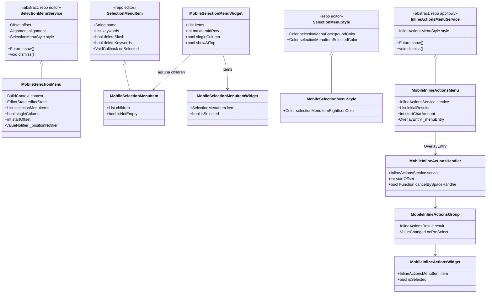
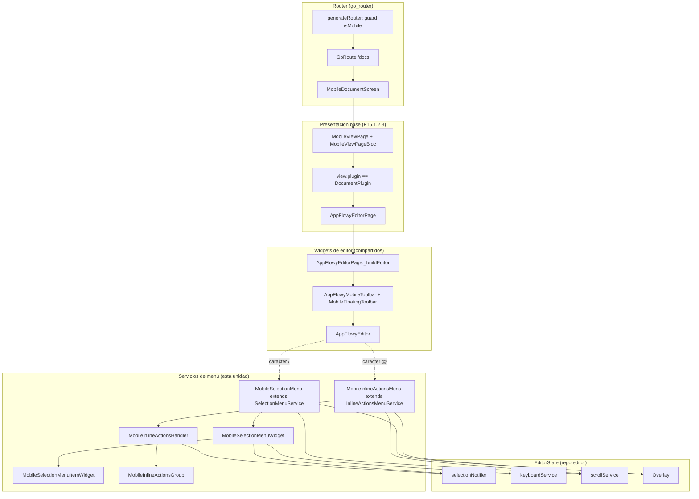
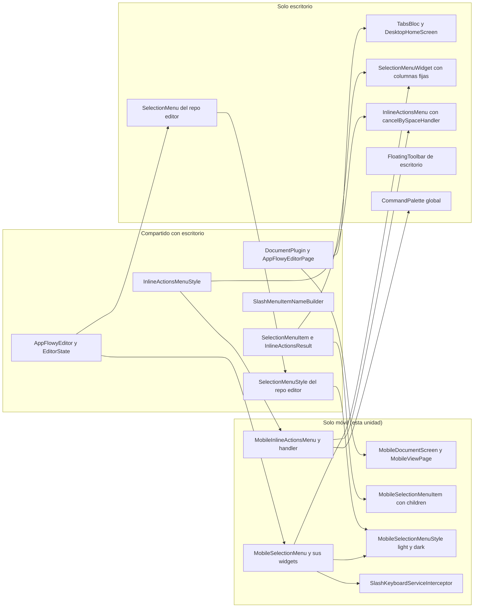
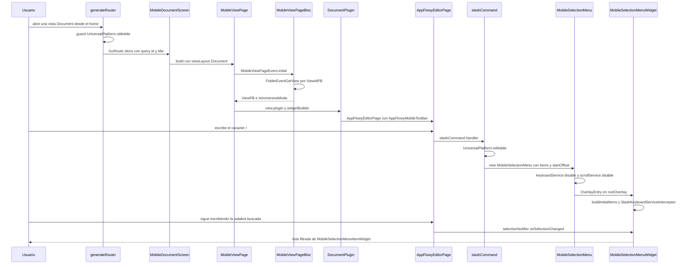
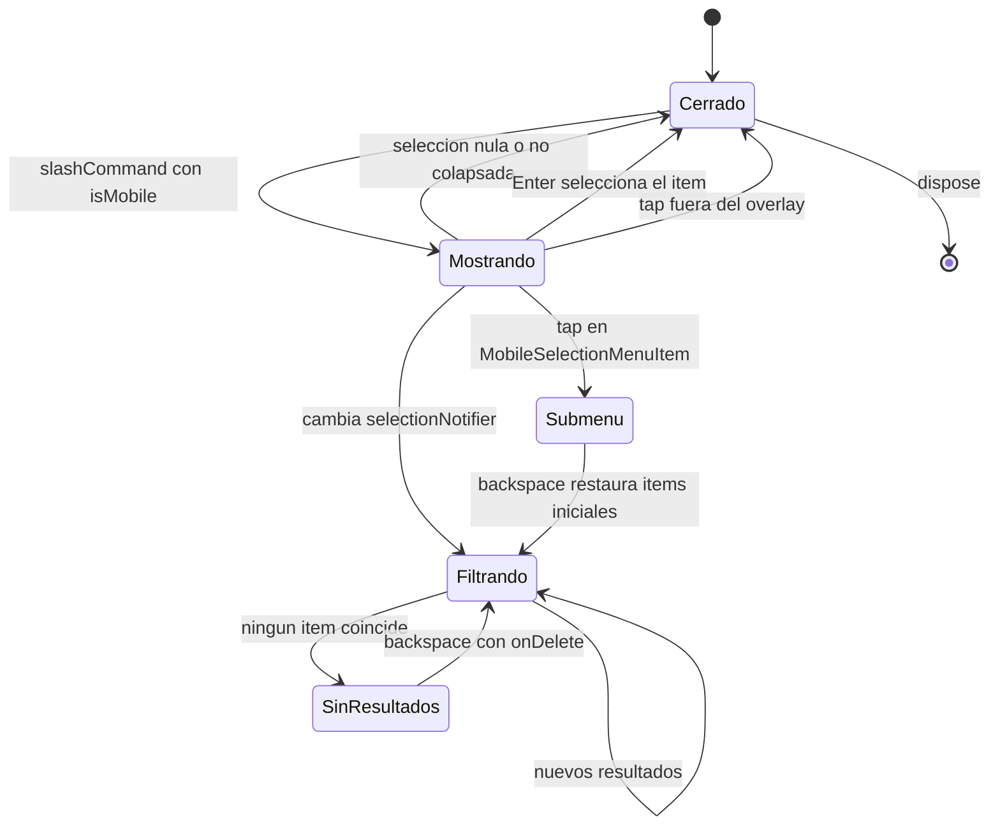

# F16.1.2.2 — Mobile presentation: documento, editor, selection menu e inline actions

## 1. Resumen

Esta unidad cubre los nueve ficheros de presentación móvil del documento en `appflowy/frontend/appflowy_flutter/lib/mobile/presentation/`: la pantalla `MobileDocumentScreen`, el menú de slash (`MobileSelectionMenu`, su widget de cuerpo `MobileSelectionMenuWidget`, su fila `MobileSelectionMenuItemWidget` y el ítem con submenú `MobileSelectionMenuItem`), el interceptor de teclado del menú y el menú de acciones en línea (`MobileInlineActionsMenu`, `MobileInlineActionsHandler`, `MobileInlineActionsGroup`). Ninguno de los nueve declara un BLoC, emite un evento FFI ni escucha una notificación de Rust: son widgets puros que se apoyan en el `EditorState` del editor y en el `BuildContext`. La página móvil no es una variante del editor de escritorio: es un `StatelessWidget` de 45 líneas que se limita a delegar en `MobileViewPage` con `viewLayout: ViewLayoutPB.Document`, mientras que el contenido real (el `DocumentPlugin` y el `AppFlowyEditorPage`) es **compartido con escritorio**. La diferenciación ocurre por una única guarda, `UniversalPlatform.isMobile`, que se evalúa en el registro de rutas, en la construcción de los ítems del slash menu y en la elección entre los dos servicios de menú.

## 2. Alcance

**Incluye** los nueve ficheros de `archivos_cubiertos`, leídos íntegros (1.492 líneas en total: 45 + 253 + 151 + 152 + 296 + 18 + 138 + 397 + 42), más las lecturas de solo lectura necesarias para sostener las afirmaciones de plataforma y de integración: el registro de rutas `appflowy/frontend/appflowy_flutter/lib/startup/tasks/generate_router.dart`, la extensión de navegación `appflowy/frontend/appflowy_flutter/lib/mobile/application/mobile_router.dart`, la página base `appflowy/frontend/appflowy_flutter/lib/mobile/presentation/base/mobile_view_page.dart`, el `AppFlowyEditorPage` en `appflowy/frontend/appflowy_flutter/lib/plugins/document/presentation/editor_page.dart`, los tres puntos donde se decide móvil/escritorio (`slash_command.dart`, `inline_actions_command.dart`, `page_reference_commands.dart`), la tabla de ítems `slash_menu_items_builder.dart` y `slash_menu_items/mobile_items.dart`, y las bases del editor en el repo `editor` (`SelectionMenuService`, `SelectionMenuItem`, `keyboard_service.dart`).

**Corrección de scope declarada.** Los directorios `appflowy/frontend/appflowy_flutter/lib/plugins/document/presentation/editor_plugins/mobile_toolbar_v3/` y `appflowy/frontend/appflowy_flutter/lib/plugins/document/presentation/editor_plugins/mobile_floating_toolbar/` **no pertenecen a F16**: están asignados y ya verificados en `F01.6.4` ("Toolbars desktop, mobile, items y link"). Esta unidad no los documenta ni los duplica, y por eso la unidad `F16.2` ("Mobile: `editor_plugins/mobile_*`") queda como marcador de alcance vacío. En este documento solo se los cita donde el editor compartido los selecciona (`appflowy/frontend/appflowy_flutter/lib/plugins/document/presentation/editor_page.dart:414–419`), como punto de contraste.

**Queda fuera y se referencia como ya documentado**: la implementación completa de `MobileViewPage`, su `MobileViewPageBloc` y el resto de la capa `application` móvil (`[[F16.1.1]]` y `[[F16.1.2.3]]`); el editor, sus plugins de escritorio y el modelo de `DocumentBloc` (`[[F01]]`, en particular `[[F01.6.1]]` para el slash menu y `[[F01.6.4]]` para las toolbars); el motor de IA que se expone como ítem del menú en línea (`[[F09.4]]`); y las bases del editor (`SelectionMenu`, `SelectionMenuItem`, `InlineActionsMenu`) que viven en el repo `editor`, no en `appflowy`.

## 3. Modelos de datos

Los nueve ficheros no definen modelos de dominio: no hay entidades protobuf, ni tablas, ni `freezed`. Definen **tipos de presentación**, y el patrón es casi siempre el mismo: o bien una subclase de una abstracción del editor a la que se le añade lo que el escritorio no necesita, o bien un widget puro que la pinta; los dos `StatefulWidget` de la unidad (`MobileSelectionMenuWidget` y `MobileInlineActionsHandler`) existen solo para sostener foco y búsqueda incremental. Hay dos excepciones cualitativas: `MobileSelectionMenuItem` añade la lista `children` (submenú de dos niveles) que `SelectionMenuItem` no tiene, y `MobileSelectionMenuStyle` añade el color de la flecha derecha; y hay una diferencia relevante por ausencias: `MobileInlineActionsMenu` **no** crea un estilo propio y reutiliza `InlineActionsMenuStyle`, que vive en el repo `appflowy` y no en el móvil.

La tabla siguiente es el inventario literal de la API pública de los nueve ficheros.

| Fichero | Símbolo público | Tipo / supertipo | API expuesta (firma) | Línea |
|---|---|---|---|---|
| `mobile/presentation/editor/mobile_editor_screen.dart` | `MobileDocumentScreen` | `StatelessWidget` | `MobileDocumentScreen({required String id, String? title, bool showMoreButton, String? fixedTitle, String? blockId, List<PickerTabType> tabs})` | `appflowy/frontend/appflowy_flutter/lib/mobile/presentation/editor/mobile_editor_screen.dart:6` |
| `mobile/presentation/editor/mobile_editor_screen.dart` | `MobileDocumentScreen.routeName` + 6 claves de query | `static const` | `routeName = '/docs'`, `viewId`, `viewTitle`, `viewShowMoreButton`, `viewFixedTitle`, `viewBlockId`, `viewSelectTabs` | `appflowy/frontend/appflowy_flutter/lib/mobile/presentation/editor/mobile_editor_screen.dart:25–31` |
| `mobile/presentation/selection_menu/mobile_selection_menu.dart` | `MobileSelectionMenu` | `SelectionMenuService` (repo `editor`) | `MobileSelectionMenu({required BuildContext context, required EditorState editorState, required List<SelectionMenuItem> selectionMenuItems, bool deleteSlashByDefault, bool deleteKeywordsByDefault, MobileSelectionMenuStyle style, int itemCountFilter, int startOffset, bool singleColumn})` | `appflowy/frontend/appflowy_flutter/lib/mobile/presentation/selection_menu/mobile_selection_menu.dart:10–21` |
| `mobile/presentation/selection_menu/mobile_selection_menu.dart` | `MobileSelectionMenu` (superficie `SelectionMenuService`) | overrides | `void dismiss()`, `Future<void> show()`, `Alignment get alignment`, `Offset get offset`, `(double? left, double? top, double? right, double? bottom) getPosition()`, `void calculateSelectionMenuOffset(Rect, Size)` | `appflowy/frontend/appflowy_flutter/lib/mobile/presentation/selection_menu/mobile_selection_menu.dart:40`, `:54`, `:176`, `:181`, `:186`, `:210` |
| `mobile/presentation/selection_menu/mobile_selection_menu.dart` | `_Position` | `class` privada | `_Position(left, top, right, bottom)` con `operator ==` y `hashCode` | `appflowy/frontend/appflowy_flutter/lib/mobile/presentation/selection_menu/mobile_selection_menu.dart:273–296` |
| `mobile/presentation/selection_menu/mobile_selection_menu_item.dart` | `MobileSelectionMenuItem` | `SelectionMenuItem` (repo `editor`) | `MobileSelectionMenuItem({required getName, required icon, keywords, required handler, List<SelectionMenuItem> children, nameBuilder, deleteKeywords, deleteSlash})` · `List<SelectionMenuItem> get children` · `bool get isNotEmpty` | `appflowy/frontend/appflowy_flutter/lib/mobile/presentation/selection_menu/mobile_selection_menu_item.dart:3–17` |
| `mobile/presentation/selection_menu/mobile_selection_menu_item_widget.dart` | `MobileSelectionMenuItemWidget` | `StatelessWidget` | `MobileSelectionMenuItemWidget({required EditorState editorState, required SelectionMenuService menuService, required SelectionMenuItem item, required bool isSelected, required MobileSelectionMenuStyle selectionMenuStyle, required VoidCallback onTap})` | `appflowy/frontend/appflowy_flutter/lib/mobile/presentation/selection_menu/mobile_selection_menu_item_widget.dart:6` |
| `mobile/presentation/selection_menu/mobile_selection_menu_item_widget.dart` | `MobileSelectionMenuStyle` | `SelectionMenuStyle` (repo `editor`) | 15 `super.` obligatorios + `final Color selectionMenuItemRightIconColor` · constantes `MobileSelectionMenuStyle.light` y `.dark` | `appflowy/frontend/appflowy_flutter/lib/mobile/presentation/selection_menu/mobile_selection_menu_item_widget.dart:79–99`, `:101`, `:120` |
| `mobile/presentation/selection_menu/mobile_selection_menu_widget.dart` | `MobileSelectionMenuWidget` | `StatefulWidget` | 13 parámetros: `items`, `itemCountFilter`, `maxItemInRow`, `menuService`, `editorState`, `onExit`, `selectionMenuStyle`, `deleteSlashByDefault`, `singleColumn`, `startOffset`, `showAtTop`, `nameBuilder`, `key` | `appflowy/frontend/appflowy_flutter/lib/mobile/presentation/selection_menu/mobile_selection_menu_widget.dart:13–28` |
| `mobile/presentation/selection_menu/mobile_selection_menu_widget.dart` | `_MobileSelectionMenuWidgetState` (superficie) | `State` | `List<SelectionMenuItem> get filterItems` · `set keyword(String)` · `void onSelectionChanged()` · `Widget _buildResultsWidget(...)` · `void refreshSelectedIndex()` · `Widget _buildNoResultsWidget(BuildContext)` · `List<SelectionMenuItem> buildInitialItems()` · `bool isInitialItems()` | `appflowy/frontend/appflowy_flutter/lib/mobile/presentation/selection_menu/mobile_selection_menu_widget.dart:72`, `:86`, `:213`, `:235`, `:324`, `:331`, `:368`, `:387` |
| `mobile/presentation/selection_menu/slash_keyboard_service_interceptor.dart` | `SlashKeyboardServiceInterceptor` | `EditorKeyboardInterceptor` (repo `appflowy`) | `SlashKeyboardServiceInterceptor({required AsyncValueGetter<bool> onDelete, required VoidCallback onEnter})` · `Future<bool> interceptDelete(...)` · `Future<bool> interceptInsert(...)` | `appflowy/frontend/appflowy_flutter/lib/mobile/presentation/selection_menu/slash_keyboard_service_interceptor.dart:6–13`, `:16`, `:28` |
| `mobile/presentation/inline_actions/mobile_inline_actions_menu.dart` | `MobileInlineActionsMenu` | `InlineActionsMenuService` (repo `appflowy`) | `MobileInlineActionsMenu({required BuildContext context, required EditorState editorState, required List<InlineActionsResult> initialResults, required InlineActionsMenuStyle style, required InlineActionsService service, int startCharAmount, bool Function()? cancelBySpaceHandler})` · `void dismiss()` · `Future<void> show()` | `appflowy/frontend/appflowy_flutter/lib/mobile/presentation/inline_actions/mobile_inline_actions_menu.dart:11–20`, `:35`, `:46` |
| `mobile/presentation/inline_actions/mobile_inline_actions_menu.dart` | `_getPosition` (privado) | método | `(double? left, double? top, double? right, double? bottom) _getPosition(Alignment, Offset)` | `appflowy/frontend/appflowy_flutter/lib/mobile/presentation/inline_actions/mobile_inline_actions_menu.dart:125` |
| `mobile/presentation/inline_actions/mobile_inline_actions_handler.dart` | `MobileInlineActionsHandler` | `StatefulWidget` | `MobileInlineActionsHandler({required results, required editorState, required menuService, required onDismiss, required style, required service, int startCharAmount, bool Function()? cancelBySpaceHandler, int startOffset})` | `appflowy/frontend/appflowy_flutter/lib/mobile/presentation/inline_actions/mobile_inline_actions_handler.dart:45–57` |
| `mobile/presentation/inline_actions/mobile_inline_actions_handler.dart` | `_StartWithsSort` (extensión) | `extension on List<InlineActionsResult>` | `void sortByStartsWithKeyword(String search)` | `appflowy/frontend/appflowy_flutter/lib/mobile/presentation/inline_actions/mobile_inline_actions_handler.dart:15–41` |
| `mobile/presentation/inline_actions/mobile_inline_actions_handler.dart` | `_MobileInlineActionsHandlerState` (superficie) | `State` | `Future<void> _doSearch()`, `void onSelectionChanged()`, `bool get noResults`, `int get groupLength`, `int lengthOfGroup(int)`, `InlineActionsMenuItem handlerOf(int, int)` | `appflowy/frontend/appflowy_flutter/lib/mobile/presentation/inline_actions/mobile_inline_actions_handler.dart:90`, `:232`, `:217`, `:220`, `:222`, `:225` |
| `mobile/presentation/inline_actions/mobile_inline_actions_menu_group.dart` | `MobileInlineActionsGroup` | `StatelessWidget` | 11 parámetros: `result`, `editorState`, `menuService`, `style`, `onSelected`, `startOffset`, `endOffset`, `onPreSelect`, `isLastGroup`, `isGroupSelected`, `selectedIndex` | `appflowy/frontend/appflowy_flutter/lib/mobile/presentation/inline_actions/mobile_inline_actions_menu_group.dart:9–23` |
| `mobile/presentation/inline_actions/mobile_inline_actions_menu_group.dart` | `MobileInlineActionsWidget` | `StatelessWidget` | `MobileInlineActionsWidget({required item, editorState, menuService, isSelected, style, onSelected, startOffset, endOffset})` | `appflowy/frontend/appflowy_flutter/lib/mobile/presentation/inline_actions/mobile_inline_actions_menu_group.dart:81–92` |

Muestra: las jerarquías de tipos de los dos menús, con el punto exacto en el que cada uno se separa de la base del editor.

Lectura: la única diferencia de modelo entre móvil y escritorio es que `MobileSelectionMenuItem` gana `children` y que `MobileSelectionMenuStyle` gana un color; todo lo demás es herencia pura. `MobileSelectionMenu` y `MobileInlineActionsMenu` son las dos implementaciones reales de las abstracciones que el editor consume, de modo que sustituir una por otra no requiere tocar ningún llamador del editor, solo la construcción del widget. `MobileInlineActionsMenu` no tiene subclase de estilo propia: reutiliza `InlineActionsMenuStyle`, definido en `appflowy/frontend/appflowy_flutter/lib/plugins/inline_actions/inline_actions_menu.dart:213`, lo que significa que el menú móvil de `@` se pinta con exactamente los mismos colores que el de escritorio.

## 4. Eventos FFI

**Ninguno de los nueve ficheros emite ni consume un evento FFI.** Se comprobó que no contienen llamadas `.send()` ni imports de `appflowy_backend/protobuf` con payloads de evento: el único fichero que importa un `.pb.dart` es `appflowy/frontend/appflowy_flutter/lib/mobile/presentation/editor/mobile_editor_screen.dart:3`, y lo hace para el enum `ViewLayoutPB.Document`, que es un discriminante de layout, no un evento. La capa de presentación móvil del documento es, por construcción, un consumidor pasivo del `EditorState`.

El único evento FFI del camino que lleva a esta capa es el que carga la vista antes de que exista ningún widget de la unidad, y lo emite el `MobileViewPageBloc` (documentado en `[[F16.1.1]]`).

| Evento | Input PB | Output PB | Handler Rust | Declarado / disparado en |
|---|---|---|---|---|
| `FolderEvent::GetView` (índice 11) | `ViewIdPB` | `ViewPB` | `get_view_handler`, `appflowy/frontend/rust-lib/flowy-folder/src/event_handler.rs:110`, registrado en `appflowy/frontend/rust-lib/flowy-folder/src/event_map.rs:19` | disparado en Dart en `appflowy/frontend/appflowy_flutter/lib/workspace/application/view/view_service.dart:275` (`FolderEventGetView(payload).send()`), consumido por `appflowy/frontend/appflowy_flutter/lib/mobile/application/base/mobile_view_page_bloc.dart:29` |

Ese `ViewPB` es lo que permite que `MobileViewPage` decida entre barra inmersiva y barra normal y qué plugin instanciar (`appflowy/frontend/appflowy_flutter/lib/mobile/presentation/base/mobile_view_page.dart:160` y `:212`). El resto de eventos del documento —apertura del collab, transacciones del editor, subida de ficheros— pertenece a `DocumentBloc`, `DocumentService` y el `EditorTransactionAdapter`, documentados en `[[F01]]`.

## 5. Notificaciones

**Ninguno de los nueve ficheros se suscribe a `RustStreamReceiver` ni declara un `*Listener`.** La única suscripción a un flujo que aparece en la unidad es a `editorState.selectionNotifier`, que es un `ValueNotifier` local del editor y no el canal de notificaciones Rust→Dart.

| Notificación | Emisor (Rust) | Listener Dart | Efecto UI en esta unidad | Evidencia |
|---|---|---|---|---|
| `FolderNotification::DidUpdateView` (índice 10) | `appflowy/frontend/rust-lib/flowy-folder/src/notification.rs:22` | `ViewListener`, en `appflowy/frontend/appflowy_flutter/lib/workspace/application/view/view_listener.dart:72` | ninguno directo: llega al `MobileViewPageBloc`, que reevalúa `isImmersiveMode` y redibuja la barra de la página móvil; los widgets de menú solo se redibujan si esa barra cambia de tamaño | `appflowy/frontend/appflowy_flutter/lib/mobile/application/base/mobile_view_page_bloc.dart:63–67` |
| `editorState.selectionNotifier` (no es notificación Rust) | `EditorState` del repo `editor` | `_MobileSelectionMenuWidgetState.onSelectionChanged` | recalcula el `keyword` de búsqueda del slash menu, o llama a `onExit()` si la selección es nula, no colapsada o se mueve hacia atrás | `appflowy/frontend/appflowy_flutter/lib/mobile/presentation/selection_menu/mobile_selection_menu_widget.dart:163`, `:213–233` |
| `editorState.selectionNotifier` (no es notificación Rust) | `EditorState` del repo `editor` | `_MobileInlineActionsHandlerState.onSelectionChanged` | recalcula la búsqueda del menú `@`, o `menuService.dismiss()` si la selección se pierde o deja de estar colapsada | `appflowy/frontend/appflowy_flutter/lib/mobile/presentation/inline_actions/mobile_inline_actions_handler.dart:136`, `:232–252` |

Ambas suscripciones son simétricas y se retiran en `dispose()` (`appflowy/frontend/appflowy_flutter/lib/mobile/presentation/selection_menu/mobile_selection_menu_widget.dart:170`, `appflowy/frontend/appflowy_flutter/lib/mobile/presentation/inline_actions/mobile_inline_actions_handler.dart:141`), lo que evita fugas cuando el overlay se cierra antes de tiempo.

## 6. BLoCs / Cubits

**Ninguno de los nueve ficheros declara un BLoC ni un Cubit.** Se verificó que no aparece ninguna definición `extends Bloc<…>` ni `with _$…` en el conjunto. Los BLoC que gobiernan esta capa se crean **por encima**, en `MobileViewPage`, y se inyectan por contexto.

| Clase | Eventos | Estados | Servicios | Dónde se crea | Evidencia |
|---|---|---|---|---|---|
| `MobileViewPageBloc` | `Initial`, `UpdateImmersionMode(bool)` | `isLoading`, `result: FlowyResult<ViewPB, FlowyError>`, `isImmersiveMode`, `userProfilePB` | `ViewBackendService.getView`, `UserBackendService.getCurrentUserProfile`, `ViewListener` | `MobileViewPage.build` con `BlocProvider(create:)` | `appflowy/frontend/appflowy_flutter/lib/mobile/presentation/base/mobile_view_page.dart:89–92`; BLoC en `appflowy/frontend/appflowy_flutter/lib/mobile/application/base/mobile_view_page_bloc.dart:14`, `:90–106` |
| `ViewBloc`, `ShareBloc`, `FavoriteBloc`, `DocumentPageStyleBloc`, `PageAccessLevelBloc`, `UserWorkspaceBloc` | — | — | — | `MultiBlocProvider` de `MobileViewPage.build`, condicionados a `view.layout.isDocumentView` | `appflowy/frontend/appflowy_flutter/lib/mobile/presentation/base/mobile_view_page.dart:105–140` |
| `DocumentBloc` | — | — | — | lo provee `DocumentPlugin` (`appflowy/frontend/appflowy_flutter/lib/plugins/document/document.dart:52`) al construir el árbol del editor | `appflowy/frontend/appflowy_flutter/lib/workspace/application/view/view_ext.dart:115–127` |

La consecuencia práctica es que los widgets de menú son **agnósticos al estado**: reciben el `EditorState` ya construido y no leen ningún bloc. Los dos únicos sitios donde tocan estado global son `keepEditorFocusNotifier` (contador compartido con el `KeyboardService`, `appflowy/frontend/appflowy_flutter/lib/mobile/presentation/selection_menu/mobile_selection_menu_widget.dart:129` y `:172`, `appflowy/frontend/appflowy_flutter/lib/mobile/presentation/inline_actions/mobile_inline_actions_handler.dart:135` y `:143`) y la lectura de `DocumentPageStyleBloc` que hace el propio editor para el padding, fuera de esta unidad (`appflowy/frontend/appflowy_flutter/lib/plugins/document/presentation/editor_configuration.dart:110–131`).

## 7. Servicios e inyección de dependencias

No hay `getIt` en ninguno de los nueve ficheros: la resolución de dependencias ocurre exclusivamente en `MobileViewPage`, que es quien crea los BLoCs de la página y además obtiene el `ReminderBloc` del inyector (`appflowy/frontend/appflowy_flutter/lib/mobile/presentation/base/mobile_view_page.dart:77` y `:117–120`). Lo que esta unidad consume son cuatro servicios del `EditorState`:

| Servicio | Origen | Uso en esta unidad | Evidencia |
|---|---|---|---|
| `editorState.service.keyboardService` | `appflowy-editor`, `EditorComponentService` | se **deshabilita** al abrir el overlay (`disable(showCursor: true)`) y se **rehabilita** al cerrarlo; además recibe el `SlashKeyboardServiceInterceptor` | `appflowy/frontend/appflowy_flutter/lib/mobile/presentation/selection_menu/mobile_selection_menu.dart:143` y `:43`; `appflowy/frontend/appflowy_flutter/lib/mobile/presentation/inline_actions/mobile_inline_actions_menu.dart:121` y `:38`; `appflowy/frontend/appflowy_flutter/lib/mobile/presentation/selection_menu/mobile_selection_menu_widget.dart:161–162` y `:168–169` |
| `editorState.service.scrollService` | `appflowy-editor` | se deshabilita al abrir el overlay para que el scroll del editor no mueva la posición del menú, y se rehabilita al cerrar | `appflowy/frontend/appflowy_flutter/lib/mobile/presentation/selection_menu/mobile_selection_menu.dart:144` y `:44`; `appflowy/frontend/appflowy_flutter/lib/mobile/presentation/inline_actions/mobile_inline_actions_menu.dart:122` y `:39` |
| `editorState.service.keyboardService.registerInterceptor` | `editor:lib/src/editor/editor_component/service/keyboard_service.dart:53` | registra `SlashKeyboardServiceInterceptor` para traducir `Enter` en "seleccionar ítem" y `Backspace` en "volver al nivel anterior" | `appflowy/frontend/appflowy_flutter/lib/mobile/presentation/selection_menu/mobile_selection_menu_widget.dart:161–162`; API en `editor:lib/src/editor/editor_component/service/keyboard_service.dart:53` y `:56` |
| `keepEditorFocusNotifier` | `appflowy-editor` (`editor:lib/src/editor/editor_component/service/editor.dart`) | contador `increase()`/`decrease()` que impide que el `KeyboardService` robe el foco mientras el overlay tiene el foco | `appflowy/frontend/appflowy_flutter/lib/mobile/presentation/selection_menu/mobile_selection_menu_widget.dart:129` y `:172`; `appflowy/frontend/appflowy_flutter/lib/mobile/presentation/inline_actions/mobile_inline_actions_handler.dart:135` y `:143` |

El único servicio global que decide plataforma es `get_it` en `appflowy/frontend/appflowy_flutter/lib/startup/deps_resolver.dart:93`, donde la apariencia se resuelve con `UniversalPlatform.isMobile ? MobileAppearance() : DesktopAppearance()`. Los widgets de esta unidad heredan por tanto la apariencia sin consultar la plataforma ellos mismos.

## 8. Persistencia

**Ninguno de los nueve ficheros toca persistencia.** No hay `sqlite`, ni `kv`, ni lectura de snapshots, ni escrituras de ficheros; la única manipulación del árbol de widgets es la inserción de un `OverlayEntry`, que es efímero por construcción. El estado que estos widgets muestran —el texto del nodo bajo el cursor y la lista de resultados— sale de `editorState.getNodeAtPath(...).delta?.toPlainText()` (`appflowy/frontend/appflowy_flutter/lib/mobile/presentation/selection_menu/mobile_selection_menu_widget.dart:229–231`, `appflowy/frontend/appflowy_flutter/lib/mobile/presentation/inline_actions/mobile_inline_actions_handler.dart:248–250`), es decir, del documento `yrs` en memoria.

La persistencia real ocurre dos niveles por debajo: el `DocumentPlugin` abre el collab a través de `DocumentBloc`/`DocumentService` y las escrituras viajan como transacciones del `EditorState` al `EditorTransactionAdapter`, que las traduce a acciones de bloque y las envía a Rust (`[[F01]]`). Las unidades de esta capa no tienen, por tanto, ninguna tabla que documentar en `cobertura.csv` más allá de su capa `ui`.

## 9. Diagramas de flujo

Muestra: el camino completo desde el tap en una tarjeta del home móvil hasta el menú de slash abierto sobre el editor, con las capas de presentación, navegación, aplicación y editor.

Lectura: la parte superior del diagrama es toda navegación y está compartida con el resto de vistas móviles; el cambio de plataforma ocurre una sola vez, en `appflowy/frontend/appflowy_flutter/lib/startup/tasks/generate_router.dart:62`, y a partir de ahí larama `DocumentPlugin` es idéntica a la de escritorio. La diferenciación real de la UI está en la banda inferior: dos servicios de menú distintos, pero el mismo `EditorState` alimentándolos. Nótese que el slash menu móvil y el de escritorio cuelgan del mismo `EditorState.selectionNotifier`, de modo que la diferencia es puramente de presentación y de posicionamiento del overlay.

Muestra: qué componente de escritorio se reutiliza, qué componente se sustituye y qué comportamiento se pierde en cada decisión `UniversalPlatform.isMobile`.

Lectura: el editor y sus plugins de bloque se reutilizan íntegros; lo único que se duplica es la capa de *overlay* de menú. El lado derecho del diagrama resume lo que móvil **no** tiene: barra flotante de escritorio, paleta de comandos y `SelectionMenu`/`InlineActionsMenu` del repo `appflowy`/`editor`. Dos asimetrías merecen atención: el menú móvil de acciones en línea **hereda** el estilo del de escritorio (flecha `B4 → M6`) pero **pierde** su capacidad de cancelar con la barra espaciadora (`D4 → M6` sin flecha de vuelta, porque `cancelBySpaceHandler` se recibe y se almacena en `appflowy/frontend/appflowy_flutter/lib/mobile/presentation/inline_actions/mobile_inline_actions_handler.dart:66` pero nunca se invoca, frente al uso real en `appflowy/frontend/appflowy_flutter/lib/plugins/inline_actions/widgets/inline_actions_handler.dart:294–295`); y el menú de slash móvil conserva `SlashMenuItemNameBuilder` del que solo cambia el tamaño de fuente según plataforma (`appflowy/frontend/appflowy_flutter/lib/plugins/document/presentation/editor_plugins/slash_menu/slash_menu_items/slash_menu_item_builder.dart:53–57`).

## 10. Diagramas de secuencia

Muestra: la apertura de un documento en el móvil, desde la construcción de la ruta hasta el primer `build` del overlay del slash menu cuando el usuario escribe `/`.

Lectura: la única línea que decide móvil/escritorio en este flujo es la consulta a `UniversalPlatform.isMobile` dentro del handler del slash, y ocurre **después** de que el editor ya está montado. Eso significa que el mismo `AppFlowyEditorPage` sirve para ambas plataformas y que solo el overlay cambia; la posición inicial del menú se captura en ese momento como `editorState.selection?.start.offset ?? 0` (`appflowy/frontend/appflowy_flutter/lib/plugins/document/presentation/editor_plugins/slash_menu/slash_command.dart:111`), y a partir de ahí la búsqueda se recalcula comparando offsets de selección en cada pulsación.

## 11. Diagramas de estado

Muestra: el ciclo de vida del menú de slash móvil y las condiciones exactas que lo cierran, extraídas de `onSelectionChanged` y de `dispose`.

Lectura: el menú no se cierra nunca por "tiempo transcurrido", solo por disparadores explícitos —selección nula o no colapsada, retroceso del cursor, longitud excesiva de la palabra clave, `Enter` y toque fuera— (`appflowy/frontend/appflowy_flutter/lib/mobile/presentation/selection_menu/mobile_selection_menu_widget.dart:215–228`, `appflowy/frontend/appflowy_flutter/lib/mobile/presentation/selection_menu/mobile_selection_menu_widget.dart:109–112`, `appflowy/frontend/appflowy_flutter/lib/mobile/presentation/selection_menu/slash_keyboard_service_interceptor.dart:34–37` y el `onTap: dismiss` del `GestureDetector` en `appflowy/frontend/appflowy_flutter/lib/mobile/presentation/selection_menu/mobile_selection_menu.dart:81`), lo que evita el clásico problema de cerrar el menú mientras el usuario escribe. El estado `Submenu` es exclusivo del móvil: se alcanza porque `MobileSelectionMenuItem` tiene `children` y `buildInitialItems()` reescribe `onSelected` para sustituir la lista mostrada (`appflowy/frontend/appflowy_flutter/lib/mobile/presentation/selection_menu/mobile_selection_menu_widget.dart:368–385`); el `Backspace` en ese estado es el que dispara `onDelete` y restaura la lista inicial (`appflowy/frontend/appflowy_flutter/lib/mobile/presentation/selection_menu/mobile_selection_menu_widget.dart:135–144`).

## 12. Archivos cubiertos (del ledger)

| # | Fuente | Ruta | Capa | LOC | Rol |
|---|---|---|---|---|---|
| 1 | appflowy | `appflowy/frontend/appflowy_flutter/lib/mobile/presentation/editor/mobile_editor_screen.dart` | ui | 45 | Pantalla `MobileDocumentScreen`: ruta `/docs`, claves de query y delegación a `MobileViewPage`. |
| 2 | appflowy | `appflowy/frontend/appflowy_flutter/lib/mobile/presentation/inline_actions/mobile_inline_actions_handler.dart` | ui | 253 | Estado del overlay de `@`: foco, búsqueda incremental, límite de 10 búsquedas inválidas y orden por prefijo. |
| 3 | appflowy | `appflowy/frontend/appflowy_flutter/lib/mobile/presentation/inline_actions/mobile_inline_actions_menu.dart` | ui | 151 | `MobileInlineActionsMenu`: servicio de menú en línea, posicionamiento del `OverlayEntry` y bloqueo de teclado/scroll. |
| 4 | appflowy | `appflowy/frontend/appflowy_flutter/lib/mobile/presentation/inline_actions/mobile_inline_actions_menu_group.dart` | ui | 152 | `MobileInlineActionsGroup` (título de grupo) y `MobileInlineActionsWidget` (fila pulsable). |
| 5 | appflowy | `appflowy/frontend/appflowy_flutter/lib/mobile/presentation/selection_menu/mobile_selection_menu.dart` | ui | 296 | `MobileSelectionMenu`: servicio del slash menu, cálculo de posición con volteo vertical/horizontal y listener de scroll. |
| 6 | appflowy | `appflowy/frontend/appflowy_flutter/lib/mobile/presentation/selection_menu/mobile_selection_menu_item.dart` | ui | 18 | `MobileSelectionMenuItem`: ítem con `children` (submenú de segundo nivel). |
| 7 | appflowy | `appflowy/frontend/appflowy_flutter/lib/mobile/presentation/selection_menu/mobile_selection_menu_item_widget.dart` | ui | 138 | Fila del menú (`MobileSelectionMenuItemWidget`) y `MobileSelectionMenuStyle` con sus dos paletas. |
| 8 | appflowy | `appflowy/frontend/appflowy_flutter/lib/mobile/presentation/selection_menu/mobile_selection_menu_widget.dart` | ui | 397 | Cuerpo del menú: filtrado por palabra clave, submenús, estado de "sin resultados" e interceptor de teclado. |
| 9 | appflowy | `appflowy/frontend/appflowy_flutter/lib/mobile/presentation/selection_menu/slash_keyboard_service_interceptor.dart` | ui | 42 | `SlashKeyboardServiceInterceptor`: traduce `Backspace` (subir nivel) y `\n` (seleccionar) en acciones del menú. |

## 13. Riesgos y casos límite

- **`MobileDocumentScreen` no distingue plataformas por sí misma**: se registra bajo el guard `if (UniversalPlatform.isMobile)` en `appflowy/frontend/appflowy_flutter/lib/startup/tasks/generate_router.dart:62`, pero el widget se puede instanciar desde cualquier `BuildContext`. Si algún día se referencia desde una ruta compartida, la página se renderizaría en escritorio con barra inmersiva y sin `SafeArea`.
- **Posicionamiento hardcodeado a 192 px**: tanto el menú de slash (`appflowy/frontend/appflowy_flutter/lib/mobile/presentation/selection_menu/mobile_selection_menu.dart:214`) como el de acciones en línea (`appflowy/frontend/appflowy_flutter/lib/mobile/presentation/inline_actions/mobile_inline_actions_menu.dart:62`) asumen 192 px de alto. Con tipografía de usuario muy grande (`textScaleFactor` configurable en `appflowy/frontend/appflowy_flutter/lib/startup/tasks/app_widget.dart:262–263`) la lista se recorta, porque el contenedor impose `maxHeight: 192` y `SizedBox(height: 192)`.
- **Desajuste de offsets al buscar**: `MobileSelectionMenuWidget` calcula `search` como `text.substring(startOffset, endOffset)` sin validar que `endOffset` no exceda la longitud del delta (`appflowy/frontend/appflowy_flutter/lib/mobile/presentation/selection_menu/mobile_selection_menu_widget.dart:229–231`); el mismo patrón aparece en `appflowy/frontend/appflowy_flutter/lib/mobile/presentation/inline_actions/mobile_inline_actions_handler.dart:248–250`. Si el nodo cambia de tipo mientras se escribe, `substring` puede lanzar `RangeError`.
- **`cancelBySpaceHandler` muerto en móvil**: el parámetro se declara y se propaga (`appflowy/frontend/appflowy_flutter/lib/mobile/presentation/inline_actions/mobile_inline_actions_menu.dart:25` → `:109` → `appflowy/frontend/appflowy_flutter/lib/mobile/presentation/inline_actions/mobile_inline_actions_handler.dart:66`) pero ningún método del `State` lo invoca, así que la protección contra un espacio que cancela el menú `[[` de `appflowy/frontend/appflowy_flutter/lib/plugins/document/presentation/editor_plugins/base/page_reference_commands.dart:133` no está activa en móvil. Es una regresión funcional silenciosa respecto al escritorio.
- **El interceptor de teclado puede quedar registrado**: `registerInterceptor` ocurre en `initState` (`appflowy/frontend/appflowy_flutter/lib/mobile/presentation/selection_menu/mobile_selection_menu_widget.dart:161–162`) y el `unregisterInterceptor` en `dispose` (`:168–169`). Si el overlay se inserta y se elimina en el mismo frame, Flutter garantiza el `dispose`, pero cualquier ruta que reutilice el mismo `State` con un nuevo `editorState` (no ocurre hoy, porque el `OverlayEntry` se reconstruye entero en cada `show`) dejaría el interceptor apuntando al `KeyboardService` anterior.
- **Contador de foco desbalanceado**: `keepEditorFocusNotifier` se incrementa una vez por widget y se decrementa en `dispose`. `MobileInlineActionsMenu.dismiss()` no lo decrementa (a diferencia de `InlineActionsMenu.dismiss()`, que sí lo hace en `appflowy/frontend/appflowy_flutter/lib/plugins/inline_actions/inline_actions_menu.dart:41`); el equilibrio depende entonces de que `MobileInlineActionsHandler.dispose` se ejecute siempre, lo que ocurre porque `dismiss()` elimina el `OverlayEntry` (`appflowy/frontend/appflowy_flutter/lib/mobile/presentation/inline_actions/mobile_inline_actions_menu.dart:42`). Es una fragilidad: si el entry se eliminara por otra vía, el foco se quedaría retenido.
- **Menú de slash sin soporte de ventanas anidadas**: `_getCurrentPosition` aborta si `selectionRects()` está vacío (`appflowy/frontend/appflowy_flutter/lib/mobile/presentation/selection_menu/mobile_selection_menu.dart:166–169`), de modo que `_show()` retorna sin insertar el `OverlayEntry` (el menú de `@` repite exactamente la misma guarda en `appflowy/frontend/appflowy_flutter/lib/mobile/presentation/inline_actions/mobile_inline_actions_menu.dart:57–60`); el `Completer` de `show()` se completa igualmente en el callback de post-frame, así que el llamador no queda colgado, pero el menú simplemente no aparece.
- **Workaround de scroll**: `_checkPositionAfterScrolling` retrama 100 ms y compara la posición para compensar el auto-scroll del editor (`appflowy/frontend/appflowy_flutter/lib/mobile/presentation/selection_menu/mobile_selection_menu.dart:147–163`). Con scroll rápido el menú puede "parpadear" de posición una vez antes de estabilizarse; el propio comentario del código lo reconoce como parche.

## 14. Evidencias y etiquetas

Por defecto todas las afirmaciones de este documento son `[VERIFICADO]`: cada una lleva su referencia `ruta:línea` y el validador `validate_evidence.py` confirmó **101 referencias, 101 correctas, 0 errores**, contra `OUT/_ledger/inventario.json`. Sobre ese total hay **tres inferencias explícitas** y **cuatro cuestiones `[NO DETERMINADO]`**, estas últimas copiadas íntegras en §18 para que el orquestador las traslade a `OUT/22-preguntas-abiertas.md`.

Las tres inferencias se apoyan en estos puntos concretos. (a) Que la separación entre UI móvil y de escritorio sea deliberada y no accidental: se deduce de que una única función, el handler de slash, construya `MobileSelectionMenu` o `SelectionMenu` bajo la misma firma de `SelectionMenuService` (`appflowy/frontend/appflowy_flutter/lib/plugins/document/presentation/editor_plugins/slash_menu/slash_command.dart:100–118`), lo que descarta que sean dos Widgets la misma clase. (b) Que el menú móvil de `@` herede el estilo del de escritorio sin variarlo: se deduce de que `MobileInlineActionsMenu` declare `InlineActionsMenuStyle` en lugar de un tipo propio (`appflowy/frontend/appflowy_flutter/lib/mobile/presentation/inline_actions/mobile_inline_actions_menu.dart:28–29`), mientras que el slash menu sí crea `MobileSelectionMenuStyle`. (c) Que el "workaround" de scroll del menú de slash compense un defecto conocido del auto-scroll del editor: se deduce del comentario que precede al método y del uso de un temporizador de 100 ms sin más justificación (`appflowy/frontend/appflowy_flutter/lib/mobile/presentation/selection_menu/mobile_selection_menu.dart:147–163`).

Ninguna referencia apunta a un archivo ajeno a `OUT/_ledger/inventario.json`, y las dos fuentes de código usadas —`appflowy` y `editor`— están clonadas en `SRC/`. Las citas al repo `editor` llevan siempre el prefijo `editor:` y las de la app el prefijo completo `appflowy/frontend/appflowy_flutter/lib/…`, sin excepciones.

## 15. Pruebas

La cobertura de esta capa es **exclusivamente de integración sobre dispositivo móvil**, en `appflowy/frontend/appflowy_flutter/integration_test/mobile/document/`, y se ejecuta desde un `main` que las agrega todas (`appflowy/frontend/appflowy_flutter/integration_test/mobile/document/document_test_runner.dart:12–24`). No hay tests unitarios ni de widget que importen estos nueve ficheros.

| Fichero de test | Qué verifica | Evidencia |
|---|---|---|
| `slash_menu_test.dart` | que aparezca exactamente un `MobileSelectionMenuWidget`, que sus `items` coincidan con `mobileItems` del repo, que la búsqueda por palabra clave filtre el número correcto de `MobileSelectionMenuItemWidget`, y que al tocar un `MobileSelectionMenuItem` su `ListView` contenga tantos hijos como `item.children` | `appflowy/frontend/appflowy_flutter/integration_test/mobile/document/slash_menu_test.dart:17`, `:33`, `:58` |
| `at_menu_test.dart` | que aparezca un `MobileInlineActionsMenu`, que la búsqueda deje 2 `MobileInlineActionsWidget`, que al tocar uno se inserte el `MentionPageBlock`, y que el menú `[[` de subpágina no deje corchetes en el texto | `appflowy/frontend/appflowy_flutter/integration_test/mobile/document/at_menu_test.dart:15`, `:22`, `:31`, `:41` |
| `plus_menu_test.dart` | inserción de bloques de tipo toggle heading a través del menú de acciones en línea disparado con `+` | `appflowy/frontend/appflowy_flutter/integration_test/mobile/document/plus_menu_test.dart:20–38` |
| `title_test.dart`, `icon_test.dart` | que la pantalla abierta sea un `MobileDocumentScreen` y que el título y el icono se localicen correctamente | `appflowy/frontend/appflowy_flutter/integration_test/mobile/document/icon_test.dart` y `title_test.dart` |
| `toolbar_test.dart`, `page_style_test.dart`, `simple_table_test.dart` | toolbar inferior móvil y estilos de página; los últimos dos son de `F01.6.4`/`F16.1.2.3`, no de esta unidad | `appflowy/frontend/appflowy_flutter/integration_test/mobile/document/document_test_runner.dart:17–24` |

Los tests disparan los menús como lo haría el usuario, inyectando el carácter por el IME (`showSlashMenu` inserta `/`, `showAtMenu` inserta `@`, `showPlusMenu` inserta `+`; `appflowy/frontend/appflowy_flutter/integration_test/shared/document_test_operations.dart:191–203`) y `createNewDocumentOnMobile` verifica que la pantalla abierta es precisamente `MobileDocumentScreen` (`appflowy/frontend/appflowy_flutter/integration_test/shared/common_operations.dart:843–849`). **No hay ningún test que cubra `MobileInlineActionsHandler` de forma aislada, ni la ruta de "10 búsquedas inválidas" que provoca el `dismiss` con `updateSelectionWithReason`** (`appflowy/frontend/appflowy_flutter/lib/mobile/presentation/inline_actions/mobile_inline_actions_handler.dart:104–111`).

## 16. Métricas

| Métrica | Valor |
|---|---|
| Ficheros de la unidad | 9 (todos de capa `ui`, todos de la fuente `appflowy`) |
| LOC totales leídos | 1.492 |
| Ficheros por sub-área | 1 (`editor/`), 3 (`inline_actions/`), 5 (`selection_menu/`) |
| Clases públicas declaradas | 11 (`MobileDocumentScreen`, `MobileSelectionMenu`, `MobileSelectionMenuItem`, `MobileSelectionMenuItemWidget`, `MobileSelectionMenuStyle`, `MobileSelectionMenuWidget`, `SlashKeyboardServiceInterceptor`, `MobileInlineActionsMenu`, `MobileInlineActionsHandler`, `MobileInlineActionsGroup`, `MobileInlineActionsWidget`) |
| Clases privadas / `State` | 4 (`_Position`, `_MobileSelectionMenuWidgetState`, `_MobileInlineActionsHandlerState`, `_StartWithsSort`) |
| Implementaciones de abstracciones del editor | 2 (`MobileSelectionMenu` de `SelectionMenuService`; `MobileInlineActionsMenu` de `InlineActionsMenuService`) |
| Subclases de tipos del editor | 2 (`MobileSelectionMenuItem`, `MobileSelectionMenuStyle`) |
| Servicios del editor manipulados | 3 (`keyboardService`, `scrollService`, `keepEditorFocusNotifier`) |
| Puntos de decisión `UniversalPlatform.*` que afectan a esta unidad | 7 (rutas, apariencia, ítems del slash menu, slash command, inline actions command, page reference command, `AppFlowyEditorPage`) |
| Bloques Mermaid | 5 (`classDiagram` en §3, `flowchart TD` y `flowchart LR` en §9, `sequenceDiagram` en §10, `stateDiagram-v2` en §11), los cinco validados con `mmdc` |
| Referencias `ruta:línea` | 101, todas válidas contra el inventario (0 errores) |
| Inferencias explícitas `[INFERIDO]` | 3 (desarrolladas en §14) |
| Cuestiones `[NO DETERMINADO]` | 4 (todas listadas en §18) |
| Constantes de layout repetidas | 192 px en 5 literales repartidos en 4 ficheros; 240 px en 4 literales repartidos en 2 ficheros |

## 17. Pendientes

- **`cancelBySpaceHandler` no operativo en móvil**: o bien se invoca en `_MobileInlineActionsHandlerState` (por ejemplo, dentro de la rama de `interceptInsert` o de `onSelectionChanged`), o bien se elimina el parámetro de las dos clases móviles para que la firma no prometa un comportamiento inexistente. La decisión afecta a `appflowy/frontend/appflowy_flutter/lib/plugins/document/presentation/editor_plugins/base/page_reference_commands.dart:133`, que hoy compila una rama muerta en móvil.
- **Ausencia de tests unitarios**: `MobileSelectionMenuWidget.keyword` (la regla de salida por longitud de palabra clave, `appflowy/frontend/appflowy_flutter/lib/mobile/presentation/selection_menu/mobile_selection_menu_widget.dart:109–112`) y `sortByStartsWithKeyword` (`appflowy/frontend/appflowy_flutter/lib/mobile/presentation/inline_actions/mobile_inline_actions_handler.dart:15–41`) son funciones puras y serían las primeras candidatas a un `unit_test` sin necesidad de dispositivo.
- **Unificar el cálculo de posición**: `MobileSelectionMenu.calculateSelectionMenuOffset` y `MobileInlineActionsMenu._getPosition` resuelven el mismo problema con dos algoritmos distintos (uno en coordenadas de pantalla con volteo, otro en `Positioned` dentro del `Stack`). Una extracción común evitaría la divergencia de comportamiento al rotar el dispositivo.
- **Constantes de tamaño**: los literales 192 y 240 px aparecen en cuatro de los nueve ficheros de la unidad; deberían vivir en una clase de constantes compartida con `EditorStyleCustomizer` para poder reaccionar a `textScaleFactor`.

## 18. Preguntas abiertas

- `[NO DETERMINADO]` ¿Qué valor toma exactamente `UniversalPlatform.isMobile` en la variante web de AppFlowy? Ninguno de los nueve ficheros lo consulta directamente (la decisión se toma en `appflowy/frontend/appflowy_flutter/lib/plugins/document/presentation/editor_plugins/slash_menu/slash_command.dart:100`, `appflowy/frontend/appflowy_flutter/lib/plugins/inline_actions/inline_actions_command.dart:57` y `appflowy/frontend/appflowy_flutter/lib/plugins/document/presentation/editor_plugins/base/page_reference_commands.dart:117`), y la implementación de `universal_platform` es una dependencia externa no presente en `SRC/`. Pendiente de inspeccionar el paquete en `pubspec.lock`.
- `[NO DETERMINADO]` ¿Se admite alguna vez el menú de slash móvil en horizontal o en tablet? No hay ninguna rama por `MediaQuery` ni por `OrientationBuilder` en los nueve ficheros; toda la lógica de volteo asume el diseño vertical del parámetro `showAtTop` de `appflowy/frontend/appflowy_flutter/lib/mobile/presentation/selection_menu/mobile_selection_menu_widget.dart:183` y `:207`.
- `[NO DETERMINADO]` ¿Quién consume `MobileSelectionMenuStyle` además del slash menu? Solo se ha verificado `appflowy/frontend/appflowy_flutter/lib/plugins/document/presentation/editor_plugins/slash_menu/slash_command.dart:108–110`; no está claro si `bottom_sheet/` o las toolbars de `F01.6.4` reciben una instancia de este estilo.
- `[NO DETERMINADO]` ¿Existe una versión *web* de estos menús? La web pasa por la rama `else` de las tres guardas de plataforma, es decir, usa la implementación de escritorio, pero no se ha encontrado en este snapshot ninguna ruta `GoRoute` condicionada a `UniversalPlatform.isWeb` que lo confirme.

## 19. Relacionado con

- `[[F16.1.1]]` — Mobile `lib/mobile/application`: `MobileViewPageBloc`, `ViewListener` y el router móvil que produce las query params que consume `MobileDocumentScreen`.
- `[[F16.1.2.3]]` — Mobile presentation: base, database, chat, búsqueda y notificaciones; contiene `MobileViewPage`, `app_bar_buttons.dart` y `more_bottom_sheet.dart`, la página base a la que delega `MobileDocumentScreen`.
- `[[F16.2]]` — Marcador de alcance para `editor_plugins/mobile_*`; queda vacío tras la corrección de scope que asigna esas carpetas a `[[F01.6.4]]`.
- `[[F01]]` — Documentos y editor: `DocumentPlugin`, `AppFlowyEditorPage`, `EditorState`, `DocumentBloc` y los plugins de bloque que se reutilizan tal cual en móvil.
- `[[F01.6.1]]` — Slash menu y elementos: tabla de ítems de escritorio frente a `mobileItems`, y `slashCommand` que decide la implementación por plataforma.
- `[[F01.6.4]]` — Toolbars desktop y mobile: `mobile_toolbar_v3` y `mobile_floating_toolbar`, donde vive el `AppFlowyMobileToolbar` que `appflowy/frontend/appflowy_flutter/lib/plugins/document/presentation/editor_page.dart:414–419` selecciona en móvil.
- `[[F09.4]]` — IA en el editor: los ítems de `@` que el `InlineActionsService` agrega y que `MobileInlineActionsHandler` filtra y pinta.