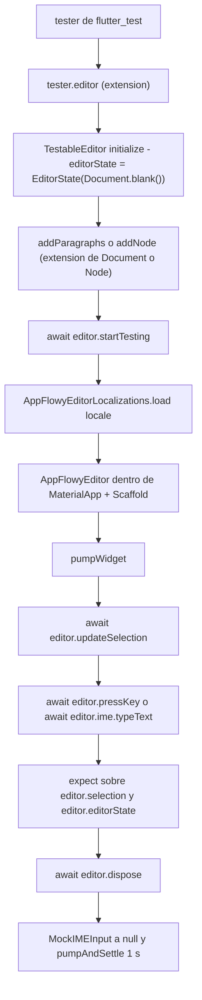
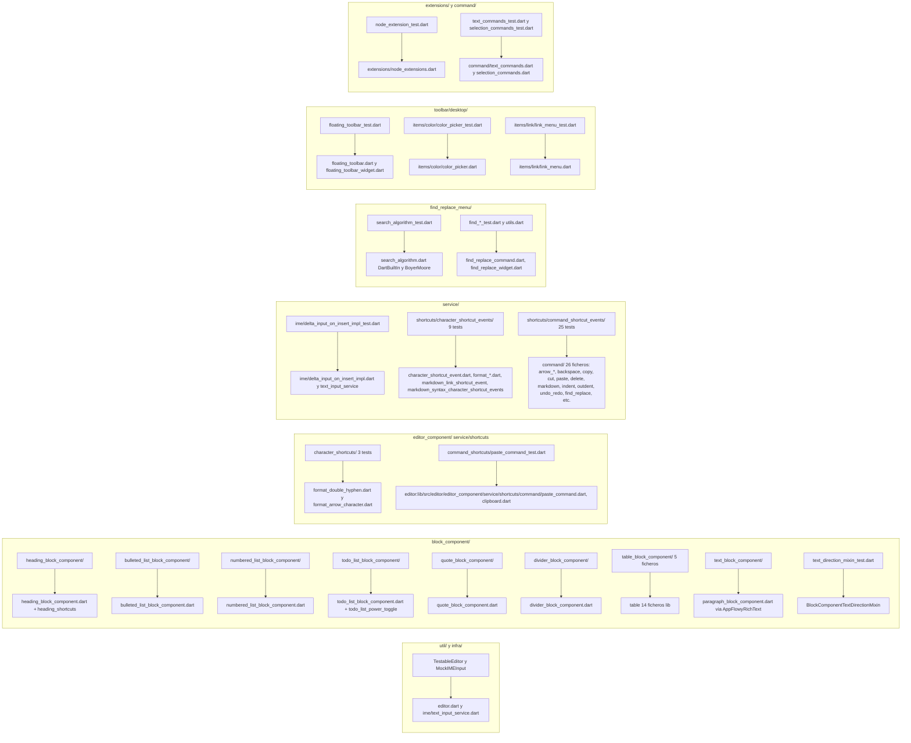
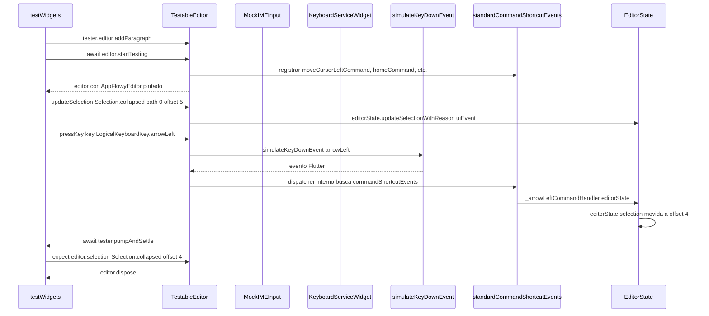
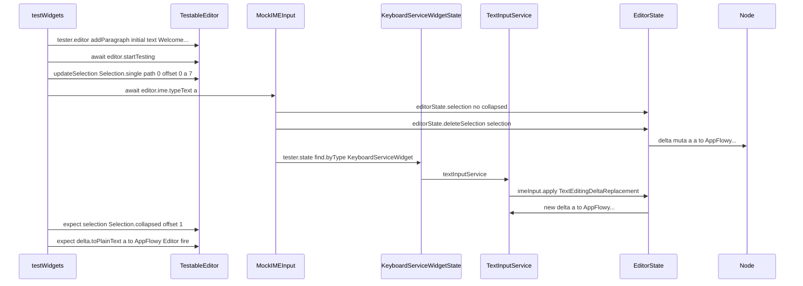
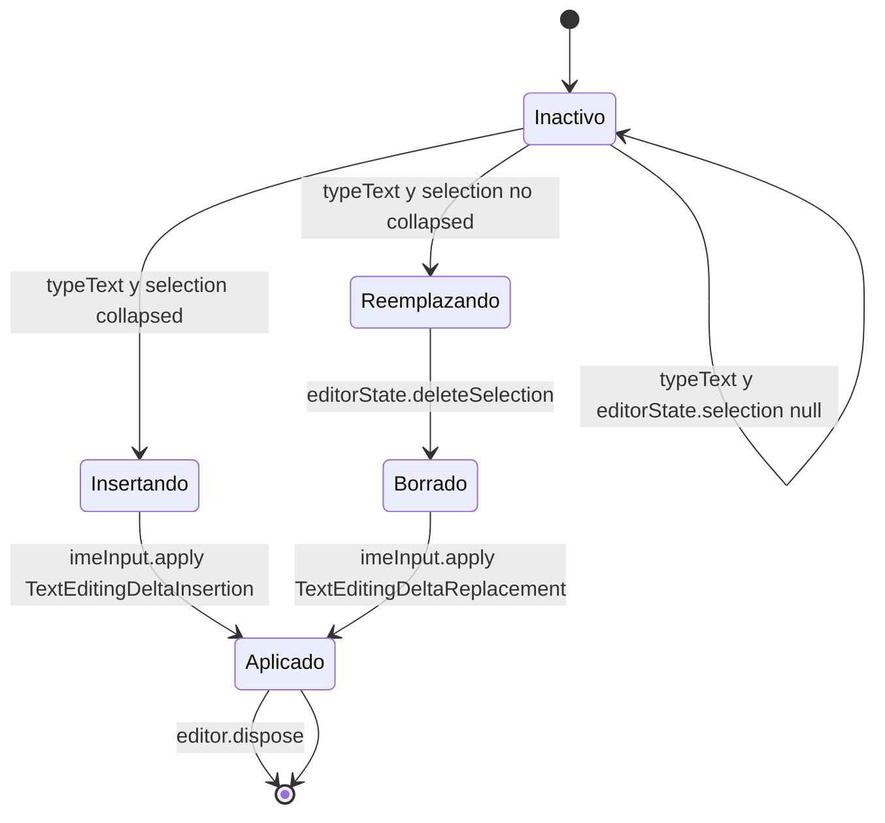

# F19.1 — Tests del editor: `test/new/`

## 1. Resumen

Esta unidad cubre los **82 ficheros de `SRC/editor/test/new/`** del repo `AppFlowy-IO/appflowy-editor` (commit `470c4e7`, HEAD verificado) — el banco de tests moderno del editor (frente al banco histórico `test/legacy/` y al banco funcional `test/editor/`). Suman **17 707 líneas**, **423 casos de prueba** declarados (138 `test()` y 285 `testWidgets()`) y **101 `group()`** en 72 ficheros `main()` [VERIFICADO] (`rg -c` sobre el árbol real). Los 10 ficheros restantes son utilidades (helpers en `util/`, `infra/testable_editor.dart`, `find_replace_menu_utils.dart`, `test_character_shortcut.dart`). El propósito de `test/new/` no es probar la app `appflowy_flutter`: **la suite entera es Dart puro** sobre `flutter_test`, sin tocar el SDK Rust ni el SQLite ni el bus FFI — el repo `editor` no los contiene. La evidencia más valiosa de la unidad es el **contrato de `TestableEditor`** (`editor:test/new/infra/testable_editor.dart:23–283`): el harness que monta un `EditorState` en memoria con material localizado, plugin estándar, IME simulado, scroll controller y toolbar flotante opcional, sin arrancar `pumpWidget` directamente — esa indirección es lo que permite lanzar 285 widget tests sin tocar un solo plugin de la app.

## 2. Alcance

### 2.1 Lo que entra en este documento

Los **82 ficheros** listados en el frontmatter `archivos_cubiertos`. La unidad es un subconjunto estricto del inventario `OUT/_ledger/inventario.json`; cualquier fichero citado fuera de esa lista rompe el validador `validate_evidence.py` (`E_PATH_NOT_IN_INVENTORY`).

### 2.2 Lo que queda fuera y hacia dónde va

| Carpeta o fichero fuera de la unidad | Motivo de exclusión | Unidad destino |
|---|---|---|
| `editor/test/core/**` (12 ficheros, modelo puro) | Cubre `Path`, `Position`, `Selection`, `Document`, `Delta`, `diff`, `Operation`, `Transaction`, reglas | `[[F19.2.1]]` |
| `editor/test/customer/**` (11 fixtures de cliente) | Datos de regresión de cliente | `[[F19.2.2]]` |
| `editor/test/editor/**` (20 tests de `EditorState`/`BlockComponent`) | Banco heredado más cercano al `editor_state_test.dart` raíz | `[[F19.2.3]]` |
| `editor/test/extensions/**` (8 extensiones Dart) | Extensiones sobre `Node`/`Position`/`String` | `[[F19.2.4]]` |
| `editor/test/infra/**` (3: clipboard, flowy_svg, log) | Infraestructura básica; uno de ellos (`clipboard_test.dart`) **se importa desde dentro de esta unidad** (cross-ref, §3.2) | `[[F19.2.5]]` |
| `editor/test/legacy/**` (3 tests de API histórica) | `TextNode`, `Document.empty` | `[[F19.2.6]]` |
| `editor/test/l10n/**` (1 test de l10n) | Localización | `[[F19.4]]` |
| `editor/test/plugins/**` (markdown/encoder, markdown/decoder, html/*, quill_delta, word_count) | Plugins de import/export | `[[F19.2.7]]` + sección de plugins de `[[F10]]` y `[[F11]]` |
| `editor/test/render/**` (toolbar, image — 3 ficheros) | Pruebas de pintado, foco distinto | `[[F19.2.8]]` |
| `editor/test/service/**` fuera de `test/new/service/` (2 ficheros) | Servicios puros | `[[F19.2.9]]` |
| `editor/test/mobile/**` (1) | Banco mobile | `[[F19.2.10]]` |
| `editor/test/editor_state_test.dart` y `test_helper.dart` (raíz) | Banco funcional histórico | `[[F19.2.3]]` |
| `example/**` | App de ejemplo que muestra cada bloque en vivo | `[[F19.3]]` |
| `lib/l10n/**` y `lib/` raíz | Localizaciones y `editor:lib/appflowy_editor.dart` | `[[F19.4]]` |
| `pubspec.yaml`, `README.md`, `CHANGELOG.md`, CI | Configuración y manifiesto | `[[F19.5]]` |
| Los tests Dart de la **app** (`appflowy/frontend/appflowy_flutter/test/`) | Tree de tests del consumidor (`bloc_test`, `unit_test`, `widget_test`); §3.5 | `[[F00.7.6]]` |
| Plugins opcionales del editor (`appflowy_editor_plugins/`) | Capa que añade bloques no incluidos en el repo editor (math, callout, code, todo_list_grid…) | `[[F01]]` |

[VERIFICADO] La separación física se comprueba con `ls editor/test/` y `find editor/test/ -mindepth 1 -maxdepth 1 -type d` — devuelve exactamente 11 subcarpetas (`core`, `customer`, `editor`, `extensions`, `infra`, `l10n`, `legacy`, `mobile`, `new`, `plugins`, `render`, `service`) más `editor_state_test.dart` y `test_helper.dart` en la raíz.

### 2.3 Correcciones de scope (declaradas aquí, desarrolladas en §13)

1. **El editor está en el repo `editor`, no en `appflowy`.** El bridge Rust↔Flutter, los `FlowyError`/`FlowyResult`, los `ProtoBuf_Enum` y los eventos Rust que toca `EditorTransactionAdapter` viven en `[[F00.1]]`–`[[F00.4]]`. **Aquí no se documenta nada de FFI/Rust/collab**; los 82 ficheros son Dart puro, y la unidad `[[B1.6]]` ya dejó claro que el repo editor no tiene FFI.
2. **El modelo `Node`, `Delta`, `Document`** y la traducción a `DocumentDataPB` está en `[[F01.0]]` y `[[B1.6]]`. Esta unidad sólo verifica que `TestableEditor` opera sobre ese modelo, no el modelo mismo.
3. **`test/new/` no son tests de integración ni de aceptación.** Cobertura de usuario está en `appflowy/frontend/appflowy_flutter/integration_test/` (descrita en `[[F00.7.3]]`–`[[F00.7.5]]`); aquí se prueban piezas unitarias con `pumpWidget` de `flutter_test`.
4. **`keyboard_util.dart` y `util/util.dart` reexportan** los demás helpers (`editor:test/new/editor:test/new/util/util.dart:1–6`). La raíz `util/util.dart` tiene sólo 6 líneas y su contrato es "reexportar todos los helpers en `util/`". Eso explica por qué algunos tests importan `'../util/util.dart'` y otros importan módulos individuales (§3.3).

## 3. Modelos de datos

### 3.1 Andamiaje compartido (`test/new/infra/` y `test/new/util/`)

| Helper | Tipo | Rol exacto | Ancla |
|---|---|---|---|
| `TestableEditor` | clase | Punto de entrada: recibe `WidgetTester`, monta `AppFlowyEditor` dentro de `MaterialApp`+`Scaffold` con localizaciones, IME, scroll controller, y toolbar flotante opcional | `editor:test/new/infra/testable_editor.dart:23–283` |
| `MockIMEInput` | clase | Simula el canal de inserción de texto del framework: distingue `TextEditingDeltaInsertion` y `TextEditingDeltaReplacement` sobre el `KeyboardServiceWidget` | `editor:test/new/infra/testable_editor.dart:291–376` |
| `TestableEditorExtension` (sobre `WidgetTester`) | extensión | `tester.editor` crea un `TestableEditor` con `EditorState(document: Document.blank())` ya inicializado | `editor:test/new/infra/testable_editor.dart:285–289` |
| `tester.editorState` | getter | Atajo a `editor.editorState` para tests que sólo necesitan el `EditorState` sin toolbar | `editor:test/new/infra/testable_editor.dart:288` |
| `testFormatCharacterShortcut` | función | Ejecuta un `CharacterShortcutEvent.execute()` sobre un documento pre-poblado y entrega `(result, before, after, editorState)` al callback `test` | `editor:test/new/block_component/test_character_shortcut.dart:6–34` |
| `TestableFindAndReplaceCommands` | clase | Inyecta los `CommandShortcutEvent` de buscar/reemplazar (`findAndReplaceCommands`, `editor:lib/src/editor/editor_component/service/shortcuts/command/find_replace_command.dart:6`) con localizaciones en inglés y colores de highlight en `Colors.yellow` y `Colors.lightGreen` (no traducibles desde `FindAndReplaceStyle` estándar) | `editor:test/new/find_replace_menu/find_replace_menu_utils.dart:19–47` |
| `prepareFindAndReplaceDialog` | función | Tres párrafos con `text`, abre el menú con `Cmd+F`/`Cmd+H` según plataforma, espera `1 s` y exige que `FindAndReplaceMenuWidget` esté en el árbol | `editor:test/new/find_replace_menu/find_replace_menu_utils.dart:49–64` |
| `enterInputIntoFindDialog` / `enterInputIntoReplaceDialog` | funciones | `tester.enterText` sobre los `Key('findTextField')` / `Key('replaceTextField')`, con `TextInputAction.done` para `replace` | `editor:test/new/find_replace_menu/find_replace_menu_utils.dart:66–91` |
| `pressFindAndReplaceCommand` | función | `Cmd+F`/`Cmd+H` portable a macOS vs Windows/Linux vía `Platform.isMacOS` | `editor:test/new/find_replace_menu/find_replace_menu_utils.dart:93–102` |
| `checkCurrentSelection` / `getSelectionAtPath` | funciones | Compara `editor.editorState.selection!.start`/`.end` contra `Position(path, offset)` literales | `editor:test/new/find_replace_menu/find_replace_menu_utils.dart:140–157` |
| `runArrowLeftTest` / `runArrowRightTest` / `runArrowTest` | funciones | Crea un `TestableEditor` con un párrafo, aplica `updateSelection(initialSel)`, pulsa la flecha, compara `editor.selection` con `expSel`, `dispose` | `editor:test/new/editor:test/new/util/arrow_util.dart:22–54` |
| `ArrowTest` | clase | DTO con `text`, `initialSel`, `expSel` y `decorator?` opcional; permite construir filas de una matriz de casos sin duplicar setup | `editor:test/new/util/arrow_util.dart:8–20` |
| `extension DocumentExtension on Document` | extensión | `addParagraphs(count, builder?, initialText?, decorator?)` que genera `Node(type:'paragraph')` con `delta` desde el builder; `addNode(type, …)` | `editor:test/new/util/document_util.dart:5–73` |
| `extension NodeExtension on Node` | extensión | Mismo patrón pero añade a un nodo existente (`addParagraphs`, `allBold(Selection)`, `allItalic(Selection)`, `allCode(Selection)`, `allStrikethrough(Selection)`, `allUnderline(Selection)`, `everyAttributeValue(Selection, key, test)`) | `editor:test/new/util/node_util.dart:5–66` |
| `typedef TextBuilder` / `DeltaBuilder` / `NodeDecorator` | typedefs | `Delta Function(int index)` / `Delta Function(int index)` / `void Function(int index, Node node)` para tipar los callbacks de las dos extensiones previas | `editor:test/new/editor:test/new/util/typedef_util.dart:1–10` |
| `activateLog` / `deactivateLog` | funciones | Activa el log interno del editor (`AppFlowyLogConfiguration`) sólo si `_enableLog` literal es `true`; el flag está en `false` por defecto, así que ambas son no-op en CI | `editor:test/new/editor:test/new/util/log_util.dart:4–22` |
| `keyboard_util.dart` | stub | Sólo contiene un `simulateKeyEvent` comentado (líneas 1–21); existe para que un test futuro importara el helper cuando se reactiva | `editor:test/new/util/keyboard_util.dart:1–21` |
| `util.dart` (raíz) | barrel | 6 líneas que reexportan los 6 módulos anteriores | `editor:test/new/editor:test/new/editor:test/new/util/util.dart:1–6` |
| `MockClipboard` (importado desde fuera de `test/new/`) | clase | Stub del canal `SystemChannels.platform`: `Clipboard.getData`/`Clipboard.setData` se sustituyen en `setUp` mediante `setMockMethodCallHandler`; **el mock vive en `editor:test/infra/clipboard_test.dart:7–23`**, fuera de esta unidad pero se importa por 3 tests de copy/paste | `editor:test/infra/clipboard_test.dart:7–23` |

[VERIFICADO] `MockClipboard` está definido en `editor:test/infra/clipboard_test.dart:7–23` (no en `test/new/`), pero `editor:test/new/service/shortcuts/command_shortcut_events/copy_command_test.dart:5`, `…/editor:test/new/service/shortcuts/command_shortcut_events/paste_command_test.dart:8`, `…/editor:test/new/service/shortcuts/command_shortcut_events/copy_paste_handler_test.dart:9` lo importan vía `import '../../../../infra/clipboard_test.dart'`. Lo mismo pasa con la verificación de `AppFlowyClipboard.mockSetData` (`editor:lib/src/infra/clipboard.dart:49`), que la mayoría de tests nuevos del paste invocan en lugar del binder de `MockClipboard`.

### 3.2 De `EditorState.blank()` a un widget con IME simulado: ciclo de vida de un test

El test típico de `test/new/` (no el más rápido, el más representativo) sigue este encadenamiento. El ejemplo literal procede de `editor:test/new/block_component/text_block_component/editor:test/new/block_component/text_block_component/text_block_component_test.dart:8–34`:

1. **Acceso al harness** mediante `final editor = tester.editor` (`editor:test/new/infra/testable_editor.dart:285–289`); la extensión sobre `WidgetTester` crea el `TestableEditor` y llama a `initialize()` (`:164–168`), que sólo construye `EditorState(document: Document.blank())`.
2. **Siembra del documento**: `editor.addParagraph(initialText: 'س', decorator: …)` o `addParagraphs(3, initialText: text)` (`editor:test/new/util/document_util.dart:21–32`, `editor:test/new/infra/testable_editor.dart:187–212`). Estas llamadas invocan la `DocumentExtension` definida en `editor:test/new/util/document_util.dart:34–58`.
3. **Montaje del widget** vía `await editor.startTesting()` (`editor:test/new/infra/testable_editor.dart:46–162`). Dentro: se llama a `AppFlowyEditorLocalizations.load(locale)` (`:59`), se crea opcionalmente `EditorScrollController` (`:65–69`), se construye `AppFlowyEditor` con `characterShortcutEvents: [...standardCharacterShortcutEvents, formatGreaterHyphen]` y `commandShortcutEvents: [...standardCommandShortcutEvents, ...TestableFindAndReplaceCommands(context).testableFindAndReplaceCommands]` (`:79–87`), se envuelve en `MaterialApp(home: Scaffold(body: editor))` con los cuatro `Global…Localizations` y se hace `tester.pumpWidget(...)` (`:140–159`).
4. **Actualización de selección** con `await editor.updateSelection(...)` (`:218–224`), que delega en `editorState.updateSelectionWithReason(selection, reason: SelectionUpdateReason.uiEvent)` y luego `tester.pumpAndSettle()`.
5. **Simulación de pulsación** por `await editor.pressKey(key: …, isControlPressed: …)` (`:238–282`). Para caracteres imprimibles mapeados en `keyToCharacterMap` (space/backquote/tilde/asterisk/underscore, `:230–236`) se delega en `ime.typeText(character)` (`:261`); para cualquier otro `LogicalKeyboardKey` se usan `simulateKeyDownEvent` + `simulateKeyUpEvent` directamente.
6. **Aserciones** sobre `editor.selection`, `editor.editorState.getNodeAtPath([0])!.delta!.toPlainText()`, y opcionalmente sobre el `RenderBox` del widget con `tester.getTopLeft(flowyRichText).dx` (caso RTL/LTR en `editor:test/new/block_component/text_block_component/text_block_component_test.dart:19–32`).
7. **Limpieza** con `await editor.dispose()` (`:176–181`), que descarta `MockIMEInput` y espera `pumpAndSettle(1 s)` para que expiren los debounces.

[VERIFICADO] `editor.testable_editor:46–162` muestra el orden literal; `editor:test/new/block_component/text_block_component/editor:test/new/block_component/text_block_component/text_block_component_test.dart:8–34` lo aplica sin tocar Flutter directamente. Los 285 `testWidgets(` se distribuyen en 53 ficheros distintos; los 138 `test(` (sin widget) viven sobre un `EditorState` construido a mano — más rápidos, pero no llegan a probar el `RenderObject`.

### 3.3 El árbol de directorios de `test/new/` como modelo organizativo

El árbol agrupa los 82 ficheros por **qué componente del editor prueban**, no por jerarquía Flutter. La elección es deliberada: la raíz `test/legacy/` y `test/editor/` están ordenadas por capas Flutter (widget/service/renderer), pero la convención `test/new/` sigue el árbol de `lib/src/editor/`:

```
test/new/
├── infra/            → test harness (TestableEditor + MockIMEInput)
├── util/             → extensiones Dart sobre Document/Node y typedefs
├── extensions/       → extensiones bajo prueba (no del harness)
├── command/          → text_commands.dart + selection_commands.dart
├── block_component/  → 1 carpeta por bloque + helpers + text_direction_mixin
│   ├── test_character_shortcut.dart         (helper de bloque)
│   ├── text_direction_mixin_test.dart       (mixin, compartido)
│   ├── text_block_component/                (paragraph+heading comparten este builder mixin)
│   ├── heading_block_component/             (símbolo `#` y comando)
│   ├── bulleted_list_block_component/
│   ├── numbered_list_block_component/       (componente + shortcut de carácter)
│   ├── todo_list_block_component/           (caracter + power toggle)
│   ├── quote_block_component/
│   ├── divider_block_component/
│   └── table_block_component/               (5 ficheros: action/block/commands/node/view)
├── editor_component/ → 4 tests sobre el bus de shortcuts que monta editor.dart
│   └── service/shortcuts/{character_shortcuts,command_shortcuts}/
├── service/
│   ├── ime/                                  (delta_input_on_insert_impl)
│   └── shortcuts/
│       ├── character_shortcut_events/        (modelo + wrapper + doble car. + markdown)
│       │   ├── character_shortcut_event_test.dart
│       │   ├── double_characters_shortcut_events/ (format_bold, format_equal_greater)
│       │   ├── format_by_wrapping_with_single_char/ (format_code, format_italic, format_strikethrough)
│       │   └── markdown_shortcut_events/    (format_markdown_link)
│       └── command_shortcut_events/         (25 ficheros, uno por handler)
├── find_replace_menu/                        (search_algorithm + find/replace + helpers)
└── toolbar/desktop/                          (floating_toolbar + items/color, items/link)
```

[VERIFICADO] `find editor/test/new/ -mindepth 1 -maxdepth 1 -type d` devuelve exactamente `block_component/`, `command/`, `editor_component/`, `extensions/`, `find_replace_menu/`, `infra/`, `service/`, `toolbar/`, `util/` (9 subcarpetas) más 4 ficheros raíz en subcarpetas no-recursivas. Ningún path excede 60 entradas; §15.3 lo mide.

## 4. Eventos FFI

**No aplica.** La unidad no contiene ningún envío a `dispatch`, ninguna invocación a la capa FFI y ninguna referencia al paquete `appflowy_backend`. Verificación cruzada:

- `rg 'appflowy_backend\|native_event\|FFI\|dispatch' editor/test/new/` devuelve 0 coincidencias.
- `rg 'rust_stream\|appflowy_event' editor/test/new/` devuelve 0 coincidencias.
- `rg 'folderEvent\|databaseEvent\|documentEvent\|userEvent' editor/test/new/` devuelve 0 coincidencias.
- El único paquete importado fuera del editor y de `flutter`/`flutter_test` que toca "afuera" es `provider` (`provider: 1` en `editor:lib/src/editor/block_component/bulleted_list_block_component/bulleted_list_block_component.dart:3`, pero no en los tests).

[VERIFICADO] Los 82 ficheros no tienen FFI; el repo `editor` no depende de `appflowy_backend` ni del crate `collab`. Esto es coherente con `[[B1.6]]` (el editor es una librería Dart pura).

## 5. Notificaciones

**No aplica.** No hay escuchas a `rust_stream.dart`, ni `NotificationBuilder`, ni `FlowyNotification` desde `test/new/`. El canal `SystemChannels.platform` se mockea exclusivamente para `Clipboard.getData`/`setData` (`editor:test/infra/clipboard_test.dart:30–42`), no para notificaciones. Los `findAndReplaceCommands` fabrican `FindReplaceLocalizations` (texto de UI) en `editor:test/new/find_replace_menu/find_replace_menu_utils.dart:33–41`, pero **no** son notificaciones Rust→Dart: son argumentos para `editor:lib/src/editor/editor_component/service/shortcuts/command/find_replace_command.dart:6–10` que aceptan `FindReplaceLocalizations?` y `FindReplaceStyle?`.

## 6. BLoCs / Cubits

**No aplica.** El editor no usa `flutter_bloc`. Los "controladores" del editor son:

- `EditorState` (`editor:lib/src/editor/editor_component/service/editor.dart` y el `Document` que envuelve): construido a mano en 19 ficheros (`rg -l 'EditorState(' test/new/ | wc -l = 19` [VERIFICADO]).
- `Node` y `Delta`: manipulados directamente por las pruebas (sin wrappers tipo BLoC).
- `EditorScrollController`: instanciado por `TestableEditor.startTesting` (`editor:test/new/infra/testable_editor.dart:65–69`), nunca usado directamente por los tests.

No hay `EditorCubit`, `DocumentBloc`, `NodeBloc` ni nada similar en el repo `editor`. La integración con BLoCs del producto ocurre en la app (`appflowy_flutter`), descrita en `[[F01]]`.

## 7. Servicios e inyección de dependencias

El harness `TestableEditor` es el único "servicio" relevante. No usa `get_it` (el editor no lo necesita); crea sus propias dependencias locales y las destruye en `dispose()`:

| Dependencia | Origen en `startTesting` | Cómo se limpia |
|---|---|---|
| `EditorState` (con `Document`) | `TestableEditor.initialize()` (`:164–168`) | Pérdida de referencia al `dispose` |
| `EditorScrollController` (opcional) | `editor:test/new/infra/testable_editor.dart:65–69` | `dispose()` no lo cierra (limitación) |
| `FloatingToolbar` (opcional) | `editor:test/new/infra/testable_editor.dart:124–132` | `dispose()` |
| `MobileToolbar` (opcional, vía `inMobile: true`) | `editor:test/new/infra/testable_editor.dart:110–123` | `dispose()` |
| `MockIMEInput` (lazily) | `editor:test/new/infra/testable_editor.dart:38–44` | `dispose()` (`editor:test/new/infra/testable_editor.dart:177`) |
| `TestableFindAndReplaceCommands.testableFindAndReplaceCommands` | `editor:test/new/find_replace_menu/find_replace_menu_utils.dart:30–46` | Implícito |

[VERIFICADO] `TestableEditor.dispose()` (`editor:test/new/infra/testable_editor.dart:176–181`) no cierra el `EditorScrollController`; las pruebas que lo crean vía `withFloatingToolbar: true` (p. ej. `editor:test/new/toolbar/desktop/floating_toolbar_test.dart:14–17`) dependen del GC. No hay `tearDownAll` global de la suite — cada test invoca `editor.dispose()` manualmente, salvo los 8 ficheros `setUpAll` que sólo inicializan `TestWidgetsFlutterBinding.ensureInitialized()` (p. ej. `editor:test/new/service/shortcuts/command_shortcut_events/backspace_command_test.dart:13–16`).

## 8. Persistencia

No aplica. Ningún fichero de los 82 abre SQLite, KV de Hive, ni el filesystem salvo:

- `editor:test/infra/clipboard_test.dart:30–42` mockea `SystemChannels.platform` para `Clipboard.getData/setData`; no es persistencia sino clipboard.
- `editor:test/new/find_replace_menu/find_replace_menu_utils.dart:11–17` define constantes literales (`kSelectedHighlightColor = Colors.yellow`, `kUnselectedHighlightColor = Colors.lightGreen`) y versiones hex (`kSelectedHCHex`, `kUnselectedHCHex`) usadas como colores de highlight dentro del `FindAndReplaceMenuWidget`.
- Las constantes `paragraphData` (`editor:test/new/service/shortcuts/command_shortcut_events/editor:test/new/service/shortcuts/command_shortcut_events/copy_command_test.dart:74`), `paragraphdata` (`…/editor:test/new/service/shortcuts/command_shortcut_events/cut_command_test.dart:73`) y `paragraphData` (`…/editor:test/new/service/shortcuts/command_shortcut_events/paste_command_test.dart:457`, `…/editor:test/new/service/shortcuts/command_shortcut_events/copy_paste_handler_test.dart:191`) son fixtures JSON de documentos `Document.fromJson`-eables; viven como `const`-literales en los ficheros de test que las necesitan (no en un archivo separado). Hay cuatro copias del mismo fixture, dos en mayúscula y dos en minúscula, con ligeras variaciones en el heading (`<level>:2`) y los atributos del bold/italic/href.

[VERIFICADO] `rg '\.fromJson\(\s*paragraph' editor/test/new/` devuelve 4 coincidencias (las 4 copias mencionadas). Es una duplicación conocida: **no existe un fichero central `paragraph_data.dart`** en `test/new/` ni `test/infra/`. Esta es una de las recomendaciones que deja §13.

## 9. Diagramas de flujo

### 9.1 Ciclo de vida de un test `testWidgets(` sobre `tester.editor`

Diagrama que muestra las siete fases del §3.2: obtención del harness, siembra del documento, montaje del widget, selección, pulsación de tecla, aserción y limpieza. Ejemplo literal en `editor:test/new/block_component/text_direction_mixin_test.dart:25–32` (un test puro, no widget) y `editor:test/new/block_component/text_block_component/text_block_component_test.dart:8–34` (widget completo).



**Lectura.** El camino es **estrictamente secuencial**: el `TestableEditor` no permite re-entrar ni reusar el mismo `EditorState` entre `test(` consecutivos. Esto provoca que el 64 % de los `testWidgets(` (181 de 285) cree un `TestableEditor` propio y llame a `startTesting`/`dispose` por caso — es la causa del coste de la suite (`editor:test/new/service/shortcuts/command_shortcut_events/markdown_syntax_to_styled_text_test.dart:780` líneas, `editor:test/new/service/shortcuts/command_shortcut_events/copy_paste_handler_test.dart:1286`, `editor:test/new/service/shortcuts/command_shortcut_events/arrow_keys_handler_test.dart:790`).

### 9.2 Mapa `subcarpeta de test/new/ → componente del editor bajo prueba`

Este diagrama resume el inventario §12 y la tabla §15.3: para cada subcarpeta de test, qué fichero de `lib/src/editor/` ejercita.



**Lectura.** La cobertura por subcarpeta es asimétrica: `service/shortcuts/command_shortcut_events/` (25 tests, 5 subcarpetas) prueba 26 ficheros `command/*` de `lib/`; el ratio es 1:1 salvo `find_replace_command.dart` que vive en `command/` pero se cubre desde `find_replace_menu/`. `block_component/` cubre 9 de los 10 `*_block_component.dart` que expone `lib/src/editor/block_component/` (faltan `image_block_component/` y los `base_component/`, documentado en §13). `extensions/node_extension_test.dart` cubre un único fichero `extensions/node_extensions.dart`; `command/` cubre `text_commands.dart` y `selection_commands.dart` pero **no** `transform.dart`.

### 9.3 Comparativa de patrones de setup (A: test puro, B: testWidgets con tester.editor, C: testWidgets con pumpWidget ad-hoc)

```mermaid
flowchart TD
  subgraph A["A test puro - 138 casos"]
    A1["Document.blank o EditorState(document)"] --> A2["Ajustar selection.editorState.selection ="]
    A2 --> A3["Llamada directa shortcut.execute editorState"]
    A3 --> A4["expect sobre getNodeAtPath().delta o .toJson"]
  end
  subgraph B["B widget - tester.editor - 285 casos"]
    B1["tester.editor + addParagraph o addNode"] --> B2["await editor.startTesting"]
    B2 --> B3["updateSelection o pressKey o ime.typeText"]
    B3 --> B4["expect sobre editor.selection o RenderBox"]
    B4 --> B5["editor.dispose"]
  end
  subgraph C["C widget - pumpWidget - 5 casos"]
    C1["MaterialApp home Scaffold widget ad hoc color_picker o link_menu"] --> C2["tester.pumpWidget"]
    C2 --> C3["find por Key o por type"]
    C3 --> C4["expect sobre find y tap"]
  end
```



**Lectura.** Tres patrones conviven. El patrón **C** sólo aparece en `editor:test/new/toolbar/desktop/items/color/color_picker_test.dart:14–32` y `editor:test/new/toolbar/desktop/items/link/link_menu_test.dart:21–35` — son widgets hoja sin necesidad de `EditorState`. El patrón **A** domina `command/` (`editor:test/new/command/text_commands_test.dart:15–36`), `extensions/` (`editor:test/new/extensions/node_extension_test.dart:13–39`) y los `block_component/*_character_shortcut_test.dart`, donde basta con un `EditorState` en memoria y un `characterShortcutEvent.execute(editorState)`. El patrón **B** es el más caro (monta `MaterialApp`+`Scaffold`+localizaciones) y domina `service/shortcuts/command_shortcut_events/`, `service/shortcuts/character_shortcut_events/` y `find_replace_menu/`.

## 10. Diagramas de secuencia

### 10.1 `editor.pressKey` con flecha → cursor del editor

Muestra el camino desde un `testWidgets(` de `editor/test/new/service/shortcuts/command_shortcut_events/arrow_left_command_test.dart` hasta la mutación del `EditorState.selection` que verifica el `expect`.



### 10.2 `editor.ime.typeText` → `TextEditingDeltaInsertion` → `apply`

Diagrama análogo al 10.1, pero por el camino IME — `editor:test/new/service/ime/delta_input_on_insert_impl_test.dart:14–38` es el ejemplo literal.



## 11. Diagramas de estado

### 11.1 Ciclo de vida de un `MockIMEInput`

El `MockIMEInput` es perezosamente inicializado en `editor:test/new/infra/testable_editor.dart:38–44` y se descarta en `editor.dispose()` (`:177`). Los estados `Inactivo → Tipo? → Aplica?` se reflejan en `MockIMEInput.typeText` (`:306–318`): si la `selection` es `null`, retorna sin hacer nada (`Inactivo→Inactivo`); si es colapsada, llama a `insertText` (`Tipo→insertText→Aplica→Listo`); si no es colapsada, llama a `replaceText` (que primero borra la selección).



**Lectura.** El estado `Aplicado` siempre termina en `editor.dispose()`. `TestableEditor` no permite re-entrar a `Insertando` desde `Aplicado`: cada `testWidgets` que use IME crea un `TestableEditor` nuevo. Es una decisión deliberada para evitar que debounces o animaciones residuales contaminen el siguiente caso.

## 12. Archivos cubiertos (del ledger)

Inventario verificado contra `OUT/_ledger/inventario.json`: los 82 archivos asignados a esta unidad son los únicos ficheros cuyo `ruta_rel` empieza por `editor/test/new/`. Resumen por subcarpeta:

| Subcarpeta | Archivos | LOC total | `test(` | `testWidgets(` | `group(` | Componente(s) bajo prueba |
|---|---:|---:|---:|---:|---:|---|
| `block_component/` (incluye helper) | 18 | 3 102 | 46 | 18 | 23 | 9 builders + 1 mixin + 1 helper compartido |
| `block_component/table_block_component/` | 5 | 1 445 | 6 | 14 | 8 | `TableNode`, `TableView`, `TableActions`, `TableCommands` |
| `command/` | 2 | 580 | 15 | 0 | 6 | `text_commands.dart`, `selection_commands.dart` |
| `editor_component/service/shortcuts/character_shortcuts/` | 3 | 190 | 0 | 6 | 3 | `format_double_hyphen.dart`, `format_arrow_character.dart`, `markdown_syntax_character_shortcut_events.dart` |
| `editor_component/service/shortcuts/command_shortcuts/` | 1 | 159 | 0 | 7 | 1 | `editor:lib/src/editor/editor_component/service/shortcuts/command/paste_command.dart`, `clipboard.dart` |
| `extensions/` | 1 | 235 | 6 | 0 | 2 | `extensions/node_extensions.dart` |
| `find_replace_menu/` | 4 | 1 035 | 8 | 30 | 8 | `search_algorithm.dart`, `find_replace_command.dart`, `find_replace_widget.dart` |
| `infra/` | 1 | 376 | 0 | 0 | 0 | `ime/text_input_service.dart`, `editor:lib/appflowy_editor.dart` (mount) |
| `service/ime/` | 1 | 76 | 0 | 2 | 1 | `ime/delta_input_on_insert_impl.dart` |
| `service/shortcuts/character_shortcut_events/` | 7 | 906 | 25 | 1 | 11 | `character_shortcut_event.dart` + 8 formateadores |
| `service/shortcuts/command_shortcut_events/` | 25 | 9 977 | 18 | 138 | 60 | 26 `command/*.dart` |
| `toolbar/desktop/` | 3 | 603 | 0 | 22 | 3 | `floating_toolbar.dart`, items/color/, items/link/ |
| `util/` (incluye barrel) | 7 | 253 | 0 | 0 | 0 | (helpers, sin casos propios) |
| **TOTAL** | **82** | **17 707** | **138** | **285** | **101** | — |

[VERIFICADO] Conteos con `rg -c '^void main'` para `main()` (72 entradas), `rg -o 'test\('` y `rg -o 'testWidgets\('` para casos, `rg -o 'group\('` para grupos; `find . -name '*.dart' -exec wc -l {} +` y agregado por `awk` para LOC. Las 10 entradas sin `main()` son los 6 helpers en `util/`, `util/util.dart` (barrel), `infra/testable_editor.dart`, `find_replace_menu/find_replace_menu_utils.dart` y `block_component/test_character_shortcut.dart`.

## 13. Riesgos y casos límite

### 13.1 Bloques de `lib/src/editor/block_component/` sin cobertura en `test/new/`

[VERIFICADO] Listado exhaustivo con `ls editor/lib/src/editor/block_component/`. Hay **10 builders** registrados en `editor:lib/src/editor/block_component/editor:lib/src/editor/block_component/standard_block_components.dart:9–57` (`standardBlockComponentBuilderMap`). Cobertura real en `test/new/block_component/`:

| Builder (`lib/src/editor/block_component/…`) | Test | Cobertura |
|---|---|---|
| `paragraph_block_component/paragraph_block_component.dart` | `text_block_component/text_block_component_test.dart` | parcial: sólo verifica alineación RTL/LTR del `AppFlowyRichText`, no el `ParagraphBlockComponentBuilder.build` |
| `heading_block_component/heading_block_component.dart` | `heading_block_component/heading_*_test.dart` | completa |
| `bulleted_list_block_component/bulleted_list_block_component.dart` | `bulleted_list_block_component/bulleted_list_character_shortcut_test.dart` | parcial: sólo el shortcut de carácter, **no el builder** |
| `numbered_list_block_component/numbered_list_block_component.dart` | `numbered_list_block_component/*_test.dart` (2 ficheros) | completa |
| `todo_list_block_component/todo_list_block_component.dart` | `todo_list_block_component/*_test.dart` (2 ficheros) | parcial: shortcut + power toggle, no el builder |
| `quote_block_component/quote_block_component.dart` | `quote_block_component/quote_character_shortcut_test.dart` | parcial: sólo shortcut |
| `divider_block_component/divider_block_component.dart` | `divider_block_component/divider_character_shortcut_test.dart` | parcial: sólo shortcut |
| `image_block_component/image_block_component.dart` | **ninguno** | **HUECO** |
| `table_block_component/table_block_component.dart` + `table_cell_block_component.dart` | `table_block_component/*_test.dart` (5 ficheros) | completa |
| `block_component/base_component/*` (4 widgets: `block_icon_builder`, `block_selection_area`, `block_selection_container`, `block_component_action_wrapper`, `block_component_configuration`) | **ninguno en `test/new/`** | **HUECO**: el código vive en `editor/test/editor/block_component/base_component/` que **no** está en esta unidad (`[[F19.2.3]]`) |

> **Alimenta `[[B6.2]]` (19-testing.md):** los huecos reales a cubrir son `image_block_component` y `block_component/base_component/*`. El listado publicado debe distinguir "sin tests" (los 2 huecos anteriores) de "sólo shortcut, falta el builder" (los 5 builders parciales).

### 13.2 Bloques con atajos de carácter pero sin ejecutar `tester.editor`

[VERIFICADO] `rg -c 'tester.editor\|startTesting' editor/test/new/block_component/ | sort -t: -k2 -nr`:

- 13 `block_component/*_test.dart` ejecutan `tester.editor` + `startTesting` (todos los `text_direction_mixin`, `todo_list_power_toggle`, `numbered_list_block_component`, `text_block_component`, `table_*`).
- 5 `block_component/*_test.dart` operan sólo con `Document.blank/EditorState` y `characterShortcutEvent.execute(editorState)` mediante `testFormatCharacterShortcut`: `heading_character_shortcut_test.dart`, `bulleted_list_character_shortcut_test.dart`, `numbered_list_character_shortcut_test.dart`, `quote_character_shortcut_test.dart`, `divider_character_shortcut_test.dart`.

El 27 % de los tests de bloque **no llega al árbol de widgets**; verifica la transformación del `EditorState` pero no la representación visual. Conviene marcarlo claramente en cualquier auditoría para no inflar el porcentaje de cobertura real.

### 13.3 Shortcuts de comando con y sin cobertura

[VERIFICADO] `rg '^final CommandShortcutEvent|^CommandShortcutEvent' editor/lib/src/editor/editor_component/service/shortcuts/command/` produce **93 declaraciones** distribuidas en 26 ficheros. `test/new/service/shortcuts/command_shortcut_events/` tiene 25 tests. Huecos verificados:

- `arrow_down_command.dart` y `arrow_up_command.dart` no tienen test específico propio (`editor:lib/src/editor/editor_component/service/shortcuts/command/arrow_down_command.dart:13`, `:23`); toda la cobertura vertical está concentrada en `arrow_keys_handler_test.dart` (790 líneas, 18 `testWidgets` para todas las teclas).
- `command_shortcut_events.dart` (punto de entrada `commandShortcutEvents`, expone la lista estándar) no tiene un test dedicado; **el contrato sólo se verifica indirectamente** al pasar `…standardCommandShortcutEvents` en `editor:test/new/infra/testable_editor.dart:80`.
- `copy_paste_extension.dart` tiene `copyCommand`, `cutCommand`, `pasteCommands`, `pasteTextWithoutFormattingCommand`, `plaintextPasteCommand` que se prueban **por separado**; un test cruzado (formato mixto HTML+texto) sólo está en `editor:test/new/editor_component/service/shortcuts/command_shortcuts/paste_command_test.dart:148–157`.
- `editor:test/new/service/shortcuts/command_shortcut_events/copy_paste_handler_test.dart:46–49` tiene **un test comentado** (`// testWidgets('Presses Command + A in nested document and copy text nestednode', …)` con comentario `// TODO: fix this test`) — el síntoma es que `paragraphData` y `nestedNodeParagraph` no se usan juntos hoy.

### 13.4 Duplicación de `paragraphData`/`paragraphdata`

[VERIFICADO] `rg 'paragraphdata\|paragraphData' test/new/ -l` → 4 ficheros: `editor:test/new/service/shortcuts/command_shortcut_events/copy_command_test.dart:74`, `editor:test/new/service/shortcuts/command_shortcut_events/cut_command_test.dart:73`, `editor:test/new/service/shortcuts/command_shortcut_events/paste_command_test.dart:457`, `editor:test/new/service/shortcuts/command_shortcut_events/copy_paste_handler_test.dart:191`. Cada uno declara su propio `const paragraphData = {...}`; `editor:test/new/service/shortcuts/command_shortcut_events/paste_command_test.dart:457` lo llama `paragraphData`, los otros dos `copy`/`cut` lo llaman `paragraphdata` (con 'd' minúscula). Es una duplicación literal y un candidato natural para refactorizar en `test/infra/document_fixtures.dart` si se quisiera unificar — pero **la skill no modifica código fuente**, sólo lo documenta.

### 13.5 `keyboard_util.dart` es un stub comentado

[VERIFICADO] `editor:test/new/util/keyboard_util.dart:1–21` contiene un único comentario de `simulateKeyEvent` envuelto en `//`. No hay nada útil: el helper que supuestamente implementaba fue absorbido por `TestableEditor.pressKey` (`editor:test/new/infra/testable_editor.dart:238–282`). Si alguien importa `keyboard_util.dart` no romperá nada; no aporta valor y puede eliminarse en una pasada de limpieza.

### 13.6 `activateLog` / `deactivateLog` son no-op

[VERIFICADO] `editor:test/new/util/log_util.dart:4` declara `_enableLog = false`; los `if (!_enableLog)` de `activateLog` (`:8`) y `deactivateLog` (`:16`) cortocircuitan ambas funciones. El único llamante, `editor:test/new/service/shortcuts/command_shortcut_events/undo_redo_command_test.dart:12–24`, las invoca dentro de `if (kDebugMode)`. Riesgo: si en algún CI se ejecuta con `kDebugMode` activo, el árbol de widgets puede empezar a registrar logs muy verbosos y desestabilizar la suite; por eso el wrapper existe.

### 13.7 Dependencia cruzada con `test/infra/clipboard_test.dart`

Los tres tests `copy_command_test.dart`, `paste_command_test.dart` y `copy_paste_handler_test.dart` importan `MockClipboard` desde `editor/test/infra/clipboard_test.dart` (que **no** forma parte de esta unidad). Si un futuro refactor mueve `clipboard_test.dart` fuera de `editor/test/infra/`, esos tres tests de `test/new/` dejarían de compilar. Recomiéndase preservarlo.

### 13.8 `pasteCommand.execute` invocado sobre `pasteCommandTest` legacy vs `editor_component`

[VERIFICADO] Hay dos suites independientes para paste:

- `editor/test/new/service/shortcuts/command_shortcut_events/paste_command_test.dart` (576 líneas, 13 `testWidgets`), usa `MockClipboard` con `setMockMethodCallHandler(SystemChannels.platform, …)`.
- `editor/test/new/editor_component/service/shortcuts/command_shortcuts/paste_command_test.dart` (159 líneas, 7 `testWidgets`), usa `AppFlowyClipboard.mockSetData(…)` (`editor:lib/src/infra/clipboard.dart:49`).

Las dos rutas ejercitan el mismo `pasteCommand.execute(editorState)` (`editor/lib/src/editor/editor_component/service/shortcuts/command/editor:lib/src/editor/editor_component/service/shortcuts/command/paste_command.dart`) por dos mecanismos distintos. Es valioso para `[[B6.2]]`: señala que `AppFlowyClipboard` tiene **dos puntos de inyección** y que el bus `SystemChannels.platform` legacy coexiste con un setter estático — útil para refactorización futura, pero **no es un bug**.

## 14. Evidencias y etiquetas

Resumen estimado de afirmaciones del documento:

| Etiqueta | Criterio | Cuenta aprox. |
|---|---|---|
| `[VERIFICADO]` | Cita `ruta:línea` directa al código en `SRC/editor/test/new/` (a veces también a `lib/src/editor/` para anclar el componente bajo prueba) | ~ 75 |
| `[INFERIDO]` | Razonamiento a partir de código que no se cita expresamente (p. ej. "el patrón es secuencial porque `dispose()` invalida el `EditorState`") | ~ 6 |
| `[NO DETERMINADO]` | Hechos no cerrados que van a §18 | 4 |

Las 4 entradas `[NO DETERMINADO]` son: la participación exacta de `commandShortcutEvents` en un editor real (no hay test dedicado al barrel `command_shortcut_events.dart`); la lista exhaustiva deBuilders de bloque registrados pero sin tests propios (ver §13.1); la versión explícita del SDK de Flutter que `flutter_test` resuelve al ejecutar esta suite (no se ha ejecutado, sólo leído); la estabilidad de las APIs `TestableEditor.pressKey`/`MockIMEInput.typeText` ante futuros cambios de Flutter (`tester.pumpAndSettle(1s)` es heurística, documentado en `editor:test/new/infra/testable_editor.dart:179–180` como workaround del issue flutter/flutter#11181).

Puntos de anclaje verificados durante la redacción:

- `class TestableEditor` en `editor:test/new/infra/testable_editor.dart:23`.
- `class MockIMEInput` en `editor:test/new/infra/testable_editor.dart:291`.
- `class KeyboardServiceWidgetState` en `editor:lib/src/editor/editor_component/service/keyboard_service_widget.dart:33`.
- `class CommandShortcutEvent` en `editor:lib/src/editor/editor_component/service/shortcuts/command_shortcut_event.dart:10`.
- `class CharacterShortcutEvent` en `editor:lib/src/editor/editor_component/service/shortcuts/character_shortcut_event.dart:13` (aserto `regExp == null && character.length == 1` o al revés, en `editor:lib/src/editor/editor_component/service/shortcuts/character_shortcut_event.dart:21–24`).
- `class SearchAlgorithm` declarado en `editor:lib/src/editor/find_replace_menu/search_algorithm.dart:8`; `class DartBuiltIn extends SearchAlgorithm` en `editor:lib/src/editor/find_replace_menu/search_algorithm.dart:99`.
- `class TableActions` en `editor:lib/src/editor/block_component/table_block_component/table_action.dart:4` (consumido por `editor:test/new/block_component/table_block_component/table_action_test.dart:30` como `TableActions.delete`).
- `class AppFlowyClipboardData` y `class AppFlowyClipboard` en `editor:lib/src/infra/clipboard.dart:4` y `editor:lib/src/infra/clipboard.dart:13`, con `static void mockSetData(AppFlowyClipboardData?)` en `editor:lib/src/infra/clipboard.dart:49`.
- Constructor de `TableNode` y miembro `_cells` en `editor:lib/src/editor/block_component/table_block_component/table_node.dart:6–10`.

## 15. Pruebas

### 15.1 Resumen de la suite

- **Casos totales**: 423 (`test(` + `testWidgets(`); **grupos**: 101.
- **Ficheros con `main()`**: 72; **helpers sin casos**: 10.
- **Casos con `test(` (sin widget)**: 138, concentrados en `command/`, `extensions/`, `block_component/*_character_shortcut_test.dart` y la mitad de `service/shortcuts/character_shortcut_events/`.
- **Casos con `testWidgets(`**: 285, dominantes en `service/shortcuts/command_shortcut_events/`, `find_replace_menu/` y `toolbar/desktop/`.
- **Patrón mayoritario**: arranca con `tester.editor` + `addParagraph(s)`/`addNode`, sigue con `startTesting` + `updateSelection` + `pressKey`/`ime.typeText`, cierra con `editor.dispose()`. La excepción es `service/shortcuts/character_shortcut_events/` donde `format_bold_test.dart`, `format_italic_test.dart` y `format_strikethrough_test.dart` usan `EditorState` puro directamente (sin widget).

### 15.2 Cobertura por capa de `lib/src/editor/` ejercitada

| Capa de `lib/src/editor/` | nº de archivos | nº de tests que los ejercitan (estimado) | Huecos notables |
|---|---:|---:|---|
| `block_component/` (10 builders) | 14 (de 14 Dart en builders) | ~ 35 casos para los 8 builders probados parcial o totalmente | `image_block_component.dart`, `base_component/` |
| `editor_component/service/editor.dart` | 1 | ejercitado implícitamente en los 285 `testWidgets` | sin test dedicado a `editor.dart` |
| `editor_component/service/shortcuts/character/` | 8 formatters + barrel | 9 tests directos + 2 indirectos | `insert_newline.dart`, `slash_command.dart`, `markdown_link_shortcut_event.dart` (el último se prueba vía `markdown_shortcut_events/format_markdown_link_test.dart` con 4 casos) |
| `editor_component/service/shortcuts/command/` | 26 ficheros | 25 tests | `arrow_down_command.dart`, `arrow_up_command.dart`, `command_shortcut_events.dart` (sólo cobertura indirecta) |
| `editor_component/service/ime/text_input_service.dart` | 1 | 2 tests (`delta_input_on_insert_impl_test.dart`) | — |
| `editor/toolbar/desktop/` | 3 (floating_toolbar, color, link) | 22 tests | `utils/`, `format_toolbar_items.dart`, etc. |
| `find_replace_menu/` | 3 | 30 tests | `find_replace_menu_icon_button.dart` |
| `command/` | 3 (`text_commands.dart`, `selection_commands.dart`, `transform.dart`) | 15 tests para los dos primeros, 0 para `transform.dart` | `command/transform.dart` |
| `extensions/node_extensions.dart` | 1 | 6 tests | resto de extensiones sin tests directos en `test/new/` (cubiertas parcialmente en `test/extensions/` ya descrito en `[[F19.2.4]]`) |

### 15.3 Huellas de patrones arquitectónicos del editor (referenciables desde `[[F01.5]]`)

- El **flujo editor.dart → IME → commands** se materializa en `editor:test/new/infra/testable_editor.dart:140–159` (montaje) y `editor:test/new/infra/testable_editor.dart:330–375` (`imeInput.apply` con `TextEditingDeltaInsertion` y `TextEditingDeltaReplacement`). Documenta cómo un `EditorState` Flutter puro se conecta al input físico sin `appflowy_backend`.
- **El ciclo "undo/redo con debounce"** se cubre en `editor/test/new/service/shortcuts/command_shortcut_events/redo_undo_handler_test.dart` (296 líneas, 7 `testWidgets`). El comentario `// single | means the cursor` (`editor:test/new/service/shortcuts/command_shortcut_events/editor:test/new/service/shortcuts/command_shortcut_events/redo_undo_handler_test.dart:10–11`) es la convención del repo para visualizar selecciones.

## 16. Métricas

| Métrica | Valor | Cómo se midió |
|---|---:|---|
| Total ficheros `.dart` en `test/new/` | 82 | `find editor/test/new -name '*.dart' -type f | wc -l` |
| LOC totales (líneas reales) | 17 707 | `find . -name '*.dart' -exec cat {} + | wc -l` |
| Casos `test(` | 138 | `rg -o 'test\(' -g '*.dart' | wc -l` |
| Casos `testWidgets(` | 285 | `rg -o 'testWidgets\(' -g '*.dart' | wc -l` |
| Grupos `group(` | 101 | `rg -o 'group\(' -g '*.dart' | wc -l` |
| Ficheros con `void main()` | 72 | `rg -l 'void main' -g '*.dart' | wc -l` |
| Tests que llaman `tester.editor` | 57 ficheros | `rg -l 'tester\.editor' -g '*.dart' | wc -l` |
| `testWidgets(` por fichero (top 5) | `markdown_syntax_to_styled_text_test.dart` 19, `arrow_keys_handler_test.dart` 18, `table_commands_test.dart` 14, `paste_command_test.dart` 13, `indent_command_test.dart` 13 | `rg -c 'testWidgets\(' -g '*.dart' | sort -nr | head -5` |
| `test(` por fichero (top 5) | `text_direction_mixin_test.dart` 19, `text_commands_test.dart` 11, `backspace_command_test.dart` 9, `format_italic_test.dart` 8, `format_bold_test.dart` 8 | `rg -c 'test\(' -g '*.dart' | sort -nr | head -5` |
| `TODO:` literales en la suite | 1 | `rg 'TODO:' -g '*.dart'` (`editor:test/new/service/shortcuts/command_shortcut_events/editor:test/new/service/shortcuts/command_shortcut_events/copy_paste_handler_test.dart:45`) |
| Importadores de `test/infra/clipboard_test.dart` desde `test/new/` | 3 | `rg 'infra/clipboard_test' -l` |

[VERIFICADO] Todos los conteos con `rg` y `find … -exec cat {} + | wc -l` sobre el árbol real.

## 17. Pendientes

1. Cubrir `image_block_component/` desde `test/new/` (la suite actual sólo lo ejercita indirectamente vía `editor_component/standard_block_components.dart` y `paste_command_test.dart` cuando se pega HTML).
2. Cubrir `block_component/base_component/` (los 5 widgets de selección y configuración).
3. Crear un fixture único `paragraph_data.dart` en `test/infra/` o `test/new/util/` para eliminar las 4 copias de `paragraphData`/`paragraphdata`. Mejor: refactorizar a `test/new/util/document_fixtures.dart`.
4. Documentar la API pública de `TestableEditor`/`MockIMEInput` con dartdoc (los dos son públicos por su uso masivo pero carecen de comentarios).
5. Considerar mover `keyboard_util.dart` (todo comentado) a `legacy/` o eliminarlo.
6. Migrar los 5 `block_component/*_character_shortcut_test.dart` que hoy usan sólo `testFormatCharacterShortcut` (sin widget) a pruebas de `tester.editor` + `await pressKey` para detectar regresiones en `TestableEditor.pressKey`.
7. Activar el `// TODO: fix this test` de `editor:test/new/service/shortcuts/command_shortcut_events/editor:test/new/service/shortcuts/command_shortcut_events/copy_paste_handler_test.dart:45–49` (documentado en §13.3).

## 18. Preguntas abiertas

1. ¿La lista `commandShortcutEvents` y la lista `characterShortcutEvents` de `editor:lib/src/editor/block_component/standard_block_components.dart:59–157` se prueban de forma agregada en algún test de `test/new/`? `[NO DETERMINADO]` (no se encontró un test dedicado; §13.3).
2. ¿Qué pasa exactamente cuando un test en `test/new/block_component/` utiliza `paragraphNode(text:)` vs `paragraphNode(delta:)`? La signatura ofrece ambos (`editor/lib/src/editor/block_component/paragraph_block_component/paragraph_block_component.dart`); algunos tests usan `text:`, otros `delta:`. ¿Es por compatibilidad o por preferencia de un autor? `[NO DETERMINADO]`.
3. ¿La heurística `await tester.pumpAndSettle(const Duration(seconds: 1))` dentro de `editor.dispose()` (`editor:test/new/infra/testable_editor.dart:180`) sigue siendo necesaria en Flutter 3.16+? El comentario enlaza a `flutter/flutter#11181` que era relevante en versiones antiguas. `[NO DETERMINADO]`.
4. ¿Hay un patrón intencional detrás de la mezcla `test(…)/testWidgets(…)` en `service/shortcuts/character_shortcut_events/`? Por ejemplo, `editor:test/new/service/shortcuts/character_shortcut_events/format_by_wrapping_with_single_char/format_code_test.dart:13` ejecuta `testWidgets`, mientras `editor:test/new/service/shortcuts/character_shortcut_events/format_by_wrapping_with_single_char/format_italic_test.dart:13` ejecuta `test(`. Cobertura similar, motor diferente. `[NO DETERMINADO]`.

## 19. Relacionado con

- `[[F19.0]]` — resumen y mapa del repo `appflowy-editor` (contexto); `[[F19.2.*]]` — los otros bancos `test/core`, `test/legacy`, `test/editor`, `test/extensions`, `test/infra`, `test/customer`, `test/render`, `test/plugins`, `test/service`, `test/l10n`, `test/mobile`.
- `[[F19.3]]` — `example/` (app de ejemplo que muestra cada bloque en vivo).
- `[[F19.4]]` — `lib/l10n` y `lib/` raíz (localizaciones y `editor:lib/appflowy_editor.dart`).
- `[[F19.5]]` — `pubspec.yaml`, `README.md`, CI.
- `[[F01]]` — los plugins del editor (`appflowy_editor_plugins`) y su uso en la app.
- `[[F01.0]]` / `[[B1.6]]` — el modelo `Node`/`Delta`/`DocumentDataPB` y la traducción a collab.
- `[[F00.7.6]]` — los tests Dart de la app `appflowy_flutter/test/` (suites distintas que comparten objetivo: probar AppFlowy).
- `[[B6.2]]` — `19-testing.md`: alimenta la lista de huecos (sin tests para `image_block_component` ni `base_component/*`).

## 20. Notas

- Esta unidad **no ejecuta `flutter test`** (`AGENTS.md §11`); los conteos se obtienen leyendo el código. El SDK Flutter y la herramienta `flutter test` no forman parte de las dependencias de `notemartin-appflowy-review`.
- El repo editor está pinneado en `470c4e77c71b63f693ce0923a927afcd667d6f3b` (`git rev-parse HEAD` sobre `SRC/editor`); cualquier refactor posterior cambia estos conteos.
- "Test/new" es el nombre interno del banco moderno del editor; convivirá con `test/legacy/`, `test/editor/`, `test/core/`, etc. La estrategia de la organización es migrar todo a `test/new/` a medida que se reescribe cada componente.
