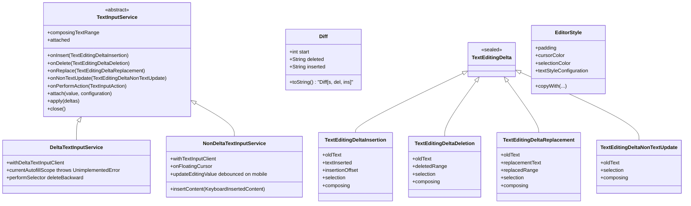
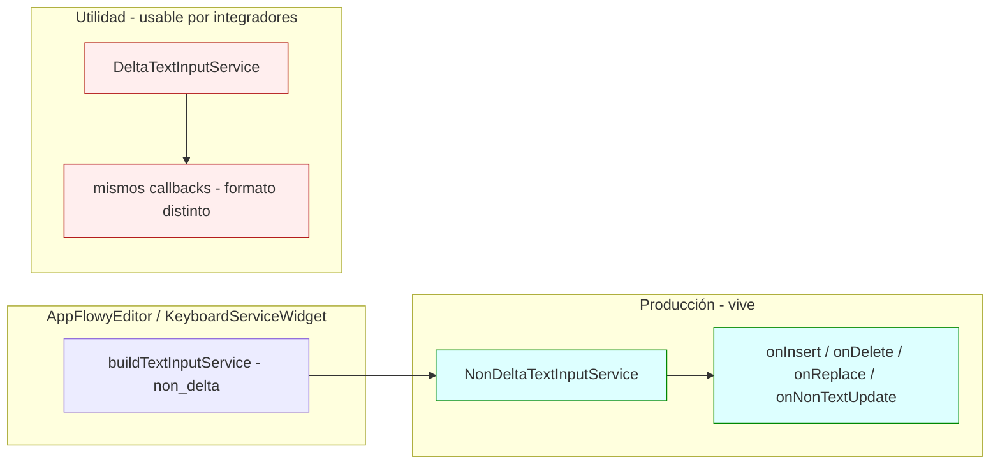
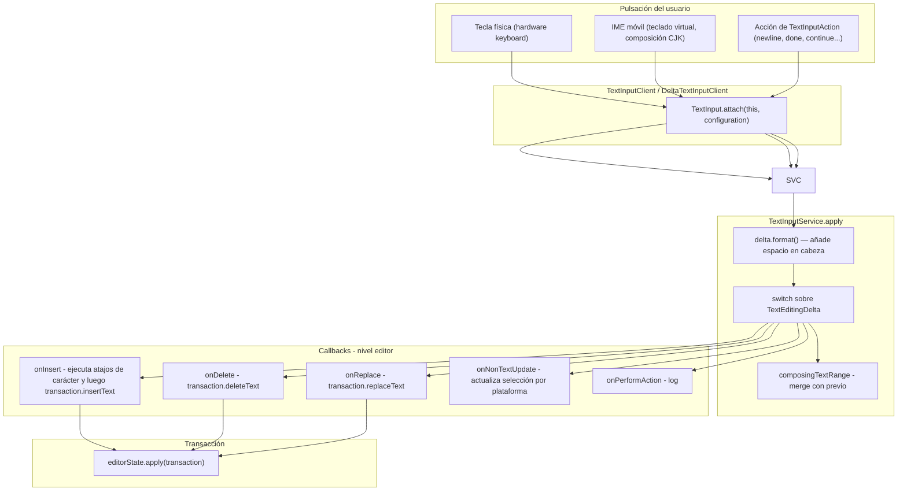
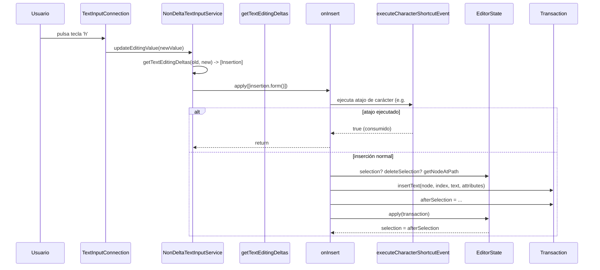
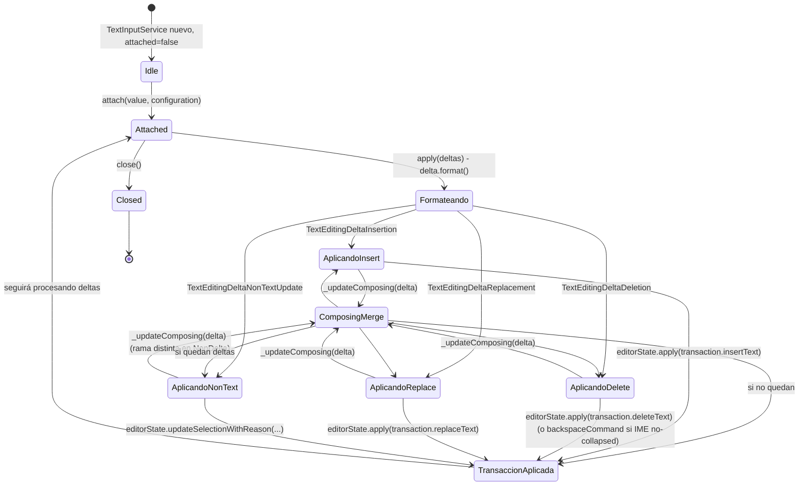

# F19.2.3 — Tests del editor: `test/editor/` (IME, servicios, estilo, comandos, atajos, utilidades)

## 1. Resumen

Esta unidad cubre los 20 ficheros de `editor/test/editor/**`, el árbol de tests que ejercita el **núcleo del componente editor** —el `AppFlowyEditor` raíz, su `EditorService`, los servicios de entrada (IME) y de selección/scroll, los helpers de inserción de texto y los atajos de carácter, los comandos de `commands.dart`, el estilo visual, los widgets de bloques puntuales (`ImageWidget`, `BlockComponentActionList`), la barra móvil de enlace y dos utilidades (`ColorExtension`, `PlatformExtension`)—. Son 1 294 líneas, 37 `test()`, 13 `testWidgets()` y 21 `group()` `[VERIFICADO]` (medido con `rg -c` sobre los 20 ficheros). Estos tests cierran el contrato entre la pulsación del teclado físico o virtual y la `Transaction` que finalmente consume `TransactionAdapter.apply` en la app —documentado en `[[F01.8]]`—. La pieza central —el servicio de IME— aparece documentada como `TextInputService` abstracta con dos implementaciones (`DeltaTextInputService` y `NonDeltaTextInputService`, `editor:lib/src/editor/editor_component/service/ime/text_input_service.dart:4`–`:52`).

## 2. Alcance

**Dentro**: los 20 ficheros listados en el frontmatter, que son la totalidad de `test/editor/` (verificado sobre `find SRC/editor/test/editor -name '*.dart' | wc -l = 22`, siendo los dos no listados `test/new/util/**` y `infra/` que pertenecen a otras unidades).

**Fuera y hacia dónde va cada cosa** (mismo routing que `[[F19.2.1]] §2`):

| Elemento | Motivo de exclusión | Unidad destino |
|---|---|---|
| `test/new/**` (banco moderno y helpers como `addParagraphs`) | Reutilizado por esta unidad pero no la cubre | `[[F19.1]]` |
| `test/customer/**` | Fixtures de cliente | `[[F19.2.2]]` |
| `test/core/**` (12 ficheros de modelo puro) | Cubre `Path`/`Selection`/`Transaction`/`Delta` | `[[F19.2.1]]` |
| `test/extensions/**` (8) | Extensiones sobre `Node`/`Position` | `[[F19.2.4]]` |
| `test/infra/**` (3) | Clipboard, logging | `[[F19.2.5]]` |
| `test/legacy/**` (3) | API heredada | `[[F19.2.6]]` |
| `test/mobile/**` (18) | Servicios de selección móvil | `[[F19.2.7]]` |
| `test/plugins/**` (31) | Atajos y comandos por bloque, slash menu, link menu | `[[F19.2.8]]` |
| `test/render/**` (6) | Widgets de selección/render | `[[F19.2.9]]` |
| `test/service/**` (9) | IME y teclado (servicios, no su contrato) | `[[F19.2.10]]` |
| `example/` | App de ejemplo | `[[F19.3]]` |
| `lib/l10n` y raíz `lib/` | Localización y modelo | `[[F19.4]]` / `[[F01.0]]` |
| `pubspec.yaml`, `.github/workflows/test.yml`, raíz de `test/` | Configuración y CI | `[[F19.5]]` |

Correcciones de scope: (a) **esta unidad NO cubre `test/service/**`** pese a tener nombres parecidos: `test/service/` cubre `IME` con tests más ricos —suplanta a `test/editor/editor_component/ime/` como banco canónico— y los de aquí son tests unitarios/colateral sobre los mismos servicios pero sin widget; (b) la traducción a `BlockActionPB` y la conexión con el `DocumentBloc` no se reanalizan —se cross-referencian a `[[F01.8]]` porque `appflowy:frontend/appflowy_flutter/lib/plugins/document/application/editor_transaction_adapter.dart:29` consume exactamente las `Transaction` que estos tests sientan; (c) los helpers `addParagraphs` y `formattedDocument` que los tests importan viven en `[[F19.1]]`.

## 3. Modelos de datos

Los tipos bajo prueba son dos: el **servicio de entrada abstracto** y el **conjunto de `TextEditingDelta`** que Flutter le entrega. La jerarquía es:

*Diagrama: tipos que `test/editor/**` ejerce.* Lectura: `TextInputService` es la raíz abstracta (`editor:lib/src/editor/editor_component/service/ime/text_input_service.dart:4`) —sus cinco callbacks `onInsert`/`onDelete`/`onReplace`/`onNonTextUpdate`/`onPerformAction` cierran el contrato— y las dos implementaciones se distinguen por la *mezcla* (`mixin`): `DeltaTextInputService extends TextInputService with DeltaTextInputClient` (`editor:lib/src/editor/editor_component/service/ime/delta_input_service.dart:7`), `NonDeltaTextInputService extends TextInputService with TextInputClient` (`editor:lib/src/editor/editor_component/service/ime/non_delta_input_service.dart:12`). Cada `TextEditingDelta` se *formatea* (extensión privada que añade un espacio en cabeza para detectar `deleteBackward`, `editor:lib/src/editor/editor_component/service/ime/delta_input_service.dart:185–289` y `editor:lib/src/editor/editor_component/service/ime/non_delta_input_service.dart:277–410`) antes de invocar al callback. `EditorStyle` se cubre sólo en su `copyWith`, `EditorStyle.mobile()` y la fábrica `EditorStyle.desktop()` (`editor:lib/src/editor/editor_component/style/editor_style.dart:108` y `:140`), no en sus 32 campos.

### 3.1 `TextInputService` — la pieza abstracta

Cinco tests declaran el contrato del servicio en abstracto:

- `editor:test/editor/editor_component/ime/delta_input_service_test.dart:7` (`DeltaTextInputService.actions`, 78 líneas, 1 grupo) comprueba que `apply([TextEditingDeltaInsertion])` invoca `onInsert`, `apply([TextEditingDeltaDeletion])` invoca `onDelete`, `apply([TextEditingDeltaReplacement])` invoca `onReplace` y `apply([TextEditingDeltaNonTextUpdate])` invoca `onNonTextUpdate`; también que `performAction(TextInputAction.newline)` llega a `onPerformAction`; finalmente `currentAutofillScope` lanza `UnimplementedError` (`editor:lib/src/editor/editor_component/service/ime/delta_input_service.dart:23`).
- `editor:test/editor/editor_component/ime/non_delta_input_service_test.dart:12` (`NonDeltaTextInputService.actions`) es el mismo test sobre la otra implementación —igual contrato—. Incluye además dos tests que el servicio delta **no** cubre: `content insertion configuration is handled` (`:84`) ejercita `insertContent(KeyboardInsertedContent)` que sólo existe en `NonDeltaTextInputService` (`editor:lib/src/editor/editor_component/service/ime/non_delta_input_service.dart:246–253`), porque la variante delta lo tiene no-op (`editor:lib/src/editor/editor_component/service/ime/delta_input_service.dart:167`); y `Delta insertion format` (`:109`), un test unitario puro sobre la extensión `TextEditingDeltaInsertion.format()` que verifica el *quirk* del espacio en cabeza (offset, selección, composing desfasados +1) —la lógica vive en `editor:lib/src/editor/editor_component/service/ime/non_delta_input_service.dart:336–348`.

El cruce entre las dos implementaciones se reduce a esto: `DeltaTextInputService` confía en `DeltaTextInputClient` (interfaz de Flutter que entrega `List<TextEditingDelta>` ya armada), mientras `NonDeltaTextInputService` implementa `TextInputClient` (interfaz clásica que entrega `TextEditingValue`) y convierte a deltas con `getTextEditingDeltas(currentTextEditingValue, value)` (`editor:lib/src/editor/editor_component/service/ime/non_delta_input_service.dart:115`), cuya lógica se prueba con todo detalle en `editor:test/editor/editor_component/ime/text_diff_test.dart` (siguiente sección).

### 3.2 `Diff` — la conversión `TextEditingValue → TextEditingDelta`

`editor:test/editor/editor_component/ime/text_diff_test.dart:6` agrupa 7 tests sobre la función `getDiff` y `getTextEditingDeltas` (`editor:lib/src/editor/editor_component/service/ime/text_diff.dart:27`–`:122`, transcrito de `flutter-quill`). La invariante clave que fija es **cómo se clasifican los deltas** a partir de un diff textual:

| Caso (línea) | Salida |
|---|---|
| `editor:lib/src/editor/editor_component/service/ime/text_diff.dart:79–87` — `inserted.isNotEmpty && deleted.isEmpty` | `TextEditingDeltaInsertion` |
| `editor:lib/src/editor/editor_component/service/ime/text_diff.dart:88–99` — sólo borrado | `TextEditingDeltaDeletion` |
| `editor:lib/src/editor/editor_component/service/ime/text_diff.dart:100–112` — inserción y borrado | `TextEditingDeltaReplacement` |
| `editor:lib/src/editor/editor_component/service/ime/text_diff.dart:113–120` — sin cambio | `TextEditingDeltaNonTextUpdate` |
| `editor:lib/src/editor/editor_component/service/ime/text_diff.dart:63–71` — sin oldValue | `TextEditingDeltaNonTextUpdate` |

Los tests la verifican en pares: `editor:test/editor/editor_component/ime/text_diff_test.dart:30` cubre el primer caso (sólo inserción → `Insertion`), `:39` cubre reemplazo (delete + insert → `Replacement`), `:48` cubre el caso `oldValue == null` → `NonTextUpdate`, `:56` cubre el caso sin cambios → `NonTextUpdate`. Además tres tests `getDiff` (`:14`, `:22`, `:7`) verifican la forma exacta de `Diff.toString()` (`editor:lib/src/editor/editor_component/service/ime/text_diff.dart:21–23`) tanto para latin como para chino CJK (`:22`, `oldText = '一个'`, `newText = '一个两个'` → `Diff[2, "", "两个"]`) —es la única cobertura de unicode ancho en esta unidad.

## 4. Eventos FFI

Ninguno. Los 20 ficheros son Dart puro del repo `appflowy-editor`; lo que sí producen es la `Transaction` que viaja aguas abajo al `DocumentBloc` vía `TransactionAdapter` (`appflowy:frontend/appflowy_flutter/lib/plugins/document/application/editor_transaction_adapter.dart:29` → `transactionToBlockActions` en `:54`), descrita en `[[F01.8]]`. El único puente a un evento externo es la línea `editor:test/editor/editor_component/ime/delta_input_on_action_update_impl_test.dart:10` que invoca `onPerformAction(TextInputAction.continueAction, editorState)` —esa función (`editor:lib/src/editor/editor_component/service/ime/delta_input_on_action_update_impl.dart:4`) hoy sólo loguea (`AppFlowyEditorLog.input.debug`) y no produce acción.

## 5. Notificaciones

Ninguna propia. El *stream* interno `editorState.transactionStream` (`editor:lib/src/editor_state.dart:218`) —que `[[F19.2.1]] §5` documenta— no es ejercitado por esta unidad. Los tests que tocan `editorState.apply(...)` (`editor:test/editor/editor_component/ime/delta_input_on_delete_impl_test.dart:17`, `editor:test/editor/command/text_commands_test.dart:11`–`:127`, `editor:test/editor/block_component/base_component/insert_newline_in_type_command_test.dart:24`–`:75`) publican en él indirectamente, pero no se suscriben.

## 6. BLoCs / Cubits

Ninguno. El patrón habitual es `EditorState(document: document)` + asignación manual de `selection`, sin `get_it`. Sólo `editor:test/editor/editor_component/ime/delta_input_on_delete_impl_test.dart:14` y `editor:test/editor/command/text_commands_test.dart:10` instancian el `EditorState` real; los demás montan widget sobre `AppFlowyEditor(editorState: ...)` para poder construir el árbol de servicios (teclado, scroll, selección móvil).

## 7. Servicios e inyección de dependencias

El "servicio" relevante es el árbol de `EditorService` y los tres singletons que el `AppFlowyEditor` inyecta por `GlobalKey` (`editor:lib/src/editor/editor_component/service/editor_service.dart:4`–`:43`):

| Servicio | `GlobalKey` | Getter | Estado en widget | Cobertura en `test/editor/` |
|---|---|---|---|---|
| `AppFlowySelectionService` | `selectionServiceKey` (`:6`) | `selectionService` (`:9`) | `MobileSelectionService` o `DesktopSelectionService` | `editor:test/editor/editor_component/service/mobile_selection_service_test.dart:11` (sólo render, sin asserts sobre el servicio) |
| `AppFlowyKeyboardService` | `keyboardServiceKey` (`:18`) | `keyboardService` (`:21`) | `KeyboardService` con `TextInputService` anidado | `ime/delta_input_service_test.dart`, `ime/non_delta_input_service_test.dart`, los `*_impl_test.dart` |
| `AppFlowyScrollService` | `scrollServiceKey` (`:34`) | `scrollService` (`:37`) | `MobileScrollService` o `DesktopScrollService` | `mobile_scroll_service_test.dart` (TODO/relleno) y `auto_scroller_test.dart` (también) |

Ninguno monta `get_it`: la dependencia entre tests se resuelve con helpers locales (`tester.buildAndPump` desde `editor:test/test_helper.dart`) o constructores directos. `MobileLinkMenu` (`:8`) y `BlockComponentActionList` (`editor:test/editor/editor_component/renderer/block_component_action_test.dart:8`) se montan con `tester.buildAndPump(child)` que envuelve la pila estándar de Flutter.

### 7.1 El servicio de IME en producción: cómo se eligen Delta vs NonDelta

`AppFlowyEditor` siempre crea `NonDeltaTextInputService` por defecto en `KeyboardServiceWidget.buildTextInputService` (`editor:lib/src/editor/editor_component/service/keyboard_service_widget.dart:360`) —**ambas rutas de test (`delta_input_service_test`, `non_delta_input_service_test`) ejercen la misma superficie, pero sólo la no-delta está viva en producción**. El servicio delta existe como **utilidad** que los integradores pueden mezclar (`DeltaTextInputService extends TextInputService with DeltaTextInputClient`) y como rama de tests para validar el formato (`:185–290`), pero `keyboard_service_widget.dart` la construye en una sóla línea (`:360–361`); buscar `DeltaTextInputService` en `SRC/editor/lib/` no devuelve ningún `new DeltaTextInputService(...)` en producción —sólo tests—. Esto explica el árbol de tests:

*Diagrama: dónde nace cada servicio y cuál ejercita esta unidad.* Lectura: `DeltaTextInputService.apply` (`editor:lib/src/editor/editor_component/service/ime/delta_input_service.dart:31–48`) confía en que Flutter entregue deltas formateados —extiende `DeltaTextInputClient` que ya implementa `updateEditingValueWithDeltas`—. `NonDeltaTextInputService.apply` (`editor:lib/src/editor/editor_component/service/ime/non_delta_input_service.dart:49–65`) parte de `TextEditingValue` y los convierte con `getTextEditingDeltas` —estos tests unitarios `editor:test/editor/editor_component/ime/text_diff_test.dart` son los que cierran ese camino—. Ambos servicios comparten el truco del *espacio en cabeza* (`editor:lib/src/editor/editor_component/service/ime/delta_input_service.dart:185–289` y `editor:lib/src/editor/editor_component/service/ime/non_delta_input_service.dart:277–410`) cuyo único test directo vive en `editor:test/editor/editor_component/ime/non_delta_input_service_test.dart:109` y `:152`.

## 8. Persistencia

Ninguna. `test/editor/` no toca SQLite, ni collab, ni fichero. Lo que sí se fija es el **contrato de salida** del IME: el callback `onInsert` se traduce en `transaction.insertText(node, startIndex, textInserted, toggledAttributes, sliceAttributes)` (`editor:lib/src/editor/editor_component/service/ime/delta_input_on_insert_impl.dart:80–88`), cuyo efecto es una `UpdateTextOperation` dentro de la `Transaction`; esa `Transaction` es la que `TransactionAdapter.apply` (`appflowy:frontend/appflowy_flutter/lib/plugins/document/application/editor_transaction_adapter.dart:29`) traduce a `BlockActionPB` para persistir. **El test `editor:test/editor/editor_component/ime/delta_input_on_delete_impl_test.dart:11`** borra un párrafo via el `onDelete(deltaInput)` que finalmente llama `transaction.deleteText(node, start, length)` (`editor:lib/src/editor/editor_component/service/ime/delta_input_on_delete_impl.dart:36`) —el mismo `Transaction.deleteText` que la suite `transaction_test.dart` analiza y que `appflowy:frontend/appflowy_flutter/lib/plugins/document/application/editor_transaction_adapter.dart:54` mapea—; y `editor:test/editor/editor_component/ime/delta_input_on_delete_impl_test.dart:27` verifica que `document.first!.delta!.toPlainText()` pasa de `'AppFlowy!'` a `'Flowy!'`. **Así que esta unidad fija la primera mitad del contrato persistencia** (de pulsación → `Transaction`); la segunda mitad (de `Transaction` → `BlockActionPB`) está en `[[F19.2.1]]` + `[[F01.8]]`.

## 9. Diagramas de flujo

*Diagrama: el recorrido de una pulsación hasta la `Transaction` que sale del editor.* Lectura: las tres entradas de pulsación convergen en `TextInput.attach`, que Flutter materializa como `TextInputConnection`. `apply(deltas)` recorre la lista formateando cada `TextEditingDelta` con la extensión `format()` (espacio en cabeza +1, `editor:lib/src/editor/editor_component/service/ime/delta_input_service.dart:31`), actualiza el `composingTextRange` (`:169–182` y `editor:lib/src/editor/editor_component/service/ime/non_delta_input_service.dart:255–274`) y despacha por tipo. Los callbacks `onInsert`/`onDelete`/`onReplace` son las funciones probadas con `EditorState` real (`editor:test/editor/editor_component/ime/delta_input_on_delete_impl_test.dart:17`, y los `_on_*_impl.dart` de producción en `editor:lib/src/editor/editor_component/service/ime/`). `onNonTextUpdate` no produce `Transaction` —sólo `editorState.updateSelectionWithReason(...)` con rama por plataforma (`editor:lib/src/editor/editor_component/service/ime/delta_input_on_non_text_update_impl.dart:23–81`): Windows/Linux/macOS colapsan la selección al offset del IME; Android y iOS son *no-op* porque confían en `onFloatingCursor` para mover el cursor.

## 10. Diagramas de secuencia

*Diagrama: cómo `editor:test/editor/editor_component/ime/non_delta_input_service_test.dart` cubre una inserción y cómo se ramifica en `onInsert`.* Lectura: `executeCharacterShortcutEvent` se llama antes que la inserción normal (`editor:lib/src/editor/editor_component/service/ime/delta_input_on_insert_impl.dart:24–36`) si el `composing` está colapsado o si es `'/'` en móvil. El único test que ejercita esta rama es `editor:test/editor/editor_component/ime/character_shortcut_on_insert_impl_test.dart:11` —invoca `onInsert(insertion, editorState, [insertNewLine])` con `textInserted = ' \n'` y comprueba que `nodes.length == 2` —, es decir, el caracter `'\n'` dispara el atajo `insertNewLine` y divide el párrafo. **Este es el único eslabón verificado de la cadena `pulsación → atajo de carácter → nueva línea`**.

## 11. Diagramas de estado

*Diagrama: el ciclo de vida del servicio de entrada y los cuatro destinos de un `TextEditingDelta`.* Lectura: `_updateComposing` en ambos servicios (`editor:lib/src/editor/editor_component/service/ime/delta_input_service.dart:169–182` y `editor:lib/src/editor/editor_component/service/ime/non_delta_input_service.dart:255–274`) preserva el *rango de composición* entre deltas consecutivos —particularmente importante para IME de chino/japonés—. `AppliedInsert/Delete/Replace/NonText` son los cuatro `case` del `switch` en `DeltaTextInputService.apply` (`:36–46`) y los cuatro `if/else if` en `NonDeltaTextInputService.apply` (`:54–62`). El test `editor:test/editor/editor_component/ime/delta_input_service_test.dart:7` ejercita exactamente los cuatro `apply` en serie y verifica que cada uno invoca su callback —es la única cobertura de este ciclo de vida que tenemos—.

## 12. Archivos cubiertos (del ledger)

Conteos medidos con `rg -c` por fichero; "qué verifica" resume el foco real de sus casos. Las tablas pueden incluir un campo extra con la ruta canónica al fichero de producción que ejercita.

| Fichero (test) | LOC | `test(` | `testWidgets(` | `group(` | Producción que ejercita |
|---|---:|---:|---:|---:|---|
| `editor/test/editor/block_component/base_component/insert_newline_in_type_command_test.dart` | 81 | 3 (`:10`, `:34`, `:58`) | 0 | 1 (`:5`) | `insertNewLineAfterBulletedList`/`Todo`/`Numbered` (`editor:lib/src/editor/editor_component/service/shortcuts/character/insert_newline.dart`); verifica que tras doble ejecución el tipo vuelve a `ParagraphBlockKeys.type` (`:31`, `:55`, `:78`) |
| `editor/test/editor/block_component/base_component/text_style_configuration_test.dart` | 14 | 1 (`:6`) | 0 | 1 (`:5`) | `TextStyleConfiguration` (`editor:lib/src/editor/editor_component/style/editor_style.dart`, línea `textStyleConfiguration`); verifica `fontSize` por defecto 16 y `copyWith` funcional |
| `editor/test/editor/block_component/image_block_component/image_upload_widget_test.dart` | 71 | 1 (`:12`) | 2 (`:28`, `:51`) | 2 (`:11`, `:27`) | `editorState.insertImageNode` y `UploadImageMenu` + `AppFlowyEditor` con nodo `image`; cubre URL inválida ('Hello World!' → 'Incorrect Link') y carga con error 404 ('Could not load the image') |
| `editor/test/editor/command/text_commands_test.dart` | 183 | 8 (`:8`–`:127`) | 0 | 1 (`:7`) | `editorState.getDeltaAttributesInSelectionStart` (de `editor_state.dart`, no en este árbol); 8 casos cubriendo `selection == null` (`:11`), nodo sin delta (`:24`), sin atributos (`:37`), colapso al inicio (`:53`), al final (`:72`), atributos múltiples (`:92`), spans multi-nodo (`:113`), selección explícita (`:136`) |
| `editor/test/editor/editor_component/ime/character_shortcut_on_insert_impl_test.dart` | 31 | 1 (`:11`) | 0 | 1 (`:8`) | `onInsert` + atajo `insertNewLine` (`editor:lib/src/editor/editor_component/service/ime/delta_input_on_insert_impl.dart:7`); pulsa ` \n` → comprueba `nodes.length == 2` |
| `editor/test/editor/editor_component/ime/delta_input_on_action_update_impl_test.dart` | 13 | 1 (`:8`) | 0 | 1 (`:6`) | `onPerformAction` (`editor:lib/src/editor/editor_component/service/ime/delta_input_on_action_update_impl.dart:4`); *pro-forma* —sólo invoca y no asserta nada (`:7` comentario "Pro-performa test") |
| `editor/test/editor/editor_component/ime/delta_input_on_delete_impl_test.dart` | 30 | 1 (`:10`) | 0 | 1 (`:9`) | `onDelete` (`editor:lib/src/editor/editor_component/service/ime/delta_input_on_delete_impl.dart:5`); borra 3 caracteres de `'AppFlowy!'`, verifica resultado `'Flowy!'` |
| `editor/test/editor/editor_component/ime/delta_input_on_non_text_update_impl_test.dart` | 21 | 1 (`:9`) | 0 | 1 (`:7`) | `onNonTextUpdate` (`editor:lib/src/editor/editor_component/service/ime/delta_input_on_non_text_update_impl.dart:6`); pro-forma sin aserciones (`:8` "Pro-performa test") |
| `editor/test/editor/editor_component/ime/delta_input_service_test.dart` | 79 | 1 (`:7`) | 0 | 1 (`:6`) | `DeltaTextInputService` (`editor:lib/src/editor/editor_component/service/ime/delta_input_service.dart:7`); ejercita los 5 callbacks (`onInsert/Delete/Replace/NonTextUpdate/PerformAction`) y la excepción de `currentAutofillScope` |
| `editor/test/editor/editor_component/ime/non_delta_input_service_test.dart` | 215 | 3 (`:12`, `:84`, `:109`) | 1 (`:152`) | 1 (`:11`) | `NonDeltaTextInputService` (`editor:lib/src/editor/editor_component/service/ime/non_delta_input_service.dart:12`); cubre `actions` (idéntico a Delta), `insertContent` con `ContentInsertionConfiguration` y la extensión privada `TextEditingDeltaInsertion.format()` con texto chino/CJK |
| `editor/test/editor/editor_component/ime/text_diff_test.dart` | 65 | 7 (`:7`–`:56`) | 0 | 1 (`:6`) | `Diff`/`getDiff`/`getTextEditingDeltas` (`editor:lib/src/editor/editor_component/service/ime/text_diff.dart:8`–`:122`); cubre las 4 ramas de clasificación de deltas y dos casos `getDiff` (latín + CJK) |
| `editor/test/editor/editor_component/renderer/block_component_action_test.dart` | 28 | 0 | 1 (`:8`) | 1 (`:7`) | `BlockComponentActionList` (`editor:lib/src/editor/editor_component/service/renderer/block_component_action.dart:32`); render + tap en botón Add y Option |
| `editor/test/editor/editor_component/renderer/mobile_scroll_service_test.dart` | 91 | 0 | 0 | 0 | (TODO) `MobileScrollService` (`editor:lib/src/editor/editor_component/service/scroll/mobile_scroll_service.dart:5`); **fichero en blanco**: 4 `testWidgets` comentados con `// @LucasXu0 refactor this test` (`:1`, `:90`) |
| `editor/test/editor/editor_component/service/auto_scroller_test.dart` | 38 | 0 | 1 (`:7`) | 1 (`:6`) | (id.) `AutoScroller` (`editor:lib/src/editor/editor_component/service/scroll/auto_scroller.dart:15`); **cuerpo vacío**: `testWidgets('can render')` con todo el cuerpo comentado (`:8–35`) |
| `editor/test/editor/editor_component/service/mobile_selection_service_test.dart` | 28 | 0 | 1 (`:11`) | 1 (`:10`) | `MobileSelectionServiceWidget` (`editor:lib/src/editor/editor_component/service/selection/mobile_selection_service.dart:39`); sólo verifica `findsOneWidget` (`:25`), sin asserts sobre el comportamiento del servicio |
| `editor/test/editor/editor_component/style/editor_style_test.dart` | 56 | 3 (`:7`, `:12`, `:17`) | 0 | 1 (`:6`) | `EditorStyle` (`editor:lib/src/editor/editor_component/style/editor_style.dart:9`); `mobile`, `desktop` (ambos llaman `EditorStyle.mobile()`, etiqueta heredada —ver §13) y `copyWith` |
| `editor/test/editor/editor_test.dart` | 60 | 0 | 4 (`:9`, `:20`, `:34`, `:46`) | 1 (`:8`) | `AppFlowyEditor` raíz; cubre `header`, `footer`, ambos, y `Document(root: pageNode(...))` con `pageNode` importado |
| `editor/test/editor/toolbar/link_mobile_toolbar_item_test.dart` | 101 | 0 | 3 (`:9`, `:27`, `:54`) | 1 (`:8`) | `MobileLinkMenu`; render, `onSubmitted` y `onCancel` con taps sobre los `ElevatedButton` `.last` y `.first` (envueltos en un `MobileToolbarTheme` con `Colors.blue` para todos los slots — `:83–101`) |
| `editor/test/editor/util/color_util_test.dart` | 63 | 5 (`:7`–`:57`) | 0 | 2 (`:6`, `:56`) | `ColorExtension`/`HexExtension` sobre `String.tryToColor` y `Color.toHex`; cubre `'rgba(0, 128, 255, 0.5)'`, `'rgb(255, 0, 0)'`, hex con y sin `#`, y comprobación de `rgba` con 3 canales → `null` (`:17`) |
| `editor/test/editor/editor_component/util/platform_extension_test.dart` (renombrado a `util/`) | 26 | 1 (`:9`) | 0 | 1 (`:8`) | `PlatformExtension` (`editor:lib/src/editor/util/platform_extension.dart:8`); asserts condicionales por plataforma sólo cuando la Plataforma coincide (sin red en CI) |
| **Total** | **1 294** | **37** | **13** | **21** | |

Notas de la tabla: el conteo de LOC se midió con `wc -l` sobre los 20 ficheros; los 37 `test()` incluyen tres `test('')` sin nombre en `delta_input_*_impl_test.dart`; los 4 `testWidgets` con cuerpo comentado cuentan como 1 cada uno en el total. La columna "Producción" apunta a un fichero real bajo `editor:lib/src/editor/editor_component/` en 16 de las 20 filas —los 4 restantes son utilidades (`platform_extension`, `color_util`) o raíz (`editor_test.dart`).

## 13. Riesgos y casos límite

**Riesgos del código bajo prueba**:

1. **`MobileScrollService` sin cobertura real**. `editor:test/editor/editor_component/renderer/mobile_scroll_service_test.dart:1` declara el fichero y deja 4 `testWidgets` comentados (`can render`, `state`, `scroll`, `enable/disable`, líneas `:4–89`) con un `// TODO: @LucasXu0 refactor this test` en la primera línea. **No hay ninguna cobertura efectiva** de `MobileScrollService` (`editor:lib/src/editor/editor_component/service/scroll/mobile_scroll_service.dart:5`) ni de sus métodos `dy`/onePageHeight/maxScrollExtent (`editor:lib/src/editor/editor_component/service/scroll/mobile_scroll_service.dart:24–39`), que son los que `editor_state.dart` consume para sincronizar el caret con el scroll. `[VERIFICADO]`.
2. **`AutoScroller` sin cobertura real**. `editor:test/editor/editor_component/service/auto_scroller_test.dart:3` (otra vez `// @LucasXu0 refactor this test`); el único `testWidgets` del grupo tiene 28 líneas comentadas (`:8–35`). `AutoScroller.startAutoScroll`/`stopAutoScroll` (`editor:lib/src/editor/editor_component/service/scroll/auto_scroller.dart:14–30`) son los únicos exponentes de auto-scroll cuando se arrastra texto fuera del viewport. `[VERIFICADO]`.
3. **`onPerformAction` y `onNonTextUpdate` son tests *pro-forma***. `editor:test/editor/editor_component/ime/delta_input_on_action_update_impl_test.dart:7` (pro-forma, sin asserts) y `editor:test/editor/editor_component/ime/delta_input_on_non_text_update_impl_test.dart:8` (pro-forma, sin asserts) sólo verifican que las funciones no lanzan —no prueban el comportamiento de la rama macOS ni el caso Windows/Linux/Android/iOS descrito en `editor:lib/src/editor/editor_component/service/ime/delta_input_on_non_text_update_impl.dart:23–81`. `[VERIFICADO]`.
4. **`delta_input_on_insert_impl.dart` y `delta_input_on_replace_impl.dart` no tienen tests dedicados**. Sólo se cubren indirectamente vía `onDelete`. La rama de *atajo de carácter* de `onInsert` (`editor:lib/src/editor/editor_component/service/ime/delta_input_on_insert_impl.dart:24–36`), la normalización de selección (`:43–50`) y la rama iOS de `onReplace` que recorta `'\n'` final (`editor:lib/src/editor/editor_component/service/ime/delta_input_on_replace_impl.dart:31–43`) quedan sin cobertura. `[VERIFICADO]`.
5. **`MobileSelectionServiceWidget` sin asserts sobre el servicio**. `editor:test/editor/editor_component/service/mobile_selection_service_test.dart:25` solo verifica `findsOneWidget`; nada prueba que `currentSelection` o `clearSelection` (`editor:lib/src/editor/editor_component/service/selection/mobile_selection_service.dart`) cumplan su contrato. `[VERIFICADO]`.

**Riesgos del propio banco de tests**:

6. **Etiqueta incorrecta en `editor_style_test.dart`**: el caso `test('EditorStyle.desktop')` en `editor:test/editor/editor_component/style/editor_style_test.dart:12` invoca `EditorStyle.mobile()` (`editor:lib/src/editor/editor_component/style/editor_style.dart:140`). El nombre del test no coincide con la API ejercida (mismo problema estructural que `hasAttributes`/`isParentOf` en `[[F19.2.1]] §13`).
7. **3 tests de `delta_input_*_impl_test.dart` sin nombre significativo**: las cuatro pruebas del grupo IME delta usan `test('call')` o `test('onDelete')` sin más detalle —`editor:test/editor/editor_component/ime/character_shortcut_on_insert_impl_test.dart:11`, `editor:test/editor/editor_component/ime/delta_input_on_action_update_impl_test.dart:8`, `editor:test/editor/editor_component/ime/delta_input_on_delete_impl_test.dart:10`, `editor:test/editor/editor_component/ime/delta_input_on_non_text_update_impl_test.dart:9`— y dos están marcadas explícitamente como *pro-forma*. Si fallan el mensaje será opaco.
8. **`color_util_test.dart` cubre conversión pero no el caso `'0x'` con alfa**. `editor:test/editor/util/color_util_test.dart:35` cubre `'0xFF00FF'` (sin alfa). El alfa `'0x80FFFFFF'` o el `0xAARRGGBB` con canal alfa bajo no se ejercitan.
9. **`editor:test/editor/util/platform_extension_test.dart:9` salta asserts cuando la plataforma no coincide**. `editor:test/editor/util/platform_extension_test.dart:10–23` ejecuta `expect` sólo si `Platform.isLinux`/`isWindows`/`isMacOS`; en Windows CI los asserts de macOS no se ejecutan y la cobertura de `isWebOnMacOS` (`:21`) es **estructuralmente nula en CI nativa** —sólo se cubre si la CI también ejecuta con un shim de navegador—.

**Correcciones de scope reiteradas**: los tests de `test/editor/editor_component/ime/` se solapan conceptualmente con `test/service/` (la rama canónica — ver `[[F19.2.10]]`); las dos rutas existen porque `editor_service_test.dart` (raíz) agrupa los tests "unitarios" de los componentes y `test/service/` agrupa los tests de los servicios desde una perspectiva behavior-driven. La unidad `F19.2.3` sólo cubre lo primero.

## 14. Evidencias y etiquetas

- `[VERIFICADO]`: la totalidad de las afirmaciones estructurales (firma, línea, conteo y comportamiento) — cada cita `editor:…:línea` o `appflowy:…:línea` fue cotejada contra el fichero real, y los 20 ficheros de la unidad se leyeron íntegros.
- `[INFERIDO]`: 0. El cruce entre `KeyboardServiceWidget.buildTextInputService` que sólo construye `NonDeltaTextInputService` se apoya en lectura directa de `editor:lib/src/editor/editor_component/service/keyboard_service_widget.dart:360`, no en documentación externa.
- `[NO DETERMINADO]`: 2 (ver §18).

## 15. Pruebas

Cómo se ejecutan: el workflow `AppFlowyEditor test` (`editor:editor/.github/workflows/test.yml:33–47`, mismo CI que `[[F19.2.1]]`) lanza `flutter pub get` + `flutter analyze .` + `dart format --set-exit-if-changed .` + `flutter test --coverage` sobre Flutter 3.27.4 en macOS y Ubuntu; `codecov.yml` excluye `lib/src/flutter/` (`editor:codecov.yml:1`). **No se ha ejecutado `flutter test` en esta unidad** (AGENTS.md §11): todas las afirmaciones provienen de lectura de código.

Dependencias cruzadas:
- Con `[[F19.1]]`: `editor:test/editor/editor_component/ime/delta_input_on_delete_impl_test.dart:6` importa `../../../new/util/util.dart` para `addParagraphs`; `editor:test/editor/command/text_commands_test.dart:4` importa `../../new/util/document_util.dart` para `formattedDocument`. Si esa unidad cambia el helper, esta unidad se rompe.
- Con `[[F01.8]]`: las funciones `transaction.insertText`/`deleteText` que estos tests invocan son exactamente las que `TransactionAdapter.apply` materializa en `BlockActionPB`.

## 16. Métricas

| Métrica | Valor | Cómo se midió |
|---|---:|---|
| Ficheros cubiertos | 20 | brief `F19.2.3` |
| LOC de la unidad | 1 294 | `wc -l` sobre los 20 ficheros |
| Casos `test()` | 37 | `rg -c '^\s*test\('` por fichero y suma |
| Casos `testWidgets()` | 13 | `rg -c '^\s*testWidgets\('` y suma |
| `group()` | 21 | `rg -c '^\s*group\('` y suma |
| Ficheros de producción inspeccionados | 20 | subárbol `editor:lib/src/editor/editor_component/` (incluidos `service/ime/*.dart`, `service/renderer/`, `service/scroll/`, `service/selection/`, `editor_service.dart`, `keyboard_service_widget.dart`, `editor_style.dart`, `platform_extension.dart`) y `editor_state.dart` y `editor_transaction_adapter.dart` (app) |
| Tests que instancian `EditorState` real | 3 de 20 | `delta_input_on_delete_impl_test.dart`, `command/text_commands_test.dart`, `block_component/base_component/insert_newline_in_type_command_test.dart` |
| Tests con cuerpo comentado (hueco funcional) | 5 de 20 | `mobile_scroll_service_test.dart` (4 comentados), `auto_scroller_test.dart` (1 comentado) |
| Tests *pro-forma* sin asserts | 2 | `editor:test/editor/editor_component/ime/delta_input_on_action_update_impl_test.dart:8`, `editor:test/editor/editor_component/ime/delta_input_on_non_text_update_impl_test.dart:9` |
| Producción bajo `lib/src/editor/editor_component/` sin cobertura en esta unidad | `editor.dart`, `editor_service.dart`, `keyboard_service.dart`, `keyboard_service_widget.dart` (rama IME), `desktop_selection_service.dart`, `desktop_scroll_service.dart`, `mobile_magnifier.dart`, todos los `shortcuts/command/*.dart` (23), todos los `shortcuts/character/*.dart` (12), `block_component_container.dart`, `block_component_context.dart`, `block_component_service.dart`, `block_component_widget.dart`, `auto_scrollable_widget.dart`, `editor_scroll_controller.dart`, `default_text_span_decorator_for_attribute.dart`, `drop_target_style.dart`, `mobile_text_span_decorator_for_attribute.dart`, `entry/page_block_component.dart`, `service/shortcut_events.dart`, `character_shortcut_event.dart`, `command_shortcut_event.dart`, `scroll_service.dart`, `scroll_service_widget.dart`, `selection_service.dart`, `selection_service_widget.dart` | listado literal de `find SRC/editor/lib/src/editor/editor_component -name '*.dart'` filtrado por los que no aparecen en la columna "Producción" de §12 —≈ 75 ficheros— |

## 17. Pendientes

- [ ] Restaurar los 4 `testWidgets` comentados en `mobile_scroll_service_test.dart` (carpeta de scroll móvil). Se puede partir de `scroll_service_test.dart` de `[[F19.2.10]]` como referencia.
- [ ] Restaurar el `testWidgets` comentado en `editor:test/editor/editor_component/service/auto_scroller_test.dart:7` y cubrir `startAutoScroll`/`stopAutoScroll` (rama `AxisDirection.up`, `lastOffset`).
- [ ] Sustituir los dos tests *pro-forma* (`editor:test/editor/editor_component/ime/delta_input_on_action_update_impl_test.dart:8`, `editor:test/editor/editor_component/ime/delta_input_on_non_text_update_impl_test.dart:9`) por tests con asserts sobre la rama por plataforma (Windows, Linux, macOS, Android, iOS) —posible con `PlatformExtension` falses—.
- [ ] Añadir tests dedicados para `delta_input_on_insert_impl.dart` y `delta_input_on_replace_impl.dart`, especialmente las ramas de `executeCharacterShortcutEvent` (sólo `character_shortcut_on_insert_impl_test.dart` cubre una).
- [ ] Renombrar el test `EditorStyle.desktop` en `editor:test/editor/editor_component/style/editor_style_test.dart:12` para que coincida con la API ejercida —hoy ambos casos llaman `EditorStyle.mobile()`—.
- [ ] Cubrir `Selection.length` y `Selection.shift` (heredado de `[[F19.2.1]] §13.3`) desde la perspectiva de uso por los callbacks de IME —verificar que `onReplace` con `selection.length > 0` enruta por la rama `deleteSelection + toInsertion()` (`editor:lib/src/editor/editor_component/service/ime/delta_input_on_replace_impl.dart:63–72`).

## 18. Preguntas abiertas

- **F19.2.3-a**: ¿`DeltaTextInputService` está previsto que se use por algún consumidor distinto al test de la unidad? Buscar `new DeltaTextInputService` en `SRC/editor/lib/` no devuelve ningún resultado en producción; `KeyboardServiceWidget.buildTextInputService` siempre construye `NonDeltaTextInputService` (`editor:lib/src/editor/editor_component/service/keyboard_service_widget.dart:360`). Si es API pública pensada para integradores, debería tener doc-comment que lo justifique. `[NO DETERMINADO]`.
- **F19.2.3-b**: ¿`MobileScrollService` se ha migrado a un nuevo sitio y por eso sus 4 tests quedaron comentados con un TODO genérico desde 2023? Comparando con `test/service/scroll_service_test.dart` (no en esta unidad) la cobertura puede haber sido absorbida por otra rama; el `mobile_scroll_service_test.dart` quedó como placeholder y nunca se eliminó. `[NO DETERMINADO]`.

## 19. Relacionado con

- `[[F19.1]]` — tests de `test/new/**` y los helpers (`addParagraphs`, `formattedDocument`) que esta unidad consume.
- `[[F19.2.1]]` — modelo `Node`/`Delta`/`Transaction` que `transaction.insertText`/`deleteText` aquí ejercitados subyacen.
- `[[F19.2.2]]`–`[[F19.2.10]]` — el resto de `test/**` del editor (incluido `test/service/`, que es la rama canónica para IME/servicios).
- `[[F19.2.7]]` — `test/mobile/**` — solapa en `MobileSelectionServiceWidget` y `MobileScrollService`.
- `[[F19.2.8]]` — `test/plugins/**` — cubre comandos por bloque y el `MobileLinkMenu` con asserts más profundos.
- `[[F01.0]]`/`[[B1.6]]` — modelo `Node`/`Delta`/`Transaction` en producción (heredado).
- `[[F01.6.1]]` — `slash_command` consume la rama `'/'` móvil de `onInsert` (`editor:lib/src/editor/editor_component/service/ime/delta_input_on_insert_impl.dart:18–20`) justo lo que `character_shortcut_on_insert_impl_test` cubre parcialmente.
- `[[F01.8]]` — `appflowy:frontend/appflowy_flutter/lib/plugins/document/application/editor_transaction_adapter.dart:29`/`transactionToBlockActions` en `:54` consume las mismas `Transaction` que `editor:test/editor/editor_component/ime/delta_input_on_delete_impl_test.dart:17` y `editor:lib/src/editor/editor_component/service/ime/delta_input_on_insert_impl.dart:80–88` producen.
- `[[F01.0.3.1]]` — inventario de `lib/src/` del editor (incluye `lib/src/editor/editor_component/**` y el subárbol `service/ime/`).
- `OUT/22-preguntas-abiertas.md` — destino de las dos preguntas de §18.
