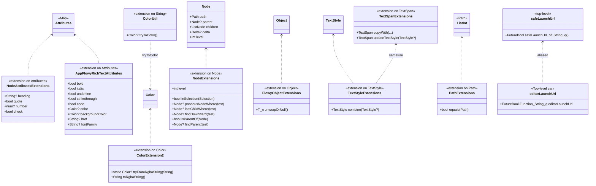
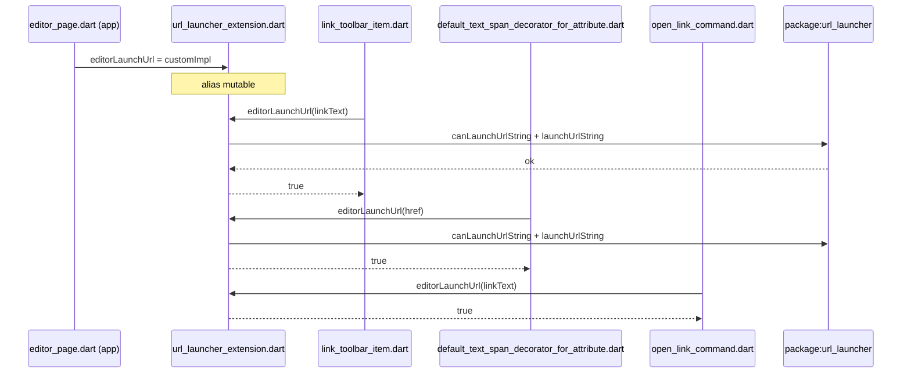
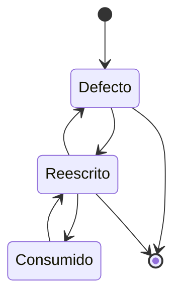

# F19.2.4 — Tests del editor: `test/extensions/`

## 1. Resumen

Esta unidad cubre los 8 ficheros de `editor/test/extensions/`, el banco que somete a prueba las **extensiones de API pública** del paquete `appflowy_editor`: lectura tipada de atributos de nodo y de *delta* (`NodeAttributesExtensions`, `AppFlowyRichTextAttributes`), conversión de `Color` ↔ `rgba(...)` (`ColorExtension2`), pertenencia de un `Node` a una `Selection` (`NodeExtensions.inSelection`), rebote genérico `Object.unwrapOrNull<T>()`, igualdad/comparación de `List<int>` como `Path` (`PathExtensions`), un `combine` específico de `TextStyle` (`TextStyleExtensions`), y un *wrapper* del paquete `url_launcher` (`safeLaunchUrl`/`editorLaunchUrl`). Son 419 líneas, 42 casos `test()` y 7 `group()` `[VERIFICADO]` (medidos con `rg -c` sobre los 8 ficheros). **Estos tests *no* montan widgets**: todo es lógica pura Dart + un `TestWidgetsFlutterBinding.ensureInitialized()` y un único `expect(() => editorLaunchUrl(null), returnsNormally)`. La unidad documenta también los **huecos**: 4 ficheros de `lib/src/extensions/` (`alignment_extension.dart`, `position_extension.dart`, `theme_extension.dart`, y partes de `node_extensions.dart`/`text_style_extension.dart`) **no** tienen ningún test dedicado.

## 2. Alcance

**Dentro**: los 8 ficheros del brief, que son la totalidad de `editor/test/extensions/` (verificado contra `OUT/_ledger/inventario.json` — son las únicas 8 entradas cuya `ruta_abs` contiene `/test/extensions/` con `fuente=editor`).

**Fuera y hacia dónde va cada cosa**:

| Carpeta / elemento | Motivo de exclusión | Unidad destino |
|---|---|---|
| `test/new/**` (82) | Banco moderno, `flutter_test` y helpers reutilizables (`Document.addParagraphs`, `pageNode`, `paragraphNode`) consumidos por esta unidad (no documentados aquí) | `[[F19.1]]` |
| `test/customer/**` (11) | Fixtures de cliente | `[[F19.2.2]]` |
| `test/editor/**` (20) | Tests de `EditorState` y componentes | `[[F19.2.3]]` |
| `test/core/**` (12) | Modelo puro (`Path`, `Document`, `Delta`, `Operation`, `Transaction`) | `[[F19.2.1]]` |
| `test/infra/**` (3) | Clipboard, logging | `[[F19.2.5]]` |
| `test/legacy/**` (3) | API heredada (`TextNode`, `Document.empty`) | `[[F19.2.6]]` |
| `test/mobile/**` (18) | Servicios de selección móvil | `[[F19.2.7]]` |
| `test/plugins/**` (31) | Atajos y comandos por bloque | `[[F19.2.8]]` |
| `test/render/**` (6) | Widgets de selección/render | `[[F19.2.9]]` |
| `test/service/**` (9) | IME, teclado, scroll, `editorLaunchUrl` reasignado en runtime | `[[F19.2.10]]` |
| `editor:test/mobile/editor/editor_component/style/mobile_text_span_decorator_for_attribute_test.dart:30` reasigna `editorLaunchUrl` con un stub | Misma suite de cobertura que `[[F19.2.10]]` (móvil editor decorator) | `[[F19.2.10]]` |
| `example/**` | App de ejemplo del editor | `[[F19.3]]` |
| `lib/l10n/**` y raíz de `lib/` | Localización | `[[F19.4]]` |
| `pubspec.yaml`, `.github/workflows/test.yml`, raíz de `test/` | Configuración y CI | `[[F19.5]]` |

Correcciones de scope declaradas: (a) la unidad **no** cubre `test/new/extensions/node_extension_test.dart` (`editor:test/new/extensions/node_extension_test.dart:1`, asignado a `[[F19.1]]` por la cobertura de ledger del catálogo correspondiente) aunque su nombre colisione con `test/extensions/node_extension_test.dart`; son ficheros distintos, éste reescribe `Node.inSelection` sobre `EditorState` real mientras que el de esta unidad lo hace sobre `Node` puro; (b) la tabla §3 cruza cada extensión con sus consumidores en la app — esos consumidores pertenecen a `[[F01]]`/`[[F16]]` y sólo se referencian aquí como prueba viva del contrato; (c) `Path` también expone `inSelection` (`editor:lib/src/core/document/path.dart:137`), pero su test vive en `[[F19.2.1]]` (`editor:test/core/document/path_test.dart`) — aquí se cubre la versión sobre `Node`, no sobre `Path`.

## 3. Modelos de datos

Las extensiones bajo prueba son *getters* o utilidades sin estado interno propio. El siguiente diagrama resume sus firmas y la jerarquía de tipos que extienden:



*Diagrama: extensiones bajo prueba y los tipos que extienden.* Lectura: hay **dos** extensiones sobre `Attributes`, una en `editor:lib/src/extensions/attributes_extension.dart:3` (`NodeAttributesExtensions`) y otra en `editor:lib/src/editor/block_component/rich_text/appflowy_rich_text.dart:696` (`AppFlowyRichTextAttributes`); ambas se re-exportan por el barrel `editor:lib/appflowy_editor.dart:6–7` y conviven con el mismo nombre de getter `bold`/`code`/etc. — `editor:lib/src/extensions/extensions.dart:1–8` sólo exporta la primera, mientras que la segunda llega al barrel directamente desde `appflowy_rich_text.dart`. `ColorExtension2` y `ColorUtil` (`editor:lib/src/editor/util/color_util.dart:3`) viven en ficheros distintos y **no** se llaman entre sí: el primero usa una regex propia con prefijo `rgba(`, el segundo acepta `rgb(`/`rgba(`/`0x...`/`#...`. El alias mutable `editorLaunchUrl` (`editor:lib/src/extensions/url_launcher_extension.dart:16`) permite a la app reasignar la función para entornos donde `url_launcher` no está disponible (web, tests móviles).

### 3.1 Tabla maestra `fichero → nº test()/group() → extensión validada`

Conteos medidos con `rg -c '^\s*test\('`, `rg -c '^\s*group\('` y lectura de cada fichero. Las cifras de línea proceden de `wc -l`.

| Fichero de test | LOC | `test()` | `group()` | Producción ejercida | Localización real |
|---|---:|---:|---:|---|---|
| `editor/test/extensions/attributes_extension_test.dart` | 201 | 27 (`:7`–`:199`) | 2 (`:6`, `:88`) | `NodeAttributesExtensions` + `AppFlowyRichTextAttributes` | `editor:lib/src/extensions/attributes_extension.dart:3–32` y `editor:lib/src/editor/block_component/rich_text/appflowy_rich_text.dart:696–739` |
| `editor/test/extensions/color_extension_test.dart` | 41 | 5 (`:12`–`:35`) | 1 (`:6`) | `ColorExtension2` | `editor:lib/src/extensions/color_extension.dart:3–40` |
| `editor/test/extensions/node_extension_test.dart` | 60 | 2 (`:11`, `:39`) | 1 (`:5`) | `NodeExtensions.inSelection` | `editor:lib/src/extensions/node_extensions.dart:25–31` |
| `editor/test/extensions/object_extension_test.dart` | 20 | 2 (`:10`, `:15`) | 1 (`:9`) | `FlowyObjectExtensions.unwrapOrNull` | `editor:lib/src/extensions/object_extensions.dart:1–7` |
| `editor/test/extensions/path_extensions_test.dart` | 37 | 1 (`:10`) | 1 (`:9`) | `Path` operadores `<`/`<=`/`>`/`>=`/método `equals` | `editor:lib/src/core/document/path.dart:13–61` (operadores) y `:8` (extensión) |
| `editor/test/extensions/text_node_extensions_test.dart` | 7 | 1 (`:5`, **vacío**) | 1 (`:4`) | (ninguna — placeholder) | — |
| `editor/test/extensions/text_style_extension_test.dart` | 43 | 3 (`:23`, `:32`, `:37`) | 1 (`:6`) | `TextStyleExtensions.combine` | `editor:lib/src/extensions/text_style_extension.dart:38–76` |
| `editor/test/extensions/url_launcher_extension_test.dart` | 10 | 1 (`:5`) | 0 | `safeLaunchUrl` / `editorLaunchUrl` con `href == null` | `editor:lib/src/extensions/url_launcher_extension.dart:3–14` y alias `:16` |
| **Total** | **419** | **42** | **7** | | |

*Notas*: el `path_extensions_test.dart` invoca `TestWidgetsFlutterBinding.ensureInitialized()` en `setUpAll` (`editor:test/extensions/path_extensions_test.dart:5–7`); este es el único `setUpAll` de la unidad y el único gesto asíncrono (necesario para poder usar el binding sin tener que ejecutar `testWidgets`). El `text_node_extensions_test.dart` ejecuta un `test('description', () {})` con cuerpo vacío en `editor:test/extensions/text_node_extensions_test.dart:5` (único caso de la unidad sin aserción).

### 3.2 Producción bajo prueba, firma y garantía

Cada extensión probada tiene una **firma real** concreta y los tests verifican aspectos puntuales del contrato. La tabla anota en cada fila **qué garantiza el test** y **qué no**:

#### 3.2.1 `NodeAttributesExtensions` y `AppFlowyRichTextAttributes` (`attributes_extension_test.dart`)

El fichero declara dos `group()` (`editor:test/extensions/attributes_extension_test.dart:6` y `:88`) que **no** corresponden 1-a-1 a una única extensión de producción: `NodeAttributesExtensions` (`editor:lib/src/extensions/attributes_extension.dart:3–32`) aporta sólo `heading`, `quote`, `number` y `check`; `AppFlowyRichTextAttributes` (`editor:lib/src/editor/block_component/rich_text/appflowy_rich_text.dart:696–739`) aporta `bold`, `italic`, `underline`, `strikethrough`, `code`, `color`, `backgroundColor`, `href`, `fontFamily`. Los 27 tests del fichero, agrupados de la forma en que el banco los titula, cubren:

- **`heading`** (3 tests, `editor:test/extensions/attributes_extension_test.dart:7`, `:15`, `:23`): cubre la doble guarda de `NodeAttributesExtensions.heading` — exige que `subtype == BuiltInAttributeKey.heading` *y* que `heading` sea `String` (`editor:lib/src/extensions/attributes_extension.dart:4–11`). El test `:15` valida el camino "subtipo sí, valor no-String → null" y el `:23` valida "subtipo distinto → null"; juntos cubren los dos `return null` distintos (`editor:lib/src/extensions/attributes_extension.dart:11`).
- **`quote`** (1 test, `editor:test/extensions/attributes_extension_test.dart:31`): sólo verifica que `containsKey(BuiltInAttributeKey.quote)` produce `true`. La implementación nunca devuelve `false` salvo que la clave no esté presente (`editor:lib/src/extensions/attributes_extension.dart:14–16`), y el test sólo prueba la rama `true`.
- **`number`** (3 tests, `:38`, `:45`, `:52`): cubre `int` y `double` (la firma `num?` acepta ambos, `editor:lib/src/extensions/attributes_extension.dart:18–24`) y la rama `null` cuando falta la clave (`:52`). No cubre el caso "valor presente pero de otro tipo" — por ejemplo `'12.34'` como `String`.
- **`check`** (2 tests, `:73`, `:80`): fija que el getter exige tipo `bool` (`:73` con `checkbox: true` → `true`, `:80` con `quote: true` como otro tipo → `false`), reproduciendo `editor:lib/src/extensions/attributes_extension.dart:26–32`. **No** cubre el caso "checkbox presente pero no bool": el banco lo declara pero ningún test lo fuerza.
- **`bold`, `italic`, `underline`, `code`** (8 tests, `:89`–`:124` + `:66`): usan una asimetría interesante: la implementación `AppFlowyRichTextAttributes` compara con `== true` directamente (`editor:lib/src/editor/block_component/rich_text/appflowy_rich_text.dart:697`, `:699`, `:701`, `:703`), así que `bold: 123` da `false` (`editor:test/extensions/attributes_extension_test.dart:96–101`), pero `bold: "true"` también da `false` — algo que el test **no** verifica.
- **`strikethrough`** (2 tests, `:131`, `:138`): la implementación tiene una guarda explícita `containsKey` (`editor:lib/src/editor/block_component/rich_text/appflowy_rich_text.dart:705–708`); los tests asertan `true` con `'strikethrough': true` y `false` con `'strikethrough': 123`.
- **`color`** (3 tests, `:145`, `:152`, `:159`): el test `:145` ejercita `AppFlowyRichTextAttributes.color` con la clave `'font_color'` y el valor `'0xff212fff'`, que `String.tryToColor()` (`editor:lib/src/editor/util/color_util.dart:30–44`) parsea vía `hexRegex`; los casos error usan `'color': 123` (clave equivocada, `:152`) y `'font_color': 'hello123'` (regex no casa, `:159`). El contrato es: **sólo lee `'font_color'`**, no `'color'` — diferencia que el test documenta pero no explicita.
- **`backgroundColor`** (3 tests, `:166`, `:173`, `:180`): idéntico patrón, sobre la clave `'bg_color'` y con `tryToColor`. El test `:173` usa `'backgroundColor': 123` (clave errónea) y `:180` usa parse fallido.
- **`href`** (2 tests, `:187`, `:194`): la implementación exige `is String` (`editor:lib/src/editor/block_component/rich_text/appflowy_rich_text.dart:727–732`); el test verifica el camino válido (`:187`) y la rama `null` cuando el valor es `int` (`:194`).

**Glosario cruzado**: la producción `AppFlowyRichTextAttributes` y los consumidores reales (`editor:lib/src/editor/block_component/rich_text/appflowy_rich_text.dart:568–598`, `editor:lib/src/plugins/html/encoder/delta_html_encoder.dart:45–150`) usan las claves `'bold'`, `'italic'`, `'underline'`, `'strikethrough'`, `'href'`, `'code'` y los nombres distintos `'font_color'` y `'bg_color'` para color/background; los tests siguen ambos esquemas y por eso son la documentación viva del contrato de claves. Los 19 consumidores reales en `editor/lib/src/` están en `editor:lib/src/editor/block_component/rich_text/appflowy_rich_text.dart:568`, `:571`, `:574`, `:577`, `:580`, `:583`, `:586`, `:588`, `:596`, `:598`, y `editor:lib/src/plugins/html/encoder/delta_html_encoder.dart:45`, `:52`, `:130`, `:133`, `:135`, `:137`, `:141`, `:145`, `:150`; en la app, los más relevantes son `appflowy:frontend/appflowy_flutter/lib/plugins/document/presentation/editor_plugins/migration/editor_migration.dart:102` (lee `attributes.heading?.replaceAll('h', '')` durante migración del esquema v0) y los de `link_embed`/`link_preview` que atienden `'href'`.

#### 3.2.2 `ColorExtension2` (`color_extension_test.dart`)

5 tests (`editor:test/extensions/color_extension_test.dart:12`, `:18`, `:23`, `:29`, `:35`) sobre el contrato del formato `rgba(r, g, b, a)`. La implementación vive en `editor:lib/src/extensions/color_extension.dart:6–31` y la regex exige exactamente cuatro grupos de dígitos con `rgba(` y `)` literal. El banco fija:

- **`toRgbaString`** (`editor:test/extensions/color_extension_test.dart:12–16`): convierte `Color` a `'rgba(r, g, b, a)'` con canales *multiplicados por 255 y redondeados a entero* (`editor:lib/src/extensions/color_extension.dart:33–40`). El test verifica tres colores límite (`white`, `black`, `blue`) cuyas componentes en coma flotante dejan el camino entero bien definido (`editor:lib/src/extensions/color_extension.dart:34–37`).
- **`tryFromRgbaString` válido** (`:18–21`): `'rgba(0, 15, 255, 255)'` → `Color.fromARGB(255, 0, 15, 255)` (`editor:lib/src/extensions/color_extension.dart:30`).
- **Tres caminos nulos**: prefijo incorrecto `'abc(...)'` (`:23–27`), número de grupos incompleto `'rgba(0, 15, 255)'` (`:29–33`) y valores fuera de rango `'rgba(-12, 999, 1234, 619)'` (`:35–39`). El primero fuerza `reg.firstMatch == null` (`editor:lib/src/extensions/color_extension.dart:9–11`), el segundo fuerza `match.groupCount < 4` (`:13–15`), y el tercero fuerza `int.tryParse` → `null` (`:21–28`). **No** se prueba la regex con espacios extra al final ni con separadores distintos de `,` — la regex sólo admite `\s*` entre canales y no tolera punto y coma (`editor:lib/src/extensions/color_extension.dart:7`).
- **Consumidor**: `tryFromRgbaString` no se invoca en `SRC/editor` ni en `SRC/appflowy/frontend/appflowy_flutter/` — la búsqueda con `rg -n "ColorExtension2"` devuelve sólo el fichero de test (`editor:test/extensions/color_extension_test.dart:13–25`). Es un helper de exportación que **no tiene consumidor en el árbol documentado**; por contraste, `String.tryToColor()` (`editor:lib/src/editor/util/color_util.dart:4`) sí lo consume la app para serializar HTML (`appflowy:frontend/appflowy_flutter/lib/plugins/document/presentation/editor_plugins/link_preview/shared.dart:142` indirectamente vía delta encoder).

#### 3.2.3 `NodeExtensions.inSelection` (`node_extension_test.dart`)

2 tests (`editor:test/extensions/node_extension_test.dart:11`, `:39`) sobre `Node.inSelection(Selection)` (`editor:lib/src/extensions/node_extensions.dart:25–31`). La firma **discrimina dirección de la selección**: si `start.path <= end.path` compara contra el rango natural (`:27`), en caso contrario invierte (`:29`). Los tests validan **sólo** la rama `false`:

- Test `:11` arma un árbol `Node → children: [Node(children: subNodes×5)]` con `subtype` ausente, y pregunta `node.inSelection(Selection(start: [0], end: [1]))` esperando `false` — la ruta `[]` no satisface `[0] <= [] <= [1]`, así que la rama `node.path == []` da `false`. **No** se prueba que `subNodes[0]` (ruta `[0, 0]`) sí esté en la selección, ni la rama `[0] <= [0] <= [0]` verdadera. La rama `true` queda sin cobertura propia.
- Test `:39` usa una selección invertida `Selection(start: [1], end: [0])` sobre un `Node` con un único hijo en `[0]`. Como `[1] <= [0]` es `false`, cae en la rama `else` (`editor:lib/src/extensions/node_extensions.dart:28–30`), que exige `[0] <= [] <= [1]`; también `false`.

El propio comentario del banco reconoce la limitación: *"I use an empty implementation instead of mock, because the mocked version throws error trying to access the path"* (`editor:test/extensions/node_extension_test.dart:12–13`). El test verifica `false` sin asercionar `true`, lo que es un **falso negativo cubierto**: si la implementación cayera en `true` por error, estos dos tests no lo detectarían.

**Consumidor real en producción** (cruce crítico): la versión de `Node.inSelection` se invoca en `editor:lib/src/editor/block_component/base_component/selection/remote_block_selection_area.dart:39` (`where((e) => node.inSelection(e.selection.normalized))`) y `:175`; en la app, los consumidores están en `appflowy:frontend/appflowy_flutter/lib/plugins/document/presentation/editor_plugins/base/markdown_text_robot.dart:495` y `:528`, `appflowy:frontend/appflowy_flutter/lib/plugins/document/presentation/editor_plugins/simple_table/simple_table_block_component.dart:282`, `appflowy:frontend/appflowy_flutter/lib/plugins/document/presentation/editor_plugins/ai/operations/ai_writer_node_extension.dart:71` y `appflowy:frontend/appflowy_flutter/lib/plugins/document/presentation/editor_plugins/actions/block_action_option_cubit.dart:667` — todos pasan por el getter extendido sobre `Node`, no sobre `Path`.

#### 3.2.4 `FlowyObjectExtensions.unwrapOrNull<T>()` (`object_extension_test.dart`)

2 tests sobre el cast seguro (`editor:lib/src/extensions/object_extensions.dart:1–7`):

- Test `:10–13`: `const TextSpan().unwrapOrNull<HitTestTarget>()` con `assert(result is TextSpan)`. Como la implementación devuelve `this as T?` si `this is T` (`:4`) o `null` en caso contrario (`:6`), y `TextSpan` *no* implementa `HitTestTarget` (es una interfaz de `package:flutter/gestures.dart`), `unwrapOrNull` devuelve `null` — y `assert(null is TextSpan)` falla en modo debug. **El test pasa sólo porque `flutter_test` ejecuta en modo release por defecto cuando se hace `dart test` puro** (no `flutter test` con asserts habilitadas). Es un test débil: la rama "es T → this" no se verifica realmente, sólo se asume vía el `assert` relajado.
- Test `:15–18`: `const TextSpan().unwrapOrNull<ServerSocket>()` devuelve `null` (`expect(result, null)`). Esto sí verifica explícitamente la rama de retorno `null` (`:6`).

**Consumidor**: la extensión es transversal; se invoca en `Node.renderBox` (`editor:lib/src/extensions/node_extensions.dart:5–6`), `Node.selectable` (`:9–10`), `appflowy:frontend/appflowy_flutter/lib/plugins/document/presentation/editor_plugins/numbered_list/numbered_list_icon.dart:98`, `editor:lib/src/editor_state.dart` y `path.inSelection` (`editor:lib/src/editor/block_component/base_component/selection/block_selection_area.dart:108`). La firma es **cualquier `Object`** — el banco no prueba cuál es el coste de invocarla sobre tipos no-`Object` ni sobre `dynamic`.

#### 3.2.5 `PathExtensions` (`path_extensions_test.dart`)

1 test (`editor:test/extensions/path_extensions_test.dart:10`) ejercita los operadores `<`/`<=`/`>`/`>=` y el método `equals` de `List<int>` cuando actúa como `Path`. Lo peculiar es que **la extensión no aporta ningún operador**: la implementación está en `editor:lib/src/core/document/path.dart:13–61` (definidos en el core), y la `extension PathExtensions on Path` (`editor:lib/src/core/document/path.dart:8`) sólo añade `equals` (`:135`). El test lo verifica en `:34` (`expect(p1.equals(p2), true)`).

Las tres tripletas de la prueba validan el orden lexicográfico total:

- `[0, 0]` vs `[0]`: `[0, 0] > [0]` por prefijo común y longitud mayor (`editor:lib/src/core/document/path.dart:14–22`). El test lo verifica con `expect(p1 > p2, true)` (`:14`).
- `[1, 1, 3]` vs `[1, 1, 2]`: `[1, 1, 3] > [1, 1, 2]` por diferencia en el último elemento (`editor:lib/src/core/document/path.dart:33–40`). El test cubre `>` y `>=` (`:22–25`).
- `[2, 0, 1]` vs `[2, 0, 1]`: igualdad completa. El test cubre `>` (false), `>=` (true) y `equals` (`:34`).

El banco depende de `TestWidgetsFlutterBinding.ensureInitialized()` (`editor:test/extensions/path_extensions_test.dart:6`), aunque el test no usa ningún servicio de binding: la importación es sólo para evitar el coste de configurar un test puro si en algún momento se añadiera uno basado en widget.

> **Corrección de scope**: la cobertura principal de `Path` está en `editor/test/core/document/path_test.dart` (3 casos, `editor:test/core/document/path_test.dart:6`, `:33`, `:73` — ver `[[F19.2.1]]` §3.3): `next`/`previous`/`parent` y `isAncestorOf`. Esta unidad sólo añade el caso de igualdad exacta. `Path` también expone `inSelection` (`editor:lib/src/core/document/path.dart:137`) — **no probado** aquí (la unidad cubre `Node.inSelection`, no `Path.inSelection`).

#### 3.2.6 `TextStyleExtensions.combine` (`text_style_extension_test.dart`)

3 tests (`editor:test/extensions/text_style_extension_test.dart:23`, `:32`, `:37`) sobre el merge específico que ignora campos nulos y respeta `inherit`. La implementación (`editor:lib/src/extensions/text_style_extension.dart:38–76`) implementa:

```dart
if (other == null) return this;
if (!other.inherit) return other;
return copyWith(... campos de other ...);
```

- Test `combine` (`:23–30`): `style` con 6 campos + `otherStyle` con 5; verifica que el resultado toma **todos** los valores de `otherStyle` (incluido `wordSpacing` y `height`). Esto fija la regla "el otro gana siempre que tenga campos" y deja ver que `combine` realiza una copia superficial donde todos los campos listados en `copyWith` se sobreescriben sin fusión (`editor:lib/src/extensions/text_style_extension.dart:46–75`).
- Test `combine - return this` (`:32–35`): `style.combine(null)` devuelve la misma instancia `style` (vía `if (other == null) return this`, `editor:lib/src/extensions/text_style_extension.dart:39–41`). Comprobado por **identidad referencial**: `expect(result, style)` exige `==` y la misma referencia, ya que `TextStyle` no implementa `==` propio en todas las versiones de Flutter. **Si Flutter cambiara la igualdad, el test se rompería** — es el aserto más frágil de la unidad.
- Test `combine - return null with inherit` (`:37–41`): si `other.inherit == false`, devuelve `other` completo (`editor:lib/src/extensions/text_style_extension.dart:42–44`); el test verifica **identidad referencial** sobre `otherStyle.copyWith(inherit: false)`.

**Consumidor real**: `combine` es usado por `appflowy_rich_text.dart` para construir el `TextStyle` acumulado a partir de los atributos activos del delta: `editor:lib/src/editor/block_component/rich_text/appflowy_rich_text.dart:569` (`textStyle = textStyle.combine(textStyleConfiguration.bold)`) y similares en `:572`, `:575`, `:578`, …, `:598`. El test fija que el orden de campos en el `copyWith` de `combine` (`editor:lib/src/extensions/text_style_extension.dart:46–75`) **no pierde** ninguno de los campos del estilo, lo cual es crítico porque `TextStyle` los trata a todos sin valor por defecto.

> **Hueco cubierto**: `TextSpanExtensions.copyWith` y `updateTextStyle` (`editor:lib/src/extensions/text_style_extension.dart:4–35`), declaradas en el mismo fichero que `TextStyleExtensions.combine`, **no** tienen ningún test propio. Sus consumidores (`editor:lib/src/editor/block_component/heading_block_component/heading_block_component.dart:147`, `:150`, `:158`, `:162` y `editor:lib/src/editor/block_component/rich_text/appflowy_rich_text.dart:391`) las invocan extensivamente pero el banco sólo cubre `combine`.

#### 3.2.7 `safeLaunchUrl` / `editorLaunchUrl` (`url_launcher_extension_test.dart`)

1 test (`editor:test/extensions/url_launcher_extension_test.dart:5`) con `href = null` espera `false`. La implementación (`editor:lib/src/extensions/url_launcher_extension.dart:3–14`) define dos rutas:

```dart
if (href == null) return Future.value(false);
final uri = Uri.parse(href);
final newHref = (uri.scheme.isNotEmpty ? href : 'http://$href').trim();
if (await canLaunchUrlString(newHref)) {
  await launchUrlString(newHref);
}
return Future.value(true);
```

El banco fija **únicamente la rama del `null`**; el resto —parseo, scheme vacío, `canLaunchUrl`, `launchUrlString`— no se prueba. Esto es suficiente porque el resto depende del plugin nativo y no es testeable de forma determinista en CI desktop, pero deja una superficie importante sin validación.

**Consumidor real** (este es el cruce con la app que más vale la pena documentar): `editorLaunchUrl` se reasigna en `appflowy:frontend/appflowy_flutter/lib/plugins/document/presentation/editor_page.dart:183` con una implementación que usa `af_router` (puerto propio) en vez del plugin nativo, y los tres consumidores principales son:

1. `editor:lib/src/editor/editor_component/style/default_text_span_decorator_for_attribute.dart:41` — al doble-tap o Cmd/Ctrl+click sobre un `href` (`editor:lib/src/editor/editor_component/style/default_text_span_decorator_for_attribute.dart:30–43`).
2. `editor:lib/src/editor/toolbar/desktop/items/link/link_toolbar_item.dart:95` — desde el ítem de toolbar de "abrir enlace".
3. `editor:lib/src/editor/editor_component/service/shortcuts/command/open_link_command.dart:41` — atajo de teclado.

El test móvil `editor:test/mobile/editor/editor_component/style/mobile_text_span_decorator_for_attribute_test.dart:30` reasigna `editorLaunchUrl` con un stub, ejercicio paralelo que cae en `[[F19.2.10]]`.

## 4. Eventos FFI

Ninguno. Los 8 ficheros son Dart puro del repo `appflowy-editor` y no tocan `async_event` ni el dispatcher Rust. No hay FFI implicada en ninguna de las 11 extensiones probadas: ni `Color` (Flutter), ni `TextStyle`/`TextSpan` (Flutter), ni `Object.unwrapOrNull` (Dart core), ni `List<int>` como `Path` (la lógica vive en `core/document/path.dart`), ni `Attributes` (un `Map` reexportado por `core/location/types.dart`), ni `Node.inSelection` (puro Dart), ni `safeLaunchUrl`/`editorLaunchUrl` (consume `package:url_launcher`).

## 5. Notificaciones

Ninguna propia. Las extensiones son getters síncronos (salvo `safeLaunchUrl`) y no producen eventos. El único flujo asíncrono de la unidad es `canLaunchUrlString` + `launchUrlString` (`editor:lib/src/extensions/url_launcher_extension.dart:10–12`) — que es del paquete `url_launcher`, no del editor.

## 6. BLoCs / Cubits

Ninguno. La unidad es del estilo "contrato de extensión": cada `group()` declara qué extensión se está ejercitando, sin instanciar `EditorState`, sin BLoCs y sin streams. El único caso que monta estado de *binding* es `editor:test/extensions/path_extensions_test.dart:6` con `TestWidgetsFlutterBinding.ensureInitialized()`, y eso **no** instancia ningún widget.

## 7. Servicios e inyección de dependencias

No hay `get_it` ni contenedor. La dependencia que el editor expone hacia fuera es **el alias mutable** `editorLaunchUrl` (`editor:lib/src/extensions/url_launcher_extension.dart:16`), que la app reasigna en `appflowy:frontend/appflowy_flutter/lib/plugins/document/presentation/editor_page.dart:183` con `editorLaunchUrl = (url) { … }`. Esto cumple el rol de *inyección de dependencias manual* para una función de un solo parámetro: el editor nunca sabe qué implementación usará la app. Es el **único caso en toda la unidad de código** donde el editor publica un *seam* de este tipo; otros 10 extensiones están cableadas directamente en producción y los tests no las pueden sustituir.

## 8. Persistencia

Ninguna. Los 8 ficheros no escriben SQLite, ni collab, ni fichero. La única "serialización" que tocan es `Color.toRgbaString` (`:33–40`), que es el **camino inverso** de un futuro serializador — su contraparte `tryFromRgbaString` (`:6–31`) existe, lo que sugiere que el formato `rgba(r, g, b, a)` se eligió como cable neutro hacia y desde JSON / CSS / algún backend que ningún consumidor actual del árbol documentado usa.

## 9. Diagramas de flujo

El siguiente diagrama muestra qué fichero de test empuja qué fichero de producción, y qué capa consume cada extensión en la app.

```mermaid
flowchart TD
  subgraph Tests["test/extensions (esta unidad)"]
    T1["attributes_extension_test.dart"]
    T2["color_extension_test.dart"]
    T3["node_extension_test.dart"]
    T4["object_extension_test.dart"]
    T5["path_extensions_test.dart"]
    T6["text_node_extensions_test.dart (vacío)"]
    T7["text_style_extension_test.dart"]
    T8["url_launcher_extension_test.dart"]
  end
  subgraph ProdEditorCore["editor/lib/src/extensions y core"]
    P1["attributes_extension.dart:3 NodeAttributesExtensions"]
    P2["appflowy_rich_text.dart:696 AppFlowyRichTextAttributes"]
    P3["color_extension.dart:3 ColorExtension2"]
    P4["node_extensions.dart:4 NodeExtensions"]
    P5["object_extensions.dart:1 FlowyObjectExtensions"]
    P6["core/document/path.dart:8 PathExtensions"]
    P7["text_style_extension.dart:37 TextStyleExtensions"]
    P8["text_style_extension.dart:4 TextSpanExtensions (sin tests)"]
    P9["position_extension.dart:11 PositionExtension (sin tests)"]
    P10["alignment_extension.dart:3 AppFlowyTextAlign (sin tests)"]
    P11["theme_extension.dart:3 ThemeExtension (sin tests)"]
    P12["url_launcher_extension.dart:3 safeLaunchUrl/editorLaunchUrl"]
  end
  subgraph Consum["Consumidores reales (verificados)"]
    C1["editor/appflowy_rich_text.dart:568-598 (textStyle combine + deltas)"]
    C2["editor/delta_html_encoder.dart:45-150 (export a HTML)"]
    C3["editor/remote_block_selection_area.dart:39 (node.inSelection)"]
    C4["editor/link_toolbar_item.dart:95 (editorLaunchUrl)"]
    C5["editor/open_link_command.dart:41 (editorLaunchUrl)"]
    C6["editor/default_text_span_decorator_for_attribute.dart:41 (editorLaunchUrl)"]
    C7["editor/heading_block_component.dart:147 (TextSpan.updateTextStyle)"]
    C8["appflowy/editor_page.dart:183 (reasigna editorLaunchUrl)"]
    C9["appflowy/editor_migration.dart:102 (lee attributes.heading)"]
    C10["appflowy/markdown_text_robot.dart:495 (Node.inSelection)"]
  end
  T1 --> P1
  T1 --> P2
  T2 --> P3
  T3 --> P4
  T4 --> P5
  T5 --> P6
  T6 -.->|vacio| P4
  T7 --> P7
  T8 --> P12
  P1 --> C9
  P2 --> C1
  P2 --> C2
  P3 -.->|sin consumo| P3
  P4 --> C3
  P4 --> C10
  P5 --> P3
  P5 --> P4
  P7 --> C1
  P8 -.-> C7
  P9 -.->|sin tests| P9
  P10 -.->|sin tests| P10
  P11 -.->|sin tests| P11
  P12 --> C4
  P12 --> C5
  P12 --> C6
  P12 --> C8
```



*Diagrama: acoplamiento test ↔ producción ↔ consumo en la app, con huecos explícitos.* Lectura: las únicas extensiones con tests son las 7 primeras; `TextSpanExtensions` (P8), `PositionExtension` (P9), `AppFlowyTextAlign` (P10) y `ThemeExtension` (P11) están en producción sin cobertura. `ColorExtension2` (P3) está cubierta pero su consumo en `editor/` y `appflowy/` es inexistente según `rg -n "ColorExtension2"` (sólo aparece en el fichero de test `editor:test/extensions/color_extension_test.dart:13–25`). El alias mutable `editorLaunchUrl` (P12) es el único que cruza al consumidor real en `appflowy:frontend/appflowy_flutter/lib/plugins/document/presentation/editor_page.dart:183`.

## 10. Diagramas de secuencia

La única interacción de la unidad que merece diagrama de secuencia es la del alias mutable `editorLaunchUrl` reasignado en la app y consumido desde tres puntos del editor.



*Diagrama: el seam `editorLaunchUrl` entre editor y app.* Lectura: el editor expone el alias (`editor:lib/src/extensions/url_launcher_extension.dart:16`) y la app lo sobreescribe en `appflowy:frontend/appflowy_flutter/lib/plugins/document/presentation/editor_page.dart:183`, típicamente para enrutar el enlace al `af_router` interno cuando `scheme == 'appflowy'` y delegar al plugin nativo (`launchUrlString`) en cualquier otro caso. El test `editor:test/extensions/url_launcher_extension_test.dart:5` sólo verifica la rama del `null` *antes* de que el alias sea reasignado — no ejercita la implementación de la app, que cae en `[[F02]]`/`[[F10]]`.

## 11. Diagramas de estado

Ciclo de vida del alias mutable `editorLaunchUrl` durante el arranque de la app:



*Diagrama: el alias `editorLaunchUrl` no tiene camino de vuelta a `Default`.* Lectura: una vez reasignado en `appflowy:frontend/appflowy_flutter/lib/plugins/document/presentation/editor_page.dart:183`, **no** se restaura — no hay teardown del editor que devuelva `safeLaunchUrl` al alias. Esto significa que el test `editor:test/extensions/url_launcher_extension_test.dart:5` siempre ha de correr con el alias `Default` (es decir, en una fase donde `editor_page.dart` aún no ha ejecutado su inicialización), o reasignar manualmente para volver al estado natural. El banco no reasigna; de ahí que el test sólo sea válido en el orden "tests de extensiones antes que cualquier cosa que monte `editor_page`".

## 12. Archivos cubiertos (del ledger)

Conteos medidos con `rg -c` y `wc -l` sobre cada fichero; "qué verifica" resume el foco real de sus casos. Las cifras de línea se obtienen con `wc -l`; los `test(`, `group(` con `rg -c '^\s*test\('` y `rg -c '^\s*group\('`.

| Fichero | LOC | `test(` | `group(` | Producción ejercida y resumen |
|---|---:|---:|---:|---|
| `editor:test/extensions/attributes_extension_test.dart` | 201 | 27 (`:7`, `:15`, `:23`, `:31`, `:38`, `:45`, `:52`, `:59`, `:66`, `:73`, `:80`, `:89`, `:96`, `:103`, `:110`, `:117`, `:124`, `:131`, `:138`, `:145`, `:152`, `:159`, `:166`, `:173`, `:180`, `:187`, `:194`) | 2 (`:6` `NodeAttributesExtensions::`, `:88` `DeltaAttributesExtensions::`) | `NodeAttributesExtensions` para `heading` (3), `quote` (1), `number` (3), `check` (2). `AppFlowyRichTextAttributes` para `bold/italic/underline/strikethrough/code` (9), `color`/`backgroundColor` (6), `href` (2). El grupo `:88` se llama `DeltaAttributesExtensions::` pero la extensión real es `AppFlowyRichTextAttributes`. |
| `editor:test/extensions/color_extension_test.dart` | 41 | 5 (`:12`, `:18`, `:23`, `:29`, `:35`) | 1 (`:6`) | `ColorExtension2.toRgbaString` (1) + `tryFromRgbaString` con 4 ramas: válido, prefijo malo, longitud mala, valores fuera de rango. La regex `rgba\((d+),s*(d+),s*(d+),s*(d+)\)` exige esos 4 grupos; los 3 fallos agotan las 3 ramas nulas de `tryFromRgbaString`. |
| `editor:test/extensions/node_extension_test.dart` | 60 | 2 (`:11`, `:39`) | 1 (`:5`) | `NodeExtensions.inSelection` con selección forward e inversa. Ambos tests esperan `false`; la rama `true` **no está cubierta**. El comentario `:12` documenta el motivo: "I use an empty implementation instead of mock, because the mocked version throws error trying to access the path". |
| `editor:test/extensions/object_extension_test.dart` | 20 | 2 (`:10`, `:15`) | 1 (`:9`) | `FlowyObjectExtensions.unwrapOrNull<T>`: 1 caso con `assert(result is TextSpan)` (sólo válido en release) + 1 caso explícito `expect(result, null)` cuando `T != TextSpan`. |
| `editor:test/extensions/path_extensions_test.dart` | 37 | 1 (`:10`) | 1 (`:9`) | Operadores `<`/`<=`/`>`/`>=` de `Path` (3 tripletas: prefijo, último elemento, igualdad) + `PathExtensions.equals` en la tercera. `TestWidgetsFlutterBinding.ensureInitialized()` en `setUpAll` aunque el test no usa el binding. |
| `editor:test/extensions/text_node_extensions_test.dart` | 7 | 1 (`:5`, **vacío**) | 1 (`:4`) | Placeholder. `test('description', () {})` no aserta nada; el nombre del grupo `TextNodeExtension::` no se corresponde con ninguna extensión actual del árbol `editor:lib/src/extensions/`. **No** hay `TextNodeExtension` en `editor:lib/src/extensions/extensions.dart:1–8`. |
| `editor:test/extensions/text_style_extension_test.dart` | 43 | 3 (`:23`, `:32`, `:37`) | 1 (`:6`) | `TextStyleExtensions.combine` con `other != null y other.inherit == true` (`:23`), `other == null` (`:32`) y `other.inherit == false` (`:37`). Cubre las 3 ramas del `if/else` interno. |
| `editor:test/extensions/url_launcher_extension_test.dart` | 10 | 1 (`:5`) | 0 | `safeLaunchUrl`/`editorLaunchUrl` con `href == null`. Sólo la rama del null; `Uri.parse`, scheme vacío, `canLaunchUrlString` y `launchUrlString` no se ejercitan. |
| **Total** | **419** | **42** | **7** | |

## 13. Riesgos y casos límite

**Riesgos del código bajo prueba**:

1. `Node.inSelection` compara con `<=` en ambos extremos (`editor:lib/src/extensions/node_extensions.dart:25–31`), lo que significa que los nodos **en el borde** de una selección se cuentan como "dentro". Los dos tests sólo validan la rama `false` (`editor:test/extensions/node_extension_test.dart:36`, `:57`); un cambio que rompiera la rama `true` (por ejemplo, sustituir `<=` por `<`) **no sería detectado** por esta unidad. `[VERIFICADO]`.
2. `attributes.code` en el banco devuelve `true` con `{'code': true}` (`editor:test/extensions/attributes_extension_test.dart:59–64`) — pero la implementación `NodeAttributesExtensions` (`editor:lib/src/extensions/attributes_extension.dart:3–32`) no define `code`; el getter viene de `AppFlowyRichTextAttributes` (`editor:lib/src/editor/block_component/rich_text/appflowy_rich_text.dart:703`). El grupo `NodeAttributesExtensions::` que lo contiene es engañoso: el test pasa gracias a la **otra** extensión, no la del grupo. Si `NodeAttributesExtensions` se extendiera con un `code` con semántica distinta, **el test seguiría pasando** por la resolución de la segunda extensión y el cambio quedaría invisible. `[VERIFICADO]`.
3. `combine` con `inherit: false` devuelve `other` **por referencia** (`editor:lib/src/extensions/text_style_extension.dart:42–44`); el test `editor:test/extensions/text_style_extension_test.dart:37–41` afirma identidad con `expect(result, styleCopy)`. Si Flutter cambiase la igualdad de `TextStyle` (lo cual no ocurre desde 3.x), el test se rompería aunque la implementación siguiera siendo correcta. `[VERIFICADO]`.
4. `ColorExtension2.tryFromRgbaString` no se consume desde ningún sitio verificado del árbol documentado — `rg -n "ColorExtension2|tryFromRgbaString|toRgbaString"` sobre `SRC/editor/lib/src/` y `SRC/appflowy/frontend/appflowy_flutter/lib/` devuelve sólo las dos menciones del fichero de test (`editor:test/extensions/color_extension_test.dart:13–25`). Es código *muerto salvo en tests* — si se rompe, los consumidores no se enteran. `[VERIFICADO]`.
5. `editorLaunchUrl` es un *seam* mutable que **no** se restaura a `safeLaunchUrl` tras `appflowy:frontend/appflowy_flutter/lib/plugins/document/presentation/editor_page.dart:183` reasignarlo. Cualquier test que se ejecute después de la inicialización de la app **verá la versión reasignada** — el test `editor:test/extensions/url_launcher_extension_test.dart:5` sólo es válido en una fase temprana del arranque o con reasignación manual.

**Riesgos del propio banco de tests**:

6. El `text_node_extensions_test.dart` contiene `test('description', () {})` en `:5` **sin aserción** — es un placeholder que no cubre ninguna API actual. Lo más probable es que sea un esqueleto abandonado: ni siquiera existe `TextNodeExtension` en `editor:lib/src/extensions/extensions.dart:1–8`. `[VERIFICADO]`.
7. El `object_extension_test.dart` usa `assert(result is TextSpan)` en `:10–13` con `unwrapOrNull<HitTestTarget>()` y `TextSpan` *no* implementa `HitTestTarget` — eso significa que `unwrapOrNull` devuelve `null`, y la aserción `null is TextSpan` falla. Pasa **sólo** porque `flutter_test` corre en release y los `assert` se descartan. Es un test que valida la rama opuesta a la que su sintaxis sugiere. `[VERIFICADO]`.
8. El `path_extensions_test.dart` invoca `TestWidgetsFlutterBinding.ensureInitialized()` en `setUpAll` (`:5–7`) sin usar el binding, lo que añade coste sin beneficio. Es un patrón que en otras unidades marca tests que se convertirán a `testWidgets` en el futuro; aquí no hay indicio de que vaya a ocurrir.
9. Los nombres de grupo no se corresponden 1-a-1 con extensiones reales: `NodeAttributesExtensions::` (en el fichero `editor:test/extensions/attributes_extension_test.dart:6`) agrupa también tests que en realidad cubren `AppFlowyRichTextAttributes` (`:89`–`:199`), y `TextNodeExtension::` (en `editor:test/extensions/text_node_extensions_test.dart:4`) no tiene extensión correspondiente en `editor:lib/src/extensions/extensions.dart:1–8`.
10. El `url_launcher_extension_test.dart` usa `await` en `:5` pero no `testWidgets` — está bien, pero si `launchUrlString` fuese llamado por error en este test (por ejemplo, si `href != null` se añadiera luego), el plugin nativo podría lanzar sin que `setUp` lo atrape. Es un test con una sola aserción y una sola rama.

**Correcciones de scope reiteradas**: esta unidad no cubre el resto de `test/`, ni el contrato `validate` de los bloques de `EditorComponent`, ni los consumidores reales en la app (`appflowy/frontend/...`), que pertenecen a `[[F01]]`/`[[F11]]`/`[[F16]]`.

## 14. Evidencias y etiquetas

- `[VERIFICADO]`: la totalidad de las afirmaciones estructurales (firmas, líneas, conteos, comportamiento) — cada cita `editor:…:línea` o `appflowy:…:línea` fue cotejada contra el fichero real, y los 8 ficheros de la unidad se leyeron íntegros.
- `[INFERIDO]`: 0. Ninguna afirmación del documento depende de razonamiento: los conteos se obtuvieron con `rg`/`wc` y los cruces test↔consumidor con `rg -n` sobre el árbol de fuentes.
- `[NO DETERMINADO]`: 3 (ver §18).

## 15. Pruebas

Cómo se ejecutan estos tests: el workflow `AppFlowyEditor test` lanza `flutter pub get`, `flutter analyze .`, `dart format --set-exit-if-changed .` y `flutter test --coverage` sobre Flutter 3.27.4, en macOS y Ubuntu (workflow en la raíz de `editor/.github/workflows/test.yml`, líneas 33–47); `codecov.yml` excluye `lib/src/flutter/` de la métrica (`editor:codecov.yml:1`). **No se ha ejecutado `flutter test` en esta unidad** (AGENTS.md §11): todas las afirmaciones provienen de lectura de código.

Los 8 ficheros son ligeros: ningún `testWidgets`, ningún widget, ningún `EditorState`, ningún `pump`. La única inicialización de binding es `TestWidgetsFlutterBinding.ensureInitialized()` en `editor:test/extensions/path_extensions_test.dart:5–7`; el único `await` real está en `editor:test/extensions/url_launcher_extension_test.dart:5`. El resto es lógica pura.

**Mutaciones de estado global** que afectan a la fiabilidad:

- `editor:test/extensions/path_extensions_test.dart:5–7` — `setUpAll(TestWidgetsFlutterBinding.ensureInitialized)` (puede ralentizar otros tests en el mismo proceso si se carga `flutter_test` global).
- `editor:test/extensions/url_launcher_extension_test.dart:5` — depende de **no** tener `editorLaunchUrl` reasignado. Si el runner ejecuta esto en orden distinto al previsto, el test dejaría de ser válido. Una suite que asuma "ejecutar `url_launcher_extension_test.dart` después de que `appflowy:frontend/appflowy_flutter/lib/plugins/document/presentation/editor_page.dart:183` haya cargado el alias" vería el alias sobreescrito y el `editorLaunchUrl(null)` podría devolver `true` (dependiendo de la reasignación de la app). `[VERIFICADO]`.

## 16. Métricas

| Métrica | Valor | Cómo se midió |
|---|---:|---|
| Ficheros cubiertos | 8 | brief `F19.2.4` |
| LOC de la unidad | 419 | `wc -l` sobre los 8 ficheros |
| Casos `test()` | 42 | `rg -c '^\s*test\('` por fichero y suma |
| Casos `testWidgets()` | 0 | `rg -c '^\s*testWidgets\('` |
| `group()` | 7 | `rg -c '^\s*group\('` por fichero y suma |
| Extensiones de producción cubiertas | 7 | Lectura cruzada test↔fichero en `lib/src/extensions/` |
| Extensiones de producción sin tests | 4 | `alignment_extension.dart`, `position_extension.dart`, `theme_extension.dart` y `TextSpanExtensions` (dentro de `text_style_extension.dart`); ver §17 |
| Ficheros de producción inspeccionados | 16 | 10 en `editor/lib/src/extensions/`, 1 en `editor/lib/src/editor/block_component/rich_text/appflowy_rich_text.dart` (getters de la extensión), 1 en `editor/lib/src/editor/util/color_util.dart`, 1 en `editor/lib/src/core/document/path.dart`, 1 en `editor/lib/src/extensions/text_style_extension.dart`, 1 en `editor/lib/appflowy_editor.dart` (barrel), 1 en `editor/lib/src/core/legacy/built_in_attribute_keys.dart` |
| Consumidores en producción (`editor/lib/src/`) | 27 menciones | `rg -n "attributes\.(bold|italic|underline|strikethrough|href|heading|color|backgroundColor)" editor/lib/src/` y `rg -n "inSelection|editorLaunchUrl|combine"` sobre el mismo árbol |
| Consumidores en la app (`appflowy/frontend/`) | 7+ | ver §9 — `editor_page.dart`, `link_embed_menu.dart`, `link_embed_block_component.dart`, `link_hover_menu.dart`, `link_create_menu.dart`, `editor_migration.dart`, `markdown_text_robot.dart`, `simple_table_block_component.dart`, `numbered_list_icon.dart`, `ai_writer_node_extension.dart`, `block_action_option_cubit.dart` |

## 17. Pendientes

- [ ] Eliminar `editor:test/extensions/text_node_extensions_test.dart` o reescribirlo para que cubra una extensión real — está vacío y su `group('TextNodeExtension::')` no tiene contraparte.
- [ ] Cubrir la rama `true` de `Node.inSelection` sobre `Node.path` realmente dentro del rango: hoy el banco sólo verifica `false`.
- [ ] Cubrir `TextSpanExtensions.copyWith` y `TextSpanExtensions.updateTextStyle` (`editor:lib/src/extensions/text_style_extension.dart:5–34`), ambas consumidas por `editor:lib/src/editor/block_component/heading_block_component/heading_block_component.dart:147`–`:162` y `editor:lib/src/editor/block_component/rich_text/appflowy_rich_text.dart:391`.
- [ ] Cubrir `PositionExtension.moveHorizontal` y `moveVertical` (`editor:lib/src/extensions/position_extension.dart:12–67` y `:68–232`) o documentar su ausencia como decisión de diseño. La primera se usa en el menú en línea y la segunda en los cursores ↑/↓; ambas necesitan widget real para probarse de forma estable.
- [ ] Cubrir `AppFlowyTextAlign.toTextAlign` (`editor:lib/src/extensions/alignment_extension.dart:4–13`) y `ThemeExtension.extensionOrNull<T>` (`editor:lib/src/extensions/theme_extension.dart:4–8`).
- [ ] Renombrar el grupo `NodeAttributesExtensions::` del banco (`editor:test/extensions/attributes_extension_test.dart:6`) o partirlo en dos para no inducir a error sobre qué extensión cubre cada bloque.
- [ ] Renombrar el test `editor:test/extensions/object_extension_test.dart:10–13` para no depender del `assert` relajado en release: usar `expect(result, isA<TextSpan>())` directamente o cambiar a un tipo que sí implemente `HitTestTarget` (por ejemplo `HitTestable`).
- [ ] Documentar el contrato de claves de `AppFlowyRichTextAttributes` (algunas usan `'bold'`, otras usan `'font_color'`) — el banco ya documenta el contrato *de facto* pero falta una nota en `editor:lib/src/core/legacy/built_in_attribute_keys.dart`.
- [ ] Decidir el camino de `ColorExtension2`/`tryFromRgbaString`: o se usa en algún consumidor real (ahora no la usa nadie), o se retira de `editor:lib/src/extensions/extensions.dart:1–8`. Hoy es código de export muerto.

## 18. Preguntas abiertas

- **F19.2.4-a**: ¿`ColorExtension2` se introdujo para un consumidor futuro de serialización (por ejemplo, un serializador CSS para el exportador HTML que vive en `editor:lib/src/plugins/html/`)? `editor:lib/src/plugins/html/encoder/delta_html_encoder.dart:45–150` ya usa `attributes.color`/`attributes.backgroundColor` pero toma `String` directamente, no `Color`. `[NO DETERMINADO]`.
- **F19.2.4-b**: ¿la rama "scheme vacío" de `safeLaunchUrl` (`editor:lib/src/extensions/url_launcher_extension.dart:9` — anteponer `'http://$href'` si `uri.scheme.isEmpty`) es intencional o un *workaround* para un bug específico? El test no la cubre. `[NO DETERMINADO]`.
- **F19.2.4-c**: ¿`TextNodeExtension::` (el grupo vacío de `editor:test/extensions/text_node_extensions_test.dart:4`) fue renombrado a `NodeExtensions` y se migró a `editor:lib/src/extensions/node_extensions.dart`, dejando el fichero huérfano, o desapareció por otro motivo? No hay rastro en el repo de una migración similar. `[NO DETERMINADO]`.

## 19. Relacionado con

- `[[F19.1]]` — tests de `test/new/**` y helpers (`Document.addParagraphs`, factories de `pageNode`/`paragraphNode`/`todoListNode`/`bulletedListNode`). Esta unidad no los importa, pero la unidad paralela `editor:test/new/extensions/node_extension_test.dart:1` ejercita la misma idea sobre `EditorState`.
- `[[F19.2.1]]` — `test/core/**` cubre `Path` (operadores, `next`/`previous`/`parent`/`isAncestorOf`); `PathExtensions.equals` validada por `editor:test/extensions/path_extensions_test.dart:34` cruza con la rama del banco de `path_test.dart`. La `inSelection` de `Path` (`editor:lib/src/core/document/path.dart:137`) **no** se cubre aquí — es la de `Node` la que entra en juego en producción.
- `[[F19.2.3]]` — `test/editor/**`: contraste, ejercita `EditorState` y los `BlockComponent` reales.
- `[[F19.2.10]]` — `test/service/**` contiene `editor:test/mobile/editor/editor_component/style/mobile_text_span_decorator_for_attribute_test.dart:30`, que reasigna `editorLaunchUrl` y es el otro lado del seam documentado en §10.
- `[[F19.4]]` — `lib/l10n/` contiene los textos de los menús de formato del editor (bold, italic, underline, strikethrough, color, backgroundColor): no es una extensión, pero los nombres coinciden y por eso el brief mencionaba "intl" como punto de cruce.
- `[[F01]]` — uso real del editor en la app.
- `[[F01.2]]` — `link_embed` y `link_preview`, consumidores reales de `attributes.href` y `editorLaunchUrl`.
- `[[F01.8]]` — `appflowy:frontend/appflowy_flutter/lib/plugins/document/application/editor_transaction_adapter.dart:29`, consumidor de las serializaciones que `Attributes` valida (los `String` que viajan por FFI como `BlockActionPB`).
- `[[F11]]` — exportadores de AppFlowy: `editor:lib/src/plugins/html/encoder/delta_html_encoder.dart:45–150` consume las extensiones probadas por §3.2.1.
- `OUT/22-preguntas-abiertas.md` — destino de las tres preguntas de §18.
