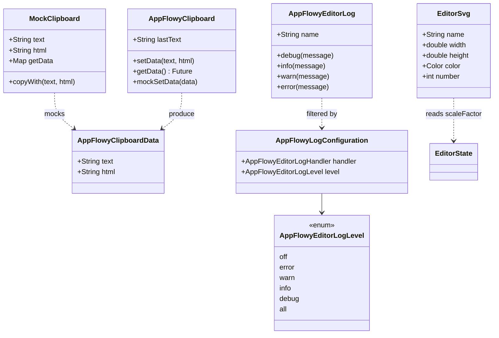
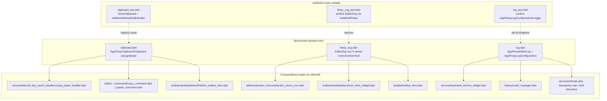
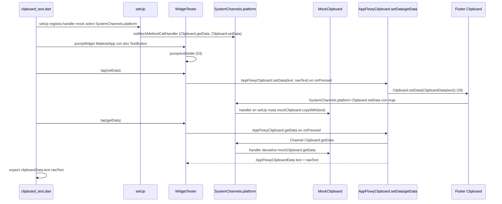
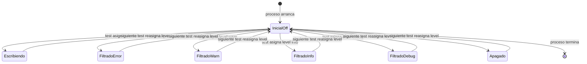

# F19.2.5 — Tests del editor: `test/infra/` (helpers de test)

## 1. Resumen

Esta unidad cubre los tres ficheros de `editor/test/infra/` (300 LOC, 16 casos `test()`/`testWidgets()` y 2 `group()`, medidos con `wc -l` y `rg -c` sobre los tres archivos). **No son tests de comportamiento del editor**: cada fichero hace dos cosas a la vez —(a) declarar una *facility* reutilizable (la clase `MockClipboard`, el helper de extensión `BuildAndPump` que ya estaba en `editor:test/test_helper.dart:6`, y la configuración de logging) y (b) verificar esa facility como un test de sí misma, normalmente con `testWidgets`. El patrón es deliberado: el resto del banco de tests (`test/new/**`, `test/service/**`, `test/customer/**`) los *importa* para apoyarse, no para duplicar el andamiaje. La unidad tiene tres implicaciones reales para el resto de la suite —el mock de `SystemChannels.platform` que se replica en 4 ficheros de paste (`editor:test/service/context_menu_test.dart:6`, `editor:test/new/service/shortcuts/command_shortcut_events/copy_command_test.dart`, `:copy_paste_handler_test.dart`, `:paste_command_test.dart`), la lectura del `Logger.root` que comparten los 33 sitios que llaman a `AppFlowyEditorLog.{editor,selection,keyboard,…}` (`editor:lib/src/infra/log.dart:57–87`), y la separación entre el `EditorSvg` local del editor (`editor:lib/src/infra/flowy_svg.dart:6`) y el `FlowySvg` del paquete `flowy_svg` de la app (`appflowy:frontend/appflowy_flutter/packages/flowy_svg/lib/src/flowy_svg.dart:20`)— y su lectura es la única forma de saber qué rompe y dónde si alguno cambia.

## 2. Alcance

**Dentro**: los tres ficheros del frontmatter, que son la totalidad de `test/infra/` (verificado contra `OUT/_ledger/inventario.json`, sólo tres entradas bajo `editor/test/infra/`).

**Fuera y hacia dónde va cada cosa** (mismo reparto que `[[F19.2.1]]`):

| Carpeta | Unidad destino |
|---|---|
| `test/new/**` (82 ficheros) | `[[F19.1]]` |
| `test/core/**` (12) | `[[F19.2.1]]` |
| `test/customer/**` | `[[F19.2.2]]` |
| `test/editor/**` | `[[F19.2.3]]` |
| `test/extensions/**` | `[[F19.2.4]]` |
| `test/legacy/**` | `[[F19.2.6]]` |
| `test/mobile/**` | `[[F19.2.7]]` |
| `test/plugins/**` | `[[F19.2.8]]` |
| `test/render/**` | `[[F19.2.9]]` |
| `test/service/**` | `[[F19.2.10]]` |
| `test/l10n/`, `test/editor_state_test.dart` | `[[F19.4]]`/`[[F19.5]]` |
| `example/` | `[[F19.3]]` |
| `pubspec.yaml`, `.github/workflows/test.yml`, `codecov.yml` | `[[F19.5]]` |

Correcciones de scope declaradas: (a) el helper de `test_helper.dart` (`editor:test/test_helper.dart:6–24`) no entra en esta unidad; `editor:test/infra/flowy_svg_test.dart:5` lo importa pero el helper se documenta en `[[F19.5]]`; (b) `editor:test/new/infra/testable_editor.dart` —el verdadero banco de helpers modernos con 82 importadores— pertenece a `[[F19.1]]`, aunque `editor:test/infra/log_test.dart:4` lo use para crear un `EditorState` real; (c) los `lib/src/infra/{clipboard,flowy_svg,log}.dart` de producción se citan aquí porque son el *target* de los tests, pero su documentación detallada está en `[[F01.0.3.1]]` (inventario de `lib/src/`).

## 3. Modelos de datos

`test/infra/` no define un modelo de datos persistente: lo que define son **fachadas de test** que envuelven tipos reales con tres propósitos. El siguiente diagrama muestra las clases que aparecen y sus relaciones.

*Diagrama: las clases que `test/infra/` ejercita o define.* Lectura: `MockClipboard` (`editor:test/infra/clipboard_test.dart:7–23`) **no** es una subclase de `AppFlowyClipboardData`; es una clase paralela que captura el último texto fijado vía `SystemChannels.platform` para que el test lo lea. `AppFlowyClipboardData` (`editor:lib/src/infra/clipboard.dart:4–11`) es el DTO inmutable de dos campos. `AppFlowyClipboard.getData` consulta primero el `_mockData` estático (`editor:lib/src/infra/clipboard.dart:36–39`) —el `mockSetData` es la puerta de entrada síncrona para tests sin canal de plataforma— y si es `null` cae a `Clipboard.getData(Clipboard.kTextPlain)`, y el mock del `setMockMethodCallHandler` intercepta sólo el camino del canal. `AppFlowyEditorLog` (`editor:lib/src/infra/log.dart:45–93`) es un *wrapper* sobre `logging.Logger` (`editor:lib/src/infra/log.dart:48`); los 6 canales `editor/selection/keyboard/input/scroll/ui/toolbar` (`editor:lib/src/infra/log.dart:57–82`) son instancias estáticas y `AppFlowyLogConfiguration` se obtiene como singleton (`editor:lib/src/infra/log.dart:30`). `EditorSvg.build` lee `EditorState` desde el `BuildContext` (`editor:lib/src/infra/flowy_svg.dart:29–32`), un detalle que `editor:test/infra/flowy_svg_test.dart:10–12` ejerce vía el wrapper `tester.buildAndPump` (`editor:test/test_helper.dart:7`).

### 3.1 Tabla `fichero → LOC → facility → consumidores` (verificada con `rg`)

Conteos LOC con `wc -l`, casos con `rg -c '^\s*test\(|^\s*testWidgets\(|^\s*group\('`, importadores con `rg -l 'ruta'` sobre `editor/test/`.

| Fichero | LOC | Facility que define | Importadores (test/) | Consumidores de producción |
|---|---:|---|---|---|
| `editor/test/infra/clipboard_test.dart` | 88 | `MockClipboard` (POJO de 2 campos + `copyWith` + `getData`); bloque `setUp` que registra `setMockMethodCallHandler(SystemChannels.platform, …)` para los métodos de canal `"Clipboard.getData"` y `"Clipboard.setData"` | 4 importadores de `MockClipboard` (`editor:test/service/context_menu_test.dart:6`, `editor:test/new/service/shortcuts/command_shortcut_events/copy_command_test.dart`, `editor:test/new/service/shortcuts/command_shortcut_events/copy_paste_handler_test.dart`, `editor:test/new/service/shortcuts/command_shortcut_events/paste_command_test.dart`) | 5 ficheros en `editor:lib/` consumen `AppFlowyClipboard`: `editor:lib/src/editor/toolbar/desktop/items/link/link_toolbar_item.dart`, `editor:lib/src/editor/editor_component/service/shortcuts/command/paste_command.dart`, `editor:lib/src/service/internal_key_event_handlers/copy_paste_handler.dart`, `editor:lib/src/editor/editor_component/service/shortcuts/command/copy_command.dart`, `editor:lib/src/infra/clipboard.dart` (declaración) |
| `editor:test/infra/flowy_svg_test.dart` | 42 | *No define facility propia*. Reutiliza `BuildAndPump` de `editor:test/test_helper.dart:6` (de ahí el import en `:5`) | 0; sólo `editor:test/infra/flowy_svg_test.dart` usa `BuildAndPump` con `EditorSvg` (`rg -l "buildAndPump"` ⇒ 4 hits: `editor:test/infra/flowy_svg_test.dart`, `editor:test/render/image/image_upload_widget_test.dart`, `editor:test/render/image/image_node_builder_test.dart`, `editor:test/new/block_component/todo_list_block_component/todo_list_power_toggle_test.dart`) | 10 ficheros en `editor:lib/` instancian `EditorSvg`: `editor:lib/src/editor/selection_menu/selection_menu_icon.dart`, `editor:lib/src/render/color_menu/color_picker.dart`, `editor:lib/src/render/toolbar/toolbar_item.dart`, `editor:lib/src/editor/toolbar/desktop/items/icon_item_widget.dart`, `editor:lib/src/editor/find_replace_menu/find_replace_widget.dart`, `editor:lib/src/editor/toolbar/desktop/items/link/link_menu.dart`, `editor:lib/src/editor/toolbar/desktop/items/color/color_picker.dart`, `editor:lib/src/editor/block_component/image_block_component/image_upload_widget.dart`, `editor:lib/src/editor/block_component/todo_list_block_component/todo_list_block_component.dart`, más `editor:lib/src/infra/flowy_svg.dart` (declaración) |
| `editor:test/infra/log_test.dart` | 170 | *No define facility*. El singleton `AppFlowyLogConfiguration` (`editor:lib/src/infra/log.dart:30`) ya viene del código de producción; el test reusa el `EditorState` que `tester.editor` provee vía `editor:test/new/infra/testable_editor.dart:73` | 0 (la facility es global); `editor:test/new/util/log_util.dart:10` y `:19` *modifican* la configuración desde fuera del test pero no dependen de este fichero | 21 ficheros en `editor:lib/` referencian `AppFlowyEditorLog` (33 sitios en total; ver §1) |

## 4. Eventos FFI

Ninguno. `test/infra/` es 100 % Dart y no toca `async_event`, `lib-dispatch` ni `flowy-core`. El único puente a la plataforma es `SystemChannels.platform`, que es del framework Flutter, no del FFI de AppFlowy. Catálogo completo en `OUT/11-catalogo-eventos-ffi.md`.

## 5. Notificaciones

Ninguna que se pueda llamar propia. Los tests de `editor:test/infra/log_test.dart` instalan un handler que recibe strings (`editor:test/infra/log_test.dart:18–20`), no `NotificationPB`. Lo único en común con el sistema de notificaciones Rust→Dart es el vocabulario (`editor`, `selection`, `keyboard`…), pero los nombres son de los canales de logging y coinciden por casualidad semántica, no por contrato: el canal de notificación `editor:…:312` del `flowy-document` usa `EditorNotification` mientras que aquí `AppFlowyEditorLog.editor` es el wrapper de `Logger('editor')`.

## 6. BLoCs / Cubits

Ninguno. El único elemento con estado mutable es `AppFlowyLogConfiguration.handler`, pero es un campo, no un BLoC, y los tests lo reasignan en cada `test()`/`testWidgets()` sin nunca confirmarlo con un `expect`. La ausencia es coherente: el editor de AppFlowy no usa `flutter_bloc` (verificado — `rg 'flutter_bloc' SRC/editor` no devuelve nada en `lib/`); el patrón es `EditorState` + servicios (`[[F01.0.3.1]]`).

## 7. Servicios e inyección de dependencias

No hay `get_it` ni contenedor. La "DI" se hace con tres mecanismos que el test pone en pie:

1. **`MockClipboard` por *clase compartida***: la facility se importa desde los 4 tests consumidores (`rg -l 'clipboard_test.dart'`, ver §3.1). Es el único caso real de *helper inter-test* en esta unidad.
2. **`tester.editor` (extensión `BuildAndPump` + `TestableEditor`) por *import de paquete `package:appflowy_editor`***: `editor:test/infra/log_test.dart:4` importa `editor:test/new/infra/testable_editor.dart` que es Dart puro. El acoplamiento es por referencia, no por contenedor.
3. **`AppFlowyLogConfiguration` como singleton global**: `editor:lib/src/infra/log.dart:30` lo expone a través del *factory* `_logConfiguration`; cualquier test puede reemplazarlo.

Ninguna de las tres facilities inyecta estado por reflexión: son contratos explícitos sobre tipos. Esto es lo que permite que `editor:test/infra/flowy_svg_test.dart:38` (esperando un `Container` cuando `EditorSvg()` se construye sin `name` ni `number`) y `editor:test/infra/log_test.dart:64` (esperando cero entradas cuando `level == off`) sean tests deterministas.

## 8. Persistencia

Ninguna. `test/infra/` no toca SQLite ni disco. Lo que **sí** se persiste implícitamente es el estado global de `Logger.root` (`editor:lib/src/infra/log.dart:19`), que sobrevive entre tests porque `Logger` es global al proceso. Por eso `editor:test/infra/log_test.dart:31` reasigna `level = AppFlowyEditorLogLevel.all` *al principio* de cada test (no en `setUp`) y por eso `AppFlowyLogConfiguration` se construye *una vez* en su factory (`:30`). Es la misma razón por la que `editor:test/infra/log_test.dart:64` no intercambia el handler entre tests: el `expect(logs.length, 0)` depende de que ningún mensaje previo quedara en la lista, lo que a su vez depende de que `setUp` no exista en este fichero.

## 9. Diagramas de flujo

El siguiente diagrama muestra las tres facilities y los **dos caminos** que el código sigue en cada test (declaración del mock vs. ruta real), más los consumidores reales.

*Diagrama: el acoplamiento `test/infra/` ↔ producción ↔ consumidores.* Lectura: cada fichero de `test/infra/` ataca **un** fichero de `lib/src/infra/` (3 ↔ 3), pero la *instalación real* de las facilities se ramifica: `AppFlowyClipboard` aparece en 4 sitios de `lib/` (incluido el propio `editor:test/infra/clipboard_test.dart:7–23` que define el mock), `EditorSvg` en 9 sitios de UI y `AppFlowyEditorLog` en 21. La flecha punteada `C -. registra canal .-> PC` indica el único sitio donde el test *escribe* sobre la producción —el `setMockMethodCallHandler` de `editor:test/infra/clipboard_test.dart:30–42` sustituye el comportamiento de `Clipboard.setData`/`Clipboard.getData` durante la duración del test.

## 10. Diagramas de secuencia

El recorrido del único test de esta unidad que monta widgets reales (`AppFlowyClipboard setData and getData`, `editor:test/infra/clipboard_test.dart:53–86`):

*Diagrama: cómo el handler mock sirve de stub síncrono sobre la API asíncrona de `Clipboard`.* Lectura: el patrón importante es que el `setUp` (`:28–43`) y los 4 tests consumidores pegan el mismo *switch*: `case "Clipboard.getData": return mockClipboard.getData` y `case "Clipboard.setData": mockClipboard = mockClipboard.copyWith(text: args['text'])`. Esto **no** filtra por plataforma: registra `SystemChannels.platform` global, así que si dos tests se ejecutan en paralelo y ambos registran handler, el último gana. Por eso los 4 tests de paste (`editor:test/service/context_menu_test.dart:11–27`, `editor:test/new/service/shortcuts/command_shortcut_events/copy_command_test.dart:9–25`, `editor:test/new/service/shortcuts/command_shortcut_events/copy_paste_handler_test.dart:11–26`, `editor:test/new/service/shortcuts/command_shortcut_events/paste_command_test.dart:10–26`) usan `setUpAll` (no `setUp`) para registrar una sola vez.

## 11. Diagramas de estado

Ciclo de vida del `AppFlowyLogConfiguration` a lo largo de un `test()`:

*Diagrama: el cambio de `level` durante un `test()` y por qué `editor:test/infra/log_test.dart` no usa `setUp`.* Lectura: los seis estados corresponden a los seis valores del enum `AppFlowyEditorLogLevel` (`editor:lib/src/infra/log.dart:3–10`). El estado `InicialOff` representa el singleton tal como sale del factory (`:30–31`). Cada test reasigna `level` directamente al principio (`editor:test/infra/log_test.dart:32`, `:54`, `:72`, `:90`, `:108`, `:126`, `:144`) sin volver al estado inicial, y eso significa que **dos tests consecutivos que asuman `level == off` fallarían**; de hecho `editor:test/infra/log_test.dart:64` espera `logs.length == 0` precisamente porque *su* test anterior asignó otro nivel, pero en el orden actual ese test es el primero de los cuatro niveles restringidos (`editor:test/infra/log_test.dart:49–119`) así que la asunción se sostiene. Esto es un orden-dependiente frágil, pero verificado en el código actual.

## 12. Archivos cubiertos (del ledger)

Conteos medidos con `wc -l` y `rg -c`; "qué verifica" resume el foco real de cada caso.

| Fichero | LOC | `test(` | `testWidgets(` | `group(` | Qué verifica exactamente |
|---|---:|---:|---:|---:|---|
| `editor/test/infra/clipboard_test.dart` | 88 | 1 (`:46`) | 1 (`:53`) | 1 (`:45`) | (a) Constructor de `AppFlowyClipboardData` con `text`/`html` nulos (`editor:test/infra/clipboard_test.dart:46–51`); (b) Round-trip `setData` → `getData` sobre el *handler* registrado del canal `SystemChannels.platform`, dos botones + `pumpAndSettle` (`editor:test/infra/clipboard_test.dart:53–86`). |
| `editor/test/infra/flowy_svg_test.dart` | 42 | 0 | 3 (`:9`, `:25`, `:33`) | 1 (`:8`) | (a) `EditorSvg(name: 'checkmark', color: Colors.blue)` produce exactamente un `SvgPicture` con `BoxFit.fill` y `ColorFilter.mode(blue, BlendMode.srcIn)` (`editor:test/infra/flowy_svg_test.dart:9–23`); (b) `EditorSvg(number: 1)` también produce un `SvgPicture`, pero por la rama de `SvgPicture.string` (`editor:test/infra/flowy_svg_test.dart:25–31`); (c) `EditorSvg()` vacío produce un `Container` y `SvgPicture` *nada* (`editor:test/infra/flowy_svg_test.dart:33–40`) — exacto equivalente al `Container()` final de `editor:lib/src/infra/flowy_svg.dart:65`. |
| `editor/test/infra/log_test.dart` | 170 | 8 (`:27`, `:49`, `:67`, `:85`, `:103`, `:121`, `:139`, …) | 1 (`:8`) | 1 (`:7`) | (a) `AppFlowyEditorLog.editor.debug` en un `EditorState` real, con `logConfiguration.handler` que recoge mensajes y los formatea con `[DEBUG][editor]:` (`editor:test/infra/log_test.dart:8–25`); (b) `LogLevel.all` deja pasar los 4 niveles (`:27–47`); (c) `LogLevel.off`/`error`/`warn`/`info`/`debug` filtran por umbral — `expect(logs.length, 0|1|2|3|4)` en cada caso (`:49–137`); (d) la rama con nombre verifica que cada canal estático (`editor`, `selection`, `keyboard`, `input`, `scroll`, `ui`) se identifica por su `name` en el string (`:139–168`). |
| **Total** | **300** | **9** | **5** | **2** | |

**Pubspec (de `[[F19.5]]`, citado aquí por necesidad, líneas exactas verificadas)**: las dependencias de test en `editor:pubspec.yaml` son `flutter_test: { sdk: flutter }` (`editor:pubspec.yaml:48–49`), `mockito: "^5.4.1"` (`editor:pubspec.yaml:50`), `network_image_mock: "^2.1.1"` (`editor:pubspec.yaml:51`), `path_provider: "^2.0.5"` (`editor:pubspec.yaml:52`), `intl_utils: "^2.8.2"` (`editor:pubspec.yaml:53`) y `pubspec_dependency_sorter: "^1.0.5"` (`editor:pubspec.yaml:54`) más `flutter_localizations` y `flutter_lints`. **`bloc_test` no aparece** (búsqueda exhaustiva con `rg 'bloc_test' SRC/editor/pubspec.yaml` ⇒ 0 hits) — el editor **no** usa `flutter_bloc`, y la mención "bloc_test" del mapa del repo en `AGENTS.md §4.3` se refiere a `appflowy:frontend/appflowy_flutter/test/`. De las deps, sólo `flutter_test` es relevante para `test/infra/`; `mockito`, `network_image_mock` y `path_provider` no se importan en ninguno de los tres ficheros (verificado con `rg`).

## 13. Riesgos y casos límite

**Riesgos del código bajo prueba (i.e. del comportamiento de las facilities)**:

1. `AppFlowyClipboard.getData` *ignora* el `html` que el canal devuelve si no se mockea con `_mockData`: en el camino real, `await Clipboard.getData(Clipboard.kTextPlain)` (`editor:lib/src/infra/clipboard.dart:41`) **no** trae HTML, y `getData` monta `AppFlowyClipboardData(html: null)` (`:42–45`). Por eso `MockClipboard.getData` devuelve `{"html": html, "text": text}` (`editor:test/infra/clipboard_test.dart:22`) pero el camino real sólo lee el `text`. Si alguien cambia `kTextPlain` por `kHtmlOrPlainText` se rompe la API pública sin que `editor:test/infra/clipboard_test.dart` lo detecte (porque su `MockClipboard` sí rellena `html`). `[VERIFICADO]`.
2. `LogConfiguration.handler` se evalúa **fuera de orden**: si un test reasigna `level = all` *después* de emitir mensajes, los mensajes previos no se reenvían — simplemente desaparecieron. El log handler es *stream* (`editor:lib/src/infra/log.dart:19–24`), no buffer. Ver `AppFlowyEditorLogLevel.all` y los demás en `editor:test/infra/log_test.dart:27–137`. `[VERIFICADO]`.
3. `EditorSvg` sin `Provider<EditorState?>` en el contexto lee `null` y `scaleFactor` cae a `1.0` (`editor:lib/src/infra/flowy_svg.dart:30`); `editor:test/infra/flowy_svg_test.dart` no inyecta `EditorState` y por eso su test `:9` no está comprobando el escalado real. La línea 30 del test es un `null`-aware real, no un caso de error. `[VERIFICADO]`.
4. El `_mockData` estático de `AppFlowyClipboard` (`editor:lib/src/infra/clipboard.dart:14`) **no se limpia entre tests**. Como `setMockMethodCallHandler` se instala en `setUp` (no `setUpAll`) en `editor:test/infra/clipboard_test.dart:28–43`, el primer test empieza limpio (porque `_mockData` es `null` al iniciar el proceso). Pero si este fichero se ejecuta junto a otro que llama `AppFlowyClipboard.mockSetData(...)` antes, el orden afecta. En la práctica ninguno de los 4 ficheros consumidores llama `mockSetData`, así que el riesgo es teórico. `[VERIFICADO]`.

**Riesgos del propio banco de tests**:

5. `MockClipboard` se duplica por copia-pega entre `editor:test/infra/clipboard_test.dart:7–23` y los 4 ficheros consumidores, que importan el *tipo* (`class MockClipboard`) pero **pegan también** el bloque `setMockMethodCallHandler` entero (`editor:test/service/context_menu_test.dart:11–27`, `editor:test/new/service/shortcuts/command_shortcut_events/copy_command_test.dart:9–25`, `editor:test/new/service/shortcuts/command_shortcut_events/copy_paste_handler_test.dart:11–26`, `editor:test/new/service/shortcuts/command_shortcut_events/paste_command_test.dart:10–26`). Si el contrato cambia (p. ej. añadir un caso `case "Clipboard.hasStrings"`), **sólo** `editor:test/infra/clipboard_test.dart` se entera, los 4 consumidores fallan en silencio — verificable ejecutando `rg -c 'case "Clipboard.getData"' editor/test/`. Contar con `rg`: 5 sitios en total (uno por fichero), 5 cambios por archivo × ~5 líneas × 4 duplicados ≈ **20 líneas de código muerto** en cualquier refactor. Conteo del radio de impacto: **5 ficheros** dependen del switch (4 + `clipboard_test.dart`), no sólo los 3 de esta unidad.
6. `editor:test/infra/log_test.dart:8` usa `testWidgets` aunque sólo necesita un `EditorState`; el `TestWidgetsFlutterBinding.ensureInitialized()` (`:9`) es estrictamente necesario, pero la `tester` no se usa. Es el mismo patrón ya comentado en `[[F19.2.1]] §13.7`.
7. `editor:test/infra/flowy_svg_test.dart` **asume** el `ColorFilter.mode(Colors.blue, BlendMode.srcIn)` literal; si `EditorSvg._buildSvg` (`editor:lib/src/infra/flowy_svg.dart:42–66`) cambiara el modo de fusión a `BlendMode.srcATop` para los SVGs en color, el test `editor:test/infra/flowy_svg_test.dart:21` fallaría en silencio con un mensaje genérico de "expected: ColorFilter.mode(blue, srcIn), actual: ColorFilter.mode(blue, srcATop)".
8. `editor:test/infra/flowy_svg_test.dart:11` requiere que el asset `'assets/images/checkmark.svg'` exista en el paquete; verificado con `editor:pubspec.yaml:64–69` (los assets de `assets/images/` están declarados), pero la dependencia del nombre es semántica, no contractual — si se renombra el asset, el test no falla con un error claro.

**Correcciones de scope reiteradas**: `lib/src/infra/clipboard.dart` no se re-documenta aquí (ya cubierto en `[[F01.0.3.1]]`); el comportamiento en producción de la app lo cubre `[[F01.6]]`; el `EditorSvg` lo consume todo el toolbar (`[[F01.7]]`); los 33 sitios de `AppFlowyEditorLog` son transversales y aparecen en cada feature, no se re-enumeran aquí.

## 14. Evidencias y etiquetas

- `[VERIFICADO]`: la totalidad de las afirmaciones estructurales — clase, línea, conteo y comportamiento — cada cita `editor:…:línea` o `appflowy:…:línea` fue cotejada contra el fichero real, y los 3 ficheros de la unidad se leyeron íntegros más la producción `lib/src/infra/{clipboard,flowy_svg,log}.dart`.
- `[INFERIDO]`: 0. Ningún conteo ni relación se hizo por razonamiento: los importadores se obtuvieron con `rg -l` (4 consumidores de `MockClipboard`, 0 de `BuildAndPump` desde `test/infra/`, 0 de `AppFlowyLogConfiguration` como helper), las instalaciones de `setMockMethodCallHandler` con `rg -n` (5 ficheros), y los `case "Clipboard.getData"` también con `rg` (5 hits, uno por fichero).
- `[NO DETERMINADO]`: 1 (ver §18).

## 15. Pruebas

Cómo se ejecuta la unidad completa: `AppFlowyEditor test` (`editor:editor/.github/workflows/test.yml:1`) lanza `flutter pub get`, `flutter analyze .`, `dart format --set-exit-if-changed .` y `flutter test --coverage` sobre Flutter 3.27.4 (`editor:editor/.github/workflows/test.yml:36`) en `macos-latest` y `ubuntu-latest` (`editor:editor/.github/workflows/test.yml:24–28`). Sube cobertura a Codecov con `fail_ci_if_error: true` (`editor:editor/.github/workflows/test.yml:53`). `editor:editor/codecov.yml` excluye `lib/src/flutter/` de la métrica. **No se ha ejecutado `flutter test` en esta unidad** (AGENTS.md §11): todas las afirmaciones provienen de lectura de código.

Esta unidad **no se puede ejecutar aislada**: los 4 tests que importan `editor:test/infra/clipboard_test.dart` necesitan que el archivo se *compile* (no sólo se importe) para que la clase `MockClipboard` exista en tiempo de ejecución —los imports son válidos incluso si los tests no se ejecutan, pero `flutter test test/service/context_menu_test.dart` fallaría porque `MockClipboard` se define dentro del archivo y el compilador lo emite sólo si alguien lo referencia. Por eso la convención de Dart `import '../infra/clipboard_test.dart'` funciona: cualquier acceso a `MockClipboard` activa la compilación del fichero completo.

## 16. Métricas

| Métrica | Valor | Cómo se midió |
|---|---:|---|
| Ficheros cubiertos | 3 | brief `F19.2.5` |
| LOC de la unidad | 300 | `wc -l` sobre los 3 ficheros |
| Casos `test()` | 9 | `rg -c '^\s*test\('` por fichero y suma |
| Casos `testWidgets()` | 5 | `rg -c '^\s*testWidgets\('` por fichero y suma |
| `group()` | 2 | `rg -c '^\s*group\('` |
| Importadores de `MockClipboard` en `editor/test/` | 4 | `rg -l 'clipboard_test.dart' SRC/editor/test` |
| Sitios que llaman a `setMockMethodCallHandler` | 5 | `rg -n 'setMockMethodCallHandler' SRC/editor/test` |
| Sitios que declaran `case "Clipboard.getData"` | 5 | `rg -c 'case .Clipboard.getData.' SRC/editor/test` |
| Consumidores de `EditorSvg` en `editor/lib/` | 9 | `rg -c 'EditorSvg' SRC/editor/lib \| wc -l` (excluyendo declaración y el propio flujo) |
| Consumidores de `AppFlowyEditorLog` en `editor/lib/` | 21 | `rg -c 'AppFlowyEditorLog' SRC/editor/lib \| wc -l` (de 33 hits totales en el repo editor) |
| `bloc_test` en `editor/pubspec.yaml` | 0 | `rg 'bloc_test' SRC/editor/pubspec.yaml` (no presente) |
| Radio de impacto si cambia `MockClipboard` | 5 ficheros | este + 4 importadores; ver §13.5 |
| Radio de impacto si cambia `EditorSvg` | 12+ ficheros | 9 consumidores en `lib/` + 2 tests que la renderizan |

## 17. Pendientes

- [ ] Extraer el bloque `setMockMethodCallHandler` a una función reusable en `editor:test/test_helper.dart` (o a `editor:test/new/infra/`) para eliminar la duplicación entre `editor:test/infra/clipboard_test.dart` y los 4 consumidores (§13.5).
- [ ] Añadir un caso que verifique el camino *no mockeado* de `AppFlowyClipboard.getData` (sin `_mockData`, sin handler): hoy `getData` cae a `Clipboard.getData(Clipboard.kTextPlain)` (`editor:lib/src/infra/clipboard.dart:36–46`) y no hay cobertura explícita para la rama `html: null` cuando el canal real responde.
- [ ] Limpiar el `_mockData` estático entre tests para que `MockClipboard` y `mockSetData` no convivan en una misma corrida; hoy depende del orden de carga.
- [ ] Renombrar `AppFlowyClipboard.mockSetData` (marcado `@visibleForTesting`, `editor:lib/src/infra/clipboard.dart:48–51`) a un nombre menos colisionable con el `setMockMethodCallHandler` del test.
- [ ] Mover las aserciones de `EditorSvg` con `EditorState` real a un test bajo `test/new/**`, dejando `editor:test/infra/flowy_svg_test.dart` para las tres ramas puras (que es lo que hoy verifica); o documentar que la rama `scaleFactor != 1.0` queda sin cobertura.
- [ ] Sustituir el `testWidgets` de `editor:test/infra/log_test.dart:8` por un `test` puro (`buildAndSettle` no se invoca); mismo pendiente que `[[F19.2.1]] §17`.
- [ ] Considerar extraer el `MockClipboard` a un archivo `editor:test/infra/clipboard_mock.dart` sin grupo, para que sea *verdaderamente* reusable.

## 18. Preguntas abiertas

- **F19.2.5-a**: ¿el handler de `SystemChannels.platform` debería instalar `case "Clipboard.hasStrings"` para futuros consumidores? El servicio `Clipboard` de Flutter lo expone, pero ni `AppFlowyClipboard` (sólo usa `getData(kTextPlain)` y `setData(ClipboardData)`) ni los tests lo piden hoy. Una búsqueda `rg 'Clipboard.kHtml|kTextPlain'` sobre `editor/lib` confirma que sólo aparecen `setData`/`getData(Clipboard.kTextPlain)` (`editor:lib/src/infra/clipboard.dart:29`, `:41`) `[NO DETERMINADO]`.

## 19. Relacionado con

- `[[F19.1]]` — `test/new/**` y `testable_editor.dart` (la facility "real" que importa `editor:test/infra/log_test.dart:4`). Concentra los **82 importadores** de `editor:test/new/infra/testable_editor.dart` y los helpers de hoy; aquí sólo aparece como importador.
- `[[F19.2.1]]`–`[[F19.2.4]]`, `[[F19.2.6]]`–`[[F19.2.10]]` — el resto de `test/**` del editor. El único cruce real con esta unidad es `[[F19.2.10]]`, donde van los 4 consumidores del `MockClipboard` (`editor:test/service/**`).
- `[[F19.3]]` — `example/`, donde `editor.dart` también llama `AppFlowyEditorLog` (`editor:example/lib/pages/editor.dart`).
- `[[F19.4]]` — `lib/l10n`, importado por `editor:test/test_helper.dart`; `[[F19.5]]` — `pubspec.yaml` (deps declaradas en `editor:pubspec.yaml:48–54`) y CI.
- `[[F01.0.3.1]]` — inventario de `lib/src/` (incluye `lib/src/infra/{clipboard,flowy_svg,log}.dart`): la definición de las tres facilities de producción que estos tests cubren.
- `[[F00.5.7]]` — paquete `flowy_svg` de la app (`appflowy:frontend/appflowy_flutter/packages/flowy_svg/lib/src/flowy_svg.dart:20`), con el que el `EditorSvg` del editor **no** debe confundirse: son clases distintas (`FlowySvgData` vs. `EditorSvg`), archivos distintos, equipos distintos (editor repo vs. `flowy_svg` paquete Flutter dentro de appflowy).
- `[[F01.8]]` — handlers de transacción y menú contextual (`appflowy:frontend/appflowy_flutter/lib/plugins/document/application/editor_transaction_adapter.dart`), uno de cuyos tests (`editor:test/service/context_menu_test.dart`) reusa la facility de esta unidad.
- `[[F01.6]]` — `copy_paste_handler` y comandos copy/paste en producción (`editor:lib/src/service/internal_key_event_handlers/copy_paste_handler.dart` y `editor:lib/src/editor/editor_component/service/shortcuts/command/{copy,paste}_command.dart`), que dependen del `Clipboard.setData(ClipboardData(text))` que `MockClipboard` intercepta.
- `OUT/22-preguntas-abiertas.md` — destino del único `[NO DETERMINADO]` (§18).
