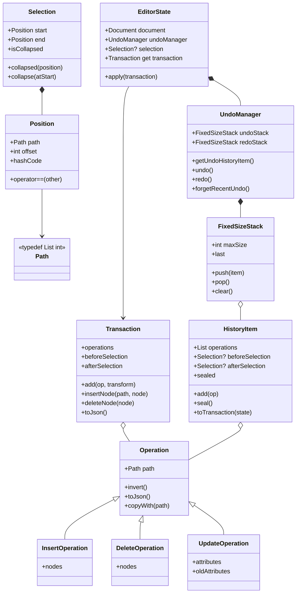
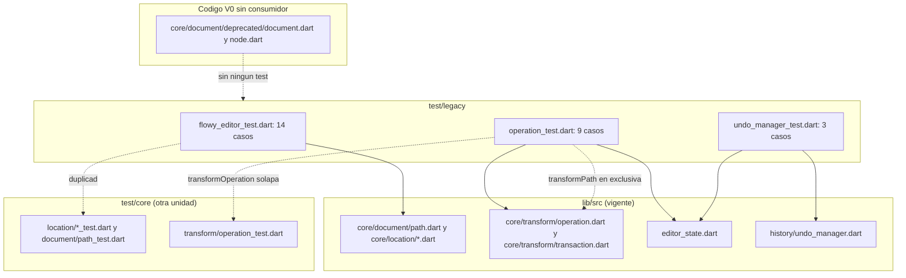
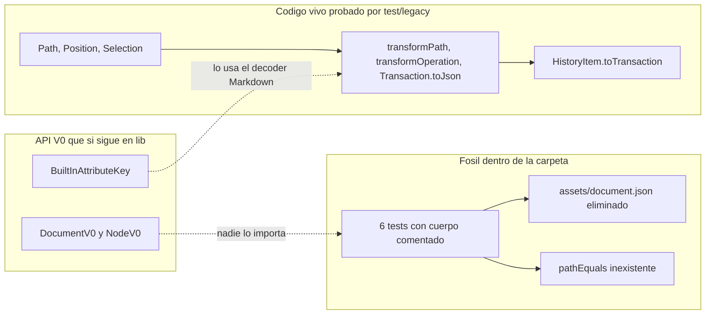
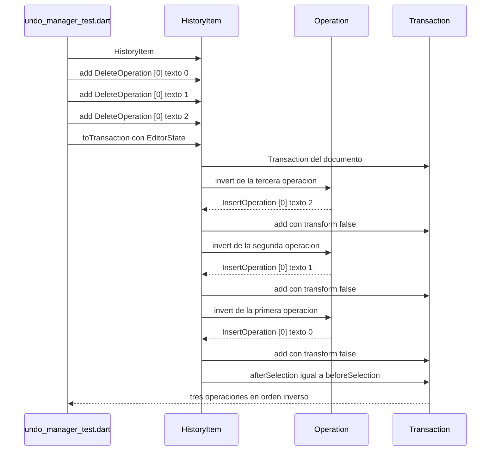
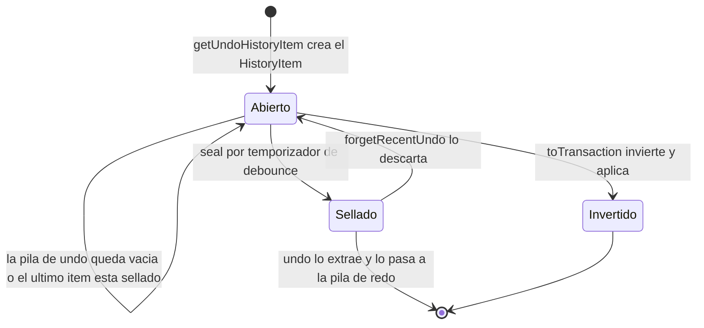

# F19.2.6 — Tests del editor: `test/legacy/`

## 1. Resumen

Esta unidad cubre los tres ficheros de `editor/test/legacy/`: 344 líneas y 26 casos `test()` repartidos en `flowy_editor_test.dart` (14), `operation_test.dart` (9) y `undo_manager_test.dart` (3). El nombre de la carpeta sugiere que prueban el editor antiguo (`FlowyEditor`/`FlowyEditorState`) y la hipótesis inicial de la unidad era que esa suite no podía compilar. **La búsqueda lo desmiente**: `FlowyEditor`, `FlowyEditorState` y `FlowyEditorComponent` no existen en ninguna parte del repo —cero coincidencias con `\bFlowyEditor\b` sobre `lib/`, `test/`, `example/` y `documentation/`— y ningún fichero de `test/legacy/` los referencia. Los tres ficheros compilan y se ejecutan en CI contra la API vigente. El valor real de la unidad está en tres hallazgos: (a) la carpeta está mal nombrada, su contenido es API actual; (b) `undo_manager_test.dart` es el **único** test del árbol entero que ejerce `UndoManager`/`HistoryItem`, que es producción viva; (c) `operation_test.dart` cubre la rama `null` de `transformOperation` que `test/core/` no alcanza.

## 2. Alcance

**Dentro**: los 3 ficheros del frontmatter, que son la totalidad de `test/legacy/` (3 entradas en `OUT/_ledger/inventario.json`).

**Fuera y hacia dónde va cada cosa**:

| Elemento | Motivo de exclusión | Unidad destino |
|---|---|---|
| `test/new/**` | Banco moderno y helpers compartidos | `[[F19.1]]` |
| `test/core/**` | Tests del modelo puro; solapa en `Path`/`Position`/`Selection` y en `transformOperation` | `[[F19.2.1]]` |
| `test/customer/**` | Fixtures de cliente | `[[F19.2.2]]` |
| `test/editor/**` | Tests de `EditorState` y componentes | `[[F19.2.3]]` |
| `test/extensions/**` | Extensiones Dart sobre `Node`/`Position` | `[[F19.2.4]]` |
| `test/infra/**` | Clipboard y logging | `[[F19.2.5]]` |
| `test/mobile/**` | Servicios de selección móvil | `[[F19.2.7]]` |
| `test/plugins/**` | Atajos, comandos y codecs por bloque | `[[F19.2.8]]` |
| `test/render/**` | Widgets de selección/render | `[[F19.2.9]]` |
| `test/service/**` | IME, teclado, scroll | `[[F19.2.10]]` |
| `lib/src/core/document/deprecated/**` | `DocumentV0`/`NodeV0`, API V0 que sí sigue en `lib/` pero que `test/legacy/` no ejerce (ver §13.1) | `[[F19.2.1]]` (superficie) |
| `example/**`, `lib/l10n/**`, `pubspec.yaml`, `.github/workflows/test.yml` | Configuración, CI y ejemplo | `[[F19.3]]`, `[[F19.4]]`, `[[F19.5]]` |

Correcciones de scope: (a) esta unidad **no** reasigna `lib/src/core/document/deprecated/**` —el código V0 que realmente sobrevive en `lib/`— a ningún test del repo; es un hueco de cobertura, no un fichero de esta unidad (ver §17); (b) el modelo `Node`/`Delta`/`Transaction` que los tests ejercitan es producción y está documentado en `[[F01.0]]` y `[[B1.6]]`; (c) el uso del editor en la app y sus atajos de deshacer/rehacer pertenecen a `[[F01.0]]`/`[[F01.8]]`.

## 3. Modelos de datos

Los tres ficheros de `test/legacy/` tocan exactamente los mismos tipos que el resto del banco de tests —`Path`, `Position`, `Selection`, `Operation`, `Transaction`, `EditorState`, `UndoManager`, `HistoryItem`—, todos ellos exportados por el barrel `editor:lib/appflowy_editor.dart:6` (`src/core/core.dart`) y `:15` (`src/editor_state.dart`), salvo `HistoryItem`, que se importa por ruta interna (§3.3).

*Diagrama: los tipos que `test/legacy/` somete a prueba.* Lectura: `Path` es un alias de `List<int>` (`editor:lib/src/core/document/path.dart:6`) con una extensión `PathExtensions` que aporta `equals` por `listEquals` (`editor:lib/src/core/document/path.dart:8–11`); `Position` encima aporta igualdad estructural y `hashCode` coherente (`editor:lib/src/core/location/position.dart:27–36`). `Operation` es la base de la que heredan las tres subtypes que el test instancia, y `Transaction` las acumula más dos selecciones. `EditorState` es el dueño de un `UndoManager`, que a su vez mantiene dos pilas de `HistoryItem`; `HistoryItem.toTransaction` es el puente que traduce historia a transacción. Es exactamente el modelo "pila de historial por cliente" descrito en `[[B1.6]]`, aunque aquí el historial es puramente local y efímero.

### 3.1 La superficie legacy que realmente existe

El hallazgo estructural de primer orden. La API `FlowyEditor` **no está en el repo**: `rg '\bFlowyEditor\b'` sobre `SRC/editor` no devuelve coincidencias, ni tampoco `FlowyEditorState` ni `FlowyEditorComponent`. Lo único que existe es `AppFlowyEditor` (`editor:lib/src/editor/editor_component/service/editor.dart:22`) con su `_AppFlowyEditorState` (`editor:lib/src/editor/editor_component/service/editor.dart:243`) `[VERIFICADO]`. La historia del repo lo explica sin ambigüedad: el commit `a033bfc2` —*chore: rename flowy_editor to appflowy_editor*, 2022-08-17— es el punto en que `test/legacy/flowy_editor_test.dart` entra en el árbol con su nombre actual, es decir el nombre de la clase murió con ese commit y el del fichero quedó como fósil `[VERIFICADO]` (evidencia de `git log`).

Consecuencia: **la hipótesis de que la suite no compila es falsa**. Los tres ficheros importan sólo símbolos que existen hoy (§12, columna «existe hoy»): `Path`/`Position`/`Selection` vía rutas internas (`editor:test/legacy/flowy_editor_test.dart:1–3`), `Node`/`transformOperation`/`EditorState`/`Document` (`editor:test/legacy/operation_test.dart:3`, `:5`, `:6`, `:7`), y `HistoryItem` por ruta interna (`editor:test/legacy/undo_manager_test.dart:2`).

Lo que sí es «legacy» en el sentido estricto es otra cosa, y queda **sin ningún test**: `lib/src/core/document/deprecated/document.dart` (`DocumentV0`, `editor:lib/src/core/document/deprecated/document.dart:15`) y `lib/src/core/document/deprecated/node.dart` (`NodeV0`, `TextNodeV0`, `editor:lib/src/core/document/deprecated/node.dart:229`), ambos marcados con el aviso `ONLY USE FOR MIGRATION` (`editor:lib/src/core/document/deprecated/document.dart:8–13`) y exportados por el barrel (`editor:lib/src/core/core.dart:3–4`). Un `rg 'DocumentV0'` sobre `lib/`, `test/` y `example/` no devuelve **ninguna** referencia externa: el código V0 está muerto dentro del propio paquete `[VERIFICADO]`. Y el tercer superviviente, `BuiltInAttributeKey` (`editor:lib/src/core/legacy/built_in_attribute_keys.dart:14`), está vivo pero tampoco lo toca `test/legacy/`: su único consumidor de producción es el decodificador Markdown (`editor:lib/src/plugins/markdown/decoder/delta_markdown_decoder.dart:5`) y sus tests están en `test/plugins/html/` (`editor:test/plugins/html/delta_encoder_test.dart:14`) → `[[F19.2.8]]`.

### 3.2 `flowy_editor_test.dart` — 6 tests muertos y 8 vivos

Los seis primeros casos (`editor:test/legacy/flowy_editor_test.dart:9`, `:17`, `:27`, `:39`, `:51`, `:61`) tienen el **cuerpo íntegramente comentado**: declaran `test('…', () async { … })` y no ejecutan una sola aserción. El código comentado pertenece a una generación anterior de la API y está muerto por dos motivos independientes `[VERIFICADO]`:

1. El recurso que cargaban ya no existe. Las seis copias de `rootBundle.loadString('assets/document.json')` (`editor:test/legacy/flowy_editor_test.dart:10`, `:18`, `:28`, `:40`, `:52`, `:62`) apuntan a un asset que el commit `1b1fb25e` (2022-08-19) eliminó del paquete; hoy no hay ningún `document.json` en `SRC/editor`. Por eso el nombre `test/legacy/`: la carpeta nació como el vertedero donde se aparcaron los tests que el refactor del selection menu dejó sin fixture.
2. Un símbolo que ya no existe. El caso `search node by Self in state tree` invocaba `pathEquals(path, [1, 0])` (`editor:test/legacy/flowy_editor_test.dart:36`); `pathEquals` no aparece en `lib/` con ninguna forma. Su sustituto es `PathExtensions.equals` (`editor:lib/src/core/document/path.dart:8–11`). Este test no se podría ni recompilar, porque su cuerpo es la prueba del API antiguo.

Los ocho casos restantes (`editor:test/legacy/flowy_editor_test.dart:72`, `:80`, `:88`, `:95`, `:102`, `:109`, `:116`, `:123`) sí ejercitan la API vigente y son, sin excepción, **duplicados funcionales** de `test/core/location/`: comparador de `Path` (`:72`, `:80` frente a `editor:test/core/document/path_test.dart:6`), igualdad y `hashCode` de `Position` (`:88`, `:95`, `:102`, `:109` frente a `editor:test/core/location/position_test.dart:15`, `:23`, `:30`), `Selection.collapsed`/`isCollapsed` (`:116` frente a `editor:test/core/location/selection_test.dart:27`) y `Selection.collapse` en ambos sentidos (`:123` frente a `editor:test/core/location/selection_test.dart:67`). La única diferencia es stylistic: aquí se comparan `Position` con `==` sobre objetos identicos por valor, sin ninguna de las comprobaciones de centinela `invalid()` ni de round-trip JSON que sí hace la suite moderna. El último caso es el único que fija algo que `test/core/` cubre de otra forma: `sel.collapse()` sin argumento debe colapsar **al final**, porque el valor por defecto del parámetro es `atStart = false` (`editor:lib/src/core/location/selection.dart:103–109`), y el test comprueba exactamente esa rama por defecto (`editor:test/legacy/flowy_editor_test.dart:132–134`).

### 3.3 `undo_manager_test.dart` — el único test del árbol

Aquí la pregunta «¿sigue vigente `UndoManager`?» tiene respuesta afirmativa y rotunda `[VERIFICADO]`. `UndoManager` vive en `editor:lib/src/history/undo_manager.dart:88` y `HistoryItem` en `editor:lib/src/history/undo_manager.dart:12`; ambos son **producción viva**: `EditorState` instancia el manager en su constructor con un tamaño de pila de 200 (`editor:lib/src/editor_state.dart:98–99`), lo expone como campo `late final` (`editor:lib/src/editor_state.dart:257`), y lo consume desde el atajo de teclado deshacer/rehacer (`editor:lib/src/service/internal_key_event_handlers/redo_undo_handler.dart:5`, `:10`), desde el comando de menú (`editor:lib/src/editor/editor_component/service/shortcuts/command/undo_redo_command.dart:19`, `:38`), desde el service de buscar-y-reemplazar, que invalida el último undo tras un reemplazo global (`editor:lib/src/editor/find_replace_menu/search_service.dart:177`) y desde la corrección de deltas en nodos no-textuales (`editor:lib/src/editor/editor_component/service/ime/delta_input_on_non_text_update_impl.dart:147`). Además `EditorState` sella los `HistoryItem` con un debounce de `minHistoryItemDuration` (`editor:lib/src/editor_state.dart:118`, `:649`, `:678`) y mueve los elementos entre pila de undo y de redo (`editor:lib/src/editor_state.dart:668`).

El test, en cambio, **no prueba `UndoManager`**: no construye ninguno. Los tres casos ejercitan sólo `HistoryItem` y su conversión a `Transaction`. `HistoryItem.toTransaction` recorre las operaciones **en orden inverso** y aplica `operation.invert()` con `transform: false` (`editor:lib/src/history/undo_manager.dart:40–50`), intercambiando `beforeSelection` y `afterSelection` al construir la transacción. Eso es exactamente lo que comprueban los dos primeros casos: tras añadir tres `DeleteOperation` sobre la ruta `[0]` con textos `'0'`, `'1'`, `'2'`, la transacción resultante contiene `InsertOperation` en orden `'2'`, `'1'`, `'0'` (`editor:test/legacy/undo_manager_test.dart:19–21`), y en el caso mixto el `UpdateOperation` queda en su posición relativa correcta (índice 2) mientras los tres inserts la rodean (`editor:test/legacy/undo_manager_test.dart:36–39`). El tercer caso comprueba el único estado propio de `HistoryItem`: `seal()` pone el flag y `sealed` lo refleja (`editor:lib/src/history/undo_manager.dart:25–29`, aserción en `editor:test/legacy/undo_manager_test.dart:44–46`).

Dos detalles de calidad que hay que registrar. Primero, **7 de las 8 aserciones del fichero usan `assert()` en lugar de `expect()`** (`editor:test/legacy/undo_manager_test.dart:19`, `:20`, `:21`, `:36`, `:37`, `:38`, `:39`); sólo la comprobación de `sealed` es un `expect` (`:46`). En `flutter test` las aserciones Dart están activas (modo debug/JIT), pero un fallo aborta el test sin mensaje explicativo y en una compilación AOT el fichero se quedaría sin una sola comprobación. Segundo, el fichero **importa la historia por ruta interna** (`editor:test/legacy/undo_manager_test.dart:2`, `package:appflowy_editor/src/history/undo_manager.dart`) porque `editor:lib/appflowy_editor.dart` **no exporta** `src/history/`: el barrel exporta `core`, `editor_state`, `infra`, `plugins` y los `service`, pero ningún módulo `history` (`editor:lib/appflowy_editor.dart:6–31`). Es decir, `HistoryItem` es superficie interna del paquete y el test se acopla al layout de `lib/src/`; un cambio de ruta rompe la suite sin aviso.

## 4. Eventos FFI

Ninguno. `test/legacy/**` es Dart puro del repo `appflowy-editor` (Flutter puro, sin `dart:ffi`) y no toca `async_event` ni el dispatcher Rust. La frontera FFI de la app se documenta en `[[F01.0]]` y `[[F01.8]]`, con el catálogo completo en `OUT/11-catalogo-eventos-ffi.md`.

## 5. Notificaciones

Ninguna propia. Los tres ficheros esperan `Future`s sin escuchar ningún `Stream`. La única señal interna que atraviese la unidad de forma indirecta es `EditorState.transactionStream`, que `EditorState.apply` emite antes y después de aplicar (`editor:lib/src/editor_state.dart:422–437`); `test/core/transform/` la usa explícitamente en `[[F19.2.1]]`, `test/legacy/` no la observa en ningún punto `[VERIFICADO]`.

## 6. BLoCs / Cubits

Ninguno. No hay `flutter_bloc` en ninguna de las tres dependencias. El estado se instancia a mano: `EditorState(document: Document(root: root))` (`editor:test/legacy/operation_test.dart:82`, `:100`, `:124`) y `EditorState.blank()` (`editor:test/legacy/undo_manager_test.dart:11`, `:25`). Los BLoCs que envuelven al editor en la app (`DocumentBloc`, `DocumentSyncBloc`) quedan fuera → `[[F01.0.1]]`.

## 7. Servicios e inyección de dependencias

No hay contenedor `get_it` ni factories: cada test construye su `EditorState` directamente. La única inyección real ocurre **dentro** del propio `EditorState`, que es quien instancia `UndoManager` en el cuerpo del constructor con `maxHistoryItemSize ?? 200` y le inyecta `state = this` (`editor:lib/src/editor_state.dart:98–99`). Nótese el desajuste de valores por defecto: el propio `UndoManager` declara `stackSize = 20` (`editor:lib/src/history/undo_manager.dart:93`), que sólo se aplica si alguien lo construye a mano, como de hecho hace este test —que no, porque no construye ninguno— `[VERIFICADO]`. `maxHistoryItemSize` es inyectable desde el `EditorState` (`editor:lib/src/editor_state.dart:95`), lo que permite a los integradores cambiar la profundidad del historial; el servicio de la app es `[[F01.0]]`.

## 8. Persistencia

Ninguna. No hay SQLite, ni colab, ni fichero de disco. El historial es **estructura en memoria**: `UndoManager` mantiene dos `FixedSizeStack`, y cada pila es un `LinkedList<HistoryItem>` con tope duro, que descarta el primero al desbordar (`editor:lib/src/history/undo_manager.dart:53–63`). Este modelo es el contrapunto local del CRDT: el servidor no conoce la pila de deshacer, y un cliente que sincroniza el documento desde otro dispositivo no puede deshacer cambios ajenos. La semántica CRDT completa está en `[[B1.6]]`. Lo que sí queda fijado como contrato de salida hacia la capa de sincronía es `Transaction.toJson()`, consumido aguas arriba por la app antes de convertirse en `BlockActionPB` (`[[F01.8]]`).

## 9. Diagramas de flujo

El primer diagrama muestra qué fichero empuja qué fichero de producción y qué parte de esa superficie está duplicada en `test/core/`.

*Diagrama: acoplamiento real de `test/legacy/**`.* Lectura: las flechas sólidas son dependencias de compilación verificadas; la punteada a `Dead` marca el hueco —`DocumentV0`/`NodeV0` no tienen ningún test, ni aquí ni en ningún otro fichero del árbol. Entre los punteados a `test/core` hay una asimetría importante: `flowy_editor_test.dart` **duplica** cobertura que ya existe en `test/core/location/`, mientras que `operation_test.dart` **añade** cobertura que no existe en ningún otro sitio: `transformPath` (`editor:lib/src/core/transform/operation.dart:232–253`) sólo se prueba aquí —una búsqueda de `transformPath` sobre `test/` devuelve únicamente este fichero— y sus tres casos cubren la rama del prefijo comun (`editor:test/legacy/operation_test.dart:16`, `:20`) y el parámetro `delta` (`:24`), que `test/core/` no toca.

El segundo diagrama separa lo que está vivo de lo que es fósil dentro de la carpeta, que es el resultado central de la unidad.

*Diagrama: clasificación de los 26 casos.* Lectura: la rama superior son los tests que se ejecutan de verdad y que hay que mantener aunque la carpeta se renombre; la central es deuda documentada que explica el nombre `legacy/`; la inferior es la ironía estructural, la API que se llama `deprecated` en el código **no** es la que guarda el directorio llamado `legacy` en los tests.

## 10. Diagramas de secuencia

La secuencia que ejercita `editor:test/legacy/undo_manager_test.dart:19–21`: tres borrados acumulados en un `HistoryItem` se re-invierten y se inyectan como una única transacción.

*Diagrama: inversión de un lote de borrados.* Lectura: el bucle inverso está en `editor:lib/src/history/undo_manager.dart:42–46`; el `transform: false` es lo que garantiza que los caminos `[0]` no se desplacen entre sí al reinyectar, y es también lo que distingue la construcción de un undo (campos ya calculados) de la construcción de una edición del usuario (campos pendientes de transformar). El intercambio final `builder.afterSelection = beforeSelection; builder.beforeSelection = afterSelection` (`editor:lib/src/history/undo_manager.dart:47–48`) es la simetría que hace que el cursor salte a su sitio anterior; en este test ambos campos son `null`, de modo que esa mitad del contrato queda sin cubrir (§13.4).

## 11. Diagramas de estado

Ciclo de vida de un elemento del historial, que es la máquina de estados real que el tercer caso del fichero exercise.

*Diagrama: `HistoryItem` como entrada de una lista enlazada.* Lectura: el nodo `Sellado` es terminal en el sentido de que `add` ya no debe escribirse sobre él —el propio doc-comment de `seal()` lo dice (`editor:lib/src/history/undo_manager.dart:20–24`)— y es `UndoManager.getUndoHistoryItem` quien decide abrir una entrada nueva cuando encuentra el último sellado (`editor:lib/src/history/undo_manager.dart:104–109`). El test cubre exactamente la arista `Abierto → Sellado` (`editor:test/legacy/undo_manager_test.dart:44–46`) y la arista `Abierto → Invertido`, pero ninguna de las otras tres (`Abierto → Abierto`, dos veces, y `Sellado → Abierto`).

## 12. Archivos cubiertos (del ledger)

Conteos medidos con `rg -c` y `wc -l` sobre cada fichero; «API que ejercita» y «existe hoy» son el resultado de cruzar cada símbolo con `lib/` (§3.1).

| Fichero | LOC | `test(` | `group(` | API que ejercita | ¿Existe hoy en `lib/`? |
|---|---:|---:|---:|---|---|
| `editor/test/legacy/flowy_editor_test.dart` | 136 | 14 (`:9`, `:17`, `:27`, `:39`, `:51`, `:61`, `:72`, `:80`, `:88`, `:95`, `:102`, `:109`, `:116`, `:123`) | 0 | 6 casos con cuerpo comentado (`Document.fromJson` sobre `assets/document.json`, `document.insert/delete/update`, `nodeAtPath`, `pathEquals`); 8 casos vivos sobre `Path.equals`, `Position.operator==`/`hashCode`, `Selection.collapsed`/`isCollapsed`/`collapse` | **Parcial.** Los 8 vivos: sí (`editor:lib/src/core/document/path.dart:8–11`, `editor:lib/src/core/location/position.dart:27–36`, `editor:lib/src/core/location/selection.dart:39`, `:71`, `:103–109`). Los 6 muertos: `Document.fromJson` sí (`editor:lib/src/core/document/document.dart:39`), `nodeAtPath` sí (`editor:lib/src/core/document/document.dart:98`), `pathEquals` **no** |
| `editor/test/legacy/operation_test.dart` | 139 | 9 (`:12`, `:18`, `:23`, `:28`, `:41`, `:55`, `:69`, `:98`, `:116`) | 3 (`:11`, `:27`, `:97`) | `transformPath` (`:13`–`:24`), `transformOperation` con `InsertOperation`/`DeleteOperation` (`:29`–`:66`), `EditorState.transaction` + `deleteNode` ×3 (`:82`–`:95`), `Transaction.toJson()` para insert y delete (`:106`, `:128`) | **Sí, todo.** `editor:lib/src/core/transform/operation.dart:232–253` y `:255–272`, `editor:lib/src/core/transform/transaction.dart:51–57`, `:95–104`, `:136–148`, `editor:lib/src/editor_state.dart:259–263` |
| `editor/test/legacy/undo_manager_test.dart` | 69 | 3 (`:10`, `:24`, `:42`) | 0 | `HistoryItem` (`:13`), `add` (`:14`–`:33`), `toTransaction` con inversión de `DeleteOperation` y `UpdateOperation` (`:18`, `:35`), `seal`/`sealed` (`:44`–`:46`) | **Sí.** `editor:lib/src/history/undo_manager.dart:12`, `:25–29`, `:31–33`, `:40–50` |
| **Total** | **344** | **26** | **3** | 20 casos vivos, 6 con el cuerpo comentado | — |

## 13. Riesgos y casos límite

**Riesgos del banco de tests (lo que hay que arreglar)**:

1. **Seis tests vacíos que CI cuenta como verdes.** Los casos `editor:test/legacy/flowy_editor_test.dart:9`, `:17`, `:27`, `:39`, `:51` y `:61` pasan sin ejecutar una sola aserción porque todo su cuerpo está comentado. El CI ejecuta `flutter test --coverage` sin exclusiones (`editor:editor/.github/workflows/test.yml:40`), así que el recuento de tests incluye 6 casos vacíos, un 23 % de los 26 de la carpeta, sin que nada en el código lo delate. Ningún `@Skip`, `skip:` o `// ignore` los marca (`rg 'ignore|@Skip|@Tags|skip:' test/legacy/` no devuelve coincidencias), de modo que ni el runner ni el revisor los distinguen `[VERIFICADO]`.
2. **Un símbolo inexistente sobrevive en el código comentado.** `pathEquals` (`editor:test/legacy/flowy_editor_test.dart:36`) no existe en `lib/`; si alguien descomenta el bloque tal cual no compila, y el plan deAsset ya no está. Reconstruir los seis tests exige escribir un `Document` en código, no volver a leer un JSON.
3. **`state.apply(transaction)` se llama sin `await` en los tres sitios que lo usan.** `editor:test/legacy/operation_test.dart:92`, `:105` y `:127` invocan un `Future<void>` (`editor:lib/src/editor_state.dart:398`) y acto seguido leen `transaction.operations` (`:93`–`:95`) o `transaction.toJson()` (`:106`, `:128`). Las aserciones pasan porque leen el *constructor* de la transacción, no el documento aplicado —el builder ya había Fillado las operaciones de forma síncrona (`editor:lib/src/core/transform/transaction.dart:19–26`); es decir, **el efecto de `apply` no está verificado en ningún punto** y el trabajo asíncrono se desborda más allá del final del test. El analizador no avisa: `unawaited_futures` no está en el conjunto de `flutter_lints` ni en `lints/recommended.yaml`, y `editor:analysis_options.yaml:9–11` sólo añade cuatro reglas y excluye únicamente `lib/src/l10n/**` `[VERIFICADO]`.
4. **`assert()` en lugar de `expect()`** en 7 de las 8 comprobaciones de `undo_manager_test.dart` (`editor:test/legacy/undo_manager_test.dart:19`–`:21`, `:36`–`:39`). Un fallo aborta el caso sin decir qué se esperaba.
5. **Acoplamiento a rutas internas de `lib/src/`.** Los tres ficheros importan por ruta profunda (`editor:test/legacy/flowy_editor_test.dart:1–3`, `editor:test/legacy/operation_test.dart:3`, `:5`, `:6`, `:7`, `editor:test/legacy/undo_manager_test.dart:2`) en vez del barrel `package:appflowy_editor/appflowy_editor.dart`. Sólo `editor:test/legacy/undo_manager_test.dart:1` importa también el barrel, y aun así necesita la ruta interna para `HistoryItem`, que no está exportada (§3.3).

**Riesgos del código bajo prueba**:

6. **`HistoryItem.beforeSelection`/`afterSelection` quedan sin cubrir.** `toTransaction` intercambia ambos campos (`editor:lib/src/history/undo_manager.dart:47–48`) y ningún test les asigna valor: la mitad del contrato de undo —"el cursor vuelve al punto anterior"— no está verificada por ningún fichero del repo.
7. **`UndoManager` no tiene test propio.** Ni `undo()`/`redo()`/`getUndoHistoryItem()`/`forgetRecentUndo()` (`editor:lib/src/history/undo_manager.dart:97–158`) ni el `FixedSizeStack` con su tope (`editor:lib/src/history/undo_manager.dart:53–86`) se ejercitan. Todo el comportamiento de deshacer/rehacer que la app dispara desde `editor:lib/src/service/internal_key_event_handlers/redo_undo_handler.dart:5` depende de código sin un solo test dedicado `[VERIFICADO]`.
8. **`transformPath` tiene cobertura exclusiva y mínima.** Tres casos en 26 líneas (`editor:test/legacy/operation_test.dart:12–25`) para una función con ramas de longitud, de vacío y de prefijo (`editor:lib/src/core/transform/operation.dart:233–241`). La aserción `transformPath([0, 1, 2], [0, 0, 7, 8, 9])` aparece **duplicada** en dos tests distintos (`editor:test/legacy/operation_test.dart:16` y `:19`), uno en el grupo «changed» y otro en «not changed».
9. **La rama `null` de `transformOperation` sólo la cubre esta carpeta.** `editor:test/legacy/operation_test.dart:66` comprueba que borrar `[0]` anula un borrar de `[0, 2]` porque `a.path.isAncestorOf(b.path)` (`editor:lib/src/core/transform/operation.dart:261–262`); `test/core/transform/operation_test.dart` no alcanza esa rama, según consta en `[[F19.2.1]]` §13.1. Si alguien fusiona `test/legacy/` con `test/core/` y descarta los duplicados, **esta cobertura se pierde**: hay que promoverla antes, no después.
10. **El gancho de test `disableSealTimer` no lo usa nadie.** El campo está declarado en `editor:lib/src/editor_state.dart:272` con el comentario «only used for testing» y se lee en `editor:lib/src/editor_state.dart:673`, pero no hay ni una referencia en `test/`. Es exactamente el gancho que `undo_manager_test.dart` necesitaría para probar el sellado por debounce sin esperas.

## 14. Evidencias y etiquetas

- `[VERIFICADO]`: todas las afirmaciones estructurales —símbolos ausentes y presentes, líneas, conteos, comportamiento de `transformPath`/`transformOperation`/`Transaction.toJson`/`HistoryItem.toTransaction`, fechas y asuntos de commit. Todos los conteos salieron de `rg -c` y `wc -l` sobre `SRC/editor` y los tres ficheros se leyeron íntegros (136 + 139 + 69 = 344 líneas, idéntico a `loc` en el inventario).
- `[INFERIDO]`: 1. Que el renombrado de `FlowyEditor` a `AppFlowyEditor` explica el nombre del fichero: se deduce del asunto del commit `a033bfc2` («chore: rename flowy_editor to appflowy_editor», 2022-08-17), de la fecha en que `test/legacy/flowy_editor_test.dart` entró en el árbol, y de que hoy sólo existe `AppFlowyEditor` (`editor:lib/src/editor/editor_component/service/editor.dart:22`); el propio `UPGRADING.md` no registra el renombrado (`editor:documentation/UPGRADING.md:5` sólo habla de `AppFlowyEditor.custom`).
- `[NO DETERMINADO]`: 2 (ver §18).

## 15. Pruebas

Cómo se ejecutan: el workflow `AppFlowyEditor test` lanza `flutter pub get`, `flutter analyze .`, `dart format --set-exit-if-changed .` y `flutter test --coverage` sobre Flutter 3.27.4 en macOS y Ubuntu, y sube la cobertura a Codecov con `fail_ci_if_error: true` (`editor:editor/.github/workflows/test.yml:40–54`). No hay `dart_test.yaml` en el repo y el único `exclude` del analizador es `lib/src/l10n/**` (`editor:analysis_options.yaml:9–11`), de modo que **`test/legacy/` se analiza, se formatea y se ejecuta íntegro en cada push a `main` y `stable`** `[VERIFICADO]`. Detalle de CI: `dart format --set-exit-if-changed .` es lo que explica que el último commit que tocó la carpeta (`b602141d`, 2023-09-13, «fix: missing a required trailing comma») fuera sólo cosmético.

**No se ha ejecutado `flutter test` en esta unidad** (AGENTS.md §11): todas las afirmaciones provienen de lectura de código y de `git log`. Como consecuencia, el juicio «los 20 casos vivos pasan» es una deducción de la lectura del contrato de cada función, no una observación.

## 16. Métricas

| Métrica | Valor | Cómo se midió |
|---|---:|---|
| Ficheros cubiertos | 3 | brief `F19.2.6` / inventario |
| LOC de la unidad | 344 | `wc -l`, coincidente con `loc` del inventario (136 + 139 + 69) |
| Casos `test()` | 26 | `rg -c '^\s*test\('` por fichero y suma (14 + 9 + 3) |
| Casos `testWidgets()` | 0 | `rg -c '^\s*testWidgets\('` sin coincidencias |
| `group()` | 3 | `rg -c '^\s*group\('` (sólo `operation_test.dart`) |
| Casos con cuerpo íntegramente comentado | 6 | lectura de `editor:test/legacy/flowy_editor_test.dart:9–70` |
| Casos vivos que ejecutan aserciones | 20 | 26 - 6 |
| Aserciones con `assert()` en vez de `expect()` | 7 | `rg -c 'assert\('` sobre `undo_manager_test.dart` |
| Llamadas a `EditorState.apply` sin `await` | 3 | `editor:test/legacy/operation_test.dart:92`, `:105`, `:127` |
| Cobertura exclusiva de la carpeta | 2 | `transformPath` (sólo aquí) y rama `null` de `transformOperation` |
| Símbolos `FlowyEditor`/`FlowyEditorState`/`FlowyEditorComponent` presentes en el repo | 0 | `rg '\bFlowyEditor\b'` sobre `SRC/editor` |
| Ficheros de producción inspeccionados | 10 | `undo_manager.dart`, `operation.dart`, `transaction.dart`, `editor_state.dart`, `document.dart`, `node.dart`, `path.dart`, `position.dart`, `selection.dart`, `deprecated/{document,node}.dart`, `legacy/built_in_attribute_keys.dart`, `core.dart`, `appflowy_editor.dart`, `paragraph_block_component.dart`, `analysis_options.yaml`, `.github/workflows/test.yml` |
| Antigüedad del último cambio | 2023-09-13 | `git log -1 -- test/legacy` → `b602141d`, cosmético |

## 17. Pendientes

- [ ] Decidir el destino de la carpeta: renombrarla a `test/legacy/` → algo como `test/archive/`, o promoting lo que tiene valor. **Antes de cualquier movimiento**, portar los dos tests únicos a su sitio natural —los 3 casos de `transformPath` a `test/core/transform/operation_test.dart` y el caso de la rama `null` (`editor:test/legacy/operation_test.dart:55–67`) al fichero equivalente— porque de otro modo se pierde cobertura (§13.9).
- [ ] Borrar o reconstruir los 6 tests de cuerpo comentado (`editor:test/legacy/flowy_editor_test.dart:9–70`): un test vacío no es cobertura y ocupa seis huecos en el recuento.
- [ ] Añadir `await` a las tres llamadas `state.apply(...)` y asercionar sobre el documento resultante, no sobre la transacción a medio construir (`editor:test/legacy/operation_test.dart:92`, `:105`, `:127`).
- [ ] Escribir tests de `UndoManager` (`undo`, `redo`, `getUndoHistoryItem`, `forgetRecentUndo`) y de `FixedSizeStack`, que hoy no tienen ninguno, aprovechando el gancho `disableSealTimer` (`editor:lib/src/editor_state.dart:272`).
- [ ] Sustituir los 7 `assert()` de `undo_manager_test.dart` por `expect()` y añadir un caso que fije el intercambio `beforeSelection`/`afterSelection`.
- [ ] Exportar `src/history/undo_manager.dart` desde `editor:lib/appflowy_editor.dart` o mover los tipos fuera de `lib/src/`, para que el test deje de depender de una ruta interna.
- [ ] Decidir el destino de `lib/src/core/document/deprecated/{document,node}.dart` (`DocumentV0`, `NodeV0`): no los importa nadie en `lib/`, `test/` ni `example/`, y son API pública del barrel (`editor:lib/src/core/core.dart:3–4`).

## 18. Preguntas abiertas

- **F19.2.6-a**: ¿`test/legacy/` es una carpeta consciously mantenida —con la intención de conservar pruebas de comportamiento histórico del editor v0, aunque sus fixtures ya no existan— o es simplemente un directorio donde se aparcaron tests que quedaron rotos durante el refactor del selection menu (`1b1fb25e`, 2022-08-19)? No hay ninguna nota en `CONTRIBUTING`, `CHANGELOG` ni en el propio repo que lo declare `[NO DETERMINADO]`.
- **F19.2.6-b**: ¿existe un plan de deprecación para `DocumentV0`/`NodeV0` (`editor:lib/src/core/document/deprecated/document.dart:8–13`) o son un resto que nadie ha borrado en tres años? Están exportados por el barrel, lo que impide saber si algún integrador externo los usa `[NO DETERMINADO]`.

## 19. Relacionado con

- `[[F19.2.1]]` — `test/core/**`: duplica la mitad de esta carpeta y, a cambio, cubre la rama de `transformOperation` que aquí falta; el reparto de responsabilidades entre ambas unidades es el riesgo principal de este par de documentos.
- `[[F19.1]]`, `[[F19.2.2]]`–`[[F19.2.5]]`, `[[F19.2.7]]`–`[[F19.2.10]]` — el resto de `test/**` del editor.
- `[[F19.3]]` — `example/`; `[[F19.4]]` — `lib/l10n`; `[[F19.5]]` — `pubspec.yaml`, `analysis_options.yaml` y el workflow de CI que ejecuta esta carpeta.
- `[[F01.0]]` — API vigente del editor: `AppFlowyEditor` (`editor:lib/src/editor/editor_component/service/editor.dart:22`), `EditorState` y su `UndoManager` (`editor:lib/src/editor_state.dart:98`).
- `[[F01.8]]` — el `TransactionAdapter` de la app, consumidor de `Transaction.toJson()`.
- `[[B1.6]]` — modelo CRDT y de undo colaborativo: el contrapunto del historial puramente local descrito en §8.