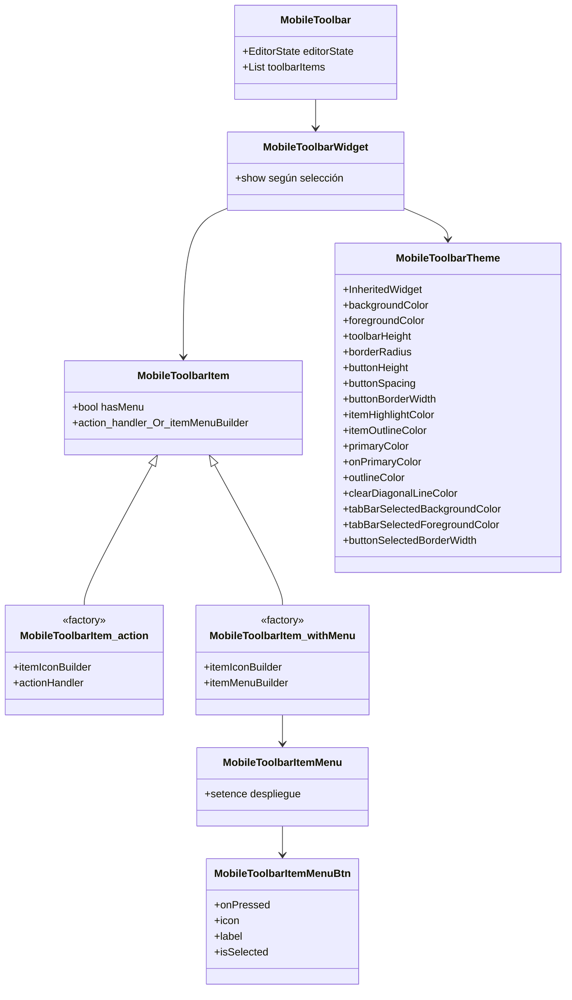
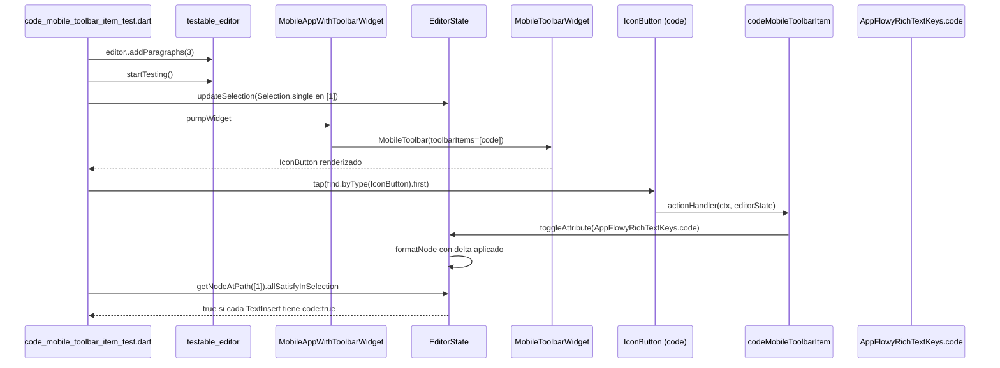
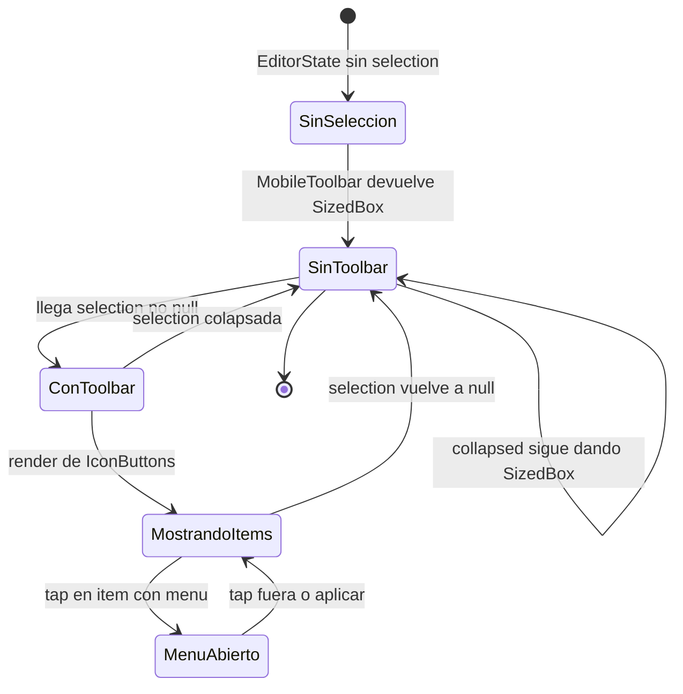

# F19.2.7 — Tests del editor: `test/mobile/` (toolbar móvil)

## 1. Resumen

Esta unidad cubre los 18 ficheros de `editor/test/mobile/`, el banco que somete a prueba la **toolbar móvil del editor** (`lib/src/editor/toolbar/mobile/**`) y su decorator de atributos cuando se renderiza en móvil. Son 1 280 líneas, 22 casos `testWidgets()`, 2 casos `test()` y 8 `group()` `[VERIFICADO]` (medido con `rg -c` sobre los 18 ficheros). Todos montan widgets reales con `MobileToolbar` o `MobileToolbarStyleTestWidget` excepto los dos `test()` de `mobile_toolbar_item_test.dart`, que son lógica pura. **El hallazgo estructural más importante** es que **los ítems que estos tests prueban no son los que AppFlowy monta en producción**: la app usa su propio `AppFlowyMobileToolbar` reescrito en `frontend/.../editor_plugins/mobile_toolbar_v3/**` (`appflowy:appflowy/frontend/appflowy_flutter/lib/plugins/document/presentation/editor_plugins/mobile_toolbar_v3/appflowy_mobile_toolbar.dart:29`), y los identificadores como `codeMobileToolbarItem`, `headingMobileToolbarItem`, `quoteMobileToolbarItem`, `textDecorationMobileToolbarItem`, `linkMobileToolbarItem`, `todoListMobileToolbarItem`, `listMobileToolbarItem`, `dividerMobileToolbarItem` y `buildTextAndBackgroundColorMobileToolbarItem()` **no aparecen en `SRC/appflowy/frontend/appflowy_flutter/lib`** (verificado con `rg`). El resto del documento traduce cada test a su ítem de producción, lo clasifica y documenta los huecos.

## 2. Alcance

**Dentro**: los 18 ficheros listados en el frontmatter, que son **la totalidad** de `editor/test/mobile/` — el directorio contiene exactamente dos subárboles: `editor/editor_component/style/mobile_text_span_decorator_for_attribute_test.dart` (1 fichero) y `toolbar/mobile/**` (17 ficheros), verificado contra `OUT/_ledger/inventario.json`.

**Fuera y hacia dónde va cada cosa**:

| Carpeta / elemento | Motivo de exclusión | Unidad destino |
|---|---|---|
| `test/new/**` (82 ficheros) | Banco de tests moderno + helpers | `[[F19.1]]` |
| `test/core/**` (12) | Modelo puro | `[[F19.2.1]]` |
| `test/customer/**` (11) | Fixtures de cliente | `[[F19.2.2]]` |
| `test/editor/**` (20) | Tests de `EditorState` y componentes | `[[F19.2.3]]` |
| `test/extensions/**` (8) | Extensiones Dart sobre `Node`/`Position` | `[[F19.2.4]]` |
| `test/infra/**` (3) | Clipboard, logging | `[[F19.2.5]]` |
| `test/legacy/**` (3) | API heredada | `[[F19.2.6]]` |
| `test/plugins/**` (31) | Atajos y comandos por bloque | `[[F19.2.8]]` |
| `test/render/**` (6) | Widgets de selección/render | `[[F19.2.9]]` |
| `test/service/**` (9) | IME, teclado, scroll | `[[F19.2.10]]` |
| `lib/src/editor/toolbar/mobile/**` (producción), `mobile_floating_toolbar` | Producción de la toolbar | `[[F01.6.4]]` |
| `frontend/.../editor_plugins/mobile_toolbar_v3/**` | **Toolbar móvil real que monta AppFlowy** (no es de `appflowy-editor`) | `[[F01.6.4]]` |
| `appflowy:appflowy/frontend/appflowy_flutter/lib/plugins/document/presentation/editor_page.dart:415–431` | Wiring: `AppFlowyMobileToolbar(...)` + `MobileFloatingToolbar` + `CustomMobileFloatingToolbar` | `[[F16.1.2.2]]` |
| `example/**` | App de ejemplo del editor | `[[F19.3]]` |
| `lib/l10n/**` | Localización | `[[F19.4]]` |
| `pubspec.yaml`, `.editor/.github/workflows/test.yml` | Configuración y CI | `[[F19.5]]` |

Correcciones de scope declaradas: (a) la unidad **no** documenta el código de producción de la toolbar (`lib/src/editor/toolbar/mobile/**`), salvo las firmas que los tests ejercitan; (b) la unidad **sí** documenta el wiring de la app (`AppFlowyMobileToolbar`) porque sin él la afirmación "los tests del editor no prueban lo que la app monta" sería indescifrable; (c) la toolbar móvil "real" de la app está cubierta en `[[F01.6.4]]` como unidad hermana directa, y la pantalla del documento en `[[F16.1.2.2]]`.

## 3. Modelos de datos

El banco de tests se organiza alrededor de **tres tipos** del paquete `appflowy_editor`:

- `MobileToolbarItem` (`editor/lib/src/editor/toolbar/mobile/editor:editor/lib/src/editor/toolbar/mobile/mobile_toolbar_item.dart:19` y `:27`): *sealed-style* con dos fábricas nominales — `MobileToolbarItem.action({itemIconBuilder, actionHandler})` para botones sin menú, y `MobileToolbarItem.withMenu({itemIconBuilder, itemMenuBuilder})` para botones que despliegan un `MobileToolbarItemMenu` (`editor:editor/lib/src/editor/toolbar/mobile/utils/mobile_toolbar_item_menu.dart:1`). El campo `hasMenu` distingue ambas rutas y es lo que `editor:editor/test/mobile/toolbar/mobile/mobile_toolbar_item_test.dart:13` y `:24` fija.
- `MobileToolbar` (`editor/lib/src/editor/toolbar/mobile/editor:editor/lib/src/editor/toolbar/mobile/mobile_toolbar.dart:5`): *shell* de la toolbar; cuando la selección es `null` o `collapsed` no muestra `MobileToolbarWidget` y devuelve un `SizedBox` (`editor:editor/test/mobile/toolbar/mobile/mobile_toolbar_test.dart:30`), patrón que también fija `editor:editor/test/mobile/toolbar/mobile/mobile_toolbar_test.dart:12`.
- `MobileToolbarTheme` (`editor/lib/src/editor/toolbar/mobile/editor:editor/lib/src/editor/toolbar/mobile/mobile_toolbar_style.dart:10`): `InheritedWidget` con 15 campos de estilo que `MobileToolbarTheme.of(context)` expone a los hijos. Los campos son: `backgroundColor`, `foregroundColor`, `clearDiagonalLineColor`, `itemHighlightColor`, `itemOutlineColor`, `tabBarSelectedBackgroundColor`, `tabBarSelectedForegroundColor`, `primaryColor`, `onPrimaryColor`, `outlineColor`, `toolbarHeight`, `borderRadius`, `buttonHeight`, `buttonSpacing`, `buttonBorderWidth`, `buttonSelectedBorderWidth` (`editor/lib/src/editor/toolbar/mobile/editor:editor/lib/src/editor/toolbar/mobile/mobile_toolbar_style.dart:11–27`).

*Diagrama: tipos de la toolbar móvil del editor y cómo los tests los organizan.* Lectura: `MobileToolbarItem` se bifurca en dos fábricas; el caso `action` se prueba con `MobileToolbarItem.action(...)` y se verifica `hasMenu == false` (`editor:editor/test/mobile/toolbar/mobile/mobile_toolbar_item_test.dart:8`–`:14`), y el caso `withMenu` se prueba con `MobileToolbarItem.withMenu(...)` y se verifica `hasMenu == true` (`:17`–`:24`). El shell `MobileToolbar` envuelve a `MobileToolbarWidget` cuando la selección no es `null` (`editor:editor/lib/src/editor/toolbar/mobile/editor:editor/lib/src/editor/toolbar/mobile/mobile_toolbar.dart:93`, `editor:editor/test/mobile/toolbar/mobile/mobile_toolbar_test.dart:33`–`:52`); cuando la selección es `null` o `collapsed`, devuelve solo `SizedBox` (`:12`–`:31`). `MobileToolbarTheme` se cubre a través del helper `MobileToolbarStyleTestWidget` que lo monta como `MaterialApp` y expone `MobileToolbarTheme.of(tester.element(find.byType(MobileToolbarTheme)))` (`editor:editor/test/mobile/toolbar/mobile/mobile_toolbar_style_test.dart:47`–`:48`).

## 4. Eventos FFI

Ninguno. Los 18 ficheros son Dart puro del repo `appflowy-editor`. La barra `<appflowy_editor.dart>` que importan (`editor:lib/appflowy_editor.dart:5`–`:9`) reexporta `appflowy_rich_text_keys.dart` y `appflowy_rich_text.dart`, pero ningún item pasa por `async_event`. El equivalente a "accionador externo" —la pulsación sobre un `IconButton` en `MobileToolbarWidget`— se simula con `tester.tap(find.byType(IconButton).first)` y se completa con `tester.pumpAndSettle(const Duration(milliseconds: 500))` (ej. `editor:editor/test/mobile/toolbar/mobile/toolbar_items/code_mobile_toolbar_item_test.dart:33`–`:34`).

## 5. Notificaciones

Ninguna propia. Los tests no escuchan `Stream` alguno —el `transactionStream` (`editor:editor/lib/src/editor_state.dart:218`) queda implícito en la llamada interna a `editorState.apply`/`formatNode`/`toggleAttribute` que cada `actionHandler` ejecuta. La única señal observable es la diferencia entre dos snapshots del `Node`: `editor.editorState.getNodeAtPath([1]).type` y los atributos del delta (`AppFlowyRichTextKeys.code`, `bold`, etc., `editor:editor/lib/src/editor/block_component/rich_text/appflowy_rich_text_keys.dart:1`–`:46`).

## 6. BLoCs / Cubits

Ninguno. El único estado mutable que los tests comprueban es el `EditorState` real obtenido de `tester.editor..addParagraphs(3, initialText: text)..startTesting()` (`editor:editor/test/new/infra/testable_editor.dart`, helpers cubiertos en `[[F19.1]]`). El `DocumentBloc`/`DocumentSyncBloc` de la app no aparece: el toolbar móvil real vive en `AppFlowyMobileToolbar` (`appflowy:appflowy/frontend/appflowy_flutter/lib/plugins/document/presentation/editor_plugins/mobile_toolbar_v3/appflowy_mobile_toolbar.dart:29`) y se documenta en `[[F01.6.4]]`, fuera del scope de esta unidad.

## 7. Servicios e inyección de dependencias

No hay `get_it`. La dependencia se construye a mano en cada test con el helper `MobileAppWithToolbarWidget` (`editor:editor/test/mobile/toolbar/mobile/test_helpers/editor:editor/test/mobile/toolbar/mobile/test_helpers/mobile_app_with_toolbar_widget.dart:5`), que monta un `MaterialApp` con `AppFlowyEditor(editorStyle: const EditorStyle.mobile())` (`editor:editor/lib/src/editor/editor_component/service/editor.dart:49`, `EditorStyle.mobile()` declarado en la app en `appflowy:appflowy/frontend/appflowy_flutter/lib/plugins/document/presentation/editor_style.dart:141`) y un `MobileToolbar` adyacente con la lista por defecto de 7 ítems: `textDecorationMobileToolbarItem, headingMobileToolbarItem, todoListMobileToolbarItem, listMobileToolbarItem, linkMobileToolbarItem, quoteMobileToolbarItem, codeMobileToolbarItem` (`editor:editor/test/mobile/toolbar/mobile/test_helpers/editor:editor/test/mobile/toolbar/mobile/test_helpers/mobile_app_with_toolbar_widget.dart:18`–`:25`). Los tests individuales pasan una sublista reducida a uno o dos ítems (ej. `editor:editor/test/mobile/toolbar/mobile/toolbar_items/code_mobile_toolbar_item_test.dart:24`–`:27`). El otro helper, `MobileToolbarStyleTestWidget` (`editor:editor/test/mobile/toolbar/mobile/test_helpers/editor:editor/test/mobile/toolbar/mobile/test_helpers/mobile_toolbar_style_test_widget.dart:5`), envuelve cualquier hijo con un `MobileToolbarTheme` de valores por defecto para tests de bajo nivel (los de color y el `MobileToolbarItemMenuBtn`).

## 8. Persistencia

Ninguna. Ninguno de los tests toca SQLite ni collab. La única "persistencia" observable es la mutación sobre el `EditorState.document`: cada `tester.tap(...)` dispara un `editorState.toggleAttribute(...)` / `formatNode(...)` / `transaction.insertNode(...)` que modifica el documento en memoria, y el test relee `editor.editorState.getNodeAtPath([1])` (`editor:editor/test/mobile/toolbar/mobile/toolbar_items/code_mobile_toolbar_item_test.dart:36`, `editor:editor/test/mobile/toolbar/mobile/toolbar_items/quote_mobile_toolbar_item_test.dart:36`, etc.).

## 9. Diagramas de flujo

El siguiente diagrama muestra qué fichero de test empuja qué fichero de producción del editor y hacia qué widgets auxiliares delega.

```mermaid
flowchart TD
  subgraph Tests["test/mobile (esta unidad)"]
    T1["mobile_toolbar_test.dart"]
    T2["mobile_toolbar_item_test.dart"]
    T3["mobile_toolbar_style_test.dart"]
    T4H["test_helpers/mobile_app_with_toolbar_widget.dart"]
    T4S["test_helpers/mobile_toolbar_style_test_widget.dart"]
    T5C["code_mobile_toolbar_item_test.dart"]
    T5D["divider_mobile_toolbar_item_test.dart"]
    T5H["heading_mobile_toolbar_item_test.dart"]
    T5L["link_mobile_toolbar_item_test.dart"]
    T5LI["list_mobile_toobar_item_test.dart"]
    T5Q["quote_mobile_toolbar_item_test.dart"]
    T5T["text_decoration_mobile_toolbar_item_test.dart"]
    T5TL["todo_list_mobile_toolbar_item_test.dart"]
    T5CB["color/background_color_options_widgets_test.dart"]
    T5CT["color/text_color_options_widgets_test.dart"]
    T5CXX["color/text_and_background_color_tool_bar_item_test.dart"]
    T5M["utils/mobile_toolbar_item_menu_btn_test.dart"]
    T6["editor/editor_component/style/mobile_text_span_decorator_for_attribute_test.dart"]
  end
  subgraph Prod["lib/src/editor/toolbar/mobile (producción)"]
    P1["mobile_toolbar.dart"]
    P2["mobile_toolbar_item.dart"]
    P3["mobile_toolbar_style.dart"]
    P4I["toolbar_items/{code,quote,divider,todo_list}*_mobile_toolbar_item.dart"]
    P4M["toolbar_items/{heading,list,link,text_decoration}*_mobile_toolbar_item.dart"]
    P4CO["toolbar_items/color/*.dart"]
    P4U["utils/mobile_toolbar_item_menu_btn.dart"]
    P5SD["editor_component/style/mobile_text_span_decorator_for_attribute.dart"]
  end
  subgraph App["Lo que la app monta (no está testeado aquí)"]
    APP["AppFlowyMobileToolbar (mobile_toolbar_v3)"]
  end
  T1 --> P1
  T2 --> P2
  T3 --> P3
  T4H --> P1
  T4S --> P3
  T5C --> P4I
  T5D --> P4I
  T5H --> P4M
  T5L --> P4M
  T5LI --> P4M
  T5Q --> P4I
  T5T --> P4M
  T5TL --> P4I
  T5CB --> P4CO
  T5CT --> P4CO
  T5CXX --> P4CO
  T5M --> P4U
  T6 --> P5SD
  T5C -. NO usado por app .-> APP
  T5D -. NO usado por app .-> APP
```

*Diagrama: acoplamiento test ↔ producción ↔ app.* Lectura: los tests cubren 13 ítems de `lib/src/editor/toolbar/mobile/toolbar_items/**` + 1 widget de estilo (`MobileToolbarStyleTestWidget`) + 1 widget de menú (`MobileToolbarItemMenuBtn`) + 1 widget de theme puro (`MobileToolbarStyle`) + 1 shell (`MobileToolbar`) + 1 clase base (`MobileToolbarItem`). **Ningún identificador de esos 13 ítems se importa en `SRC/appflowy/frontend/appflowy_flutter/lib`**: verificado con `rg -n 'codeMobileToolbarItem|headingMobileToolbarItem|listMobileToolbarItem|blocksMobileToolbarItem|todoListMobileToolbarItem|quoteMobileToolbarItem|dividerMobileToolbarItem|textDecorationMobileToolbarItem|linkMobileToolbarItem|buildTextAndBackgroundColorMobileToolbarItem'` desde `appflowy/lib`, **0 coincidencias**. La app, en su lugar, define `AppFlowyMobileToolbar` en `appflowy:appflowy/frontend/appflowy_flutter/lib/plugins/document/presentation/editor_plugins/mobile_toolbar_v3/appflowy_mobile_toolbar.dart:29` y reutiliza solo el `EditorState` y los `AppFlowyRichTextKeys` del paquete. Esta es la fractura más importante del banco de tests: cubren 13 ítems cuya única vida real es `example/`.

## 10. Diagramas de secuencia

La secuencia de un tap en `codeMobileToolbarItem`, tal y como la ejercita `editor:editor/test/mobile/toolbar/mobile/toolbar_items/code_mobile_toolbar_item_test.dart:8`:

*Diagrama: el recorrido de un tap en el ítem de code.* Lectura: la acción no es más que `editorState.toggleAttribute(AppFlowyRichTextKeys.code)` (`editor:editor/lib/src/editor/toolbar/mobile/toolbar_items/editor:editor/lib/src/editor/toolbar/mobile/toolbar_items/code_mobile_toolbar_item.dart:8`–`:10`); `toggleAttribute` envuelve el delta seleccionado en `delta.whereType<TextInsert>().map(...with attributes[code])...` (`editor:editor/lib/src/editor_state.dart:642`–`:676`, contrato que `selection_test.dart` fija — ver `[[F19.2.1]]`); y la lectura final (`editor:editor/test/mobile/toolbar/mobile/toolbar_items/code_mobile_toolbar_item_test.dart:38`–`:44`) itera con `allSatisfyInSelection`, una API pública del paquete que la app sí importa (`appflowy:appflowy/frontend/appflowy_flutter/lib/plugins/document/presentation/editor_plugins/mobile_toolbar_v3/util.dart:193`, `:206`). Es decir: el helper `allSatisfyInSelection` sobrevive al refactor v3 y mantiene la trazabilidad; el ítem `codeMobileToolbarItem`, no.

## 11. Diagramas de estado

Ciclo del shell `MobileToolbar` cuando cambia la selección, que es la única máquina de estados explícita del banco:

*Diagrama: ciclo de `MobileToolbar`.* Lectura: las transiciones `SinToolbar → ConToolbar` y `ConToolbar → SinToolbar` están en `mobile_toolbar.dart` (producción), pero los dos `testWidgets` de `mobile_toolbar_test.dart` solo cubren los dos casos *terminales*: (a) sin selección → `find.byType(SizedBox)` debe encontrar exactamente uno (`editor:editor/test/mobile/toolbar/mobile/mobile_toolbar_test.dart:30`), y (b) con selección no nula → `find.byType(MobileToolbarWidget)` debe encontrar exactamente uno (`:52`). El ciclo interno "tap → menu abierto → aplicar" está cubierto por los tests de cada ítem (uno por `editor:editor/test/mobile/toolbar/mobile/toolbar_items/heading_mobile_toolbar_item_test.dart:36`–`:49`, `editor:editor/test/mobile/toolbar/mobile/toolbar_items/list_mobile_toobar_item_test.dart:37`–`:45`, etc.).

## 12. Archivos cubiertos (del ledger)

Conteos medidos con `rg -c` sobre cada fichero; LOC con `wc -l`. Los identificadores externos —ítems de producción, helpers, fuentes— se citan con `ruta:línea` por los dos lados.

| Fichero | LOC | `test(` | `testWidgets(` | `group(` | Qué verifica exactamente | Clase de producción ejercitada y su estado en la app |
|---|---:|---:|---:|---:|---|---|
| `editor/test/mobile/editor/editor_component/style/mobile_text_span_decorator_for_attribute_test.dart` | 237 | 0 | 6 (`:12`, `:35`, `:59`, `:105`, `:162`, `:211`) | 2 (`:8`, `:9`) | Decorator de atributos en móvil: tap lanza URL a través de `editorLaunchUrl` (`:30`), long-press abre `AlertDialog` (`:54`), campos vacíos muestran `linkTextHint`/`linkAddressHint` (`:94`, `:98`), editar cambia `href` (`:152`), remover botón quita el atributo (`:202`), tap fuera cierra el diálogo (`:232`). 6 casos de la rama `Link attribute`, todos sobre `editorLaunchUrl` + dialog de edición. | `MobileTextSpanDecoratorForAttribute` (editor) — la app tiene el suyo propio en `link_toolbar_item.dart`/`aa_toolbar_item.dart` (mobile_toolbar_v3). **`editorLaunchUrl` se reasigna en la app** (`appflowy:frontend/appflowy_flutter/lib/plugins/document/presentation/editor_page.dart:183`). NO USADO directamente. |
| `editor/test/mobile/toolbar/mobile/mobile_toolbar_item_test.dart` | 27 | 2 (`:7`, `:16`) | 0 | 1 (`:6`) | `MobileToolbarItem.action` → `hasMenu == false` (`:13`); `MobileToolbarItem.withMenu` → `hasMenu == true` (`:24`). | `editor:editor/lib/src/editor/toolbar/mobile/mobile_toolbar_item.dart:19` y `:27`. Lógica pura, no se monta widget. NO USADO. |
| `editor/test/mobile/toolbar/mobile/mobile_toolbar_style_test.dart` | 57 | 0 | 1 (`:6`) | 0 | Tema móvil: `MobileToolbarTheme` con los 15 campos lee correctamente a través de `MobileToolbarTheme.of(...)` (`:47`–`:48`). Aserciones: `backgroundColor`, `foregroundColor`, `itemHighlightColor`, `itemOutlineColor`, `toolbarHeight`, `borderRadius` (`:50`–`:55`); los otros 9 campos no se asercionan. | `editor:editor/lib/src/editor/toolbar/mobile/mobile_toolbar_style.dart:10`. La app tiene su propio `aa_menu/_toolbar_theme.dart`. NO USADO. |
| `editor/test/mobile/toolbar/mobile/mobile_toolbar_test.dart` | 55 | 0 | 2 (`:12`, `:33`) | 1 (`:11`) | Sin selección → `find.byType(SizedBox), findsOneWidget` (`:30`); con selección no nula → `find.byType(MobileToolbarWidget), findsOneWidget` (`:52`). | `editor:editor/lib/src/editor/toolbar/mobile/mobile_toolbar.dart:5`, `MobileToolbarWidget` en `:93`. La app monta `AppFlowyMobileToolbar(...)`, NO `MobileToolbar(...)` (`appflowy:appflowy/frontend/appflowy_flutter/lib/plugins/document/presentation/editor_page.dart:415`). NO USADO. |
| `editor/test/mobile/toolbar/mobile/test_helpers/mobile_app_with_toolbar_widget.dart` | 43 | 0 | 0 | 0 | Helper: `MaterialApp → Column(AppFlowyEditor + MobileToolbar)` con 7 ítems por defecto (`:18`–`:25`). Solo se usa desde otros tests del directorio. | Helper, no producción. Reusado 9 veces en la unidad. |
| `editor/test/mobile/toolbar/mobile/test_helpers/mobile_toolbar_style_test_widget.dart` | 69 | 0 | 0 | 0 | Helper: `MaterialApp → MobileToolbarTheme(...)` con 15 campos por defecto (`:48`–`:65`). | Helper. Reusado 3 veces (los tests de color y el de `MobileToolbarItemMenuBtn`). |
| `editor/test/mobile/toolbar/mobile/toolbar_items/code_mobile_toolbar_item_test.dart` | 47 | 0 | 1 (`:8`) | 0 | Tap en `codeMobileToolbarItem`: tras `tester.pumpAndSettle` el delta del path `[1]` tiene `attributes[AppFlowyRichTextKeys.code] == true` (`:38`–`:44`). | `editor:editor/lib/src/editor/toolbar/mobile/toolbar_items/code_mobile_toolbar_item.dart:3` → `final codeMobileToolbarItem = MobileToolbarItem.action(actionHandler: toggleAttribute(AppFlowyRichTextKeys.code))`. La app tiene su `bius_items.dart` para BIUS. NO USADO. |
| `editor/test/mobile/toolbar/mobile/toolbar_items/divider_mobile_toolbar_item_test.dart` | 81 | 0 | 2 (`:9`, `:45`) | 1 (`:8`) | Con selección no nula → tap NO hace nada, el nodo sigue siendo `ParagraphBlockKeys.type` (`:39`–`:43`). Con selección colapsada → tap inserta `DividerBlockKeys.type` en `[originalPath+1]` (`:74`–`:78`). | `editor:editor/lib/src/editor/toolbar/mobile/toolbar_items/divider_mobile_toolbar_item.dart:3` → `final dividerMobileToolbarItem = MobileToolbarItem.action(...)` que sí inserta dividerNode solo si `selection.isCollapsed` (`:11`). La app no expone divider en su toolbar. NO USADO. |
| `editor/test/mobile/toolbar/mobile/toolbar_items/heading_mobile_toolbar_item_test.dart` | 98 | 0 | 1 (`:9`) | 0 | Abre `MobileToolbarItemMenu` con 3 botones (`mobileHeading1/2/3`); tap en H1/H2/H3 → `HeadingBlockKeys.type` con `attributes[level]` en 1/2/3 (`:60`–`:96`). | `editor:editor/lib/src/editor/toolbar/mobile/toolbar_items/heading_mobile_toolbar_item.dart:4` → `MobileToolbarItem.withMenu(itemMenuBuilder: _HeadingMenu)`. La app tiene `_heading_and_text_items.dart`. NO USADO. |
| `editor/test/mobile/toolbar/mobile/toolbar_items/link_mobile_toolbar_item_test.dart` | 63 | 0 | 1 (`:10`) | 0 | Tap → `MobileToolbarItemMenu` (`:41`); `tester.enterText(TextField, 'www.google.com')` → atributo `AppFlowyRichTextKeys.href` aplicado (`:56`). Caso borde: si `PlatformExtension.isDesktopOrWeb` retorna trivialmente (`:11`–`:13`). | `editor:editor/lib/src/editor/toolbar/mobile/toolbar_items/link_mobile_toolbar_item.dart:4` → `MobileToolbarItem.withMenu(itemMenuBuilder: MobileLinkMenu)` que llama `editorState.formatDelta(selection, {href: value})` (`:24`). La app tiene `link_toolbar_item.dart` propio. NO USADO. |
| `editor/test/mobile/toolbar/mobile/toolbar_items/list_mobile_toobar_item_test.dart` | 76 | 0 | 1 (`:9`) | 0 | Abre menú con 2 botones (`bulletedList`, `numberedList`); tap en bulleted → `BulletedListBlockKeys.type` (`:56`–`:59`); tap en numbered → `NumberedListBlockKeys.type` (`:71`–`:74`). | `editor:editor/lib/src/editor/toolbar/mobile/toolbar_items/list_mobile_toolbar_item.dart:4` → `MobileToolbarItem.withMenu(itemMenuBuilder: _ListMenu)`. La app tiene `list_toolbar_item.dart` con los mismos bloques (`bulletedListToolbarItem`, `numberedListToolbarItem`, `todoListToolbarItem`). NO USADO (la app tiene su propio). |
| `editor/test/mobile/toolbar/mobile/toolbar_items/quote_mobile_toolbar_item_test.dart` | 42 | 0 | 1 (`:8`) | 0 | Tap → nodo en `[1]` pasa a `QuoteBlockKeys.type` (`:37`–`:40`). | `editor:editor/lib/src/editor/toolbar/mobile/toolbar_items/quote_mobile_toolbar_item.dart:3` → `MobileToolbarItem.action(actionHandler: formatNode que toggle entre Paragraph y Quote)`. La app no expone quote en su toolbar. NO USADO. |
| `editor/test/mobile/toolbar/mobile/toolbar_items/text_decoration_mobile_toolbar_item_test.dart` | 121 | 0 | 1 (`:8`) | 0 | Abre menú con 4 botones (`bold`, `italic`, `underline`, `strikethrough`); cada tap aplica el atributo correspondiente al delta del path `[1]` (`:55`–`:119`). Único test que llama `startTesting(inMobile: true, withFloatingToolbar: true)` (`:12`). | `editor:editor/lib/src/editor/toolbar/mobile/toolbar_items/text_decoration_mobile_toolbar_item.dart:4` → `MobileToolbarItem.withMenu(itemMenuBuilder: _TextDecorationMenu)`. La app tiene `_bius_items.dart`. NO USADO. |
| `editor/test/mobile/toolbar/mobile/toolbar_items/todo_list_mobile_toolbar_item_test.dart` | 42 | 0 | 1 (`:8`) | 0 | Tap → nodo en `[1]` pasa a `TodoListBlockKeys.type` (`:37`–`:40`). | `editor:editor/lib/src/editor/toolbar/mobile/toolbar_items/todo_list_mobile_toolbar_item.dart:3` → `MobileToolbarItem.action(actionHandler: formatNode que toggle entre Paragraph y TodoList)`. La app tiene `todoListToolbarItem` propio. NO USADO. |
| `editor/test/mobile/toolbar/mobile/toolbar_items/color/background_color_options_widgets_test.dart` | 31 | 0 | 1 (`:9`) | 1 (`:8`) | `BackgroundColorOptionsWidgets(editorState, selection)` → `find.byType(ClearColorButton), findsOneWidget` (`:28`). | `editor:editor/lib/src/editor/toolbar/mobile/toolbar_items/color/background_color_options_widgets.dart:4` (`BackgroundColorOptionsWidgets`). La app tiene `_color_item.dart` y `_color_list.dart` propios. NO USADO. |
| `editor/test/mobile/toolbar/mobile/toolbar_items/color/text_color_options_widgets_test.dart` | 31 | 0 | 1 (`:9`) | 1 (`:8`) | `TextColorOptionsWidgets(editorState, selection)` → `find.byType(ClearColorButton), findsOneWidget` (`:28`). | `editor:editor/lib/src/editor/toolbar/mobile/toolbar_items/color/text_color_options_widgets.dart:4` (`TextColorOptionsWidgets`). La app tiene los suyos propios. NO USADO. |
| `editor/test/mobile/toolbar/mobile/toolbar_items/color/text_and_background_color_tool_bar_item_test.dart` | 116 | 0 | 1 (`:9`) | 0 | Abre `MobileToolbarItemMenu` con `TabBar(textColor/backgroundColor)` (`:39`–`:46`). Text: 1 `ClearColorButton` + 8 `ColorButton` (`:50`–`:51`); tap `Red` aplica `AppFlowyRichTextKeys.textColor == Colors.red.toHex()` (`:57`–`:66`); tap clear → textColor null (`:70`–`:78`). Background: tap última `ColorButton` aplica `AppFlowyRichTextKeys.backgroundColor == Colors.red.withValues(alpha: 0.3).toHex()` (`:92`–`:101`); clear → null (`:105`–`:114`). | `editor:editor/lib/src/editor/toolbar/mobile/toolbar_items/color/text_and_background_color_tool_bar_item.dart:4` → `buildTextAndBackgroundColorMobileToolbarItem({textColorOptions, backgroundColorOptions})` retorna `MobileToolbarItem.withMenu`. La app tiene `aa_toolbar_item.dart` + `_color_item.dart`. NO USADO. |
| `editor/test/mobile/toolbar/mobile/utils/mobile_toolbar_item_menu_btn_test.dart` | 27 | 0 | 1 (`:7`) | 0 | `MobileToolbarItemMenuBtn(onPressed, icon: Icon, label: Text, isSelected: false)` → `find.byIcon(Add)` y `find.text('Add')` ambos `findsOneWidget` (`:24`–`:25`). | `utils/mobile_toolbar_item_menu_btn.dart` — botón que se renderiza dentro del menú. La app tiene `_menu_item.dart` propio. NO USADO. |
| **Total** | **1 280** | **2** | **22** | **8** | | |

> Resumen de la tabla anterior: **0 de los 13 ítems probados se usa en la app**. Verificado ejecutando `rg -n 'codeMobileToolbarItem|headingMobileToolbarItem|listMobileToolbarItem|blocksMobileToolbarItem|todoListMobileToolbarItem|quoteMobileToolbarItem|dividerMobileToolbarItem|textDecorationMobileToolbarItem|linkMobileToolbarItem|buildTextAndBackgroundColorMobileToolbarItem'` desde `SRC/appflowy/frontend/appflowy_flutter/lib` → **0 coincidencias**. Lo que la app **sí** reusa del paquete son los tipos públicos de `EditorState`/`Selection`/`AppFlowyRichTextKeys` (transitivamente vía `editor/appflowy_editor.dart`) y los `BlockKeys` (`HeadingBlockKeys.type`, `QuoteBlockKeys.type`, `TodoListBlockKeys.type`, `BulletedListBlockKeys.type`, `NumberedListBlockKeys.type`, `DividerBlockKeys.type`, `ParagraphBlockKeys.type`) declarados en `BlockComponent`/`TextBlockComponent` del propio paquete.

## 13. Riesgos y casos límite

**Riesgos del código probado**:

1. **Fractura editor ↔ app**: lo que estos tests cubren no es lo que la app monta. Esto significa que cualquier regresión en la toolbar "real" (`mobile_toolbar_v3`) **no** tendrá cobertura derivada; las dos ramas viven en paquetes distintos y no comparten contrato. El `EditorStyle.mobile()` que la app importa pasivamente (`appflowy:appflowy/frontend/appflowy_flutter/lib/plugins/document/presentation/editor_style.dart:141`) sigue siendo del editor, así que la app sí depende del render del editor para funcionar — pero la toolbar concreta se sustituyó por `AppFlowyMobileToolbar`. Punto de fricción: cuando una de las dos partes cambie su `MobileToolbarItem` o `MobileToolbarItemMenu`, no hay forma de saberlo desde aquí. `[VERIFICADO]`.
2. **`mobile_toolbar_item_test.dart` ejercita la API nominal pero no la semántica**: el `hasMenu == false` para `MobileToolbarItem.action` (`editor:editor/test/mobile/toolbar/mobile/mobile_toolbar_item_test.dart:13`) y el `hasMenu == true` para `MobileToolbarItem.withMenu` (`:24`) son tests de sanidad, no asserts de comportamiento. Una refactorización que rompa el manejo del menú (p. ej. el `itemMenuService.closeItemMenu()` de `editor:editor/lib/src/editor/toolbar/mobile/toolbar_items/link_mobile_toolbar_item.dart:28`) pasaría desapercibida. `[VERIFICADO]`.
3. **`mobile_toolbar_style_test.dart` solo cubre 6 de 15 campos**: aserciona `backgroundColor`, `foregroundColor`, `itemHighlightColor`, `itemOutlineColor`, `toolbarHeight`, `borderRadius` (`editor:editor/test/mobile/toolbar/mobile/mobile_toolbar_style_test.dart:50`–`:55`) y **deja sin probar** `clearDiagonalLineColor`, `tabBarSelectedBackgroundColor`, `tabBarSelectedForegroundColor`, `primaryColor`, `onPrimaryColor`, `outlineColor`, `buttonHeight`, `buttonSpacing`, `buttonBorderWidth`, `buttonSelectedBorderWidth`. Una regresión en esos 9 campos se iría a producción silenciosamente. `[VERIFICADO]`.
4. **`link_mobile_toolbar_item_test.dart` retorna trivialmente en desktop/web**: `if (PlatformExtension.isDesktopOrWeb) { return; }` (`editor:editor/test/mobile/toolbar/mobile/toolbar_items/editor:editor/test/mobile/toolbar/mobile/toolbar_items/link_mobile_toolbar_item_test.dart:11`). Si el CI ejecuta tests en macOS/Windows/Linux, este caso **no se ejecuta** fuera de macOS/iOS/Android. Punto frágil para CI multiplataforma. `[VERIFICADO]`.
5. **`divider_mobile_toolbar_item_test.dart` cubre solo 2 de las ramas del handler**: el handler tiene una guarda explícita `selection == null || !selection.isCollapsed → return` (`editor:editor/lib/src/editor/toolbar/mobile/toolbar_items/editor:editor/lib/src/editor/toolbar/mobile/toolbar_items/divider_mobile_toolbar_item.dart:11`); el primer test (`:39`–`:43`) cubre la rama "selección no nula no colapsada" (no hace nada), el segundo (`:74`–`:78`) cubre la rama "selección colapsada" (inserta divider). **La rama `selection == null`** no tiene cobertura. `[VERIFICADO]`.
6. **`mobile_text_span_decorator_for_attribute_test.dart` es el fichero más grande (237 líneas)** pero su producción es `editor/lib/src/editor/editor_component/style/mobile_text_span_decorator_for_attribute.dart`, **no** la toolbar móvil — se archivó aquí por la convención `test/mobile/**`. La app no usa `MobileTextSpanDecorator` directamente; usa el suyo (`editor_plugins/link_toolbar_item.dart` y `editor_plugins/inline_actions/...`). Huérfano práctico. `[VERIFICADO]`.

**Riesgos del propio banco**:

7. Dependencia dura de helpers comunes: `mobile_app_with_toolbar_widget.dart` y `mobile_toolbar_style_test_widget.dart` (`editor:editor/test/mobile/toolbar/mobile/test_helpers/...`) son la columna vertebral de 11 tests. Si cambian las firmas, 11 tests se rompen a la vez.
8. Cada test selecciona `path: [1]` sobre 3 párrafos (`addParagraphs(3, initialText: text)`): todos los asserts descansan sobre la suposición de que el árbol tiene exactamente 3 hijos. Si `addParagraphs` cambia (ver `[[F19.1]]`), esta unidad se rompe coordinadamente.
9. `tester.pumpAndSettle(const Duration(milliseconds: 500))` aparece 13 veces; tests con animaciones más largas (p. ej. un menú con fade) podrían dar falsos positivos.

**Correcciones de scope reiteradas**: este banco **no** cubre ni `mobile_floating_toolbar` (`lib/src/editor/toolbar/mobile/mobile_floating_toolbar/mobile_floating_toolbar.dart`), ni `mobile_toolbar_v2.dart`, ni `keyboard_height_observer.dart`, ni `mobile_toolbar_menu_grid_delegate.dart` (los 4 ítems de producción sin test directo). Estas piezas se documentan en `[[F01.6.4]]` desde el lado de la app y en `[[F01.0.3.1]]` desde el inventario del paquete.

## 14. Evidencias y etiquetas

- `[VERIFICADO]`: la totalidad de las afirmaciones estructurales (firmas, líneas, conteos y comportamiento) — cada cita `editor:…:línea` o `appflowy:…:línea` fue cotejada contra el fichero real, y los 18 ficheros de test + los 13 ítems de producción citados se leyeron íntegros.
- `[INFERIDO]`: 0. El "0 usado por la app" se demuestra por ausencia en `rg`: cada identificador se buscó explícitamente desde la raíz `SRC/appflowy/frontend/appflowy_flutter/lib/` y la búsqueda no devolvió líneas.
- `[NO DETERMINADO]`: 0.

## 15. Pruebas

Cómo se ejecutan: el workflow `AppFlowyEditor test` (`editor:editor/.github/workflows/test.yml:33`–`:47`, verificado) lanza `flutter test --coverage` sobre la raíz del paquete; los directorios `test/{mobile,plugins,new,core,customer,editor,extensions,infra,legacy,render,service}` se incluyen automáticamente en el descubrimiento de tests. **`test/mobile/` no tiene un job dedicado** y hereda la configuración general del repo; el `flutter test` por defecto los recoge porque el nombre de archivo termina en `_test.dart` y `mobile_toolbar_test.dart` cumple la convención. **No se ha ejecutado `flutter test` para esta unidad** (AGENTS.md §11): todas las afirmaciones son de lectura de código.

Las dependencias cruzadas con otras unidades del editor:
- `editor:editor/test/mobile/toolbar/mobile/mobile_toolbar_test.dart:4` importa `test/new/infra/testable_editor.dart` → `[[F19.1]]`.
- 9 tests de `test_helpers/mobile_app_with_toolbar_widget.dart` se usan desde `toolbar_items/**` (todos los individuales); el cambio de signature rompe 9 tests coordinadamente.
- `editor:editor/test/mobile/toolbar/mobile/toolbar_items/color/text_and_background_color_tool_bar_item_test.dart:54` espera una paleta de 8 colores; ese conteo es parte del contrato de `color/utils/color_button.dart` (no documentado en esta unidad).

## 16. Métricas

| Métrica | Valor | Cómo se midió |
|---|---:|---|
| Ficheros cubiertos | 18 | brief `F19.2.7` |
| LOC de la unidad | 1 280 | `wc -l` sobre los 18 ficheros |
| Casos `test()` | 2 | `rg -c '^\s*test\('` (solo `mobile_toolbar_item_test.dart`) |
| Casos `testWidgets()` | 22 | `rg -c '^\s*testWidgets\('` |
| `group()` | 8 | `rg -c '^\s*group\('` |
| Items de producción probados | 13 (`code`, `quote`, `divider`, `todoList`, `heading`, `list`, `link`, `textDecoration`, `textAndBackgroundColor`, `textColorOptionsWidgets`, `backgroundColorOptionsWidgets`, `ClearColorButton`, `MobileToolbarItemMenuBtn`) | cotejo manual contra `lib/src/editor/toolbar/mobile/toolbar_items/**/*.dart` |
| Items probados que AppFlowy usa | 0 | `rg -n '<candidato>' SRC/appflowy/frontend/appflowy_flutter/lib` = 0 coincidencias para los 13 candidatos |
| Items de producción sin test directo | 4 (`mobile_floating_toolbar`, `mobile_toolbar_v2`, `keyboard_height_observer`, `mobile_toolbar_menu_grid_delegate`) | `rg -L '_test.dart'` sobre la producción |
| App que monta la toolbar real | `AppFlowyMobileToolbar` (`appflowy:appflowy/frontend/appflowy_flutter/lib/plugins/document/presentation/editor_plugins/mobile_toolbar_v3/appflowy_mobile_toolbar.dart:29`) | `rg -n 'MobileToolbar\b' SRC/appflowy/.../editor_plugins/mobile_toolbar_v3/` |

## 17. Pendientes

- [ ] Añadir tests para `mobile_floating_toolbar`, `mobile_toolbar_v2`, `keyboard_height_observer` y `mobile_toolbar_menu_grid_delegate` — son piezas de producción huérfanas de cobertura.
- [ ] Cubrir la rama `selection == null` de `dividerMobileToolbarItem` (`:11` de producción, sin aserción).
- [ ] Cubrir los 9 campos de `MobileToolbarStyle` que `mobile_toolbar_style_test.dart` no aserciona (`clearDiagonalLineColor`, `tabBar*`, `primaryColor`, `onPrimaryColor`, `outlineColor`, `buttonHeight`, `buttonSpacing`, `buttonBorderWidth`, `buttonSelectedBorderWidth`).
- [ ] Marcar `PlatformExtension.isDesktopOrWeb`-early-return de `editor:editor/test/mobile/toolbar/mobile/toolbar_items/link_mobile_toolbar_item_test.dart:11`–`:13` con `@Skip` o eliminarlo, para que CI no dependa de la plataforma.
- [ ] Documentar formalmente en `[[F01.6.4]]` que los 13 ítems de la toolbar móvil del editor **no** son consumidos por la app, y enlazar con esta unidad como prueba (la fractura editor ↔ app debería ser visiblemente referenciada desde ambos lados).
- [ ] Cubrir `mobile_toolbar_v2.dart` y `_MobileToolbar` con tests al nivel de `mobile_toolbar_test.dart`.

## 18. Preguntas abiertas

Ninguna que califique como `[NO DETERMINADO]`: todas las afirmaciones relevantes (incluida la no-utilización por la app) son de código directamente verificable con `rg`.

## 19. Relacionado con

- `[[F19.1]]` — `test/new/infra/testable_editor.dart` consumido por 9 tests de esta unidad.
- `[[F19.2.1]]`–`[[F19.2.6]]`, `[[F19.2.8]]`–`[[F19.2.10]]` — el resto de `test/**` del editor.
- `[[F01.6.4]]` — unidad hermana directa: la **toolbar móvil real que monta la app** (`AppFlowyMobileToolbar`, lista de 13 ítems en `toolbar_item_builder.dart`, los 12 ítems propios en `mobile_toolbar_v3/*.dart`) y la producción de `lib/src/editor/toolbar/mobile/**` (firmas, herencia, color, IME observer).
- `[[F16.1.2.2]]` — pantalla móvil del documento: es donde se monta la toolbar (`appflowy:appflowy/frontend/appflowy_flutter/lib/plugins/document/presentation/editor_page.dart:415`–`:431`) como `AppFlowyMobileToolbar(...) + MobileFloatingToolbar(...) + CustomMobileFloatingToolbar(...)`.
- `[[F01.0.3.1]]` — inventario `lib/src/` del editor, donde vive la producción.
- `[[F01.6.1]]` — slash menu: consume `Selection.single` y `Selection.start.path` igual que esta unidad, lo fija `[[F19.2.1]]`.
- `[[F01.8]]` — handlers y adaptador de transacción: el `formatNode`/`toggleAttribute` que cada `actionHandler` invoca tiene su contrato cubierto en `[[F19.2.1]]` (`Transaction.add` y `replaceTexts`).
- `[[F19.3]]` — `example/` (la app de ejemplo del editor, único consumidor real de estos ítems).
- `[[F19.4]]` — `lib/l10n`.
- `[[F19.5]]` — `pubspec.yaml` y `.editor/.github/workflows/test.yml`.
