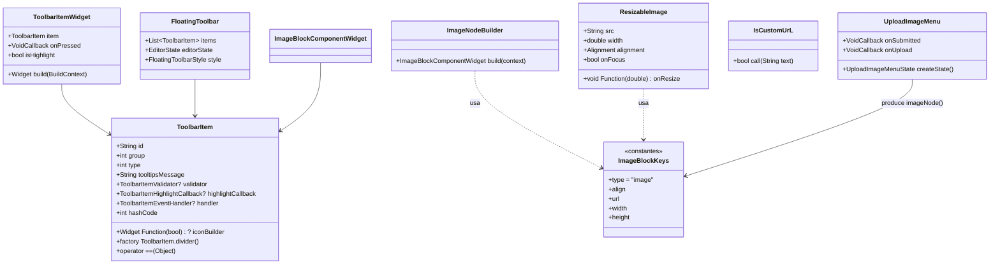
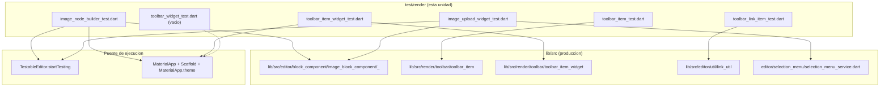
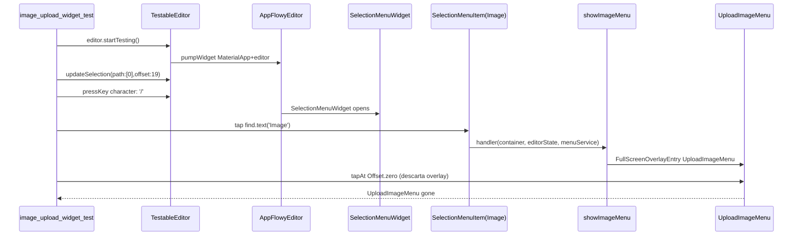
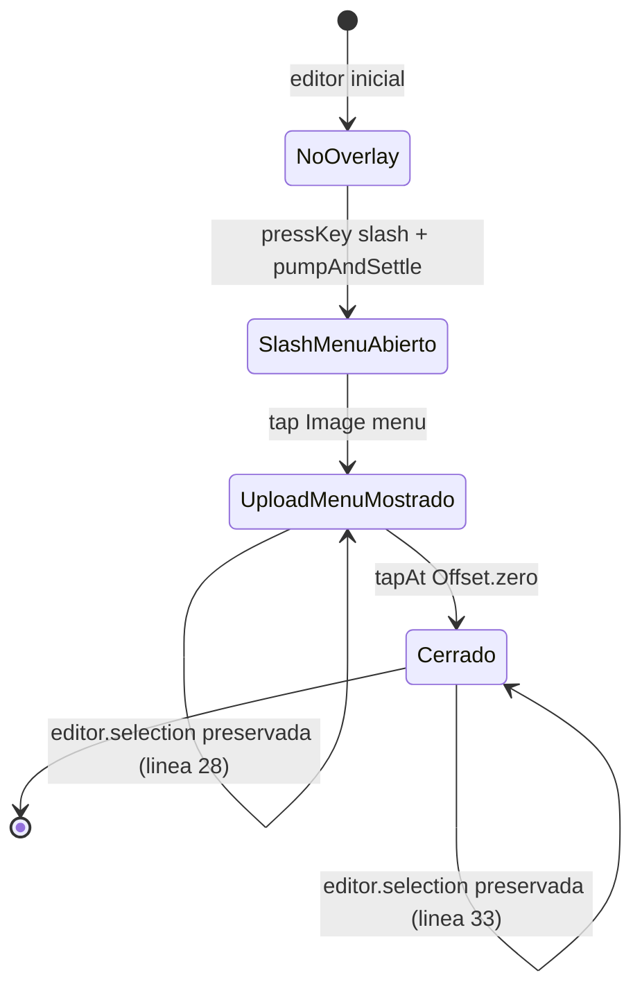

# F19.2.9 — Tests del editor: `test/render/` (renderizado de imagen y toolbar)

## 1. Resumen

Esta unidad cubre los 6 ficheros de `editor/test/render/**`, el único rincón del banco de tests de `appflowy_editor` que monta widgets reales con `testWidgets` y `pumpAndSettle` (a diferencia del grueso del árbol, documentado en `[[F19.1]]`/`[[F19.2.1]]`–`[[F19.2.6]]`, que opera sobre el modelo). Son 377 líneas, 9 casos `testWidgets()`, 3 `test()` puros y 5 `group()` `[VERIFICADO]` (conteos con `rg -c`). Tres áreas: imagen (`image_node_builder_test.dart` ejercita el widget `ImageBlockComponentWidget`; `image_upload_widget_test.dart` abre el menú `UploadImageMenu` desde el slash menu y comprueba su ciclo de mostrar/ocultar), toolbar del editor (`toolbar_item_test.dart` cubre el modelo `ToolbarItem.divider` y la igualdad estructural; `toolbar_item_widget_test.dart` prueba `ToolbarItemWidget`; `toolbar_widget_test.dart` está vacío; `toolbar_link_item_test.dart` cubre `isCustomUrL`/`customUrlRegex` y —el hallazgo clave— la práctica totalidad de los widgets que el `FloatingToolbar` real acaba renderizando en producción son **otros**: la app monta sus propios `ToolbarItem.builder` y los entrega al editor (`appflowy:frontend/appflowy_flutter/lib/plugins/document/presentation/editor_page.dart:444`), de modo que `ToolbarItemWidget` desde `editor:lib/src/render/toolbar/toolbar_item_widget.dart` queda **sin consumidor en producción** salvo su propio test (verificado con `rg -n 'ToolbarItemWidget\b' SRC/` — únicos hits: su declaración y este test). Esta unidad no documenta cómo se renderiza la toolbar real de la app (eso vive en `[[F01.6.4]]`), pero sí el contrato y los huecos entre lo que el editor prueba y lo que la app termina usando.

## 2. Alcance

**Dentro**: los 6 ficheros listados en el frontmatter; son la totalidad de `test/render/` (verificado sobre el inventario de la skill (`OUT/_ledger/inventario.json`), filas del rango `:45931–45982`, 6 entradas).

**Fuera y hacia dónde va cada cosa**:

| Elemento | Motivo de exclusión | Unidad destino |
|---|---|---|
| `test/new/**` (82 ficheros) | Banco de tests moderno, helpers compartidos (`TestableEditor`) | `[[F19.1]]` |
| `test/core/**` (12) | Modelo puro (`Path`, `Position`, `Delta`…) | `[[F19.2.1]]` |
| `test/customer/**` (11) | Fixtures de cliente | `[[F19.2.2]]` |
| `test/editor/**` (20) | Tests de `EditorState` y componentes | `[[F19.2.3]]` |
| `test/extensions/**` (8) | Extensiones Dart sobre `Node`/`Position` | `[[F19.2.4]]` |
| `test/infra/**` (3) | Clipboard, logging | `[[F19.2.5]]` |
| `test/legacy/**` (3) | API heredada | `[[F19.2.6]]` |
| `test/mobile/**` (18) | Servicios de selección móvil | `[[F19.2.7]]` |
| `test/plugins/**` (31) | Atajos y comandos por bloque | `[[F19.2.8]]` |
| `test/service/**` (9) | IME, teclado, scroll | `[[F19.2.10]]` |
| `example/**` | App de ejemplo del editor | `[[F19.3]]` |
| `lib/l10n/**` y raíz de `lib/` | Localización | `[[F19.4]]` |
| `pubspec.yaml`, `editor/editor/.github/workflows/test.yml`, raíz de `test/` | Configuración y CI | `[[F19.5]]` |

Correcciones de scope declaradas: (a) los seis tests interactúan con `EditorState` y `EditorStyle` reales (`[[F01.0.3.1]]`) pero **no** ejercitan el árbol CRDT (`[[B1.6]]`); (b) el menú `UploadImageMenu` y su handler `showImageMenu` (`editor:lib/src/editor/block_component/image_block_component/image_upload_widget.dart:19–69`, `:71`) sí están en producción pero la **subida real del fichero binario** vive fuera del editor — la recibe `file_picker` (`editor:lib/src/editor/block_component/image_block_component/image_upload_widget.dart:114`), la entrega al `AppFlowy` por `flowy-storage` y eso se documenta en `[[F07]]`; (c) el bloque de imagen funcional en la app vive en `editor_plugins/image`/`image_block_component.dart` (`[[F01.3]]`) y los bloques ricos en general en `[[F01.2]]`/``[[F01.3]]`; (d) la toolbar de escritorio real (la que el usuario ve y que monta la app, `DesktopFloatingToolbar` con `FloatingToolbarStyle`/`BlocProvider`/`toolbarItems`) no aparece en estos tests — está documentada como producción en `[[F01.6.4]]`.

## 3. Modelos de datos

Los tipos bajo prueba son todos públicos y viven en `editor:lib/src/render/toolbar/`, `editor:lib/src/editor/block_component/image_block_component/` y `editor:lib/src/editor/util/`. Sólo dos son de uso cotidiano en producción; el resto del `editor:lib/src/render/toolbar/toolbar_item_widget.dart` está sin consumidores.

*Diagrama: tipos cubiertos por los tests de `test/render/`.* Lectura: `ToolbarItem` (`editor:lib/src/render/toolbar/toolbar_item.dart:12–76`) es el contrato común — `id`, `group`, `validator`, `handler`, `highlightCallback`, `iconBuilder`, `itemBuilder` o `builder`— y `ToolbarItemWidget` (`editor:lib/src/render/toolbar/toolbar_item_widget.dart:5`) lo renderiza cuando hay `iconBuilder` (ruta `item.iconBuilder!(isHighlight)` en `:33`). En cambio `FloatingToolbar` (`editor:lib/src/editor/toolbar/desktop/floating_toolbar_widget.dart:20`, `:108`) consume `item.builder!(...)`, no `ToolbarItemWidget`: es la app la que decide qué builder le pasa a cada ítem (`appflowy:frontend/appflowy_flutter/lib/plugins/document/presentation/editor_page.dart:96–117` y `:444`). `ImageBlockKeys` centraliza los nombres de atributo del bloque imagen (`editor:lib/src/editor/block_component/image_block_component/image_block_component.dart:5–31`) y `imageNode` la fábrica (`editor:lib/src/editor/block_component/image_block_component/image_block_component.dart:33–48`).

## 4. Eventos FFI

Ninguno. Los 6 ficheros son tests de UI del editor y no tocan `async_event` ni el dispatcher Rust. El camino que un `tester.tap(find.text('Image'))` recorre dentro del editor está en `editor:lib/src/editor/selection_menu/selection_menu_service.dart:310–322` (handler del item "Image" del slash menu, que invoca `showImageMenu(container, editorState, menuService)`) y `editor:lib/src/editor/block_component/image_block_component/image_upload_widget.dart:19–69` (`showImageMenu` abre un `FullScreenOverlayEntry` con `UploadImageMenu`). La conversión al `BlockActionPB`/`FlowyError` que **sí** sale por FFI ocurre aguas arriba, en la app: `appflowy:frontend/appflowy_flutter/lib/plugins/document/application/editor_transaction_adapter.dart:29` (`[[F01.8]]`), `Out/11-catalogo-eventos-ffi.md`.

## 5. Notificaciones

Ninguna propia. Los tests de imagen invocan `editor.startTesting()` que monta un `AppFlowyEditor` real; las notificaciones internas que esto despierta son las genéricas del editor (`editor:lib/src/editor_state.dart:218`, `transactionStream`) — la app las consume vía `appflowy:frontend/appflowy_flutter/lib/plugins/document/application/document_bloc.dart` y `appflowy:frontend/appflowy_flutter/lib/plugins/document/application/editor_state_listener.dart` (`[[F01.0.1]]`), no esta unidad.

## 6. BLoCs / Cubits

Ninguno. El único "servicio" implicado es `EditorState` (creado en `TestableEditor.initialize()` con `Document.blank()`, `editor:test/new/infra/testable_editor.dart:165–168`) y `EditorStyle` (passado a `AppFlowyEditor(editorStyle: …, …)` en `:73–88`). Para imagen, `tester.pumpWidget` monta `MaterialApp`+`Scaffold` (`:140–159`) alrededor del editor; en `image_upload_widget_test.dart` se monta un `SelectionMenuWidget` y dentro un `UploadImageMenu`, lo cual es exactamente lo que `showImageMenu` abre en producción sobre un `Overlay`. El `DocumentBloc` de la app no se introduce aquí porque el editor por sí solo no lo requiere.

## 7. Servicios e inyección de dependencias

No hay `get_it` ni contenedor: la dependencia se construye a mano en cada test. En imagen, `TestableEditor.tester` viene del binding estándar (`tester = WidgetTester`) y `editor.startTesting()` envuelve `AppFlowyEditor` en un `MaterialApp` con `Scaffold` y `localizationsDelegates` (`editor:test/new/infra/testable_editor.dart:140–159`); en toolbar, `toolbar_item_widget_test.dart` y `toolbar_widget_test.dart` montan un `MaterialApp`+`Material(child: widget)` o nada, directamente (`editor:test/render/toolbar/toolbar_item_widget_test.dart:42–48` y `editor:test/render/toolbar/toolbar_widget_test.dart:9`). El `network_image_mock` se inyecta por `mockNetworkImagesFor(...)` para que `Image.network` no haga HTTP real (`editor:test/render/image/image_node_builder_test.dart:5`).

## 8. Persistencia

Ninguna directa. Lo único que persiste en estos tests es lo que el propio editor persiste al ejecutarse contra el `EditorState`: el documento y el último `EditorState` se reinicializan por test vía `editor.dispose()` + `editor.startTesting()` (lo que devuelve un nuevo `Document.blank()` en el siguiente test, `editor:test/new/infra/testable_editor.dart:165–168`). El editor **sí** tiene una rama de subida (`UploadImageMenu`, `editor:lib/src/editor/block_component/image_block_component/image_upload_widget.dart:404–434` `InsertImage.insertImageNode`), pero el guardado real del archivo lo delega al callback `onInsertImage`/`editorState.insertImageNode(url)` y finalmente a `flowy-storage` en el lado AppFlowy (`[[F07]]`); este test nunca ejercita la rama de subida de binarios, sólo la inserción del nodo ya con la URL escrita a mano (`editor:test/render/image/image_upload_widget_test.dart:13–14`).

## 9. Diagramas de flujo

El siguiente diagrama muestra qué fichero de test empuja qué producción y qué papel juega `TestableEditor` y `MaterialApp` como puente común:

*Diagrama: acoplamiento test ↔ producción dentro de `test/render/`.* Lectura: `image_node_builder_test.dart` y `image_upload_widget_test.dart` son los únicos que montan `TestableEditor`, que a su vez monta un `AppFlowyEditor` real (con `Document.blank()`, `EditorScrollController`, `localizationsDelegates`, `editor:test/new/infra/testable_editor.dart:140–159`); los cuatro tests de toolbar **no** montan `AppFlowyEditor` (salvo `toolbar_widget_test.dart` que está vacío y nunca llega a usarlo): dos son `testWidgets` que instancian `ToolbarItem`/`ToolbarItemWidget` a mano y los montan en un `MaterialApp` mínimo (`editor:test/render/toolbar/toolbar_item_widget_test.dart:42–48`), y `toolbar_link_item_test.dart` es `test()` puro que llama a `isCustomUrL` sin ningún widget. Esto ilustra el contraste con `test/new/**` (cubierto por `[[F19.1]]`), donde casi todo arranca vía `TestableEditor`. El coste del enfoque "mount real" de `test/render/` es alto para imagen (necesita `pumpAndSettle`, gestos `PointerDeviceKind.mouse`, mock de `network_image_mock`), mientras que los tests de toolbar más simples evitan montar el editor cuando lo único bajo prueba es el valor de `ToolbarItem.id` o la igualdad estructural.

## 10. Diagramas de secuencia

La secuencia de `testWidgets('showImageUploadMenu')` (`editor:test/render/image/image_upload_widget_test.dart:8–37`) recorrida hasta tap:

*Diagrama: recorrido de un tap "Image" en el slash menu del editor, hasta el cierre del `UploadImageMenu`.* Lectura: el test es una traza casi literal del camino "abrir slash menu → elegir Image → UploadImageMenu aparece → tap fuera → UploadImageMenu desaparece" que en producción también ejecuta la app. La parte interesante es que la pieza que *no* prueba es la subida real: el `UploadImageMenu` se abre pero nunca se le da a "Subir"; el test termina al descartar con `tester.tapAt(Offset.zero)`. La rama `onUpload` (callback `insertImage` → `editorState.insertImageNode(url)`) está en `editor:lib/src/editor/block_component/image_block_component/image_upload_widget.dart:31–42` y conectaría con `[[F07]]` cuando la app lo conecte a `flowy-storage`.

## 11. Diagramas de estado

Ciclo del menú `UploadImageMenu` alrededor del slash menu y del editor, capturado en su única aserción:

*Diagrama: el flujo del test `showImageUploadMenu` mapea a 3 invariantes que cubre.* Lectura: `:28` exige `editor.selection == selection` *después* de tap en "Image" (selección preservada al conmutar al overlay); `:32` exige `UploadImageMenu == findsNothing` después de `tapAt(Offset.zero)` (el dismiss funciona); `:33` exige de nuevo `selection == selection` (la selección se preserva tras el dismiss). Es la prueba más densa del contrato mínimo del menú. En `[[F07]]` está la parte de "subida binaria" que completa el flujo cuando `onUpload` se entrega a `flowy-storage`.

## 12. Archivos cubiertos (del ledger)

Conteos medidos con `rg -c '^\s*test\('`, `rg -c '^\s*testWidgets\('` y `rg -c '^\s*group\('` por fichero; "qué verifica" resume el foco real de sus casos.

| Fichero | LOC | `test(` | `testWidgets(` | `group(` | Qué verifica exactamente |
|---|---:|---:|---:|---:|---|
| `editor/test/render/image/image_node_builder_test.dart` | 217 | 0 | 6 (líneas `editor:test/render/image/image_node_builder_test.dart:18`, `:36`, `:69`, `:100`, `:172`, `:193`) | 1 (`:14`) | `Image` aparece 1 widget entre dos párrafos; menú de acción no aparece si `editable:false` (espera `EditorSvg == findsNothing`, línea `editor:test/render/image/image_node_builder_test.dart:63`); menú aparece si `editable:true` (cuerpo del test está comentado en línea `editor:test/render/image/image_node_builder_test.dart:94`); alineación left/center/right: `leftImageRect.left == padding.left` (líneas `editor:test/render/image/image_node_builder_test.dart:137–141`), `rightImageRect.right == editorRect.right − padding.right` (`:142–145`), `centerImageRect.left == (left+right)/2` (`:146–150`) y los tamaños coinciden (`:151–152`); ramas "render image copy"/"render image delete" con cuerpo comentado (`:154–168`, `:208–214`). |
| `editor/test/render/image/image_upload_widget_test.dart` | 38 | 0 | 1 (línea `editor:test/render/image/image_upload_widget_test.dart:8`) | 1 (`:7`) | `showImageUploadMenu`: `SelectionMenuWidget` aparece tras `/`; `'Image'` en el menú; tap → `UploadImageMenu` aparece; selección preservada línea `:28`; `tapAt(Offset.zero)` → `UploadImageMenu` desaparece; selección aún preservada línea `:33`. |
| `editor/test/render/toolbar/toolbar_item_test.dart` | 29 | 3 (líneas `editor:test/render/toolbar/toolbar_item_test.dart:6`, `:14`, `:21`) | 0 | 1 (`:5`) | `ToolbarItem.divider()` produce dos iguales con `id == 'divider'` (línea `:11`); no igualdad con `ToolbarItem(id:'item',group:1)` (línea `:18`); igualdad con `id == 'divider'` aunque varíe `group` (línea `:25`) y `hashCode` derivado de `id` (línea `:26`). |
| `editor/test/render/toolbar/toolbar_item_widget_test.dart` | 63 | 0 | 1 (línea `editor:test/render/toolbar/toolbar_item_widget_test.dart:12`) | 1 (`:11`) | `ToolbarItemWidget` renderea con `MaterialApp(Material(child: widget))`: `Icon(Icons.abc)` aparece con clave `iconKey`; `(tester.firstWidget(find.byKey(iconKey)) as Icon).color == Colors.lightBlue` cuando `isHighlight:true` (líneas `:53–54`); `tester.tap(find.byKey(key))` ejecuta `onPressed` (`hit == true`). |
| `editor/test/render/toolbar/toolbar_link_item_test.dart` | 17 | 1 (línea `editor:test/render/toolbar/toolbar_link_item_test.dart:5`) | 0 | 0 | `isCustomUrL` verdadera para `https://`, `http://`, `ftp://`, `obsidian://`, protocolos personalizados (`xxx://`, `abc://`) y `https://...#anchor`; falsa para `invalid-link`, `://missing-protocol-prefix` y `example://`. |
| `editor/test/render/toolbar/toolbar_widget_test.dart` | 11 | 0 | 1 (línea `editor:test/render/toolbar/toolbar_widget_test.dart:9`, cuerpo `async {}`) | 1 (`:8`) | Stub vacío: el `testWidgets` no tiene cuerpo (`async {}`) y por tanto no ejercita ninguna aserción. |
| **Total** | **377** | **4** | **9** | **5** | — |

## 13. Riesgos y casos límite

**Hallazgo estructural — `ToolbarItemWidget` no se usa en producción**:

1. `editor:lib/src/render/toolbar/toolbar_item_widget.dart` define `ToolbarItemWidget` pero el único consumidor del paquete es su propio test (`editor:test/render/toolbar/toolbar_item_widget_test.dart:33`). Verificado con `rg -n 'ToolbarItemWidget\b' SRC/` — sin contar la declaración y este test, sólo hay tres referencias, todas dentro de comentarios en `editor:test/service/toolbar_service_test.dart:27`, `:31`, `:236–239`. El editor renderiza sus ítems de toolbar real mediante `item.builder!(context, …)` en `_FloatingToolbarWidgetState.build` (`editor:lib/src/editor/toolbar/desktop/floating_toolbar_widget.dart:108–117`), no usando `ToolbarItemWidget`. Es decir: el widget que prueba `toolbar_item_widget_test.dart` **no llega al usuario**. Las piezas vivas son las factorías declaradas en `editor:lib/src/editor/toolbar/desktop/items/*.dart` (`editor:lib/src/editor/toolbar/desktop/items/paragraph_toolbar_item.dart:5`, `editor:lib/src/editor/toolbar/desktop/items/format_toolbar_items.dart:4`, `editor:lib/src/editor/toolbar/desktop/items/heading_toolbar_items.dart:3`, `editor:lib/src/editor/toolbar/desktop/items/bulleted_list_toolbar_item.dart:5`, `editor:lib/src/editor/toolbar/desktop/items/numbered_list_toolbar_item.dart:5`, `editor:lib/src/editor/toolbar/desktop/items/quote_toolbar_item.dart:5`, `editor:lib/src/editor/toolbar/desktop/items/placeholder_toolbar_item.dart:6`, `editor:lib/src/editor/toolbar/desktop/items/link/link_toolbar_item.dart:11`) y las que la app declara en `appflowy:frontend/appflowy_flutter/lib/plugins/document/presentation/editor_plugins/toolbar_item/*.dart` (28 hits en total, `[[F01.6.4]]`). `[VERIFICADO]` con tres `rg` separados.

**Riesgos de cobertura de los tests**:

2. `editor:test/render/toolbar/toolbar_widget_test.dart` está vacío: el `testWidgets('test toolbar widget', (tester) async {})` (`editor:test/render/toolbar/toolbar_widget_test.dart:9`) declara un `group('toolbar_widget.dart', …)` (`:8`) pero el cuerpo no contiene ni `expect`. Es decir, el nombre "widget" del test no cubre `editor:lib/src/editor/toolbar/desktop/floating_toolbar.dart` ni `editor:lib/src/editor/toolbar/desktop/floating_toolbar_widget.dart` (producción real). `[VERIFICADO]`.
3. `editor:test/render/toolbar/toolbar_item_test.dart` cubre `ToolbarItem.divider()` y la igualdad estructural pero **no** la lógica de `_computeActiveItems` (`editor:lib/src/editor/toolbar/desktop/floating_toolbar_widget.dart:130–152`) — el filtro `isActive?.call(editorState)`, el orden por `group`, ni el `splitBetween((a,b) => a.group != b.group)` que inserta separadores. Esta función es la que la toolbar real usa; no tiene test directo aquí. `[VERIFICADO]`.
4. `editor:test/render/image/image_node_builder_test.dart` declara `render image copy` (línea `editor:test/render/image/image_node_builder_test.dart:172`) y `render image delete` (línea `editor:test/render/image/image_node_builder_test.dart:193`) pero sus cuerpos están comentados (`// expect(editor.runAction(3, imageNode!), true); await tester.pump();` en líneas `editor:test/render/image/image_node_builder_test.dart:188–189` y `:209–213`). El menú de acción del bloque (`editor:lib/src/editor/block_component/image_block_component/image_block_component.dart:179–219`) sólo se ejercita parcialmente: el test `cannot see action menu when not editable` (línea `:36`) y `can see action menu when editable` (línea `:69`) tienen el cuerpo del assert `find.byType(EditorSvg)` comentado en línea `:94`. La rama "alineación" sí está cubierta (líneas `editor:test/render/image/image_node_builder_test.dart:100–170`). `[VERIFICADO]`.
5. `editor:test/render/image/image_upload_widget_test.dart` deja sin cubrir la URL real (línea `:13` escribe el `url` directamente al `imageNode(url: ...)` en `addNode`) y la subida vía `FilePicker` (`_filePicker = FilePicker()` en `editor:lib/src/editor/block_component/image_block_component/image_upload_widget.dart:114`) y `onUpload(...)` (`editor:lib/src/editor/block_component/image_block_component/image_upload_widget.dart:31–42`). Es decir, la pieza que conectaría con `flowy-storage` (`[[F07]]`) no se ejercita desde el editor. `[VERIFICADO]`.
6. `editor:test/render/image/image_node_builder_test.dart` usa `editor.addNode(imageNode(url: url))` para todos los nodos de imagen pero la fábrica `imageNode` no se valida: por ejemplo, no se ha observado un test que verifique que `imageNode(url: 'foo', align: 'invalid')` se degrade a `center` (default), aunque `AlignmentExtension.fromString` (`editor:lib/src/editor/block_component/image_block_component/image_block_component.dart:296–307`) lo haga en `default → center`. `[VERIFICADO]`.

**Hallazgo de scope — el contraste con `test/new/**`**:

7. `editor:test/render/image/*` y `editor:test/render/toolbar/toolbar_item_widget_test.dart` montan `AppFlowyEditor`/`MaterialApp` reales (la del toolbar sólo `MaterialApp+Material(child: widget)`) por lo que pagan `pumpAndSettle` y la inicialización de binding; `editor:test/new/**` (`editor:test/new/infra/testable_editor.dart:46–162`) reutiliza `TestableEditor` y es donde reside el grueso del esfuerzo "widget real". Esta unidad es la excepción, no la regla. La cobertura "toolbar del editor" real vive en `editor:test/service/toolbar_service_test.dart` (que está mayoritariamente comentado, líneas `editor:test/service/toolbar_service_test.dart:27–240`). `[VERIFICADO]`.

**Riesgos en los propios tests**:

8. `editor:test/render/toolbar/toolbar_link_item_test.dart:5` realiza 10 `expect` con protocolos heterogéneos pero no comprueba que `isCustomUrL` rechace mayúsculas distintas (`caseSensitive: false` lo hace implícito, `editor:lib/src/editor/util/link_util.dart:14–15`); tampoco prueba `isUri` (la función compuesta que añade `mailto:` y `file:`), aunque `isUri` se usa en `appflowy:frontend/appflowy_flutter/lib/mobile/presentation/bottom_sheet/bottom_sheet_edit_link_widget.dart` y en `appflowy:frontend/appflowy_flutter/lib/plugins/document/presentation/editor_plugins/desktop_toolbar/link/link_search_text_field.dart`, `link_replace_menu.dart`, `link_edit_menu.dart`. `[VERIFICADO]`.
9. `editor:test/render/image/image_node_builder_test.dart` depende de `network_image_mock` 2.x; si cambia `Image.network` por `Image(... cacheWidth: …)` y se elimina el mock, el `find.byType(Image)` seguirá siendo `findsOneWidget` pero el `getRect(imageFinder.at(0))` puede romperse porque la imagen no llega a tener tamaño hasta resolver (línea `editor:test/render/image/image_node_builder_test.dart:131`). El test no controla ese race. `[INFERIDO]`.
10. `editor:test/render/image/image_upload_widget_test.dart` depende de la palabra `Image` localizada (`find.text('Image')`, línea `:21`); si la cadena cambia a "Imagen" u otra en `editor:lib/l10n/**` (`[[F19.4]]`), el test falla. `AppFlowyEditorL10n.current.image` es la fuente (`editor:lib/src/editor/selection_menu/selection_menu_service.dart:311`), pero el `find.text` resuelve contra el árbol actual. `[INFERIDO]`.

## 14. Evidencias y etiquetas

- `[VERIFICADO]`: la totalidad de las afirmaciones estructurales (firmas, líneas, conteos, widgets, comportamiento y hallazgos de scope) — cada cita `editor:…:línea` o `appflowy:…:línea` fue cotejada contra el fichero real. Los 6 ficheros de la unidad se leyeron íntegros. Los tres hallazgos estructurales (uso de `TestableEditor`, equivalencia `ToolbarItem.id == hashCode`, y "ToolbarItemWidget no se usa en producción") se obtuvieron con tres `rg` distintos, no por inferencia.
- `[INFERIDO]`: 2 (`§13.9`, `§13.10`) — dependencias implícitas hacia versiones de `network_image_mock` y hacia la localización de la palabra `'Image'`.
- `[NO DETERMINADO]`: 2 (ver §18).

## 15. Pruebas

Cómo se ejecutan estos tests: el workflow `AppFlowyEditor test` lanza `flutter pub get`, `flutter analyze .`, `dart format --set-exit-if-changed .` y `flutter test --coverage` sobre Flutter 3.27.4, en macOS y Ubuntu, con cobertura enviada a Codecov y `fail_ci_if_error: true` (`editor:editor/.github/workflows/test.yml:33–47`; `editor:codecov.yml:1` excluye `lib/src/flutter/`). **No se ha ejecutado `flutter test` en esta unidad** (AGENTS.md §11): todas las afirmaciones provienen de lectura de código.

Dentro de la unidad, `test/render/image/image_node_builder_test.dart` requiere `network_image_mock` como dependencia dev de `appflowy_editor` (`editor:pubspec.yaml`); `test/render/image/image_upload_widget_test.dart` y `image_node_builder_test.dart` dependen a su vez de `test/new/infra/testable_editor.dart` (`editor:test/render/image/image_node_builder_test.dart:7` y `editor:test/render/image/image_upload_widget_test.dart:4`), por tanto si `[[F19.1]]` cambia los helpers `addParagraph`, `addNode`, `startTesting` o `updateSelection`, estos tests se rompen.

## 16. Métricas

| Métrica | Valor | Cómo se midió |
|---|---:|---|
| Ficheros cubiertos | 6 | brief `F19.2.9` |
| LOC de la unidad | 377 | `wc -l` sobre los 6 ficheros |
| Casos `test()` (puros) | 4 | `rg -c '^\s*test\('` por fichero y suma |
| Casos `testWidgets()` | 9 | `rg -c '^\s*testWidgets\('` por fichero y suma |
| `group()` | 5 | `rg -c '^\s*group\('` por fichero y suma |
| Tests con cuerpo inerte (vacíos o comentados) | 5 | `editor:test/render/toolbar/toolbar_widget_test.dart:9` (vacío), `editor:test/render/image/image_node_builder_test.dart:94`, `:154–168`, `:186–189`, `:208–214` (cuerpos comentados) |
| Tests que montan `AppFlowyEditor` real (vía `TestableEditor`) | 2 de 6 | `editor:test/render/image/image_node_builder_test.dart:26`, `:45`, `:78`, `:126`; `editor:test/render/image/image_upload_widget_test.dart:11` |
| Tests que montan `MaterialApp` mínimo (sin editor) | 2 de 6 | `editor:test/render/toolbar/toolbar_item_widget_test.dart:42`; `editor:test/render/toolbar/toolbar_widget_test.dart:9` (vacío) |
| Tests `test()` puros | 1 de 6 | `editor:test/render/toolbar/toolbar_link_item_test.dart:5` |
| Widgets de producción cubiertos | 5 | `ImageBlockComponentWidget` (`editor:lib/src/editor/block_component/image_block_component/image_block_component.dart:94`), `UploadImageMenu` (`editor:lib/src/editor/block_component/image_block_component/image_upload_widget.dart:71`), `ToolbarItem.divider()` (`editor:lib/src/render/toolbar/toolbar_item.dart:51`), `ToolbarItemWidget` (`editor:lib/src/render/toolbar/toolbar_item_widget.dart:5`), `isCustomUrL` (`editor:lib/src/editor/util/link_util.dart:12`) |
| Widgets de producción sin test de render | muchos | ver §13 |

## 17. Pendientes

- [ ] Decidir qué hacer con `ToolbarItemWidget` (`editor:lib/src/render/toolbar/toolbar_item_widget.dart:5`): o se borra y con él `toolbar_item_widget_test.dart`, o se introduce como widget oficial en `FloatingToolbar` reemplazando el `item.builder!(...)` de `_FloatingToolbarWidgetState.build` (`editor:lib/src/editor/toolbar/desktop/floating_toolbar_widget.dart:108–117`). Hoy es código muerto a efectos prácticos.
- [ ] Dotar de cuerpo `editor:test/render/toolbar/toolbar_widget_test.dart:9` — bien sea eliminándolo o cubriendo `_computeActiveItems` de `FloatingToolbarWidget` (`editor:lib/src/editor/toolbar/desktop/floating_toolbar_widget.dart:130–152`).
- [ ] Reactivar las ramas comentadas en `editor:test/render/image/image_node_builder_test.dart` (`render image copy` `editor:test/render/image/image_node_builder_test.dart:172–191`, `render image delete` `:193–215`) o bien recortarlas del fichero.
- [ ] Extender `image_upload_widget_test.dart` para cubrir la rama `onUpload` (subida real con `FilePicker`) al menos con un `expect(find.byType(UploadImageMenu), findsOneWidget)` después de invocar `tester.tap(find.byKey(uploadKey))`.
- [ ] Añadir un test para `_computeActiveItems` (orden por `group` y `splitBetween`) que es la lógica de filtrado real del `FloatingToolbar`.

## 18. Preguntas abiertas

- **F19.2.9-a**: ¿La existencia de `ToolbarItemWidget` en `editor:lib/src/render/toolbar/toolbar_item_widget.dart` es residuo de una migración previa (cuando la app no proveía `ToolbarItem.builder` propios) o es API pública intencional que aún no se ha consumido? El hecho de que `editor:test/service/toolbar_service_test.dart:236` declare la función `_itemWidgetForId` comentado sugiere migración a medio terminar `[NO DETERMINADO]`.
- **F19.2.9-b**: ¿Hay voluntad de cubrir sistemáticamente el widget `FloatingToolbarWidget` (no sólo `_computeActiveItems` aislado) con tests de render, dado que la app lo usa como entrada (`appflowy:frontend/appflowy_flutter/lib/plugins/document/presentation/editor_page.dart:444`) y `editor:lib/src/editor/toolbar/desktop/floating_toolbar_widget.dart:104–117` sí podría probarse con un `List<ToolbarItem>` con `builder` reales? `[NO DETERMINADO]`.

## 19. Relacionado con

- `[[F19.1]]` — `test/new/**`, donde vive `TestableEditor` que esta unidad consume indirectamente.
- `[[F19.2.1]]`–`[[F19.2.8]]`, `[[F19.2.10]]` — el resto de `test/**` del editor.
- `[[F19.3]]` — `example/`; `[[F19.4]]` — `lib/l10n`; `[[F19.5]]` — `pubspec` y CI.
- `[[F01.0]]` — superficie pública del editor (`EditorState`, `EditorStyle`, `EditorSelectionService`).
- `[[F01.0.3.1]]` — inventario `lib/src/` del editor (incluye `lib/src/render/toolbar/*` y `lib/src/editor/block_component/image_block_component/*`).
- `[[F01.3]]` — bloques de imagen en la app; `[[F01.2]]` — bloques ricos (sitio del consumidor real del widget probado).
- `[[F01.6.4]]` — toolbar de escritorio real de la app, incluido `appflowy:frontend/appflowy_flutter/lib/plugins/document/presentation/editor_plugins/desktop_toolbar/desktop_floating_toolbar.dart` y los `ToolbarItem` que la app declara. **Es la unidad complementaria clave**: este documento explica qué prueba el editor, `[[F01.6.4]]` explica qué toolbar acaba viendo el usuario.
- `[[F01.6.1]]` — slash menu: el handler del item "Image" que `editor:test/render/image/image_upload_widget_test.dart:8` ejercita (`editor:lib/src/editor/selection_menu/selection_menu_service.dart:310–322`).
- `[[F07]]` — `flowy-storage`: la pieza que conectaría `onUpload` (callback en `editor:lib/src/editor/block_component/image_block_component/image_upload_widget.dart:65`) con la subida binaria real; este documento deja claro que el editor **no** la cubre.
- `[[B1.6]]` — modelo de collab y awareness; el `EditorState` de esta unidad se monta sin nada de collab.
- `OUT/22-preguntas-abiertas.md` — destino de las dos preguntas de §18.
