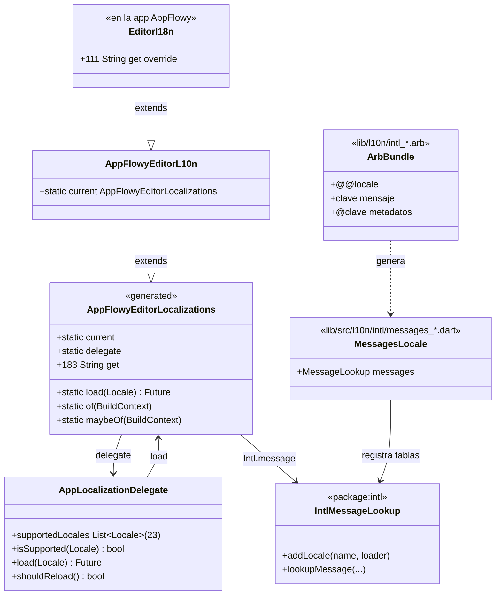
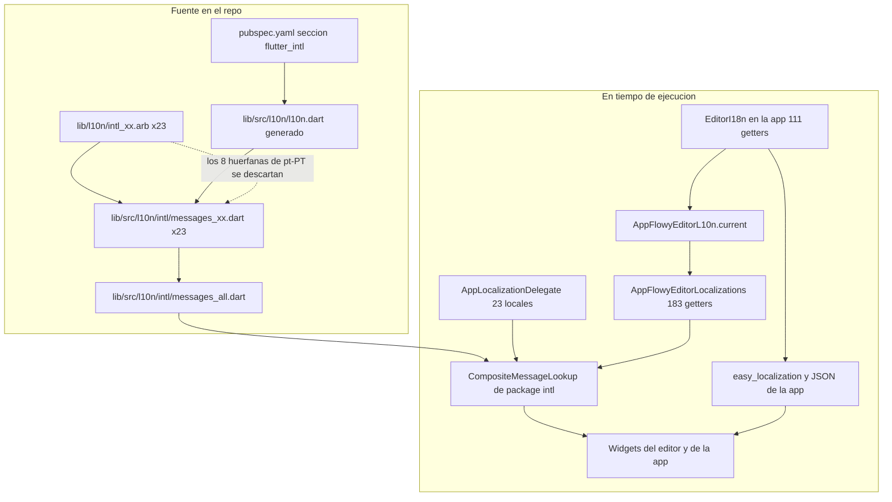
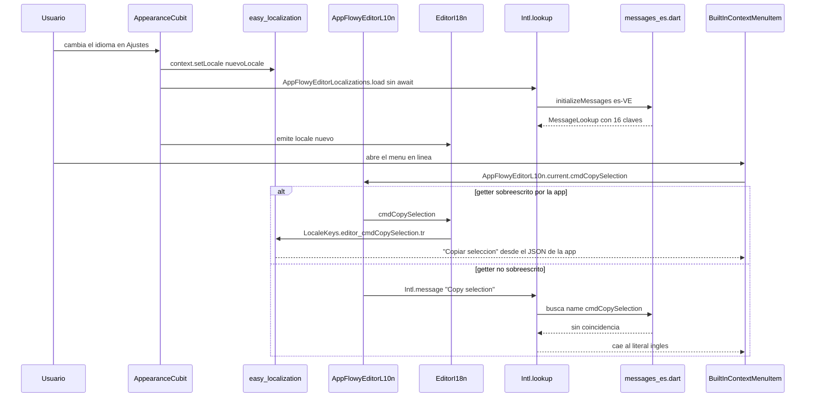
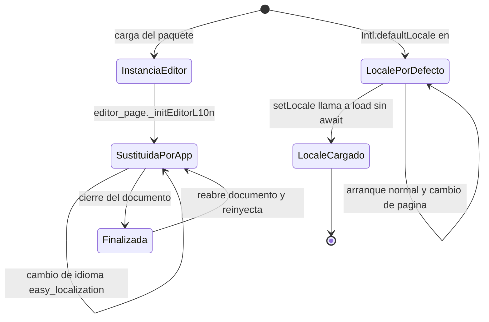

# F19.4 — Editor: `lib/l10n` y raíz de `lib/`

## 1. Resumen

Esta unidad cubre los 24 ficheros de la raíz pública del paquete `appflowy_editor`: el barrel `lib/appflowy_editor.dart` y los 23 bundles `.arb` de `lib/l10n/`. El barrel es el hallazgo estructural: con 32 líneas y 24 `export` define **la superficie pública real del editor**, y dos de esas líneas (`:13` y `:23`) son la superficie de localización. Los 23 `.arb` suman 1 405 líneas y 1 072 claves de mensaje, pero la cobertura está muy desequilibrada: `intl_en.arb` tiene 183 claves y 18 de los 22 bundles restantes tienen **16**, todas las cuales son el mismo núcleo de formato. La app AppFlowy **sí** consume el mecanismo del editor, pero lo neutraliza: sustituye `AppFlowyEditorL10n.current` por una subclase propia (`EditorI18n`) que traduce 111 de los 183 getters vía `easy_localization`, dejando **67 getters del editor resueltos por las tablas `.arb`** — y de esos 67, sólo `pt-BR` los tiene traducidos (63 de 67). Los 23 bundles `.arb` son, por tanto, casi código muerto en el contexto de AppFlowy.

## 2. Alcance

**Dentro**: `editor/lib/appflowy_editor.dart` y los 23 `editor/lib/l10n/intl_*.arb` listados en el frontmatter (24 ficheros, el brief `F19.4` los declara completos).

**Fuera y hacia dónde va cada cosa**:

| Elemento | Motivo de exclusión | Unidad destino |
|---|---|---|
| `lib/src/**` (el editor real) | Contenido de producción ya cubierto | `[[F01.0]]`, `[[B1.6]]`, `[[F19.1]]`–`[[F19.3]]` |
| `lib/src/l10n/l10n.dart` y `lib/src/l10n/intl/**` | **No están en el brief** pero son el consumidor directo de los `.arb` | Se documentan aquí como evidencia deapoyo (§3, §7, §10) |
| `documentation/translation.md` | Documentación del repo | `[[F19.5]]` — se cita en §13.6 |
| `pubspec.yaml`, `.gitignore`, `example/lib/main.dart` | Configuración y CI | `[[F19.5]]` — se citan como evidencia |
| i18n de la app (36 bundles JSON, `easy_localization`, `LocaleKeys`) | Otro mecanismo, otro dueño | `[[F14]]`, `[[F00.7.1]]` |

Correcciones de scope declaradas: (a) esta unidad **no** reanaliza el i18n de la App; sólo documenta el punto de costura (`EditorI18n`) porque es lo que determina si los `.arb` son código muerto o no; (b) `lib/src/l10n/l10n.dart` (1 933 líneas) y los 24 `messages_*.dart` generados son **ficheros extra no asignados** a esta unidad: se declaran en `archivos_extra_detectados` y se usan como evidencia, pero no se re-documenta su API getter por getter; (c) el contenido de `lib/src/editor/**` y `lib/src/service/**` que consume las cadenas queda en `[[F01.0]]`/`[[F19.1]]`.

## 3. Modelos de datos

### 3.1 El barrel `lib/appflowy_editor.dart`

El fichero tiene 32 líneas y se abre con `library;` (`editor:lib/appflowy_editor.dart:2`), la forma moderna de declarar una biblioteca sin nombre. A partir de ahí son **24 directivas `export`**, agrupadas en cinco familias por los comentarios del propio autor:

| Familia | Líneas | Exports | Qué expone |
|---|---:|---:|---|
| `core` | `:5` | 1 | `src/core/core.dart` — `Node`, `Path`, `Position`, `Selection`, `Delta`, `Operation`, `Transaction`, `Document` |
| Rich text y tabla | `:6`–`:9` | 4 | `appflowy_rich_text.dart`, `appflowy_rich_text_keys.dart`, `default_selectable_mixin.dart`, `table.dart` |
| `editor` | `:11`–`:14` | 4 | `src/editor/editor.dart`, `find_replace_menu/find_and_replace.dart`, `l10n/appflowy_editor_l10n.dart`, `selection_menu/selection_menu.dart` |
| Estado y extensiones | `:16`, `:18` | 2 | `src/editor_state.dart` (el `EditorState`), `src/extensions/extensions.dart` |
| `infra` | `:19`–`:22` | 4 | `clipboard.dart`, `flowy_svg.dart`, `log.dart`, `mobile/mobile.dart` |
| Localización | `:23` | 1 | `src/l10n/l10n.dart` (generado) |
| `plugins` | `:25` | 1 | `src/plugins/plugins.dart` — decoders/encoders |
| Render | `:26`–`:27` | 2 | `selectable.dart`, `toolbar_item.dart` |
| Servicios | `:28`–`:32` | 5 | `context_menu`, `format_rich_text_style`, `copy_paste_handler`, `key_mapping`, `keybinding` |

Las dos entradas que interesan a esta unidad son `editor:lib/appflowy_editor.dart:13` (`export 'src/editor/l10n/appflowy_editor_l10n.dart';`) y `editor:lib/appflowy_editor.dart:23` (`export 'src/l10n/l10n.dart';`). Importan porque **son el único camino por el que la app llega a la localización del editor**: `editor_i18n.dart` importa `package:appflowy_editor/appflowy_editor.dart` en bloque (`appflowy:frontend/appflowy_flutter/lib/plugins/document/presentation/editor_plugins/i18n/editor_i18n.dart:2`), no un `src/l10n/...` interno. El barrel es, por tanto, parte del contrato, no un detalle de empaquetado.

El patrón de barrel se repite en `lib/src/core/core.dart`, que reexporta el modelo puro (citado en `[[F19.2.1]]` §3). Lo relevante aquí es que **`appflowy_editor.dart` no declara ninguna clase, función ni typedef**: es 100 % re-exports. Cualquier símbolo público del paquete se puede localizar leyendo las 24 líneas y siguiendo una de las rutas.

### 3.2 La superficie de localización en runtime



*Diagrama: la cadena que convierte un `.arb` en el texto que se pinta en pantalla.* Lectura: `lib/l10n/intl_*.arb` son datos; `intl_utils` los compila a `lib/src/l10n/intl/messages_<locale>.dart`, cada uno con un `MessageLookup` (`editor:lib/src/l10n/intl/messages_ca.dart:20–41`). `messages_all.dart` los registra en un `CompositeMessageLookup` (`editor:lib/src/l10n/intl/messages_all.dart:35`) indexados por nombre de locale en `_deferredLibraries` (`editor:lib/src/l10n/intl/messages_all.dart:44`). La clase generada `AppFlowyEditorLocalizations` (`editor:lib/src/l10n/l10n.dart:15`) no guarda ninguna tabla: cada getter llama a `Intl.message(...)` (`editor:lib/src/l10n/l10n.dart:56–61`), que busca en el lookup global usando `Intl.defaultLocale`. Encima de esa clase generadas, `AppFlowyEditorL10n` —cinco líneas, la pieza que hace posible el patrón— añade un único `static current` (`editor:lib/src/editor/l10n/appflowy_editor_l10n.dart:4`) para evitar pasar `BuildContext` por todo el editor, y la app añade una tercera capa, `EditorI18n`, que sobreescribe 111 de los 183 getters.

### 3.3 Formato `.arb`: lo que hay y lo que no

El formato `.arb` (App Resource Bundle) admite claves de mensaje y claves de metadatos `@clave` con `description`, `type` y `placeholders`. **Este conjunto no usa ninguna de esas capacidades** `[VERIFICADO]`:

- El único metadato de nivel superior es `@@locale`, presente en los 23 ficheros (`editor:lib/l10n/intl_en.arb:2`) y sin ningún `@@last_modified`.
- De los 22 bundles noingleses, 20 declaran 16 claves `@clave` (una por clave de mensaje, más `@@locale`) y 2 declaran 37. **Todas están vacías**: `{}`. Se comprobó con `jq` sobre los 23 ficheros: cero valores de metadato no vacíos.
- `intl_en.arb` e `intl_pt_BR.arb` **no declaran ninguna clave `@clave`** (0 metadatos), lo que es coherente con que el generador toma `l10n.dart` como fuente de verdad y no al revés.
- **Cero `placeholders`** en los 23 ficheros. Todas las 183 claves de `intl_en.arb` son cadenas literales sin interpolación, y los 183 getters generados pasan `args: []` (`editor:lib/src/l10n/l10n.dart:60`, `:70`, `:80`, …). Es decir: la localización del editor no tiene ni un solo string parametrizado.

Formato real de una entrada, tal y como aparece en `intl_en.arb`:

```json
{
  "@@locale": "en",
  "bold": "Bold",
  "bulletedList": "Bulleted List"
}
```

(`editor:lib/l10n/intl_en.arb:1`–`:4`)

Y su equivalente generado (`editor:lib/src/l10n/l10n.dart:54–62`):

```dart
  /// `Bold`
  String get bold {
    return Intl.message(
      'Bold',
      name: 'bold',
      desc: '',
      args: [],
    );
  }
```

El doc-comment se genera a partir del valor inglés del `.arb`, de ahí que `cmdToggleH1` apareceu documentado como `` `toggle H1` `` en `editor:lib/src/l10n/l10n.dart:1844` mientras el mensaje en inglés es `'toggle into Heading 1'` (`editor:lib/src/l10n/l10n.dart:1847`): **el comentario quedó desincronizado respecto al mensaje** `[VERIFICADO]`.

### 3.4 Tabla completa de los 23 bundles

Conteos medidos con `jq`/Python sobre los ficheros reales. «Claves» = entradas que no empiezan por `@`; «faltan» = claves presentes en `intl_en.arb` y ausentes en ese fichero; «sobran» = claves ausentes de `intl_en.arb` y presentes en ese fichero.

| Fichero | `@@locale` | Claves | `@meta` | Faltan vs `en` | Sobran | Cobertura | Valor vacío |
|---|---|---:|---:|---:|---:|---:|---:|
| `editor/lib/l10n/intl_bn_BN.arb` | `bn_BN` | 16 | 16 | 167 | 0 | 8,7 % | 0 |
| `editor/lib/l10n/intl_ca.arb` | `ca` | 16 | 16 | 167 | 0 | 8,7 % | **16** |
| `editor/lib/l10n/intl_cs_CZ.arb` | `cs-CZ` | 16 | 16 | 167 | 0 | 8,7 % | 0 |
| `editor/lib/l10n/intl_da.arb` | `da` | 55 | 37 | 128 | 0 | 30,1 % | 0 |
| `editor/lib/l10n/intl_de_DE.arb` | `de-DE` | 16 | 16 | 167 | 0 | 8,7 % | 0 |
| `editor/lib/l10n/intl_en.arb` | `en` | 183 | 0 | 0 | 0 | 100 % | 0 |
| `editor/lib/l10n/intl_es_VE.arb` | `es-VE` | 16 | 16 | 167 | 0 | 8,7 % | **16** |
| `editor/lib/l10n/intl_fr_CA.arb` | `fr-CA` | 16 | 16 | 167 | 0 | 8,7 % | 0 |
| `editor/lib/l10n/intl_fr_FR.arb` | `fr-FR` | 16 | 16 | 167 | 0 | 8,7 % | 0 |
| `editor/lib/l10n/intl_hi_IN.arb` | `hi-IN` | 16 | 16 | 167 | 0 | 8,7 % | 0 |
| `editor/lib/l10n/intl_hu_HU.arb` | `hu-HU` | 16 | 16 | 167 | 0 | 8,7 % | 0 |
| `editor/lib/l10n/intl_id_ID.arb` | `id-ID` | 16 | 16 | 167 | 0 | 8,7 % | 0 |
| `editor/lib/l10n/intl_it_IT.arb` | `it-IT` | 16 | 16 | 167 | 0 | 8,7 % | 0 |
| `editor/lib/l10n/intl_ja_JP.arb` | `ja-JP` | 16 | 16 | 167 | 0 | 8,7 % | **16** |
| `editor/lib/l10n/intl_ml_IN.arb` | `ml_IN` | 16 | 16 | 167 | 0 | 8,7 % | 0 |
| `editor/lib/l10n/intl_nl_NL.arb` | `nl-NL` | 16 | 16 | 167 | 0 | 8,7 % | **1** (`link`) |
| `editor/lib/l10n/intl_pl_PL.arb` | `pl-PL` | 16 | 16 | 167 | 0 | 8,7 % | **16** |
| `editor/lib/l10n/intl_pt_BR.arb` | `pt-BR` | 179 | 0 | 4 | 0 | 97,8 % | 0 |
| `editor/lib/l10n/intl_pt_PT.arb` | `pt-PT` | 32 | 16 | 159 | **8** | 13,1 % | 0 |
| `editor/lib/l10n/intl_ru_RU.arb` | `ru-RU` | 16 | 16 | 167 | 0 | 8,7 % | 0 |
| `editor/lib/l10n/intl_tr_TR.arb` | `tr-TR` | 16 | 16 | 167 | 0 | 8,7 % | **16** |
| `editor/lib/l10n/intl_zh_CN.arb` | `zh-CN` | 117 | 37 | 66 | 0 | 63,9 % | 0 |
| `editor/lib/l10n/intl_zh_TW.arb` | `zh-TW` | 117 | 37 | 66 | 0 | 63,9 % | 0 |
| **Total / unión / intersección** | 23 locales | **1 072** | — | 167 | 8 | unión **191**, intersección **16** | 81 |

Tres observaciones que la tabla hace visibles:

1. **El núcleo de 16.** La intersección de los 23 conjuntos de claves es exactamente 16 claves, y son las 16 primeras de `intl_en.arb` (`editor:lib/l10n/intl_en.arb:3`–`:19`): `bold`, `bulletedList`, `checkbox`, `embedCode`, `heading1`, `heading2`, `heading3`, `highlight`, `image`, `italic`, `link`, `numberedList`, `quote`, `strikethrough`, `text`, `underline`. Son las etiquetas de la barra de formato. Los 18 bundles de 16 claves **sólo traducen la barra de formato**.
2. **Cinco bundles con cadenas vacías.** `ca`, `es-VE`, `ja-JP`, `pl-PL` y `tr-TR` tienen las 16 claves con valor `""` (`editor:lib/l10n/intl_ca.arb:3`–`:32`), y `nl-NL` tiene `link` a `""` (`editor:lib/l10n/intl_nl_NL.arb:14`). En total 81 cadenas vacías. Compiladas, producen `MessageLookupByLibrary.simpleMessage("")` (`editor:lib/src/l10n/intl/messages_ca.dart:25`–`:40`): en la app de ejemplo del editor, esos bundles pintan la barra de formato **en blanco** `[VERIFICADO]`.
3. **Convenciones de nombre inconsistentes.** 18 ficheros usan `_` en el nombre y `-` en `@@locale` (p. ej. nombre `intl_zh_CN.arb`, valor `zh-CN`, `editor:lib/l10n/intl_zh_CN.arb:2`), y 2 usan `_` en ambos (`bn_BN` en `editor:lib/l10n/intl_bn_BN.arb:2` y `ml_IN` en `editor:lib/l10n/intl_ml_IN.arb:2`). El generador propaga la incoherencia al nombre del fichero Dart: existen `messages_cs-CZ.dart` y `messages_ml_IN.dart` en el mismo directorio.

### 3.5 Discrepancias de cobertura en detalle

**Las 167 claves que faltan en 18 de los 22 bundles no inglés.** No es un hueco parcial: los bundles de 16 claves no tienen ninguna clave de menú de contexto, de buscar-y-reemplazar, de tabla, de imagen, de alineación ni de comandos. Ejemplos verificables: `find` existe en `editor:lib/l10n/intl_en.arb:88` y no en ninguno de los 18; `table` existe en `editor:lib/l10n/intl_en.arb:107` y tampoco.

**Las 4 que faltan en `pt-BR`**: `cmdToggleBody`, `cmdToggleH1`, `cmdToggleH2`, `cmdToggleH3` (`editor:lib/l10n/intl_en.arb:182`–`:185`). Son las cuatro últimas claves del fichero inglés y las cuatro que **el generador tiene como getters** (`editor:lib/src/l10n/l10n.dart:1845`, `:1855`, `:1865`, `:1875`). Son también las cuatro que la app **no** sobreescribe (§7). Es decir: en portugués de Brasil, cuatro comandos de encabezado caen al texto inglés.

**Las 8 claves huérfanas de `pt-PT`.** `intl_pt_PT.arb` contiene 8 claves que **no existen en inglés ni en ningún otro bundle** — nombres de comandos de tabla de una versión anterior del editor, cuando los getters se llamaban `cmdMoveToDownCellAtSameOffset` en vez de `cmdTableMoveToDownCellAtSameOffset`:

| Clave huérfana | Línea en `intl_pt_PT.arb` |
|---|---|
| `cmdDontAddNewLineInTableCell` | `editor:lib/l10n/intl_pt_PT.arb:43` |
| `cmdMoveToDownCellAtSameOffset` | `editor:lib/l10n/intl_pt_PT.arb:47` |
| `cmdMoveToLeftCellIfItsAtStartOfCurrentCell` | `editor:lib/l10n/intl_pt_PT.arb:44` |
| `cmdMoveToRightCellIfItsAtTheEndOfCurrentCell` | `editor:lib/l10n/intl_pt_PT.arb:45` |
| `cmdMoveToUpCellAtSameOffset` | `editor:lib/l10n/intl_pt_PT.arb:46` |
| `cmdNavigateAroundTheCellsAtSameOffset` | `editor:lib/l10n/intl_pt_PT.arb:48` |
| `cmdNavigateAroundTheCellsAtSameOffsetInReverse` | `editor:lib/l10n/intl_pt_PT.arb:49` |
| `cmdStopAtTheBeginningOfTheCell` | `editor:lib/l10n/intl_pt_PT.arb:50` |

El generador **las descarta**: `messages_pt-PT.dart` contiene 24 claves frente a las 32 del `.arb` — exactamente las 32 menos 8 huérfanas `[VERIFICADO]`. Los otros 22 `messages_*.dart` coinciden exactamente con su `.arb` (183/183 en `messages_en.dart`, 179/179 en `messages_pt-BR.dart`, 117/117 en `messages_zh-CN.dart`, 55/55 en `messages_da.dart`, 16/16 en `messages_ca.dart`, etc.). Es la prueba empírica de que **el `.arb` no es la fuente de verdad para generar: lo es `l10n.dart`**.

## 4. Eventos FFI

Ninguno. Los 24 ficheros son datos y re-exports de un paquete Dart puro; no tocan `async_event` ni el dispatcher Rust. La localización del editor es puramente cliente: el texto viaja del `.arb` al `MessageLookup` local, nunca por FFI. Para el contexto de eventos FFI véase `OUT/11-catalogo-eventos-ffi.md`.

## 5. Notificaciones

Ninguna propia del editor. La única señal que afecta a la localización es un cambio de locale emitido por la app: `setLocale` emite `state.copyWith(locale: newLocale)` (`appflowy:frontend/appflowy_flutter/lib/workspace/application/settings/appearance/appearance_cubit.dart:218`), que es un estado de `AppearanceCubit`, no una notificación Rust→Dart. Catálogo en `OUT/12-catalogo-notificaciones.md`.

## 6. BLoCs / Cubits

Ninguno en esta unidad. La única clase de estado conectada es `AppearanceCubit` **de la app**, que en `setLocale` hace dos cosas: sincroniza `easy_localization` (`appflowy:frontend/appflowy_flutter/lib/workspace/application/settings/appearance/appearance_cubit.dart:207`) y sincroniza el editor (`:212`, §7). Todo el análisis del cubit y de `EditorState` está en `[[F00.7.1]]` y `[[F01.0]]`.

## 7. Servicios e inyección de dependencias

No hay `get_it`. La "inyección" es un estático global de tres niveles.

**Nivel 1 — el editor se auto-inyecta.** `AppFlowyEditorL10n` declara `static AppFlowyEditorLocalizations current = AppFlowyEditorL10n();` (`editor:lib/src/editor/l10n/appflowy_editor_l10n.dart:4`), inicializado con una instancia de sí mismo. No depende de `BuildContext` ni de que ningún `MaterialApp` registre el delegate. En el árbol de `lib/` hay **196 usos** de `AppFlowyEditorL10n.current` repartidos en 154 getters distintos; los ficheros más densos son `lib/src/editor/toolbar/utils/color_generators.dart` (16 usos) y `lib/src/editor/block_component/table_block_component/table_action_menu.dart` (13).

**Nivel 2 — la app reemplaza la instancia.** `EditorI18n extends AppFlowyEditorL10n` (`appflowy:frontend/appflowy_flutter/lib/plugins/document/presentation/editor_plugins/i18n/editor_i18n.dart:5`) sobreescribe **111** getters, cada uno delegando en `LocaleKeys.editor_<clave>.tr()` (`:11`, `:17`, `:23`, …, `:671`), es decir en `easy_localization` y en los JSON de la app. Se inyecta en la apertura de la página de documento: `_initEditorL10n()` (`appflowy:frontend/appflowy_flutter/lib/plugins/document/presentation/editor_page.dart:559`), llamado desde `initState` (`:164`). El resultado es `AppFlowyEditorL10n.current = EditorI18n()`.

**Nivel 3 — el locale del lookup.** El `Intl.defaultLocale` que usa `Intl.message` se fija en `AppFlowyEditorLocalizations.load` (`editor:lib/src/l10n/l10n.dart:34`), que la app invoca **sin esperar el `Future`** desde `setLocale` (`appflowy:frontend/appflowy_flutter/lib/workspace/application/settings/appearance/appearance_cubit.dart:212`, comentario "Sync the app's locale with the editor"). La app **no registra** `AppFlowyEditorLocalizations.delegate` en ningún `MaterialApp`: su único `localizationsDelegates` es `context.localizationDelegates` de `easy_localization` (`appflowy:frontend/appflowy_flutter/lib/startup/tasks/app_widget.dart:244`). Sólo la app de ejemplo del editor lo registra (`editor:example/lib/main.dart:32` y `:34`).

**El reparto real.** De los 183 getters generados, la app sobreescribe 111 y deja 72 heredados. De esos 72, **67 son usados** por el código de `lib/`; ésos son los únicos que de verdad leen las tablas `.arb`:

| Grupo | Getters | ¿Traduce la app? | ¿Depende del `.arb`? |
|---|---:|---|---|
| Etiquetas de formato, colores, tintes, placeholder | 87 usados, 87 sobreescritos | Sí (`easy_localization`) | No |
| Comandos `cmd*` y `textAlign*` | 67 usados, 0 sobreescritos | **No** | **Sí** |

Y la cobertura de ese conjunto de 67 por locale es demoledora:

| Locale | Claves en su `.arb` | De las 67 que el editor usa, presentes | Cobertura |
|---|---:|---:|---:|
| `en` | 183 | 67 | 100 % |
| `pt-BR` | 179 | 63 | 94 % |
| `zh-CN` | 117 | 3 | 4 % (sólo `textAlignLeft/Center/Right`, `editor:lib/l10n/intl_zh_CN.arb:154`–`:156`) |
| `zh-TW` | 117 | 3 | 4 % (ídem) |
| `pt-PT` | 32 | 3 | 4 % (`editor:lib/l10n/intl_pt_PT.arb:40`–`:42`) |
| `bn_BN`, `ca`, `cs-CZ`, `da`, `de-DE`, `es-VE`, `fr-CA`, `fr-FR`, `hi-IN`, `hu-HU`, `id-ID`, `it-IT`, `ja-JP`, `ml_IN`, `nl-NL`, `pl-PL`, `ru-RU`, `tr-TR` | 16–55 | **0** | **0 %** |

Los 18 bundles con 0 % de cobertura efectiva no son inútiles por Accident: sus 16 (o 55) claves son exactamente las que la app sobreescribe. `da` es el caso más ilustrativo: 55 claves traducidas, 39 de ellas de colores y tintes (`backgroundColor*`, `fontColor*`, `tint1..9`, `lightLightTint1..9`), **todas** sobreescritas por `EditorI18n`. `zh-CN` con 117 claves sólo aporta 3 al camino que el editor realmente usa.

## 8. Persistencia

Ninguna. Los `.arb` son fuente en el repositorio; las tablas compiladas (`messages_*.dart`) también están versionadas (`editor:lib/src/l10n/intl/messages_all.dart:1`). No hay SQLite, KV ni fichero de collab implicado. **No existe `lib/l10n/generated/`**: `ls` sobre esa ruta falla, y no hay ninguna entrada en `.gitignore` que mencione `l10n` o `arb` (las 13 líneas con `generated` del `.gitignore` se refieren a `generated_plugin_registrant`, artefactos de plataforma). La premisa de que la salida generada esté gitignored **no se cumple en este repo** `[VERIFICADO]`: la configuración `flutter_intl` del `pubspec.yaml` apunta `output_dir: lib/src/l10n` (`editor:pubspec.yaml:76`), que es código fuente versionado.

## 9. Diagramas de flujo

El flujo que documenta esta unidad va de los `.arb` a la barra de formato de la app, y muestra en qué punto se corta la cadena de traducción.



*Diagrama: generación y resolución de una cadena del editor.* Lectura: la flecha punteada marca la pérdida real del proceso —las 8 claves huérfanas de `pt-PT` mueren entre el `.arb` y el `.dart`. En runtime hay **dos caminos paralelos y mutuamente excluyentes** hacia la UI: `EditorI18n` resuelve 111 getters por `easy_localization` y los 67 restantes caen por `Intl.message` a las tablas `.arb`. Ambos desembocan en los mismos widgets porque la app pasa sus propios comandos (`getDescription: () => AppFlowyEditorL10n.current.cmdCopySelection`, `appflowy:frontend/appflowy_flutter/lib/plugins/document/presentation/editor_plugins/copy_and_paste/custom_copy_command.dart:18`) y el editor pasa los suyos (`editor:lib/src/service/context_menu/built_in_context_menu_item.dart`).

## 10. Diagramas de secuencia

Cómo llega a pantalla la descripción de un comando de teclado, en la app real (locale `es`):



*Diagrama: los dos caminos de resolución y la rama que nunca se translate.* Lectura: en `es` el camino de `easy_localization` siempre gana para los 111 getters sobreescritos. Para los 67 no sobreescritos, `messages_es-VE.dart` sólo tiene 16 claves (`editor:lib/src/l10n/intl/messages_es-VE.dart`), ninguna de las cuales es un `cmd*`, así que la búsqueda falla y el getter devuelve el literal inglés incrustado en `l10n.dart` `[INFERIDO]` — el comportamiento exacto de repliegue de `package:intl` no se ha ejecutado en esta unidad (AGENTS.md §11). Sólo `pt-BR` (63 de 67) alcanza a traducir realmente ese camino.

## 11. Diagramas de estado

Ciclo de vida de la instancia de localización dentro de la app, que es donde se ven las tres propiedades relevantes: se sustituye globalmente, no se registra en el árbol de widgets, y su locale se fija de forma asíncrona y no esperada.



*Diagrama: dos estados independientes que se confunden.* Lectura: la sustitución de `AppFlowyEditorL10n.current` (arriba) es determinista y síncrona —ocurre en `initState` de la página de documento— y el comentario de `appflowy:frontend/appflowy_flutter/lib/plugins/document/presentation/editor_plugins/i18n/editor_i18n.dart:6` deja constancia de que la variante estática ya no se usa. La carga del locale de `intl` (abajo) es **asíncrona y sin `await`** (`appflowy:frontend/appflowy_flutter/lib/workspace/application/settings/appearance/appearance_cubit.dart:212`), de modo que entre el arranque y la resolución del `Future`, `Intl.defaultLocale` sigue siendo `en` y los 67 getters no sobreescritos responden en inglés aunque el usuario haya elegido otro idioma `[INFERIDO]`. Además, la sustitución global es reentrante: cualquier consumidor del editor fuera de la página de documento (por ejemplo los selectores de color compartidos en `appflowy:frontend/appflowy_flutter/lib/plugins/base/color/color_picker.dart:30`) lee la instancia global, que puede ser la del editor genérico o la de `EditorI18n` según el orden de construcción.

## 12. Archivos cubiertos (del ledger)

| Fichero | LOC | Claves | `@meta` | Papel en la unidad |
|---|---:|---:|---:|---|
| `editor/lib/appflowy_editor.dart` | 32 | — | — | Barrel: 24 `export`; `:13` y `:23` exponen la localización |
| `editor/lib/l10n/intl_en.arb` | 186 | 183 | 0 | Bundle de referencia; sin metadatos ni placeholders |
| `editor/lib/l10n/intl_pt_BR.arb` | 182 | 179 | 0 | 2.º más completo; le faltan las 4 `cmdToggle{H1,H2,H3,Body}` |
| `editor/lib/l10n/intl_zh_CN.arb` | 156 | 117 | 37 | 117 claves; sólo 3 usables por el editor |
| `editor/lib/l10n/intl_zh_TW.arb` | 157 | 117 | 37 | Idéntico en número de claves a `zh-CN` |
| `editor/lib/l10n/intl_pt_PT.arb` | 51 | 32 | 16 | 8 claves huérfanas de una nomenclatura antigua |
| `editor/lib/l10n/intl_da.arb` | 94 | 55 | 37 | 39 claves de color/tinte, todas sobreescritas por la app |
| `editor/lib/l10n/intl_hi_IN.arb` | 34 | 16 | 16 | Núcleo de 16 |
| `editor/lib/l10n/intl_ml_IN.arb` | 34 | 16 | 16 | Núcleo de 16; único `@@locale` con `_` y no `-` |
| `editor/lib/l10n/intl_bn_BN.arb` | 34 | 16 | 16 | Núcleo de 16; único `@@locale` con `_` y no `-` |
| `editor/lib/l10n/intl_ca.arb` | 34 | 16 | 16 | Las 16 con valor `""` |
| `editor/lib/l10n/intl_cs_CZ.arb` | 34 | 16 | 16 | Núcleo de 16 |
| `editor/lib/l10n/intl_de_DE.arb` | 34 | 16 | 16 | Núcleo de 16 |
| `editor/lib/l10n/intl_es_VE.arb` | 34 | 16 | 16 | Las 16 con valor `""` |
| `editor/lib/l10n/intl_fr_CA.arb` | 34 | 16 | 16 | Núcleo de 16 |
| `editor/lib/l10n/intl_fr_FR.arb` | 34 | 16 | 16 | Núcleo de 16 |
| `editor/lib/l10n/intl_hu_HU.arb` | 34 | 16 | 16 | Núcleo de 16 |
| `editor/lib/l10n/intl_id_ID.arb` | 34 | 16 | 16 | Núcleo de 16 |
| `editor/lib/l10n/intl_it_IT.arb` | 34 | 16 | 16 | Núcleo de 16 |
| `editor/lib/l10n/intl_ja_JP.arb` | 34 | 16 | 16 | Las 16 con valor `""` |
| `editor/lib/l10n/intl_nl_NL.arb` | 34 | 16 | 16 | `link` a `""`, las otras 15 traducidas |
| `editor/lib/l10n/intl_pl_PL.arb` | 34 | 16 | 16 | Las 16 con valor `""` |
| `editor/lib/l10n/intl_ru_RU.arb` | 34 | 16 | 16 | Núcleo de 16 |
| `editor/lib/l10n/intl_tr_TR.arb` | 34 | 16 | 16 | Las 16 con valor `""` |
| **Total** | **1 437** | **1 072** | **269** | 23 locales, unión 191, intersección 16 |

Ficheros de producción inspeccionados fuera del brief (evidencia, no cobertura): `editor:lib/src/l10n/l10n.dart` (1 933 líneas), `editor:lib/src/l10n/intl/messages_all.dart` (151), los 23 `messages_<locale>.dart` (1 735 en total), `editor:lib/src/editor/l10n/appflowy_editor_l10n.dart` (5), `editor:pubspec.yaml`, `editor:.gitignore`, `editor:example/lib/main.dart`, `editor:documentation/translation.md`, más 7 ficheros de la app.

## 13. Riesgos y casos límite

1. **18 de 23 bundles no aportan nada al camino que el editor usa.** Los 67 getters no sobreescritos sólo tienen traducción en `pt-BR` (63) y, marginalmente, en `zh-CN`/`zh-TW`/`pt-PT` (3 cada uno). Cualquier idioma distinto de inglés y portugués de Brasil muestra los nombres de los comandos de teclado en inglés dentro de una UI traducida `[VERIFICADO]`.
2. **81 cadenas vacías en cinco bundles.** `editor:lib/src/l10n/intl/messages_ca.dart:25`–`:40` mapea las 16 claves a `""`. En la app de ejemplo del editor (`editor:example/lib/main.dart:32`–`:34`), que sí registra el delegate, la barra de formato queda literalmente sin etiquetas. En AppFlowy no se ve, porque esos 16 getters están sobreescritos — pero cualquier integrador del paquete que use el delegate directamente sí.
3. **8 claves huérfanas en `pt-PT`**, de una nomenclatura de comandos anterior a la introducción del prefijo `cmdTable`. El generador las descarta (`messages_pt-PT.dart` tiene 24 de 32) y nadie las va a traducir nunca; son deuda de un renombrado de API del editor.
4. **El `.arb` no gobierna la generación.** El generador parte de `l10n.dart`; por eso una clave presente en un `.arb` y ausente en el código no produce getter, y una clave presente en el código y ausente en `intl_en.arb` produciría un getter que devuelve su literal inglés. El repo **no** valida esta simetría en CI (no hay paso `intl_utils` en `.github/workflows/test.yml`, `editor:.github/workflows/test.yml`).
5. **`@@locale` inconsistente con el nombre del fichero** en 20 de 23 casos (`_` vs `-`), y en `bn_BN`/`ml_IN` el valor usa `_`. El artefacto generado conserva la incoherencia (`messages_cs-CZ.dart` frente a `messages_ml_IN.dart`).
6. **`documentation/translation.md` describe un flujo que no es el del repo.** Afirma «Save the file and the translation will be generated automatically» (`:9`, `:16`) atribuyéndolo al plugin de VS Code; el artefacto real lleva la cabecera `// Generator: Flutter Intl IDE plugin / Made by Localizely` (`editor:lib/src/l10n/l10n.dart:7`–`:8`) pero también `// DO NOT EDIT. This is code generated via package:intl/generate_localized.dart` (`editor:lib/src/l10n/intl/messages_all.dart:1`), y la dependencia real es `intl_utils: "^2.8.2"` en `dev_dependencies` (`editor:pubspec.yaml:44`). También presupone `supportedLocales: AppFlowyEditorLocalizations.delegate.supportedLocales` en `example/lib/main.dart` (`editor:documentation/translation.md:25`), lo que sí se cumple (`editor:example/lib/main.dart:34`). Detalle en `[[F19.5]]`.
7. **`_isSupported` sólo compara `languageCode`** (`editor:lib/src/l10n/l10n.dart:1927`): con `supportedLocales` declarando `pt-BR` y `pt-PT` (`:1908`–`:1909`), `isSupported(Locale('pt','PT'))` devuelve `true` por el `pt` alone y `load` acaba canonizando a un locale que puede no ser el esperado `[INFERIDO]`.
8. **`AppFlowyEditorLocalizations.load` se llama sin `await`** desde la app (`appflowy:frontend/appflowy_flutter/lib/workspace/application/settings/appearance/appearance_cubit.dart:212`) y su `Future` se descarta: cualquier lectura de `Intl.defaultLocale` inmediatamente posterior ve el valor anterior.
9. **29 de los 183 getters generados no los usa `lib/`**: las 9 parejas `tint1..9`/`lightLightTint1..9`, `color`, `highlight`, `fontColorDefault`, `fontColorOrange`, `backgroundColorDefault`, `backgroundColorOrange`, `emptySearchBoxHint`, `noFindResult`, `regexError` y dos comandos de tabla. Sobreviven sólo porque el barrel los expone como API pública para integradores.

## 14. Evidencias y etiquetas

- `[VERIFICADO]`: todo el análisis estructural. Los 24 ficheros del brief se leyeron íntegros; los conteos de claves, metadatos, valores vacíos, conjuntos disjuntos y diferencias `.arb`↔`messages_*.dart` se obtuvieron con `jq` y Python sobre los ficheros reales, no por lectura de documentación. Los 196 usos de `AppFlowyEditorL10n.current` y los 33 de la app se contaron con `rg -o`. Las 111 sobreescrituras de `EditorI18n` y las 183 definiciones de `l10n.dart` se contrastaron con `rg -c`.
- `[INFERIDO]`: 2. (a) El repliegue de `Intl.message` al literal inglés cuando el locale no tiene la clave (§10) se deduce de la estructura de `MessageLookupByLibrary` y de los datos medidos, sin ejecutar el runtime. (b) La carrera de `Intl.defaultLocale` por el `load` sin `await` (§11) es consecuencia directa de leer el código, no de una traza.
- `[NO DETERMINADO]`: 2 (ver §18).

## 15. Pruebas

Ninguna de esta unidad ejecuta código (AGENTS.md §11). **No existe ningún test sobre la localización del editor**: `rg` sobre `editor/test/` no devuelve ninguna referencia a `AppFlowyEditorL10n`, `AppFlowyEditorLocalizations` ni a los `.arb`. La única cobertura indirecta es la de los widgets del editor que se renderizan en `test/`, pero en un test el `AppFlowyEditorL10n.current` por defecto es la instancia inglesa y `Intl.message` cae al literal de `l10n.dart`, así que ninguna aserción depende del locale.

Cómo lo ejecuta el CI: `.github/workflows/test.yml` lanza `flutter pub get`, `flutter analyze .`, `dart format --set-exit-if-changed .` y `flutter test --coverage` (`editor:editor/.github/workflows/test.yml:33`–`:47`), sin ningún paso de `intl_utils generate`. Es decir: **si alguien añade una clave a `intl_en.arb` y no regenera, el CI pasa** y el getter simplemente no existe. Detalle en `[[F19.5]]`.

## 16. Métricas

| Métrica | Valor | Cómo se midió |
|---|---:|---|
| Ficheros cubiertos | 24 | brief `F19.4` |
| LOC de la unidad | 1 437 | `wc -l` sobre el barrel y los 23 `.arb` |
| Directivas `export` del barrel | 24 | `rg -c "^export" editor/lib/appflowy_editor.dart` |
| Ficheros `.arb` | 23 | `ls lib/l10n/*.arb \| wc -l` |
| Claves de mensaje (suma) | 1 072 | `jq` por fichero, entradas sin `@` |
| Claves de referencia (`intl_en.arb`) | 183 | `jq` sobre `intl_en.arb` |
| Unión / intersección de claves | 191 / 16 | conjuntos Python sobre los 23 |
| Claves `@meta` (suma) | 269 | entradas `@` sin contar `@@locale` |
| Metadatos con contenido | **0** | `jq` sobre los 23 |
| `placeholders` declarados | **0** | inspección de los 23 `.arb` |
| Cadenas vacías | 81 en 5 ficheros | `jq` sobre valores `""` |
| Claves huérfanas (`pt-PT`) | 8 | diferencia contra `intl_en.arb` |
| Getters generados | 183 | `rg -c "Intl.message\\(" l10n.dart` |
| Locales en `supportedLocales` | 23 | `rg -c "Locale.fromSubtags" l10n.dart` |
| Usos de `AppFlowyEditorL10n.current` en `lib/` | 196 (154 getters) | `rg -o` |
| Getters sobreescritos por la app | 111 | `rg -c "@override" editor_i18n.dart` |
| Getters no sobreescritos y usados | 67 | diferencia `lib/` − `EditorI18n` |
| Locales con 0 % de cobertura efectiva | 18 de 23 | tabla §7 |
| Tests de localización | **0** | `rg` sobre `editor/test/` |

## 17. Pendientes

- [ ] Traducir las 4 claves `cmdToggleBody/H1/H2/H3` que faltan en `intl_pt_BR.arb` (`editor:lib/l10n/intl_en.arb:182`–`:185`): son las que la app no sobreescribe y las que hoy caen al inglés en portugués.
- [ ] Eliminar las 8 claves huérfanas de `intl_pt_PT.arb` (`:43`–`:50`) o reintroducir los getters con el prefijo `cmdTable` que les corresponde.
- [ ] Vaciar o rellenar los 5 bundles con cadenas `""` (`ca`, `es-VE`, `ja-JP`, `pl-PL`, `tr-TR`) y el `link` de `nl-NL`: hoy compilan a tablas que sirven texto vacío.
- [ ] Normalizar `@@locale` a guion (`cs_CZ` → `cs-CZ`) y corregir `bn_BN` y `ml_IN`, que usan guion bajo.
- [ ] Añadir `EditorI18n` al inventario de la app como **punto de desacoplamiento declarado**: los 67 getters no sobreescritos son la frontera viva entre los `.arb` del editor y los JSON de la app; cualquier clave nueva de `intl_en.arb` cae por defecto en ese lado.
- [ ] Considerar `await` en `AppFlowyEditorLocalizations.load` (`appflowy:frontend/appflowy_flutter/lib/workspace/application/settings/appearance/appearance_cubit.dart:212`) o mover el cambio de locale del editor a un `await` en el arranque.
- [ ] Añadir un test que verifique la simetría `intl_en.arb` ↔ getters generados y que ningún bundle tenga claves ausentes de `en`.

## 18. Preguntas abiertas

- **F19.4-a**: ¿el conjunto de 23 `.arb` se mantiene por historical para el editor como librería independiente, o es un resto de cuando el editor servía a la UI de AppFlowy? Sólo consta que la app lo consume parcialmente (67 getters, sobre todo `pt-BR`) y que nunca registra el delegate `[NO DETERMINADO]`.
- **F19.4-b**: ¿qué mecanismo decide el comportamiento de `Intl.message` cuando el locale activo no tiene la clave — repliegue al literal inglés de `l10n.dart`, texto vacío, o excepción? Requiere ejecutar el runtime o leer `package:intl`; en esta unidad sólo se ha deducido el primer caso `[NO DETERMINADO]`.

## 19. Relacionado con

- `[[F19.3]]` — `example/`: la app que **sí** registra `AppFlowyEditorLocalizations.delegate` (`editor:example/lib/main.dart:32`–`:34`) y por tanto sí sufre las cadenas vacías.
- `[[F19.5]]` — `pubspec.yaml` (sección `flutter_intl`, `intl_utils`, `localizely`), `.gitignore`, CI y `documentation/translation.md`.
- `[[F19.1]]`–`[[F19.2.10]]` — el resto del banco de tests del editor (que no toca la localización).
- `[[F19.0]]` — índice de la feature F19.
- `[[F01.0]]` — `EditorState` y el modelo del editor, consumidores de estas cadenas.
- `[[F14]]` — i18n de la app: `easy_localization`, los 36 bundles JSON y `LocaleKeys` (`[[F00.7.1]]` para la inicialización del locale).
- `[[F01.6.1]]` — slash menu del editor, uno de los consumidores de `AppFlowyEditorL10n.current` a través del barrel.
- `OUT/22-preguntas-abiertas.md` — destino de las dos preguntas de §18.