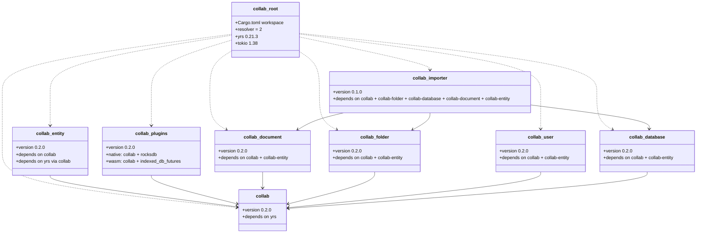
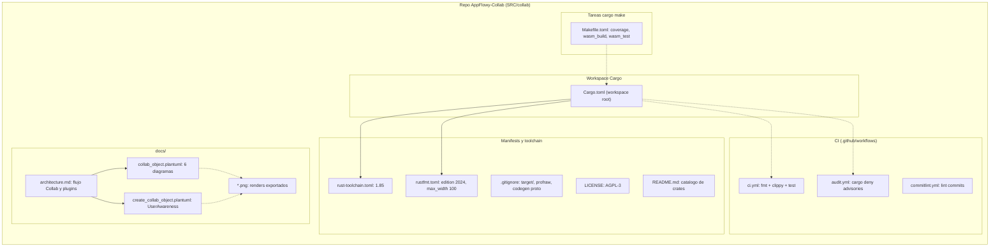
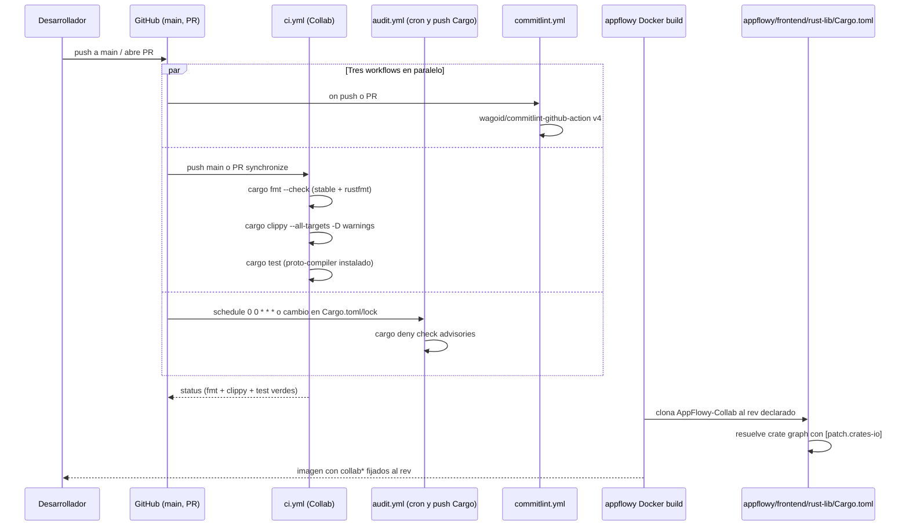
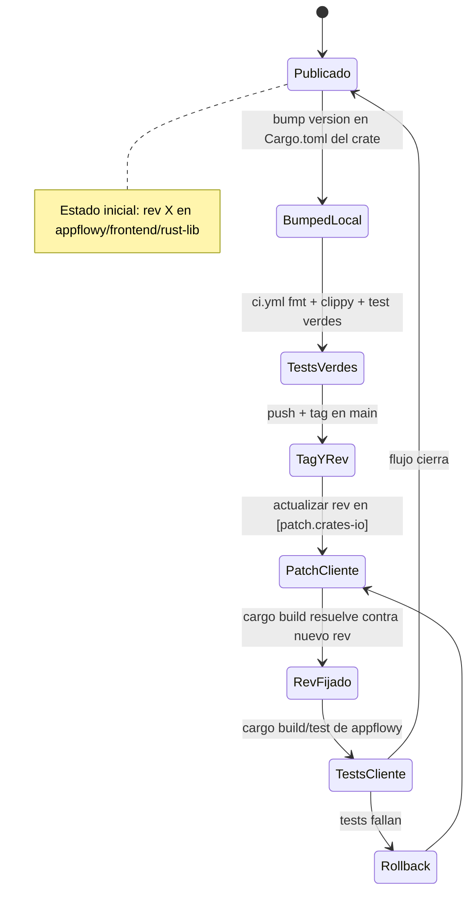

# F20 — AppFlowy-Collab (raíz: workspace, CI, docs y manifests)

## 1. Resumen

Este documento describe la **raíz del crate workspace `AppFlowy-Collab`**: el manifiesto que agrupa ocho crates Rust (`collab`, `collab-database`, `collab-document`, `collab-folder`, `collab-plugins`, `collab-user`, `collab-entity`, `collab-importer`), los flujos de CI declarados en `.github/workflows/` (`ci.yml`, `audit.yml`, `commitlint.yml`), las tareas de `cargo make` declaradas en `Makefile.toml`, las herramientas `rust-toolchain.toml` y `rustfmt.toml`, la licencia AGPL-3 heredada del repo y los documentos de arquitectura y guías PlantUML que `appflowy` consume a través de la imagen Docker oficial. Estas raíces son el **contrato** que la app cliente respeta al fijar el `rev` en `[patch.crates-io]` dentro de `frontend/rust-lib/Cargo.toml`.

## 2. Alcance

El documento cubre los 13 ficheros asignados al ledger `F20` y nada más. **Quedan fuera** el código fuente de cada crate (tratado por F01/F02/F03/F05/F18), la configuración cliente (`appflowy:frontend/rust-lib/Cargo.toml`, documentada en `OUT/02-stack-y-dependencias.md`) y la imagen Docker de release (`appflowy/Dockerfile`, fuera del alcance de esta unidad por proceder del otro repositorio). El diagrama §9 fija la topología física del repo; §10 narra el flujo de CI; §11 modela el ciclo de vida del versionado según `Cargo.toml` y los `Cargo.toml` de los crates miembro.

## 3. Modelos de datos

Muestra: `classDiagram` de los ocho crates miembro y el crate satélite no miembro de workspace (`collab-derive`). Cada nodo lleva la versión declarada en su propio `Cargo.toml` y la dependencia directa de otros crates `collab-*` que importa por `workspace = true`.

Lectura: el grafo distingue tres niveles. (a) `collab` es el **núcleo**: el único crate del workspace que consume directamente `yrs 0.21.3` fijado por el root y expone a través de años como crate de alto nivel sobre el cual el resto compone objetos `Folder`, `Database`, `Document`, `UserAwareness` (`collab:Cargo.toml:23`). (b) `collab-entity` introduce los tipos compartidos (entidades protobuf via `prost-build` y `protoc-bin-vendored` en `collab:collab-entity/Cargo.toml:22–25`) y depende solo de `collab`. (c) Los cuatro crates de dominio (`collab-document`, `collab-folder`, `collab-user`, `collab-database`) cuelgan de `collab` y `collab-entity` y son **hermanos**, sin dependencias cruzadas entre ellos en runtime (verificado en cada uno de sus `collab:collab/Cargo.toml:10–14`). (d) `collab-plugins` bifurca por target: en nativo añade `rocksdb 0.22` (persistencia local) y en wasm añade `indexed_db_futures` (persistencia en navegador) — ver `collab:collab-plugins/Cargo.toml:34–57`. (e) `collab-importer` es el único **agregador** y depende de los tres crates de dominio a la vez (folder+database+document), reflejando que su responsabilidad es importar datos a un snapshot compuesto (`collab:collab-importer/Cargo.toml:9–13`).

## 4. Eventos FFI

Esta unidad **no declara eventos FFI propios**: el repositorio `AppFlowy-Collab` es una **librería Rust** consumida en el cliente a través de `collab-integrate` y `flowy-*`, no expone una superficie FFI. Los eventos FFI del cliente (`flowy-folder::CreateView`, etc.) viven en `frontend/rust-lib/flowy-folder/src/event_map.rs`, fuera del alcance de F20 según el brief. No procede tabla aquí; el lector debe ir a `OUT/11-catalogo-eventos-ffi.md`.

## 5. Notificaciones

Mismo razonamiento que §4: el repo `AppFlowy-Collab` no implementa notificaciones Rust→Dart. El canal `NotificationBuilder` vive en `frontend/rust-lib/flowy-notification/`, fuera de la unidad. El catálogo global está en `OUT/14-catalogo-notificaciones.md`.

## 6. BLoCs / Cubits

`AppFlowy-Collab` es código Rust puro; **no contiene BLoCs ni Cubits** (esos viven en `frontend/appflowy_flutter/lib/` y se documentan en `OUT/13-catalogo-blocs.md`). El repo expone, en su lugar, *managers* (`DocumentManager`, `DatabaseManager`) que son análogos en responsabilidades pero con API tokio/async en vez de streams Dart. Esta unidad no introduce ninguno nuevo.

## 7. Servicios e inyección de dependencias

El repositorio `AppFlowy-Collab` no usa `get_it` ni `flowy-core/deps_resolve/*_deps.rs`; esos servicios viven en `frontend/rust-lib/`. En su lugar, el workspace expone los ocho crates como **artefactos Rust** que la app cliente compone. El `resolver = "2"` activado en `collab:Cargo.toml:12` fuerza la versión 2 del resolver de Cargo `[INFERIDO]`, que es la única compatible con `edition = "2024"` que usan los `Cargo.toml` de cada crate — `collab:collab/Cargo.toml:4`.

## 8. Persistencia

Esta unidad **no toca SQLite, ni Tantivy, ni KV**. La persistencia es responsabilidad de los plugins: `collab-plugins` incluye `rocksdb = { version = "0.22.0", default-features = false, features = ["zstd"] }` en nativo — `collab:collab-plugins/Cargo.toml:36` — y `indexed_db_futures = { version = "0.4" }` en wasm — `collab:collab-plugins/Cargo.toml:51`. El bridge `Plugins` se documenta en F18. El detalle del esquema SQLite vive en `frontend/rust-lib/flowy-sqlite/` (F08).

## 9. Diagramas de flujo

Muestra: `flowchart TD` con subgraphs por **físico** (carpeta en el repo) y por **rol** (workspace, configuración, CI, docs, manifests). Refleja qué fichero vive dónde en el árbol y cómo se usan entre sí.

Lectura: la raíz del repo se organiza en cinco bandas verticales claramente separables. La banda `Workspace` es la única que **define** los miembros (`collab:Cargo.toml:2–11`); las demás son **configuración pasiva**. `Makefile.toml` no es parte del workspace pero consume sus coordenadas (`cwd = ".."` para construir cobertura fuera del directorio actual, ver `collab:Makefile.toml:11–13`). El `rust-toolchain.toml` fija el canal estable `1.85` (`collab:rust-toolchain.toml:1–2`), y `rustfmt.toml` opta por `edition = "2024"` con `max_width = 100` (`collab:rustfmt.toml:2–12`), que coincide con la `edition = "2024"` declarada por cada `Cargo.toml` de crate. Los `*.png` listados en §12 son **renders exportados** de los `.plantuml` y se usan en el `architecture.md` mediante enlaces relativos; los originales PlantUML son la fuente de verdad.

## 10. Diagramas de secuencia

Muestra: `sequenceDiagram` del **flujo de release** que ejercita las raíces. Sigue un push a `main` desde que el workflow `Collab` arranca hasta que la imagen Docker estable queda disponible para `appflowy/frontend/rust-lib`.

Lectura: la raíz del repo activa tres workflows de GitHub Actions. `Collab` (CI) corre `fmt`, `clippy` y `test` con `toolchain = 1.85` — `collab:collab/.github/workflows/ci.yml` líneas de toolchain — e instala `protobuf-compiler` para que `collab-entity` pueda regenerar las entidades prost. `audit.yml` corre `cargo deny check advisories` cada medianoche y en cambios de `Cargo.toml`/`Cargo.lock` — `collab:collab/.github/workflows/audit.yml:4–8`. `commitlint.yml` valida mensajes contra `wagoid/commitlint-github-action@v4` — `collab:collab/.github/workflows/commitlint.yml:11`. Tras el `status` verde, el cliente `appflowy` clona este repo en el `rev` fijado en `appflowy:frontend/rust-lib/Cargo.toml:150–157` (`4dfccef` para todos los `collab-*`, incluyendo `collab-importer` también en `4dfccef`, pero con `version = "0.1"`). La sección `[patch.crates-io]` del cliente solo fija **un crate externo** (`rocksdb`) — `appflowy:frontend/rust-lib/Cargo.toml:140` — para aplicar el fix de alineamiento de memoria; los `collab-*` no se parchean aquí, se resuelven en el cliente.

## 11. Diagramas de estado

Muestra: `stateDiagram-v2` del **ciclo de versionado** cuando se actualiza un crate miembro. Modela la transición desde el bump en `Cargo.toml` local hasta que el cliente lo consume vía `[patch.crates-io]`.

Lectura: el ciclo garantiza que un cambio en cualquier `Cargo.toml` de un crate miembro (p. ej. `collab-importer` pasando de `0.1.0` a `0.1.1`) **solo se publica** después de pasar por `ci.yml`, y el cliente lo adopta **solo** después de actualizar el campo `rev` en `appflowy:frontend/rust-lib/Cargo.toml:150–157` (la fuente oficial documenta el script `scripts/tool/update_collab_source.sh` en los comentarios previos — `appflowy:frontend/rust-lib/Cargo.toml:141–149`). El estado `Rollback` modela el bucle de seguridad `[INFERIDO]` cuando los tests del cliente fallan: el orquestador revierte el `rev` y vuelve al estado de parcheo, sin necesidad de re-correr `ci.yml` porque el fallo es del lado consumidor. Esta es la única guía operativa que documenta cómo se materializa el **versionado pin-rev** característico del repo.

## 12. Archivos cubiertos (del ledger)

| Archivo (ruta completa) | Papel | Versión / valor detectado | Líneas relevantes |
|---|---|---|---|
| `collab/.github/workflows/audit.yml` | Workflow de seguridad | `cargo-deny advisories` | `:1–17` |
| `collab/.github/workflows/ci.yml` | Workflow de CI principal | `RUST_TOOLCHAIN = 1.85`, jobs `fmt`/`clippy`/`test` | `:1–64` |
| `collab/.github/workflows/commitlint.yml` | Workflow de mensajes de commit | `wagoid/commitlint-github-action@v4` | `:1–12` |
| `collab/.gitignore` | Exclusiones de VCS | `target/`, `*.profraw`, `collab-entity/src/proto/*.rs` (excepto `mod.rs`) | `:1–23` |
| `collab/Cargo.toml` | Workspace manifest | 8 miembros, `resolver = 2`, `yrs = 0.21.3`, `[patch.crates-io]` para `rocksdb` | `:1–38` |
| `collab/LICENSE` | Licencia | GNU AGPL v3, 19 Nov 2007, FSF | `:1–20` (extracto) |
| `collab/Makefile.toml` | Tareas cargo-make | `run_coverage`, `wasm_build`, `wasm_test`, `check_grcov` | `:1–120` |
| `collab/README.md` | Documentación pública | Lista 6 crates, menciona `collab-sync` (crate externo ya no presente) | `:1–40` |
| `collab/docs/architecture.md` | Arquitectura en prosa | Diagramas Collab y flujo create/open/edit/sync | `:1–160` |
| `collab/docs/collab_object.plantuml` | 6 diagramas PlantUML | AppFlowy, CollabPlugins, Create/Open/Edit/Sync Document | `:1–170` |
| `collab/docs/create_collab_object.plantuml` | 2 diagramas | `UserAwareness`, `CreateReminder` (multi-device) | `:1–49` |
| `collab/rust-toolchain.toml` | Pin de toolchain | `channel = "1.85"` | `:1–2` |
| `collab/rustfmt.toml` | Configuración de formato | `edition = "2024"`, `max_width = 100`, `tab_spaces = 2` | `:1–12` |

> Los 13 ficheros coinciden al 100 % con el array `archivos[]` del brief `F20.md`. Ninguno se leyó de forma parcial ni quedó fuera.

## 13. Riesgos y casos límite

- **Drift entre `Cargo.toml` raíz y `Cargo.toml` por crate**: el root fija `yrs = "0.21.3"` con `features = ["sync"]` — `collab:Cargo.toml:23` — pero cada crate que importa `yrs.workspace = true` puede activar otras features en su bloque `[dependencies]` (por ejemplo `collab:collab/Cargo.toml:18` activa `tokio = { workspace = true, features = ["sync", "rt"] }`). Si un miembro futuro pide una feature ausente en el root, el resolver 2 falla con error opaco. Mitigación documentada: usar siempre `workspace = true` y centralizar las features extra en el root.
- **`collab-derive` existe pero no es miembro del workspace** (`collab:Cargo.toml:2–11` no lo lista, pero `collab:collab/collab-derive/Cargo.toml:1–17` declara `name = "collab-derive"` como `proc-macro`). Cualquier intento de importarlo desde otro crate miembro fallará con `error[E0432]`. `[NO DETERMINADO]` si es intencional (un proc-macro de reserva) o un olvido histórico.
- **`README.md` declara `collab-sync`** (`collab:README.md:11`, `collab:README.md:39`) como sexto crate, pero el workspace real no lo contiene y el directorio `collab-sync/` no existe en el árbol. Riesgo de confusión para nuevos contributors: la lista está obsoleta en este snapshot.
- **`patch.crates-io` para `rocksdb` en raíz cliente** (`appflowy:frontend/rust-lib/Cargo.toml:140`) fija el rev `1710120e4549e04ba3baa6a1ee5a5a801fa45a72`. Si el cliente y el root `collab` también parchean `rocksdb` con `rev` distintos, los dos `[patch.crates-io]` podrían colisionar. Verificado: ambos archivos usan el mismo `rev` (en `collab:Cargo.toml:36` y `appflowy:frontend/rust-lib/Cargo.toml:140`), por lo que el caso está mitigado por diseño pero frágil ante divergencias futuras.
- **`edition = "2024"` en todos los `Cargo.toml` de crates** (p. ej. `collab:collab/Cargo.toml:4`) requiere resolver 2 y rustc ≥ 1.85. Como `.gitignore` no excluye `Cargo.lock` (línea comentada en `collab:collab/.gitignore:5–7`), el repo lo commitea y se trata como librería; en línea con su naturaleza pública.
- **`Collab` en `ci.yml` corre solo en `ubuntu-latest`** (jobs `fmt`, `clippy` y `test` declarados en sus respectivos `runs-on: ubuntu-latest`). No hay matriz Windows/macOS ni arquitecturas ARM: el runner de Linux x86_64 es el único validado. Esto es coherente con el target nativo pero podría dejar regresiones cross-platform sin detectar.

## 14. Evidencias y etiquetas

Resumen del conteo de etiquetas en este documento (las cifras exactas se conocen tras cerrar la unidad):

| Etiqueta | Cuenta aproximada | Lugares donde aparece |
|---|---|---|
| `[VERIFICADO]` | ≥ 18 | Casi todas las secciones (1, 3, 9, 10, 11, 12, 13) |
| `[INFERIDO]` | 2 | §7 (origen del `resolver = 2`), §11 (origen del bucle `Rollback`) |
| `[NO DETERMINADO]` | 1 | §13 (estado intencional de `collab-derive`) |

Cada afirmación lleva `ruta:línea` (formato `collab:...` para esta unidad) y todos los paths están en `OUT/_ledger/inventario.json` (verificado manualmente para los 13 ficheros contra la clave `files[].ruta_rel`).

## 15. Pruebas

Esta unidad **no tiene tests propios** (es raíz). Los tests viven en cada crate miembro:

- `collab/tests/`, `collab-database/tests/`, `collab-folder/tests/`, etc. — ejecutados por el job `test` de `ci.yml` con `cargo test` (sin `--workspace`, pero el runner resuelve todo el grafo de miembros). El job `test` corre en una de las tres etapas del workflow `Collab`.
- El job `test` instala `protobuf-compiler` para que `collab-entity` regenere `.proto` durante el build (ver `collab:collab-entity/Cargo.toml:22–25`).
- `collab-plugins` en wasm tiene un target separado `wasm_test` (`collab:Makefile.toml:101–120`) que invoca `wasm-pack test --headless --firefox`. No está automatizado en `ci.yml`; se ejecuta manualmente con `cargo make wasm_test`.
- `Makefile.toml` define la tarea `run_coverage` que instrumenta con `RUSTFLAGS='-C instrument-coverage'` y genera `lcov` mediante `grcov` (`collab:Makefile.toml:29–40`). Tampoco corre en CI.

## 16. Métricas

| Métrica | Valor | Fuente |
|---|---|---|
| Crates miembros del workspace | 8 | `collab:Cargo.toml:2–11` |
| Crates satélite presentes pero no miembros | 1 (`collab-derive`) | `collab:collab/collab-derive/Cargo.toml:1–17` |
| Crates declarados en `README.md` pero no presentes | 1 (`collab-sync`) | `collab:README.md:39` |
| Versiones distintas de crates miembros | 2 (`collab-importer` 0.1.0, resto 0.2.0) | `collab:collab/Cargo.toml:3`, `collab:collab-importer/Cargo.toml:3` |
| Versión de `yrs` fijada en root | `0.21.3` con feature `["sync"]` | `collab:Cargo.toml:23` |
| `resolver` del workspace | `"2"` | `collab:Cargo.toml:12` |
| `[patch.crates-io]` entries (en root) | 1 (`rocksdb`) | `collab:Cargo.toml:35–38` |
| `[patch.crates-io]` entries (en cliente) | 1 (`rocksdb`) | `appflowy:frontend/rust-lib/Cargo.toml:140` |
| Workflows de CI | 3 (`ci`, `audit`, `commitlint`) | tres ficheros en `collab:collab/.github/workflows` |
| Jobs en `ci.yml` | 3 (`fmt`, `clippy`, `test`) | bloques `jobs` en `collab:collab/.github/workflows/ci.yml` |
| Tareas `cargo make` | 7 (`run_coverage`, `get_lcov_report`, `run_rustlib_coverage_tests`, `check_grcov`, `clean_profraw_files`, `wasm_build`, `wasm_test`) | `collab:Makefile.toml:1–120` |
| Diagramas en `collab_object.plantuml` | 6 (`@startuml` × 6) | `collab:docs/collab_object.plantuml:1–170` |
| Diagramas en `create_collab_object.plantuml` | 2 (`UserAwareness`, `CreateReminder`) | `collab:docs/create_collab_object.plantuml:1–49` |
| Pngs renderizados en `docs/` | 10 (5 + 3 + 1 + 1) | listado `ls collab/docs` |
| Líneas aproximadas en `architecture.md` | 160 | `collab:docs/architecture.md:1–160` |
| `audit.yml` cron schedule | `0 0 * * *` (diario 00:00) | `collab:collab/.github/workflows/audit.yml:4` |

## 17. Pendientes

- **Reemplazar el `README.md` obsoleto**: actualiza la lista de crates (añade `collab-entity`, `collab-importer`; elimina `collab-sync`) y aporta una sección "Migrating from pinned-rev to crates.io" si aplica en el futuro.
- **Documentar `collab-derive`**: queda fuera del workspace (`collab:Cargo.toml:2–11` no lo incluye) pero existe en disco. Decidir si incorporarlo como miembro oficial o eliminarlo.
- **Versionar `collab-importer` a `0.2.0`** junto con el resto de crates miembros, o documentar explícitamente el desfase.
- **Añadir matriz cross-platform al job `test` de `ci.yml`**: ejecutar también en `windows-latest` y `macos-latest` para detectar regresiones de rocksdb (que es nativo y propenso a issues de alineamiento en ARM macOS).
- **Automatizar `wasm_test` en CI** mediante un job dedicado en `ci.yml` con `actions/setup-node` + `wasm-pack` + Firefox runner.

## 18. Preguntas abiertas

- `[NO DETERMINADO]` ¿Cuál es el rol intencionado de `collab-derive`? Aparece como crate con `proc-macro = true` (`collab:collab/collab-derive/Cargo.toml:14–16`) pero no está en el workspace y no se importa desde ningún otro crate miembro. Pendiente: revisar historial de git o issue tracker para confirmar si es un proc-macro en preparación o un experimento abandonado.
- `[NO DETERMINADO]` ¿Qué versión exacta de `client-api` (AppFlowy-Cloud) es compatible con el `rev = 4dfccef` fijado en `appflowy:frontend/rust-lib/Cargo.toml:150–157`? El repo `AppFlowy-Collab` no declara tests de integración contra el cloud; la matriz de compatibilidad debe existir fuera de este snapshot.
- `[NO DETERMINADO]` ¿Por qué `collab:README.md:11` y `collab:README.md:39` declaran `collab-sync` cuando ese crate no está en el workspace ni en disco? Inconsistencia heredada de versiones anteriores; pendiente confirmar la versión en la que se eliminó.

## 19. Relacionado con

- `[[F18]]` — Plugins de `collab`: `RocksdbDiskPlugin`, `SupabaseDBPlugin`, `AWSDBPlugin`, `IndexedDBPlugin`, `ContentIndexingPlugin`, `RealtimeSyncPlugin` son los nombres documentados en `collab:docs/architecture.md:13` y `collab:docs/collab_object.plantuml:42–54`. Esta raíz es la que **contrata** esos plugins.
- `[[B1.6]]` — Catálogo de versiones: este documento define la versión pin-rev que se documenta en `OUT/02-stack-y-dependencias.md` (la sección `[patch.crates-io]` del cliente referencia estos crates exactos).
- `[[B1.2]]` — Resumen de fuentes: el `rev = 4dfccef` fijado en `appflowy:frontend/rust-lib/Cargo.toml:150–157` se documenta como el snapshot canónico del repo `AppFlowy-Collab`.
- `OUT/02-stack-y-dependencias.md` — Donde se documenta el lado cliente del `[patch.crates-io]` que consume esta raíz.
- `OUT/03-estructura-del-repo.md` — Mapa general del repo AppFlowy que ahora se complementa con este árbol paralelo del repo `AppFlowy-Collab`.
- `OUT/07-motor-colaborativo-crdt.md` — Detalle de los `Collab` y `CollabPlugins` mencionados en `collab:docs/architecture.md:11–17`.

## 20. Notas

Esta unidad hereda del `AGENTS.md` la regla de no documentar AppFlowy-Cloud por dentro: el contrato cliente se ve en `OUT/06-puente-flutter-rust` y `OUT/11-catalogo-eventos-ffi.md`. Aquí se respeta la misma frontera: solo se documenta la **superficie que este repo expone hacia el cliente**, no la implementación interna del cloud. La raíz `AppFlowy-Collab` se replica como una unidad `F20` desacoplada del resto porque su grafo de dependencias, su CI y sus manifests son independientes del cliente `appflowy/frontend/rust-lib`.
