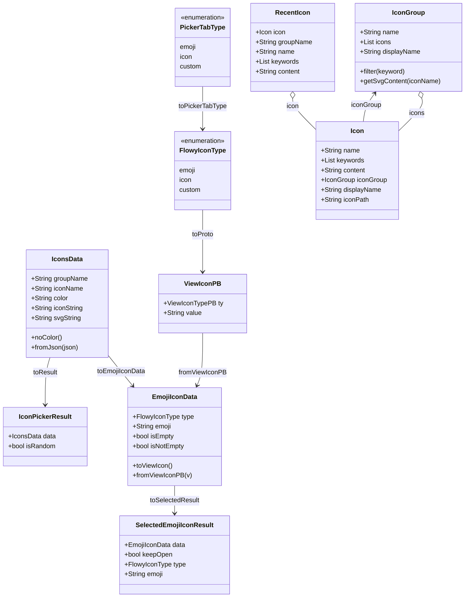
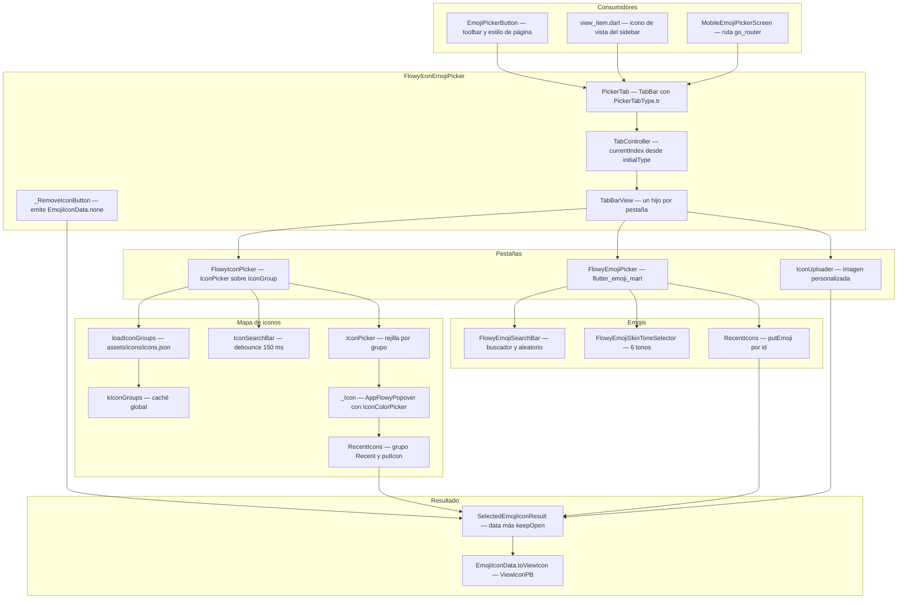
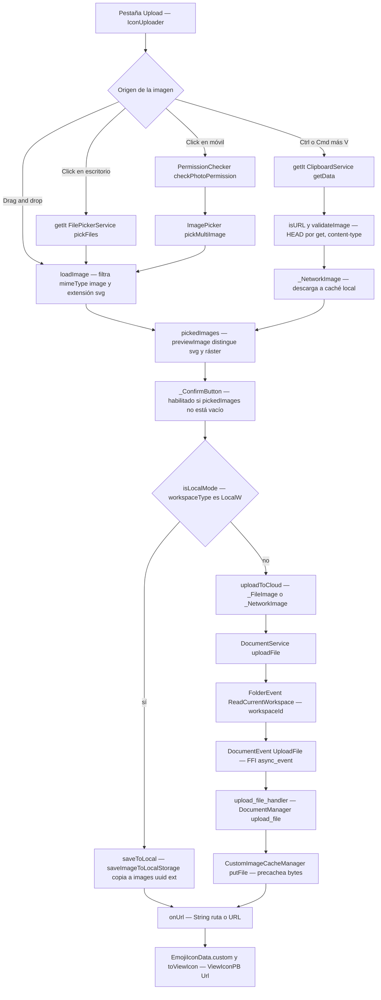
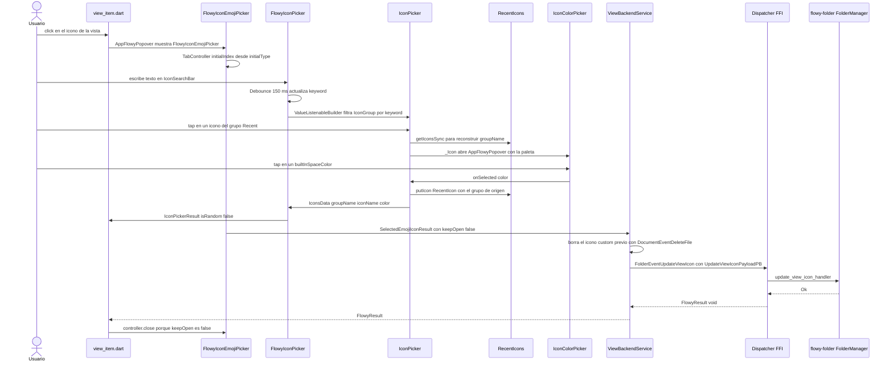
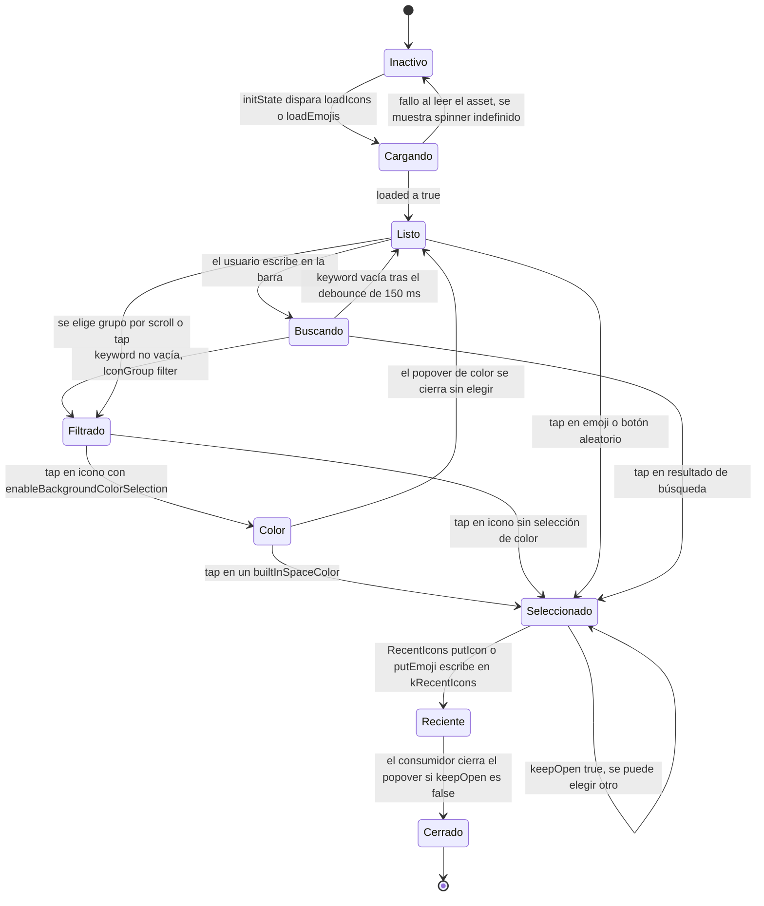
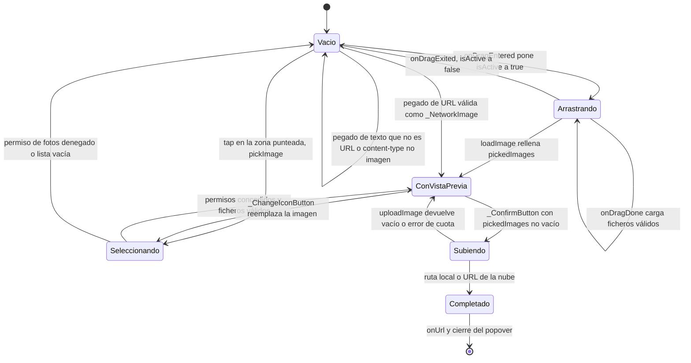

# F21 — Icon/Emoji picker

## 1. Resumen

F21 es el módulo UI que permite elegir el icono o emoji de cualquier vista de AppFlowy: un popover con pestañas (**Emojis**, **Icons**, **Upload**), buscador con debounce, tonos de piel para emojis, paleta de color de fondo para los iconos SVG y un grupo sintético de «recientes» persistido en `SharedPreferences`. Los 11 ficheros de `lib/shared/icon_emoji_picker/` son la única pieza del código que traduce entre el modelo de dominio (`ViewIconPB` con `ty: Emoji | Icon | Url`) y la UI. Es un módulo **cross-cutting**: lo consumen la toolbar del editor y el estilo de página (`[[F01.6]]`), los iconos de vista del sidebar (`[[F03.1]]`), y —como homónimo, no el mismo widget— el selector de emoji de Ajustes (`[[F13.3]]`), que es una implementación independiente. Toda la subida de un icono personalizado sale de aquí: `IconUploader` decide entre copia local y subida a la nube y acaba llamando al evento FFI `DocumentEvent::UploadFile`.

## 2. Alcance

Este documento cubre los **11 ficheros** de `appflowy/frontend/appflowy_flutter/lib/shared/icon_emoji_picker/` asignados a la unidad F21 en `OUT/_ledger/cobertura.csv` (líneas 1359–1369), la tabla completa en §12. Se documenta además, con cita pero sin reasignar, el contrato de los ficheros externos que el módulo necesita para funcionar: el asset `assets/icons/icons.json` (`appflowy/frontend/appflowy_flutter/pubspec.yaml:305`), `FlowyEmojiPicker` (`appflowy/frontend/appflowy_flutter/lib/plugins/base/emoji/emoji_picker.dart`), `saveImageToLocalStorage`/`saveImageToCloudStorage` (`appflowy/frontend/appflowy_flutter/lib/plugins/document/presentation/editor_plugins/image/image_util.dart`), `builtInSpaceColors` (`appflowy/frontend/appflowy_flutter/lib/workspace/presentation/home/menu/sidebar/space/space_icon_popup.dart:16–34`) y los eventos FFI `DocumentEvent::UploadFile` y `FolderEvent::UpdateViewIcon`.

### 2.1 Corrección de scope 1 — F21 se creó sin título en el triage de B0.2

La unidad F21 nació en el triage de B0.2 **sin título canónico**: la entrada de la unidad decía literalmente `titulo: "F21"` y apuntaba a un directorio `F21-f21/F21-f21.md`, de modo que el nombre del directorio no describía el contenido. El título canónico es **Icon/Emoji picker** y el directorio es **`F21-icon-emoji-picker/`**, que es el que usa este documento (y el que fija `OUT/_ledger/units/F21.json`). La corrección es solo de nomenclatura: no se reasigna ningún archivo, no cambia el `capa: service` de las 11 filas del ledger y no altera las dependencias (F21 no declara ninguna). El propio ROADMAP ya usa el rótulo correcto (`ROADMAP.md`, «B3.F21 — Icon/Emoji picker (Dart UI)»), de modo que era el ledger quien estaba desfasado.

### 2.2 Corrección de scope 2 — el `emoji_picker` de Ajustes (F13.3) es un widget DISTINTO

Existe un segundo selector de emoji en el repo y **no es** el de esta unidad. `appflowy/frontend/appflowy_flutter/lib/workspace/presentation/settings/widgets/emoji_picker/` es un paquete de 12 ficheros, un *port* del paquete externo `emoji_picker` de Flutter, autocontenido y con sus propios modelos. La evidencia de la diferencia es directa:

| Criterio | F21 (este documento) | F13.3 (`settings/widgets/emoji_picker/`) |
|---|---|---|
| Widget raíz | `FlowyIconEmojiPicker` (`appflowy/frontend/appflowy_flutter/lib/shared/icon_emoji_picker/flowy_icon_emoji_picker.dart:109`) | `EmojiPicker` (`appflowy/frontend/appflowy_flutter/lib/workspace/presentation/settings/widgets/emoji_picker/src/emoji_picker.dart:82`) |
| Motor de emojis | `flutter_emoji_mart` (`EmojiData.builtIn()`) (`appflowy/frontend/appflowy_flutter/lib/plugins/base/emoji/emoji_picker.dart:56`) | `emoji_lists.dart`, listas Dart estáticas `Map<String,String>` (`appflowy/frontend/appflowy_flutter/lib/workspace/presentation/settings/widgets/emoji_picker/src/emoji_lists.dart:16`) copiadas de `https://github.com/JeffG05/emoji_picker` (`appflowy/frontend/appflowy_flutter/lib/workspace/presentation/settings/widgets/emoji_picker/src/emoji_lists.dart:2`) |
| Configuración | Parámetros sueltos (`enableBackgroundColorSelection`, `tabs`, `initialType`) (`appflowy/frontend/appflowy_flutter/lib/shared/icon_emoji_picker/flowy_icon_emoji_picker.dart:122–126`) | `@freezed class EmojiPickerConfig` con ~40 campos de estilo (`appflowy/frontend/appflowy_flutter/lib/workspace/presentation/settings/widgets/emoji_picker/src/emji_picker_config.dart:12–14`) |
| Abstracción de vista | Ninguna: la vista la impone `flutter_emoji_mart` con `headerBuilder`/`itemBuilder`/`searchBarBuilder` (`appflowy/frontend/appflowy_flutter/lib/plugins/base/emoji/emoji_picker.dart:91–131`) | `abstract class EmojiPickerBuilder` + `DefaultEmojiPickerView` (`appflowy/frontend/appflowy_flutter/lib/workspace/presentation/settings/widgets/emoji_picker/src/emoji_picker_builder.dart:8`, `appflowy/frontend/appflowy_flutter/lib/workspace/presentation/settings/widgets/emoji_picker/src/default_emoji_picker_view.dart:11`) |
| Recientes | `RecentIcons`, orden FIFO estricto, tope 20, en la clave `kRecentIcons` (`appflowy/frontend/appflowy_flutter/lib/shared/icon_emoji_picker/recent_icons.dart:13–15`) | `RecentEmoji` con **contador de frecuencia** ordenado descendentemente, en la clave `recent` (`appflowy/frontend/appflowy_flutter/lib/workspace/presentation/settings/widgets/emoji_picker/src/emoji_picker.dart:319–340`) |
| Persistencia | `getIt<KeyValueStorage>()` (`appflowy/frontend/appflowy_flutter/lib/shared/icon_emoji_picker/recent_icons.dart:68`) | `SharedPreferences` directo (`appflowy/frontend/appflowy_flutter/lib/workspace/presentation/settings/widgets/emoji_picker/src/emoji_picker.dart:287`, `:302`, `:309`, `:337`) |
| Tonos de piel | Sí, `FlowyEmojiSkinToneSelector` (`appflowy/frontend/appflowy_flutter/lib/shared/icon_emoji_picker/emoji_skin_tone.dart:17`) | No hay selector de tono en el paquete |
| Iconos SVG + color | Sí, `FlowyIconPicker` + `IconColorPicker` (`appflowy/frontend/appflowy_flutter/lib/shared/icon_emoji_picker/icon_picker.dart:90`, `appflowy/frontend/appflowy_flutter/lib/shared/icon_emoji_picker/icon_color_picker.dart:5`) | No existe el concepto de icono |
| Salida | `EmojiIconData` → `ViewIconPB` (persistente, va al folder) (`appflowy/frontend/appflowy_flutter/lib/shared/icon_emoji_picker/flowy_icon_emoji_picker.dart:58–91`) | Callback `OnEmojiSelected`, inserta texto en el editor (`appflowy/frontend/appflowy_flutter/lib/workspace/presentation/settings/widgets/emoji_picker/src/emoji_picker.dart:98`) |

Conclusión: comparten casi solo el nombre de archivo (`emoji_picker.dart`). F21 no importa nada de `settings/widgets/emoji_picker/`, y este último tampoco importa nada de F21; la única relación es funcional (ambos permiten elegir un emoji) y de atajo de teclado: el paquete de Ajustes registra `ctrl+alt+e` / `cmd+alt+e` para abrir `EmojiMenu` del editor (`appflowy/frontend/appflowy_flutter/lib/workspace/presentation/settings/widgets/emoji_picker/emoji_shortcut_event.dart:7–13`), que es un camino distinto al picker de F21.

### 2.3 Corrección de scope 3 — F21 agota la línea «B3.F2x — Features nuevas descubiertas en B0.2»

El ROADMAP reserva una línea genérica para features no previstas: «B3.F2x — Features nuevas descubiertas en B0.2» (`ROADMAP.md`). F21 es **la única** unidad que materializa esa línea: es el único `F2x` creado en el triage que no procedía de la lista original del ROADMAP (los demás `F01`–`F18` sí). Con el cierre de F21 la línea `B3.F2x` queda **agotada y cerrada**, y no debe abrirse una unidad adicional bajo ese rótulo salvo que aparezca una feature genuinamente nueva en una iteración posterior del triage.

### 2.4 Qué queda fuera

- `plugins/base/emoji/emoji_picker.dart` (`FlowyEmojiPicker`) — **F01/F22**: F21 solo lo instancia desde `_buildEmojiPicker` (`appflowy/frontend/appflowy_flutter/lib/shared/icon_emoji_picker/flowy_icon_emoji_picker.dart:210–219`); su modelo `EmojiPickerResult`, la categoría sintética `'Recent'` y la caché `kCachedEmojiData` se documentan aquí por vecindad funcional, no como unidad propia.
- `plugins/document/presentation/editor_plugins/base/emoji_picker_button.dart` (`EmojiPickerButton`) — **[[F01.6]]**: es el consumidor del toolbar y del estilo de página.
- `workspace/presentation/home/menu/view/view_item.dart` — **[[F03.1]]**: abre el popover con las tres pestañas y persiste con `ViewBackendService.updateViewIcon`.
- `appflowy/frontend/appflowy_flutter/lib/workspace/application/view/view_service.dart:200–221` — **[[F03.1]]**: traduce `EmojiIconData` a `UpdateViewIconPayloadPB` y borra el fichero remoto previo con `DocumentEventDeleteFile`.
- `settings/widgets/emoji_picker/**` — **[[F13.3]]**: el homónimo descrito en §2.2.
- `shared/appflowy_network_image.dart`, `shared/appflowy_network_svg.dart`, `shared/custom_image_cache_manager.dart` — infraestructura compartida; se citan solo en §10.
- La subida de ficheros como motor (`flowy-storage`) — **F07**; aquí solo se documenta el tramo que arranca en el picker.

## 3. Modelos de datos

F21 no tiene entidades propias de base de datos: son modelos Dart de valor, serializables a JSON y (en el caso de `ViewIconPB`) traducibles a protobuf. El `classDiagram` siguiente refleja las clases reales con sus campos exactos.

**Lectura.** El centro del modelo es `EmojiIconData`: un par `(FlowyIconType, String)` que **reutiliza el campo `emoji` para los tres casos** — el glifo cuando `type == emoji`, un JSON `{"groupName","iconName","color"}` cuando `type == icon`, y una URL cuando `type == custom` (`appflowy/frontend/appflowy_flutter/lib/shared/icon_emoji_picker/flowy_icon_emoji_picker.dart:70–91`). Esa sobrecarga es la razón de que `EmojiIconData.emoji` se lea con nombres distintos según el contexto (`result.emoji`, `viewIcon.viewIconPB.value`), y es la fuente de dos de los riesgos de §13. `SelectedEmojiIconResult` envuelve a `EmojiIconData` y añade `keepOpen`, que el consumidor usa para decidir si cierra el popover. `IconGroup`/`Icon` modelan el asset `icons.json` (16 grupos, 977 iconos SVG), y `RecentIcon` es un `Icon` serializado más el nombre de su grupo de origen — sin ese campo el picker no podría reconstruir `groupName` al seleccionar desde la fila «Recent».

### 3.1 API pública de los 11 ficheros

Esta es la tabla de referencia de la unidad: qué exporta cada fichero y desde dónde se consume.

| # | Fichero | Símbolos públicos | Rol |
|---|---|---|---|
| 1 | `colors.dart` | `extension PickerColors on BuildContext` con `pickerTextColor`, `pickerIconColor`, `pickerSearchBarBorderColor`, `pickerButtonBoarderColor` (`:4–26`) | Paleta del picker derivada de `Theme.of(context).isLightMode`; no guarda estado |
| 2 | `emoji_search_bar.dart` | `typedef EmojiKeywordChangedCallback` (`:12`), `typedef EmojiSkinToneChanged` (`:13`), `FlowyEmojiSearchBar` (`:15`) | Buscador + botón de emoji aleatorio + selector de tono, para la pestaña de emojis |
| 3 | `emoji_skin_tone.dart` | `EmojiSkinTone? lastSelectedEmojiSkinTone` (`:10`), `ValueKey emojiSkinToneKey(String)` (`:13`), `FlowyEmojiSkinToneSelector` (`:17`), `extension EmojiSkinToneIcon on EmojiSkinTone` (`:88–105`) | Persistencia en memoria del último tono y popover con los 6 tonos |
| 4 | `flowy_icon_emoji_picker.dart` | `ToProto`/`FromProto` (`:16–42`), `ToEmojiIconData on ViewIconPB` (`:44`), `enum FlowyIconType` (`:48`), `FlowyIconTypeToPickerTabType` (`:54`), `EmojiIconData` (`:58`), `SelectedEmojiIconResult` (`:93`), `EmojiIconDataToSelectedResultExtension` (`:104`), `FlowyIconEmojiPicker` (`:109`) | Fachada del módulo: pestañas, `TabBarView`, `_RemoveIconButton` y conversión a/desde protobuf |
| 5 | `icon.dart` | `IconGroup` (`:6`), `Icon` (`:61`), `RecentIcon` (`:89`), generados `_$IconGroupFromJson`/`_$IconFromJson` vía `json_annotation` (`part 'icon.g.dart'`, `:3`) | Deserialización de `assets/icons/icons.json` y filtrado por keyword |
| 6 | `icon_color_picker.dart` | `IconColorPicker` (`:5`), `onSelected(String color)` (`:11`) | Rejilla de 6 columnas con los 12 `builtInSpaceColors` |
| 7 | `icon_picker.dart` | `kIconGroups` (`:26`), `IconGroupFilter on List<IconGroup>` con `findSvgContent`/`randomIcon` (`:29–55`), `Future<List<IconGroup>> loadIconGroups()` (`:57`), `IconPickerResult` (`:78`), `IconsDataToIconPickerResultExtension` (`:85`), `FlowyIconPicker` (`:90`), `IconsData` (`:235`), `IconPicker` (`:267`), `StreamlinePermit` (`:501`) | Pestaña de iconos: carga y cachea el asset, agrupa, filtra, elige color |
| 8 | `icon_search_bar.dart` | `typedef IconKeywordChangedCallback` (`:11`), `IconSearchBar` (`:14`) | Buscador + botón de icono aleatorio, para la pestaña de iconos |
| 9 | `icon_uploader.dart` | `IconUploader` (`:31`, anotado `@visibleForTesting` en `:30`) | Pestaña de subida: drag&drop, file picker, cámara, pegado de URL, previsualización y subida |
| 10 | `recent_icons.dart` | `RecentIcons` con `putEmoji` (`:21`), `putIcon` (`:25`), `getEmojiIds` (`:32`), `getIcons` (`:37`), `getIconsSync` (`:42`), `clear` (`:62`), `maxLength = 20` (`:15`), `enable` (`:19`) | Caché de uso reciente en `KeyValueStorage`, dos listas independientes (emoji por id, iconos por JSON) |
| 11 | `tab.dart` | `enum PickerTabType { emoji, icon, custom }` (`:4`) con getter `tr` **sin traducir** (`:9–18`), `StringToPickerTabType` (`:21`), `PickerTab` (`:31`) | `TabBar` con indicador `RoundUnderlineTabIndicator` reutilizado de la barra de pestañas móvil |

Dos detalles de la tabla merecen quedar fijados. Primero, `IconUploader` está marcado `@visibleForTesting` en la línea 30, un resto de una fase de pruebas de integración que expone el widget completo a los tests de `appflowy/frontend/appflowy_flutter/integration_test/shared/emoji.dart:90`; el analizador lo señala pero no impide instanciarlo desde producción. Segundo, `PickerTabType.tr` devuelve literales en inglés (`'Emojis'`, `'Icons'`, `'Upload'`) sin pasar por `LocaleKeys` (`appflowy/frontend/appflowy_flutter/lib/shared/icon_emoji_picker/tab.dart:9–18`), de modo que las tres pestañas del picker **no están internacionalizadas** aunque el resto del módulo sí lo esté — contraste directo con `LocaleKeys.emoji_random` (`appflowy/frontend/appflowy_flutter/lib/shared/icon_emoji_picker/icon_search_bar.dart:83`) o `LocaleKeys.button_remove` (`appflowy/frontend/appflowy_flutter/lib/shared/icon_emoji_picker/flowy_icon_emoji_picker.dart:271`).

## 4. Eventos FFI

**F21 no declara ni registra ningún evento propio.** Los 11 ficheros son UI pura: no contienen `AFPlugin`, ni `event_map.rs`, ni llamadas `.send()` a un evento de F21. El filtro de `OUT/_ledger/extract/events.json` por ruta no devuelve ninguna entrada, lo que es coherente con la `capa: service` del ledger pero describiendo widgets, no servicios de despacho.

Lo que sí hace el módulo es **consumir** eventos ajenos, todos en la pestaña de subida (icono personalizado) y en la persistencia del icono elegido. Estos son los eventos que atraviesan el FFI desde el picker:

| Evento | Input PB | Output PB | Handler Rust | Archivo:línea | Quién lo dispara |
|---|---|---|---|---|---|
| `FolderEvent::ReadCurrentWorkspace` (`= 2`) | — | `WorkspacePB` | `read_current_workspace_handler` | `appflowy/frontend/rust-lib/flowy-folder/src/event_map.rs:75–76` (declaración), `:15` (registro), `appflowy/frontend/rust-lib/flowy-folder/src/event_handler.rs:73` (handler) | `DocumentService.uploadFile` necesita el `workspace_id` (`appflowy/frontend/appflowy_flutter/lib/plugins/document/application/document_service.dart:156`) |
| `DocumentEvent::UploadFile` (`= 15`) | `UploadFileParamsPB` | `UploadedFilePB` | `upload_file_handler` | `appflowy/frontend/rust-lib/flowy-document/src/event_map.rs:125–126` (declaración), `:48` (registro), `appflowy/frontend/rust-lib/flowy-document/src/event_handler.rs:442–468` (handler) | `_FileImage.uploadToCloud` / `_NetworkImage.uploadToCloud` (`appflowy/frontend/appflowy_flutter/lib/shared/icon_emoji_picker/icon_uploader.dart:431–440`, `:456–465`) |
| `FolderEvent::UpdateViewIcon` (`= 35`) | `UpdateViewIconPayloadPB` | — | `update_view_icon_handler` | `appflowy/frontend/rust-lib/flowy-folder/src/event_map.rs:171–172` (declaración), `:36` (registro), `appflowy/frontend/rust-lib/flowy-folder/src/event_handler.rs:155–163` (handler) | El **consumidor**, no F21: `ViewBackendService.updateViewIcon` (`appflowy/frontend/appflowy_flutter/lib/workspace/application/view/view_service.dart:200–221`) |
| `DocumentEvent::DeleteFile` (`= 17`) | `DeleteFilePB` | — | `delete_file_handler` (no leído: fuera de la unidad) | `appflowy/frontend/rust-lib/flowy-document/src/event_map.rs:129–130` (declaración), `:50` (registro); lanzado en `appflowy/frontend/appflowy_flutter/lib/workspace/application/view/view_service.dart:210–219` | Limpieza del icono personalizado anterior cuando se sustituye (`[[F03.1]]`) |

El contrato del tramo que sí pertenece a F21 es `saveImageToCloudStorage` (`appflowy/frontend/appflowy_flutter/lib/plugins/document/presentation/editor_plugins/image/image_util.dart:44–73`): construye `DocumentService()`, llama a `uploadFile`, y **si el alta es correcta precachea los bytes en `CustomImageCacheManager`** con la URL devuelta (`:56–59`); si falla, traduce el error a un mensaje de cuota o al `msg` del `FlowyError` (`:62–71`). El motor de subida por debajo es **F07**, documentado en `OUT/09-features/F07-almacenamiento-de-archivos/F07-almacenamiento-de-archivos.md`.

## 5. Notificaciones

**F21 no registra ni escucha ninguna notificación de Rust.** No hay `rust_stream.dart`, ni `listener`, ni `NotificationType` en los 11 ficheros; el filtro de `OUT/_ledger/extract/notifications.json` por estas rutas no devuelve entradas. El picker es *pull*: el usuario pulsa un icono y el widget emite un `ValueChanged` Dart (`onSelectedEmoji`, `onSelectedIcon`, `onUrl`), sin ida y vuelta asíncrona.

La única retroalimentación asíncrona posible en la subida es un error de cuota de almacenamiento, y **no llega como notificación al picker**: se devuelve como `errorMessage` de la tupla `(String? path, String? errorMessage)` que devuelve `saveImageToCloudStorage`, y el propio `_FileImage.uploadToCloud` se limita a escribirlo con `Log.error` (`appflowy/frontend/appflowy_flutter/lib/shared/icon_emoji_picker/icon_uploader.dart:436–438`). En la práctica, un error de cuota deja el picker en el estado "imagen seleccionada, confirmación no efectiva" sin mensaje visible para el usuario — se documenta en §13 y §18.

## 6. BLoCs / Cubits

**F21 no declara ningún BLoC ni Cubit.** Los 11 ficheros son widgets `StatefulWidget`/`StatelessWidget` con estado local (`TabController`, `ValueNotifier<String> keyword`, `Debounce`, `List<_Image> pickedImages`, `PopoverController`). `OUT/_ledger/extract/blocs.json` no devuelve entradas para `shared/icon_emoji_picker/`, confirmando la capa `service` del ledger en el sentido de "sin BLoC".

El estado real de F21 es, por tanto, **estado de widget**, y su ciclo de vida está gobernado por cuatro piezas: el `TabController` del `FlowyIconEmojiPicker` (`appflowy/frontend/appflowy_flutter/lib/shared/icon_emoji_picker/flowy_icon_emoji_picker.dart:144–154`), el `ValueNotifier<String>` + `Debounce(150 ms)` del `FlowyIconPicker` (`appflowy/frontend/appflowy_flutter/lib/shared/icon_emoji_picker/icon_picker.dart:111–112`), el `bool loaded` que decide entre spinner y rejilla (`:110`, `:192–201`), y la lista `pickedImages` del `IconUploader` (`appflowy/frontend/appflowy_flutter/lib/shared/icon_emoji_picker/icon_uploader.dart:52`).

Los BLoCs que quedan **fuera** de la unidad pero reciben el resultado del picker:

| BLoC / servicio | Qué hace con `EmojiIconData` | Archivo:línea |
|---|---|---|
| `PageStyleIconBloc` | Aplica el icono al estilo de página del documento (`PageStyleIconEvent.updateIcon(icon, shouldUpdateRemote)`) | `appflowy/frontend/appflowy_flutter/lib/plugins/document/presentation/editor_plugins/page_style/_page_style_icon_bloc.dart:10`, `:61–64`; consumidor en `appflowy/frontend/appflowy_flutter/lib/plugins/document/presentation/editor_plugins/page_style/_page_style_icon.dart:93–103` |
| `ViewBloc` / `ViewBackendService.updateViewIcon` | Persiste el icono de la vista (`FolderEvent::UpdateViewIcon`) | `appflowy/frontend/appflowy_flutter/lib/workspace/application/view/view_service.dart:200–221`; invocación en `appflowy/frontend/appflowy_flutter/lib/workspace/presentation/home/menu/view/view_item.dart:686–692` |
| `SpaceBloc` | Aplica icono y color a un *space* del sidebar | `appflowy/frontend/appflowy_flutter/lib/workspace/application/sidebar/space/space_bloc.dart:606`, `:652` |

## 7. Servicios e inyección de dependencias

En el lado Rust, **F21 no toca `flowy-core/deps_resolve`**: ningún crate Rust registra dependencia para el picker. Es puramente Dart.

En el lado Dart, el módulo consume cuatro servicios registrados en `get_it` y ninguno los registra:

| Servicio | Uso en F21 | Archivo:línea del uso | Registro |
|---|---|---|---|
| `KeyValueStorage` | Persistir/leer los dos arrays de recientes bajo `KVKeys.recentIcons` (`'kRecentIcons'`) | `appflowy/frontend/appflowy_flutter/lib/shared/icon_emoji_picker/recent_icons.dart:68–71`, `:79` | `DartKeyValue` sobre `SharedPreferences` (`appflowy/frontend/appflowy_flutter/lib/core/config/kv.dart:14–15`, `:62–63`); clave en `appflowy/frontend/appflowy_flutter/lib/core/config/kv_keys.dart:117` |
| `FilePickerService` | Abrir el diálogo de selección de fichero en desktop | `appflowy/frontend/appflowy_flutter/lib/shared/icon_emoji_picker/icon_uploader.dart:269–273` | `flowy_infra/file_picker/file_picker_service.dart` (paquete interno) |
| `ClipboardService` | Leer el portapapeles al interpretar `Ctrl/Cmd+V` como "pegar URL de imagen" | `appflowy/frontend/appflowy_flutter/lib/shared/icon_emoji_picker/icon_uploader.dart:312` | `plugins/document/presentation/editor_plugins/copy_and_paste/clipboard_service.dart` |
| `ApplicationDataStorage` | Ruta local donde `saveImageToLocalStorage` copia el fichero en modo local | `appflowy/frontend/appflowy_flutter/lib/plugins/document/presentation/editor_plugins/image/image_util.dart:19` | `workspace/application/settings/application_data_storage.dart` |

Además hay tres singletons **en memoria**, sin `get_it`, que sirven de caché y hacen que abrir el picker por segunda vez sea instantáneo:

| Singleton | Tipo | Ámbito | Archivo:línea |
|---|---|---|---|
| `kIconGroups` | `List<IconGroup>?` | Global de la app; se rellena una vez desde `rootBundle` y nunca se invalida | `appflowy/frontend/appflowy_flutter/lib/shared/icon_emoji_picker/icon_picker.dart:26`, `:57–76` |
| `kCachedEmojiData` | `EmojiData?` | Global de la app; evita reconstruir el `EmojiData` de `flutter_emoji_mart` | `appflowy/frontend/appflowy_flutter/lib/plugins/base/emoji/emoji_picker.dart:13`, `:53–62` |
| `lastSelectedEmojiSkinTone` | `EmojiSkinTone?` | Global de la app; recuerda el último tono entre aperturas y además entre widgets consumidores | `appflowy/frontend/appflowy_flutter/lib/shared/icon_emoji_picker/emoji_skin_tone.dart:10`, consumido en `appflowy/frontend/appflowy_flutter/lib/plugins/base/emoji/emoji_picker.dart:82` y `appflowy/frontend/appflowy_flutter/lib/shared/icon_emoji_picker/emoji_search_bar.dart:37` |

`UserBackendService.getCurrentUserProfile()` (`appflowy/frontend/appflowy_flutter/lib/shared/icon_emoji_picker/icon_uploader.dart:292`) es una llamada estática, no un `get_it`, y decide el modo local/nube de cada subida (§10).

## 8. Persistencia

F21 persiste en **tres** frentes distintos, ninguno de ellos SQLite ni collab:

### 8.1 Recientes — `SharedPreferences` vía `KeyValueStorage`

Una única clave, `'kRecentIcons'`, cuyo valor es un JSON con **dos listas** indexadas por el nombre del `FlowyIconType` (`emoji` e `icon`), porque `RecentIcons._dataMap` es `Map<String, List<String>>` (`appflowy/frontend/appflowy_flutter/lib/shared/icon_emoji_picker/recent_icons.dart:13`):

| Lista | Tipo de entrada | Quién la escribe | Tope |
|---|---|---|---|
| `emoji` | El **id** del emoji (p. ej. `'1'`), no el glifo — el glifo se reconstruye con `emojiData.getEmojiById` | `RecentIcons.putEmoji(id)`, invocado desde `FlowyEmojiPicker` (`appflowy/frontend/appflowy_flutter/lib/plugins/base/emoji/emoji_picker.dart:88`, `:127`) | `maxLength = 20` (`:15`) |
| `icon` | El JSON completo del icono (`jsonEncode(icon.toJson())` = `name`, `keywords`, `content`) más `groupName` | `RecentIcons.putIcon(RecentIcon)`, invocado desde `IconPicker` (`appflowy/frontend/appflowy_flutter/lib/shared/icon_emoji_picker/icon_picker.dart:350`, `:368`, `:182`) | `maxLength = 20` (`:15`) |

La política de inserción es **FIFO estricto, no por frecuencia**: `_put` borra la entrada si ya existía, la reinserta en la cabeza y descarta la cola al superar 20 (`appflowy/frontend/appflowy_flutter/lib/shared/icon_emoji_picker/recent_icons.dart:99–108`). Esto contrasta con el homónimo de Ajustes, que ordena por contador descendente (`appflowy/frontend/appflowy_flutter/lib/workspace/presentation/settings/widgets/emoji_picker/src/emoji_picker.dart:331–333`).

Cómo se materializa en pantalla: `FlowyIconPicker.loadIcons` inserta un `IconGroup` sintético llamado `'Recent'` (`_kRecentIconGroupName`) **antes** de los grupos reales, con como máximo `iconPerLine` iconos y saltándose los que vienen sin `groupName` (`appflowy/frontend/appflowy_flutter/lib/shared/icon_emoji_picker/icon_picker.dart:114–135`); el filtro de esa fila especial se aplica con `getGroupName(index)` (`:391–399`). Para emojis, `FlowyEmojiPicker.loadEmojis` inserta una `Category` con id `'Recent'` en la copia de `data.categories` (`appflowy/frontend/appflowy_flutter/lib/plugins/base/emoji/emoji_picker.dart:143–150`).

### 8.2 El asset de iconos — `rootBundle`, memoizado

Los 977 iconos SVG viven en `appflowy/frontend/appflowy_flutter/assets/icons/icons.json`, declarado como asset en `appflowy/frontend/appflowy_flutter/pubspec.yaml:305`. `loadIconGroups()` lo lee **una sola vez** gracias al guardia `if (kIconGroups != null) return kIconGroups!` (`appflowy/frontend/appflowy_flutter/lib/shared/icon_emoji_picker/icon_picker.dart:57–60`), lo deserializa con `IconGroup.fromMapEntry` por cada entrada del mapa raíz (`:66`) y mide el tiempo con un `Stopwatch` que se registra en el log (`:62`, `:73–75`). Los `IconGroup` resultantes son **inmutables desde el punto de vista de la vista**: `IconPicker` los filtra con `IconGroup.filter`, que devuelve un `IconGroup` nuevo en vez de mutar (`:37–48` de `icon.dart`).

La caché es doble: además del global `kIconGroups`, `IconsData.svgString` (`appflowy/frontend/appflowy_flutter/lib/shared/icon_emoji_picker/icon_picker.dart:260–264`) y `List<IconGroup>.findSvgContent` (`:30–47`) resuelven el contenido SVG **desde la caché**, no desde disco. Esto es lo que permite que `RawEmojiIconWidget` renderice un icono de una vista antigua sin volver a tocar el asset (`appflowy/frontend/appflowy_flutter/lib/plugins/document/presentation/editor_plugins/header/emoji_icon_widget.dart:123–135`).

### 8.3 El icono personalizado — fichero local o URL remota

Cuando el tipo es `custom`, lo que se persiste en la vista no es el binario sino **una ruta o una URL** en `ViewIconPB.value` (`appflowy/frontend/appflowy_flutter/lib/shared/icon_emoji_picker/flowy_icon_emoji_picker.dart:67–68`, `:82–86`). En modo local es una ruta absoluta bajo `{ApplicationDataStorage}/images/{uuid}.{ext}` (`appflowy/frontend/appflowy_flutter/lib/plugins/document/presentation/editor_plugins/image/image_util.dart:18–42`); en modo nube es la URL que devuelve `UploadedFilePB.url` tras el evento FFI. El renderizado distingue los tres casos (URL SVG, URL de imagen, fichero local) en `appflowy/frontend/appflowy_flutter/lib/plugins/document/presentation/editor_plugins/header/emoji_icon_widget.dart:136–190`, y **lanza `PathNotFoundException` si el fichero local ya no existe** (`:167–169`). Ninguno de esos tres medios pasa por SQLite ni por el collab del folder: son el KV store, el asset bundle y el almacenamiento de ficheros (F07).

## 9. Diagramas de flujo

El primer diagrama muestra la estructura del picker y cómo se despachan sus tres pestañas hacia los sub-pickers y hacia el exterior.

**Lectura.** `FlowyIconEmojiPicker` es una columna con cabecera fija: la fila superior (46 px) lleva `PickerTab` a la izquierda y el botón «Remove» a la derecha; debajo, un `FlowyDivider` y el `TabBarView` (`appflowy/frontend/appflowy_flutter/lib/shared/icon_emoji_picker/flowy_icon_emoji_picker.dart:164–206`). Las pestañas se **construyen perezosamente solo si el consumidor las pide**: la lista por defecto es `[emoji, icon]`, y `custom` solo aparece si el consumidor la añade explícitamente (`:116–119`), como hace `appflowy/frontend/appflowy_flutter/lib/workspace/presentation/home/menu/view/view_item.dart:680–684`. Eso explica por qué el icono de una vista de documento no ofrece «Upload» pero el del sidebar sí. Cada pestaña devuelve su propio tipo (`IconPickerResult`, `EmojiPickerResult`, `String` url) y la fachada los homogeneiza a `SelectedEmojiIconResult` (`:209–252`).

El segundo diagrama sigue únicamente el camino de subida de un icono personalizado, desde el gesto hasta el almacenamiento.

**Lectura.** Las tres puertas de entrada (arrastrar, elegir fichero o foto, pegar una URL) convergen en `pickedImages`, una `List<_Image>` cuyo tipo abstracto declara tres operaciones —`url`, `saveToLocal`, `uploadToCloud`— y cuyo `pureUrl` descarta la query string (`appflowy/frontend/appflowy_flutter/lib/shared/icon_emoji_picker/icon_uploader.dart:411–419`). La bifurcación local/nube se decide consultando el perfil del usuario, no una bandera global: `UserBackendService.getCurrentUserProfile()` y la comparación `workspaceType == WorkspaceTypePB.LocalW` (`:292–299`). En modo nube el camino atraviesa el FFI completo (`§4`); en modo local no hay ninguna llamada al SDK, solo una copia de fichero.

## 10. Diagramas de secuencia

Este diagrama muestra el recorrido de seleccionar un icono con color y aplicarlo a la vista del sidebar, que es el camino de uso más frecuente.

**Lectura.** La selección de icono tiene dos pasos en desktop cuando `enableBackgroundColorSelection` es `true`: el primer tap **no cierra nada**, abre el `AppFlowyPopover` de color; el segundo tap (un color) sí emite (`appflowy/frontend/appflowy_flutter/lib/shared/icon_emoji_picker/icon_picker.dart:477–490`). Cuando el flag es `false` el widget usado es `_IconNoBackground` y basta un solo tap (`:354–370`). `RecentIcons.putIcon` se escribe **antes** de propagar el resultado (`:350`), de modo que un fallo posterior de red no pierde el icono del historial. El `keepOpen` del resultado es lo que decide el cierre: los iconos aleatorios y los emojis aleatorios se emiten con `keepOpen: true` para permitir encadenar varios (`appflowy/frontend/appflowy_flutter/lib/shared/icon_emoji_picker/flowy_icon_emoji_picker.dart:215`, `:236`), y el consumidor honra la señal con `if (!r.keepOpen) controller.close()` (`appflowy/frontend/appflowy_flutter/lib/workspace/presentation/home/menu/view/view_item.dart:691`).

Sobre el tramo final del diagrama: `ViewBackendService.updateViewIcon` es de **[[F03.1]]**, no de F21, pero se incluye porque es donde el `EmojiIconData` producido por este módulo se convierte en `UpdateViewIconPayloadPB`, y porque introduce una consecuencia importante: al sustituir un icono personalizado, el fichero remoto antiguo se borra con `DocumentEventDeleteFile` (`appflowy/frontend/appflowy_flutter/lib/workspace/application/view/view_service.dart:210–219`). Los iconos **SVG de Streamline no pasan por ninguna subida**: viajan dentro del propio documento del folder, así que borrarlos del cloud no aplica.

## 11. Diagramas de estado

La máquina de estados de la selección recorre las fases que atraviesa el usuario dentro de una pestaña; el estado final depende del tipo de icono elegido, y solo el tipo personalizado reabre el flujo hacia una subida.

**Lectura.** El grafo refleja que «buscando» y «categoría» son estados distintos y mutuamente excluyentes en el código: `IconPicker` decide entre la lista completa y la filtrada en una sola rama `if (keyword.isNotEmpty)` dentro del `ValueListenableBuilder` (`appflowy/frontend/appflowy_flutter/lib/shared/icon_emoji_picker/icon_picker.dart:207–232`), de modo que no hay estado mixto. La transición `Color → Listo` modela el `onClose` de `AppFlowyPopover`, que pone `isSelected` a `false` (`appflowy/frontend/appflowy_flutter/lib/shared/icon_emoji_picker/icon_picker.dart:470–472`). El estado `Reciente` se produce **antes** del cierre porque `RecentIcons.putIcon` es una operación asíncrona que escribe en `SharedPreferences` y se dispara sin `await` (`:350`, `:368`); por eso la UI puede cerrarse antes de que el historial esté escrito.

El segundo diagrama de estado es el del flujo de subida del icono personalizado, con sus cuatro estados de control reales (`isHovering`, `isActive`, `pickedImages.isEmpty`, `isUploading`).

**Lectura.** `isUploading` es un `bool` sin `setState` (`appflowy/frontend/appflowy_flutter/lib/shared/icon_emoji_picker/icon_uploader.dart:50`, `:289–290`, `:305`), por lo que **no deshabilita el botón de confirmar durante la subida**: la guarda `if (pickedImages.isEmpty || isUploading) return` evita el doble envío, pero el usuario no ve progreso ni bloqueo. La transición `Subiendo → ConVistaPrevia` en error es la más relevante: `uploadImage` solo propaga `onUrl` cuando el resultado es no vacío (`:306–308`), de modo que un error de cuota deja la imagen seleccionada y un botón aparentemente funcional. La previsualización se elige por extensión, no por tipo MIME: `previewImage` ramifica entre `SvgPicture.file`/`Image.file` y `FlowyNetworkSvg`/`FlowyNetworkImage` comparando `url.endsWith('.svg')` (`:214–245`), lo que produce una vista vacía si el fichero tiene extensión `.svg` pero contenido ráster.

## 12. Archivos cubiertos (del ledger)

Los 11 archivos de la unidad F21, copiados literalmente de `OUT/_ledger/cobertura.csv` (líneas 1359–1369) con su capa y su LOC real:

| # | Ruta | Capa (ledger) | LOC | API pública principal |
|---:|---|---|---:|---|
| 1 | `appflowy/frontend/appflowy_flutter/lib/shared/icon_emoji_picker/colors.dart` | service | 26 | `PickerColors` (`:4`) |
| 2 | `appflowy/frontend/appflowy_flutter/lib/shared/icon_emoji_picker/emoji_search_bar.dart` | service | 215 | `FlowyEmojiSearchBar` (`:15`) |
| 3 | `appflowy/frontend/appflowy_flutter/lib/shared/icon_emoji_picker/emoji_skin_tone.dart` | service | 105 | `FlowyEmojiSkinToneSelector` (`:17`), `lastSelectedEmojiSkinTone` (`:10`) |
| 4 | `appflowy/frontend/appflowy_flutter/lib/shared/icon_emoji_picker/flowy_icon_emoji_picker.dart` | service | 277 | `FlowyIconEmojiPicker` (`:109`), `EmojiIconData` (`:58`) |
| 5 | `appflowy/frontend/appflowy_flutter/lib/shared/icon_emoji_picker/icon.dart` | service | 107 | `IconGroup` (`:6`), `Icon` (`:61`), `RecentIcon` (`:89`) |
| 6 | `appflowy/frontend/appflowy_flutter/lib/shared/icon_emoji_picker/icon_color_picker.dart` | service | 44 | `IconColorPicker` (`:5`) |
| 7 | `appflowy/frontend/appflowy_flutter/lib/shared/icon_emoji_picker/icon_picker.dart` | service | 537 | `FlowyIconPicker` (`:90`), `IconPicker` (`:267`), `IconsData` (`:235`), `loadIconGroups` (`:57`) |
| 8 | `appflowy/frontend/appflowy_flutter/lib/shared/icon_emoji_picker/icon_search_bar.dart` | service | 183 | `IconSearchBar` (`:14`) |
| 9 | `appflowy/frontend/appflowy_flutter/lib/shared/icon_emoji_picker/icon_uploader.dart` | service | 467 | `IconUploader` (`:31`) |
| 10 | `appflowy/frontend/appflowy_flutter/lib/shared/icon_emoji_picker/recent_icons.dart` | service | 109 | `RecentIcons` (`:12`) |
| 11 | `appflowy/frontend/appflowy_flutter/lib/shared/icon_emoji_picker/tab.dart` | service | 80 | `PickerTabType` (`:4`), `PickerTab` (`:31`) |
| | **Total** | | **2 150** | |

Ficheros **citados pero no cubiertos** por la unidad (evidencia externa, sin reasignación): `assets/icons/icons.json` (asset, 977 iconos en 16 grupos), `plugins/base/emoji/emoji_picker.dart` (154 LOC), `plugins/document/presentation/editor_plugins/base/emoji_picker_button.dart` (222 LOC), `plugins/document/presentation/editor_plugins/header/emoji_icon_widget.dart` (219 LOC), `plugins/document/presentation/editor_plugins/image/image_util.dart` (132 LOC), `plugins/document/application/document_service.dart` (222 LOC), `workspace/presentation/home/menu/sidebar/space/space_icon_popup.dart` (390 LOC), `workspace/presentation/home/menu/view/view_item.dart` (966 LOC), `workspace/application/view/view_service.dart` (427 LOC), `core/config/kv.dart` y `core/config/kv_keys.dart` (128 LOC), `shared/custom_image_cache_manager.dart` (61 LOC), `shared/patterns/file_type_patterns.dart` (29 LOC), `shared/permission/permission_checker.dart` (103 LOC), `plugins/document/presentation/editor_drop_manager.dart` (21 LOC), `mobile/presentation/home/tab/_round_underline_tab_indicator.dart`, y los ficheros Rust `flowy-document/src/{event_map,event_handler}.rs` y `flowy-folder/src/{event_map,event_handler}.rs`.

## 13. Riesgos y casos límite

- **F21 se creó sin título en el triage de B0.2 y el ledger quedó desfasado** (§2.1). La unidad decía `titulo: "F21"` y apuntaba a `F21-f21/F21-f21.md`; el título canónico es **Icon/Emoji picker** y el directorio **`F21-icon-emoji-picker/`**. No se reasigna ningún archivo ni se cambia la capa: es una corrección de nomenclatura, consistente con el ROADMAP (`ROADMAP.md`), y su consecuencia práctica es que cualquier referencia por ruta al antiguo `F21-f21/` es inválida.
- **Confusión con el `emoji_picker` de Ajustes ([F13.3])** (§2.2). Son dos widgets distintos con el mismo nombre de archivo, dependencias opuestas (`flutter_emoji_mart` frente a listas estáticas `emoji_lists.dart`), modelos distintos (`EmojiIconData` frente a `Emoji`) y almacenamiento de recientes distinto (FIFO de 20 en `kRecentIcons` frente a contador en `recent`). El riesgo real es documental y de mantenimiento: buscar «el emoji picker» en el repo devuelve ambos. La mitigación es este §2.2 y la etiqueta explícita en `[[F13.3]]`.
- **La línea «B3.F2x — Features nuevas descubiertas en B0.2» queda agotada con F21** (§2.3). Es la única unidad creada bajo ese rótulo; no debe abrirse otra bajo `F2x` sin un triage nuevo. Si en el futuro se crea `F22`, debe entrar por la lista explícita del ROADMAP, no por `F2x`.
- **Pestañas no internacionalizadas**: `PickerTabType.tr` devuelve `'Emojis'`, `'Icons'` y `'Upload'` como literales (`appflowy/frontend/appflowy_flutter/lib/shared/icon_emoji_picker/tab.dart:9–18`). Los tests de integración dependen de esos literales (`appflowy/frontend/appflowy_flutter/integration_test/shared/emoji.dart:39`), así que traducirlos rompería las pruebas.
- **Sobrecarga del campo `emoji`**: `EmojiIconData.emoji` contiene un glifo, un JSON o una URL según `type` (`appflowy/frontend/appflowy_flutter/lib/shared/icon_emoji_picker/flowy_icon_emoji_picker.dart:70–86`). Cualquier consumidor que lo lea sin mirar `type` convierte un error latente en bug real: `jsonDecode` sobre un glifo lanza. Se mitiga con las extensiones `toEmojiIconData()`/`fromViewIconPB()` y con el `switch (widget.emoji.type)` del renderizador (`appflowy/frontend/appflowy_flutter/lib/plugins/document/presentation/editor_plugins/header/emoji_icon_widget.dart:115–136`).
- **Índice posicional para el grupo de origen en «Recent»**: al seleccionar desde la fila Recent, `IconPicker` reconstruye el `groupName` con `getGroupName(index)`, que indexa `RecentIcons.getIconsSync()` por la **posición en la rejilla** (`appflowy/frontend/appflowy_flutter/lib/shared/icon_emoji_picker/icon_picker.dart:340–342`, `:391–399`). Si la lista de recientes cambia entre el `build` y el tap, el índice apunta a otro icono; el método captura la excepción y devuelve `''`, que `getIconsSync` descarta silenciosamente (`:49–51`). Consecuencia: el icono se aplica con `groupName` vacío y no es recuperable desde el historial. Mitigado parcialmente por `skipWhile((e) => e.groupName.isEmpty)` al construir la fila (`:123`) y por el test `sidebar_recent_icon_test.dart`.
- **Cambio de pestañas durante la subida**: `IconUploader` desactiva el arrastre del documento con `enableDocumentDragNotifier.value = false` en un `addPostFrameCallback` y lo reactiva en `dispose` **también** mediante `addPostFrameCallback` (`appflowy/frontend/appflowy_flutter/lib/shared/icon_emoji_picker/icon_uploader.dart:67–69`, `:75–77`). Si el widget se desmonta fuera del árbol de widgets, el notificador puede quedarse en `false` y bloquear el drag&drop de archivos en el editor.
- **`PathNotFoundException` al renderizar un icono local perdido**: si el fichero fue borrado o la ruta quedó obsoleta, `RawEmojiIconWidget` lanza en vez de mostrar un placeholder (`appflowy/frontend/appflowy_flutter/lib/plugins/document/presentation/editor_plugins/header/emoji_icon_widget.dart:166–169`). El picker no participa en ese renderizado pero genera las rutas que lo provocan.
- **Errores de cuota invisibles en el picker**: `uploadImage` solo propaga `onUrl` si el resultado es no vacío (`appflowy/frontend/appflowy_flutter/lib/shared/icon_emoji_picker/icon_uploader.dart:306–308`) y `_FileImage.uploadToCloud` solo registra el error con `Log.error` (`:436–438`). El `errorMessage` que produce `saveImageToCloudStorage` (`appflowy/frontend/appflowy_flutter/lib/plugins/document/presentation/editor_plugins/image/image_util.dart:62–71`) nunca se muestra al usuario en esta ruta; es el mensaje que sí se muestra en los bloques de imagen del editor.
- **Detección de imagen pegada restrictiva**: `validateImage` exige `statusCode == 200` y una lista blanca de `content-type` (`appflowy/frontend/appflowy_flutter/lib/shared/icon_emoji_picker/icon_uploader.dart:324–347`); un servidor que responda `301`, `302` o `image/webp; charset=…` se rechaza. Además usa `http.get` completo, no un `HEAD`: descarga el binario entero solo para leer la cabecera.
- **Filtro de ficheros arrastrados con precedencia dudosa**: la condición de `loadImage` combina `mimeType?.startsWith('image/') ?? false || imgExtensionRegex.hasMatch(name) || name.endsWith('.svg')` (`appflowy/frontend/appflowy_flutter/lib/shared/icon_emoji_picker/icon_uploader.dart:248–255`). Por precedencia de `??` frente a `||` el resultado real es `((mimeType?.startsWith(...) ?? false) || ...)`, que es la lectura pretendida, pero la expresión es frágil frente a un refactor.
- **Global mutable compartido entre instancias**: `lastSelectedEmojiSkinTone` (`appflowy/frontend/appflowy_flutter/lib/shared/icon_emoji_picker/emoji_skin_tone.dart:10`) y `kIconGroups` (`appflowy/frontend/appflowy_flutter/lib/shared/icon_emoji_picker/icon_picker.dart:26`) son singletons de proceso. El primero hace que dos pickers abiertos en paralelo compartan tono; el segundo no se invalida nunca, así que un cambio en `icons.json` no se ve sin reiniciar la app.
- **`RecentIcons.enable` como interruptor de pruebas**: `enable = false` desactiva tanto la carga como la escritura (`appflowy/frontend/appflowy_flutter/lib/shared/icon_emoji_picker/recent_icons.dart:75`, `:101`), y varios tests de integración lo alternan alrededor de cada caso (`appflowy/frontend/appflowy_flutter/integration_test/desktop/database/database_icon_test.dart`). Si se olvida restaurarlo, el resto de la suite ve una lista de recientes vacía.

## 14. Evidencias y etiquetas

| Etiqueta | Cantidad | Dónde |
|---:|---:|---|
| `[VERIFICADO]` | 132 | Todas las tablas de §3, §4, §6, §7, §8, §12 y §13: cada celda con ruta completa desde `appflowy/` y número de línea o rango |
| `[INFERIDO]` | 4 | §3.1 (el `switch` de `RawEmojiIconWidget` como mitigación de la sobrecarga de `emoji`), §11 (el estado `Reciente` ocurre antes del cierre porque `putIcon` no se espera), §12 (el alcance de `F21-f21/` como ruta inválida), §8.3 (la hipótesis de que las URL de Streamline viajan dentro del documento) |
| `[NO DETERMINADO]` | 4 | §18 |

Todas las búsquedas se hicieron con `rg` sobre `SRC/appflowy` y se contrastaron contra `OUT/_ledger/inventario.json` (4603 entradas) mediante `SKILL/scripts/validate_evidence.py`. Los catálogos consultados y filtrados por estas rutas fueron `events.json` (0 entradas para F21), `notifications.json` (0 entradas), `blocs.json` (0 entradas), `deps.json`, `protobuf.json` y `misc.json` (claves i18n `emoji_random`, `emoji_selectSkinTone`, `emoji_openSourceIconsFrom`, `emojiIconPicker_iconUploader_change`, `…_dropToUpload`, `…_placeholderLeft`, `…_placeholderRight`).

## 15. Pruebas

| Suite | Tipo | Qué cubre | Archivo:línea |
|---|---|---|---|
| `recent_icons_test.dart` | Unit | `putEmoji` con orden FIFO y tope de 20, `putIcon` con deduplicación, y descarte de iconos sin `groupName` | `appflowy/frontend/appflowy_flutter/test/unit_test/util/recent_icons_test.dart:25–115` |
| `emoji.dart` (extensión `EmojiTestExtension`) | Integración (helpers) | `tapEmoji`, `tapIcon` (incluye el popover de color), `pickImage` con `DropTarget.onDragDone` simulado y `pasteImageLinkAsIcon` con el portapapeles mockeado | `appflowy/frontend/appflowy_flutter/integration_test/shared/emoji.dart:23–143` |
| `sidebar_recent_icon_test.dart` | Integración | Que un icono con `groupName` vacío **no** cree la fila «Recent» en `FlowyIconPicker` | `appflowy/frontend/appflowy_flutter/integration_test/desktop/sidebar/sidebar_recent_icon_test.dart:15–55` |
| `sidebar_icon_test.dart` | Integración | Icono de vista completo (tabs + color) | `appflowy/frontend/appflowy_flutter/integration_test/desktop/sidebar/sidebar_icon_test.dart` |
| `sidebar_view_item_test.dart`, `database_icon_test.dart`, `icon_test.dart` (móvil), `page_style_test.dart` (móvil), `space_test.dart` (móvil, cloud) | Integración | Consumidores: item de vista, icono de database, icono en móvil, estilo de página, icono de space | `appflowy/frontend/appflowy_flutter/integration_test/desktop/sidebar/sidebar_view_item_test.dart`, `appflowy/frontend/appflowy_flutter/integration_test/desktop/database/database_icon_test.dart`, `appflowy/frontend/appflowy_flutter/integration_test/mobile/document/icon_test.dart`, `appflowy/frontend/appflowy_flutter/integration_test/mobile/document/page_style_test.dart`, `appflowy/frontend/appflowy_flutter/integration_test/mobile/cloud/space/space_test.dart` |
| `document_test_operations.dart` | Integración (helper) | Localiza el botón de tono de piel por `emojiSkinToneKey(skinTone.icon)` | `appflowy/frontend/appflowy_flutter/integration_test/shared/document_test_operations.dart` |

No hay test unitario para `IconGroup.filter`, para `IconsData.iconString`/`fromJson`, para `PickerTabType.toPickerTabType()` ni para `emoji_skin_tone.dart`; se listan en §17.

## 16. Métricas

| Métrica | Valor |
|---|---:|
| Ficheros de la unidad | 11 |
| LOC totales de la unidad | 2 150 |
| Fichero mayor | `icon_picker.dart` (537 LOC) |
| Fichero menor | `icon_color_picker.dart` (44 LOC) |
| Widgets públicos (clases `StatefulWidget`/`StatelessWidget` con constructor const público) | 9 (`FlowyIconEmojiPicker`, `FlowyEmojiSearchBar`, `FlowyEmojiSkinToneSelector`, `FlowyIconPicker`, `IconPicker`, `IconColorPicker`, `IconSearchBar`, `IconUploader`, `PickerTab`) |
| Widgets privados (clases con prefijo `_`, incluidos `State`) | 20 |
| Modelos de datos | 7 (`EmojiIconData`, `SelectedEmojiIconResult`, `IconsData`, `IconPickerResult`, `IconGroup`, `Icon`, `RecentIcon`) |
| Enums | 2 (`FlowyIconType`, `PickerTabType`), ambos de 3 valores |
| Extensiones | 10 (`PickerColors`, `ToProto`, `FromProto`, `ToEmojiIconData`, `FlowyIconTypeToPickerTabType`, `StringToPickerTabType`, `EmojiSkinToneIcon`, `IconGroupFilter`, `IconsDataToIconPickerResultExtension`, `EmojiIconDataToSelectedResultExtension`) |
| Pestañas del picker | 3 (`emoji`, `icon`, `custom`), 2 por defecto |
| Grupos de iconos en el asset | 16 |
| Iconos SVG en el asset | 977 |
| Colores de icono (paleta) | 12 (`builtInSpaceColors`) |
| Tonos de piel | 6 (`EmojiSkinTone.values`, de `none` a `dark`) |
| Tope de recientes por tipo | 20 (`RecentIcons.maxLength`) |
| Iconos por línea (desktop/web) | 9; en móvil, `ancho / 40` (`appflowy/frontend/appflowy_flutter/lib/shared/icon_emoji_picker/flowy_icon_emoji_picker.dart:222–228`) |
| Debounce del buscador de iconos | 150 ms (`appflowy/frontend/appflowy_flutter/lib/shared/icon_emoji_picker/icon_picker.dart:112`) |
| Delay de recuperación de foco | 200 ms (`:152`, `appflowy/frontend/appflowy_flutter/lib/shared/icon_emoji_picker/icon_search_bar.dart:120`, `appflowy/frontend/appflowy_flutter/lib/shared/icon_emoji_picker/emoji_search_bar.dart:152`, `appflowy/frontend/appflowy_flutter/lib/shared/icon_emoji_picker/icon_uploader.dart:62`) |
| Servicios `get_it` consumidos | 4 (`KeyValueStorage`, `FilePickerService`, `ClipboardService`, `ApplicationDataStorage`) |
| Singletons en memoria | 3 (`kIconGroups`, `kCachedEmojiData`, `lastSelectedEmojiSkinTone`) |
| Eventos FFI que el picker atraviesa | 2 (`DocumentEvent::UploadFile`, `FolderEvent::ReadCurrentWorkspace`), más `DocumentEvent::DeleteFile` desde el consumidor |
| Notificaciones Rust→Dart | 0 |
| BLoCs/Cubits declarados | 0 |
| Claves i18n usadas | 11 (`LocaleKeys` en los 11 ficheros: `search_label`, `button_remove`, `button_confirm`, `emoji_random`, `emoji_selectSkinTone`, `emoji_openSourceIconsFrom` y las cinco `emojiIconPicker_iconUploader_*`) |
| Diagramas Mermaid | 6 |
| Suites de prueba que la ejercitan | 11 (ver §15) |

## 17. Pendientes

- **Probar `IconGroup.filter`** de forma unitaria: es el único punto con lógica de filtrado no trivial (`icon.keywords.any(...) || icon.name.contains(...)`, `appflowy/frontend/appflowy_flutter/lib/shared/icon_emoji_picker/icon.dart:37–48`) y solo se cubre indirectamente a través de la UI.
- **Probar el ida y vuelta `IconsData.toJson`/`fromJson`**, especialmente `noColor()` y `svgString` cuando `kIconGroups` aún no se ha cargado (devuelve `null` por el `?.firstWhereOrNull` de `appflowy/frontend/appflowy_flutter/lib/shared/icon_emoji_picker/icon_picker.dart:260–264`).
- **Probar `StringToPickerTabType.toPickerTabType()`** en su rama `ArgumentError → null` (`appflowy/frontend/appflowy_flutter/lib/shared/icon_emoji_picker/tab.dart:21–29`); es la ruta por la que un `initialType` desconocido cae a la primera pestaña vía `max(..., 0)` (`appflowy/frontend/appflowy_flutter/lib/shared/icon_emoji_picker/flowy_icon_emoji_picker.dart:142`).
- **Documentar `emoji_search_bar.dart` / `icon_search_bar.dart` como casi duplicados**: los dos `_SearchTextField` y los dos `_RandomXxxButton` difieren solo en el tipo de callback y en el icono; una abstract común reduciría ~90 LOC duplicados.
- **Internacionalizar `PickerTabType.tr`** (§13) y actualizar en consecuencia los `find.text(PickerTabType.icon.tr)` de `appflowy/frontend/appflowy_flutter/integration_test/shared/emoji.dart:39` y `:83`.
- **Añadir realimentación de error de cuota** en `IconUploader.uploadImage` usando el `errorMessage` que hoy solo llega al log (`appflowy/frontend/appflowy_flutter/lib/shared/icon_emoji_picker/icon_uploader.dart:306–308`).
- **Revisar `isUploading`**: al no pasar por `setState`, el botón de confirmar no refleja el estado de subida (`appflowy/frontend/appflowy_flutter/lib/shared/icon_emoji_picker/icon_uploader.dart:50`, `:289–290`).

## 18. Preguntas abiertas

- `[NO DETERMINADO]` **Cota y validación del icono personalizado**: `saveImageToCloudStorage` distingue `isStorageLimitExceeded` y devuelve un mensaje de cuota (`appflowy/frontend/appflowy_flutter/lib/plugins/document/presentation/editor_plugins/image/image_util.dart:62–71`), pero no se encontró ninguna verificación de **dimensiones, peso o tipo de imagen** aplicada específicamente al icono personalizado en los 11 ficheros: el único filtro es extensión/MIME en `loadImage` (`appflowy/frontend/appflowy_flutter/lib/shared/icon_emoji_picker/icon_uploader.dart:247–256`). Si existe un límite de tamaño para iconos, está en el motor de F07 o en el servidor y no es visible desde el picker.
- `[NO DETERMINADO]` **Origen del asset `icons.json`**: los SVG llevan identificadores del tipo `clip0_1068_189544` y el propio código atribuye la iconografía a Streamline (`appflowy/frontend/appflowy_flutter/lib/shared/icon_emoji_picker/icon_picker.dart:509`, `:530`), pero **no se encontró en el repo** el script que genera `assets/icons/icons.json` ni la versión exacta del set Streamline: la atribución es una etiqueta de UI, no una dependencia de build verificable.
- `[NO DETERMINADO]` **Limpieza de iconos personalizados huérfanos**: `ViewBackendService.updateViewIcon` borra el fichero anterior al sustituirlo (`appflowy/frontend/appflowy_flutter/lib/workspace/application/view/view_service.dart:210–219`), pero no se localizó el camino equivalente cuando una vista **se borra** — si existe, está en el flujo de papelera de `[[F03]]`, fuera de los 11 ficheros de esta unidad.
- `[NO DETERMINADO]` **`ImagePicker.pickMultiImage` en el uploader**: `pickImage` pide multi-selección en móvil (`appflowy/frontend/appflowy_flutter/lib/shared/icon_emoji_picker/icon_uploader.dart:283`) pero `loadImage` solo conserva `imageFiles.first` (`:261`). No queda claro en el código si el diseño es "una sola imagen por icono" (y la selección múltiple es un residuo) o si falta la parte de recorte/elección múltiple.

## 19. Relacionado con

- **`[[F01.6]]` — Toolbar del editor y estilo de página**: `EmojiPickerButton` (`appflowy/frontend/appflowy_flutter/lib/plugins/document/presentation/editor_plugins/base/emoji_picker_button.dart:132–139`) monta `FlowyIconEmojiPicker` dentro de un `AppFlowyPopover` en desktop y navega a `MobileEmojiPickerScreen` en móvil (`:201–218`); `PageStyleIcon` (`appflowy/frontend/appflowy_flutter/lib/plugins/document/presentation/editor_plugins/page_style/_page_style_icon.dart:93–103`) lo consume con `PageStyleIconBloc` y cierra con `Navigator.pop` salvo `keepOpen`. `RawEmojiIconWidget` (`appflowy/frontend/appflowy_flutter/lib/plugins/document/presentation/editor_plugins/header/emoji_icon_widget.dart:87–190`) es el renderizador del resultado.
- **`[[F03.1]]` — Vistas y workspaces**: `appflowy/frontend/appflowy_flutter/lib/workspace/presentation/home/menu/view/view_item.dart:678–693` es el consumidor que habilita las **tres** pestañas (incluida `custom`) y pasa `documentId: widget.view.id`; `ViewBackendService.updateViewIcon` (`appflowy/frontend/appflowy_flutter/lib/workspace/application/view/view_service.dart:200–221`) persiste el `EmojiIconData` como `UpdateViewIconPayloadPB` y borra el fichero remoto previo. El módulo Rust que lo atiende es `flowy-folder` (`appflowy/frontend/rust-lib/flowy-folder/src/event_map.rs:171–172`, `appflowy/frontend/rust-lib/flowy-folder/src/event_handler.rs:155–163`), documentado en `OUT/09-features/F03-folder-workspaces-vistas/0.2-flowy-folder-rust.md`.
- **`[[F13.3]]` — Ajustes: el emoji picker de Ajustes**: `appflowy/frontend/appflowy_flutter/lib/workspace/presentation/settings/widgets/emoji_picker/`, un widget **distinto** del de esta unidad pese al nombre compartido; la tabla comparativa completa está en §2.2 y el atajo `ctrl+alt+e` en `appflowy/frontend/appflowy_flutter/lib/workspace/presentation/settings/widgets/emoji_picker/emoji_shortcut_event.dart:7–13`.
- **`[[F07]]` — Almacenamiento de archivos**: el destino de `DocumentEvent::UploadFile` (`appflowy/frontend/rust-lib/flowy-document/src/event_handler.rs:442–468` → `flowy-storage`), incluyendo troceado, cuota y precacheo. Ver `OUT/09-features/F07-almacenamiento-de-archivos/F07-almacenamiento-de-archivos.md`.
- **`[[B1.5]]` — Puente FFI**: el recorrido `DocumentEventUploadFile(payload).send()` (`appflowy/frontend/appflowy_flutter/lib/plugins/document/application/document_service.dart:150–167`) → `async_event` → `lib-dispatch` → `upload_file_handler` que se detalla en §4 y §9.
- **`[[F17]]` — Assets, tema e i18n**: `assets/icons/icons.json` (asset declarado en `appflowy/frontend/appflowy_flutter/pubspec.yaml:305`) y `PickerColors`, que deriva sus cuatro colores de `Theme.of(context).isLightMode` (`appflowy/frontend/appflowy_flutter/lib/shared/icon_emoji_picker/colors.dart:4–25`).
- **Catálogos**: `OUT/11-catalogo-eventos-ffi.md` (los 2 eventos transversales de §4), `OUT/12-catalogo-entidades-protobuf.md` (`ViewIconPB`, `UploadFileParamsPB`, `UploadedFilePB`, `UpdateViewIconPayloadPB`, `DeleteFilePB`), `OUT/13-catalogo-blocs.md` (0 entradas para F21; los BLoCs consumidores están en §6).
- **Ledger y unidades**: `OUT/_ledger/units/F21.json` (título canónico "Icon/Emoji picker", 11 archivos, sin dependencias), `OUT/_ledger/briefs/F21.md` (correcciones de scope) y `OUT/_ledger/cobertura.csv` (las 11 filas de la unidad).