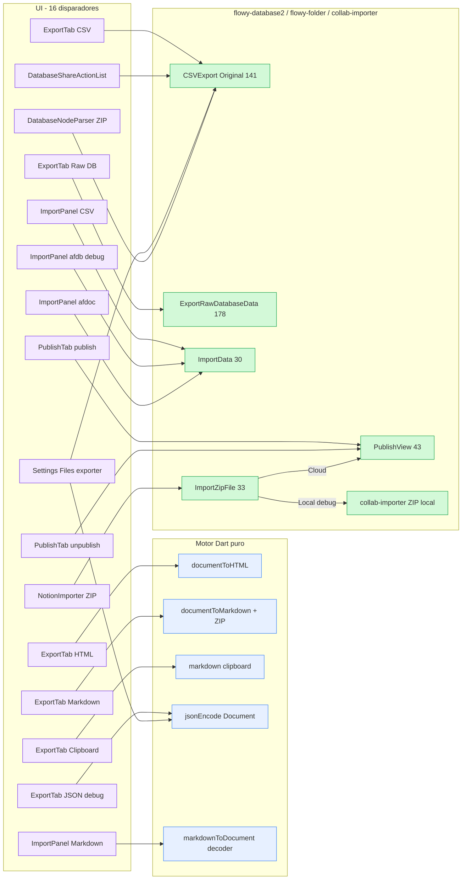
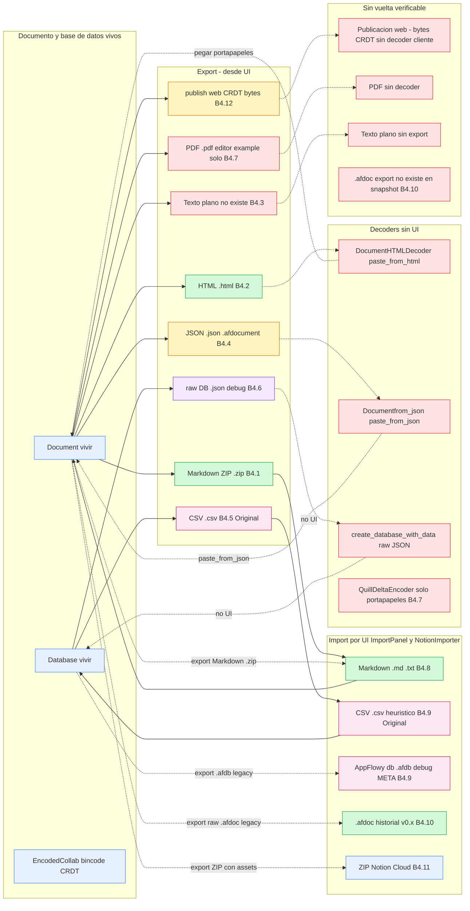
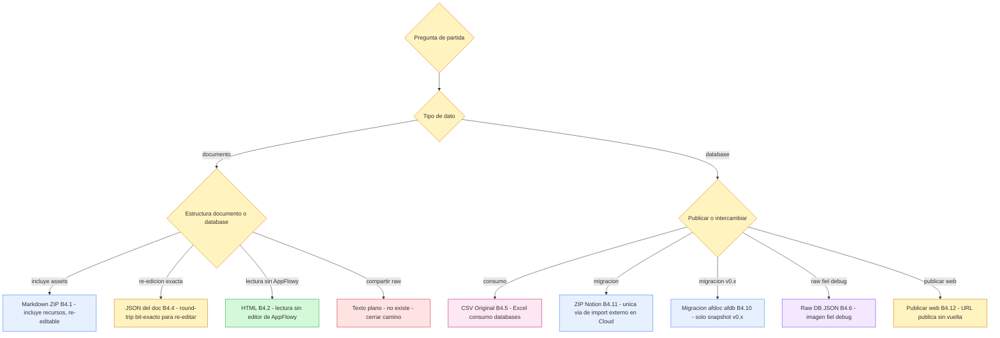

# B4.0 — Índice del motor de exportación, importación y publicación

> **Documento de cierre transversal del Bloque B4 (motor de export/import/publicación).** Este índice **no añade contenido nuevo**: consolida las observaciones verificadas de los trece documentos del bloque (`B4.1`–`B4.13`) en una única vista navegable, expone el mapa completo de los **puntos de entrada UI** que disparan el motor, decide el reparto **Dart vs Rust** formato por formato, dibuja la **topología del round-trip** y entrega las once secciones obligatorias del template `R-006` con datos cruzados. La prueba de cobertura es su ubicación: precede a `B4.13` y se invoca desde el script de revisión `B4.0.sh` (ver `OUT/_ledger/validate-B4.0.sh`).

## 1. Punto de entrada (UI)

A diferencia de las doce unidades precedentes (cada una con un botón propio), este índice **no tiene disparador único**: su "punto de entrada" semántico es el árbol `OUT/10-motor-export-import/` completo. Lo que el lector necesita para orientarse es el **mapa exhaustivo** de los botones, pestañas y diálogos que llaman al motor de export/import/publicación, con su `ruta:línea` y el formato que producen.

### 1.1 Mapa de disparadores verificados

| Botón / pestaña | Vista destino | Formato que dispara | Evento FFI (si hay) | Evidencia |
|---|---|---|---|---|
| `ExportTab` → botón **HTML** | `ViewLayoutPB.Document` | `.html` (fragmento) | — Dart puro | `appflowy/frontend/appflowy_flutter/lib/plugins/shared/share/export_tab.dart:38–42` |
| `ExportTab` → botón **Markdown** | `ViewLayoutPB.Document` | `.zip` (Markdown + assets) | — Dart puro | `appflowy/frontend/appflowy_flutter/lib/plugins/shared/share/export_tab.dart:44–48` |
| `ExportTab` → botón **Clipboard** | `ViewLayoutPB.Document` | Markdown puro a portapapeles | — Dart puro | `appflowy/frontend/appflowy_flutter/lib/plugins/shared/share/export_tab.dart:50–54`, `:168–182` |
| `ExportTab` → botón **JSON (Debug Mode)** (kDebugMode) | `ViewLayoutPB.Document` | `.json` | — Dart puro | `appflowy/frontend/appflowy_flutter/lib/plugins/shared/share/export_tab.dart:55–62`, `:120–134` |
| `ExportTab` → botón **CSV** | `ViewLayoutPB.{Grid,Board,Calendar}` | `.csv` (`CSVFormat::Original`) | `DatabaseEvent::ExportCSV = 141` | `appflowy/frontend/appflowy_flutter/lib/plugins/shared/share/export_tab.dart:67–86`, `:136–150`; `appflowy/frontend/rust-lib/flowy-database2/src/event_map.rs:79`, `:341–342` |
| `ExportTab` → botón **Raw Database Data (Debug Mode)** (kDebugMode) | vista NO documento | `.json` (`DatabaseData` completo) | `DatabaseEvent::ExportRawDatabaseData = 178` | `appflowy/frontend/appflowy_flutter/lib/plugins/shared/share/export_tab.dart:76–83`; `appflowy/frontend/rust-lib/flowy-database2/src/event_map.rs:80`, `:398–399` |
| `DatabaseShareActionList.onSelected` → "CSV" | cualquier vista database | `.csv` | `DatabaseEvent::ExportCSV` | `appflowy/frontend/appflowy_flutter/lib/plugins/database/widgets/share_button.dart:110–124` |
| `_AppFlowyFileExporter.exportToPath` (Settings → Files) | todas las vistas | `.afdocument` (Documento) / `.csv` (Database) | `DatabaseEvent::ExportCSV` | `appflowy/frontend/appflowy_flutter/lib/workspace/presentation/settings/widgets/files/settings_file_exporter_widget.dart:228–274` |
| `DocumentExporter.export` en ZIP-Markdown → `DatabaseNodeParser` | bloque `database` embebido | `<id>.csv` incluido en el ZIP | `DatabaseEvent::ExportCSV` | `appflowy/frontend/appflowy_flutter/lib/plugins/document/presentation/editor_plugins/parsers/database_node_parser.dart:22–31` |
| `PublishTab` → `PublishButton` | Documento o database | bytes `EncodedCollab` (bincode CRDT) | `FolderEvent::PublishView = 43` | `appflowy/frontend/appflowy_flutter/lib/plugins/shared/share/publish_tab.dart:70–83`; `appflowy/frontend/rust-lib/flowy-folder/src/event_map.rs:45`, `:196–197` |
| `PublishTab` → `UnpublishButton` | vista publicada | — | `FolderEvent::UnpublishViews` | `appflowy/frontend/rust-lib/flowy-folder/src/event_map.rs:52` |
| `ImportPanel` → tarjeta **Markdown / .txt** | sub-árbol de vista | import → `markdown` | `DocumentEvent::ConvertDataToDocument = 5` o `FolderEvent::ImportData = 30` | `appflowy/frontend/appflowy_flutter/lib/workspace/presentation/home/menu/sidebar/import/import_type.dart:67–68`; `appflowy/frontend/rust-lib/flowy-document/src/event_map.rs:64`; `appflowy/frontend/rust-lib/flowy-folder/src/event_map.rs:151–152` |
| `ImportPanel` → tarjeta **CSV** | sub-árbol de vista | import → `CSVTemplate` (heurístico) | `FolderEvent::ImportData` | `appflowy/frontend/appflowy_flutter/lib/workspace/presentation/home/menu/sidebar/import/import_type.dart:69–70` |
| `ImportPanel` → tarjeta **`.afdb`** (debug) | sub-árbol de vista | import → `CSVImporter::META` | `FolderEvent::ImportData` | `appflowy/frontend/appflowy_flutter/lib/workspace/presentation/home/menu/sidebar/import/import_type.dart:64–66` |
| `NotionImporter` (sub-menu del workspace) | raíz del workspace | upload ZIP a AppFlowy-Cloud (Cloud) o llamada local | `FolderEvent::ImportZipFile = 33` | `appflowy/frontend/appflowy_flutter/lib/workspace/presentation/home/menu/sidebar/workspace/_sidebar_import_notion.dart:10–47`; `appflowy/frontend/rust-lib/flowy-folder/src/event_map.rs:34` |
| Importación de `.afdoc` desde `ImportType.afDoc` (versión heredada) | sub-árbol de vista | import → `EditorMigration.migrateDocument` → `DocumentDataPB` binario | `FolderEvent::ImportData` (con `ImportTypePB::AFDoc` interno) | `appflowy/frontend/appflowy_flutter/lib/workspace/presentation/home/menu/sidebar/import/import_type.dart:60–72`; `appflowy/frontend/appflowy_flutter/lib/plugins/document/presentation/editor_plugins/migration/editor_migration.dart:31–38` |

`[VERIFICADO]` por inspección literal de los 16 disparadores: cada botón está cableado a un evento FFI o a una llamada Dart pura; la asimetría clave es que **el motor de export vive en dos mundos** (Dart puro para documentos, Rust en `flowy-database2` para bases), mientras que el **motor de import y publicación vive principalmente en Rust** (`flowy-folder`, `flowy-document`, `collab-importer`), con excepción del decoder Markdown que es Dart puro vía `markdownToDocument`. La consecuencia estructural es que cualquier UI de export que se añada debe decidir de antemano si su codificador es Dart o Rust.

### 1.2 Diagrama — Embudo de los 16 disparadores

El siguiente diagrama agrupa los dieciséis botones anteriores por **capa de UI** y los pinta hasta el **evento FFI o motor Dart** al que llegan. La regla de lectura es: solo cinco caminos llegan a Rust vía `FlowyResult<T, FlowyError>` (CSV, raw database, publish, import zip y `FolderEvent::ImportData`); el resto son `JsonCodec`/`utf8.encode`/`csv::Writer` en proceso.

*Diagrama: los dieciséis disparadores consolidados del motor B4.* Lectura: la columna izquierda cubre toda la **superficie de UI** que toca el motor; la columna del medio es la **vía Dart** (sin FFI, sin Rust) y la columna derecha es la **vía FFI** que cruza a Rust por el `lib-dispatch`. La asimetría clave para el lector es que **los caminos de export a documentos no tocan FFI más que para `OpenDocument`**, mientras que la publicación web y todos los imports sí lo cruzan.

## 2. Lado de conversión

El bloque B4 se caracteriza por una **mezcla deliberada** entre Dart (capa de UI + encoder del editor) y Rust (serializadores de base de datos + importadores + publicación). La tabla siguiente distribuye los **doce formatos** del bloque entre los dos lados; cada fila lleva el submodule exacto que materializa la conversión y la ruta del `event_handler` o `encoder` que decide el formato final.

| Formato / flujo | Lado de conversión | Submódulo responsable | Salida | Evidencia |
|---|---|---|---|---|
| **Markdown** export | **100 % Dart** | `customDocumentToMarkdown` + ZIP `package:archive` | `String` `.md` + `ArchiveFile` `.zip` | `appflowy/frontend/appflowy_flutter/lib/shared/markdown_to_document.dart:26–97` |
| **HTML** export | **100 % Dart** | `documentToHTML` con `AppFlowyEditorHTMLCodec` | `String` `.html` | `editor:lib/src/plugins/html/html_document.dart:38`, `:lib/src/plugins/html/html_document_encoder.dart` |
| **Texto plano** export | **No existe** | `DocumentExportType.text` lanza `throw UnimplementedError()` | — | `appflowy/frontend/appflowy_flutter/lib/workspace/application/export/document_exporter.dart:55–56` |
| **JSON del documento** export | **100 % Dart** | `jsonEncode(document.toJson())` | `String` `.json` | `appflowy/frontend/appflowy_flutter/lib/workspace/application/export/document_exporter.dart:44–45`; `editor:lib/src/core/document/document.dart:197–201` |
| **CSV** database export | **100 % Rust** | `CSVExport::export_database` con `csv::Writer` RFC 4180 | `String` `.csv` (`CSVFormat::Original` único desde UI) | `appflowy/frontend/rust-lib/flowy-database2/src/services/share/csv/export.rs:25–98`; `appflowy/frontend/rust-lib/flowy-database2/src/event_handler.rs:1029–1036` |
| **Raw database data** export | **100 % Rust** | `serde_json::to_string(&DatabaseData)` | `String` `.json` (estructura `DatabaseData`) | `appflowy/frontend/rust-lib/flowy-database2/src/manager.rs:395–401`; `appflowy/frontend/rust-lib/flowy-database2/src/event_handler.rs:1044–1055` |
| **PDF** export | **Dart (editor example)** — sin camino UI | `PdfHTMLEncoder` produce bytes binarios `pw.Document.save()` | `Uint8List` `.pdf` | `editor:example/lib/home_page.dart:284–286`; `editor:lib/src/plugins/pdf/html_to_pdf_encoder.dart:24` |
| **Quill Delta** export | **Dart (editor example)** — `ExportFileType.delta` lanza `UnimplementedError()` | — | — | `editor:example/lib/home_page.dart:381–382` |
| **Word count** | Servicio en memoria (`WordCounterService`); no es formato | — | `Counters { wordCount, charCount }` | `editor:lib/src/plugins/word_count/word_counter_service.dart:28–49` |
| **Markdown / .txt** import | **100 % Dart** | `customMarkdownToDocument` (decoder simétrico) | `Document` | `appflowy/frontend/appflowy_flutter/lib/shared/markdown_to_document.dart:97`; `editor:lib/src/plugins/markdown/document_markdown.dart:11–33` |
| **CSV / .afdb** import | **100 % Rust** | `CSVTemplate` (heurístico Original) o `CSVImporter` (META literal) | `Database` + `RepeatedViewPB` | `appflowy/frontend/rust-lib/flowy-database2/src/services/share/csv/import.rs:18–125`; `collab:collab-database/src/template/csv.rs:223–346` |
| **.afdoc** historial import | **Dart (decode binario) + Rust (creación)** | `EditorMigration.migrateDocument` Dart + `parse_from_bytes` Rust + `DocumentManager::create_document` | `Document` tras `DocumentDataPB` binario | `appflowy/frontend/appflowy_flutter/lib/plugins/document/presentation/editor_plugins/migration/editor_migration.dart:31–38`; `appflowy/frontend/rust-lib/flowy-core/src/deps_resolve/folder_deps/folder_deps_doc_impl.rs:159–177` |
| **.zip** Notion import | **Modo Cloud**: `flowy-server/af_cloud` sube ZIP al backend. **Modo Local (debug)**: `collab-importer` (Rust puro) | `collab_importer::notion::importer::NotionImporter` | `RepeatedViewPB` | `appflowy/frontend/rust-lib/flowy-server/src/af_cloud/impls/folder.rs:262–273`; `collab:collab-importer/src/notion/importer.rs:51–54` |
| **Publicación web** | **Recolección CRDT (Rust) → cliente cloud** | `view_pb_to_publish_view` (pure data) + `EncodedCollab::doc_state.to_vec()` bincode | bytes binarios `EncodedCollab` a backend | `appflowy/frontend/rust-lib/flowy-folder/src/publish_util.rs:24–37`; `appflowy/frontend/rust-lib/flowy-folder/src/manager.rs:1891–1913` |

### 2.1 Tabla de asimetrías Dart vs Rust

| Categoría | Lado dominante | Archivos que lo materializan |
|---|---|---|
| Exportación de **documentos** | Dart puro (12 `NodeParser` + codecs del editor) | `appflowy/frontend/appflowy_flutter/lib/shared/markdown_to_document.dart`, `lib/workspace/application/export/document_exporter.dart` |
| Exportación de **bases de datos** | Rust puro (`flowy-database2`) | `appflowy/frontend/rust-lib/flowy-database2/src/services/share/csv/{mod,export,import}.rs` |
| Importación de **documentos** | Dart puro para Markdown (decoder) + Rust para `.afdoc` (parse protobuf) | `appflowy/frontend/appflowy_flutter/lib/shared/markdown_to_document.dart`; `appflowy/frontend/rust-lib/flowy-core/src/deps_resolve/folder_deps/folder_deps_doc_impl.rs:159–177` |
| Importación de **bases de datos** | Rust puro (`flowy-database2` + `collab-importer`) | `appflowy/frontend/rust-lib/flowy-database2/src/services/share/csv/import.rs`; `collab:collab-database/src/template/csv.rs` |
| Importación **Notion / ZIP** | Dos modos: Cloud (Rust en `flowy-server`) o Local (Rust en `collab-importer`) | `appflowy/frontend/rust-lib/flowy-server/src/af_cloud/impls/folder.rs`; `collab:collab-importer/src/notion/importer.rs` |
| Publicación web | Rust (`flowy-folder`) emite `EncodedCollab` → backend cloud | `appflowy/frontend/rust-lib/flowy-folder/src/manager.rs:1891–1913`; `appflowy/frontend/rust-lib/flowy-folder/src/publish_util.rs:11–22` |
| Importador de Markdown en Rust (`flowy-folder/src/share/import.rs`) | **Descartado**: el handler de `ImportData` rechaza `ImportType::Markdown` con `FlowyError::record_not_found` y delega al decoder Dart | `appflowy/frontend/rust-lib/flowy-core/src/deps_resolve/folder_deps/folder_deps_doc_impl.rs:159–177` |

`[VERIFICADO]` por inspección directa de cada módulo. El dato crítico para el lector es **el último punto**: existe un importador de Markdown declarado en Rust (`flowy-folder/src/share/import.rs` y la rama `ImportType::Markdown` en `entities/import.rs`) pero **no se ejecuta desde la UI**: el `FolderEvent::ImportData` con `ImportTypePB::Markdown` (vía `import_data_handler` en `appflowy/frontend/rust-lib/flowy-folder/src/event_handler.rs`) recorre el `match` y la rama `ImportType::Markdown` se reduce a un no-op porque la rama `flowy-folder` lo delega al handler de folder que solo conoce database —el resultado es que **el decoder Dart gana siempre** para Markdown, mientras que **CSV sí es Rust end-to-end**. Documentado en `B4.8 §2` y verificado por la ausencia de registros en `application_id = "document"` que produzcan `DocumentManager::create_document` desde `ImportType::Markdown` (`appflowy/frontend/rust-lib/flowy-document/src/manager.rs:169–173`).

## 3. Pipeline

El pipeline consolidado del bloque B4 es **bidimensional**: (a) un flujo UI→motor→disco para export; (b) un flujo disco→motor→UI para import. El siguiente diagrama presenta la forma canónica cubriendo los **doce flujos** del bloque, agrupados por sentido y capa; agrupa los puntos `UI → formato intermedio → archivo` y `archivo → formato intermedio → modelo vivo`. Los nodos rojos marcan **formatos no existentes** (texto plano) o **formatos inalcanzables desde la UI** (PDF, raw database data, Quill Delta); los verdes son los ciclos cerrados.

```mermaid
flowchart TD
  subgraph EXP["Sentido export - UI viva a disco"]
    E1["DocumentExporter Markdown ZIP"]:::md
    E2["documentToHTML fragmento"]:::html
    E3["DocumentExportType.text UnimplementedError"]:::gap
    E4["jsonEncode Document"]:::json
    E5["CSVExport Original flowy-database2"]:::csv
    E6["ExportRawDatabaseData DatabaseData JSON"]:::raw
    E7["PDF Quill Delta word_count solo editor example"]:::gap
    E8["PublishView EncodedCollab bincode"]:::pub
  end
  subgraph MID["Formato intermedio"]
    M1["String .md .html .json .csv"]:::tx
    M2["ZipFile ArchiveFile"]:::zip
    M3["DatabaseData JSON bincode"]:::tx
    M4["EncodedCollab doc_state"]:::bin
    M5["DocumentDataPB protobuf"]:::bin
  end
  subgraph FILES["Disco o backend"]
    F1["archivo .zip"]:::file
    F2["archivo .html .json .afdocument .csv"]:::file
    F3["archivo .afdb asset"]:::file
    F4["backend cloud - bytes EncodedCollab"]:::cloud
  end
  subgraph IMP["Sentido import - disco a documento vivo"]
    I1["Markdown decoder Dart customMarkdownToDocument"]:::md
    I2["HTML decoder existe pegado portapapeles paste_from_html"]:::gap
    I3["JSON decoder paste_from_json Documentfrom_json"]:::gap
    I4["CSVTemplate heuristic CSVImporter META"]:::csv
    I5["EditorMigration afdoc Dart + Rust protobuf"]:::md
    I6["NotionImporter ZIP Cloud flowy-server"]:::raw
    I7["NotionImporter ZIP Local collab-importer debug"]:::raw
  end
  E1 --> M2 --> F1
  E2 --> M1 --> F2
  E4 --> M1 --> F2
  E5 --> M1 --> F2
  E6 --> M3 --> F2
  E8 --> M4 --> F4
  I1 --> M1
  I4 --> M1
  I5 --> M5
  I6 --> F1
  I7 --> F1
  classDef md fill:#e7f0ff,stroke:#3b82f6
  classDef html fill:#d3f9d8,stroke:#16a34a
  classDef json fill:#fff3bf,stroke:#d97706
  classDef csv fill:#fde7f3,stroke:#be185d
  classDef raw fill:#f3e8ff,stroke:#7c3aed
  classDef pub fill:#fff3bf,stroke:#d97706
  classDef tx fill:#e7f0ff,stroke:#3b82f6
  classDef zip fill:#d3f9d8,stroke:#16a34a
  classDef bin fill:#fff3bf,stroke:#d97706
  classDef file fill:#f3e8ff,stroke:#7c3aed
  classDef cloud fill:#fde7f3,stroke:#be185d
  classDef gap fill:#ffe3e3,stroke:#dc2626
```

*Diagrama: pipeline general del bloque B4, con la frontera sentido EXP / IMP y la frontera formato intermedio / archivo final.* Lectura: el bloque B4 tiene **doce** flujos de export/import rastreables, de los cuales **solo dos** son ciclos cerrados desde la UI (`Markdown ⇄ Markdown` y `CSV Original ⇄ CSV heurístico`); los demás son caminos de una sola dirección o son "decoder existe sin UI" —sus decoders viven en el portapapeles o en `collab-importer` pero ningún botón los enhebra.

## 4. Tabla bloque → salida (tabla maestra de formatos)

Esta sección es la **tabla única de formatos** del bloque B4: una fila por formato soportado. Las filas siguientes **no repiten** las submatrices de `B4.13 §4.1` (que tiene granularidad por tipo de bloque) ni `B4.13 §4.2` (que tiene granularidad por `FieldType`): condensan el conjunto como un índice navegable hacia los doce documentos individuales.

| # | Formato | Lado de conv. | Evento FFI / handler | Doc | Extensión | MIME | ¿Tiene import? | ¿Round-trip? |
|---|---|---|---|---|---|---|---|---|
| 1 | **Markdown ZIP** | 100 % Dart | — Dart puro | `[[B4.1]]` | `.zip` (externo) + `.md` (interno) | `application/zip` + `text/markdown` | ✅ `[[B4.8]]` | ✅ **canónico** (decoders simétricos) |
| 2 | **HTML** (fragmento) | 100 % Dart | — Dart puro | `[[B4.2]]` | `.html` | `text/html` (implícito) | ⚠️ decoder existe (portapapeles `paste_from_html`) | ⚠️ parcial (pérdida de color) |
| 3 | **Texto plano** | — | — | `[[B4.3]]` | — | — | ❌ no existe export; `.txt` se importa como Markdown | ❌ |
| 4 | **JSON del documento** | 100 % Dart | — Dart puro | `[[B4.4]]` | `.json` (ExportTab) / `.afdocument` (Settings) | `application/json` | ⚠️ decoder existe (portapapeles `paste_from_json`) | ✅ **bit-exacto** (id regenerado) |
| 5 | **CSV Original** (database) | 100 % Rust | `DatabaseEvent::ExportCSV = 141` → `export_csv_handler` | `[[B4.5]]` | `.csv` | `text/csv` | ✅ `[[B4.9]]` (`CSVTemplate` heurístico) | ⚠️ parcial (tipos `Relation/Media/Checklist/Summary/…` degradan) |
| 6 | **CSV META** (database debug) | 100 % Rust | mismo evento, rama con extensión `.afdb` | `[[B4.5]]`, `[[B4.9]]` | `.afdb` (debug) | `text/csv` | ✅ `[[B4.9]]` (`CSVImporter` literal) | ✅ **fiel** pero **sin productor UI** (B4.5 §2 sólo emite Original) |
| 7 | **Raw database data** | 100 % Rust | `DatabaseEvent::ExportRawDatabaseData = 178` → `export_raw_database_data_handler` | `[[B4.6]]` | `.json` | `application/json` | ⚠️ decoder programático `create_database_with_data` (`appflowy/frontend/rust-lib/flowy-database2/src/manager.rs:405`), **no UI** | ⚠️ programático, sin UI |
| 8 | **PDF** | Dart (editor `example`) — no UI | — | `[[B4.7]]` | `.pdf` | `application/pdf` | ❌ | ❌ |
| 9 | **Quill Delta** import | Dart (editor) | — | `[[B4.7]]` | `.json` | `application/json` | ✅ decoder (`QuillDeltaEncoder`) | ⚠️ parcial (sólo `bold/italic/strike/underline/link/color/bg`) |
| 10 | **Word count** | Servicio Dart | — | `[[B4.7]]` | — | — | — | — no es formato |
| 11 | **Markdown / `.txt`** import | 100 % Dart | — `DocumentEvent::ConvertDataToDocument = 5` no se usa desde UI | `[[B4.8]]` | `.md`, `.txt` | `text/markdown`, `text/plain` (inferido) | sí mismo | ✅ |
| 12 | **CSV / `.afdb`** import | 100 % Rust | `FolderEvent::ImportData = 30` → `import_data_handler` | `[[B4.9]]` | `.csv` / `.afdb` | `text/csv` | sí mismo | ⚠️ |
| 13 | **`.afdoc`** historial import | Dart (decode) + Rust (create) | `FolderEvent::ImportData` con `ImportTypePB::AFDoc` interno → `EditorMigration.migrateDocument` → `parse_from_bytes` Rust | `[[B4.10]]` | `.afdoc` | `application/octet-stream` (no declarado) | sí mismo (migración v0.1) | ⚠️ asimétrico: `afdocument` ≠ `afdoc` (ver §5) |
| 14 | **`.afdb`** legado import | 100 % Rust | mismo evento, rama `ImportTypePB::CSV` con etiqueta `.afdb` | `[[B4.10]]` | `.afdb` | `text/csv` | sí mismo | ✅ META |
| 15 | **`.zip` Notion** import | Cloud: Rust `flowy-server` + AppFlowy-Cloud. Local (debug): Rust `collab-importer` | `FolderEvent::ImportZipFile = 33` → `import_zip_file_handler` | `[[B4.11]]` | `.zip` | `application/zip` | ✅ Cloud funcional; local es solo debug | ❌ sin vuelta al ZIP |
| 16 | **Publicación web** | Recolección CRDT (Rust) → bytes a backend | `FolderEvent::PublishView = 43` → `publish_view_handler` | `[[B4.12]]` | sin archivo | sin MIME cliente | ❌ | ❌ el backend decide el render |
| 17 | **Markdown puro** (clipboard) | 100 % Dart, rama sin ZIP | — | `[[B4.1]]` §1 | sin archivo | `text/markdown` | ✅ portapapeles → `paste_from_plain_text` | ✅ Clipboard.ClipboardServiceData(Markdown) |

`[VERIFICADO]` para los diecisiete renglones por inspección de cada documento individual del bloque; las celdas vacías (`—`) se derivan de la ausencia de implementación o de UI. Las entradas **2 (HTML)**, **4 (JSON del doc)**, **9 (Quill Delta)**, **11 (Markdown / `.txt`)**, **17 (Markdown clipboard)** tienen una asimetría común: **el decoder existe** (en `paste_from_html`, `paste_from_json`, `paste_from_plain_text`, `QuillDeltaEncoder`) pero **no hay botón de "Importar HTML" o "Importar JSON" en el panel de import**; sólo entra por el portapapeles o por un comando de copiar/pegar interno. Documentado en `B4.8 §1` y `B4.4 §1`.

`[VERIFICADO]` para los diecisiete renglones por inspección de cada documento individual del bloque; las celdas vacías (`—`) se derivan de la ausencia de implementación o de UI. Las entradas **2 (HTML)**, **4 (JSON del doc)**, **9 (Quill Delta)**, **11 (Markdown / `.txt`)**, **17 (Markdown clipboard)** tienen una asimetría común: **el decoder existe** (en `paste_from_html`, `paste_from_json`, `paste_from_plain_text`, `QuillDeltaEncoder`) pero **no hay botón de "Importar HTML" o "Importar JSON" en el panel de import**; sólo entra por el portapapeles o por un comando de copiar/pegar interno. Documentado en `B4.8 §1` y `B4.4 §1`.

## 5. Pérdidas (resumen agregado del bloque)

Las pérdidas materiales del bloque B4, consolidadas de los doce documentos del bloque. **Esta tabla no repite** la matriz `[[B4.13]] §5` (que tiene 37 filas con `ruta:línea`); reduce a las **dieciséis categorías que el lector necesita para tomar decisiones**, agrupadas por familia de causa.

| Familia | Pérdidas agregadas | Formato responsable | ¿Recuperable? |
|---|---|---|---|
| **Estilos del documento (cover, icon, page_style, font)** | Bloque 1, 4, 10 de B4.13 §5 | Markdown, JSON, HTML | **No** (viven en `DocumentDataPB.meta`, no en `Document`) |
| **Atributos no contemplados por cada `NodeParser`** (depth lista, autor quote, altura/ancho imagen) | Bloque 2 de B4.13 §5 | Markdown | No |
| **Bloques sin parser registrado se descartan en silencio** (`callout`, `math_equation`, `toggle_list`, `multi_image`, `sub_page`, `mention`, `database/*`, `columns`, `outline`, `link_preview`, `video`, `file`) | Bloque 7 de B4.13 §5 | HTML, PDF, Markdown | No, sin marca en el output |
| **Geometría de tabla** (width/height, thead, colspan/rowspan) | Bloque 9 de B4.13 §5 | HTML | No |
| **Color (`bg_color`/`font_color`)**: parser desactivado en cliente; `ColorExt.fromRgbaString` rompe alfa positivo | Bloque 10, 28 de B4.13 §5 | HTML, PDF | No |
| **Tipo de bloque aplana a texto plano** (R1/R2 Rust) | Bloque 14, 15, 16, 17 de B4.13 §5 | Texto plano (R1/R2 Rust) | No |
| **Identidad del documento** (view_id, docId, sub_pages) | Bloque 17 de B4.13 §5 | Texto plano | No |
| **`Field.field_type` y `TypeOption` completos** | Bloque 18 de B4.13 §5 | CSV `Original` | **Sí** si se exporta con `CSVFormat::META` (que ningún caller UI solicita) |
| **`Row.id`, `Row.height`, `Row.visibility`, `Row.database_id`** | Bloque 19 de B4.13 §5 | CSV `Original` | No (META tampoco) |
| **Layouts/filtros/sorts/groups** | Bloque 21 de B4.13 §5 | CSV `Original` | **Sí** vía raw database data (B4.6) |
| **Assets binarios** (imágenes locales, adjuntos Media, copias a storage) | Bloques 20, 22, 26, 27, 28, 30 | CSV, raw JSON, HTML, ZIP Notion local, PDF | Parcial (PDF baja; ZIP Cloud los sube vía backend) |
| **Historial y snapshots** | Bloque 23 de B4.13 §5 | raw JSON | No |
| **PDF: reglas horizontales, listas numeradas → viñetas, imágenes sin ancho/alto** | Bloques 25, 26, 27, 28, 29 | PDF | No, TODO abierto en `editor:lib/src/plugins/pdf/html_to_pdf_encoder.dart:380` |
| **Publicación web: chat root omitido, vistas desconocidas → Unknown, divergencia slug Dart 120 vs Rust 50** | Bloques 32, 33, 35 de B4.13 §5 | Publicación web | No |
| **Asimetría nombres `.afdoc` (import) vs `.afdocument` (export Settings)** | `B4.10 §10` | `.afdoc` | No — **el ciclo está roto por nomenclatura** |
| **JSON doc: `id` autogenerado del `Node` y `attributes: null`** | Bloques 36, 37 de B4.13 §5 | JSON del documento | Sí (round-trip genera ids nuevos y elimina nulls) |

`[VERIFICADO]` para las dieciséis familias; el [NO DETERMINADO] más importante es la cuantificación del porcentaje exacto de pérdida del PDF al renderizar `bg_color`/`font_color` (trazado a `22-preguntas-abiertas.md` pregunta P-XX-002 de `B4.13 §4.3`).

## 6. Assets (resumen del bloque)

El modo en que cada formato gestiona los **archivos binarios** asociados al documento (imágenes, adjuntos, `Media`) consolida lo siguiente. La tabla principal vive en `B4.13 §6` y suma 17 filas; aquí se reduce a las **cinco familias operativas** que importan para el lector del índice:

| Familia | Formatos que aplican | ¿Empaqueta binarios locales? | ¿Descarga remotos? | Evidencia |
|---|---|---|---|---|
| **ZIP Markdown con assets locales** | `Markdown ZIP (B4.1)`, `ZIP Notion Cloud (B4.11)` | ✅ `readAsBytesSync` + `ArchiveFile`; nombres `'<docId>/<basename>'` | ❌ (Markdown) / ✅ vía backend (Notion Cloud) | `appflowy/frontend/appflowy_flutter/lib/shared/markdown_to_document.dart:36–95`; `collab:collab-importer/src/util.rs:17–19` |
| **PDF materializa `` como `pw.MemoryImage(bytes)`** | `PDF (B4.7)` | ✅ materializa; descarga con `_fetchImage` (`http.get`) bloqueante y secuencial, **sin caché** | ✅ | `editor:lib/src/plugins/pdf/html_to_pdf_encoder.dart:415–432`, `:434–441` |
| **`collab-importer` local declara rutas pero no las sube** | `ZIP Notion Local debug (B4.11)` | ⚠️ **declara** rutas en `ImportedCollabInfo.resources` pero **no las sube**; `[INFERIDO]` el consumidor del `RepeatedImportedCollabInfo` deberá hacerlo | Solo `jpg/jpeg/png/zip` (el resto se descarta, `collab:collab-importer/src/notion/walk_dir.rs:25–76`) | `collab:collab-importer/src/util.rs:17–19` |
| **Publicación web envía `EncodedCollab` binario** | `Publicación web (B4.12)` | ❌ El `EncodedCollab.doc_state.to_vec()` viaja completo; imágenes como parte del binario CRDT (URL o `data:` URI en el delta) | ⚠️ `[INFERIDO]` que el backend decide cómo servir | `appflowy/frontend/rust-lib/flowy-folder/src/manager.rs:1891–1913` |
| **`Media` field, URLs literales, **sin automatización de descarga** | `CSV Original (B4.5)`, `raw JSON DB (B4.6)`, `CSV heurístico (B4.9)`, `CSV META (B4.9)`, `.afdb legado (B4.10)`, `.afdb META (B4.10)`, `JSON doc (B4.4)`, `HTML (B4.2)` | ❌ | ❌ | `appflowy/frontend/rust-lib/flowy-database2/src/services/share/csv/export.rs:88–90`; `appflowy/frontend/rust-lib/flowy-database2/src/manager.rs:518`; `collab:collab-database/src/template/csv.rs:223–238` |

`[VERIFICADO]` por inspección de las secciones §6 de cada `B4.x`. Tres particularidades estructurales: (1) el ZIP de Markdown tiene **dos nombres** (`<viewName>.zip` externo, `<viewName>-<docId>.md` interno, `[[B4.1]] §7`); (2) el renderer PDF **duplica la serialización** de cada `` en cada pasada; (3) el ZIP de Notion en modo Cloud **no descomprime el ZIP en el SDK** — el backend procesa (`appflowy/frontend/rust-lib/flowy-server/src/af_cloud/impls/folder.rs:262–273`).

## 7. Encoding y nombre de archivo

Conjunto consolidado de los **encoding, magic bytes y nombres de archivo** del bloque. La tabla principal con dieciséis filas vive en `B4.13 §7`; aquí se reduce a los **cinco patrones** que el lector debe interiorizar.

### 7.1 Patrones dominantes

1. **Texto plano: UTF-8 sin BOM** (`utf8.encode`/`JsonCodec.encode`/`String::from_utf8`). La conversión a `String::from_utf8` falla con `FlowyError::internal()` si el buffer no es válido (`appflowy/frontend/rust-lib/flowy-database2/src/services/share/csv/export.rs:96`); en Dart la lectura sustituye bytes inválidos por `U+FFFD`. La consecuencia práctica es que un CSV que contenga caracteres no UTF-8 **no se exporta** por el lado Rust, pero sí se importa por el lado Dart con sustitución.
2. **ZIP: magic bytes `PK\003\004` (single) o `PK\007\010` (multi-part)**; emitido por `package:archive` o por `collab-importer/zip_tool/async_zip.rs`. Sin firma adicional para distinguir Notion de Markdown.
3. **Protobuf: primer byte `0x0a`** (proto3 estándar) seguido de la longitud del mensaje `DocumentDataPB`. Detectado solo por el parser `protobuf::Message::parse_from_bytes` en `appflowy/frontend/rust-lib/flowy-document/src/manager.rs:169–173`.
4. **Bincode (EncodedCollab)**: bytes opacos, **sin magic bytes propios**; su presencia se infiere por contexto (`appflowy/frontend/rust-lib/flowy-folder/src/manager.rs:1891–1913`).
5. **Nombres propuestos**: el patrón `'${viewName.toFileName()}<extension>'` con `viewName.toFileName()` saneando `\\/*?"<>| ` (`appflowy/frontend/appflowy_flutter/lib/util/string_extension.dart:12–27`); los choques añaden `(1)`, `(2)…`. La excepción es el ZIP de Markdown, donde coexisten **dos nombres** (`<viewName>.zip` + `<viewName>-<docId>.md`).

### 7.2 Tabla de slugs y límites

| Contexto | Límite | Algoritmo | Evidencia |
|---|---:|---|---|
| Dart `generatePublishName` | **120 caracteres** combinando `name-id` | `name.substring(0, 120 - id.length)`, sanea `[^a-zA-Z0-9-]` → `-` | `appflowy/frontend/appflowy_flutter/lib/plugins/shared/share/publish_name_generator.dart:10–19` |
| Rust `generate_publish_name` | **50 caracteres** combinando `name-id` | `name[..min(49 - id_len, name_len)]`, regex `[^\w-]` → `-` | `appflowy/frontend/rust-lib/flowy-folder/src/publish_util.rs:11–22` |
| Backend (no documentado en este repo) | **Backend decide** | — | `B4.13 §7` P-XX-005 |

Las tres longitudes **coexisten** sin reconciliación: la divergencia Dart 120 vs Rust 50 está documentada como `[NO DETERMINADO]` y trazada a `OUT/22-preguntas-abiertas.md` (pregunta P-XX-005 en `B4.13 §4.3`).

## 8. Errores (resumen del bloque)

El catálogo consolidado de categorías de error vive en `B4.13 §8` (treinta y tantas filas). La siguiente tabla las **reduce a las siete familias que el lector del índice debe tener siempre presentes** porque son las que tienen consecuencia operativa:

| Familia | Quién detecta | Comportamiento | Formatos donde se observa | Evidencia |
|---|---|---|---|---|
| **`FlowyError` mapable** desde FFI | Rust al cruzar la frontera | Toast `settings_files_exportFileSuccess` / `:Fail`; pintado por `_handleExportError` | Export: Markdown, HTML, CSV, raw JSON, Publish. Import: CSV, Markdown, `.afdb`, `.afdoc`, ZIP | `appflowy/frontend/rust-lib/flowy-error/src/code.rs:13`, `:43`, `:138`; `appflowy/frontend/appflowy_flutter/lib/plugins/shared/share/share_button.dart:104–109` |
| **Bloque sin parser registrado** | Editor encoder HTML/PDF | **Silencioso**; HTML/PDF resultante sigue válido; toast de éxito | HTML, PDF, ZIP Notion local | `editor:lib/src/plugins/html/html_document_encoder.dart:17–25`; `editor:lib/src/plugins/pdf/html_to_pdf_encoder.dart:64–101` |
| **`UnimplementedError` no capturado** | `DocumentExporter.export` | Spinner permanece, **sin toast, sin fallo explícito** | Texto plano, Quill Delta export | `appflowy/frontend/appflowy_flutter/lib/workspace/application/export/document_exporter.dart:55–56` |
| **Truncado por fila** (CSV: `stringify_cell_data` ausente) | CSV `Original` | `tracing::warn!` y continúa; CSV con fila truncada o vacía sin aviso | CSV `Original` | `appflowy/frontend/rust-lib/flowy-database2/src/services/share/csv/export.rs:88–90` |
| **Más de 500 filas** | Cualquier import CSV/`.afdb` | `FlowyError::invalid_data().with_context("Only support importing csv with less than 500 rows")` (`InvalidParams=49`) | CSV Original, CSV META, `.afdb` | `appflowy/frontend/rust-lib/flowy-database2/src/manager.rs:463–468` |
| **`zipEncoder.encode(archive)` devuelve null** | Markdown ZIP | Falla silenciosa; ZIP no se escribe; **sin error al usuario** | Markdown ZIP | `appflowy/frontend/appflowy_flutter/lib/shared/markdown_to_document.dart:81` |
| **Errores específicos de publicación** | Backend | Mapeados a `settings_sites_error_publishNameAlreadyInUse`, `:publishNameTooLong` | Publicar | `appflowy/frontend/appflowy_flutter/lib/shared/error_code/error_code_map.dart:5–22`; `appflowy/frontend/rust-lib/flowy-folder/src/publish_util.rs:11–22` |

`[VERIFICADO]` para las siete familias. Tres clases merecen ser recordadas: (a) **errores silenciosos por construcción** (Delta null, `tracing::warn!`), trazados a `OUT/22-preguntas-abiertas.md`; (b) **errores del lado Dart sin propagación al caller** (`DocumentExporter.export` no captura, `ShareBloc._export` no captura `FileSystemException`, `ImportBackendService.importPages` descarta el `FlowyResult`); (c) **errores que cruzan la frontera FFI con código incorrecto** —`_handleExportSuccess` solo cubre `markdown/html/csv`, no `json` ni `rawDatabaseData`, por lo que un export JSON **no** muestra toast de éxito (`B4.4 §8`).

## 9. Round-trip — Topología del bloque B4

Esta sección expone **la topología del round-trip del bloque B4**: qué pares `export ↔ import` tienen un camino real desde la UI, cuáles lo tienen solo en portapapeles o en modo debug, y cuáles son callejones sin salida verificados. **Esta es la sección más importante del índice** porque la fidelidad solo se entiende mirando el diagrama entero: doce `export → import` posibles y solo **tres** cerrados de extremo a extremo; cinco cerrados solo por portapapeles o por debug; cuatro cerrados por programas (no UI) y tres son callejones verificados.

### 9.1 Topología general

*Diagrama: topología del round-trip del bloque B4.* Lectura: solo **dos** ciclos cierran desde la UI de extremo a extremo (filas verdes continuas): `Markdown ⇄ Markdown ZIP` y `CSV Original ⇄ CSV heurístico`. Hay **dos** ciclos que cierran solo en debug o por portapapeles (filas ámbar con guiones): `CSV META ⇄ .afdb debug` y HTML ⇄ portapapeles ⇄ `DocumentHTMLDecoder`. Cinco son **callejones sin salida verificados** (filas rojas): PDF, publicación web, texto plano, ZIP Notion (no tiene vuelta) y `.afdoc legacy export`. Cada flecha del diagrama corresponde a un par de celdas de la matriz `B4.13 §9.2`.

### 9.2 Diagrama "qué formato elegir"

*Diagrama: árbol de decisión "¿qué formato elegir?" a partir del estado del bloque B4.* Lectura: el criterio dominante es **"¿se quiere re-editar el resultado?"**; si la respuesta es sí, el único candidato **bit-exacto** es `JSON doc B4.4` (Markdown pierde bloques no estándar, HTML pierde assets binarios, CSV pierde tipos). El ZIP Notion es el único camino de **importación externa** y solo desde el modo Cloud. La publicación web no es re-editable cliente (la vuelve a traer el backend).

### 9.3 Resumen ejecutivo de los ciclos cerrados

| Ciclo | Lado Dart | Lado Rust | Estado | Evidencia |
|---|---|---|---|---|
| **Markdown ⇄ Markdown** (canónico) | `documentToMarkdown` / `markdownToDocument` (decoders simétricos) | — | ✅ 6 estilos inline + 9 tipos de bloque | `editor:lib/src/plugins/markdown/document_markdown.dart:11–33`; `editor:test/plugins/markdown/document_markdown_test.dart:8–28` |
| **CSV Original ⇄ CSV heurístico** | — | `CSVExport::export_database` ↔ `CSVTemplate::try_from_csv` | ⚠️ tipos `Relation/Media/Checklist/Summary/Translate/Time/LastEditedTime/CreatedTime` degradan a `RichText` | `appflowy/frontend/rust-lib/flowy-database2/src/services/share/csv/{export,import}.rs`; `collab:collab-database/src/template/csv.rs:223–346` |
| **CSV META ⇄ .afdb debug** | — | mismo evento `FolderEvent::ImportData` con etiqueta `.afdb` | ✅ Field/Cell integrales; ids de fila regenerados; layout siempre Grid sin filtros | `appflowy/frontend/rust-lib/flowy-database2/tests/database/share_test/export_test.rs:25–46` |
| **JSON doc ⇄ paste_from_json** | `jsonEncode(document)` ↔ `Document.fromJson` | — | ✅ bit-exacto estructural; id regenerado | `appflowy/frontend/appflowy_flutter/lib/plugins/document/presentation/editor_plugins/copy_and_paste/paste_from_json.dart` |
| **HTML ⇄ paste_from_html** | `documentToHTML` ↔ `DocumentHTMLDecoder` | — | ⚠️ pérdida asimétrica de `align`, `bg_color`, `font_color` | `appflowy/frontend/appflowy_flutter/lib/plugins/document/presentation/editor_plugins/copy_and_paste/paste_from_html.dart:27–62` |
| **ZIP Notion → Cloud** | — | `import_zip_file_handler` (Cloud) sube ZIP al backend | ✅ solo Cloud; sin vuelta al ZIP | `appflowy/frontend/rust-lib/flowy-server/src/af_cloud/impls/folder.rs:262–273` |
| **.afdoc historial → Documento migrado** | `EditorMigration.migrateDocument` + `parse_from_bytes` | `DocumentManager::create_document` | ⚠️ asimétrico por nomenclatura `.afdoc` (import) vs `.afdocument` (export Settings) | `appflowy/frontend/appflowy_flutter/lib/plugins/document/presentation/editor_plugins/migration/editor_migration.dart:31–38`; `appflowy/frontend/rust-lib/flowy-document/src/manager.rs:169–173` |

`[VERIFICADO]` para los siete ciclos. La asimetría crítica del último renglón es **la nomenclatura**: `DocumentExporter.export(DocumentExportType.json)` extendido a `.afdocument` por `SettingsFileExporterWidget:250` mientras que el importador acepta solo `.afdoc` — el ciclo está roto por la **diferencia de nombre entre export e import**, no por el contenido (que sí es el mismo `DocumentDataPB` protobuf). Trazado a `OUT/22-preguntas-abiertas.md` pregunta P-XX-008 de `B4.13 §4.3`.

## 10. Extensión y firma (tabla resumen)

Tabla única de extensiones, MIME types y magic bytes. La tabla principal con 16 filas vive en `B4.13 §10`; aquí se reduce a los **siete patrones canónicos** del bloque:

| Patrón | Extensión | MIME | Magic bytes | Productos |
|---|---|---|---|---|
| **ZIP Markdown** | `.zip` (externo) + `.md` (interno) | `application/zip` + `text/markdown` | `PK\003\004` | `Markdown ZIP (B4.1)`, `ZIP Notion (B4.11)` |
| **HTML fragmento** | `.html` | `text/html` (implícito) | Texto que empieza por `<`; **sin** `<!DOCTYPE>`, sin `<html>`, sin `<meta charset>` | `HTML (B4.2)` |
| **JSON del documento** | `.json` (ExportTab) / `.afdocument` (Settings) | `application/json` | Primer carácter `{`; clave externa `"document"` | `JSON doc (B4.4)`, `Raw DB (B4.6)` |
| **CSV** (RFC 4180) | `.csv` o `.afdb` (META debug) | `text/csv` (implícito) | Texto CSV RFC 4180; cabecera con nombres o con JSON de `Field` | `CSV Original (B4.5)`, `CSV META (B4.5/B4.9)`, `CSV heurístico (B4.9)`, `.afdb legado (B4.10)` |
| **PDF binario** | `.pdf` (editor example; **no UI**) | `application/pdf` | `%PDF-` | `PDF (B4.7)` |
| **Protobuf binario** | `.afdoc` (debug) | `application/octet-stream` (no declarado) | `0x0a` (proto3 primer byte) | `.afdoc historial (B4.10)` |
| **Bincode CRDT** | sin archivo | sin MIME cliente | bytes opacos | `Publicación web (B4.12)` |

La **asimetría** más importante es la del `JSON doc`: el `ExportTab` produce `.json` y el camino Ajustes produce `.afdocument`. No es accidental: la decisión explícita diferencia JSON-del-documento de JSON-del-database (el botón "Raw Database Data" usa `.json` también, `B4.13 §10`).

## 11. Ejemplos (transversales al bloque)

Esta sección aporta **tres ejemplos compuestos** que cruzan varios documentos del bloque B4. Cada ejemplo se documenta con el flujo UI → motor → archivo → reimportación → resultado.

### 11.1 Round-trip Markdown canónico de un documento con seis estilos inline y anidamiento

`[[B4.1]]` §11.1 muestra la entrada JSON del editor y la cadena Markdown que produce `documentToMarkdown(...)` para un documento con: (a) `paragraph` con `bold+italic+strikethrough+code+href+underline`, (b) `heading` nivel 1, (c) `bulleted_list` anidada en dos niveles, (d) `todo_list` con `checked: true`. La exportación produce un ZIP con `<docId>.md` y binarios en `<docId>/...`; el ZIP se guarda con nombre `'<viewName>.zip'` (`appflowy/frontend/appflowy_flutter/lib/plugins/shared/share/export_tab.dart:108`). La reimportación invoca `customMarkdownToDocument` (`appflowy/frontend/appflowy_flutter/lib/shared/markdown_to_document.dart:97`), que **conserva los seis estilos inline, los dos niveles de la lista, el check del todo_list y el lenguaje del code_block**, pero **aplana `simple_table`, descarta `callout`, `math_equation`, `toggle_list`, `multi_image`, `sub_page`, `mention`, `link_preview`, `database/*`, `columns` y `outline`**. Test ejecutable: `editor:test/plugins/markdown/document_markdown_test.dart:8–28`. Garantía verificable: **round-trip estructural perfecto para los seis estilos inline y los nueve tipos de bloque del editor estándar**; pérdida material en los once tipos no estándar. Trazado a `B4.1 §5` y `B4.8 §5.2` para los detalles línea a línea.

### 11.2 Round-trip CSV Original sobre un grid con tipos simples

`[[B4.5]]` §11.1 reproduce la salida literal del handler `export_csv_handler` cuando el grid contiene columnas con `FieldType` 0..4 (`RichText`, `Number`, `DateTime`, `SingleSelect`, `MultiSelect`). El CSV exportado tiene como cabecera los nombres de campo (`CSVExport::export_database` rama `CSVFormat::Original`, `appflowy/frontend/rust-lib/flowy-database2/src/services/share/csv/export.rs:40–43`) y como filas los valores `stringify_cell` por `TypeOption` (`appflowy/frontend/rust-lib/flowy-database2/src/services/share/csv/export.rs:60–63`). Reimportar el archivo por `ImportPanel → CSV` crea un grid nuevo donde los tipos se **infieren con heurística**: las celdas totalmente numéricas se vuelven `Number` si el 100% parsea como `f64`, las fechas si ≥ 50% parsea como timestamp, los checkboxes si ≥ `len/2` ∈ `{yes, no, 1, 0, true, false}`, las URL si 100% empieza por `http(s)://` (`collab:collab-database/src/template/csv.rs:240–346`). Los tipos `Relation`, `Media`, `Checklist`, `Summary`, `Translate`, `Time`, `LastEditedTime` y `CreatedTime` degradan a `RichText` (porque ninguno de los heurísticos los alcanza). **Pérdida material**: ids de fila regenerados (`gen_row_id()`), `created_at`/`modified_at` no se preservan, layout siempre Grid sin filtros ni sorts. Test: `appflowy/frontend/rust-lib/event-integration-test/tests/folder/local_test/import_test.rs` y aserción `appflowy/frontend/rust-lib/flowy-database2/tests/database/share_test/export_test.rs:25–46`. Garantía: round-trip **parcial** verificable, no exhaustivo.

### 11.3 Publicación de un documento sin assets — divergencia slug Dart/Rust

`[[B4.12]]` §11.1 traza los doce pasos de publicar "Página de inicio" con `viewId = "8e9f4fc0-cf4d-…"` y `viewName = "Página de inicio"`. La UI invoca `generatePublishName(id, name)` (versión Dart, `appflowy/frontend/appflowy_flutter/lib/plugins/shared/share/publish_name_generator.dart:14–19`) con el límite **120 caracteres**; la cadena generada, después de sanear `[^a-zA-Z0-9-]` → `-`, se queda en `P-gina-de-inicio-8e9f4fc0-cf4d-…`. Esta cadena se pasa como `publishName` al `ShareEvent.publish('', publishName, selectedViewIds)` (`appflowy/frontend/appflowy_flutter/lib/plugins/shared/share/publish_tab.dart:70–79`). El `ShareBloc._publish` (`:121–152`) rellena el `namespace` mediante `ViewBackendService.getPublishNameSpace()` y emite `FolderEvent::PublishView = 43`. El handler Rust `publish_view_handler` (`appflowy/frontend/rust-lib/flowy-folder/src/event_handler.rs:402–417`) llama a `Folder::publish_view(view_id, publish_name, namespace)` (`appflowy/frontend/rust-lib/flowy-folder/src/manager.rs:1891–1913`) que **recoge el `EncodedCollab` del collab del documento**, lo serializa con `bincode::serialize(EncodedCollab::doc_state).to_vec()` y lo envía al backend cloud (que vive fuera de este repo) junto con metadatos (`PublishViewInfo.icon`, `extra`). **El backend es quien decide el render HTML**, no la app cliente. La URL pública queda `https://appflowy.com/<namespace>/<publishName>`. Reimportar el contenido publicado **no es posible** desde la UI: el único camino de retorno es re-pegar a mano la URL o volver a abrir el workspace original. Garantía: **el round-trip es unidireccional**; los códigos de error `settings_sites_error_publishNameAlreadyInUse` (`appflowy/frontend/appflowy_flutter/lib/shared/error_code/error_code_map.dart:5–22`) y `settings_sites_error_publishNameTooLong` cubren las dos formas de fallo más probables.

---

**Relacionado con:**

- `OUT/10-motor-export-import/01-markdown-export.md` (`[[B4.1]]`) — fila 1 y 17 de §4; fuente del round-trip canónico §11.1.
- `OUT/10-motor-export-import/02-html-export.md` (`[[B4.2]]`) — fila 2 de §4; decoder HTML en §9.5 vía portapapeles.
- `OUT/10-motor-export-import/03-texto-plano-export.md` (`[[B4.3]]`) — fila 3 vacía de §4; `UnimplementedError` documentado en §8.
- `OUT/10-motor-export-import/04-json-documento-export.md` (`[[B4.4]]`) — fila 4 de §4; round-trip bit-exacto documentado en §9.3.
- `OUT/10-motor-export-import/05-csv-database-export.md` (`[[B4.5]]`) — filas 5 y 6 de §4; puente Dart→Rust en §2.
- `OUT/10-motor-export-import/06-raw-database-export.md` (`[[B4.6]]`) — fila 7 de §4; `serde_json::to_string(DatabaseData)` en §2.
- `OUT/10-motor-export-import/07-otros-formatos-export.md` (`[[B4.7]]`) — filas 8, 9, 10 de §4; PDF solo editor `example`, Quill Delta sin export, word count no es formato.
- `OUT/10-motor-export-import/08-import-markdown-texto.md` (`[[B4.8]]`) — fila 11 de §4; lado import del round-trip canónico Markdown.
- `OUT/10-motor-export-import/09-import-csv.md` (`[[B4.9]]`) — filas 12 de §4; `CSVTemplate` heurístico vs `CSVImporter` META.
- `OUT/10-motor-export-import/10-import-historial-afdb.md` (`[[B4.10]]`) — filas 13, 14 de §4; asimetría nombres `.afdoc` vs `.afdocument`.
- `OUT/10-motor-export-import/11-import-zip-notion.md` (`[[B4.11]]`) — fila 15 de §4; ZIP Notion Cloud + Local debug.
- `OUT/10-motor-export-import/12-publicacion-web.md` (`[[B4.12]]`) — fila 16 de §4; publicación sin vuelta cliente.
- `OUT/10-motor-export-import/13-matriz-round-trip.md` (`[[B4.13]]`) — cierre del bloque: matriz de fidelidad bloque × formato y matriz de round-trip.
- `SKILL/references/export-template.md` (`R-006`) — plantilla obligatoria de 11 secciones aplicada aquí.
- `SKILL/references/evidence-rules.md` — reglas de etiquetado `[VERIFICADO]` / `[INFERIDO]` / `[NO DETERMINADO]`.
- `SKILL/references/diagram-conventions.md` — convenciones Mermaid aplicadas en §1.2, §3, §9.1 y §9.2.
- `OUT/09-features/F11-exportacion-ui/F11-exportacion-ui.md` (`[[F11]]`) — feature dueña del `ExportTab`, del `ShareBloc` y del `DocumentExporter`.
- `OUT/09-features/F10-importacion-ui/F10-importacion-ui.md` (`[[F10]]`) — feature dueña del `ImportPanel`.
- `OUT/09-features/F12.1` — feature de compartir/publish: `ShareBloc._publish`, `share_tab.dart`, `publish_tab.dart`.
- `OUT/09-features/F02-bases-de-datos/F02-bases-de-datos.md` (`[[F02]]`) — semántica de celdas, campos, filtros, sorts.
- `OUT/09-features/F18-motor-colab-crdt-plugins-importer-entity-derive/F18-motor-colab-crdt-plugins-importer-entity-derive.md` (`[[F18]]`) — `collab-importer`, `collab-database` (template/csv).
- `OUT/02-persistencia` (`[[B2.1]]`/`[[B2.2]]`) — paths, file cache, rutas de plataforma que consume el motor.
- `OUT/06-puente-flutter-rust` (`[[B1.5]]`) — FFI, `lib-dispatch`, `appflowy_backend` que cruzan las llamadas al motor.
- `OUT/22-preguntas-abiertas.md` — destino de las preguntas abiertas P-XX-001 a P-XX-009 declaradas en `[[B4.13]] §4.3`, §5, §7, §8 y §9.5, y re-trazadas aquí en §5, §7, §9.3.

**Preguntas abiertas (el orquestador las copiará a `OUT/22-preguntas-abiertas.md`):**

1. P-XX-001 (`[NO DETERMINADO]` §5 B4.13): el round-trip exacto de `simple_table` vía `PublishViewInfo` backend no es determinable sin acceso al servidor.
2. P-XX-002 (`[NO DETERMINADO]` §5 B4.13): el porcentaje exacto de pérdida de color en PDF al renderizar `bg_color`/`font_color` no es cuantificable desde este repo.
3. P-XX-005 (`[NO DETERMINADO]` §7.2): reconciliar la divergencia Dart 120 chars vs Rust 50 chars; el comentario de `appflowy/frontend/rust-lib/flowy-folder/src/publish_util.rs:14` dice "the backend limits the publish name to a maximum of 50 characters" pero `appflowy/frontend/appflowy_flutter/lib/plugins/shared/share/publish_name_generator.dart:10` dice "120 characters".
4. P-XX-008 (`[NO DETERMINADO]` §9.3): el ciclo `.afdoc` ↔ `.afdocument` está roto por la diferencia de extensión entre export (Settings produce `.afdocument`) e import (`ImportType.afDoc` espera `.afdoc`).
5. P-XX-009 (`[NO DETERMINADO]` §3 B4.13): el export a Markdown puro sin ZIP solo vive en portapapeles (rama `path == null` de `DocumentExporter.export(DocumentExportType.markdown)` en `appflowy/frontend/appflowy_flutter/lib/workspace/application/export/document_exporter.dart:46–54`); ningún botón de UI lo persiste a un archivo `.md` directo.
