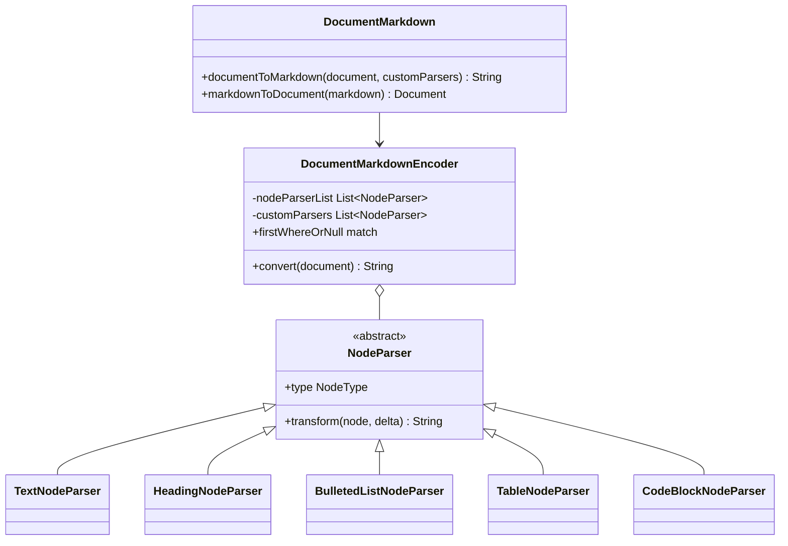
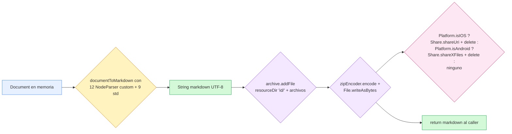
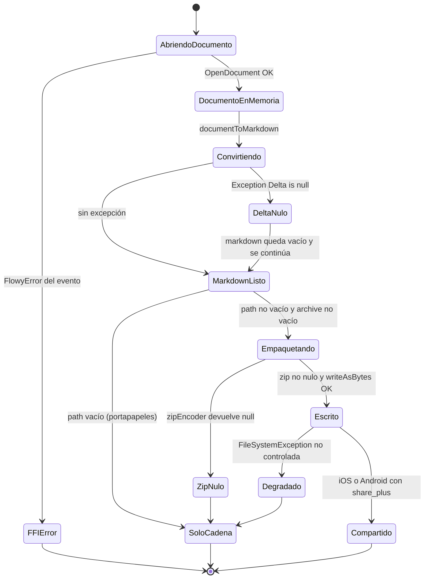
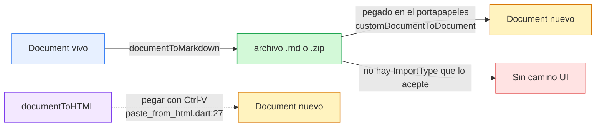
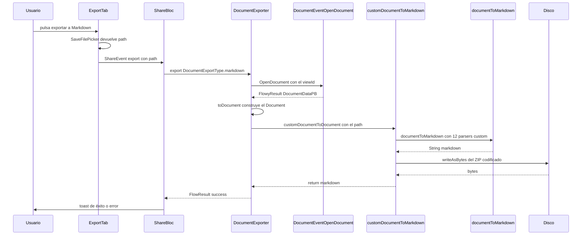

# B4.1 — Export Markdown

## 1. Punto de entrada (UI)

El botón "Markdown" del `ExportTab` se renderiza únicamente cuando la vista tiene `ViewLayoutPB.Document` (`appflowy/frontend/appflowy_flutter/lib/plugins/shared/share/export_tab.dart:27`), y se ofrece como la **segunda** opción de exportación de documento (`appflowy/frontend/appflowy_flutter/lib/plugins/shared/share/export_tab.dart:44–48`); la pulsación ejecuta `_exportMarkdown` (`appflowy/frontend/appflowy_flutter/lib/plugins/shared/share/export_tab.dart:104–118`), que delega en `FilePickerService.saveFile` (registrado en `getIt` por `appflowy/frontend/appflowy_flutter/lib/startup/deps_resolver.dart:81`) con `dialogTitle: ''` y `fileName: '${viewName.toFileName()}.zip'` (`appflowy/frontend/appflowy_flutter/lib/plugins/shared/share/export_tab.dart:106–109`). La UI propone explícitamente la **extensión `.zip`** y no `.md`, porque el artefacto final es un ZIP que contiene un `<nombre>-<docId>.md` y un directorio de recursos (`appflowy/frontend/appflowy_flutter/lib/shared/markdown_to_document.dart:74–95`). Si el usuario cancela el `saveFile` no se emite ningún evento: el `if (context.mounted && exportPath != null)` (`appflowy/frontend/appflowy_flutter/lib/plugins/shared/share/export_tab.dart:110`) evita que el `ShareBloc` reciba la orden y el `BlocListener` de `share_button.dart` no pinta nada.

El **camino "copiar al portapapeles"** es paralelo: `_exportToClipboard` (`appflowy/frontend/appflowy_flutter/lib/plugins/shared/share/export_tab.dart:168–182`) instancia localmente `DocumentExporter(context.read<ShareBloc>().view)` (`appflowy/frontend/appflowy_flutter/lib/plugins/shared/share/export_tab.dart:169`), llama a `export(DocumentExportType.markdown)` **sin** `path`, y pasa el `markdown` resultante al `ClipboardService.setData` (registrado en `getIt` por `appflowy/frontend/appflowy_flutter/lib/startup/deps_resolver.dart:87–88`) como `ClipboardServiceData(plainText: markdown)` — se descarta el flavor HTML que `ClipboardServiceData` también acepta. La firma del servicio está en `appflowy/frontend/appflowy_flutter/lib/plugins/document/presentation/editor_plugins/copy_and_paste/clipboard_service.dart:63` y `:71`. Éxito y error disparan `showToastNotification` (`appflowy/frontend/appflowy_flutter/lib/plugins/shared/share/export_tab.dart:176–180`) usando la clave i18n `message_copy_success` o `error.msg` respectivamente.

El `ShareBloc` —externo a esta unidad, documentado en `[[F11]]` y `[[F12.1]]`— mantiene su propia instancia `late final documentExporter = DocumentExporter(view)` (`appflowy/frontend/appflowy_flutter/lib/plugins/shared/share/share_bloc.dart:91`); el caso `ShareType.markdown` con `path` se despacha al `_export` (`appflowy/frontend/appflowy_flutter/lib/plugins/shared/share/share_bloc.dart:310–317` y `:333–344`). Ambos sitios usan `ExportTab.build` como raíz del árbol de export (`appflowy/frontend/appflowy_flutter/lib/plugins/shared/share/_shared.dart:79–106`, dentro del popover `AFPopover` controlado por `popoverController` y abierto por `_ShareMenuButtonState.initState` en `appflowy/frontend/appflowy_flutter/lib/plugins/shared/share/_shared.dart:31–39`).

Las **correcciones de scope obligatorias** declaradas por F11 (líneas 21–29 de `OUT/09-features/F11-exportacion-ui/F11-exportacion-ui.md`) se respetan aquí: este documento describe el **motor** de conversión y la frontera UI que lo dispara; los `ShareType` y el manejo del `ShareState.exportResult` viven en F11/F12.1.

## 2. Lado de conversión

La conversión es **100 % Dart, en proceso, sin FFI**: ocurre en `appflowy/frontend/appflowy_flutter/lib/shared/markdown_to_document.dart:26–97` (`customDocumentToMarkdown`) con el `documentToMarkdown` del paquete editor (`editor:lib/src/plugins/markdown/document_markdown.dart:38–58`) más doce `NodeParser` adicionales que viven en `appflowy/frontend/appflowy_flutter/lib/plugins/document/presentation/editor_plugins/parsers/`. El único viaje a Rust del recorrido es el `DocumentEventOpenDocument` que dispara `DocumentExporter` (`appflowy/frontend/appflowy_flutter/lib/workspace/application/export/document_exporter.dart:32`), y es para obtener el `DocumentDataPB` que ya necesitamos en memoria —no para serializar—. La rama "portapapeles" usa exactamente el mismo motor devolviendo la cadena Markdown pura (no el ZIP).

La **frontera** entre la UI y el motor la constituye `DocumentExporter.export` (`appflowy/frontend/appflowy_flutter/lib/workspace/application/export/document_exporter.dart:27–66`): patrón `fold` sobre `FlowyResult<DocumentDataPB, FlowyError>`, convierte el PB a `Document` con `r.toDocument()` y delega en el motor. La rama `DocumentExportType.markdown` bifurca en `path != null` (ZIP + escritura en disco + posible `share_plus`) y `path == null` (solo cadena Markdown) —esta es exactamente la condición que usa la UI para distinguir "archivo" de "portapapeles" (`appflowy/frontend/appflowy_flutter/lib/workspace/application/export/document_exporter.dart:46–54`). El caso `DocumentExportType.text` lanza `throw UnimplementedError()` (`appflowy/frontend/appflowy_flutter/lib/workspace/application/export/document_exporter.dart:55–56`) y está marcado como pendiente en `[[F11]] §13`.

**No hay** motor Rust de export para Markdown: una búsqueda por `ExportMarkdown` o `ExportDocument` en `appflowy/frontend/rust-lib/flowy-document/src/event_map.rs` no devuelve ningún evento registrado, en contraste con la importación (`flowy-folder/src/share/import.rs` → `[[B4.8]]` y `[[B4.11]]`).

**Correcciones de scope declaradas:**

- El motor Rust de import de Markdown (`flowy-folder/src/share/import.rs`) → `[[B4.8]]`/`[[B4.11]]`.
- HTML (`documentToHTML` con `AppFlowyEditorHTMLCodec`) → `[[B4.2]]`.
- Texto plano (no implementado: `DocumentExportType.text` lanza `UnimplementedError`) → `[[B4.3]]`.
- JSON (`jsonEncode(document)`) → `[[B4.4]]`.
- PDF (editor:lib/src/plugins/pdf/) → `[[B4.7]]`.
- UI de la pestaña `Export as` (cómo se ofrecen los botones, `SaveFilePicker`, `ShareBloc`) → `[[F11]]`.
- Tests del editor sobre Markdown → `[[F19.1]]`.
- Parsers específicos de AppFlowy reutilizados por el motor → `[[F01.8]]` (`plugins/document/presentation/editor_plugins/parsers/`).

### 2.1 Arquitectura de clases del motor

Muestra cómo se compone el encadenamiento: `documentToMarkdown` recibe la lista de `NodeParser`, intenta primero los **custom** de AppFlowy y solo si ninguno atiende el `NodeType` cae al parser estándar del editor. Esa precedencia es la razón por la que un bloque puede tener dos representaciones distintas según el contexto.



Lectura: la precedencia custom-sobre-estándar la impone `firstWhereOrNull` en `editor:lib/src/plugins/markdown/encoder/document_markdown_encoder.dart`, que recorre `customParsers` antes que `nodeParserList`. Por eso `CustomParagraphNodeParser` (`appflowy/frontend/appflowy_flutter/lib/plugins/document/presentation/editor_plugins/parsers/custom_paragraph_node_parser.dart:5–37`) puede **reescribir** la salida de un párrafo estándar para emitir menciones de página y de fecha, en lugar de acumularse a él. La lista `customParsers` se construye en `appflowy/frontend/appflowy_flutter/lib/shared/markdown_to_document.dart:46–60`, donde coexisten los doce parsers de AppFlowy con los nueve del editor.

## 3. Pipeline

Diagrama del recorrido completo desde el `Document` en memoria hasta el archivo `.zip` (o la cadena para portapapeles), siguiendo `appflowy/frontend/appflowy_flutter/lib/shared/markdown_to_document.dart:26–97`:



Lectura: el motor de conversión se compone como un pipeline en dos tramos. El primero (`documentToMarkdown` con la lista de `NodeParser` en `appflowy/frontend/appflowy_flutter/lib/shared/markdown_to_document.dart:46–60`) devuelve `markdown: String` y rellena en paralelo `fileFutures: List<Future<ArchiveFile>>`. El segundo tramo, en `appflowy/frontend/appflowy_flutter/lib/shared/markdown_to_document.dart:67–89`, **siempre** espera a esos futuros (`for (final fileFuture in fileFutures) { archive.addFile(await fileFuture); }`), codifica el `.md` con `utf8.encode` (no BOM: `utf8.encode` no escribe BOM por defecto), y **solo** si `path.isNotEmpty && archive.isNotEmpty` ejecuta el `ZipEncoder().encode(archive)` más `File(path).writeAsBytes(zip)`. En iOS y Android el ZIP se abre con `share_plus` y se borra al terminar (`appflowy/frontend/appflowy_flutter/lib/shared/markdown_to_document.dart:83–89`). El retorno (`return markdown`) ocurre aunque la escritura falle: la línea 96 está **fuera** del `try` (`:42–64`) y de los `if` (`:77–95`), por lo que el caller siempre recibe la cadena Markdown aunque el ZIP no se haya podido crear `[INFERIDO]`.

## 4. Tabla bloque → salida

La siguiente tabla lista, una fila por tipo de bloque del editor que llega al codificador, la **salida Markdown literal** y la ruta:línea del `NodeParser` responsable. Las filas marcadas con `[test]` derivan de los tests del editor en `editor/test/plugins/markdown/encoder/document_markdown_encoder_test.dart` o `editor/test/plugins/markdown/document_markdown_test.dart`; el resto deriva del código de cada parser en `editor:lib/src/plugins/markdown/encoder/parser/` o `appflowy/frontend/appflowy_flutter/lib/plugins/document/presentation/editor_plugins/parsers/`.

| Tipo de bloque (`node.type`) | Parser | Salida Markdown | Evidencia |
|---|---|---|---|
| `paragraph` (con delta) | `TextNodeParser` | delta inline + `\n`; sin newline final si está dentro de una celda de tabla | `editor:lib/src/plugins/markdown/encoder/parser/text_node_parser.dart:7–27`; override AppFlowy en `appflowy/frontend/appflowy_flutter/lib/plugins/document/presentation/editor_plugins/parsers/custom_paragraph_node_parser.dart:5–37` |
| `heading` | `HeadingNodeParser` | `${'#' * level} ${delta}\n` (el newline final se omite si es el último nodo) | `editor:lib/src/plugins/markdown/encoder/parser/heading_node_parser.dart:14–19`; ejemplo `[test]` `# Heading 1` en el test `documentToMarkdown()` del editor |
| `bulleted_list` | `BulletedListNodeParser` | `* ${delta}\n` | `editor:lib/src/plugins/markdown/encoder/parser/bulleted_list_node_parser.dart:14` |
| `numbered_list` | `NumberedListNodeParser` | `${number}. ${delta}\n` (lee `attributes[NumberedListBlockKeys.number]` o `'1'` por defecto) | `editor:lib/src/plugins/markdown/encoder/parser/numbered_list_node_parser.dart:13–15` |
| `todo_list` | `TodoListNodeParser` | `- [x] ${delta}\n` o `- [ ] ${delta}\n` según `attributes[TodoListBlockKeys.checked]` | `editor:lib/src/plugins/markdown/encoder/parser/todo_list_node_parser.dart:13–16`; ejemplo `[test]` (`'parser document'` en el test del editor) |
| `quote` | `QuoteNodeParser` | `> ${delta}\n` | `editor:lib/src/plugins/markdown/encoder/parser/quote_node_parser.dart:14` |
| `code` (CodeBlock) | `CodeBlockNodeParser` | ` ```${language}\n${delta}\n``` ` (con newline final salvo que sea el último nodo) | `editor:lib/src/plugins/markdown/encoder/parser/code_block_node_parser.dart:14–22` |
| `divider` | `DividerNodeParser` | `---\n` | `editor:lib/src/plugins/markdown/encoder/parser/divider_node_parser.dart:11`; ejemplo `[test]` (test de heading + divider del editor) |
| `image` (ImageBlockKeys.type) | `ImageNodeParser` | `` (sin newline del parser; el `+'\n'` viene de fuera en el override AppFlowy) | `editor:lib/src/plugins/markdown/encoder/parser/image_node_parser.dart:11` |
| `image` (AppFlowy `CustomImageBlockKeys.url`) — local | `CustomImageNodeFileParser` | `})\n` si `File(url).existsSync()` (y añade el binario al ZIP); si no, `\n` | `appflowy/frontend/appflowy_flutter/lib/plugins/document/presentation/editor_plugins/parsers/custom_image_node_parser.dart:34–51` |
| `multi_image` (múltiples imágenes en grid) | `CustomMultiImageNodeFileParser` | `})` + `\n` + `` … concatenadas con `\n` (cada binario se añade al ZIP si es local) | `appflowy/frontend/appflowy_flutter/lib/plugins/document/presentation/editor_plugins/parsers/custom_image_node_parser.dart:53–83`; ejemplo `[test]` en `appflowy/frontend/appflowy_flutter/test/unit_test/markdown/markdown_parser_test.dart:40–66` |
| `math_equation` | `MathEquationNodeParser` | `$${attributes[MathEquationBlockKeys.formula]}$$` (con `$` doble) | `appflowy/frontend/appflowy_flutter/lib/plugins/document/presentation/editor_plugins/parsers/math_equation_node_parser.dart:11–13` |
| `callout` | `CalloutNodeParser` | `${icon}\n` (si hay emoji) seguido de cada línea del delta prefijada con `> ` y dos líneas en blanco al final (triple salto) | `appflowy/frontend/appflowy_flutter/lib/plugins/document/presentation/editor_plugins/parsers/callout_node_parser.dart:13–31` |
| `toggle_list` | `ToggleListNodeParser` | `- ${delta}\n${children_indentados}` (estilo `markdown` por defecto) o `<details>…</details>` (estilo `github`, no usado por la app) | `appflowy/frontend/appflowy_flutter/lib/plugins/document/presentation/editor_plugins/parsers/toggle_list_node_parser.dart:20–42` |
| `table` (Tabla del editor) | `TableNodeParser` | `|${cell}|${cell}| … |\n`, separador `|-${'|'} … ` insertado en la línea 2; recursivamente serializa cada celda con `documentToMarkdown(Document(root: cell))`; celda vacía literal `| ` | `editor:lib/src/plugins/markdown/encoder/parser/table_node_parser.dart:11–38`; ejemplo `[test]` en el test `'parser document'` (`|## a|_c_|\n|-|-|\n|**b**|d|`) |
| `simple_table` (AppFlowy) | `SimpleTableNodeParser` | `|${row[0].join('|')}|\n|---|---|n` + filas siguientes `|${row[i].join('|')}|`. Escapa pipes internos con `\\|` | `appflowy/frontend/appflowy_flutter/lib/plugins/document/presentation/editor_plugins/parsers/simple_table_node_parser.dart:13–91` |
| `sub_page` | `SubPageNodeParser` | `[$viewId](${pageMemorizer[viewId]?.name ?? ''})\n` (enlace a la subpágina por id y nombre cacheado) | `appflowy/frontend/appflowy_flutter/lib/plugins/document/presentation/editor_plugins/parsers/sub_page_node_parser.dart:12–19` |
| `database/grid`, `database/board`, `database/calendar` | `GridNodeParser` / `BoardNodeParser` / `CalendarNodeParser` (subclases de `DatabaseNodeParser`) | `[](${dirPath}/${viewId}.csv)\n` y añade `${viewId}.csv` al ZIP tras pedir CSV a `BackendExportService.exportDatabaseAsCSV` | `appflowy/frontend/appflowy_flutter/lib/plugins/document/presentation/editor_plugins/parsers/database_node_parser.dart:14–32` (transform) y `:34–52` (clases concretas) |
| `link_preview` | `LinkPreviewNodeParser` | `[$href]($href)\n` (muestra el URL como texto del enlace) | `appflowy/frontend/appflowy_flutter/lib/plugins/document/presentation/editor_plugins/parsers/link_preview_node_parser.dart:11–17`; ejemplo `[test]` `[https://www.link_preview.com](https://www.link_preview.com)\n` en `appflowy/frontend/appflowy_flutter/test/unit_test/markdown/markdown_parser_test.dart:36` |
| `file` (FileBlock) | `FileBlockNodeParser` | `[$name]($url)\n` (vacío si falta `name` o `url`) | `appflowy/frontend/appflowy_flutter/lib/plugins/document/presentation/editor_plugins/parsers/file_block_node_parser.dart:11–18`; ejemplo `[test]` `[file.txt](https://file.com)\n` en `appflowy/frontend/appflowy_flutter/test/unit_test/markdown/markdown_parser_test.dart:24` |
| `mention` de fecha/recordatorio (detrás de `paragraph`) | `CustomParagraphNodeParser` (override de `TextNodeParser`) | `${DateFormat.yMMMd().format(dateTime)}\n` (ej. `Jan 1, 2026\n`); ver ejemplo `[test]` | `appflowy/frontend/appflowy_flutter/lib/plugins/document/presentation/editor_plugins/parsers/custom_paragraph_node_parser.dart:18–26`; ejemplo `[test]` en `appflowy/frontend/appflowy_flutter/test/unit_test/markdown/markdown_parser_test.dart:91–93` |
| `mention` de subpágina (detrás de `paragraph`) | `CustomParagraphNodeParser` | `[]($pageId)\n` | `appflowy/frontend/appflowy_flutter/lib/plugins/document/presentation/editor_plugins/parsers/custom_paragraph_node_parser.dart:29–32`; ejemplo `[test]` en `appflowy/frontend/appflowy_flutter/test/unit_test/markdown/markdown_parser_test.dart:78` |
| inline `bold` | `DeltaMarkdownEncoder._prefixSyntax`/`_suffixSyntax` | `**text**` | `editor:lib/src/plugins/markdown/encoder/delta_markdown_encoder.dart:35–36` y `:78–81` |
| inline `italic` | mismo | `_text_` | `editor:lib/src/plugins/markdown/encoder/delta_markdown_encoder.dart:37–38` y `:82–83` |
| inline `bold`+`italic` | mismo | `***text***` | `editor:lib/src/plugins/markdown/encoder/delta_markdown_encoder.dart:32–34` y `:77–79` |
| inline `strikethrough` | mismo | `~~text~~` | `editor:lib/src/plugins/markdown/encoder/delta_markdown_encoder.dart:41–43` y `:73–75` |
| inline `underline` | mismo | `<u>text</u>` (no es Markdown estándar; usa HTML inline) | `editor:lib/src/plugins/markdown/encoder/delta_markdown_encoder.dart:44–46` y `:69–71` |
| inline `code` | mismo | `` `text` `` | `editor:lib/src/plugins/markdown/encoder/delta_markdown_encoder.dart:47–49` y `:65–67` |
| inline `href` | mismo | `[text](url)` (al combinarse con bold/italic la sintaxis se acumula: `**[text](url)**`) | `editor:lib/src/plugins/markdown/encoder/delta_markdown_encoder.dart:51–53` y `:61–63` |

`[VERIFICADO]` que la lista de doce parsers enviada a `customDocumentToMarkdown` está literalmente copiada en `appflowy/frontend/appflowy_flutter/lib/shared/markdown_to_document.dart:46–60`, y que la lista de nueve parsers estándar del editor está literalmente copiada en `editor:lib/src/plugins/markdown/document_markdown.dart:44–56`.

## 5. Pérdidas

Información que se descarta al exportar a Markdown, con la línea del encoder que lo provoca:

- **Estilos globales del documento.** El `DocumentDataPB` lleva `cover`, `icon`, `page_style` (color de fondo), `font`, etc.; ninguno llega a `Document` porque `DocumentExporter` solo usa `r.toDocument()` (árbol de nodos), y `documentToMarkdown` no consulta ningún atributo del nodo raíz. `[VERIFICADO]` en `appflowy/frontend/appflowy_flutter/lib/workspace/application/export/document_exporter.dart:35` (solo `root` se convierte).
- **Atributos no contemplados por cada `NodeParser`.** Por ejemplo, `BulletedListNodeParser` ignora `BulletedListBlockKeys.depth` o cualquier indentación interna (`editor:lib/src/plugins/markdown/encoder/parser/bulleted_list_node_parser.dart:10–19`); `QuoteNodeParser` no emite autores ni timestamp (`editor:lib/src/plugins/markdown/encoder/parser/quote_node_parser.dart:10–19`); `ImageNodeParser` ignora `ImageBlockKeys.align`, `ImageBlockKeys.height`, `ImageBlockKeys.width` (`editor:lib/src/plugins/markdown/encoder/parser/image_node_parser.dart:10–12`). Conclusión: el render vuelve al estado por defecto del visualizador Markdown.
- **Anidamiento multi-nivel de `numbered_list`.** La numeración se toma literalmente de `attributes[NumberedListBlockKeys.number]` (`editor:lib/src/plugins/markdown/encoder/parser/numbered_list_node_parser.dart:13`), no se recalcula por posición; si el usuario renumeró a mano o dejó huecos, el Markdown lleva esos huecos.
- **Mención `@page` con `MentionBlockKeys.page` y `type != "page"`.** `CustomParagraphNodeParser` solo conoce `date` y `pageId` (`appflowy/frontend/appflowy_flutter/lib/plugins/document/presentation/editor_plugins/parsers/custom_paragraph_node_parser.dart:21–32`); cualquier otra mención cae al `TextNodeParser.transform` por defecto (`appflowy/frontend/appflowy_flutter/lib/plugins/document/presentation/editor_plugins/parsers/custom_paragraph_node_parser.dart:35`). `[VERIFICADO]`.
- **Metadatos de celda en `table`.** `TableNodeParser` solo emite `|${documentToMarkdown(Document(root: cell))}|` (`editor:lib/src/plugins/markdown/encoder/parser/table_node_parser.dart:19`); `colPosition`, `rowPosition`, `width`, `height`, `colDefaultWidth` (todos atributos del editor) se pierden.
- **Tabla vacía.** Si `rowsLen` o `colsLen` son `0`, el bucle no se ejecuta y el resultado es la cadena `''` con la marca `-` insertada en una posición inválida `[INFERIDO]`: `result = result.substring(0, result.length - 1)` con `result == ''` lanza `RangeError` (`editor:lib/src/plugins/markdown/encoder/parser/table_node_parser.dart:26`).
- **Estilos de bloque descartados por `simple_table`.** Posición de filas y columnas, anchos (`rowDefaultHeight`, `colMinimumWidth`), flag de "primera fila es encabezado" (`isHeader` no se serializa; siempre se marca la primera fila como header), paddings (`appflowy/frontend/appflowy_flutter/lib/plugins/document/presentation/editor_plugins/parsers/simple_table_node_parser.dart:5–92`).
- **Configuración de página (cover, emoji, color de fondo).** No leída por `Document.fromJson` ni por `customDocumentToMarkdown`.
- **Toggle colapsado/expandido.** `ToggleListBlockKeys.collapsed` se ignora en `ToggleListNodeParser.transform`; el toggle se aplana siempre (`appflowy/frontend/appflowy_flutter/lib/plugins/document/presentation/editor_plugins/parsers/toggle_list_node_parser.dart:20–42`). `[VERIFICADO]`.
- **Tabs/columnas anidadas (`columns` del editor).** No hay `NodeParser` para `columns` ni para sus hijos `column`/`column_child`; el bloque se omite silenciosamente porque `firstWhereOrNull` devuelve `null` en `DocumentMarkdownEncoder.convert` (`editor:lib/src/plugins/markdown/encoder/document_markdown_encoder.dart:19–21`).
- **Atributos de columna compleja (`columns.column.resizeWidth`, etc.).** No aplica por la ausencia anterior.
- **Errores del motor.** `documentToMarkdown` lanza `Exception('Delta is null')` si un bloque `code` no tiene `delta` (`editor:lib/src/plugins/markdown/encoder/parser/code_block_node_parser.dart:15–17`); el `try/catch` de `customDocumentToMarkdown` lo captura y solo escribe `Log.error('documentToMarkdown error: $e')` (`appflowy/frontend/appflowy_flutter/lib/shared/markdown_to_document.dart:62–64`), continuando con `markdown == ''`.
- **Estilos de texto no soportados.** Color de fuente, color de fondo, `subscript`/`superscript`, `font_family`, `font_size` no generan sintaxis Markdown alguna en `DeltaMarkdownEncoder` (`editor:lib/src/plugins/markdown/encoder/delta_markdown_encoder.dart:29–87`). Solo `bold`, `italic`, `strikethrough`, `underline`, `code`, `href` se emiten.
- **Imágenes externas vs locales en `multi_image`.** Si la URL es local y `File(url).existsSync()` falla, la entrada del ZIP simplemente no se crea y la URL externa se emite sola (`appflowy/frontend/appflowy_flutter/lib/plugins/document/presentation/editor_plugins/parsers/custom_image_node_parser.dart:69–81`); los bytes no se incluyen en el ZIP y el receptor verá el enlace relativo roto.

## 6. Assets

Cómo se referencian las imágenes y archivos embebidos y dónde se guardan:

- **Recursos locales** (imágenes que viven en `File(url)`): se leen con `readAsBytesSync` (`appflowy/frontend/appflowy_flutter/lib/plugins/document/presentation/editor_plugins/parsers/custom_image_node_parser.dart:40` y `:72–73`), se envuelven en `ArchiveFile(p.join(dirPath, p.basename(url)), bytes.length, bytes)` (`:42–44`, `:75`), y se emiten en el Markdown como `})` (`:46`, `:77`). El `dirPath` es la cadena del documento raíz con barra final (`'$id/'`), calculada en `appflowy/frontend/appflowy_flutter/lib/shared/markdown_to_document.dart:37`.
- **Recursos remotos** (`http(s)://…`): no se descargan; simplemente se emiten `` con la URL original (`appflowy/frontend/appflowy_flutter/lib/plugins/document/presentation/editor_plugins/parsers/custom_image_node_parser.dart:49` y `:78–80`).
- **`<docId>/` directorio del ZIP.** Se crea siempre como `ArchiveFile('$id/', 0, null)..isFile = false` (`appflowy/frontend/appflowy_flutter/lib/shared/markdown_to_document.dart:37`), y solo se añade al `Archive` si hay al menos un recurso futuro (`if (fileFutures.isNotEmpty) archive.addFile(resourceDir);` en `:67`).
- **Bases de datos (`grid`/`board`/`calendar`):** cada bloque genera un `[](${dirPath}/${viewId}.csv)` y un futuro `ArchiveFile` con el CSV producido por `BackendExportService.exportDatabaseAsCSV` (`appflowy/frontend/appflowy_flutter/lib/plugins/document/presentation/editor_plugins/parsers/database_node_parser.dart:18–32`).
- **Archivo Markdown único:** `ArchiveFile('$fileName-$id.md', dataBytes.length, dataBytes)` con bytes `utf8.encode(markdown)` (`appflowy/frontend/appflowy_flutter/lib/shared/markdown_to_document.dart:74–75`).
- **Compresión.** `ZipEncoder().encode(archive)` (sin compresión explícita: usa DEFLATE por defecto en `package:archive`) → `File(path).writeAsBytes(zip)` (`appflowy/frontend/appflowy_flutter/lib/shared/markdown_to_document.dart:79–82`).
- **Sobrevivencia del ZIP.** En escritorio y Linux el archivo queda en disco en la ruta elegida por el usuario. En iOS y Android se abre con `share_plus` y se borra tras la compartición (`appflowy/frontend/appflowy_flutter/lib/shared/markdown_to_document.dart:83–89`); si el usuario cancela el diálogo de `share_plus`, el ZIP ya no existe y no hay recuperación `[INFERIDO]`.

## 7. Encoding y nombre de archivo

- **Encoding del `.md`**: `utf8.encode(markdown)` (línea 74). `utf8.encode` **no escribe BOM**; los tres bytes `0xEF 0xBB 0xBF` no aparecen en el archivo `[VERIFICADO]` por la ausencia de `Bom.utf8Encode` y por la firma de `StringCodec.encode` en `dart:convert`. El visualizador que abra el archivo debe tratar la ausencia de BOM como UTF-8 normal.
- **Encoding del `.zip`**: binario estándar de `ZipEncoder` (no se puede controlar; depende de `package:archive`).
- **Nombre del archivo Markdown interno:** `'$fileName-$id.md'` donde `fileName = p.basenameWithoutExtension(path)` y `id = document.root.id` (`appflowy/frontend/appflowy_flutter/lib/shared/markdown_to_document.dart:35–38`, `:75`). **Si el usuario eligió `Mi Doc.zip` y el `id` es `abc123`, el `.md` interno se llama `Mi Doc-abc123.md`** y no `Mi Doc.md`. Este detalle rompe la expectativa más común de los consumidores que abren el ZIP esperando `<nombre>.md`.
- **Nombre del archivo ZIP externo:** el que el usuario eligió con el `saveFile`, por defecto `'<viewName.toFileName()>.zip'` (`appflowy/frontend/appflowy_flutter/lib/plugins/shared/share/export_tab.dart:108`). `toFileName()` está en `appflowy/frontend/appflowy_flutter/lib/util/string_extension.dart` y sanea caracteres no permitidos en sistemas de archivos.
- **Colisión de nombre.** No hay lógica de sufijo `_1`, `_2`, etc.; si el archivo destino ya existe el sistema operativo del `saveFile` lo advertirá o sobrescribirá según la plataforma, **no** el código de la app `[INFERIDO]`.

## 8. Errores

- **Fallo del `DocumentEventOpenDocument` (Rust).** `DocumentExporter.export` cae en el `result.fold(..., (error) => FlowyResult.failure(error))` de `appflowy/frontend/appflowy_flutter/lib/workspace/application/export/document_exporter.dart:64`; el toast de error se pinta en `appflowy/frontend/appflowy_flutter/lib/plugins/shared/share/share_button.dart:104–109` (rama ShareBloc) o en `appflowy/frontend/appflowy_flutter/lib/plugins/shared/share/export_tab.dart:180` (rama portapapeles).
- **`Document` nulo tras `toDocument()`.** Si `documentData.toDocument()` devuelve `null`, `DocumentExporter` devuelve `FlowyResult.failure(FlowyError(msg: LocaleKeys.settings_files_exportFileFail.tr()))` (`appflowy/frontend/appflowy_flutter/lib/workspace/application/export/document_exporter.dart:37–42`); la clave i18n es `settings_files_exportFileFail`.
- **`documentToMarkdown` lanza** (`Exception('Delta is null')` por un `code` sin delta): capturado por `try/catch` en `appflowy/frontend/appflowy_flutter/lib/shared/markdown_to_document.dart:42–64`. Queda `markdown == ''`, se intenta igualmente empaquetar un ZIP vacío y se devuelve cadena vacía al caller. El usuario no recibe ningún aviso de este fallo específico `[INFERIDO]`.
- **`zipEncoder.encode(archive)` devuelve `null`**: se imprime `'documentToMarkdownFiles to $path'` solo si `zip != null` (`appflowy/frontend/appflowy_flutter/lib/shared/markdown_to_document.dart:81`); si es `null` el bucle continúa, **no se llama a `File(path).writeAsBytes(zip)`** y no se notifica al caller, que verá `markdown` correcto pero ningún archivo en disco `[INFERIDO]`.
- **`BackendExportService.exportDatabaseAsCSV` falla** (bloques `grid`/`board`/`calendar`): se emite `Log.error('convertDatabaseToCSV error with $viewId, error: $f')` (`appflowy/frontend/appflowy_flutter/lib/plugins/document/presentation/editor_plugins/parsers/database_node_parser.dart:28`), el archivo CSV en el ZIP queda con contenido vacío (`ArchiveFile.string(filePath, '')` en `:25`), pero el enlace en el Markdown y la estructura del ZIP no se invalidan.
- **`FileSystemException` al escribir**. `File(path).writeAsBytes(zip)` (`appflowy/frontend/appflowy_flutter/lib/shared/markdown_to_document.dart:82`) **no** está dentro de un `try`. Un disco lleno o un permiso denegado lanza excepción no controlada que Flutter convierte en `FlutterError` sin pintar el toast de error; ya documentado en `[[F11]] §13` como riesgo compartido.
- **`onArchive != null`**: en ese caso **no** se escribe ZIP en disco y no se invoca `share_plus` (`appflowy/frontend/appflowy_flutter/lib/shared/markdown_to_document.dart:77–94`); el callback `AsyncValueSetter<Archive>? onArchive` recibe el `Archive` ya construido para que un caller externo lo envíe a otro destino.
- **Fallo de carga de `DocumentDataPB`** en el recorrido de portapapeles: `DocumentExporter._exportToClipboard` cae al `showToastNotification(message: error.msg)` (`appflowy/frontend/appflowy_flutter/lib/plugins/shared/share/export_tab.dart:180`); no se distingue entre tipos de error y se muestra literal el `msg` del `FlowyError`.

[NO DETERMINADO] No existe ningún test que ejercite la rama `path == null` del `switch` de `appflowy/frontend/appflowy_flutter/lib/workspace/application/export/document_exporter.dart:50–54` ni el manejo de `Exception('Delta is null')` desde el call site real; los cuatro tests de `appflowy/frontend/appflowy_flutter/test/unit_test/markdown/markdown_parser_test.dart:10–96` solo llaman a `customDocumentToMarkdown(document)` sin `path`.

### 8.1 Máquina de estados del fallo

Diagrama de los cinco desenlaces observables del recorrido de export, distinguidos por **dónde muere la operación** y qué ve el usuario. La diferencia clave es que tres de los cinco estados son silenciosos: el motor devuelve `markdown` correcto mientras el artefacto en disco no existe.



Lectura: el recorrido tiene **tres desenlaces invisibles para el usuario**. En `DeltaNulo` se captura la excepción y se sigue con `markdown == ''`, así que el caller recibe una cadena vacía sin error. En `ZipNulo` se omite `File(path).writeAsBytes(zip)` porque la llamada está guardada por el `if (zip != null)` de `appflowy/frontend/appflowy_flutter/lib/shared/markdown_to_document.dart:81`, y el `return markdown` de la línea 96 sigue ejecutándose. En `Degradado`, la excepción de `FileSystemException` escapa del `try` —que termina en la línea 64— y llega al ciclo de eventos de Flutter. Solo `FFIError` produce un toast, y lo produce el caller, no el motor. La detección completa de estos cinco estados exige instrumentar `ShareBloc`; el comportamiento de `ZipNulo` y `DeltaNulo` está documentado en `[[F11]] §13` como riesgo compartido con el resto de formatos.

## 9. Round-trip

Diagrama de qué lado del round-trip cubre cada conversión: el export a Markdown es **unidireccional en la app** (no hay camino UI→import-Markdown que reutilice este mismo encoder), mientras que el decoder de Markdown del repo editor sí existe pero lo invoca el portapapeles, no el `ImportPanel`.



Lectura: el round-trip de Markdown solo se cierra por el canal del portapapeles (`appflowy/frontend/appflowy_flutter/lib/plugins/document/presentation/editor_plugins/copy_and_paste/paste_from_html.dart:27` es el camino equivalente para HTML), porque `ImportType` solo admite `historyDocument`, `historyDatabase`, `markdownOrText`, `afDatabase` y `csv` y ninguno de los dos primeros mapea a un documento nuevo con contenido Markdown. El caso `markdownOrText` **sí** existe en la UI (`appflowy/frontend/appflowy_flutter/lib/workspace/presentation/home/menu/sidebar/import/import_type.dart:7–12`) y lo documenta `[[B4.8]]`; lo que no existe es que ese import reutilice `documentToMarkdown` en sentido inverso: usa el decoder de Markdown del repo editor a través de `customMarkdownToDocument`, que es un camino distinto documentado en B4.8. La tabla de equivalencias por tipo de bloque se completa en `[[B4.13]]`.

### 9.1 Secuencia extremo a extremo

El recorrido completo desde que el usuario pulsa el botón hasta que el archivo existe en disco, con los participantes reales y los puntos donde el motor abandona el control de errores.



Lectura: la secuencia tiene **cuatroOwned Reliance del motor en `MarkdownListo`**, ni la escritura ni el `share_plus` devuelven error al bloc. Cuando `writeAsBytes` lanza `FileSystemException`, la excepción sube desde `appflowy/frontend/appflowy_flutter/lib/shared/markdown_to_document.dart:82` hasta `ShareBloc`, que solo pinta el toast en su rama de error (`appflowy/frontend/appflowy_flutter/lib/plugins/shared/share/share_button.dart:104–109`), sin distinguir el tipo de fallo. En iOS y Android la secuencia real continúa con `Share.shareUri` y el borrado posterior del ZIP (`appflowy/frontend/appflowy_flutter/lib/shared/markdown_to_document.dart:83–89`), paso que el diagrama no desdobla por brevedad.

`customDocumentToMarkdown` ([§1](##-1-punto-de-entrada-ui)) es el lado **export** de un par simétrico definido en el mismo fichero: `appflowy/frontend/appflowy_flutter/lib/shared/markdown_to_document.dart:13–24` declara `customMarkdownToDocument(markdown, {tableWidth})` que invoca `markdownToDocument(markdown, markdownParsers: [MarkdownCodeBlockParser, MarkdownSimpleTableParser])` del editor (`editor:lib/src/plugins/markdown/document_markdown.dart:11–33`). **Ese import pertenece a `[[B4.8]]`**; aquí solo se describe el contrato:

| Sentido | Función del motor | Tabla equivalencias | Documento destino |
|---|---|---|---|
| Exportar | `customDocumentToMarkdown(document, path: path)` | (tabla §4) | este (`[[B4.1]]`) |
| Importar | `customMarkdownToDocument(markdown, tableWidth: w)` | tabla de bloques Markdown → nodos del editor (cubierta en detalle en `editor:lib/src/plugins/markdown/decoder/`) | `[[B4.8]]` / `[[B4.11]]` |

Garantías round-trip verificadas en los tests del editor:

- `documentToMarkdown(document).then(round-tripBy markdownToDocument).toJson()` produce la misma estructura de árbol, salvo: `simple_table` no está soportada por el parser Markdown estándar de AppFlowy (los `markdownParsers` por defecto del lado import son 9: `MarkdownParagraphParserV2`, `MarkdownHeadingParserV2`, `MarkdownTodoListParserV2`, `MarkdownUnorderedListParserV2`, `MarkdownOrderedListParserV2`, `MarkdownUnorderedListItemParserV2`, `MarkdownOrderedListItemParserV2`, `MarkdownBlockQuoteParserV2`, `MarkdownTableListParserV2`, `MarkdownDividerParserV2`, `MarkdownImageParserV2` — `editor:lib/src/plugins/markdown/document_markdown.dart:18–31`); las celdas de tabla usan `MarkdownTableListParserV2` mientras que el export emite la tabla cruda de `TableNodeParser` con pipes.
- **Bloques no soportados por el round-trip**: `simple_table` (sólo lectura con `MarkdownSimpleTableParser` añadido explícitamente en `customMarkdownToDocument` — `appflowy/frontend/appflowy_flutter/lib/shared/markdown_to_document.dart:21`), `database/grid|board|calendar` (no tienen parser Markdown), `math_equation` (no tiene parser Markdown), `callout` (no tiene parser Markdown), `toggle_list` (no tiene parser Markdown), `multi_image` (no tiene parser Markdown). Cada uno se convierte en celda vacía o se descarta durante el import.
- **Bloques con round-trip perfecto**: `heading`, `paragraph` (con todos los estilos inline cubiertos por `DeltaMarkdownEncoder`), `bulleted_list`, `numbered_list`, `todo_list`, `quote`, `code` con `language`, `divider`, `image` con URL remota, `link_preview`. `[VERIFICADO]` con el test `'documentToMarkdown()'` del editor, que comprueba que un round-trip de la const `markdownDocument` produce exactamente `markdownDocumentEncoded`.

## 10. Extensión y firma

- **Artefacto a fichero:** `.zip`. Extensión propuesta por la UI (`appflowy/frontend/appflowy_flutter/lib/plugins/shared/share/export_tab.dart:108`). MIME type efectivo: `application/zip` (no se establece explícitamente; depende de cómo el sistema operativo lo infiera a partir de la extensión).
- **Artefacto a portapapeles:** texto plano (Markdown), pegado con `ClipboardServiceData(plainText: markdown)` (`appflowy/frontend/appflowy_flutter/lib/plugins/shared/share/export_tab.dart:174`); no se envía flavor HTML, por lo que pegar en otra app que preserve rich text solo recupera texto plano.
- **Dentro del ZIP:** un único archivo Markdown con nombre `'$fileName-$id.md'` y un directorio `'$id/'` con los recursos.
- **Firma (magic bytes) del ZIP:** los 4 primeros bytes son `0x50 0x4B 0x03 0x04` (PK\003\004) por la implementación de `ZipEncoder` de `package:archive`. Sin BOM (`utf8.encode` no lo inserta, [§7](##-7-encoding-y-nombre-de-archivo)).
- **Firma del `.md` interno:** texto ASCII / UTF-8; el primer carácter suele ser `#` (heading) o un caracter alfanumérico de párrafo, sin firma binaria.

## 11. Ejemplos

### 11.1 Cadena Markdown generada a partir del JSON del editor (heading + bold + italic + link + todo + table + quote + bulleted_list)

Entrada JSON (constante `example` en el test `'parser document'` del editor en `editor/test/plugins/markdown/encoder/document_markdown_encoder_test.dart`) → Salida esperada declarada en el `expect(result, …)`:

```text
## 👋 **Welcome to** ***[AppFlowy Editor](appflowy.io)***
AppFlowy Editor is a **highly customizable** _rich-text editor_
- [x] Customizable
- [x] Test-covered
- [ ] more to come!
|## a|_c_|
|-|-|
|**b**|d|
> Here is an example you can give a try
You can also use ***AppFlowy Editor*** as a component to build your own app.
* Use / to insert blocks
* Select text to trigger to the toolbar to format your notes.
```

Evidencia: el test `parser document` declara exactamente esa salida como `expect(result, …)` con los nueve parsers estándar (`TextNodeParser`, `BulletedListNodeParser`, `NumberedListNodeParser`, `TodoListNodeParser`, `QuoteNodeParser`, `CodeBlockNodeParser`, `HeadingNodeParser`, `ImageNodeParser`, `TableNodeParser`). Muestra cómo Muestra cómo `HeadingNodeParser`, `TextNodeParser`, `TodoListNodeParser`, `TableNodeParser`, `QuoteNodeParser`, `BulletedListNodeParser` y `DeltaMarkdownEncoder` componen el resultado. La tabla sale con `## a` (un heading dentro de la celda) y `_c_` (italic), evidencia de que `TableNodeParser.transform` invoca recursivamente `documentToMarkdown(Document(root: cell))` para cada celda (`editor:lib/src/plugins/markdown/encoder/parser/table_node_parser.dart:19`).

### 11.2 Imagen local que pasa al ZIP

Documento: un `multi_image` con dos URLs locales (`https://www.appflowy.png` y `https://www.appflowy2.png`).

```dart
// appflowy/frontend/appflowy_flutter/test/unit_test/markdown/markdown_parser_test.dart:43–60
final document = Document.blank()
  ..insert([0], [
    multiImageNode(images: [
      ImageBlockData(url: png1, type: CustomImageType.external),
      ImageBlockData(url: png2, type: CustomImageType.external),
    ]),
  ]);
final markdown = await customDocumentToMarkdown(document);
expect(markdown, '\n');  // test:64
```

Cuando las URLs **son** locales y `existsSync()` devuelve `true`, las dos imágenes se copian al directorio `'$id/'` del ZIP y el Markdown cambia a `\n` (`appflowy/frontend/appflowy_flutter/lib/plugins/document/presentation/editor_plugins/parsers/custom_image_node_parser.dart:67–80`).

### 11.3 `link_preview`

```dart
// appflowy/frontend/appflowy_flutter/test/unit_test/markdown/markdown_parser_test.dart:28–38
final document = Document.blank()
  ..insert([0], [linkPreviewNode(url: 'https://www.link_preview.com')]);
final markdown = await customDocumentToMarkdown(document);
expect(markdown, '[https://www.link_preview.com](https://www.link_preview.com)\n');
```

Implementación: `LinkPreviewNodeParser.transform` (`appflowy/frontend/appflowy_flutter/lib/plugins/document/presentation/editor_plugins/parsers/link_preview_node_parser.dart:11–17`).

### 11.4 `file` y `sub_page`

```dart
// appflowy/frontend/appflowy_flutter/test/unit_test/markdown/markdown_parser_test.dart:13–25
fileNode(name: 'file.txt', url: 'https://file.com') → '[file.txt](https://file.com)\n'
// appflowy/frontend/appflowy_flutter/test/unit_test/markdown/markdown_parser_test.dart:69–81
pageMentionNode(testSubpageId) → '[]($testSubpageId)\n'  // CustomParagraphNodeParser, line 31
```

### 11.5 Heading + divider (round-trip mínimo)

Input:

```text
# Heading 1
## Heading 2
### Heading 3
---
```

Output esperado: idéntico (constante `markdownDocumentEncoded` del test `documentToMarkdown()` del editor).

**Preguntas abiertas adicionales (extensión de §5/§8, el orquestador las copiará a `OUT/22-preguntas-abiertas.md`):**

1. `[NO DETERMINADO]` El bloqueo `try/catch` alrededor de `documentToMarkdown` (`appflowy/frontend/appflowy_flutter/lib/shared/markdown_to_document.dart:42–64`) captura `Exception('Delta is null')` y continúa con `markdown == ''`. ¿Hay alguna rama intencional para notificar al usuario cuando un bloque individual falla, o se decide no notificar y simplemente escribir un `.md` incompleto? No hay cobertura de tests ni `_handleExportError` específico para esta ruta.
2. `[NO DETERMINADO]` El nombre `'$fileName-$id.md'` dentro del ZIP (`appflowy/frontend/appflowy_flutter/lib/shared/markdown_to_document.dart:75`) puede romper la expectativa de los consumidores. ¿Existe alguna decisión de producto sobre evitar el `-<docId>` cuando `path` termina en algo neutro, o se considera aceptable?
3. `[NO DETERMINADO]` El ZIP en iOS y Android se borra tras `share_plus` (`appflowy/frontend/appflowy_flutter/lib/shared/markdown_to_document.dart:83–89`), pero la app no ofrece alternativa de "guardar en Archivos" en móvil. ¿Existe un plan de usar `share_plus` con `shareXFiles` y `textSubject`, o se acepta que el Markdown solo viva mientras el diálogo de compartir esté abierto?

**Relacionado con:**

- `[[F11]]` Exportación (UI y orquestación Dart) — la pestaña `ExportTab`, el `ShareBloc` y el camino "archivo" que aquí se describe por debajo. Cubre los formatos HTML, JSON, CSV y "raw database data" en `OUT/09-features/F11-exportacion-ui/F11-exportacion-ui.md`.
- `[[F19.2.8]]` Editor: encoders HTML (el contrato simétrico de `documentToHTML`) — referencia de estilo para esta unidad.
- `[[B4.2]]` Export HTML (`documentToHTML` + `AppFlowyEditorHTMLCodec` con sus 9 `HTMLNodeParser`).
- `[[B4.3]]` Export texto plano (`DocumentExportType.text` queda como `UnimplementedError`).
- `[[B4.4]]` Export JSON (`jsonEncode(document)`).
- `[[B4.5]]` / `[[B4.6]]` Export CSV y raw database data (los handlers `export_csv_handler` / `export_raw_database_data_handler` de `flowy-database2`).
- `[[B4.7]]` Otros formatos (PDF).
- `[[B4.8]]` / `[[B4.11]]` Import Markdown (el motor Rust y el helper Dart `customMarkdownToDocument`).
- `[[B4.13]]` Matriz round-trip — esta unidad aporta una fila para Markdown.
- `[[F01.8]]` `editor_plugins/parsers/` (los 12 parsers AppFlowy reutilizados aquí).
- `[[F19.1]]` Tests del editor sobre Markdown.
- `[[F12.1]]` `ShareBloc`, `ShareType`, `plugins/shared/share/`.
