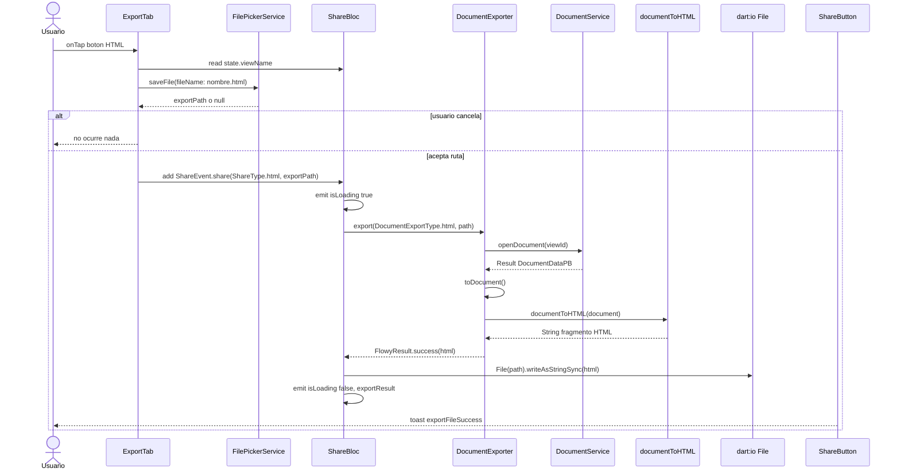
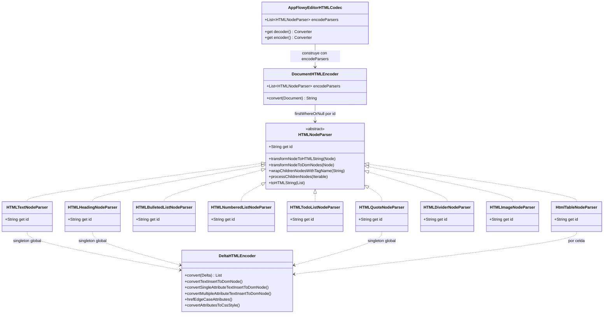
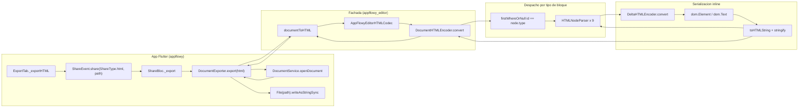
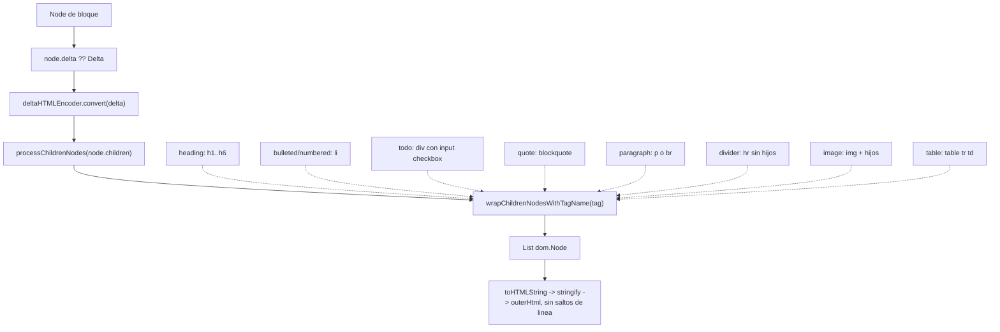
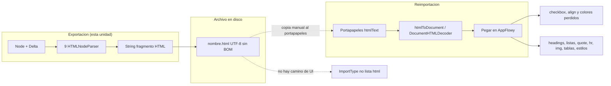

# B4.2 — Export HTML

El motor de exportación a HTML de AppFlowy es **Dart puro del repositorio `appflowy-editor`**: una fachada tipo `Codec<Document, String>` (`editor:lib/src/plugins/html/html_document.dart:38`) que serializa el `Document` del editor como un **fragmento HTML sin envoltorio** (sin `<html>`, sin `<head>`, sin `<body>`), delegando cada tipo de bloque en un `HTMLNodeParser` y cada `Delta` inline en un `DeltaHTMLEncoder`. La capa Flutter solo orquesta: `DocumentExporter.export(DocumentExportType.html)` llama a `documentToHTML(document)` y devuelve un `String` que `ShareBloc` escribe con `File.writeAsStringSync`. Esta unidad documenta el motor completo (15 ficheros del repo `editor`), su frontera con la UI (3 ficheros del repo `appflowy`) y, como evidencia de contrato, los tests del plugin (`[[F19.2.8]]`), que son la especificación ejecutable del formato.

## 1. Punto de entrada (UI)

El único camino de UI para exportar a HTML es la pestaña **Exportar** del popover de compartir, que solo se ofrece para vistas de tipo documento. `ExportTab.build` lee la vista del `ShareBloc` y bifurca según `ViewLayoutPB.Document`: si no es una base de datos, devuelve `_buildDocumentExportTab` (`appflowy/frontend/appflowy_flutter/lib/plugins/shared/share/export_tab.dart:24–32`). Ahí está el primer botón, titulado con `LocaleKeys.shareAction_html` y con el icono `FlowySvgs.export_html_s`, cuyo `onTap` es `_exportHTML` (`appflowy/frontend/appflowy_flutter/lib/plugins/shared/share/export_tab.dart:38–42`).

`_exportHTML` hace exactamente tres cosas (`appflowy/frontend/appflowy_flutter/lib/plugins/shared/share/export_tab.dart:88–102`): lee `state.viewName` del `ShareBloc`, pide una ruta con `getIt<FilePickerService>().saveFile(dialogTitle: '', fileName: '${viewName.toFileName()}.html')` y, si el usuario no cancela, despacha `ShareEvent.share(ShareType.html, exportPath)`. No hay ningún precondición adicional más allá de que la vista sea un documento: **no se exige permiso de escritura, ni que la vista esté publicada, ni que el documento tenga contenido**.

```dart
// appflowy/frontend/appflowy_flutter/lib/plugins/shared/share/export_tab.dart:88–102
Future<void> _exportHTML(BuildContext context) async {
  final viewName = context.read<ShareBloc>().state.viewName;
  final exportPath = await getIt<FilePickerService>().saveFile(
    dialogTitle: '',
    fileName: '${viewName.toFileName()}.html',
  );
  if (context.mounted && exportPath != null) {
    context.read<ShareBloc>().add(
          ShareEvent.share(
            ShareType.html,
            exportPath,
          ),
        );
  }
}
```

`ShareBloc._share` marca `isLoading`, delega en `_export` y guarda el resultado en el estado (`appflowy/frontend/appflowy_flutter/lib/plugins/shared/share/share_bloc.dart:99–119`). Dentro de `_export`, el tipo HTML cae en la rama `else` que **no** es CSV ni raw-database, es decir la que va a `documentExporter.export(type.documentExportType, path: path)` (`appflowy/frontend/appflowy_flutter/lib/plugins/shared/share/share_bloc.dart:326–329`), y el mapeo `ShareType.html → DocumentExportType.html` está en el getter `documentExportType` (`appflowy/frontend/appflowy_flutter/lib/plugins/shared/share/share_bloc.dart:371–372`). El popover que contiene la pestaña se construye en `ShareMenuButton`, que es una de las tres piezas de UI que esta unidad cubre como frontera (`appflowy/frontend/appflowy_flutter/lib/plugins/shared/share/_shared.dart:14–24`, `:96–103`).

Hay un **segundo consumidor** del mismo botón, no de exportación sino de integración: `ShareButton` declara las pestañas `share`/`publish`/`exportAs` y decide qué toast mostrar según el `ShareType` devuelto, incluyendo `ShareType.html` en el grupo de éxito (`appflowy/frontend/appflowy_flutter/lib/plugins/shared/share/share_button.dart:74–81`, `:90–102`).

El siguiente diagrama muestra la interacción completa desde el `onTap` hasta el toast, con los participantes nombrados por su clase real.



*Diagrama: secuencia del export HTML de extremo a extremo.* Lectura: el usuario nunca ve el motor; entre el `onTap` y el toast hay exactamente cinco saltos de proceso (UI → BLoC → servicio → biblioteca `editor` → disco) y ninguno pasa por la FFI. Obsérvese que `openDocument` ocurre **antes** de serializar: el motor no lee el CRDT, recibe un `Document` ya materializado en memoria por `DocumentService` (`appflowy/frontend/appflowy_flutter/lib/workspace/application/export/document_exporter.dart:31–35`), lo que implica que el HTML refleja un instante concreto del documento y que un cambio concurrente puede no quedar incluido `[INFERIDO]`. La rama `alt usuario cancela` es real: `saveFile` devuelve `null` y el `if` de `appflowy/frontend/appflowy_flutter/lib/plugins/shared/share/export_tab.dart:94` aborta sin emitir evento alguno.

## 2. Lado de conversión

La conversión es **100 % Dart, sin FFI y sin Rust**. `documentToHTML` es una función de nivel superior del repo `editor` (`editor:lib/src/plugins/html/html_document.dart:18–36`) y su firma completa es:

```dart
// editor:lib/src/plugins/html/html_document.dart:18–36
String documentToHTML(
  Document document, {
  List<HTMLNodeParser> customParsers = const [],
}) {
  return AppFlowyEditorHTMLCodec(
    encodeParsers: [
      ...customParsers,
      const HTMLTextNodeParser(),
      const HTMLBulletedListNodeParser(),
      const HTMLNumberedListNodeParser(),
      const HTMLTodoListNodeParser(),
      const HTMLQuoteNodeParser(),
      const HTMLHeadingNodeParser(),
      const HTMLImageNodeParser(),
      const HtmlTableNodeParser(),
      const HTMLDividerNodeParser(),
    ],
  ).encode(document);
}
```

**Corrección de alcance importante.** El brief de la unidad mencionaba las opciones `editorState`, `contentHash` y `encodeAmpersand`; **ninguna existe**. La única opción de `documentToHTML` es `customParsers`, una lista de `HTMLNodeParser` que se antepone a la lista por defecto (`editor:lib/src/plugins/html/html_document.dart:20`, `:23–24`). `AppFlowyEditorHTMLCodec` solo admite `encodeParsers` en su constructor (`editor:lib/src/plugins/html/html_document.dart:39–43`); el lado decoder es un getter sin estado (`editor:lib/src/plugins/html/html_document.dart:46`). Ningún call site de la app pasa `customParsers`: `DocumentExporter` lo invoca con el solo argumento posicional (`appflowy/frontend/appflowy_flutter/lib/workspace/application/export/document_exporter.dart:58–60`).

### 2.1 Las clases de la arquitectura

| Clase | Tipo | Rol | Ubicación |
|---|---|---|---|
| `AppFlowyEditorHTMLCodec` | `Codec<Document, String>` | Fachada; solo cablea encoder y decoder | `editor:lib/src/plugins/html/html_document.dart:38–52` |
| `DocumentHTMLEncoder` | `Converter<Document, String>` | Recorre los hijos de la raíz y despacha por `node.type` | `editor:lib/src/plugins/html/html_document_encoder.dart:6–28` |
| `DocumentHTMLDecoder` | `Converter<String, Document>` | Inverse; **no lo usa ningún camino de export**, se documenta en `[[B4.8]]` | `editor:lib/src/plugins/html/html_document_decoder.dart:8–502` |
| `HTMLNodeParser` | abstracta | Contrato por tipo de bloque (9 implementaciones) | `editor:lib/src/plugins/html/encoder/parser/html_node_parser.dart:5–57` |
| `DeltaHTMLEncoder` | `Converter<Delta, List<dom.Node>>` | Serialización inline de los `TextInsert` | `editor:lib/src/plugins/html/encoder/delta_html_encoder.dart:11–157` |
| `HTMLTags` | clase de constantes | Tabla de nombres de etiquetas compartida por encoder y decoder | `editor:lib/src/plugins/html/html_document_decoder.dart:504–583` |

El siguiente diagrama de clases muestra la jerarquía real del lado export: la fachada, el encoder que itera, la clase abstracta con sus nueve subclases y el codificador inline que todas comparten como singleton global.



*Diagrama: la arquitectura de clases del encoder HTML.* Lectura: la jerarquía tiene exactamente un eje —el `id`, que es la clave de bloque que se serializa— y un punto de indirección global: **`deltaHTMLEncoder` es una variable final de nivel superior** (`editor:lib/src/plugins/html/encoder/delta_html_encoder.dart:6`) que todos los parsers comparten, de modo que no hay forma de inyectar una implementación alternativa de la serialización inline (consecuencia: `customParsers` permite sustituir parsers de bloque, pero no el encoder de `Delta`). `AppFlowyEditorHTMLCodec` es un `Codec` de `dart:convert` (`editor:lib/src/plugins/html/html_document.dart:38`), por lo que `.encode(document)` y `.decode(html)` son simétricos aunque el decoder se instancie en cada llamada como un objeto nuevo (`editor:lib/src/plugins/html/html_document.dart:46`).

La tabla anterior enumera las piezas del motor; el decoder completo (`DocumentHTMLDecoder`, 583 líneas) queda fuera de esta unidad y se documenta en `[[B4.8]]`, junto con la matriz de qué HTML de entrada acepta.

El encoder es trivial en su lógica de selección: `DocumentHTMLEncoder.convert` itera `input.root.children` y busca con `firstWhereOrNull` el primer parser cuyo `id` coincida con `node.type` (`editor:lib/src/plugins/html/html_document_encoder.dart:11–16`). **No hay rama `else`**: si ningún parser declara ese `id`, el nodo se descarta en silencio y no deja ni un hueco en la salida (`editor:lib/src/plugins/html/html_document_encoder.dart:17–25`). Es el primer mecanismo de pérdida del motor y se detalla en §5.

El decoder, aunque no pertenece a esta unidad, comparte `HTMLTags` con el encoder: sus dos tablas de despacho son `formattingElements` (12 etiquetas inline, `editor:lib/src/plugins/html/html_document_decoder.dart:539–552`) y `specialElements` (16 etiquetas de bloque, `editor:lib/src/plugins/html/html_document_decoder.dart:554–571`). Un detalle de diseño explica casi toda la tabla de §4: **`HTMLTags.list` vale '`li`', no '`ul`'** (`editor:lib/src/plugins/html/html_document_decoder.dart:513`), y es por eso que `HTMLBulletedListNodeParser` y `HTMLNumberedListNodeParser` envuelven sus hijos en `<li>` (no en `<ul>`/`<ol>`) y dejan el envoltorio de lista para `transformNodeToHTMLString` (`editor:lib/src/plugins/html/encoder/parser/bulleted_list_node_parser.dart:48–51`, `editor:lib/src/plugins/html/encoder/parser/numbered_list_node_parser.dart:46–49`).

**Correcciones de scope declaradas.** Markdown (`.md` y el ZIP con recursos) → `[[B4.1]]`; texto plano → `[[B4.3]]`, que hoy ni siquiera existe como formato funcional (`DocumentExportType.text` lanza `UnimplementedError`, `appflowy/frontend/appflowy_flutter/lib/workspace/application/export/document_exporter.dart:55–56`); JSON → `[[B4.4]]`; importación de Markdown → `[[B4.8]]`; importación ZIP/Notion → `[[B4.11]]`. La capa UI que dispara todo esto ya está documentada en `[[F11]]`, y el uso del codec dentro de la app que no es exportación (copiar/pegar con HTML en el portapapeles) pertenece a `[[F01.8]]`; los tests que citamos como contrato en §4 estándocumentados en `[[F19.2.8]]`.

## 3. Pipeline

El siguiente diagrama muestra el camino completo desde el modelo `Document` en memoria hasta el archivo `.html` en disco, marcando en qué capa se decide cada cosa.



*Diagrama: pipeline de exportación a HTML.* Lectura: `DocumentExporter.export` es el único puente entre la app y el motor; abre el documento vía `DocumentService.openDocument` (`appflowy/frontend/appflowy_flutter/lib/workspace/application/export/document_exporter.dart:31–32`), lo convierte a `Document` con `r.toDocument()` (`:35`) y solo entonces invoca `documentToHTML` (`:58–60`). El `String` que vuelve se envuelve en `FlowyResult.success` sin transformaciones (`:61`) y `ShareBloc._export` lo escribe literalmente en el `path` que eligió el `FilePickerService` (`appflowy/frontend/appflowy_flutter/lib/plugins/shared/share/share_bloc.dart:338`). El motor, por su parte, es un bucle de dos niveles: nivel 1, nodo de bloque (`DocumentHTMLEncoder.convert`, `editor:lib/src/plugins/html/html_document_encoder.dart:13`); nivel 2, `Delta` inline (`DeltaHTMLEncoder.convert`, `editor:lib/src/plugins/html/encoder/delta_html_encoder.dart:13–18`).

El despacho del parser es recursivo y vive en `HTMLNodeParser.processChildrenNodes`: por cada hijo busca su parser con el mismo `firstWhereOrNull` y concatena su `transformNodeToDomNodes` (`editor:lib/src/plugins/html/encoder/parser/html_node_parser.dart:37–53`). Todos los parsers de bloque comparten exactamente tres pasos —convertir el delta, añadir los hijos recursivos, envolver en la etiqueta del bloque—, y solo se diferencian en la etiqueta y en los atributos.



*Diagrama: esqueleto común de los nueve parsers.* Lectura: el grafo central es idéntico para siete de los nueve parsers; solo `HTMLDividerNodeParser` se salta delta e hijos y devuelve directamente `[dom.Element.tag(HTMLTags.divider)]` (`editor:lib/src/plugins/html/encoder/parser/divider_node_parser.dart:21–26`), y `HtmlTableNodeParser` reescribe por completo el bucle de hijos porque sus hijos son celdas, no bloques (`editor:lib/src/plugins/html/encoder/parser/table_node_parser.dart:26–68`). El último salto es donde se pierde cualquier salto de línea del texto: `toHTMLString` concatena `stringify(e)` de cada nodo y hace `.replaceAll('\n', '')` (`editor:lib/src/plugins/html/encoder/parser/html_node_parser.dart:55–56`), y `stringify` usa `outerHtml` para elementos y el `text` pelado para nodos de texto (`editor:lib/src/plugins/html/encoder/parser/html_node_parser.dart:59–69`). Como consecuencia **un `TextInsert` con saltos de línea embedded sale pegado al resto del párrafo**.

## 4. Tabla bloque → salida

Esta es la tabla central de la unidad. Cada fila se apoya en dos fuentes: la línea del parser que emite la etiqueta y la línea del test que fija el HTML esperado **literal**. Los literales entre comillas triples son copia exacta del repositorio de tests (`[[F19.2.8]]`); ninguno está reescrito.

Antes de la tabla de HTML, el contrato declarado por cada parser: el `id` que devuelve es exactamente la constante `type` de su bloque, y ese getter es la única pieza que el `firstWhereOrNull` del encoder utiliza para hacer el despacho (`editor:lib/src/plugins/html/html_document_encoder.dart:14–16`).

| Clase del parser | `id` devuelto (clave de bloque) | Getter | Etiqueta que emite | Atributos que escribe | ¿Procesa hijos? |
|---|---|---|---|---|---|
| `HTMLTextNodeParser` | `ParagraphBlockKeys.type` | `editor:lib/src/plugins/html/encoder/parser/text_node_parser.dart:8` | `p` (`HTMLTags.paragraph`) o `br` si vacío | ninguno | sí, recursivo |
| `HTMLHeadingNodeParser` | `HeadingBlockKeys.type` | `editor:lib/src/plugins/html/encoder/parser/heading_node_parser.dart:8` | `h1`…`h6`, interpolada | ninguno | sí, recursivo |
| `HTMLBulletedListNodeParser` | `BulletedListBlockKeys.type` | `editor:lib/src/plugins/html/encoder/parser/bulleted_list_node_parser.dart:8` | `li` (constante `HTMLTags.list`) + `ul`/`/ul` condicional | ninguno | sí, recursivo |
| `HTMLNumberedListNodeParser` | `NumberedListBlockKeys.type` | `editor:lib/src/plugins/html/encoder/parser/numbered_list_node_parser.dart:8` | `li` + `ol`/`/ol` condicional | `start="N"` opcional (`editor:lib/src/plugins/html/encoder/parser/numbered_list_node_parser.dart:21–22`) | sí, recursivo |
| `HTMLTodoListNodeParser` | `TodoListBlockKeys.type` | `editor:lib/src/plugins/html/encoder/parser/todo_list_node_parser.dart:8` | `div` (`HTMLTags.div`) | `checked=""` en el `<input>` (`editor:lib/src/plugins/html/encoder/parser/todo_list_node_parser.dart:31–33`) | sí, recursivo |
| `HTMLQuoteNodeParser` | `QuoteBlockKeys.type` | `editor:lib/src/plugins/html/encoder/parser/quote_node_parser.dart:8` | `blockquote` (`HTMLTags.blockQuote`) | ninguno | sí, recursivo |
| `HTMLDividerNodeParser` | `DividerBlockKeys.type` | `editor:lib/src/plugins/html/encoder/parser/divider_node_parser.dart:8` | `hr` (`HTMLTags.divider`) | ninguno | **no** |
| `HTMLImageNodeParser` | `ImageBlockKeys.type` | `editor:lib/src/plugins/html/encoder/parser/image_node_parser.dart:8` | `img` (`HTMLTags.image`) | `src` siempre; `height`, `width`, `align` opcionales (`editor:lib/src/plugins/html/encoder/parser/image_node_parser.dart:26–41`) | sí, como hermanos |
| `HtmlTableNodeParser` | `TableBlockKeys.type` | `editor:lib/src/plugins/html/encoder/parser/table_node_parser.dart:11` | `table` / `tr` / `td` (`HTMLTags.table`, `.tableRow`, `.tabledata`) | ninguno; las dimensiones salen del `rowsLen`/`colsLen` del nodo | sí, celda a celda |

Los nueve getters de `id` devuelven constantes `static const String` de sus respectivas clases de claves (`editor:lib/src/editor/block_component/table_block_component/table_block_component.dart:10` para `table`), de modo que el contrato de despacho es una coincidencia de cadenas exacta y sensible a mayúsculas.

| `NodeType` (clave de bloque) | HTML literal emitido | Parser (fichero:línea) | Evidencia del test |
|---|---|---|---|
| `paragraph` con delta | `<p>Welcome to AppFlowy</p>` | `editor:lib/src/plugins/html/encoder/parser/text_node_parser.dart:36–38` | `editor:test/plugins/html/encoder/parser/text_node_parser_test.dart:138` (con `bold` → `<p><strong>…</strong></p>`) |
| `paragraph` con delta vacío | `<br>` | `editor:lib/src/plugins/html/encoder/parser/text_node_parser.dart:33–34` | `editor:test/plugins/html/encoder/parser/text_node_parser_test.dart:58` |
| `heading` nivel 1–6 | `<h$i>Welcome to AppFlowy</h$i>` | `editor:lib/src/plugins/html/encoder/parser/heading_node_parser.dart:30–32` | `editor:test/plugins/html/encoder/parser/text_node_parser_test.dart:31` (bucle `i` de 1 a 6) |
| `bulleted_list` (nodo suelto) | `<ul><li>Welcome to AppFlowy</li></ul>` | `editor:lib/src/plugins/html/encoder/parser/bulleted_list_node_parser.dart:21–25`, `:48–51` | `editor:test/plugins/html/encoder/parser/text_node_parser_test.dart:45` |
| `bulleted_list` (4 contiguos) | `<ul><li>A1</li><li>A2</li><li>A3</li><li>A4</li></ul>` | `editor:lib/src/plugins/html/encoder/parser/bulleted_list_node_parser.dart:23–32` | `editor:test/plugins/html/encoder/parser/bulleted_list_parser_test.dart:29` (literal), `:24` (`expect`) |
| `numbered_list` (sin `number`) | `<ol><li>Welcome to AppFlowy</li></ol>` | `editor:lib/src/plugins/html/encoder/parser/numbered_list_node_parser.dart:22–26`, `:46–49` | `editor:test/plugins/html/encoder/parser/text_node_parser_test.dart:71` |
| `numbered_list` (4 contiguos) | `<ol><li>A1</li><li>A2</li><li>A3</li><li>A4</li></ol>` | `editor:lib/src/plugins/html/encoder/parser/numbered_list_node_parser.dart:24–33` | `editor:test/plugins/html/encoder/parser/numbered_list_parser_test.dart:46` |
| `numbered_list` con `number: 100` | `<ol start="100"><li>A1</li><li>A2</li><li>A3</li><li>A4</li></ol>` | `editor:lib/src/plugins/html/encoder/parser/numbered_list_node_parser.dart:21–22` | `editor:test/plugins/html/encoder/parser/numbered_list_parser_test.dart:48` (literal), `:41` (`expect`) |
| `todo_list` `checked: true` | `<div><input type="checkbox" checked="">Welcome to AppFlowy</div>` | `editor:lib/src/plugins/html/encoder/parser/todo_list_node_parser.dart:30–34`, `:39–41` | `editor:test/plugins/html/encoder/parser/text_node_parser_test.dart:91` |
| `todo_list` `checked: false` | `<div><input type="checkbox">Welcome to AppFlowy</div>` | `editor:lib/src/plugins/html/encoder/parser/todo_list_node_parser.dart:31–33` | `editor:test/plugins/html/encoder/parser/text_node_parser_test.dart:96` |
| `quote` | `<blockquote>Welcome to AppFlowy</blockquote>` | `editor:lib/src/plugins/html/encoder/parser/quote_node_parser.dart:33–35` | `editor:test/plugins/html/encoder/parser/text_node_parser_test.dart:109` |
| `divider` | `<hr>` | `editor:lib/src/plugins/html/encoder/parser/divider_node_parser.dart:25` | `editor:test/plugins/html/encoder/parser/text_node_parser_test.dart:118` |
| `image` con solo `url` | `` | `editor:lib/src/plugins/html/encoder/parser/image_node_parser.dart:25–26`, `:43–44` | `editor:test/plugins/html/encoder/parser/image_node_parser_test.dart:27` |
| `image` con `align: center` | `` | `editor:lib/src/plugins/html/encoder/parser/image_node_parser.dart:38–41` | `editor:test/plugins/html/encoder/document_html_encoder_test.dart:316` (dentro de `nestedHTML`) |
| `table` 2×2 heterogénea | `<table><tr><td><h2>a</h2></td><td><p><i>c</i></p></td></tr><tr><td><p><strong>b</strong></p></td><td><p>d</p></td></tr></table>` | `editor:lib/src/plugins/html/encoder/parser/table_node_parser.dart:34–67` | `editor:test/plugins/html/encoder/parser/table_node_parser_test.dart:111` |

### 4.1 Formato inline (delta) — la otra mitad de la tabla

El `Delta` de cada bloque pasa por `DeltaHTMLEncoder`, que decide entre texto plano, etiqueta directa o `<span>` con CSS según el **número** de atributos del `TextInsert` (`editor:lib/src/plugins/html/encoder/delta_html_encoder.dart:24–34`). La tabla `keyToTag` solo cubre cinco claves (`editor:lib/src/plugins/html/encoder/delta_html_encoder.dart:56–63`).

| Atributos del `TextInsert` | HTML literal | Rama | Evidencia del test |
|---|---|---|---|
| ninguno | texto pelado (`dom.Text`) | `editor:lib/src/plugins/html/encoder/delta_html_encoder.dart:24–26` | sin test propio: se ejerce en todos los literales de bloque con delta simple |
| `bold: true` | `<strong>…</strong>` | `editor:lib/src/plugins/html/encoder/delta_html_encoder.dart:57`, `:65–66` | `editor:test/plugins/html/encoder/parser/text_node_parser_test.dart:138` |
| `italic: true` | `<i>…</i>` | `editor:lib/src/plugins/html/encoder/delta_html_encoder.dart:58` | `editor:test/plugins/html/delta_encoder_test.dart:40–71` (`test('italic')`) |
| `underline: true` | `<u>…</u>` | `editor:lib/src/plugins/html/encoder/delta_html_encoder.dart:59` | `editor:test/plugins/html/encoder/parser/text_node_parser_test.dart:158` |
| `strikethrough: true` | `<del>…</del>` | `editor:lib/src/plugins/html/encoder/delta_html_encoder.dart:60` | `editor:test/plugins/html/encoder/parser/text_node_parser_test.dart:178` |
| `code: true` | `<code>…</code>` | `editor:lib/src/plugins/html/encoder/delta_html_encoder.dart:61` | `editor:test/plugins/html/delta_encoder_test.dart:177–210` |
| `href` solo | `<a href="…">…</a>` | `editor:lib/src/plugins/html/encoder/delta_html_encoder.dart:45–50` | `editor:test/plugins/html/delta_encoder_test.dart:142–175` |
| `bg_color` o `font_color` solo | `<span style="background-color: …">` (redirigido a multi-atributo) | `editor:lib/src/plugins/html/encoder/delta_html_encoder.dart:52–54` | `editor:test/plugins/html/encoder/parser/text_node_parser_test.dart:248`, `:271` |
| `underline` + `strikethrough` | `<span style="text-decoration: underline line-through">…</span>` | `editor:lib/src/plugins/html/encoder/delta_html_encoder.dart:133–139` | `editor:test/plugins/html/encoder/parser/text_node_parser_test.dart:199` |
| 6 atributos (los 4 de estilo + 2 colores) | `<span style="font-weight: bold; text-decoration: underline line-through; font-style: italic; background-color: rgba(0, 188, 240, 96); color: rgba(33, 150, 243, 255)">…</span>` | `editor:lib/src/plugins/html/encoder/delta_html_encoder.dart:127–155` | `editor:test/plugins/html/encoder/parser/text_node_parser_test.dart:224` |
| `href` + varios estilos | anidamiento `<a href="…"><u><i><strong>…</strong></i></u></a>` | `editor:lib/src/plugins/html/encoder/delta_html_encoder.dart:87–125` | `editor:test/plugins/html/delta_encoder_test.dart:212` (`test('composition')`), `:237` |

> Nota de trazabilidad: la fila "ningún atributo" no tiene fichero de test propio; los siete tests de `editor:test/plugins/html/delta_encoder_test.dart` cubren los seis atributos con nombre más la composición (`test('bold')` en `editor:test/plugins/html/delta_encoder_test.dart:7`, `test('italic')` en `editor:test/plugins/html/delta_encoder_test.dart:40`, `test('underline')` en `editor:test/plugins/html/delta_encoder_test.dart:73`, `test('strikethrough')` en `editor:test/plugins/html/delta_encoder_test.dart:109`, `test('href')` en `editor:test/plugins/html/delta_encoder_test.dart:142`, `test('code')` en `editor:test/plugins/html/delta_encoder_test.dart:177`, `test('composition')` en `editor:test/plugins/html/delta_encoder_test.dart:212`).

### 4.2 Detalles finos del contrato por parser

- **Listas**: el patrón "envolver solo si soy el primero o el último" está implementado con cuatro ramas excluyentes en `transformNodeToHTMLString` (`editor:lib/src/plugins/html/encoder/parser/bulleted_list_node_parser.dart:23–32`, idéntico en `editor:lib/src/plugins/html/encoder/parser/numbered_list_node_parser.dart:24–33`). Solo el nodo que abre la secuencia emite `<ul>`/`<ol>` y solo el que la cierra emite `</ul>`/`</ol>`; los intermedios emiten solo su `<li>`. Consecuencia verificable: una lista interrumpida por otro tipo de bloque produce dos `<ul>` separados, no uno.
- **`start` en listas numeradas**: se lee `node.attributes[NumberedListBlockKeys.number]` y se interpola sin validación (`editor:lib/src/plugins/html/encoder/parser/numbered_list_node_parser.dart:21–22`). El test fija exactamente `start="100"` (`editor:test/plugins/html/encoder/parser/numbered_list_parser_test.dart:48`).
- **`todo_list`**: el `<input type="checkbox" />` se crea con `dom.Element.html` (HTML literal embebido en el código Dart, no `dom.Element.tag`) y se **inserta en la posición 0** del buffer de nodos antes de añadir el delta y los hijos (`editor:lib/src/plugins/html/encoder/parser/todo_list_node_parser.dart:30`, `:34`). El atributo `checked` se añade con valor cadena vacía (`editor:lib/src/plugins/html/encoder/parser/todo_list_node_parser.dart:31–33`), que es exactamente lo que espera el test (`editor:test/plugins/html/encoder/parser/text_node_parser_test.dart:91`).
- **`image`**: los atributos `height`, `width` y `align` son **opcionales** y solo se emiten si no son nulos (`editor:lib/src/plugins/html/encoder/parser/image_node_parser.dart:28–41`); sus nombres de clave son `url`, `height`, `width` y `align` (`editor:lib/src/editor/block_component/image_block_component/image_block_component.dart:14`, `:20`, `:25`, `:30`). A diferencia de los demás parsers, `transformNodeToDomNodes` devuelve `[anchor, ...hijos]`, es decir **emite el `` como hermano de sus hijos, no como padre** (`editor:lib/src/plugins/html/encoder/parser/image_node_parser.dart:43–49`).
- **`table`**: itera `rowsLen × colsLen` leyendo las dimensiones de los atributos del nodo (`editor:lib/src/plugins/html/encoder/parser/table_node_parser.dart:30–31`), obtiene cada celda con `getCellNode(node, col, row)` (`editor:lib/src/editor/block_component/table_block_component/util.dart:4`, importado en `editor:lib/src/plugins/html/encoder/parser/table_node_parser.dart:5`) y envuelve cada hijo de celda en `<td>` (`editor:lib/src/plugins/html/encoder/parser/table_node_parser.dart:39–55`). El bucle de hijos de la celda **no acumula**: cada iteración crea un `<td>` nuevo, de modo que una celda con varios bloques produce varios `<td>` dentro de la misma fila, no un `<td>` con varios hijos (`editor:lib/src/plugins/html/encoder/parser/table_node_parser.dart:39–55`). Los nombres de clave de la tabla (`rowsLen`, `colsLen`, `colDefaultWidth`, `rowDefaultHeight`, `colMinimumWidth`) están en `editor:lib/src/editor/block_component/table_block_component/table_block_component.dart:12–22`.
- **Barrel incompleto**: `editor:lib/src/plugins/html/encoder/parser/html_parser.dart` exporta nueve ficheros pero **no** `divider_node_parser.dart` (`:1–9`), por eso `html_document.dart` lo importa por ruta completa (`editor:lib/src/plugins/html/html_document.dart:6`). Un consumidor externo que importe solo el barrel no ve el parser de `divider` `[VERIFICADO]`.
- **Los nueve parsers por defecto** están cableados en la lista literal de `documentToHTML` (`editor:lib/src/plugins/html/html_document.dart:25–33`), y los tests replican esa misma lista a mano (`editor:test/plugins/html/encoder/parser/text_node_parser_test.dart:6–16`).

## 5. Pérdidas

Todo lo que sigue se pierde **en el momento de codificar a HTML**, no al escribir el archivo. Cada punto está anclado a la línea que lo descarta.

1. **Bloques sin parser registrado, descartados en silencio.** `DocumentHTMLEncoder.convert` no tiene rama `else`: si `encodeParsers.firstWhereOrNull` devuelve `null`, el nodo no se escribe en el buffer (`editor:lib/src/plugins/html/html_document_encoder.dart:14–25`). Es la pérdida mayor del motor, porque es **invisible**: el HTML resultante sigue siendo válido y el toast de éxito se muestra igual (`appflowy/frontend/appflowy_flutter/lib/plugins/shared/share/share_button.dart:93–97`). El decoder tiene un caso `default` que trata lo desconocido como párrafo (`editor:lib/src/plugins/html/html_document_decoder.dart:124–125`), pero **el encoder no tiene equivalente**.

   Conviene ser preciso sobre *qué* se pierde, porque el motor está casi completo para el editor base: el mapa estándar de bloques del repo `editor` registra 11 tipos (`editor:lib/src/editor/block_component/standard_block_components.dart:10–56`) y el exportador tiene parser para 9 (`editor:lib/src/plugins/html/html_document.dart:25–33`). Los dos restantes no son un hueco real: `page` es la raíz y `convert` itera `root.children`, nunca el nodo raíz (`editor:lib/src/plugins/html/html_document_encoder.dart:13`), y `table_cell` lo atiende `HtmlTableNodeParser` a mano (`editor:lib/src/plugins/html/encoder/parser/table_node_parser.dart:39–55`). El hueco real viene de los tipos de bloque **adicionales** que registra la dependencia `appflowy_editor_plugins` y que este motor no conoce: la app los usa explícitamente (`appflowy/frontend/appflowy_flutter/lib/plugins/document/presentation/editor_page.dart:173–174`, `:202–205`) y ninguna de sus claves aparece en el barrel público del repo `editor` (`editor:lib/src/plugins/plugins.dart:1–17`). Todos esos bloques —toggle, callout, tabla simple— desaparecen del `.html` sin dejar marca `[VERIFICADO para el descarte; INFERIDO para el inventario concreto de claves, porque `appflowy_editor_plugins` no está entre las tres fuentes de esta skill]`.
2. **El barrel público no expone el parser de `divider`.** `editor:lib/src/plugins/html/encoder/parser/html_parser.dart` exporta nueve ficheros pero no `divider_node_parser.dart` (`editor:lib/src/plugins/html/encoder/parser/html_parser.dart:1–9`), y ese barrel es a su vez lo que reexporta `package:appflowy_editor/appflowy_editor.dart` (`editor:lib/src/plugins/plugins.dart:2`), que es justo el import que hace la app (`appflowy/frontend/appflowy_flutter/lib/workspace/application/export/document_exporter.dart:9`). A `documentToHTML` no le afecta, porque su lista por defecto se construye con el import directo de `editor:lib/src/plugins/html/html_document.dart:6`, pero cualquier `customParsers` construido desde el barrel **no puede reutilizar `HTMLDividerNodeParser`** y perdería todos los `<hr>` `[VERIFICADO]`.
3. **Salto de línea dentro del texto.** `toHTMLString` hace `.replaceAll('\n', '')` sobre la concatenación completa (`editor:lib/src/plugins/html/encoder/parser/html_node_parser.dart:55–56`), así que un `TextInsert` con `\n` embedded produce texto corrido sin marca de fin de párrafo.
4. **Párrafo vacío → `<br>` en lugar de `<p></p>`.** `HTMLTextNodeParser` devuelve `[dom.Element.tag(HTMLTags.br)]` cuando el buffer queda vacío (`editor:lib/src/plugins/html/encoder/parser/text_node_parser.dart:33–34`). Un párrafo vacío y su ausencia son indistinguibles en la salida `[VERIFICADO]` (literal en `editor:test/plugins/html/encoder/parser/text_node_parser_test.dart:58`).
5. **Geometría de tabla.** El parser solo lee `rowsLen` y `colsLen` (`editor:lib/src/plugins/html/encoder/parser/table_node_parser.dart:30–31`); nunca escribe `colDefaultWidth`, `rowDefaultHeight`, `colMinimumWidth`, `colsHeight` ni `borderWidth`, que sí existen como claves (`editor:lib/src/editor/block_component/table_block_component/table_block_component.dart:12–24`). El HTML no lleva `width`, `height`, `colspan`, `rowspan` ni `<thead>`/`th`.
6. **Alineación de imagen en la vuelta.** El encoder sí emite `align` (`editor:lib/src/plugins/html/encoder/parser/image_node_parser.dart:38–41`), pero el decoder solo lee `src` (`editor:lib/src/plugins/html/html_document_decoder.dart:364–373`), así que el atributo se pierde en el round-trip, no en la exportación.
7. **Atributos de texto fuera de la whitelist de CSS.** `convertAttributesToCssStyle` solo sabe construir seis declaraciones: `font-weight`, `text-decoration`, `font-style`, `background-color` y `color` (`editor:lib/src/plugins/html/encoder/delta_html_encoder.dart:130–153`). El `Delta` del editor admite más claves —`font_family`, `font_size`, `auto_complete`, `find_bg_color`, `transparent` (`editor:lib/src/editor/block_component/rich_text/appflowy_rich_text_keys.dart:8–14`)— y todas se descartan sin llegar al `style`.
8. **Atributos simples no mapeados.** Si un `TextInsert` tiene **exactamente un** atributo cuya clave no está en `keyToTag`, la expresión `keyToTag[attributes.keys.first]` devuelve `null` y ese `null` se pasa a `dom.Element.tag(...)` (`editor:lib/src/plugins/html/encoder/delta_html_encoder.dart:65–66`). Qué emite exactamente el paquete `html` ante un nombre de etiqueta nulo no es determinable desde las fuentes de esta skill `[NO DETERMINADO]`, y ningún test cubre el caso `[VERIFICADO: por ausencia en editor:test/plugins/html/delta_encoder_test.dart]`.
9. **Metadatos de documento.** No se emite `doctype`, `<html>`, `<head>`, `<meta charset>`, `<title>` ni `<body>`: `DocumentHTMLEncoder.convert` solo concatena los fragmentos de cada bloque (`editor:lib/src/plugins/html/html_document_encoder.dart:12`, `:26`). La salida es un **fragmento**, no un documento HTML válido por sí solo `[VERIFICADO]`.

## 6. Assets

Las imágenes se exportan **por referencia**, nunca incrustadas. `HTMLImageNodeParser` copia el valor del atributo `url` del nodo directamente al atributo `src` del `` (`editor:lib/src/plugins/html/encoder/parser/image_node_parser.dart:26`), sin descargar el binario, sin copiarlo a una carpeta hermana y sin generar `data:` URI. El comentario de la propia clave de bloque confirma que `url` puede ser una URL o una base64 en web (`editor:lib/src/editor/block_component/image_block_component/image_block_component.dart:16–20`), y el exportador simplemente lo traspasa.

Consecuencias operativas:

- Un archivo HTML exportado desde AppFlowy **no es autocontenido**: las imágenes quedan colgando de la red, y solo se resuelven si el servidor de assets sigue vivo y accesible. Esto contrasta con la exportación Markdown, que sí empaqueta un directorio de recursos en un ZIP (`appflowy/frontend/appflowy_flutter/lib/shared/markdown_to_document.dart:26`, documentado en `[[B4.1]]`).
- Las imágenes locales incrustadas en el documento cuyo `url` no sea una URL absoluta se exportan tal cual; el decoder, en cambio, descarta cualquier `src` que no empiece por `http` y lo sustituye por un párrafo vacío (`editor:lib/src/plugins/html/html_document_decoder.dart:364–368`). Es una pérdida asimétrica: el lado export es permisivo, el lado import es restrictivo `[VERIFICADO]`.
- No hay ninguna carpeta, ningún `manifest` y ninguna referencia a assets de archivo en los 15 ficheros del motor: la única etiqueta de asset es `` (`editor:lib/src/plugins/html/html_document_decoder.dart:515`). Los bloques `file`, `video` y `media` del editor no tienen parser (§5, punto 1).

## 7. Encoding y nombre de archivo

**Nombre.** Lo compone la UI, no el motor. `ExportTab._exportHTML` pasa a `FilePickerService.saveFile` el nombre `'${viewName.toFileName()}.html'` (`appflowy/frontend/appflowy_flutter/lib/plugins/shared/share/export_tab.dart:90–93`). `toFileName` sustituye **cada carácter** del conjunto `\/*?"<>| ` (barra, barra inversa, dos puntos, asterisco, interrogación, comillas, ángulo, barra vertical y **espacio**) por un guion bajo, carácter a carácter (`appflowy/frontend/appflowy_flutter/lib/util/string_extension.dart:12`, `:17–27`). No hay recorte de longitud, ni normalización Unicode, ni desambiguación de colisiones: dos vistas con el mismo nombre producen dos `nombre.html` y el `FilePickerService` decide (`appflowy/frontend/appflowy_flutter/lib/plugins/shared/share/export_tab.dart:90`). La extensión es siempre `.html` en minúsculas y la añade la UI, no el motor `[VERIFICADO]`.

**Encoding.** `documentToHTML` devuelve un `String` de Dart y no toca bytes (`editor:lib/src/plugins/html/html_document.dart:18`). La conversión a bytes ocurre en un único sitio: `File(path).writeAsStringSync(s)` en `ShareBloc._export` (`appflowy/frontend/appflowy_flutter/lib/plugins/shared/share/share_bloc.dart:338`), **sin argumento `encoding`**, es decir con el valor por defecto de la firma de `dart:io`, que es UTF-8. No se escribe BOM y no hay ninguna cabecera `<meta charset="utf-8">` en la salida, porque el motor no emite envoltorio (§5, punto 9) `[VERIFICADO]` para el código; la consecuencia —que un visor que asuma Latin-1 mostraría caracteres corruptos— es `[INFERIDO]` a partir del comportamiento estándar de `dart:io`.

Contraste útil: el importador sí es explícito con el encoding y siempre UTF-8 (`File(path).readAsString()` y `utf8.encode(data)` en `appflowy/frontend/appflowy_flutter/lib/workspace/presentation/home/menu/sidebar/import/import_panel.dart:164–205`), otra señal de que HTML quedó fuera del contrato de importación (§9).

**Contraste con el importador de la UI.** El enum `ImportType` solo contempla `historyDocument`, `historyDatabase`, `markdownOrText`, `csv` y `afDatabase` (`appflowy/frontend/appflowy_flutter/lib/workspace/presentation/home/menu/sidebar/import/import_type.dart:7–12`) y sus extensiones permitidas son `afdoc`, `afdb`, `md`, `txt` y `csv` (`appflowy/frontend/appflowy_flutter/lib/workspace/presentation/home/menu/sidebar/import/import_type.dart:60–72`). **No hay `html` en ninguna de las dos listas**, y el `switch` del panel de importación solo tiene esos cinco casos (`appflowy/frontend/appflowy_flutter/lib/workspace/presentation/home/menu/sidebar/import/import_panel.dart:162–207`).

## 8. Errores

El motor de exportación a HTML **no tiene manejo de errores propio**: no hay `try`/`catch`, ni tipos de excepción, ni códigos de error, ni logging en ninguno de los 15 ficheros. `DocumentExporter.export` solo devuelve un `FlowyResult` por dos motivos: que `DocumentService.openDocument` falle (`appflowy/frontend/appflowy_flutter/lib/workspace/application/export/document_exporter.dart:32–33`, `:64`) o que `r.toDocument()` devuelva `null`, caso en el que emite `FlowyError(msg: LocaleKeys.settings_files_exportFileFail.tr())` (`appflowy/frontend/appflowy_flutter/lib/workspace/application/export/document_exporter.dart:36–42`). El camino HTML no añade ninguno de los dos casos propios (`appflowy/frontend/appflowy_flutter/lib/workspace/application/export/document_exporter.dart:57–61`).

Los modos de fallo reales, con su gravedad:

| Fallo | Dónde | Comportamiento observado | Etiqueta |
|---|---|---|---|
| `assert(node.type == …)` en bulleted/numbered/todo/quote/table | `editor:lib/src/plugins/html/encoder/parser/bulleted_list_node_parser.dart:15` y las otras cuatro implementaciones | `AssertionError` en depuración; código muerto en release porque el dispatch ya garantiza el tipo | `[VERIFICADO]` |
| Escritura a disco fallida (permisos, ruta ocupada) | `appflowy/frontend/appflowy_flutter/lib/plugins/shared/share/share_bloc.dart:338` | `FileSystemException` sin capturar: el error sube por la cadena de eventos y **no llega al toast** | `[VERIFICADO]` (por ausencia de `try`) |
| Bloque sin parser | `editor:lib/src/plugins/html/html_document_encoder.dart:17–25` | Silenciosa: el contenido desaparece y el export sigue siendo "exitoso" | `[VERIFICADO]` |
| `DocumentExportType.text` | `appflowy/frontend/appflowy_flutter/lib/workspace/application/export/document_exporter.dart:55–56` | `UnimplementedError`; ningún botón lo ofrece | `[VERIFICADO]` |

El toast de éxito/fallo lo decide `ShareButton` leyendo `exportResult`: éxito para `markdown`, `html` y `csv` con el mensaje `settings_files_exportFileSuccess` (`appflowy/frontend/appflowy_flutter/lib/plugins/shared/share/share_button.dart:90–102`), y error con `settings_files_exportFileFail: <code>` (`appflowy/frontend/appflowy_flutter/lib/plugins/shared/share/share_button.dart:104–109`). Como la escritura del §7 no captura excepciones, el toast de error solo se ve cuando el fallo ocurre **antes** de escribir. Detalle de contrato heredado de `[[F11]]`: `ShareType.unimplemented` solo contiene `link` (`appflowy/frontend/appflowy_flutter/lib/plugins/shared/share/share_bloc.dart:365`), de modo que `text` no se filtra ahí y su `UnimplementedError` sí llegaría al usuario si algún día se expusiera.

## 9. Round-trip

La vuelta completa es `HTML → Document` mediante `DocumentHTMLDecoder`, cuyo contrato, tablas de despacho y pérdidas ya están documentados con detalle en `[[F19.2.8]]` y son la unidad hermana de este motor en `[[B4.8]]`. Aquí sólo se registra lo que afecta a la salida del exportador:

**No existe camino de UI para reimportar HTML.** Es un hallazgo material y verificado: la función `htmlToDocument` existe y es pública (`editor:lib/src/plugins/html/html_document.dart:13–15`), pero sus dos únicos consumidores en toda la app son el **portapapeles** —`paste_from_html` la invoca al pegar (`appflowy/frontend/appflowy_flutter/lib/plugins/document/presentation/editor_plugins/copy_and_paste/paste_from_html.dart:27`) y `custom_copy_command` usa el camino inverso `documentToHTML` al copiar (`appflowy/frontend/appflowy_flutter/lib/plugins/document/presentation/editor_plugins/copy_and_paste/custom_copy_command.dart:56`, `:70`)— y la app de ejemplo del editor (`editor:example/lib/home_page.dart:152`). La UI de importación (§7) no la menciona en ningún caso. Por tanto **el round-trip del exportador HTML es, hoy, un contrato de biblioteca, no un flujo de usuario**: un archivo `.html` producido por AppFlowy no se puede recuperar desde la propia aplicación por la interfaz.

**Estado global del flag de color.** `DocumentHTMLDecoder.enableColorParse` es un `static bool` con valor inicial `true` (`editor:lib/src/plugins/html/html_document_decoder.dart:11–12`) que gobierna tres ramas del parseo de CSS: `background-color` (`editor:lib/src/plugins/html/html_document_decoder.dart:452–458`), `background` (`:461–467`) y `color` (`:470–476`). **Corrección al precedente de `[[F19.2.8]]`**: ese documento concluyó que "nadie lo cambia"; es incorrecto. La app lo desactiva explícitamente al construir la página de editor (`appflowy/frontend/appflowy_flutter/lib/plugins/document/presentation/editor_page.dart:192–193`), con el comentario `// disable the color parse in the HTML decoder.` La consecuencia práctica es que **el HTML exportado por esta unidad sí contiene `background-color` y `color` (§4.1), pero al pegarlo de vuelta en AppFlowy esos colores se descartan**: el round-trip inline pierde color siempre en la app de escritorio, aunque la biblioteca sí lo preservaría por defecto `[VERIFICADO]`.

El siguiente diagrama resume qué sobrevive al ciclo completo en la aplicación, marcando en rojo las rutas que se cortan dentro de la app pero no dentro de la biblioteca.



*Diagrama: qué se pierde en el round-trip y dónde.* Lectura: la ruta sólida superior es el único camino que la aplicación soporta hoy (exportar a disco). La ruta punteada hacia `htmlToDocument` solo se materializa si el usuario copia el contenido a mano, porque la importación por archivo no contempla `.html` (§7). En esa ruta, el decoder reconstruye bien la estructura de bloques pero pierde tres familias de atributos: el estado del checkbox de los `todo_list`, el `align` de las imágenes y —porque `enableColorParse` está a `false` en la app (`appflowy/frontend/appflowy_flutter/lib/plugins/document/presentation/editor_page.dart:193`)— el `bg_color` y el `font_color`, que sí viajan en el HTML de salida (§4.1).

**Tabla de equivalencias de este lado (Document → HTML)**, para la matriz de `[[B4.13]]`:

| Atributo del nodo | Emitido como | ¿Vuelve al reimportar? | Evidencia |
|---|---|---|---|
| `bold`, `italic`, `underline`, `strikethrough` | `<strong>`, `<i>`, `<u>`, `<del>` (o CSS si hay 2+) | Sí | `editor:lib/src/plugins/html/encoder/delta_html_encoder.dart:57–60`; `editor:lib/src/plugins/html/html_document_decoder.dart:264–275` |
| `code` | `<code>` | Sí (`{code: true}`) | `editor:lib/src/plugins/html/encoder/delta_html_encoder.dart:61`; `editor:lib/src/plugins/html/html_document_decoder.dart:276–278` |
| `href` | `<a href="…">` (+ anidamiento si hay estilos) | Sí | `editor:lib/src/plugins/html/encoder/delta_html_encoder.dart:45–50`; `editor:lib/src/plugins/html/html_document_decoder.dart:285–290` |
| `bg_color` / `font_color` | `rgba(r, g, b, a)` decimal en `style` | **No en la app** (flag off) | `editor:lib/src/extensions/color_extension.dart:33–39`; `appflowy/frontend/appflowy_flutter/lib/plugins/document/presentation/editor_page.dart:193` |
| `todo_list.checked` | `<input type="checkbox" checked="">` | **No** (`input` cae en el `default` del decoder y se vuelve párrafo) | `editor:lib/src/plugins/html/encoder/parser/todo_list_node_parser.dart:30–33`; `editor:lib/src/plugins/html/html_document_decoder.dart:87–127` |
| `image.align` | `align="center"` | **No** (el decoder solo lee `src`) | `editor:lib/src/plugins/html/encoder/parser/image_node_parser.dart:38–41`; `editor:lib/src/plugins/html/html_document_decoder.dart:364–373` |
| dimensiones de tabla | ninguna | No | `editor:lib/src/plugins/html/encoder/parser/table_node_parser.dart:30–31` |

La reconstrucción de color cuando el flag está activo es simétrica y reversible: el encoder emite `rgba($red, $green, $blue, $alpha)` con `(a * 255).toInt()` (`editor:lib/src/extensions/color_extension.dart:33–39`) y el decoder lo vuelve a hex con `tryToColor()` + `toHex()` (`editor:lib/src/editor/util/color_util.dart:4–6`, `:51–57`), cuyo regex `rgba` exige exactamente el formato `rgba(N, N, N, N)` que el encoder produce (`editor:lib/src/editor/util/color_util.dart:6`). El literal `background-color: rgba(0, 188, 240, 96)` del test conserva el alfa `0x60 = 96` sin perder precisión (`editor:test/plugins/html/encoder/parser/text_node_parser_test.dart:224`).

## 10. Extensión y firma

| Propiedad | Valor | Evidencia |
|---|---|---|
| Extensión de archivo | `.html` (minúsculas), decidida por la UI | `appflowy/frontend/appflowy_flutter/lib/plugins/shared/share/export_tab.dart:92` |
| MIME type | **ninguno declarado**: el `saveFile` se llama con `dialogTitle: ''` y sin filtros; no hay constante MIME en el motor | `appflowy/frontend/appflowy_flutter/lib/plugins/shared/share/export_tab.dart:90–93` |
| Magic bytes | **ninguno**: no hay cabecera ni `doctype` (§5, punto 9) | `editor:lib/src/plugins/html/html_document_encoder.dart:12–26` |
| Encoding en disco | UTF-8, sin BOM (default de `dart:io` al no pasar `encoding`) | `appflowy/frontend/appflowy_flutter/lib/plugins/shared/share/share_bloc.dart:338` |
| Estructura del documento | fragmento HTML sin `<html>/<head>/<body>`; los bloques van concatenados sin separador | `editor:lib/src/plugins/html/html_document_encoder.dart:18–26` |
| Detección por parte del importador | imposible por extensión: `ImportType.allowedExtensions` no incluye `html` | `appflowy/frontend/appflowy_flutter/lib/workspace/presentation/home/menu/sidebar/import/import_type.dart:60–72` |

La consecuencia de "sin MIME, sin magic bytes, sin extensión reconocida" es que un `.html` exportado por AppFlowy es **indistinguible de una página web cualquiera** para cualquier herramienta, y que el propio importador de la app lo rechazaría aunque se leLauncherase con la ruta correcta.

## 11. Ejemplos

### 11.1 Documento real → HTML real (literal de los tests)

El caso más denso del repositorio es el `test('parser document')` de `document_html_encoder_test.dart`, que convierte un `Document.fromJson` y compara el resultado contra la constante `example` de una línea (`editor:test/plugins/html/encoder/document_html_encoder_test.dart:41–42`). Muestra deliberadamente (el literal completo son 1 208 caracteres en una sola línea, con sangrías de 4 espacios en la fuente):

```html
<h1>AppFlowyEditor</h1><h2>👋 <strong>Welcome to</strong>   <span style="font-weight: bold; font-style: italic">AppFlowy Editor</span></h2><p>AppFlowy Editor is a <strong>highly customizable</strong>   <i>rich-text editor</i></p>…<ul><li>[x] Customizable</li><li>[x] Test-covered</li><li>[ ] more to come!</li></ul><blockquote>This is a quote!</blockquote><p><code> Code block</code></p>…<hr><h3>Awesome features</h3>…<br><br>
```

Tres cosas se leen aquí y conviene internalizarlas: (a) los `<p>`, `<h1>` y `<li>` van **pegados, sin `\n` ni separador**, porque `DocumentHTMLEncoder` los concatena en un `StringBuffer` (`editor:lib/src/plugins/html/html_document_encoder.dart:12`, `:18`) y `toHTMLString` borra cualquier salto (`editor:lib/src/plugins/html/encoder/parser/html_node_parser.dart:56`); (b) los dos `<br>` finales son **dos párrafos vacíos** convertidos por la rama `domNodes.isEmpty` (`editor:lib/src/plugins/html/encoder/parser/text_node_parser.dart:33–34`); (c) el "code block" es solo un `<code>` inline dentro de un `<p>`, porque el editor **no tiene bloque `code_block` en este motor** (§5, punto 1).

El segundo caso, `nestedHTML` (`editor:test/plugins/html/encoder/document_html_encoder_test.dart:315–316`), demuestra el comportamiento de `image` con hijos: el `` aparece **como hermano del párrafo siguiente**, no envuelto, exactamente por el `return [anchor, ...processChildrenNodes(...)]` de `editor:lib/src/plugins/html/encoder/parser/image_node_parser.dart:43–49`.

### 11.2 Salida mínima, bloque por bloque

Los nueve literales que un lector necesita para predecir el resultado. Ocho salen de `editor:test/plugins/html/encoder/parser/text_node_parser_test.dart` (el `` viene de `editor:test/plugins/html/encoder/parser/image_node_parser_test.dart:27`):

```html
<h3>Welcome to AppFlowy</h3>            <!-- heading_node_parser -->
<ul><li>Welcome to AppFlowy</li></ul>   <!-- bulleted_list_node_parser -->
<ol><li>Welcome to AppFlowy</li></ol>   <!-- numbered_list_node_parser -->
<div><input type="checkbox" checked="">Welcome to AppFlowy</div>  <!-- todo_list_node_parser -->
<blockquote>Welcome to AppFlowy</blockquote>                       <!-- quote_node_parser -->
<hr>                                    <!-- divider_node_parser -->
         <!-- image_node_parser -->
<br>                                    <!-- text_node_parser -->
<p><span style="font-weight: bold; text-decoration: underline line-through; font-style: italic">…</span></p>
```

### 11.3 El hueco invisible: qué se pierde sin dejar rastro

Un documento con `heading`, `paragraph`, `callout` y `divider` produce un archivo con el heading, el párrafo y el `<hr>`, y **el `callout` desaparece sin ninguna marca** — el resultado sigue siendo HTML bien formado y el toast de éxito aparece igual (`appflowy/frontend/appflowy_flutter/lib/plugins/shared/share/share_button.dart:93–97`). La causa está en la ausencia de rama `else` (`editor:lib/src/plugins/html/html_document_encoder.dart:17–25`) y la razón por la que la tabla de §4 solo tiene nueve filas mientras que el editor tiene del orden de veinte tipos de bloque.

### 11.4 Correcciones de scope de esta unidad (cierre)

Reafirmadas para que ningún lector las pierda: la exportación a **Markdown** (incluido el ZIP con recursos y el copiado al portapapeles) es `[[B4.1]]`; el **texto plano** es `[[B4.3]]` y hoy está declarado pero no implementado (`appflowy/frontend/appflowy_flutter/lib/workspace/application/export/document_exporter.dart:55–56`); el **JSON** es `[[B4.4]]`; la **importación de Markdown** es `[[B4.8]]`, donde vive también la superficie pública de `DocumentHTMLDecoder` y sus tablas `formattingElements`/`specialElements` (`editor:lib/src/plugins/html/html_document_decoder.dart:539–571`); la **importación ZIP/Notion** es `[[B4.11]]`. La **UI** que dispara la exportación es `[[F11]]`, y el **uso del codec dentro de la app** fuera de la exportación (copiar/pegar) es `[[F01.8]]`. Los **tests** del plugin —la evidencia de la tabla de §4— están documentados en `[[F19.2.8]]`. La **matriz de round-trip** que consolida esta tabla con las de los demás formatos corresponde a `[[B4.13]]`.

---

## Relacionado con

- `[[B4.1]]` — Export Markdown: el otro motor Dart del editor, con un contrato de assets distinto (ZIP con recursos).
- `[[B4.3]]` — Export texto plano: formato declarado en `DocumentExportType` pero sin implementar.
- `[[B4.4]]` — Export JSON: el volcado de `Document.toJson` que la misma clase produce en su rama hermana.
- `[[B4.8]]` — Import Markdown/HTML: `DocumentHTMLDecoder`, `htmlToDocument` y la ausencia de camino de UI para HTML.
- `[[B4.11]]` — Import ZIP/Notion.
- `[[B4.13]]` — Matriz round-trip: debe consumir la tabla de equivalencias de §9.
- `[[F11]]` — Exportación (UI y orquestación Dart): `_exportHTML`, `ShareEvent.share`, toasts.
- `[[F10]]` — Importación (UI): el enum `ImportType` que no contempla `.html`.
- `[[F01.8]]` — Copiar/pegar: los otros dos usos de `documentToHTML`/`htmlToDocument` en la app.
- `[[F19.2.8]]` — Tests del plugin HTML: contrato ejecutable de la tabla de §4 y del decoder.