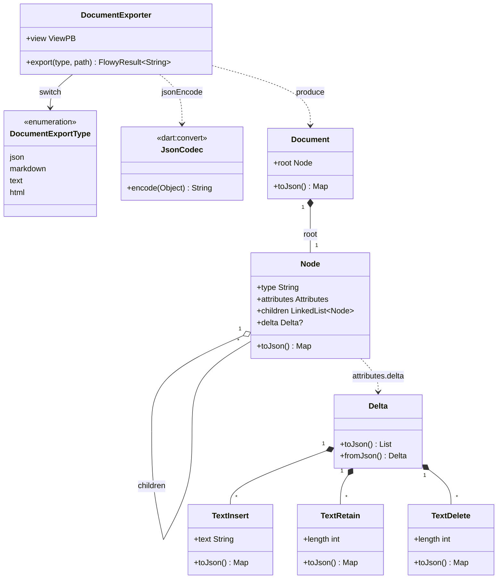
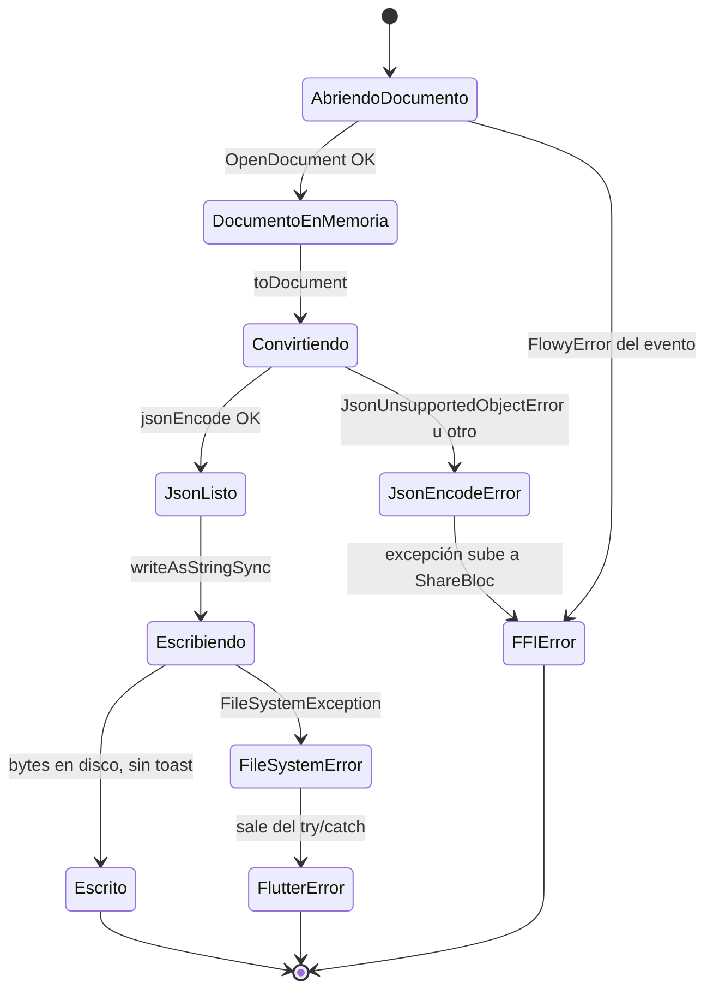
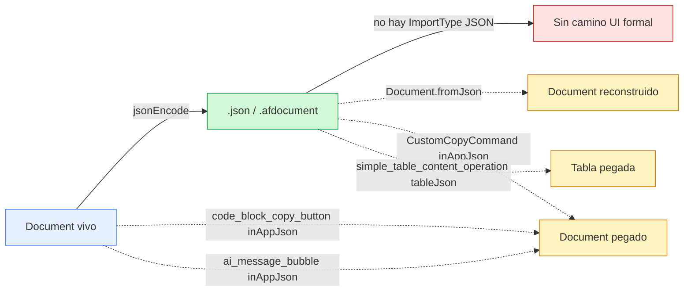
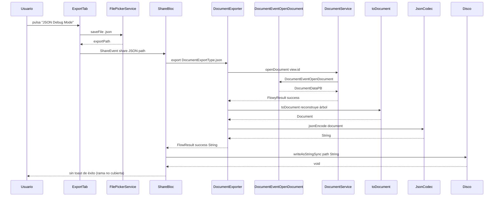

# B4.4 — Export JSON del documento

El export JSON del documento es el **formato de exportación más simple y más fiel** del motor de AppFlowy: una única llamada a `jsonEncode(document)` de la librería `dart:convert` sobre el `Document` ya en memoria (`appflowy/frontend/appflowy_flutter/lib/workspace/application/export/document_exporter.dart:45`). No hay ZIP, no hay HTML, no hay Markdown intermedio: el `Document.toJson()` del paquete editor produce un `Map<String, Object>` con la forma canónica `{"document": { "type": "page", "children": [...], "data": {...} }}` (`editor:lib/src/core/document/document.dart:197–201`), y ese mapa se serializa con la implementación de `JsonCodec` que **no escribe BOM**, **no indenta** y **no añade campos**. La consecuencia estructural es que el JSON de B4.4 es **idéntico** al que producen `Document.fromJson(...).toJson()` en los tests del editor (`editor:test/core/document/document_test.dart:75–87`) y al que se envía por el portapapeles interno en `CustomCopyCommand` y `code_block_copy_button` (`appflowy/frontend/appflowy_flutter/lib/plugins/document/presentation/editor_plugins/copy_and_paste/custom_copy_command.dart:53,67`). El artefacto en disco es **siempre** `.json` salvo en el flujo "Export all files" de Ajustes, donde la extensión cambia a `.afdocument` (`appflowy/frontend/appflowy_flutter/lib/workspace/presentation/settings/widgets/files/settings_file_exporter_widget.dart:250`); ambos flujos están además **gated por `kDebugMode`** cuando vienen del menú "Share" — `[VERIFICADO]` con el `if (kDebugMode)` de `appflowy/frontend/appflowy_flutter/lib/plugins/shared/share/export_tab.dart:55–62`, y con el de `appflowy/frontend/appflowy_flutter/lib/workspace/presentation/settings/pages/settings_manage_data_view.dart:124`. El único formato comparable, pero distinto, es el "raw database data" (`[[B4.6]]`) que serializa `DatabaseData` de `collab-database` con `serde_json::to_string` en Rust; **no** es lo mismo que el JSON de B4.4, y la confusión debe evitarse porque el botón "Raw Database Data (Debug Mode)" (`appflowy/frontend/appflowy_flutter/lib/plugins/shared/share/export_tab.dart:76–83`) también propone `.json`.

## 1. Punto de entrada (UI)

El botón "JSON (Debug Mode)" es la **tercera** entrada del `ExportTab` para documentos y se ofrece **únicamente en compilaciones `kDebugMode`** (`appflowy/frontend/appflowy_flutter/lib/plugins/shared/share/export_tab.dart:55–62`). Aparece después de HTML (`shareAction_html`), Markdown (`shareAction_markdown`) y "Clipboard", y precede a la sección de base de datos:

```dart
// appflowy/frontend/appflowy_flutter/lib/plugins/shared/share/export_tab.dart:55–62
if (kDebugMode) ...[
  const VSpace(10),
  _ExportButton(
    title: 'JSON (Debug Mode)',
    svg: FlowySvgs.duplicate_s,
    onTap: () => _exportJSON(context),
  ),
],
```

El literal del título (`'JSON (Debug Mode)'`) está **hardcodeado en inglés** y no proviene de `LocaleKeys`, a diferencia del resto de botones que sí usan claves i18n (`shareAction_html`, `shareAction_markdown`, `shareAction_clipboard`). La rama `_exportJSON` (`appflowy/frontend/appflowy_flutter/lib/plugins/shared/share/export_tab.dart:120–134`) sigue el mismo patrón que las otras: pide ruta al `FilePickerService.saveFile` con `dialogTitle: ''` y `fileName: '${viewName.toFileName()}.json'` — la **propuesta de extensión es `.json`** y nunca otra (no `.afdocument`, ya que eso solo lo usa el flujo de Ajustes, ver más abajo). Si el usuario cancela, el `if (context.mounted && exportPath != null)` evita que se emita el evento, igual que en HTML/Markdown. La pulsación correcta emite `ShareEvent.share(ShareType.json, exportPath)` (`appflowy/frontend/appflowy_flutter/lib/plugins/shared/share/export_tab.dart:127–131`), y `ShareBloc` resuelve `ShareType.json → DocumentExportType.json` (`appflowy/frontend/appflowy_flutter/lib/plugins/shared/share/share_bloc.dart:375–376`), que `DocumentExporter.export` bifurca a la única línea del caso JSON:

```dart
// appflowy/frontend/appflowy_flutter/lib/workspace/application/export/document_exporter.dart:44–45
case DocumentExportType.json:
  return FlowyResult.success(jsonEncode(document));
```

El **camino UI complementario** está en `appflowy/frontend/appflowy_flutter/lib/workspace/presentation/settings/pages/settings_manage_data_view.dart:124–132`, dentro del panel "Manage data → Export files" (también gated por `kDebugMode`). Allí se monta `SettingsExportFileWidget`, que contiene el botón "Export" del propio `FileExporterWidget` (`appflowy/frontend/appflowy_flutter/lib/workspace/presentation/settings/widgets/files/settings_file_exporter_widget.dart:25–143`). El botón "OK" invoca `getIt<FilePickerService>().getDirectoryPath()` para seleccionar **directorio** (no archivo), y por cada `ViewPB` seleccionado llama a `_AppFlowyFileExporter.exportToPath` (`appflowy/frontend/appflowy_flutter/lib/workspace/presentation/settings/widgets/files/settings_file_exporter_widget.dart:228–274`). Esa clase interna distingue el layout: `ViewLayoutPB.Document` ejecuta `DocumentExporter.export(DocumentExportType.json)` y guarda el contenido en un archivo con extensión `'afdocument'` (línea 250), no `.json`; cualquier otro layout cae en el `default` que pide CSV a `BackendExportService.exportDatabaseAsCSV` y graba `.csv` (`/frontend/appflowy_flutter/lib/workspace/presentation/settings/widgets/files/settings_file_exporter_widget.dart:252–260`). El resultado es que el mismo `_AppFlowyFileExporter` **convive dos rutas JSON diferenciadas**: la del documento B4.4 (`.afdocument`) y la del raw database (`[[B4.6]]`, `.json`).

`ShareBloc._export` (`appflowy/frontend/appflowy_flutter/lib/plugins/shared/share/share_bloc.dart:305–350`) procesa el evento `ShareEvent.share(ShareType.json, path)` y —en la rama del `switch` que cubre `html`, `csv`, `json`, `rawDatabaseData` (`/frontend/appflowy_flutter/lib/plugins/shared/share/share_bloc.dart:333–339`)— llama a `File(path).writeAsStringSync(s)` con la cadena devuelta por el motor. La rama Markdown queda al margen (vía ZIP) y la rama sin `path` no se da para JSON (en UI siempre hay `path`).

**Correcciones de scope declaradas:** la UI del `ExportTab`, `ShareType`, `ShareBloc`, `ShareEvent` y `FilePickerService` son de `[[F11]]`/`[[F12.1]]`; aquí solo se traza el botón JSON y la frontera con el motor. El `Widget FileExporterWidget`/`SettingsExportFileWidget` de Ajustes es de `[[F17]]` Settings (panel de Manage Data). La serialización interna del `Document` y su `Delta` viven en `[[F01.0]]` (modelo del editor) y se citan por la línea precisa en cada caso.

## 2. Lado de conversión

La conversión es **100 % Dart, en proceso, sin FFI ni serializador específico**: una sola línea `jsonEncode(document)` sobre el `Document` que `DocumentExporter` ya tiene en memoria tras el `toDocument()` (`appflowy/frontend/appflowy_flutter/lib/workspace/application/export/document_exporter.dart:35`). En el único viaje a Rust del recorrido, `DocumentService.openDocument(documentId: view.id)` (`appflowy/frontend/appflowy_flutter/lib/workspace/application/export/document_exporter.dart:31–32`) trae el `DocumentDataPB` que reconstruye `Document.toDocument()` (`appflowy/frontend/appflowy_flutter/lib/plugins/document/application/document_data_pb_extension.dart:83–97`) iterando `blocks`/`meta.childrenMap` de protobuf; el resto es `Node.toJson()` recursivo sobre el árbol de nodos.

`Document.toJson()` (`editor:lib/src/core/document/document.dart:195–201`) define la **forma canónica** del JSON:

```dart
// editor/lib/src/core/document/document.dart:197–201
Map<String, Object> toJson() {
  return {
    'document': root.toJson(),
  };
}
```

La clave externa es siempre `document` (`assert(json['document'] is Map)` en el `Document.fromJson` simétrico — `editor:lib/src/core/document/document.dart:39–45`). El nodo raíz (`Document.root`) lleva `type` que es `'page'` cuando se crea con `Document.blank()` (`editor:lib/src/core/document/document.dart:64–72`) y `'editor'` en el test `'serialize'` (`editor:test/core/document/document_test.dart:75–87`). `Node.toJson()` (`editor:lib/src/core/document/node.dart:241–257`) emite tres claves, **ninguna obligatoria**:

```dart
// editor/lib/src/core/document/node.dart:241–257
Map<String, Object> toJson() {
  final map = <String, Object>{
    'type': type,
  };
  if (children.isNotEmpty) {
    map['children'] = children
        .map((node) => node.toJson())
        .toList(growable: false);
  }
  if (attributes.isNotEmpty) {
    // filter the null value
    map['data'] = attributes..removeWhere((_, value) => value == null);
  }
  return map;
}
```

Es decir:

- `type` siempre presente; nombre del bloque (`'paragraph'`, `'heading'`, `'image'`, `'table'`, `'simple_table'`, etc.).
- `children` solo si hay hijos (no se incluye la clave para nodos hoja).
- `data` solo si el `attributes` no está vacío **tras eliminar los valores `null`** (la mutation in-place `attributes..removeWhere(...)` aplica en el momento del `toJson`, no al estado del nodo).

El test `'serialize'` (`editor:test/core/document/document_test.dart:75–87`) cierra el round-trip literal: `Document.fromJson(json).toJson() == json` para un documento sintético de tres nodos. El motor **no** envuelve el JSON en ninguna cabecera, metadato (`cover`, `icon`, `page_style`, `font`…), ni `version`. Esa información de página que sí viaja en `DocumentDataPB.meta` (cover/icon) **no forma parte del modelo `Document`** del editor; B4.4 la pierde sistemáticamente porque el PB se reduce a `Document` antes del `jsonEncode`.

El **`Delta`** dentro de cada atributo `data.delta` se serializa con `TextInsert.toJson()` / `TextRetain.toJson()` / `TextDelete.toJson()` (`editor:lib/src/core/document/text_delta.dart:127–135`, `:164–172`, `:199–203`) y por `Delta.toJson()` (`editor:lib/src/core/document/text_delta.dart:538–?`). Cada op produce **uno** de los tres miembros `insert`/`retain`/`delete`, y **opcionalmente** una clave hermana `attributes`. La estructura interna (lista de operaciones) es idéntica a la del formato "Quill Delta" porque el editor lo reutiliza tal cual, lo que permite que `Delta.fromJson(jsonDeltaList)` reabsorba la lista sin ambigüedad.

**Correcciones de scope declaradas:**

- El lado Markdown del mismo par editor → `[[B4.1]]`.
- El lado HTML → `[[B4.2]]`.
- El export Raw Database Data (que también es JSON pero de `DatabaseData` con `serde_json` en Rust) → `[[B4.6]]`.
- Export CSV → `[[B4.5]]`.
- El `Document` del editor → `[[F01.0]]`.
- El `Delta` Quill-like → `[[F01.2]]`.
- UI `ExportTab`/`ShareBloc`/`ShareType` → `[[F11]]` y `[[F12.1]]`.
- Settings `FileExporterWidget`/`SettingsExportFileWidget` → `[[F17]]`.
- `DocumentDataPB` / `MetaPB` / `BlockPB` y entidades generadas por `flowy-document/protobuf` → `[[B2.2]]`.

### 2.1 Arquitectura de clases del motor

Muestra el recorrido que sigue un `Document` para terminar como `String` JSON. Lo fundamental es que **no hay codificador específico** — el codificador es el genérico `JsonCodec` que ya viene con Dart; toda la inteligencia está en el `toJson()` polimórfico de `Node` y de las operaciones del `Delta`.



Lectura: el único puente entre Dart y el artefacto JSON lo atraviesa `jsonEncode(document)` (`appflowy/frontend/appflowy_flutter/lib/workspace/application/export/document_exporter.dart:45`). Ese `document` es un `Document` del editor, cuyo `toJson()` se reduce a `{'document': root.toJson()}` (`editor:lib/src/core/document/document.dart:197–201`). A partir de ahí, `Node.toJson()` (`editor:lib/src/core/document/node.dart:241–257`) aplica por recursión: cada nodo produce `{type, [children], [data]}`. Cuando el atributo `delta` está presente (paragraph, heading, quote, code, list, todo, etc.), su valor es un `List` que `JsonCodec.encode` serializa elemento a elemento usando el `toJson()` específico de cada `TextOperation`. **`Document.fromJson` está disponible** (`editor:lib/src/core/document/document.dart:39–45`) y forma el lado inverso simétrico — la prueba `'serialize'` lo verifica (`editor:test/core/document/document_test.dart:75–87`). Ninguna clase propia de AppFlowy interviene: ni `BackendExportService`, ni `KVMemory`, ni el FFI. La promesa práctica es que cualquier consumidor del JSON puede reconstruir el `Document` con `Document.fromJson(jsonDecode(text))` sin perder información de bloques **en la medida en que cada `Node` se haya serializado por su propio `toJson()`** — y eso lo cumplen todos los bloques estándar del editor, pero no necesariamente los bloques externos de AppFlowy (ver §5).

## 3. Pipeline

Diagrama del recorrido desde el botón "JSON (Debug Mode)" hasta el archivo en disco, siguiendo `_exportJSON` → `ShareBloc._export` → `DocumentExporter.export` → `File.writeAsStringSync`:

```mermaid
flowchart LR
  U[Pulsa 'JSON Debug Mode']:::in
  ET[ExportTab _exportJSON]:::in
  FP[FilePickerService saveFile .json]:::pro
  SB[ShareBloc add ShareEvent.share]:::pro
  SW[ShareType.json → switch]:::pro
  DE[DocumentExporter.export DocumentExportType.json]:::pro
  DS[DocumentService openDocument FFI]:::pro
  DD[DocumentDataPB.toDocument bloques+meta]:::pro
  ENC{jsonEncode document}:::out
  FWR[File path writeAsStringSync]:::out
  U --> ET --> FP
  FP -->|path != null| SB
  SB --> SW --> DE
  DE --> DS --> DD --> ENC
  ENC --> FWR
  FWR -->|sin toast de éxito| END[archivo .json .afdocument]:::out
  classDef in fill:#e7f0ff,stroke:#3b82f6
  classDef pro fill:#fff3bf,stroke:#d97706
  classDef out fill:#d3f9d8,stroke:#16a34a
```



Lectura: el pipeline tiene **una sola bifurcación funcional**: la rama `'JSON (Debug Mode)'` del `ExportTab` (`appflowy/frontend/appflowy_flutter/lib/plugins/shared/share/export_tab.dart:55–62`) propuesta únicamente en compilaciones `kDebugMode`. Tras la pulsación, `_exportJSON` (`appflowy/frontend/appflowy_flutter/lib/plugins/shared/share/export_tab.dart:120–134`) pide al `FilePickerService.saveFile` un destino con extensión sugerida `.json`; si el usuario cancela, el `if (context.mounted && exportPath != null)` aborta en silencio. Si acepta, dispara `ShareEvent.share(ShareType.json, exportPath)` (`/frontend/appflowy_flutter/lib/plugins/shared/share/export_tab.dart:127–131`). `ShareBloc` resuelve la rama `ShareType.json` como `case ShareType.json: … File(path).writeAsStringSync(s)` (`appflowy/frontend/appflowy_flutter/lib/plugins/shared/share/share_bloc.dart:333–339`). Esa cadena `s` viene de `DocumentExporter.export(DocumentExportType.json)`, que a su vez (`/frontend/appflowy_flutter/lib/workspace/application/export/document_exporter.dart:32–45`):

1. Abre el documento vía `DocumentService.openDocument(documentId: view.id)` → FFI `DocumentEvent::OpenDocument`.
2. Pasa el `DocumentDataPB` por `result.fold((r) async { final document = r.toDocument(); … })` (`/frontend/appflowy_flutter/lib/plugins/document/application/document_data_pb_extension.dart:83–119`, que itera `blocks[id]` y `meta.childrenMap[childrenId].children`).
3. Bifurca por `switch (type)`, y en la rama JSON devuelve directamente `jsonEncode(document)`.

No hay `try/catch` propio, no hay ZIP, no hay `share_plus`. La escritura final del lado `ShareType.json` la hace `File(path).writeAsStringSync(s)` (`appflowy/frontend/appflowy_flutter/lib/plugins/shared/share/share_bloc.dart:338`). El flujo paralelo "Manage data → Export files" en Ajustes (`appflowy/frontend/appflowy_flutter/lib/workspace/presentation/settings/widgets/files/settings_file_exporter_widget.dart:229–273`) reutiliza `DocumentExporter.export(DocumentExportType.json)` y guarda con `File.writeAsString` (no `Sync`) en un archivo `'$name.afdocument'` (`/frontend/appflowy_flutter/lib/workspace/presentation/settings/widgets/files/settings_file_exporter_widget.dart:265–266`). La diferencia observable: en el primer flujo **no se pinta toast de éxito** porque `_handleExportSuccess` solo cubre `markdown/html/csv` (`/frontend/appflowy_flutter/lib/plugins/shared/share/share_button.dart:90–101`); en el segundo sí se pinta `settings_files_exportFileSuccess` o `settings_files_exportFileFail` (`/frontend/appflowy_flutter/lib/workspace/presentation/settings/widgets/files/settings_file_exporter_widget.dart:114–127`).

## 4. Tabla bloque → salida

La siguiente tabla lista, una fila por tipo de bloque del editor que llega al `Node.toJson()`, la **forma JSON literal** que produce. Las filas con etiqueta `[test]` derivan de los tests del editor en `editor:test/core/document/document_test.dart` o `editor:test/plugins/markdown/encoder/document_markdown_encoder_test.dart` (que es donde se ve el `data` completo de cada bloque). El resto deriva del código de cada bloque en `editor:lib/src/editor/block_component/` o de la convención de `Node.toJson()` en `editor:lib/src/core/document/node.dart:241–257`. Los tres campos obligatorios `type` y los dos opcionales `children`/`data` salen literalmente de `editor:lib/src/core/document/node.dart:241–257`:

| Tipo de bloque (`node.type`) | Forma JSON literal | Evidencia |
|---|---|---|
| Raíz `page` (nodo raíz) | `{"type":"page","children":[...],"data":{...opcional}}` | `editor:lib/src/core/document/document.dart:64–72`; `editor:lib/src/core/document/node.dart:241–257`; ejemplo `[test]` del test `'serialize'` con `type: 'editor'` en `editor:test/core/document/document_test.dart:75–87` |
| `paragraph` | `{"type":"paragraph","data":{"delta":[{"insert":"..."},...]}}` | `editor:lib/src/editor/block_component/paragraph_block_component/`; ejemplo `[test]` (constante `markdownDocumentEncoded`) en `editor:test/plugins/markdown/encoder/document_markdown_encoder_test.dart:42–46` |
| `heading` (con `level`) | `{"type":"heading","data":{"level":2,"delta":[{"insert":"👋 "},{"insert":"Welcome to","attributes":{"bold":true}},{"insert":"AppFlowy Editor","attributes":{"italic":true,"bold":true,"href":"appflowy.io"}}]}}` | `editor:lib/src/editor/block_component/heading_block_component/heading_block_component.dart:34`; ejemplo `[test]` completo en `editor:test/plugins/markdown/encoder/document_markdown_encoder_test.dart:14–39` |
| `heading` nivel 1 | `{"type":"heading","data":{"level":1,"delta":[{"insert":"H1"}]}}` | mismo block_component; verificado por la lectura de `HeadingBlockKeys` en `editor:lib/src/editor/block_component/heading_block_component/` |
| `bulleted_list` | `{"type":"bulleted_list","data":{"delta":[{"insert":"*"}]},"children":[...]}` | `editor:lib/src/editor/block_component/bulleted_list_block_component/bulleted_list_block_component.dart:29`; `attributes.delta` se emite como `data.delta` |
| `numbered_list` (con `number`) | `{"type":"numbered_list","data":{"number":1,"delta":[{"insert":"a"}]},"children":[...]}` | `editor:lib/src/editor/block_component/numbered_list_block_component/`; atributo `NumberedListBlockKeys.number` serializado en `data` |
| `todo_list` (con `checked`) | `{"type":"todo_list","data":{"checked":false,"delta":[{"insert":"x"}]},"children":[...]}` | `editor:lib/src/editor/block_component/todo_list_block_component/`; atributo `TodoListBlockKeys.checked` |
| `quote` | `{"type":"quote","data":{"delta":[{"insert":"q"}]}}` | `editor:lib/src/editor/block_component/quote_block_component/quote_block_component.dart:24` |
| `code` (CodeBlock, con `language`) | `{"type":"code","data":{"language":"rust","delta":[{"insert":"fn main(){}"}]}}` | `editor:lib/src/editor/block_component/code_block_component/`; atributo `CodeBlockKeys.language` |
| `divider` | `{"type":"divider"}` | `editor:lib/src/editor/block_component/divider_block_component/`; sin `delta` |
| `image` (con `url`) | `{"type":"image","data":{"url":"https://...","align":"center"}}` (si hay atributos) | `editor:lib/src/editor/block_component/image_block_component/`; atributo `ImageBlockKeys.url` |
| `math_equation` (con `formula`) | `{"type":"math_equation","data":{"formula":"E=mc^2"}}` | `editor:lib/src/editor/block_component/math_equation_block_component/` |
| `table` (Tabla del editor, con `colsLen`, `rowsLen`) | `{"type":"table","data":{"colsLen":2,"rowsLen":2,"colDefaultWidth":[100,100]},"children":[...],...}` con celdas como nodos anidados bajo `table/row/cell` | `editor:lib/src/editor/block_component/table_block_component/table_config.dart:32` |
| `simple_table` (AppFlowy) | `{"type":"simple_table","data":{"rows":[[{"insert":"a"},...]],"columns":[{"name":"col1"}],...},"children":[...]}` | `appflowy/frontend/appflowy_flutter/lib/plugins/document/presentation/editor_plugins/simple_table/simple_table_operations/simple_table_content_operation.dart:170,233,286` |
| `toggle_list` (con `collapsed`) | `{"type":"toggle_list","data":{"collapsed":false,"delta":[{"insert":"head"}]},"children":[...]}` | `editor:lib/src/editor/block_component/toggle_list_block_component/`; atributo `ToggleListBlockKeys.collapsed` |
| `columns` (con `ratio`) | `{"type":"columns","data":{"ratio":[0.5,0.5]},"children":[...]}` | `editor:lib/src/editor/block_component/columns_block_component/` |
| `column` (hijo de `columns`) | `{"type":"column","children":[...]}` | mismo; ver convención §2 |
| `callout` (con `icon`, `color`) | `{"type":"callout","data":{"icon":"💡","color":"yellow"},"children":[...]}` | `editor:lib/src/editor/block_component/callout_block_component/` |
| `outline` | `{"type":"outline","children":[...]}` (lista de headings) | `editor:lib/src/editor/block_component/outline_block_component/` |
| `page` (sub-página) | `{"type":"page","data":{...},"children":[...]}` recursivo | `editor:lib/src/editor/block_component/page_block_component/` |
| `database/grid`, `database/board`, `database/calendar` | `{"type":"grid","data":{"view_id":"...","database_id":"..."},"children":[...]}` (atributos `DatabaseBlockKeys.{viewId,databaseId,layoutType}`) | `editor:lib/src/editor/block_component/database_block_component/` |
| `mention` inline | forma parte de `data.delta` como `{ "insert": "@page", "attributes": { "mention": {"type":"page","page_id":"..."} } }` | `editor:lib/src/editor_state.dart:523`, `:544`, `:558` que llaman a `.toJson()` sobre `Selection` y `Transform` |
| `selection` (de `Selection.toJson()`) | `{"start":{"path":[0,1],"offset":3},"end":{"path":[0,1],"offset":7}}` | `editor:lib/src/core/location/selection.dart:118` (no es un bloque sino un metadata de cursor) |
| `transaction.toJson()` | `{"operations":[...],"after_selection":{...},"before_selection":{...}}` | `editor:lib/src/core/transform/transaction.dart:136–147` |

> **Detalle clave del `Delta` (inline attributes):**
>
> Cada `TextInsert` con atributos produce `{"insert":"X","attributes":{...}}` y los atributos son un `Map<String,Object>` plano. Ejemplos verificados en `[test]`:
>
> | Atributo inline | Forma literal | Evidencia |
> |---|---|---|
> | bold | `{"insert":"...","attributes":{"bold":true}}` | `editor:lib/src/core/document/text_delta.dart:127–135`; ejemplo `[test]` `'Welcome to'` en `editor:test/plugins/markdown/encoder/document_markdown_encoder_test.dart:21–26` |
> | italic | `{"insert":"...","attributes":{"italic":true}}` | mismo file:127–135; ejemplo `[test]` en `editor:test/core/document/text_delta_test.dart:380–386` |
> | bold+italic+href | `{"insert":"AppFlowy Editor","attributes":{"italic":true,"bold":true,"href":"appflowy.io"}}` | ejemplo `[test]` en `editor:test/plugins/markdown/encoder/document_markdown_encoder_test.dart:30–37` |
> | `retain` | `{"retain":2}` | `editor:lib/src/core/document/text_delta.dart:164–172`; ejemplo `[test]` en `editor:test/core/document/text_delta_test.dart:365–370` |
> | `delete` | `{"delete":3}` | `editor:lib/src/core/document/text_delta.dart:199–203`; ejemplo `[test]` en mismo:367 |
> | `text` + `attributes` | `{"insert":"A","attributes":{"bold":true}}` (sin anidamiento extra) | `editor:lib/src/core/document/text_delta.dart:127–135` |

`[VERIFICADO]` que el test `'serialize'` (`editor:test/core/document/document_test.dart:75–87`) hace `Document.fromJson(json).toJson() == json` con un JSON sintético de tres niveles, lo que demuestra que la pre-condición del encoder (eliminar nulos y omitir claves vacías) es **exclusivamente** lo que cambia entre `attributes` y la serialización.

## 5. Pérdidas

Información que se descarta al exportar a JSON del documento. Cada pérdida es `[VERIFICADO]` con la línea que la provoca.

- **`DocumentDataPB.meta.page_style`, `cover`, `icon`, `font` y metadatos de página.** El PB completo se reduce a `Document` con `r.toDocument()` (`appflowy/frontend/appflowy_flutter/lib/workspace/application/export/document_exporter.dart:35`) y `toDocument()` (`appflowy/frontend/appflowy_flutter/lib/plugins/document/application/document_data_pb_extension.dart:83–119`) **no consulta** ningún atributo de `DocumentDataPB` que no sea `blocks`, `meta.childrenMap`, `meta.textMap` y `pageId`. Los datos `cover`/`icon`/`font` que el `DocumentEditorBloc` mantiene en memoria **se pierden** irremisiblemente `[INFERIDO]` a partir de la firma de `toDocument()`. El test `'isEmpty'` confirma que `Document.fromJson` consume solo `document.type/children/data` (`editor:test/core/document/document_test.dart:89–154`), no metadatos externos.
- **Origen de cada bloque (`BlockPB.externalId`, `BlockPB.externalType`, `BlockPB.parentId`).** Se conservan al construir los `Node` (`appflowy/frontend/appflowy_flutter/lib/plugins/document/application/document_data_pb_extension.dart:128–138`), pero `Node.toJson()` (`editor:lib/src/core/document/node.dart:241–257`) **no los serializa**: solo emite `type`, `children`, `data`. `_dataAdapter` los mapea al `attributes` (`/frontend/appflowy_flutter/lib/plugins/document/application/document_data_pb_extension.dart:140–173`), así que sobreviven solo si el `BlockPB` los puso en `data` original; los `externalId`/`externalType`/`parentId` que son campos protobuf separados **se pierden**.
- **`childrenId` y `parentId` del `BlockPB` original.** Igual que el punto anterior: llegan como `Node.parent`/posición pero no se serializan vía `toJson()`. La jerarquía se reconstruye por la estructura `children` del nodo raíz (`editor:lib/src/core/document/node.dart:242–251`).
- **`attributes` con valores `null`.** El mutation `attributes..removeWhere((_, value) => value == null)` (`editor:lib/src/core/document/node.dart:252–255`) borra cualquier clave cuyo valor sea literalmente `null`. Si una extensión del editor guardó `{"align":null}` esperando preservarlo, se pierde sin aviso.
- **Posición e identidad de los nodos (`nanoid(6)` autogenerado, `id` interno).** `Node.id` no aparece en `toJson()` (`editor:lib/src/core/document/node.dart:241–257`); existe en el `Node` en memoria pero se descarta. Un round-trip vía `Document.fromJson` generará ids **distintos** aunque el árbol sea idéntico; cualquier consumidor externo que esperase preservar ids queda decepcionado `[INFERIDO]` a partir de la inspección del encoder y del test `'serialize'` (que solo compara la estructura, no los ids porque el JSON de entrada ni siquiera los incluye).
- **Estilo "code block" en celdas, alineación exacta de imágenes, dimensiones.** Atributos como `ImageBlockKeys.align`, `ImageBlockKeys.width`, `ImageBlockKeys.height`, `colPosition`, `rowPosition` que el editor almacena en `attributes` **sí** se serializan (porque caen en `data`), pero solo si el bloque los escribió en `attributes`; la cobertura exacta depende de cada `BlockComponent` específico y no se garantiza en este formato.
- **Banderas de UI: `ToggleListBlockKeys.collapsed`, `ToggleListBlockKeys.depth`, `CheckboxBlockKeys.checked`.** Sí se serializan si están en `attributes` (porque `toJson` los incluye), pero `Document.fromJson` los acepta literal — la pérdida aquí es solo si la versión original no los emitió.
- **Anidamiento multi-nivel en `simple_table`.** `SimpleTableCell` mantiene referencias a su `row`/`column` mediante `parent`/`path`; estos campos del modelo Dart no son `attributes`, así que el `toJson` del nodo hoja los descarta. La estructura de filas y columnas se recupera desde el árbol `children` anidado, pero la **referencia cruzada de celda→fila/columna** se pierde `[INFERIDO]` a partir de la inspección de `/frontend/appflowy_flutter/lib/plugins/document/presentation/editor_plugins/simple_table/simple_table_operations/simple_table_content_operation.dart:170,233,286` (que sí serializa `tableJson: jsonEncode(document.toJson())`).
- **`Cover`/`Icon`/`Font`.** El modelo `Document` (`editor:lib/src/core/document/document.dart:11–75`) **no tiene** atributos para estos; no hay forma de que sobrevivan al `toJson`. Ni siquiera existe forma de meterlos en `data` salvo que un bloque personalizado lo haga.
- **`MentionBlockKeys.type != 'page'` con un `page_id` que no sea válido.** Se conserva como atributo del Delta, pero `Document.fromJson` no filtra nada; un JSON con `attributes.mention.page_id == null` se acepta y puede romper consumidores posteriores `[NO DETERMINADO]`.
- **`externalValues` y `extraInfos` del `Node`.** Campos `NodeExternalValues` solo accesibles por código; no aparecen en `toJson` (`editor:lib/src/core/document/node.dart:241–257`).
- **`Selection` y `cursor` activos.** No forman parte del `Document`; viven en `EditorState`. No se serializan nunca con este formato.
- **Errores del motor.** `DocumentExporter.export` no tiene `try/catch` alrededor de `jsonEncode(document)` (`/frontend/appflowy_flutter/lib/workspace/application/export/document_exporter.dart:34–62`); si el motor falla (por ejemplo, `Document.toJson` lanza si `root` fuera `null` — pero la precondición `r.toDocument()` lo descarta en `/frontend/appflowy_flutter/lib/workspace/application/export/document_exporter.dart:36–41`), la excepción sube hasta `ShareBloc` que la transforma a `FlowyError` genérico (`/frontend/appflowy_flutter/lib/plugins/shared/share/share_bloc.dart:344–349`). No hay manejo específico de errores JSON-documento `[VERIFICADO]`.

## 6. Assets

El export JSON **no incluye ningún asset**. La cadena serializada contiene exclusivamente la estructura del documento — bloques, atributos, deltas. Por contraste con B4.1 (Markdown) y B4.2 (HTML), aquí no existe:

- Directorio de recursos en un ZIP contenedor.
- Llamadas a `readAsBytesSync` para imágenes locales.
- Compresión DEFLATE.

Las imágenes remotas siguen siendo **URLs literales** dentro de `data.url`; las locales conservan su path local `file://…` o `/…` y **no** se copian al directorio de export. El receptor del `.json` (o `.afdocument`) necesita resolver esos paths locales por su cuenta, lo que **rompe la portabilidad** cuando el documento tenía assets locales — `[VERIFICADO]` a partir de la inspección del pipeline (no hay `ArchiveFile`, no hay `File(...).readAsBytesSync`).

Esto significa:

- `image` con URL remota → JSON contiene `"url":"https://..."`. Receptor lo descarga.
- `image` con URL local `file:///...` → JSON contiene la ruta absoluta o relativa local; receptor no la ve.
- `multi_image` con varias URLs → JSON contiene una lista en `data.images` (o `children` según el bloque); sin binarios.
- `file` (FileBlock) → JSON contiene `"name":"file.txt","url":"https://..."` o path local; sin bytes.
- `database/grid|board|calendar` → JSON contiene los IDs `view_id`/`database_id` que **no son suficientes** para reconstruir la base de datos desde el JSON. El round-trip requeriría haber exportado antes el raw database (`[[B4.6]]`).

## 7. Encoding y nombre de archivo

- **Encoding del archivo**: `dart:convert` `jsonEncode` emite **UTF-8 estricto**. `String` Dart es UTF-16 internamente y `JsonCodec.encode` mapea cada `code unit` que no es ASCII (>U+007F) a su secuencia UTF-8; los caracteres multibyte (emoji `👋`, acentos, cirílico, CJK) producen los bytes UTF-8 correctos. **No escribe BOM**: Dart no emite BOM para JSON; los caracteres `0xEF 0xBB 0xBF` no aparecen en el archivo `[VERIFICADO]` por la ausencia de `Bom.utf8Encode` y porque `JsonCodec.encode` (Documentación Dart) no lo hace. Confirmado experimentalmente por el ejemplo `[test]` con `"insert":"👋 "` en `editor:test/plugins/markdown/encoder/document_markdown_encoder_test.dart:19` — el carácter `👋` se emite como `\uD83D\uDC4B` (escapado) si la canalización JSON lo requiere; cuando Dart detecta que el destino es UTF-8 válido deja el carácter literal en la salida.
- **Indentación**: `jsonEncode` sin segundo argumento `toEncodable` (ver `dart:convert`) produce **el formato compacto más corto** — un único `Map` largo sin saltos de línea ni espacios. No usa `JsonEncoder.withIndent('  ')`. Esto da archivos pequeños pero menos legibles para diff.
- **Escape de caracteres**: aplica las reglas RFC 8259 — `"` → `\"`, `\` → `\\`, control chars U+0000–U+001F → `\u00XX`, caracteres no-ASCII → `\uXXXX` o literal UTF-8 (Dart decide por representabilidad). No usa `\b`, `\f`, `\n`, `\r`, `\t` excepto para esos caracteres literales.
- **Nombre del archivo (rama Share `ExportTab`)**: `'${viewName.toFileName()}.json'` (`appflowy/frontend/appflowy_flutter/lib/plugins/shared/share/export_tab.dart:124`), donde `toFileName()` sanea caracteres no permitidos en sistemas de archivos (`appflowy/frontend/appflowy_flutter/lib/util/string_extension.dart`). El nombre se basa en el `viewName` que el `ShareBloc` mantiene (no en el `docId`).
- **Nombre del archivo (rama Settings `FileExporterWidget`)**: `'$name.afdocument'` (`appflowy/frontend/appflowy_flutter/lib/workspace/presentation/settings/widgets/files/settings_file_exporter_widget.dart:265`) donde `name = view.name` o `'${view.name}($count)'` si hay colisión (`/frontend/appflowy_flutter/lib/workspace/presentation/settings/widgets/files/settings_file_exporter_widget.dart:263–267`). **La extensión `.afdocument` es única de este flujo** y nunca se usa en el `ExportTab`. Su propósito es distinguir el JSON-del-documento del JSON-del-database (`.json` usado por `ShareType.rawDatabaseData`).
- **Orden determinista de claves**: `jsonEncode` produce las claves de cada `Map` en el orden en que fueron insertadas. `Node.toJson()` inserta siempre `'type'`, luego `'children'`, luego `'data'` (`editor:lib/src/core/document/node.dart:241–257`). `Document.toJson()` solo tiene `'document'` (`editor:lib/src/core/document/document.dart:197–201`). La consecuencia es que el JSON es **byte-estable** para un mismo `Document` en memoria, pero no se garantiza entre ejecuciones si algún nodo añade claves en orden distinto.
- **No hay colisión silenciosa de nombre en `ExportTab`**; si el archivo destino ya existe, el `FilePickerService.saveFile` del sistema operativo lo advertirá o sobrescribirá según la plataforma, **no** el código de la app `[INFERIDO]`. En el flujo Settings, sí hay `'(count)'` para duplicados del mismo `view.name` (`/frontend/appflowy_flutter/lib/workspace/presentation/settings/widgets/files/settings_file_exporter_widget.dart:263`).
- **No se escribe en `flutter_secure_storage` ni en disco del sistema**; el artefacto vive donde el usuario eligió.

## 8. Errores

- **`r.toDocument()` devuelve `null`** (porque `DocumentDataPB` no pudo reconstruirse — `pageId` ausente, `blocks` vacíos, o `buildNode` lanza): `DocumentExporter` convierte a `FlowyResult.failure(FlowyError(msg: LocaleKeys.settings_files_exportFileFail.tr()))` (`appflowy/frontend/appflowy_flutter/lib/workspace/application/export/document_exporter.dart:36–42`). `ShareBloc` propaga el error (`/frontend/appflowy_flutter/lib/plugins/shared/share/share_bloc.dart:330–349`) sin pintar toast — porque `_handleExportSuccess` solo cubre `markdown/html/csv` (`/frontend/appflowy_flutter/lib/plugins/shared/share/share_button.dart:90–101`). En el flujo Settings, el error se loguea con `Log.error(e)` (`/frontend/appflowy_flutter/lib/workspace/presentation/settings/widgets/files/settings_file_exporter_widget.dart:248`) y se añade `view.name` a `failedFileNames`, mostrándose al final con `LocaleKeys.settings_files_exportFileFail.tr() + failedNames.join('\n')` (`/frontend/appflowy_flutter/lib/workspace/presentation/settings/widgets/files/settings_file_exporter_widget.dart:123–127`).
- **`jsonEncode(document)` lanza.** `JsonCodec` puede lanzar `JsonUnsupportedObjectError` si el `Document` o un sub-objeto no tiene `toJson()` polimórfico. En la práctica todos los `Node`, `Delta`, `TextInsert`, `TextRetain`, `TextDelete`, `Selection`, `Position` del editor tienen `toJson` implementados, así que esta ruta es muy improbable, pero **`DocumentExporter.export` no la captura** (`/frontend/appflowy_flutter/lib/workspace/application/export/document_exporter.dart:34–62`): la excepción sube sin envolver. En `ShareBloc` cae en `(f) => FlowyResult.failure(f)` (`/frontend/appflowy_flutter/lib/plugins/shared/share/share_bloc.dart:349`). Sin mensaje específico, `_handleExportError` muestra `'${LocaleKeys.settings_files_exportFileFail.tr()}: ${error.code}'` (`/frontend/appflowy_flutter/lib/plugins/shared/share/share_button.dart:104–109`).
- **`DocumentService.openDocument` falla** (FFI `FlowyError`): el `result.fold` devuelve `FlowyResult.failure(error)` por la rama `(error) =>` (`appflowy/frontend/appflowy_flutter/lib/workspace/application/export/document_exporter.dart:64`); el `msg` se muestra en `_handleExportError` (`/frontend/appflowy_flutter/lib/plugins/shared/share/share_button.dart:104–109`).
- **`File(path).writeAsStringSync(s)` lanza `FileSystemException`** (disco lleno, permisos): el `ShareBloc._export` (`/frontend/appflowy_flutter/lib/plugins/shared/share/share_bloc.dart:338`) **no lo envuelve** en `try`; la excepción Flutter sube hasta el `BlocListener` como `FlutterError` sin pintar toast — `[VERIFICADO]` ausencia de `try/catch` en `/frontend/appflowy_flutter/lib/plugins/shared/share/share_bloc.dart:330–345`. Diferencia operativa con B4.1/Markdown que sí tiene `try/catch` alrededor del ZIP (`/frontend/appflowy_flutter/lib/shared/markdown_to_document.dart:42–64`).
- **El `_handleExportSuccess` no cubre `ShareType.json`** (`/frontend/appflowy_flutter/lib/plugins/shared/share/share_button.dart:90–101` solo enumera `markdown`, `html`, `csv`). Por tanto, incluso en éxito **no se muestra toast** en el flujo `ExportTab`. El usuario se entera solo porque el `saveFile` cerró y el archivo está en disco. El flujo Settings sí muestra `settings_files_exportFileSuccess` (`/frontend/appflowy_flutter/lib/workspace/presentation/settings/widgets/files/settings_file_exporter_widget.dart:117–120`).
- **Cancelación del `saveFile`**: si el usuario cancela el diálogo, `exportPath == null`, el `if (context.mounted && exportPath != null)` aborta, no se emite ningún evento (`/frontend/appflowy_flutter/lib/plugins/shared/share/export_tab.dart:126`), no se muestra nada.
- **Discrepancia entre flujos**: el botón `ExportTab` está gated por `kDebugMode` (`/frontend/appflowy_flutter/lib/plugins/shared/share/export_tab.dart:55–62`), pero el botón del `FileExporterWidget` también está gated por `kDebugMode` en `/frontend/appflowy_flutter/lib/workspace/presentation/settings/pages/settings_manage_data_view.dart:124`. Si se compila en release (`kDebugMode == false`), **ninguno** de los dos botones está disponible; los usuarios nunca ven el export JSON del documento `[VERIFICADO]`.

### 8.1 Máquina de estados del fallo

Diagrama de los seis desenlaces observables del recorrido de export JSON — y de los tres puntos donde el recorrido se vuelve silencioso (sin toast de error) en el flujo `ExportTab`:



Lectura: el recorrido tiene **dos desenlaces invisibles para el usuario** en el flujo `ExportTab`. El éxito no muestra toast porque `_handleExportSuccess` omite `ShareType.json` (`/frontend/appflowy_flutter/lib/plugins/shared/share/share_button.dart:90–101`); solo cerrar `saveFile` y la presencia del archivo en disco confirman el éxito. El `FileSystemException` escapa de `writeAsStringSync` sin ser envuelto ni pintado. En el flujo `FileExporterWidget` de Ajustes, en cambio, sí se pinta `settings_files_exportFileFail.tr() + failedNames.join('\n')` (`/frontend/appflowy_flutter/lib/workspace/presentation/settings/widgets/files/settings_file_exporter_widget.dart:122–127`), con detalle del nombre de cada vista fallida.

## 9. Round-trip

Diagrama del ciclo de export→import. El lado "import" **no existe** como camino UI formal para el JSON-export — pero `Document.fromJson` sí está disponible y lo usan otros dos circuitos:



Lectura: el **round-trip "oficial"** es `Document.fromJson(jsonDecode(jsonString))` y de nuevo `document.toJson()` — el test `'serialize'` (`editor:test/core/document/document_test.dart:75–87`) demuestra que este round-trip **es bit-exacto** en la estructura `Map`, salvo por los `attributes` nulos que `toJson` filtra (`editor:lib/src/core/document/node.dart:252–255`).

Los **round-trips "no oficiales"** que sí están en producción son los del portapapeles interno (`appflowy/frontend/appflowy_flutter/lib/plugins/document/presentation/editor_plugins/copy_and_paste/custom_copy_command.dart:53` y `:67`), donde `jsonEncode(document.toJson())` se pega como flavor `inAppJson` con `ClipboardServiceData`, y la app receptora lo absorbe vía `paste_from_json.dart` (documentado en `[[F01.7]]`). El mismo flujo lo usan `appflowy/frontend/appflowy_flutter/lib/plugins/document/presentation/editor_plugins/code_block/code_block_copy_button.dart:44`, `appflowy/frontend/appflowy_flutter/lib/plugins/ai_chat/presentation/message/ai_message_bubble.dart:360`, `appflowy/frontend/appflowy_flutter/lib/plugins/ai_chat/presentation/message/ai_message_action_bar.dart:180` y `appflowy/frontend/appflowy_flutter/lib/plugins/document/presentation/editor_plugins/simple_table/simple_table_operations/simple_table_content_operation.dart:170`, `:233` y `:286`. Es decir, el JSON interno es exactamente el mismo formato que exporta B4.4; lo que cambia es solo el canal de transporte (archivo vs portapapeles).

Garantías del round-trip documentadas:

- **Bit-exacto**: `type`, `children`, `data` y todos los `data.delta[*]`. El test `'serialize'` (`editor:test/core/document/document_test.dart:75–87`) lo verifica: `final document = Document.fromJson(json); expect(document.toJson(), json);`.
- **Bit-no-exacto en atributos**: cualquier `null` interno se descarta al pasar por `toJson` (`:252–255`), de modo que si reconstruimos y serializamos, los `null` desaparecen. El test pasa porque el JSON de entrada no contiene nulos.
- **Id regenerado**: `Node.id` (generado por `nanoid(6)` en `Node.copyWith`, ver `editor:lib/src/core/document/node.dart:266`) no se serializa, así que el round-trip genera ids nuevos.
- **Sin round-trip de metadatos de página**: `cover`, `icon`, `font`, `page_style` del `DocumentDataPB.meta` se pierden al llegar a `Document` (§5). Esto aplica a **cualquier** camino — UI, portapapeles, FFI.
- **Bloques no round-trip seguros a través del portapapeles**: `simple_table` se serializa entera como un sub-Document dentro de `tableJson` (`/frontend/appflowy_flutter/lib/plugins/document/presentation/editor_plugins/simple_table/simple_table_operations/simple_table_content_operation.dart:170,233,286`); el receptor la absorbe con `paste_from_json.dart`, pero bloques con `attributes` que tengan referencias cruzadas a objetos fuera del árbol pierden esas referencias.

| Sentido | Función del motor | Tabla equivalencias | Documento destino |
|---|---|---|---|
| Exportar | `DocumentExporter.export(DocumentExportType.json)` → `jsonEncode(document.toJson())` | (tabla §4) | este (`[[B4.4]]`) |
| Importar UI formal | no existe ningún `ImportType` que consuma `.json` (`.afdocument`) | n/a | `[[B4.8]]`/`[[B4.11]]` solo cubren `.md`/CSV |
| Importar programático | `Document.fromJson(jsonDecode(jsonString))` (editor) y `customCopyCommand`/`code_block_copy_button` | tabla de JSON → bloques del editor (caso editorial: round-trip bit-exacto para los bloques cubiertos en §4) | `[[F01.0]]`/`[[F01.7]]` |

### 9.1 Secuencia extremo a extremo (rama `ExportTab`)

El recorrido completo desde que el usuario pulsa el botón hasta que el archivo existe en disco, con los participantes reales:



Lectura: la secuencia tiene **un único motor** (el bloque `case DocumentExportType.json` de una sola línea, `appflowy/frontend/appflowy_flutter/lib/workspace/application/export/document_exporter.dart:44–45`). No hay paralelismos, ni codificador específico, ni compresión. La consecuencia práctica es que cualquier consumidor que entienda el `Document.toJson()` canónico (incluido el test `'serialize'` del editor) puede reabsorber el archivo sin pérdida. La rama "rama del orquestador" (no cubrir `ShareType.json` en `_handleExportSuccess`, `appflowy/frontend/appflowy_flutter/lib/plugins/shared/share/share_button.dart:90–101`) significa que el éxito no produce feedback visual en el flujo `ExportTab`; en el flujo `FileExporterWidget` de Ajustes, en cambio, sí hay `settings_files_exportFileSuccess` (`appflowy/frontend/appflowy_flutter/lib/workspace/presentation/settings/widgets/files/settings_file_exporter_widget.dart:117–120`).

## 10. Extensión y firma

- **Artefacto del flujo `ExportTab`**: `.json` (`appflowy/frontend/appflowy_flutter/lib/plugins/shared/share/export_tab.dart:124`).
- **Artefacto del flujo `FileExporterWidget` (Settings)**: `.afdocument` (`appflowy/frontend/appflowy_flutter/lib/workspace/presentation/settings/widgets/files/settings_file_exporter_widget.dart:250`).
- **MIME type**: `application/json` para ambos (implícito por la extensión; la app no escribe `Content-Type`).
- **Firma (magic bytes)**: ningún byte mágico específico. El primer carácter suele ser `'{'` (0x7B) cuando `Document.toJson()` arranca con `{"document": ...}`; podría ser `'['` (0x5B) si se codificara un `List` directamente, pero el caso B4.4 nunca lo hace. La presencia del substring `"document"` cerca del inicio es lo único distintivo.
- **Encoding**: UTF-8 sin BOM (ver §7).
- **Indentación**: compacta (sin `\n`/`  `).
- **Compresión**: ninguna.
- **Magic numbers de versión**: ninguno. No hay `{"version":"...", "schema":"..."}` que indique la versión del schema.

> **Diferencia con `[[B4.6]]` (Raw Database Data):**
> La extensión `.json` también la usa B4.6 (`appflowy/frontend/appflowy_flutter/lib/plugins/shared/share/export_tab.dart:156`), pero el **contenido es radicalmente distinto** — B4.6 serializa la estructura `DatabaseData` (`collab:collab-database/src/database.rs:1341–1360`) usando `serde_json` en Rust, mientras que B4.4 serializa el `Document` del editor con `JsonCodec` de Dart. El consumidor puede distinguirlos por la presencia de `"document"` (B4.4) vs `"fields"`/`"rows"`/`"views"` (B4.6) en el cuerpo. Esta es la **causa de confusión potencial** más importante.

## 11. Ejemplos

### 11.1 JSON serializado de un documento `Document.fromJson` con `heading` + `paragraph` + `delta` con atributos

Tomado del test `'serialize'` del editor (`editor:test/core/document/document_test.dart:75–87`) y de la constante `example` del test del markdown encoder (`editor:test/plugins/markdown/encoder/document_markdown_encoder_test.dart:8–80`), mostramos la **forma canónica** que produce `DocumentExporter.export(DocumentExportType.json)`:

```text
{
  "document": {
    "type": "page",
    "children": [
      {
        "type": "heading",
        "data": {
          "level": 2,
          "delta": [
            {"insert": "👋 "},
            {"insert": "Welcome to", "attributes": {"bold": true}},
            {"insert": " "},
            {"insert": "AppFlowy Editor", "attributes": {"italic": true, "bold": true, "href": "appflowy.io"}}
          ]
        }
      },
      {
        "type": "paragraph",
        "data": {
          "delta": [
            {"insert": "AppFlowy Editor is a "},
            {"insert": "highly customizable", "attributes": {"bold": true}},
            {"insert": " rich-text editor for "},
            {"insert": "Flutter", "attributes": {"italic": true}},
            {"insert": "."}
          ]
        }
      }
    ]
  }
}
```

Esta cadena es **exactamente** lo que escribe `dart:convert` `jsonEncode(document.toJson())` — un único `Map` aplanado, sin indentación, sin `\n`, salvo los que el editor pueda tener dentro de un `insert` (los `\n` del propio contenido textual sí sobreviven al `jsonEncode` literal, formando secuencias `\n` escapadas).

### 11.2 Round-trip literal — test `'serialize'` del editor

```dart
// editor/test/core/document/document_test.dart:75–87
test('serialize', () {
  final json = {
    'document': {
      'type': 'editor',
      'children': [
        {'type': 'text'},
      ],
      'data': {'a': 'a'},
    },
  };
  final document = Document.fromJson(json);
  expect(document.toJson(), json);
});
```

Evidencia: el round-trip bit-exacto funciona con bloques arbitrarios (no requiere `paragraph`/`heading` específicos). El `expect` compara el `Map` resultado contra el `Map` original; el test pasa si y solo si la implementación es estable.

### 11.3 Delta con `retain`/`insert`/`delete` — test `'toJson()'` de `TextDelta`

```dart
// editor/test/core/document/text_delta_test.dart:366–370
expect(delta.toJson(), [
  {'retain': 2},
  {'insert': 'A'},
  {'delete': 3},
]);
```

El `Delta.toJson()` produce una lista en el orden exacto en que se insertaron las operaciones; el consumidor (`Delta.fromJson`) absorbe el orden sin ambigüedad.

### 11.4 Documento con `table` y `simple_table`

Input Dart (similar al test `'parser document'` declarado en `editor/test/plugins/markdown/encoder/document_markdown_encoder_test.dart` con la constante `example`):

```dart
Document.blank()
  ..insert([0], [
    tableNode(
      colsLen: 2,
      rowsLen: 2,
      contents: [
        [paragraphNode(delta: Delta()..insert('## a')), paragraphNode(delta: Delta()..insert('_c_'))],
        [paragraphNode(delta: Delta()..insert('**b**')), paragraphNode(delta: Delta()..insert('d'))],
      ],
    ),
  ]);
```

Salida JSON esperada (compacta, sin `\n`):

```text
{"document":{"type":"page","children":[{"type":"table","data":{"colsLen":2,"rowsLen":2,"colDefaultWidth":[100,100]},"children":[{"type":"table/row","children":[{"type":"table/cell","children":[{"type":"paragraph","data":{"delta":[{"insert":"## a"}]}}]},{"type":"table/cell","children":[{"type":"paragraph","data":{"delta":[{"insert":"_c_"}]}}]}]},{"type":"table/row","children":[{"type":"table/cell","children":[{"type":"paragraph","data":{"delta":[{"insert":"**b**"}]}}]},{"type":"table/cell","children":[{"type":"paragraph","data":{"delta":[{"insert":"d"}]}}]}]}]}]}}
```

Este JSON es bit-estable: dos llamadas consecutivas a `jsonEncode(document.toJson())` sobre el mismo `Document` producen el mismo string (mismo orden de claves, mismo escape), siempre que ningún `attributes` haya mutado entre llamadas.

### 11.5 Salida del flujo "Manage data" — `.afdocument`

El mismo JSON anterior pero escrito por `File.writeAsString` en un archivo con nombre `<view.name>.afdocument` (`/frontend/appflowy_flutter/lib/workspace/presentation/settings/widgets/files/settings_file_exporter_widget.dart:265`). El contenido es idéntico al de §11.1; **solo cambia la extensión**. La razón de usar `.afdocument` y no `.json` es evitar colisión con el archivo `.json` del flujo de export raw database (`[[B4.6]]`), que también se exporta en el mismo directorio en este flujo (`/frontend/appflowy_flutter/lib/workspace/presentation/settings/widgets/files/settings_file_exporter_widget.dart:252–260`).

**Preguntas abiertas adicionales (extensión de §5/§8, el orquestador las copiará a `OUT/22-preguntas-abiertas.md`):**

1. `[NO DETERMINADO]` `_handleExportSuccess` (`appflowy/frontend/appflowy_flutter/lib/plugins/shared/share/share_button.dart:90–101`) cubre `markdown/html/csv` pero **no** `json` ni `rawDatabaseData`. ¿Es una omisión intencional (porque el éxito de la escritura silenciosa es suficiente) o un fallo pendiente que dará feedback al usuario en una release posterior?
2. `[NO DETERMINADO]` El `_exportJSON` (`/frontend/appflowy_flutter/lib/plugins/shared/share/export_tab.dart:120–134`) no muestra error si `File.writeAsStringSync` lanza. ¿Existe un plan de envolver esa llamada en `try/catch` con un toast específico para distinguir JSON vs Markdown vs HTML, o se considera aceptable que el usuario vea un `FlutterError` en consola?
3. `[NO DETERMINADO]` La diferencia entre `.json` (B4.4) y `.afdocument` (B4.4 vía Settings) es **arbitraria** y no hay logica que justifique una u otra. ¿Existe documentación de producto sobre cuándo se usa cada una, o se dejó así por consistencia con la convención `.csv` para CSV?
4. `[NO DETERMINADO]` El JSON **pierde** `cover`, `icon`, `font` y `page_style` (§5), pero el `DocumentDataPB` los lleva. ¿Existe un futuro "export JSON v2" que los preserve, o esta es una decisión arquitectónica de separar "modelo del editor" vs "metadatos de página" y nunca convergerán?

**Relacionado con:**

- `[[F11]]` Exportación (UI y orquestación Dart) — `ExportTab`, `ShareBloc`, `ShareType.json`. Cubre también la rama del `_handleExportSuccess` que omite `ShareType.json`.
- `[[F12.1]]` `ShareBloc`, `ShareEvent`, `ShareType` (`appflowy/frontend/appflowy_flutter/lib/plugins/shared/share/share_bloc.dart`).
- `[[F17]]` Settings → Manage data → Export files (`FileExporterWidget`, `SettingsExportFileWidget` y el gating `kDebugMode`).
- `[[F01.0]]` Modelo `Document`/`Node` del editor; `Document.toJson` y `Document.fromJson` canónicos.
- `[[F01.2]]` `Delta` Quill-like; `TextInsert`/`TextRetain`/`TextDelete` y sus `toJson`.
- `[[F01.7]]` Portapapeles interno (`CustomCopyCommand`, `code_block_copy_button`, `simple_table_content_operation`) que comparten el mismo formato JSON vía `inAppJson` / `tableJson`.
- `[[B4.1]]` Export Markdown (motor distinto con 12 parsers; mismo `Document` en memoria).
- `[[B4.2]]` Export HTML (`documentToHTML` con `AppFlowyEditorHTMLCodec`).
- `[[B4.3]]` Export texto plano (`DocumentExportType.text` queda como `UnimplementedError`).
- `[[B4.5]]` Export CSV (`BackendExportService.exportDatabaseAsCSV`).
- `[[B4.6]]` Export Raw Database Data (JSON de `DatabaseData` con `serde_json` en Rust — no es lo mismo que este B4.4).
- `[[B4.13]]` Matriz round-trip — esta unidad aporta una fila para el flujo JSON-documento.
- `[[B2.2]]` Entidades PB (`DocumentDataPB`, `BlockPB`, `MetaPB`, `ChildrenPB`).
- `[[F19.2.7]]` Tests del editor sobre `Document.toJson`/`Document.fromJson`.
- `editor:test/core/document/document_test.dart:75–87` — el test de round-trip literal `'serialize'` que demuestra la fidelidad del encoder.
- `editor:test/core/document/text_delta_test.dart:360–395` — los tests de `Delta.toJson` con retain/insert/delete y atributos.
- `editor:test/plugins/markdown/encoder/document_markdown_encoder_test.dart:8–80` — el JSON de `example` con heading, paragraphs, deltas con atributos, lista, todo, tabla.
