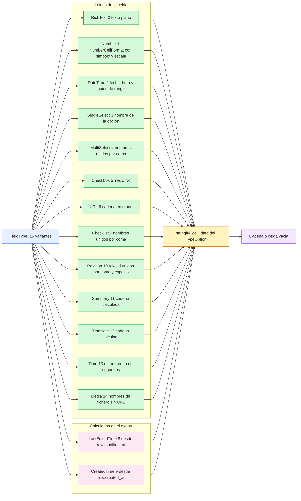
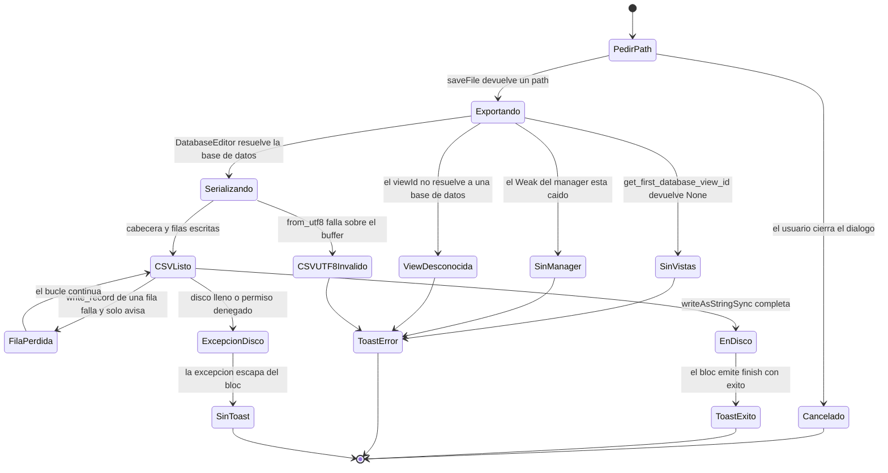
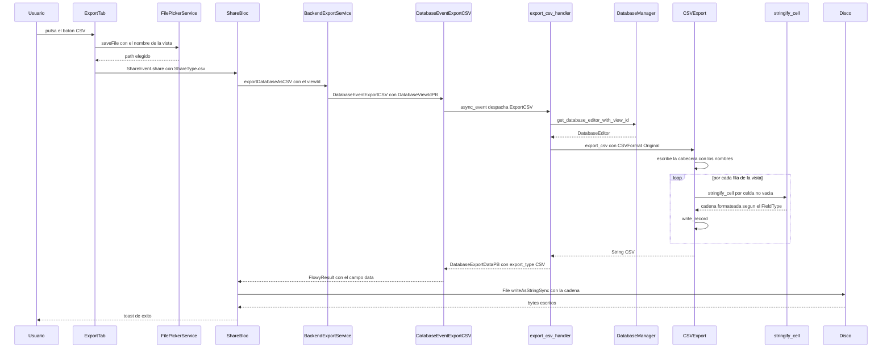

# B4.5 — Export CSV de base de datos

El export CSV de una base de datos es el único formato del motor de exportación que **cruza la frontera FFI para producir el artefacto**: Dart solo pide el dato y lo vuelca en disco, mientras que toda la serialización ocurre en Rust dentro de `flowy-database2`. El motor es `CSVExport::export_database` (`appflowy/frontend/rust-lib/flowy-database2/src/services/share/csv/export.rs:25–98`), una función asíncrona que construye un `csv::Writer` sobre un buffer en memoria, escribe una fila de cabecera con los nombres de campo y después una fila por cada fila de la base de datos. La conversión de cada celda a texto la delega en `stringify_cell`, que a su vez invoca el `stringify_cell_data` del `TypeOption` correspondiente al `FieldType` de la celda: por eso el contenido de una columna depende tanto del tipo de columna como de su `type_option` (formato numérico, formato de fecha, separador de selections). El evento FFI que lo activa es `DatabaseEvent::ExportCSV` (índice 141), cuyo handler es `export_csv_handler` en `appflowy/frontend/rust-lib/flowy-database2/src/event_handler.rs:1029` —confirmando la cifra citada por `[[F11]] §2`— y cuyo formato de salida es **siempre** `CSVFormat::Original`, nunca `CSVFormat::META` (`appflowy/frontend/rust-lib/flowy-database2/src/event_handler.rs:1036`). Este documento traza el recorrido completo Dart → FFI → Rust → CSV → disco y deriva, tipo de campo por tipo de campo, el formato CSV literal que produce cada uno.

## 1. Punto de entrada (UI)

Existen **cuatro** disparadores distintos del mismo motor, y solo uno de ellos corresponde al camino "compartir" del producto:

1. **Botón «CSV» del `ExportTab`** (camino principal). `ExportTab` decide entre pestaña de documento y pestaña de base de datos según el layout de la vista; la rama de base de datos es `_buildDatabaseExportTab` (`appflowy/frontend/appflowy_flutter/lib/plugins/shared/share/export_tab.dart:67–86`), que renderiza el botón con la clave i18n `shareAction_csv` (`appflowy/frontend/appflowy_flutter/lib/plugins/shared/share/export_tab.dart:71–75`). La pulsación entra en `_exportCSV` (`appflowy/frontend/appflowy_flutter/lib/plugins/shared/share/export_tab.dart:136–150`): pide destino con `FilePickerService.saveFile(dialogTitle: '', fileName: '${viewName.toFileName()}.csv')` y, solo si el usuario no cancela y el `context` sigue montado, despacha `ShareEvent.share(ShareType.csv, exportPath)` al `ShareBloc`. El `ShareBloc` resuelve la rama de base de datos en `_export` (`appflowy/frontend/appflowy_flutter/lib/plugins/shared/share/share_bloc.dart:305–350`), donde el `if (type == ShareType.csv)` de `appflowy/frontend/appflowy_flutter/lib/plugins/shared/share/share_bloc.dart:310–317` llama a `BackendExportService.exportDatabaseAsCSV(view.id)`, desempaqueta solo el campo `data` del PB y escribe el fichero con `File(path).writeAsStringSync(s)` en `appflowy/frontend/appflowy_flutter/lib/plugins/shared/share/share_bloc.dart:338`.
2. **Botón «Share» de la propia base de datos.** `DatabaseShareActionListState.onSelected` (`appflowy/frontend/appflowy_flutter/lib/plugins/database/widgets/share_button.dart:110–124`) abre el mismo `saveFile` con extensión `.csv` (`appflowy/frontend/appflowy_flutter/lib/plugins/database/widgets/share_button.dart:115`) y despacha `DatabaseShareEvent.shareCSV(exportPath)` sobre el `DatabaseShareBloc` que se crea en el `BlocProvider` de `appflowy/frontend/appflowy_flutter/lib/plugins/database/widgets/share_button.dart:27–29`. El listener de `appflowy/frontend/appflowy_flutter/lib/plugins/database/widgets/share_button.dart:30–39` pinta un `SnackBar` de éxito o un toast con el `msg` del `FlowyError` (`appflowy/frontend/appflowy_flutter/lib/plugins/database/widgets/share_button.dart:49–58`).
3. **«Export all files» de Ajustes → Files.** El bucle de `appflowy/frontend/appflowy_flutter/lib/workspace/presentation/settings/widgets/files/settings_file_exporter_widget.dart:235–271` llama a `BackendExportService.exportDatabaseAsCSV(view.id)` para **toda vista cuyo layout no sea `Document`** (`appflowy/frontend/appflowy_flutter/lib/workspace/presentation/settings/widgets/files/settings_file_exporter_widget.dart:252–260`), con extensión `.csv`, y desambigua nombres duplicados con el sufijo `(1)`, `(2)`… (`appflowy/frontend/appflowy_flutter/lib/workspace/presentation/settings/widgets/files/settings_file_exporter_widget.dart:262–270`). Este camino **no pasa por ningún `ShareBloc`**: escribe con `File.writeAsString` y acumula los nombres fallidos sin toast.
4. **Bloque `database` embebido en un documento.** `DatabaseNodeParser._convertDatabaseToCSV` (`appflowy/frontend/appflowy_flutter/lib/plugins/document/presentation/editor_plugins/parsers/database_node_parser.dart:22–31`) pide el mismo CSV y lo empaqueta como `<dirPath>/<viewId>.csv` dentro del ZIP del export Markdown. Es el consumidor interno de este motor y su análisis completo vive en `[[B4.1]] §6`.

**Correcciones de scope declaradas:** la construcción de los widgets, el `ShareType`, el `ShareState` y los toasts pertenecen a `[[F11]]` y `[[F12.1]]`; aquí solo se nombra la frontera que dispara el motor. La semántica de la base de datos (celdas, campos, filtros, sorts) es de `[[F02]]`; el camino inverso es `[[B4.9]]`; el formato «raw database data» es `[[B4.6]]`.

## 2. Lado de conversión

La conversión es **100 % Rust, dentro del crate `flowy-database2`**, sin ninguna lógica de formato en Dart. Los tres ficheros del módulo son un `mod.rs` de dos líneas y dos submódulos (`appflowy/frontend/rust-lib/flowy-database2/src/services/share/csv/mod.rs:1–5`); `mod.rs` se declara como `pub mod csv;` desde el padre (`appflowy/frontend/rust-lib/flowy-database2/src/services/share/mod.rs:1`) y reexporta ambos con `pub use export::*;` / `pub use import::*;`, de modo que `CSVExport`, `CSVFormat` y `CSVImporter` viven en el mismo espacio de nombres.

El motor se apoya en la crate `csv` versión `1.3.0` declarada en `appflowy/frontend/rust-lib/flowy-database2/Cargo.toml:48`. Se instancia con `csv::Writer::from_writer(vec![])` (`appflowy/frontend/rust-lib/flowy-database2/src/services/share/csv/export.rs:30`), es decir el constructor de atajos que aplica **todos los valores por defecto** del builder: en ningún punto del crate aparece `csv::WriterBuilder` ni `csv::ReaderBuilder` (`appflowy/frontend/rust-lib/flowy-database2/src/services/share/csv/export.rs:30` y `:44`, `appflowy/frontend/rust-lib/flowy-database2/src/services/share/csv/import.rs:50`). Por tanto el formato es RFC 4180 con delimitador `,`, comilla `"`, terminador de registro `\n` y estilo de entrecomillado *necesario* (solo se entrecomilla un campo que contenga el delimitador, la comilla, un `\r` o un `\n`) `[INFERIDO]`: la deducción se apoya en la ausencia de `WriterBuilder` en todo el crate y en que la crate `csv` no está vendorizada en este snapshot, por lo que sus valores por defecto no se pueden citar directamente.

El resultado es un `FlowyResult<String>` (`appflowy/frontend/rust-lib/flowy-database2/src/services/share/csv/export.rs:97`), no bytes: el buffer del writer se convierte a `Vec<u8>` con `into_inner` y luego a `String` con `String::from_utf8` (`appflowy/frontend/rust-lib/flowy-database2/src/services/share/csv/export.rs:93–96`). Esa conversión es la razón de que el formato de salida esté **obligatoriamente ligado a UTF-8**: un dato no representable en UTF-8 produciría un `FlowyError::internal()` en lugar de una sustitución.

La cadena de llamada completa, desde el manager hasta el writer, son cuatro saltos:

```rust
// appflowy/frontend/rust-lib/flowy-database2/src/manager.rs:551–554
pub async fn export_csv(&self, view_id: &str, style: CSVFormat) -> FlowyResult<String> {
  let database = self.get_database_editor_with_view_id(view_id).await?;
  database.export_csv(style).await
}
```

```rust
// appflowy/frontend/rust-lib/flowy-database2/src/services/database/database_editor.rs:1702–1709
pub async fn export_csv(&self, style: CSVFormat) -> FlowyResult<String> {
  let database = self.database.clone();
  let database_guard = database.read().await;
  let csv = CSVExport
    .export_database(&database_guard, style)
    .await
    .map_err(internal_error)?;
  Ok(csv)
}
```

El tercer salto es la conversión de celda. `stringify_cell` (`appflowy/frontend/rust-lib/flowy-database2/src/services/cell/cell_operation.rs:132–141`) **no** usa el `field_type` del campo sino el que la propia celda declara bajo la clave `field_type` (`collab:collab-database/src/rows/cell.rs:53–57`); con ese valor busca el `TypeOption` registrado en el `Field` y llama a `handle_stringify_cell` (`appflowy/frontend/rust-lib/flowy-database2/src/services/field/type_options/type_option_cell.rs:333–341`), que a su vez invoca el `stringify_cell_data` del tipo. Si el `Field` no tiene `type_option` para ese `FieldType`, el handler es `None` y `unwrap_or_default()` devuelve cadena vacía; si la celda no lleva la clave `field_type`, `stringify_cell` devuelve directamente `""` (`appflowy/frontend/rust-lib/flowy-database2/src/services/cell/cell_operation.rs:138–140`). Ninguna de las dos rutas puede propagar un error: **el motor de export no puede fallar por el contenido de una celda**.

## 3. Pipeline

Diagrama del recorrido completo desde el `_ExportButton` hasta el byte en disco, con los cuatro puntos en los que el control pasa de una capa a otra y los dos únicos conversores reales (Rust produce la cadena; Dart la persiste):

```mermaid
flowchart LR
  subgraph DART["Capa Dart (Flutter)"]
    BTN["_ExportButton shareAction_csv"]:::ui
    PICK["FilePickerService.saveFile devuelve path"]:::ui
    SBLOC["ShareBloc._export rama ShareType.csv"]:::ui
    DBSHARE["DatabaseShareBloc._onShareCSV"]:::ui
    BES["BackendExportService.exportDatabaseAsCSV"]:::ui
    EV["DatabaseEventExportCSV codigo generado"]:::ffi
    WR["File.writeAsStringSync escribe el CSV"]:::disk
  end
  subgraph FFI["Frontera FFI (dart-ffi / lib-dispatch)"]
    SEND["send serializa DatabaseViewIdPB"]:::ffi
    DISP["dispatcher resuelve DatabaseEvent::ExportCSV 141"]:::ffi
    BACK["DatabaseExportDataPB vuelve por el canal asincrono"]:::ffi
  end
  subgraph RUST["Capa Rust (flowy-database2)"]
    HAND["export_csv_handler event_handler.rs"]:::rust
    MGR["DatabaseManager.get_database_editor_with_view_id"]:::rust
    EDT["DatabaseEditor.export_csv"]:::rust
    EXP["CSVExport.export_database"]:::rust
    WRITER["csv::Writer sobre Vec con deltas"]:::rust
    STRF["stringify_cell y stringify_cell_data"]:::rust
    UTF8["String::from_utf8 del buffer"]:::rust
  end
  BTN --> PICK --> SBLOC --> BES --> EV --> SEND --> DISP --> HAND
  DBSHARE --> BES
  HAND --> MGR --> EDT --> EXP --> WRITER
  WRITER --> STRF --> WRITER
  WRITER --> UTF8 --> BACK --> WR
  classDef ui fill:#e7f0ff,stroke:#3b82f6
  classDef ffi fill:#f3e8ff,stroke:#7c3aed
  classDef rust fill:#fff3bf,stroke:#d97706
  classDef disk fill:#d3f9d8,stroke:#16a34a
```



Lectura: el grafo tiene una sola rama que importa. Del lado Dart hay tres emisores distintos del mismo evento (`ShareBloc`, `DatabaseShareBloc` y el bucle de Ajustes) pero **un solo destino**: el PB `DatabaseViewIdPB` con `value = viewId`. Del lado Rust el handler no serializa nada: resuelve el editor de base de datos, delega y devuelve el PB ya con la cadena dentro. El nodo `UTF8` es el último punto donde el dato está en Rust, y `WR` es el primero donde existe como fichero; entre ambos solo cruza la frontera un `String`. Nótese que la escritura en disco ocurre **en Dart**, no en Rust: el motor nunca toca el sistema de ficheros en el camino de export (el `CSVImporter` sí lo hace, pero solo en el camino de import, `appflowy/frontend/rust-lib/flowy-database2/src/services/share/csv/import.rs:25–27`).

El recorrido interno de `export_database` merece una lectura propia porque toma dos decisiones que condicionan todo el resultado:

```rust
// appflowy/frontend/rust-lib/flowy-database2/src/services/share/csv/export.rs:30–58
let mut wtr = csv::Writer::from_writer(vec![]);
let view_id = database
  .get_first_database_view_id()
  .ok_or_else(|| FlowyError::internal().with_context("failed to get first database view"))?;
let fields = database.get_fields_in_view(&view_id, None);

let field_records = fields
  .iter()
  .map(|field| match &style {
    CSVFormat::Original => field.name.clone(),
    CSVFormat::META => serde_json::to_string(&field).unwrap(),
  })
  .collect::<Vec<String>>();
wtr.write_record(&field_records)
  .map_err(|e| FlowyError::internal().with_context(e))?;

let mut field_by_field_id = IndexMap::new();
fields.into_iter().for_each(|field| {
  field_by_field_id.insert(field.id.clone(), field);
});
let rows = database
  .get_rows_for_view(&view_id, 20, None)
  .await
  .filter_map(|result| async { result.ok() })
  .collect::<Vec<_>>()
  .await;
```

Dos consecuencias se derivan de este fragmento y conviene fijarlas porque desmienten dos intuiciones habituales:

- **El `view_id` que envía Dart se descarta.** El handler resuelve la base de datos completa con `get_database_editor_with_view_id` y a partir de ahí el export usa `database.get_first_database_view_id()` (`appflowy/frontend/rust-lib/flowy-database2/src/services/share/csv/export.rs:31–34`), que devuelve la **primera vista de la base de datos** (`collab:collab-database/src/database.rs:1401–1409`), tanto para la lista de campos como para el listado de filas. Si el usuario exporta una vista Board o una segunda vista Grid de una base de datos con varias vistas, lo que sale es el esquema y las filas de la primera vista registrada `[VERIFICADO]`.
- **El `20` es tamaño de lote, no límite de filas.** `get_rows_for_view` declara el tercer parámetro como `chunk_size` y devuelve un `Stream` de filas (`collab:collab-database/src/database.rs:597–607`); el `.collect()` de `appflowy/frontend/rust-lib/flowy-database2/src/services/share/csv/export.rs:53–58` materializa **todas** las filas, no las primeras veinte `[VERIFICADO]`. La afirmación «lotes de 20 filas» de `[[F02.8]] §8.4` es correcta sobre el chunking pero puede leerse como truncamiento; no lo hay.

El orden de las columnas es el `FieldOrder` de la vista: `get_fields_in_view` construye un mapa de todos los campos y luego lo recorre con el vector de órdenes, descartando cualquier campo sin orden (`collab:collab-database/src/database.rs:1888–1914`), y avisa por `tracing::warn!` si longitudes no coinciden (`collab:collab-database/src/database.rs:1902–1908`). El orden de las filas es el `RowOrder` de esa misma vista (`collab:collab-database/src/database.rs:614–617`).

## 4. Tipo de campo → salida

**Corrección de alcance frente al encargo:** `FieldType` tiene **15 variantes, no 16**. El enum va de `RichText = 0` a `Media = 14`, sin huecos (`appflowy/frontend/rust-lib/flowy-database2/src/entities/field_entities.rs:427–444`), y su comentario de cabecera prohíbe reordenar el enum (`appflowy/frontend/rust-lib/flowy-database2/src/entities/field_entities.rs:410–411`). La tabla siguiente tiene una fila por cada una.

El dispatch hacia el formateador tiene una bifurcación previa que afecta a las dos últimas columnas de la tabla. `export_database` recorre los campos indexados por `field_by_field_id` y, para `FieldType::LastEditedTime` y `FieldType::CreatedTime`, **no busca la celda**: fabrica una `TimestampCellData` con `row.created_at` o `row.modified_at` según `is_created_time()` y la convierte a `Cell` con `to_cell(field.field_type)` (`appflowy/frontend/rust-lib/flowy-database2/src/services/share/csv/export.rs:71–79`). Para cualquier otro tipo, si `row.cells.get(field_id)` devuelve `None` la celda del CSV es cadena vacía (`appflowy/frontend/rust-lib/flowy-database2/src/services/share/csv/export.rs:80–83`). En ambos casos el resultado pasa por el mismo `stringify` (`appflowy/frontend/rust-lib/flowy-database2/src/services/share/csv/export.rs:60–63`).

| `FieldType` (valor) | Columna por defecto | Salida CSV literal | Evidencia |
|---|---|---|---|
| `RichText` (0) | `Text` | El texto plano de la celda tal cual (`StringCellData.0`), sin comillas propias; el writer entrecomilla si contiene `,` `"` `\r` o `\n`. Celda ausente → `""` | `appflowy/frontend/rust-lib/flowy-database2/src/services/field/type_options/text_type_option/text_type_option.rs:63–65`; celda ausente en `appflowy/frontend/rust-lib/flowy-database2/src/services/share/csv/export.rs:80–83` |
| `Number` (1) | `Number` | `Display` de `NumberCellFormat`: símbolo + escala si el formato es de moneda, decimal si no, y **cadena vacía** si no hay `money` ni `decimal`. Con `NumberFormat::USD` y `scale = 0`, `1` sale como `$1` | `appflowy/frontend/rust-lib/flowy-database2/src/services/field/type_options/number_type_option/number_type_option.rs:97–102`; `collab:collab-database/src/fields/type_option/number_type_option.rs:259–270`; valor de prueba `$1` en `appflowy/frontend/rust-lib/flowy-database2/tests/database/share_test/export_test.rs:59–63` |
| `DateTime` (2) | `Date` | Sin rango y `include_time = false`: solo la fecha. Con hora: `"<fecha> <hora>"`. Con rango y hora: `"<fecha1> <hora1> → <fecha2> <hora2>"`. Con rango sin hora: `"<fecha1> → <fecha2>"`. El formato concreto sale de `DateFormat` (`US` → `%Y/%m/%d`, `ISO` → `%Y-%m-%d`, `Friendly` → `%b %d, %Y`) y el desplazamiento horario del `timezone_id` del campo | `appflowy/frontend/rust-lib/flowy-database2/src/services/field/type_options/date_type_option/date_type_option.rs:104–130`; tabla de formatos en `collab:collab-database/src/fields/type_option/date_type_option.rs:409–418`; `include_time` por defecto `false` al leer la celda en `collab:collab-database/src/fields/type_option/date_type_option.rs:463–482`; valor de prueba `2022/03/14` en `appflowy/frontend/rust-lib/flowy-database2/tests/database/share_test/export_test.rs:64–68` |
| `SingleSelect` (3) | `Single Select` | El **nombre** de la única opción seleccionada (o `""` si no hay celda). El `id` interno de la opción y su color se pierden | `appflowy/frontend/rust-lib/flowy-database2/src/services/field/type_options/selection_type_option/select_type_option.rs:135–143`; `""` verificado en `appflowy/frontend/rust-lib/flowy-database2/tests/database/share_test/export_test.rs:69–73` |
| `MultiSelect` (4) | `Multi Select` | Nombres de todas las opciones unidas por `,` (constante `SELECTION_IDS_SEPARATOR = ","`). Ejemplo literal de la prueba: `Google,Facebook` | `appflowy/frontend/rust-lib/flowy-database2/src/services/field/type_options/selection_type_option/select_type_option.rs:135–143`; separador en `collab:collab-database/src/fields/type_option/select_type_option.rs:335`; valor de prueba en `appflowy/frontend/rust-lib/flowy-database2/tests/database/share_test/export_test.rs:74–78` |
| `Checkbox` (5) | `Checkbox` | `Yes` si está marcado, `No` si no. Sin celda → `""` | `appflowy/frontend/rust-lib/flowy-database2/src/services/field/type_options/checkbox_type_option/checkbox_type_option.rs:50–52`; literales `CHECK`/`UNCHECK` en `appflowy/frontend/rust-lib/flowy-database2/src/services/field/type_options/checkbox_type_option/checkbox_type_option_entities.rs:13–14`; `Yes` verificado en `appflowy/frontend/rust-lib/flowy-database2/tests/database/share_test/export_test.rs:157–161` |
| `URL` (6) | `URL` | El campo `data` de `URLCellData` **en crudo**, sin normalizar: puede ser texto libre con URL incrustada. Ejemplo literal de la prueba: `AppFlowy website - https://www.appflowy.io` | `appflowy/frontend/rust-lib/flowy-database2/src/services/field/type_options/url_type_option/url_type_option.rs:88–90`; estructura en `collab:collab-database/src/fields/type_option/url_type_option.rs:65–68`; valor de prueba en `appflowy/frontend/rust-lib/flowy-database2/tests/database/share_test/export_test.rs:162–166` |
| `Checklist` (7) | `Checklist` | Nombres de todos los ítems unidos por `,`. **El estado marcado/desmarcado de cada ítem no se serializa**: solo el nombre | `appflowy/frontend/rust-lib/flowy-database2/src/services/field/type_options/checklist_type_option/checklist_type_option.rs:143–150` |
| `LastEditedTime` (8) | `Last modified` | **Valor calculado en el momento del export**, no una celda: `row.modified_at` formateado con `DateFormat`/`TimeFormat` del campo. Con `include_time` (por defecto `true` en `TimestampTypeOption::new`) sale `"<fecha> <hora>"`. Sin celda de origen no hay `""`: la columna se rellena igualmente | `appflowy/frontend/rust-lib/flowy-database2/src/services/share/csv/export.rs:71–79`; formateo en `appflowy/frontend/rust-lib/flowy-database2/src/services/field/type_options/timestamp_type_option/timestamp_type_option.rs:39–47`; `include_time: true` por defecto en `collab:collab-database/src/fields/type_option/timestamp_type_option.rs:71–78`; desfase horario en `collab:collab-database/src/fields/type_option/timestamp_type_option.rs:80–100` |
| `CreatedTime` (9) | `Created time` | Igual que el anterior pero sobre `row.created_at`, seleccionado por `is_created_time()` | `appflowy/frontend/rust-lib/flowy-database2/src/services/share/csv/export.rs:72–76`; predicado en `appflowy/frontend/rust-lib/flowy-database2/src/entities/field_entities.rs:523–525` |
| `Relation` (10) | `Relation` | Los `row_id` relacionados unidos por `", "` (coma + espacio). **No se exporta el nombre de la fila relacionada ni el `database_id` destino**: el resultado no es interpretable fuera de AppFlowy | `appflowy/frontend/rust-lib/flowy-database2/src/services/field/type_options/relation_type_option/relation.rs:60–62`; implementación en `collab:collab-database/src/template/relation_parse.rs:74–83` |
| `Summary` (11) | `Summarize` | El `String` calculado por el resumen, tal cual. Sin celda → `""` | `appflowy/frontend/rust-lib/flowy-database2/src/services/field/type_options/summary_type_option/summary.rs:63–65`; `SummaryCellData` es un newtype sobre `String` en `collab:collab-database/src/template/summary_parse.rs:8–9` |
| `Translate` (12) | `Translate` | El texto traducido, tal cual. Sin celda → `""` | `appflowy/frontend/rust-lib/flowy-database2/src/services/field/type_options/translate_type_option/translate.rs:63–65`; newtype en `collab:collab-database/src/template/translate_parse.rs:39–43` |
| `Time` (13) | `Time` | El entero crudo de `TimeCellData.0` (`Option<i64>`), impreso con `to_string()`. Ejemplo del mock de pruebas: `75`. **No se formatea como `HH:MM`** | `appflowy/frontend/rust-lib/flowy-database2/src/services/field/type_options/time_type_option/time.rs:40–45`; tipo del dato en `collab:collab-database/src/template/time_parse.rs:9–10`; valor `75` insertado en `appflowy/frontend/rust-lib/flowy-database2/tests/database/mock_data/grid_mock_data.rs:199` |
| `Media` (14) | `Media` | Los `name` de los ficheros unidos por `", "`. **Las URLs de los ficheros no se serializan**, de modo que el resultado es texto sin ningún destino; además el flag `hide_file_names` del `TypeOption` se ignora por completo | `appflowy/frontend/rust-lib/flowy-database2/src/services/field/type_options/media_type_option/media_type_option.rs:62–64`; unión de nombres en `collab:collab-database/src/fields/type_option/media_type_option.rs:139–146`; flag declarado y nunca leído en `collab:collab-database/src/fields/type_option/media_type_option.rs:23` |

El siguiente diagrama reparte las quince variantes de `FieldType` entre las cuatro familias de formato que produce el motor, y marca las dos columnas cuyo valor se calcula en el momento del export en lugar de leerse de la celda:



Lectura: el grafo tiene dos entradas y una sola salida. La entrada superior agrupa trece variantes que salen de `row.cells.get(field_id)` y de ahí al `stringify_cell_data` de su `TypeOption`; la entrada inferior agrupa las dos columnas de timestamp, que el export fabrica a partir de `row.created_at` y `row.modified_at` antes de hacer exactamente el mismo viaje (`appflowy/frontend/rust-lib/flowy-database2/src/services/share/csv/export.rs:71–79`). La salida común es una cadena que puede estar vacía sin que eso sea un error: tanto la celda ausente (`appflowy/frontend/rust-lib/flowy-database2/src/services/share/csv/export.rs:80–83`) como el `TypeOption` no registrado y la celda sin clave `field_type` (`appflowy/frontend/rust-lib/flowy-database2/src/services/cell/cell_operation.rs:133–140`) desembocan en `""`. De ahí la consecuencia práctica de §8: **el motor no tiene forma de distinguir "celda vacía" de "celda ilegible"**, y el CSV exporta las dos igual.

La tabla se cierra con dos filas que no son `FieldType` pero que comparten la misma decisión de formato:

| Elemento | Salida CSV literal | Evidencia |
|---|---|---|
| Fila de cabecera | `field.name.clone()` en `CSVFormat::Original`; el `serde_json::to_string(&field)` completo en `CSVFormat::META`. Se escribe con `write_record` y es **el único `write_record` cuyo error se propaga** como `FlowyError::internal()` | `appflowy/frontend/rust-lib/flowy-database2/src/services/share/csv/export.rs:36–46` |
| Fila de datos | Una llamada a `write_record` por fila de la base de datos; si falla, se emite `tracing::warn!("CSV failed to write record: {}", e)` y **el bucle continúa** | `appflowy/frontend/rust-lib/flowy-database2/src/services/share/csv/export.rs:88–90` |

## 5. Pérdidas

Todo lo que el formato `CSVFormat::Original` descarta, con la línea que lo provoca:

- **El tipo de cada columna.** Solo se escribe `field.name` en la cabecera (`appflowy/frontend/rust-lib/flowy-database2/src/services/share/csv/export.rs:40`); el `field_type`, el `id` del campo, `width`, `visibility`, `is_primary` y el bloque completo de `type_options` se pierden. Es la razón declarada por el propio doc-comment del enum (`appflowy/frontend/rust-lib/flowy-database2/src/services/share/csv/export.rs:15–17`).
- **Los `id` internos de filas y celdas.** El bucle escribe `cells` sin ninguna columna de identificador (`appflowy/frontend/rust-lib/flowy-database2/src/services/share/csv/export.rs:65–86`); `Row.id` (`collab:collab-database/src/rows/row.rs:381`) no aparece en ninguna parte del CSV.
- **Los metadatos de fila.** `Row` transporta `height`, `visibility` y `database_id` (`collab:collab-database/src/rows/row.rs:380–391`) y el export solo lee `cells`, `created_at` y `modified_at` (`appflowy/frontend/rust-lib/flowy-database2/src/services/share/csv/export.rs:72–83`). La altura de fila, una fila oculta y la portada (`RowCover`, que vive en `RowMeta` y no en `Row`) desaparecen.
- **Los `FieldSettings` de la vista.** Ocultar columnas, ancho, `is_primary` y la configuración por layout viven en `default_field_settings_for_fields` (`appflowy/frontend/rust-lib/flowy-database2/src/services/share/csv/import.rs:100`) y no se leen en el export: el CSV sale con **todas** las columnas ordenadas, ocultas incluidas.
- **La identidad de la vista exportada.** Como se usa `get_first_database_view_id()` (`appflowy/frontend/rust-lib/flowy-database2/src/services/share/csv/export.rs:31–33`), el layout, el nombre y el id de la vista que el usuario eligió no dejan rastro en el artefacto, y si exporta una vista secundaria el contenido corresponde a otra vista (§3).
- **Los estados de los ítems de `Checklist`.** `stringify_cell_data` proyecta solo `option.name` (`appflowy/frontend/rust-lib/flowy-database2/src/services/field/type_options/checklist_type_option/checklist_type_option.rs:143–150`); el booleano `is_selected` de cada ítem se descarta.
- **Los `id` de las opciones de `SingleSelect`/`MultiSelect`.** Se emite `option.name` y nada más (`appflowy/frontend/rust-lib/flowy-database2/src/services/field/type_options/selection_type_option/select_type_option.rs:135–143`); el color de la opción tampoco se exporta, de modo que un `MultiSelect` con dos opciones de nombre duplicado es indistinguible al reimportar.
- **Los `id` de fila y el nombre legible de `Relation`.** `to_cell_string` concatena identificadores opacos (`collab:collab-database/src/template/relation_parse.rs:74–83`), no nombres.
- **Las URLs de `Media`.** Solo el nombre del fichero (`collab:collab-database/src/fields/type_option/media_type_option.rs:139–146`). La columna es irrecuperable sin acceso al gestor de ficheros.
- **El `id` de `Media` y su `hide_file_names`.** El `TypeOption` declara `hide_file_names` (`collab:collab-database/src/fields/type_option/media_type_option.rs:23`) pero ninguna ruta de stringify lo consulta `[VERIFICADO]`.
- **El contenido en crudo de `Date` (`reminder_id`, `end_timestamp` sin rango).** `DateCellData` transporta `reminder_id` (`collab:collab-database/src/fields/type_option/date_type_option.rs:473`) y `stringify_cell_data` solo lo usa para decidir rango y hora (`appflowy/frontend/rust-lib/flowy-database2/src/services/field/type_options/date_type_option/date_type_option.rs:104–130`); el recordatorio asociado a la celda se pierde.
- **`CSVFormat::META` tampoco está expuesto al usuario.** Existe, está implementado y solo lo usan los tests: el handler de FFI pasa siempre `CSVFormat::Original` (`appflowy/frontend/rust-lib/flowy-database2/src/event_handler.rs:1036`). `DatabaseManager::export_csv` acepta el parámetro `style` (`appflowy/frontend/rust-lib/flowy-database2/src/manager.rs:551`) pero ningún evento FFI lo permite cambiar.

## 6. Assets

El motor CSV **no gestiona ningún asset**. No hay descarga, ni copia, niReferencia a `flowy-storage`, ni `file_cache`, ni `uploader` en `appflowy/frontend/rust-lib/flowy-database2/src/services/share/csv/export.rs` (99 líneas, sin ninguna ruta de import a un servicio de ficheros) `[VERIFICADO]`.

- **Columnas `Media`.** Es el único tipo de campo con contenido no textual, y su salida es el nombre del fichero sin URL (`collab:collab-database/src/fields/type_option/media_type_option.rs:139–146`). Las imágenes y adjuntos de la base de datos **no viajan** en el `.csv`; el receptor solo obtiene texto.
- **Contraste con el export Markdown.** `DatabaseNodeParser` (`appflowy/frontend/appflowy_flutter/lib/plugins/document/presentation/editor_plugins/parsers/database_node_parser.dart:22–31`) sí empaqueta el CSV como `ArchiveFile` dentro del ZIP, pero el CSV que incrusta es exactamente el mismo: sin binarios. Los recursos de un bloque `database` no se incluyen en el ZIP del documento `[VERIFICADO]`.
- **Contraste con el raw database data.** `export_raw_database_data_handler` (`appflowy/frontend/rust-lib/flowy-database2/src/event_handler.rs:1043–1055`) serializa el JSON completo del collab, donde sí aparecen las URLs de los ficheros; es el único de los dos formatos de base de datos que las conserva. Documentado en `[[B4.6]]`.
- **Portapapeles.** No hay camino CSV→portapapeles: `_exportToClipboard` de `ExportTab` solo conoce Markdown (`[[B4.1]] §1`), y `DatabaseShareBloc._saveCSVToPath` (`appflowy/frontend/appflowy_flutter/lib/plugins/database/application/share_bloc.dart:48–53`) escribe siempre en disco.

## 7. Encoding y nombre de archivo

- **Encoding en Rust.** El buffer del writer se convierte con `String::from_utf8` (`appflowy/frontend/rust-lib/flowy-database2/src/services/share/csv/export.rs:96`), que devuelve `Err(FromUtf8Error)` ante cualquier secuencia no UTF-8 y se traduce a `FlowyError::internal()`. No hay BOM en ningún punto: la crate `csv` no escribe BOM y el código no lo añade `[VERIFICADO]`.
- **Encoding en Dart.** `File.writeAsStringSync` de `dart:io` usa `utf8` por defecto y **no** escribe BOM: `appflowy/frontend/appflowy_flutter/lib/plugins/shared/share/share_bloc.dart:338`, `appflowy/frontend/appflowy_flutter/lib/plugins/database/application/share_bloc.dart:49` y `appflowy/frontend/appflowy_flutter/lib/workspace/presentation/settings/widgets/files/settings_file_exporter_widget.dart:266`. El archivo resultante es UTF-8 puro.
- **Terminador de línea.** El `csv::Writer` por defecto usa `\n` como terminador de registro, no `\r\n` `[INFERIDO]` (misma deducción que en §2: constructor de atajos y ausencia de `WriterBuilder`).
- **Nombre de archivo.** Lo elige el usuario en el diálogo `saveFile`; el valor por defecto es `'${viewName.toFileName()}.csv'` en los tres caminos (`appflowy/frontend/appflowy_flutter/lib/plugins/shared/share/export_tab.dart:140`, `appflowy/frontend/appflowy_flutter/lib/plugins/database/widgets/share_button.dart:115`). En el caso de Ajustes el nombre es `'$name.$fileExtension'` con el nombre crudo de la vista y desambiguación por sufijo `(n)` (`appflowy/frontend/appflowy_flutter/lib/workspace/presentation/settings/widgets/files/settings_file_exporter_widget.dart:263–265`), es decir **sin pasar por `toFileName()`** y por tanto sin saneado de caracteres.
- **Colisiones.** Ninguna lógica de sufijo en el motor; solo el bucle de Ajustes desambigua duplicados dentro de la misma carpeta. La casilla de "guardar" del sistema operativo decide el comportamiento real `[INFERIDO]`.

## 8. Errores

El motor tiene una superficie de error muy estrecha y, en contrapeso, tres defectos silenciosos que el usuario no percibe.

- **Base de datos sin vistas.** `get_first_database_view_id()` devuelve `None` y el motor falla con `FlowyError::internal().with_context("failed to get first database view")` (`appflowy/frontend/rust-lib/flowy-database2/src/services/share/csv/export.rs:32–33`). `ErrorCode::Internal = 0` (`appflowy/frontend/rust-lib/flowy-error/src/code.rs:13`).
- **Manager ya liberado.** `upgrade_manager` falla con `FlowyError::internal().with_context("The database manager is already dropped")` (`appflowy/frontend/rust-lib/flowy-database2/src/event_handler.rs:21–27`), invocado en la primera línea del handler (`appflowy/frontend/rust-lib/flowy-database2/src/event_handler.rs:1033`).
- **`view_id` desconocido.** `get_database_editor_with_view_id` encadena `get_database_id_with_view_id` y `get_or_init_database_editor` (`appflowy/frontend/rust-lib/flowy-database2/src/manager.rs:258–264`); el error concreto lo decide esa resolución y no se specializes en el handler.
- **Fallo de escritura de la cabecera.** El único `write_record` que se propaga como `FlowyError::internal()` (`appflowy/frontend/rust-lib/flowy-database2/src/services/share/csv/export.rs:44–46`); en la práctica solo ocurre si una fila de cabecera excede los límites del writer.
- **Fallo de escritura de una fila de datos.** Solo genera `tracing::warn!` y el bucle continúa (`appflowy/frontend/rust-lib/flowy-database2/src/services/share/csv/export.rs:88–90`): el CSV sale con esa fila truncada o ausente y el usuario recibe un toast de **éxito** `[INFERIDO]`.
- **Buffer no UTF-8 o error de `into_inner`.** `FlowyError::internal()` en `appflowy/frontend/rust-lib/flowy-database2/src/services/share/csv/export.rs:93–96`.
- **Cadena de `serde_json` que no se puede serializar (solo `CSVFormat::META`).** `.unwrap()` en `appflowy/frontend/rust-lib/flowy-database2/src/services/share/csv/export.rs:41`/entrada de celda en `:62`Con `unwrap_or_else(|_| "".to_string())` respectivamente: en el primer caso **panica**, en el segundo degrada a celda vacía `[VERIFICADO]`. Ninguno de los dos es alcanzable desde la UI.
- **Defecto 1 — doble escritura en `DatabaseShareBloc`.** `_saveCSVToPath` se invoca **dos veces** con la misma cadena: una en el `fold` de éxito y otra dentro del `fold` del `emit` (`appflowy/frontend/appflowy_flutter/lib/plugins/database/application/share_bloc.dart:31` y `:39`). El fichero se abre y se sobrescribe dos veces idénticas `[VERIFICADO]`.
- **Defecto 2 — `ExportDataPB` mal tipado y devuelto sin usar.** `_saveCSVToPath` declara devolver `ExportDataPB` y lo etiqueta con `ExportType.Markdown` aunque el contenido es CSV (`appflowy/frontend/appflowy_flutter/lib/plugins/database/application/share_bloc.dart:50–52`), y su valor de retorno se descarta en ambos call sites `[VERIFICADO]`. El parámetro se llama además `markdown` (`appflowy/frontend/appflowy_flutter/lib/plugins/database/application/share_bloc.dart:48`).
- **Defecto 3 — `File.writeAsStringSync` fuera de cualquier `try`.** Un disco lleno o un permiso denegado lanza `FileSystemException` sin capturar en los dos BLoCs (`appflowy/frontend/appflowy_flutter/lib/plugins/database/application/share_bloc.dart:49` y `appflowy/frontend/appflowy_flutter/lib/plugins/shared/share/share_bloc.dart:338`); el toast de éxito solo se pinta si el `emit(finish)` se ejecuta, es decir **antes** de que la escritura termine `[INFERIDO]`.

Diagrama de los estados observables del recorrido, con los tres desenlaces silenciosos marcados aparte:



Lectura: de los diez desenlaces, **solo tres** son visibles para el usuario —`ToastExito`, `ToastError` y `SinToast`— y el resto son fallos del motor que o bien abortan con `FlowyError` (los tres primeras transiciones de error) o producen un archivo silenciosamente incompleto. `FilaPerdida` es el más peligroso: el CSV se entrega como si estuviera bien y la fila desaparecida es indistinguible de una fila vacía. `ExcepcionDisco` es el segundo: el estado de éxito se emite en el mismo `await` que precede a la escritura, así que el `BlocListener` puede pintar el snackbar antes de que `writeAsStringSync` termine. El diagrama no incluye el defecto de la doble escritura de `DatabaseShareBloc`, porque no cambia el estado observable sino el coste.

## 9. Round-trip

El CSV tiene **dos importadores distintos según el estilo**, y solo uno de ellos es el inverso real de este export:

| Sentido | Estilo | Motor | Comportamiento verificado |
|---|---|---|---|
| Exportar | `Original` | `CSVExport::export_database` (`appflowy/frontend/rust-lib/flowy-database2/src/services/share/csv/export.rs:25–98`) | el de este documento |
| Importar | `Original` | `CSVTemplate` de `collab-database`, **no** `CSVImporter` (`appflowy/frontend/rust-lib/flowy-database2/src/manager.rs:516–523`; motor en `collab:collab-database/src/template/csv.rs:13` y `:33`) | heurístico: infiere tipos a partir del contenido de cada columna |
| Exportar | `META` | mismo `export_database`, rama `serde_json` (`appflowy/frontend/rust-lib/flowy-database2/src/services/share/csv/export.rs:39–42` y `:60–63`) | solo alcanzable desde los tests |
| Importar | `META` | `CSVImporter.import_csv_from_string` dentro de `spawn_blocking` (`appflowy/frontend/rust-lib/flowy-database2/src/manager.rs:525–531`) | reconstruction fiel de `Field` y `Cell` |

Consecuencias verificables:

- **El `CSVFormat::Original` que exporta la UI no es el `Original` que importa la UI.** `DatabaseManager::import_csv` enruta `Original` a `CSVTemplate` (`appflowy/frontend/rust-lib/flowy-database2/src/manager.rs:517–522`) y reserva `CSVImporter` para `META` (`appflowy/frontend/rust-lib/flowy-database2/src/manager.rs:525–531`). El `CSVImporter` solo se usa si se le pide `META`; su rama `Original` (`appflowy/frontend/rust-lib/flowy-database2/src/services/share/csv/import.rs:112–115`) está effectively muerta desde la UI.
- **La reconstrucción `META` sí preserva los tipos.** El test `export_and_then_import_meta_csv_test` exporta en `META`, reimporta y comprueba que los diez `field_type` del grid de prueba se recuperan con sus valores 0..9 (`appflowy/frontend/rust-lib/flowy-database2/tests/database/share_test/export_test.rs:25–46`), y que los valores textualizados coinciden con los originales: `A`, `$1`, `2022/03/14`, `""`, `Google,Facebook`, `Yes` y `AppFlowy website - https://www.appflowy.io` (`appflowy/frontend/rust-lib/flowy-database2/tests/database/share_test/export_test.rs:54–166`).
- **`LastEditedTime`/`CreatedTime` no sobreviven ni en `META`.** Aunque el export calcula la celda virtual, el importador vuelve a lanzar `default_field_settings_for_fields` y reconstruye el `Field` desde el JSON; los dos `FieldType` timestamp dependen de `row.created_at`/`modified_at`, que no viajan en el CSV. Los tests los excluyen explícitamente del round-trip (`appflowy/frontend/rust-lib/flowy-database2/tests/database/share_test/export_test.rs:167–174`).
- **Las columnas vacías del `META` degradan.** Si `serde_json::from_str::<Cell>` falla, el importador inserta una celda con `CELL_DATA` vacío (`appflowy/frontend/rust-lib/flowy-database2/src/services/share/csv/import.rs:116–121`); si falla el parseo del `Field`, cae a `default_field` con `FieldType::RichText` (`appflowy/frontend/rust-lib/flowy-database2/src/services/share/csv/import.rs:87–96` y `:149–154`), con `dbg!(e)` impreso a stdout como único rastro `[VERIFICADO]`.
- **Cobertura de columnas en el round-trip probado.** La cabecera del CSV `META` literal del test tiene diez columnas (RichText a CreatedTime); `Relation`, `Summary`, `Translate`, `Time` y `Media` quedan fuera del aserto (`appflowy/frontend/rust-lib/flowy-database2/tests/database/share_test/export_test.rs:104` y `:167–174`), aunque el mock de datos las construye (`appflowy/frontend/rust-lib/flowy-database2/tests/database/mock_data/grid_mock_data.rs:130–172`).

### 9.1 Secuencia extremo a extremo

El recorrido real de una exportación desde el `ExportTab` del documento, con los participantes nombrados como las clases y funciones existentes y marcando los dos puntos donde el motor abandona el control de errores:



Lectura: la secuencia tiene **cuatro puntos de retorno** y solo uno de ellos puede llegar al usuario. `H-->>DE` propaga `FlowyError` si falla la resolución de la base de datos o el writer; `CE-->>H` propaga el fallo de cabecera o de `from_utf8`; la escritura de una fila de datos individual **no** propaga nada (queda en un `warn`); y `FS-->>SB` no propaga nada porque `writeAsStringSync` no está dentro de un `try`. El `toast de exito` se emite en `appflowy/frontend/appflowy_flutter/lib/plugins/shared/share/share_bloc.dart:335–339` del `BlocListener` del botón de compartir, es decir en el mismo `await` que kicks la escritura.

## 10. Extensión y firma

- **Extensión propuesta.** `.csv` en los dos caminos de compartir (`appflowy/frontend/appflowy_flutter/lib/plugins/shared/share/export_tab.dart:140` y `appflowy/frontend/appflowy_flutter/lib/plugins/database/widgets/share_button.dart:115`) y en el de Ajustes (`appflowy/frontend/appflowy_flutter/lib/workspace/presentation/settings/widgets/files/settings_file_exporter_widget.dart:259`). El motor no conoce la extensión: devuelve un `String`.
- **MIME type.** No se establece en ninguna parte; la association la hace el sistema operativo o el diálogo de guardado a partir de `.csv`, por lo que el resultado efectivo es `text/csv` `[INFERIDO]`.
- **Magic bytes / firma.** **No hay firma binaria.** El artefacto es texto UTF-8 sin BOM cuyo primer byte es el primer carácter del nombre de la primera columna. Esto es lo que distingue este formato del `.zip` del export Markdown (`[[B4.1]] §10`).
- **Estructura del archivo.** Una línea de cabecera seguida de `N` líneas de datos, separadas por `\n`, con delimitador `,` y entrecomillado solo cuando es necesario `[INFERIDO]` por las razones de §2. No hay sección de metadatos, ni versión de formato, ni pie de fichero.
- **PB de transporte.** `DatabaseExportDataPB` con dos campos: `export_type: DatabaseExportDataType` (índice 1) y `data: String` (índice 2) (`appflowy/frontend/rust-lib/flowy-database2/src/entities/share_entities.rs:12–19`). `DatabaseExportDataType` tiene dos variantes: `CSV = 0` (por defecto) y `RawDatabaseData = 1` (`appflowy/frontend/rust-lib/flowy-database2/src/entities/share_entities.rs:3–10`). El evento es `DatabaseEvent::ExportCSV = 141` con `input = "DatabaseViewIdPB"` y `output = "DatabaseExportDataPB"` (`appflowy/frontend/rust-lib/flowy-database2/src/event_map.rs:341–342`), registrado en `appflowy/frontend/rust-lib/flowy-database2/src/event_map.rs:79`. Contrato completo en `[[B2.1]]` y `[[B2.2]]`.

## 11. Ejemplos

### 11.1 Cabecera y primera fila del grid de pruebas, en `CSVFormat::META` (literal del test)

Entrada: el grid que construye `make_test_grid` (`appflowy/frontend/rust-lib/flowy-database2/tests/database/mock_data/grid_mock_data.rs:26–176`), con las quince columnas que crea recorriendo `FieldType::iter()` y la fila 0 sembrada en `appflowy/frontend/rust-lib/flowy-database2/tests/database/mock_data/grid_mock_data.rs:178–203`. Salida: la primera línea del CSV `META` que consume `history_database_import_test` (`appflowy/frontend/rust-lib/flowy-database2/tests/database/share_test/export_test.rs:104`), recortada a los tres primeros campos:

```text
"{""id"":""TJCxFc"",""name"":""Name"",""field_type"":0,""visibility"":true,""width"":100,""type_options"":{""0"":{""data"":""""}},""is_primary"":true}","{""id"":""XbMTxa"",""name"":""Price"",""field_type"":1,...}","{""id"":""cPgMsM"",""name"":""Time"",""field_type"":2,...}"
"{""data"":""A"",""field_type"":0}","{""data"":""1"",""field_type"":1}","{""data"":""1647251762"",""field_type"":2}"
"{""data"":"""",""field_type"":3}","{""data"":""edpw,cx0O"",""field_type"":4}","{""data"":""Yes"",""field_type"":5}"
```

Lectura: la primera línea es la cabecera y lleva el `Field` entero serializado — `id`, `name`, `field_type`, `visibility`, `width`, `type_options` e `is_primary` — entrecomillado porque contiene comas. Obsérvese que el `field_type` va como número entero (`0`, `1`, `2`), que es el mismo valor del discriminante del enum `FieldType` (`appflowy/frontend/rust-lib/flowy-database2/src/entities/field_entities.rs:425–444`). Las líneas siguientes son las filas: cada celda es `{"data": <string>, "field_type": <entero>}`, exactamente el `HashMap` de la celda más la clave `field_type` que `stringify_cell` lee para elegir el formateador (`collab:collab-database/src/rows/cell.rs:53–57`). Nótese que la celda de `MultiSelect` guarda los **ids** de opción (`edpw,cx0O`) y no sus nombres: el formateo a texto ocurre después, en el lector.

### 11.2 El mismo grid en `CSVFormat::Original` (derivado de las aserciones del test)

Las aserciones de `export_and_then_import_meta_csv_test` fijan el resultado de `stringify_cell` tras el round-trip, y por tanto el contenido textual exacto de cada columna en estilo `Original` (`appflowy/frontend/rust-lib/flowy-database2/tests/database/share_test/export_test.rs:54–166`):

```text
Name,Price,Time,Status,Platform,is urgent,link,TODO
A,$1,2022/03/14,,Google,Facebook,Yes,AppFlowy website - https://www.appflowy.io,First thing
```

Lectura: cada fragmento se deriva de una aserción distinta del test. `A` es el `insert_text_cell("A")` del mock (`appflowy/frontend/rust-lib/flowy-database2/tests/database/mock_data/grid_mock_data.rs:184`) asertado en `appflowy/frontend/rust-lib/flowy-database2/tests/database/share_test/export_test.rs:54–58`; `$1` viene de `NumberFormat::USD` con `scale = 0` sobre `insert_number_cell("1")` (`appflowy/frontend/rust-lib/flowy-database2/tests/database/mock_data/grid_mock_data.rs:43–44` y `:185`), formateado por `Display for NumberCellFormat` (`collab:collab-database/src/fields/type_option/number_type_option.rs:259–270`) y asertado en `appflowy/frontend/rust-lib/flowy-database2/tests/database/share_test/export_test.rs:59–63`; `2022/03/14` es el `DateFormat::US` (`%Y/%m/%d`) aplicado al timestamp `1647251762` con `timezone_id = "Etc/UTC"` (`appflowy/frontend/rust-lib/flowy-database2/tests/database/mock_data/grid_mock_data.rs:53–57`) y con `include_time` ausente, es decir `false` (`collab:collab-database/src/fields/type_option/date_type_option.rs:471`); el `Status` vacío se explica porque el mock no siembra `SingleSelect` en la fila 0 (cae en el brazo `_ => ""` de `appflowy/frontend/rust-lib/flowy-database2/tests/database/mock_data/grid_mock_data.rs:200`), y el export escribe `""` cuando la celda no existe (`appflowy/frontend/rust-lib/flowy-database2/src/services/share/csv/export.rs:80–83`), tal como aserta `appflowy/frontend/rust-lib/flowy-database2/tests/database/share_test/export_test.rs:69–73`; `Google,Facebook` son los nombres de las dos primeras opciones del `MultiSelect` (`appflowy/frontend/rust-lib/flowy-database2/tests/database/mock_data/grid_mock_data.rs:187–188`) unidos por la coma de `SELECTION_IDS_SEPARATOR`; `Yes` es `CHECK`; y el campo `link` sale **tal cual se insertó**, con la etiqueta y la URL en el mismo valor (`appflowy/frontend/rust-lib/flowy-database2/tests/database/mock_data/grid_mock_data.rs:190–192`), lo que produce un campo CSV que contiene dos puntos y dos barras.

### 11.3 Columnas que el mock construye pero el round-trip no comprueba

El mismo grid incluye cinco columnas adicionales que ninguna aserción cubre (`appflowy/frontend/rust-lib/flowy-database2/tests/database/mock_data/grid_mock_data.rs:130–172`), y que illustrate the losses de §5:

```text
Related,AI summary,AI translate,Estimated time,Media
```

Con la fila 0 (`appflowy/frontend/rust-lib/flowy-database2/tests/database/mock_data/grid_mock_data.rs:178–203`), ninguna de las cinco tiene celda sembrada, así que las cinco salen vacías. Lo relevante no es el valor de la fila sino **la forma de la columna**: `Related` solo puede contener `row_id` opacos separados por `", "`, `Estimated time` solo puede contener el entero crudo (75 en la fila 0 del mock, `appflowy/frontend/rust-lib/flowy-database2/tests/database/mock_data/grid_mock_data.rs:199`), y `Media` solo puede contener nombres de fichero sin URL. Ninguna de las tres es reimportable en otra herramienta `[VERIFICADO]`.

### 11.4 Importación de un CSV escrito a mano, en `CSVFormat::Original`

El test unitario de `import.rs` (`appflowy/frontend/rust-lib/flowy-database2/src/services/share/csv/import.rs:195–220`) fija el comportamiento del lector ante un CSV convencional, con comillas y una celda multilínea:

```text
Name,Tags,Number,Date,Checkbox,URL
1,tag 1,1,"May 26, 2023",Yes,appflowy.io
2,tag 2,2,"May 22, 2023",No,
,,, ,Yes,"#
```

Lectura: el lector usa `csv::Reader::from_reader(content.as_bytes())` (`appflowy/frontend/rust-lib/flowy-database2/src/services/share/csv/import.rs:50`), que resuelve las comillas, y la última fila termina con un `"` sin cerrar para exercised el camino tolerante: `records().flat_map(|r| r.ok())` (`appflowy/frontend/rust-lib/flowy-database2/src/services/share/csv/import.rs:59–61`) **descarta silenciosamente** cualquier registro malformado en lugar de fallar, de modo que la última fila se pierde sin error. El resultado son seis campos `RichText` (`default_field` en `appflowy/frontend/rust-lib/flowy-database2/src/services/share/csv/import.rs:149–154`), con el primero marcado como primario por el `index == 0` de `appflowy/frontend/rust-lib/flowy-database2/src/services/share/csv/import.rs:86`. El segundo test (`appflowy/frontend/rust-lib/flowy-database2/src/services/share/csv/import.rs:222–229`) comprueba que un contenido de un solo byte `"` sí produce `Err`, vía `FlowyError::invalid_data()` (`ErrorCode::InvalidParams = 49`, `appflowy/frontend/rust-lib/flowy-error/src/code.rs:138`).

**Preguntas abiertas (el orquestador las copiará a `OUT/22-preguntas-abiertas.md`):**

1. `[NO DETERMINADO]` El export usa `database.get_first_database_view_id()` (`appflowy/frontend/rust-lib/flowy-database2/src/services/share/csv/export.rs:31–33`) en lugar del `view_id` que Dart envía. ¿Es intencionado (el CSV representa "la base de datos", no "la vista") o es un resto de una refactorización que creó `DatabaseEditor`? En el segundo caso, exportar una vista Board de una base de datos con Grid devolvería el esquema del Grid, y no hay ningún test que lo detecte porque `share_test` solo usa bases con una sola vista.
2. `[NO DETERMINADO]` `CSVFormat::META` está implementado, testeado y es el único que hace round-trip fiel, pero ningún evento FFI lo expone y la UI no puede seleccionarlo (`appflowy/frontend/rust-lib/flowy-database2/src/event_handler.rs:1036`). ¿Existe un plan de exponerlo (por ejemplo como «Exportar con metadatos» o como formato de copia de seguridad), o se considera código muerto que debe retirarse junto con su rama de import?
3. `[NO DETERMINADO]` `DatabaseShareBloc._onShareCSV` escribe el fichero dos veces (`appflowy/frontend/appflowy_flutter/lib/plugins/database/application/share_bloc.dart:31` y `:39`) y etiqueta el resultado como `ExportType.Markdown` (`:52`). ¿Es un resto de una fusión entre `DatabaseShareBloc` y `ShareBloc`? La revisión completa de la duplicación entre ambos BLoCs corresponde a `[[F12.1]]`.
4. `[NO DETERMINADO]` `wtr.write_record(&cells)` solo registra un `warn` si falla (`appflowy/frontend/rust-lib/flowy-database2/src/services/share/csv/export.rs:88–90`), de modo que un CSV truncado se reporta al usuario como éxito. ¿Se ha considerado propagar el error o al menos marcar el resultado como parcial en el PB `DatabaseExportDataPB`?

**Relacionado con:**

- `[[B4.6]]` Export raw database data — el hermano `ExportRawDatabaseData = 178` que comparte handler, PB de salida y entrada (`appflowy/frontend/rust-lib/flowy-database2/src/event_handler.rs:1043–1055`).
- `[[B4.9]]` Import CSV — `CSVImporter` y `CSVTemplate`, los dos importadores que este documento contrapone en §9.
- `[[B4.1]]` Export Markdown — el `DatabaseNodeParser` que incrusta este mismo CSV en el ZIP del documento (`appflowy/frontend/appflowy_flutter/lib/plugins/document/presentation/editor_plugins/parsers/database_node_parser.dart:22–31`).
- `[[B4.13]]` Matriz round-trip y fidelidad — esta unidad aporta las dos filas CSV (Original y META) y las quince columnas.
- `[[F11]]` Exportación (UI y orquestación Dart) — `ExportTab`, `ShareType.csv` y los toasts; confirma `export_csv_handler` en `appflowy/frontend/rust-lib/flowy-database2/src/event_handler.rs:1029`.
- `[[F12.1]]` `ShareBloc` y `plugins/shared/share/` — el ladocanónico de la escritura en disco.
- `[[F02]]` Bases de datos — `FieldType`, `TypeOption`, celdas y `DatabaseEditor`, la semántica que el motor serializa.
- `[[B2.1]]` Eventos FFI y `[[B2.2]]` entidades protobuf — `DatabaseEvent::ExportCSV` (141) y `DatabaseExportDataPB`.