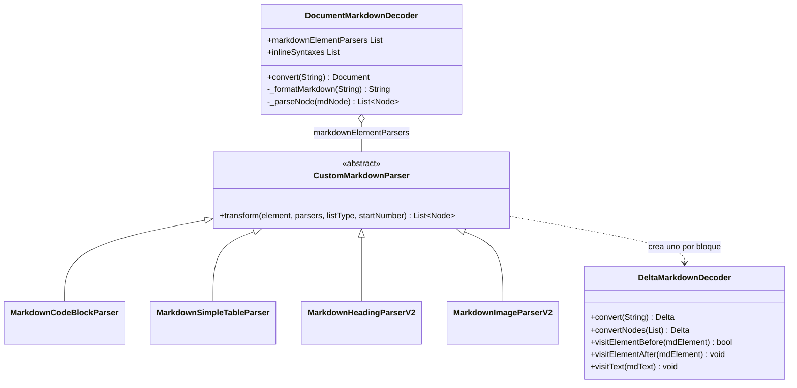
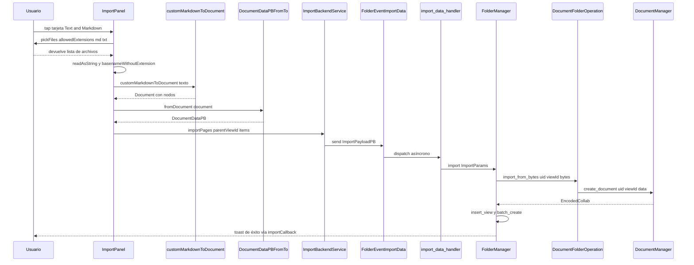
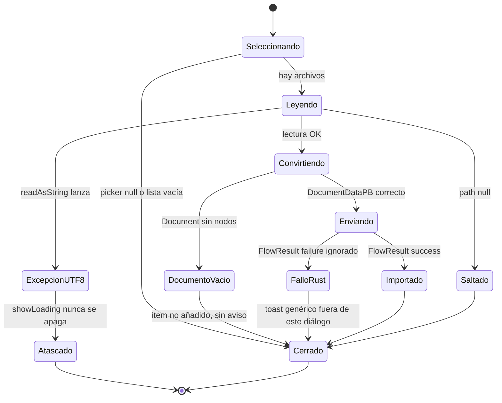
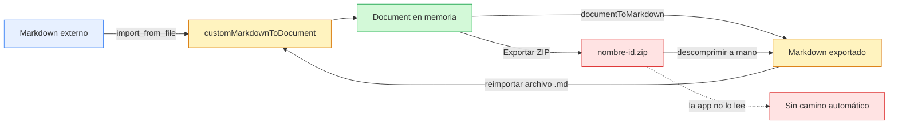

# B4.8 — Import Markdown y texto

## 1. Punto de entrada (UI)

La importación de Markdown y texto plano se dispara desde el botón "+" del sidebar de la vista: `ViewAddButtonState._showViewImportAction` (`appflowy/frontend/appflowy_flutter/lib/workspace/presentation/home/menu/view/view_add_button.dart:93–104`) llama a `showImportPanel(parentViewId, context, callback)`, que abre un `FlowyDialog` con un `GridView.count` de dos columnas donde cada tarjeta es una variante de `ImportType` habilitada para el modo actual de compilación (`appflowy/frontend/appflowy_flutter/lib/workspace/presentation/home/menu/sidebar/import/import_panel.dart:26–52` y `:98–124`). La tarjeta "Text & Markdown" corresponde a `ImportType.markdownOrText`, una de las cinco variantes del enum (`appflowy/frontend/appflowy_flutter/lib/workspace/presentation/home/menu/sidebar/import/import_type.dart:7–12`), con etiqueta localizada `LocaleKeys.importPanel_textAndMarkdown` (`:21–22`), icono `FlowySvgs.text_s` (`:39–40`) y extensión **no restringida en release** (`:49–58`: devuelve `true` en la rama `default`, a diferencia de `historyDocument`, `historyDatabase` y `afDatabase`, que exigen `kDebugMode`). Su pulsación ejecuta `_importFile(widget.parentViewId, e)` y cierra el overlay (`appflowy/frontend/appflowy_flutter/lib/workspace/presentation/home/menu/sidebar/import/import_panel.dart:114–119`).

`_importFile` abre el selector de archivos con `FileType.custom`, multi-selección y `allowedExtensions: ['md', 'txt']` (`appflowy/frontend/appflowy_flutter/lib/workspace/presentation/home/menu/sidebar/import/import_type.dart:60–72` y `appflowy/frontend/appflowy_flutter/lib/workspace/presentation/home/menu/sidebar/import/import_panel.dart:142–147`). Para cada archivo se lee el contenido con `await File(path).readAsString()` y se deriva el nombre de la vista con `p.basenameWithoutExtension(path)` (`appflowy/frontend/appflowy_flutter/lib/workspace/presentation/home/menu/sidebar/import/import_panel.dart:155–160`). El caso Markdown comparte rama de `switch` con `historyDocument` y construye el `ImportItemPayloadPB` con `viewLayout = ViewLayoutPB.Document` e `importType = ImportTypePB.Markdown` (`appflowy/frontend/appflowy_flutter/lib/workspace/presentation/home/menu/sidebar/import/import_panel.dart:173–186`). El envío lo hace la fachada estática `ImportBackendService.importPages`, que empaqueta todo el lote en un único `ImportPayloadPB` y dispara un solo `FolderEventImportData` (`appflowy/frontend/appflowy_flutter/lib/workspace/application/settings/share/import_service.dart:19–29`).

**Distinción clave con el export (B4.1).** El panel ofrece un solo formato "Text & Markdown" para `.md` y `.txt`: **no hay dos entradas separadas**, el texto plano se procesa con el mismo decoder Markdown. La tarjeta no tiene ninguna opción de pegado directo desde el portapapeles; el camino del portapapeles es un recorrido distinto (§9) que no pasa por el FFI.

**Correcciones de scope.** La UI del diálogo (tarjetas, iconos, `FilePickerService`, `FlowyOverlay`) y el `ImportCallback` pertenecen a `[[F10]]`; aquí solo se cita el punto exacto donde se prepara el payload y se llama al motor. El `ShareBloc` y el `ExportTab` son el camino inverso (`[[B4.1]]`, `[[F11]]`). El `NotionImporter` y `FolderEvent::ImportZipFile` son el camino ZIP (`[[B4.11]]`).

## 2. Lado de conversión

La conversión Markdown → documento es **100 % Dart, en proceso, sin FFI**: ocurre en `customMarkdownToDocument` (`appflowy/frontend/appflowy_flutter/lib/shared/markdown_to_document.dart:13–24`), que es el gemelo exacto de `customDocumentToMarkdown` (`:26–97`, documentado en `[[B4.1]]`). Ambos viven en el mismo fichero de 97 líneas y comparten los imports (`:1–11`); lo que cambia es el sentido: `customDocumentToMarkdown` es `Future<String>` y devuelve Markdown, `customMarkdownToDocument` es `Document` (síncrono) y devuelve el árbol de nodos.

`customMarkdownToDocument` **añade dos parsers propios de AppFlowy** a los once del paquete editor: `MarkdownCodeBlockParser` (para que los bloques cercados conserven el lenguaje) y `MarkdownSimpleTableParser` (para que las tablas GFM se conviertan en el tipo `simple_table` de la app y no en la tabla heredada del editor) (`appflowy/frontend/appflowy_flutter/lib/shared/markdown_to_document.dart:17–23`). El resto es `markdownToDocument` del editor, que los coloca **delante** de su lista estándar (`editor:lib/src/plugins/markdown/document_markdown.dart:11–33`): el orden efectivo de resolución es

```
MarkdownCodeBlockParser → MarkdownSimpleTableParser → Paragraph → Heading → TodoList
→ UnorderedList → OrderedList → UnorderedListItem → OrderedListItem → BlockQuote
→ TableList → Divider → Image
```

El `Codec` que envuelve ambos sentidos es `AppFlowyEditorMarkdownCodec` (`editor:lib/src/plugins/markdown/document_markdown.dart:61–85`); su `decoder` es `DocumentMarkdownDecoder` (`:74–78`). El paquete `markdown` de Dart está fijado en `^7.2.1` (`editor:pubspec.yaml:27`).

La frontera con Rust es mínima: el único trabajo que se delega es **materializar el `Document` como `DocumentDataPB` y crear el collab**. `DocumentDataPBFromTo.fromDocument` (`appflowy/frontend/appflowy_flutter/lib/plugins/document/application/document_data_pb_extension.dart:33–81`) recorre el árbol con `NodeIterator`, serializa cada nodo a `BlockPB`, genera un `childrenId` `nanoid(10)` por bloque y arma el `MetaPB` con el mapa de hijos; `try_into()` del `ImportPayloadPB` (lado Rust) solo valida y copia bytes (`appflowy/frontend/rust-lib/flowy-folder/src/entities/import.rs:73–118`).

**No hay parser de Markdown en Rust para este camino.** `ImportType::Markdown` existe en el enum (`appflowy/frontend/rust-lib/flowy-folder/src/share/import.rs:5–12`) pero `DocumentFolderOperation::import_from_bytes` lo recibe como `_import_type` y **no lo lee**: deserializa los bytes directamente como `DocumentDataPB` (`appflowy/frontend/rust-lib/flowy-core/src/deps_resolve/folder_deps/folder_deps_doc_impl.rs:159–177`). El contraste con el handler de base de datos es explícito: allí el `import_type` **sí** discrimina (`ImportType::CSV` → `CSVFormat::Original`, `ImportType::AFDatabase` → `CSVFormat::META`, `appflowy/frontend/rust-lib/flowy-core/src/deps_resolve/folder_deps/folder_deps_database_impl.rs:275–279`, que documenta `[[B4.9]]`). Además `import_from_file_path` del handler de documento es un `TODO(lucas)` que devuelve `Ok(())` sin hacer nada (`appflowy/frontend/rust-lib/flowy-core/src/deps_resolve/folder_deps/folder_deps_doc_impl.rs:179–187`), de modo que enviar `file_path` en lugar de `data` en el payload crearía una vista **vacía** sin error.

### 2.1 Arquitectura de clases del decoder

Muestra las dos capas del decoder y la precedencia que `document_markdown_decoder.dart` impone al recorrer `markdownElementParsers` en orden y detenerse en el primero que devuelva nodos.



Lectura: `DocumentMarkdownDecoder.convert` (`editor:lib/src/plugins/markdown/decoder/document_markdown_decoder.dart:17–40`) no sabe nada de AppFlowy; es un `Converter<String, Document>` genérico que recibe la lista de parsers por constructor (`editor:lib/src/plugins/markdown/decoder/parser/custom_markdown_node_parser.dart:4–13`). Cada `CustomMarkdownParser.transform` devuelve una lista **posiblemente vacía** como señal de "no es mío", y `_parseNode` itera y corta en el primer resultado no vacío (`editor:lib/src/plugins/markdown/decoder/document_markdown_decoder.dart:43–64`). Esa es la razón por la que `MarkdownSimpleTableParser` registrado en `appflowy/frontend/appflowy_flutter/lib/shared/markdown_to_document.dart:21` **anula por completo** a `MarkdownTableListParserV2` del editor (`editor:lib/src/plugins/markdown/decoder/parser/markdown_table_parser.dart`): ambos-atienden `tag == 'table'`, y el de AppFlowy está antes en la lista. `[VERIFICADO]` por el orden de `editor:lib/src/plugins/markdown/document_markdown.dart:18–31`.

## 3. Pipeline

Diagrama del recorrido completo: desde la tarjeta del diálogo hasta que el collab del documento importado existe en disco y se sube a la nube.

```mermaid
flowchart LR
  subgraph UI["UI (Flutter)"]
    A["ImportType.markdownOrText<br/>tarjeta del ImportPanel"]:::ui
    B["FilePickerService.pickFiles<br/>allowedExtensions md txt"]:::ui
  end
  subgraph Conv["Conversión (Dart)"]
    C["_documentDataFrom<br/>customMarkdownToDocument"]:::pro
    D["DocumentDataPBFromTo.fromDocument<br/>writeToBuffer"]:::pro
  end
  subgraph FFI["FFI"]
    E["FolderEventImportData<br/>ImportPayloadPB"]:::ffi
  end
  subgraph Rust["Rust flowy-folder"]
    F["import_data_handler<br/>try_into ImportParams"]:::rust
    G["FolderManager::import<br/>import_single_file"]:::rust
    H["DocumentFolderOperation<br/>import_from_bytes"]:::rust
    I["DocumentManager.create_document<br/>EncodedCollab"]:::rust
  end
  subgraph Persist["Persistencia"]
    J["batch_create_folder_collab_objects<br/>notify_parent_view_did_change"]:::out
  end
  A --> B --> C --> D --> E --> F --> G --> H --> I --> J
  classDef ui fill:#e7f0ff,stroke:#3b82f6
  classDef pro fill:#fff3bf,stroke:#d97706
  classDef ffi fill:#f3e8ff,stroke:#7c3aed
  classDef rust fill:#fde7f3,stroke:#be185d
  classDef out fill:#d3f9d8,stroke:#16a34a
```



Lectura: todo el tramo `Conv` ocurre **antes** del cruce del FFI, en un solo `_documentDataFrom` síncrono (`appflowy/frontend/appflowy_flutter/lib/workspace/presentation/home/menu/sidebar/import/import_panel.dart:222–234`). El evento Rust está declarado con su contrato exacto en `appflowy/frontend/rust-lib/flowy-folder/src/event_map.rs:151–152` (`#[event(input = "ImportPayloadPB", output = "RepeatedViewPB")]`, `ImportData = 30`) y registrado en el plugin con `.event(FolderEvent::ImportData, import_data_handler)` (`appflowy/frontend/rust-lib/flowy-folder/src/event_map.rs:33`). El handler es un `fold` de tres líneas (`appflowy/frontend/rust-lib/flowy-folder/src/event_handler.rs:356–364`): convierte el payload, delega en `folder.import(params)` y devuelve `data_result_ok(views)`. `FolderManager::import` itera los items, llama a `import_single_file` (que elige handler por `ViewLayout` con `get_handler`, `appflowy/frontend/rust-lib/flowy-folder/src/manager.rs:2195–2203`), inserta la `View` en el folder y agrupa los `EncodedCollab` (`appflowy/frontend/rust-lib/flowy-folder/src/manager.rs:2049–2102` y `:2110–2146`). El `EncodedCollab` que produce `create_document` es la estructura `state_vector` + `doc_state` + `version` que el crate `collab` expone y que este crate importa (`appflowy/frontend/rust-lib/flowy-core/src/deps_resolve/folder_deps/folder_deps_doc_impl.rs:3`).

### 3.1 Fases internas del decoder

Las cuatro fases por las que pasa el texto antes de convertirse en `DocumentDataPB`, todas dentro de `editor:lib/src/plugins/markdown/decoder/`:

1. **Pre-formato textual.** `_formatMarkdown` aplica dos sustituciones por expresión regular antes de entregar el texto al parser: fuerza un salto de línea en blanco entre un texto y una imagen que solo tengan un `\n` entre medias, y también cuando no tenían ninguno (`editor:lib/src/plugins/markdown/decoder/document_markdown_decoder.dart:66–87`). Esto evita que `` quede incrustado dentro del párrafo anterior y se pierda como bloque independiente. El test correspondiente cubre los tres casos (`editor:test/plugins/markdown/document_markdown_test.dart:30–59`).
2. **Parseo a AST HTML.** `md.Document(extensionSet: md.ExtensionSet.gitHubFlavored, inlineSyntaxes: [...inlineSyntaxes, UnderlineInlineSyntax()], encodeHtml: false).parse(...)` (`editor:lib/src/plugins/markdown/decoder/document_markdown_decoder.dart:20–27`). El `encodeHtml: false` es lo que permite que las etiquetas `<u>` sobrevivan como nodos en lugar de convertirse en texto escapado.
3. **Recorrido por parsers.** `mdNodes.map(_parseNode).nonNulls.flattened` (`editor:lib/src/plugins/markdown/decoder/document_markdown_decoder.dart:29–37`), con aplanado recursivo en `parseElementChildren` para listas anidadas (`editor:lib/src/plugins/markdown/decoder/parser/markdown_parser_extension.dart:10–39`).
4. **Decodificación de deltas.** Cada bloque crea un `DeltaMarkdownDecoder` que visita sus hijos `md.Node` y acumula `TextInsert` con atributos (`editor:lib/src/plugins/markdown/decoder/delta_markdown_decoder.dart:36–45` y `:47–61`). Para deltas que llegan como cadena cruda usa `ExtensionSet.gitHubWeb` con `parseInline` (`editor:lib/src/plugins/markdown/decoder/delta_markdown_decoder.dart:25–29`), un set **distinto** del de nivel documento.

### 3.2 Secuencia extremo a extremo

Recorrido de un archivo `.md` con dos nodos desde que el usuario elige la tarjeta hasta que el árbol del sidebar se refresca.



Lectura: la secuencia tiene un **único punto de fallo observable** para el usuario, y no está en el motor: `_importFile` ignora el `FlowyResult` que devuelve `ImportBackendService.importPages` (`appflowy/frontend/appflowy_flutter/lib/workspace/presentation/home/menu/sidebar/import/import_panel.dart:210–215`) y ejecuta siempre `showLoading.value = false` más `widget.importCallback(importType, '', null)` (`:217–218`). Un `FlowyError` de Rust llega al bloc del editor y se trata como una notificación genérica; el documento importado puede no existir y la UI no lo distingue. Detallado en §8.

## 4. Tabla formato → bloque

Una fila por construcción Markdown reconocida. La columna `NodeType` es el valor literal de `node.type` que produce el decoder; la columna "Parser" identifica quién lo produce.

| Construcción Markdown | Tag HTML resultante | `NodeType` del editor | Parser que la atiende | Evidencia |
|---|---|---|---|---|
| `# H1` … `###### H6` | `h1`–`h6` | `heading` con `level` = índice + 1 | `MarkdownHeadingParserV2` | `editor:lib/src/plugins/markdown/decoder/parser/markdown_heading_parser.dart:4` y `:20–32` |
| Párrafo con texto | `p` | `paragraph` | `MarkdownParagraphParserV2` | `editor:lib/src/plugins/markdown/decoder/parser/markdown_paragraph_parser.dart:18–46` |
| Párrafo con una sola imagen | `p > img` | ninguno: se cede a `MarkdownImageParserV2` | `MarkdownParagraphParserV2` retorna `[]` | `editor:lib/src/plugins/markdown/decoder/parser/markdown_paragraph_parser.dart:22–29` |
| Párrafo vacío | `p` sin hijos | `paragraph` con delta vacío | `MarkdownParagraphParserV2` | `editor:lib/src/plugins/markdown/decoder/parser/markdown_paragraph_parser.dart:31–36` |
| Salto de línea blando (`  \n`) dentro de `<p>` | `br` | varios `paragraph` (uno por tramo) | `_splitByBrTag` | `editor:lib/src/plugins/markdown/decoder/parser/markdown_paragraph_parser.dart:38–46` y `:65–79` |
| `* ítem` / `- ítem` | `ul > li` | `bulleted_list` | `MarkdownUnorderedListParserV2` + `MarkdownUnorderedListItemParserV2` | `editor:lib/src/plugins/markdown/decoder/parser/markdown_unordered_list_parser.dart:18–27` y `editor:lib/src/plugins/markdown/decoder/parser/markdown_unordered_list_item_parser.dart:44–55` |
| `1. ítem` | `ol > li` | `numbered_list` con `number` = atributo `start` | `MarkdownOrderedListParserV2` + `MarkdownOrderedListItemParserV2` | `editor:lib/src/plugins/markdown/decoder/parser/markdown_ordered_list_parser.dart:18–30` y `editor:lib/src/plugins/markdown/decoder/parser/markdown_ordered_list_item_parser.dart:44–57` |
| Lista anidada (`li > ul`/`li > ol`) | hijo `ul`/`ol` del `li` | `children` del nodo de lista | los dos parsers de item, con `listType: unknown` | `editor:lib/src/plugins/markdown/decoder/parser/markdown_unordered_list_item_parser.dart:25–37` y `:49–53` |
| `- [x]` / `- [ ]` | `li.task-list-item` con `input[checked]` | `todo_list` con `checked` | `MarkdownTodoListParserV2` | `editor:lib/src/plugins/markdown/decoder/parser/markdown_todo_list_parser.dart:18–21` y `:30` y `:41–58` |
| `> cita` | `blockquote` | `quote` | `MarkdownBlockQuoteParserV2` | `editor:lib/src/plugins/markdown/decoder/parser/markdown_block_quote_parser.dart:18–27` |
| `---` (3+ guiones) | `hr` | `divider` | `MarkdownDividerParserV2` | `editor:lib/src/plugins/markdown/decoder/parser/markdown_divider_parser.dart:18–24`; el test comprueba que `--` y `-` **no** son divisores (`editor:test/plugins/markdown/decoder/divider_deocder_test.dart:19–22`) |
| ```` ```lenguaje ```` | `pre > code.language-*` | `code` con atributo `language` | `MarkdownCodeBlockParser` (AppFlowy) | `appflowy/frontend/appflowy_flutter/lib/plugins/document/presentation/editor_plugins/parsers/markdown_code_parser.dart:19–21` y `:33–48`; el tipo `'code'` lo afirma el encoder en `editor:lib/src/plugins/markdown/encoder/parser/code_block_node_parser.dart:11` |
| ```` ``` ```` sin lenguaje | `pre > code` sin `class` | `code` con `language: null` | `MarkdownCodeBlockParser` | `appflowy/frontend/appflowy_flutter/lib/plugins/document/presentation/editor_plugins/parsers/markdown_code_parser.dart:33–41` |
| `` | `img[src]` | `image` con `url` y `align: 'center'` | `MarkdownImageParserV2` | `editor:lib/src/plugins/markdown/decoder/parser/markdown_image_parser.dart:18–22` |
| `[](href)` | `a > img[src]` | `image` (se **descarta** el enlace que la envuelve) | `MarkdownImageParserV2` | `editor:lib/src/plugins/markdown/decoder/parser/markdown_image_parser.dart:24–36` |
| Tabla GFM con cabecera y cuerpo | `table > thead/tbody` | `simple_table` (`enableHeaderRow: true`) | `MarkdownSimpleTableParser` (AppFlowy) | `appflowy/frontend/appflowy_flutter/lib/plugins/document/presentation/editor_plugins/parsers/markdown_simple_table_parser.dart:24` y `:106–114`; el tipo literal está en `appflowy/frontend/appflowy_flutter/lib/plugins/document/presentation/editor_plugins/simple_table/simple_table_block_component.dart:19` |
| Tabla GFM (solo con el decoder estándar) | `table` | `table` con hijos `table/cell` | `MarkdownTableListParserV2` | `editor:lib/src/plugins/markdown/decoder/parser/markdown_table_parser.dart:55–79`; **inalcanzable desde `customMarkdownToDocument`** por precedencia del parser de AppFlowy |
| `**negrita**` | `strong` | atributo `bold: true` en el `TextInsert` | `DeltaMarkdownDecoder` | `editor:lib/src/plugins/markdown/decoder/delta_markdown_decoder.dart:64–65` y `:88–89` |
| `_cursiva_` | `em` | atributo `italic: true` | `DeltaMarkdownDecoder` | `editor:lib/src/plugins/markdown/decoder/delta_markdown_decoder.dart:66–67` |
| `~~tachado~~` | `del` | atributo `strikethrough: true` | `DeltaMarkdownDecoder` | `editor:lib/src/plugins/markdown/decoder/delta_markdown_decoder.dart:70–71` |
| `` `código` `` | `code` inline | atributo `code: true` | `DeltaMarkdownDecoder` | `editor:lib/src/plugins/markdown/decoder/delta_markdown_decoder.dart:68–69` |
| `[texto](url)` | `a[href]` | atributo `href` | `DeltaMarkdownDecoder` | `editor:lib/src/plugins/markdown/decoder/delta_markdown_decoder.dart:72–73` |
| `<u>subrayado</u>` | `u` (sintaxis inline propia) | atributo `underline: true` | `UnderlineInlineSyntax` + `DeltaMarkdownDecoder` | `editor:lib/src/plugins/markdown/decoder/custom_syntaxes/underline_syntax.dart:3–13` y `editor:lib/src/plugins/markdown/decoder/delta_markdown_decoder.dart:74–75` |
| `<br>` en línea | `br` | separación en párrafos (§4 fila 5) | `_splitByBrTag` | `editor:lib/src/plugins/markdown/decoder/parser/markdown_paragraph_parser.dart:65–79` |
| Cualquier otro elemento HTML con atributos | tag arbitrario | atributos arbitrarios en el delta **si el valor es JSON válido** | rama `else` de `_addAttributeKey` | `editor:lib/src/plugins/markdown/decoder/delta_markdown_decoder.dart:76–84` |

`[VERIFICADO]` que la precedencia custom-sobre-estándar la impone el orden literal de la lista construida en `editor:lib/src/plugins/markdown/document_markdown.dart:18–31` (los dos parsers de AppFlowy se anteponen con el spread `...markdownParsers` de `:19`) y que el corte en el primer parser con resultado no vacío ocurre en `editor:lib/src/plugins/markdown/decoder/document_markdown_decoder.dart:46–55`.

**Construcciones Markdown sin parser en este snapshot**: tablas de soporte (`multi_image`), `callout`, `math_equation`, `toggle_list`, `file`, `sub_page`, `link_preview`, `database/grid|board|calendar`, `columns` y `video` no tienen `CustomMarkdownParser` en la lista de `markdownToDocument`. Si aparecen en el Markdown como sintaxis HTML cruda (`<video>`, `<iframe>`, etc.), caen en la rama `else` de `DeltaMarkdownDecoder` (§4 última fila). Los que el export sí produce (ver la tabla §4 de `[[B4.1]]`) pero aquí no se reconocen → §5.

## 5. Preservación

Esta sección sustituye a la de "pérdidas" del export: se documenta qué sobrevive del Markdown original y qué se descarta, con la línea del decoder responsable de cada pérdida.

### 5.1 Lo que se conserva

- **Estructura de encabezados y su nivel exacto.** Los seis niveles `h1`–`h6` se mapean uno a uno a `heading.level` (`editor:lib/src/plugins/markdown/decoder/parser/markdown_heading_parser.dart:4` y `:24`), lo que permite el round-trip verificado en `editor:test/plugins/markdown/document_markdown_test.dart:84–88`.
- **Los seis estilos inline** que el export sabe emitir: `bold`, `italic`, `strikethrough`, `code`, `href` y `underline` (`editor:lib/src/plugins/markdown/decoder/delta_markdown_decoder.dart:63–75`). El `underline` es el único que no es Markdown estándar: se recupera gracias a la `UnderlineInlineSyntax` registrada por el decoder (`editor:lib/src/plugins/markdown/decoder/document_markdown_decoder.dart:24`), que además es **recursiva** —el texto interior se reparsea con `md.InlineParser` (`editor:lib/src/plugins/markdown/decoder/custom_syntaxes/underline_syntax.dart:9`), por lo que `**<u>x</u>**` conserva ambos estilos.
- **Anidamiento real de listas**, no aplanado: `MarkdownUnorderedListItemParserV2` separa los hijos `ul`/`ol` del resto del contenido del `li` y los pasa como `children` (`editor:lib/src/plugins/markdown/decoder/parser/markdown_unordered_list_item_parser.dart:25–37` y `:49–53`). El test `test nested list` verifica un árbol `bulleted_list > bulleted_list` de tres niveles (`editor:test/plugins/markdown/decoder/document_markdown_decoder_test.dart:358–380`).
- **El atributo `start` de las listas ordenadas.** `MarkdownOrderedListParserV2` lee `element.attributes['start']` y lo propaga como `number` a cada ítem, lo que preserva listas que empiezan en 5 o saltan números (`editor:lib/src/plugins/markdown/decoder/parser/markdown_ordered_list_parser.dart:22` y `:29`; consumo en `editor:lib/src/plugins/markdown/decoder/parser/markdown_ordered_list_item_parser.dart:46`).
- **El estado de verificación de las tareas.** `checked` se lee del `input` del `li.task-list-item` (`editor:lib/src/plugins/markdown/decoder/parser/markdown_todo_list_parser.dart:30`) y se propaga a `todoListNode(checked: …)` (`:42–43`); las tareas anidadas también se conservan como `children` (`:50–56`).
- **El lenguaje de los bloques de código.** `MarkdownCodeBlockParser` extrae la clase `language-*` del `<code>` (`appflowy/frontend/appflowy_flutter/lib/plugins/document/presentation/editor_plugins/parsers/markdown_code_parser.dart:33–41`) y la escribe como atributo `language` del nodo `code` (`:44–47`). Sin este parser, el `markdown` de Dart habría emitido `<pre><code>` sin clase.
- **La estructura de la tabla GFM y su fila de cabecera.** `MarkdownSimpleTableParser` construye una `simpleTableRowBlockNode` por cada `<tr>`, con la primera fila tomada de `<thead>` y marcada con `enableHeaderRow: true` (`appflowy/frontend/appflowy_flutter/lib/plugins/document/presentation/editor_plugins/parsers/markdown_simple_table_parser.dart:61–75` y `:106–109`). Además acepta un `tableWidth` que reparte el ancho en partes iguales entre columnas (`appflowy/frontend/appflowy_flutter/lib/plugins/document/presentation/editor_plugins/parsers/markdown_simple_table_parser.dart:110–112`), que es lo que permite el fallback HTML del portapapeles con `tableWidth: 200` (`appflowy/frontend/appflowy_flutter/lib/plugins/document/presentation/editor_plugins/copy_and_paste/paste_from_html.dart:54–62`).
- **El salto de línea blando** (dos espacios al final de línea) se convierte en dos párrafos en lugar de unirse con un espacio, verificado en `editor:test/plugins/markdown/document_markdown_test.dart:15–21`.
- **Los estilos anidados dentro de un mismo `TextInsert`**: el `DeltaMarkdownDecoder` acumula atributos en un mapa `_attributes` compartido y lo restaura al salir del elemento (`editor:lib/src/plugins/markdown/decoder/delta_markdown_decoder.dart:47–61` y `:87–105`), de modo que `**[AppFlowy Editor](appflowy.io)**` produce un único `TextInsert` con `bold`, `italic` y `href` (`editor:test/plugins/markdown/decoder/document_markdown_decoder_test.dart:30–37`).

### 5.2 Lo que se descarta

- **Alineación, ancho y alto de las imágenes.** `MarkdownImageParserV2` solo lee `attributes['src']` y llama a `imageNode(url: …)` sin más argumentos (`editor:lib/src/plugins/markdown/decoder/parser/markdown_image_parser.dart:18–22`), por lo que la firma de `imageNode` aplica sus valores por defecto `align: 'center'`, `height: null`, `width: null` (`editor:lib/src/editor/block_component/image_block_component/image_block_component.dart:33–48`). Una imagen Markdown alineada a la derecha vuelve centrada. `[VERIFICADO]` por el test que espera exactamente `align: 'center'` (`editor:test/plugins/markdown/decoder/image_decoder_test.dart:12–21`).
- **El texto alternativo de la imagen.** Solo se propaga `src`; el `alt` del Markdown se descarta en las dos ramas del parser (`editor:lib/src/plugins/markdown/decoder/parser/markdown_image_parser.dart:18–22` y `:34–36`).
- **El enlace que envuelve a una imagen** (`[](https://destino)`): la segunda rama del parser de imagen sube por el `children.first` y devuelve solo la imagen, sin propagar el `href` del `<a>` padre (`editor:lib/src/plugins/markdown/decoder/parser/markdown_image_parser.dart:24–36`).
- **Estilos de color de fuente, resaltado, sub/superíndice, familia y tamaño.** La rama `else` de `_addAttributeKey` intenta `jsonDecode(value)` sobre cada atributo del elemento y, si el valor no es JSON, lo descarta con un `catch` vacío (`editor:lib/src/plugins/markdown/decoder/delta_markdown_decoder.dart:76–84`). Un `style="color:red"` no se decodifica y se pierde; en cambio un atributo `checked="true"` **sí** se decodifica a `true` y se inyecta en el delta. `[VERIFICADO]`.
- **Autor, fecha y anidamiento de las citas.** `MarkdownBlockQuoteParserV2` aplana el `blockquote` a un único `quoteNode` con todos sus hijos dentro del delta; las citas anidadas (`> > texto`) quedan como texto `> …` en lugar de un `quote` hijo (`editor:lib/src/plugins/markdown/decoder/parser/markdown_block_quote_parser.dart:22–27`).
- **Estilos de lista no estándar**: cualquier atributo en el `li` distinto de `class="task-list-item"` hace que el parser de ítem devuelva `[]` (`editor:lib/src/plugins/markdown/decoder/parser/markdown_unordered_list_item_parser.dart:19–23` y `editor:lib/src/plugins/markdown/decoder/parser/markdown_ordered_list_item_parser.dart:19–23`). Un `<li class="special">` no produce ningún nodo.
- **Tablas sin cabecera, sin cuerpo o con alineación de columnas.** Tanto `MarkdownSimpleTableParser` (`appflowy/frontend/appflowy_flutter/lib/plugins/document/presentation/editor_plugins/parsers/markdown_simple_table_parser.dart:53–55`) como `MarkdownTableListParserV2` (`editor:lib/src/plugins/markdown/decoder/parser/markdown_table_parser.dart:51–53`) retornan `[]` si `thead` o `tbody` están vacíos, de modo que **una tabla de una sola fila de cabecera se descarta por completo**. La especificación de alineación (`:---`, `:---:`) del GFM se ignora en ambos.
- **Anchos de columna y colores de `simple_table`.** `MarkdownSimpleTableParser` solo escribe `columnWidths` cuando `tableWidth != null` y no es móvil (`appflowy/frontend/appflowy_flutter/lib/plugins/document/presentation/editor_plugins/parsers/markdown_simple_table_parser.dart:110–112`); en móvil y en la importación desde archivo quedan `null`. Ningún color de fila o columna se lee.
- **Todo bloque que el export de `[[B4.1]]` produce y aquí no se reconoce**: `callout`, `math_equation`, `toggle_list`, `file`, `sub_page`, `link_preview`, `multi_image`, `database/grid|board|calendar` y `columns` no tienen `CustomMarkdownParser`. Su contenido Markdown equivalente (`$$…$$`, `[$nombre](id)`, `[$nombre](url)`, `[]()`) se degrada a párrafo con atributos `href`, o se pierde si el `NodeType` resultante no tiene componente visual registrado.
- **Atributos de bloque no Markdown de `heading` y listas.** El `headingNode` solo recibe `level` y `delta` (`editor:lib/src/plugins/markdown/decoder/parser/markdown_heading_parser.dart:27–32`); cualquier color, fondo o fuente aplicado en el editor original se pierde.
- **El nombre de la vista no proviene del Markdown.** Se deriva del nombre del archivo con `p.basenameWithoutExtension(path)` (`appflowy/frontend/appflowy_flutter/lib/workspace/presentation/home/menu/sidebar/import/import_panel.dart:160`), no del primer encabezado `#` del documento ni de un `frontmatter`. Un `index.md` genera una vista llamada `index`.
- **Todo nodo que ningún parser atiende se descarta en silencio**, con un único `AppFlowyEditorLog.editor.debug` que registra `empty result from node: …` (`editor:lib/src/plugins/markdown/decoder/document_markdown_decoder.dart:57–61`). No hay ninguna señal para el usuario.

## 6. Assets

En la importación de archivos **no hay gestión de assets en el sentido del export**: ni descarga, ni subida, ni copia al almacenamiento local.

- **Imágenes remotas (`http(s)://…` o rutas relativas).** Se conserva la cadena literal del `src` en el atributo `url` del nodo `image` (`editor:lib/src/plugins/markdown/decoder/parser/markdown_image_parser.dart:20` y `:35`). El renderizador del editor las descarga bajo demanda con su propio mecanismo de caché de imágenes; este motor no interviene. `[INFERIDO]` a partir de la ausencia total de código de red o de `dart:io` en el decoder (el decoder solo importa `dart:convert`, `markdown`, `collection` y `appflowy_editor`, `editor:lib/src/plugins/markdown/decoder/document_markdown_decoder.dart:1–6`).
- **Imágenes locales relativas (``).** El `url` se guarda tal cual, con el prefijo de ruta relativa. Si el `.md` se importó desde un directorio con recursos al lado, la imagen **no** resolverá porque la app no copia el directorio ni reescribe la ruta: la URL relativa se interpreta contra el almacenamiento interno de la app. `[INFERIDO]` — no hay ninguna llamada a `File`, `path` ni `path_provider` en el camino de importación (`appflowy/frontend/appflowy_flutter/lib/workspace/presentation/home/menu/sidebar/import/import_panel.dart:142–234`).
- **Contraste con el ZIP de `[[B4.1]]`.** El export empaqueta los binarios locales en un directorio `'$id/'` dentro de un `.zip` y reescribe las URLs a ``; el import **no** sabe leer ese ZIP. Si el usuario exporta un documento AppFlowy a Markdown, descomprime el `.zip` a mano y reimporta el `.md`, todas las imágenes locales aparecen rotas. `[VERIFICADO]` por la ausencia de cualquier manejo de `Archive`/`ZipDecoder` en `customMarkdownToDocument` (`appflowy/frontend/appflowy_flutter/lib/shared/markdown_to_document.dart:13–24`, que no importa `dart:io`).
- **Atajos del portapapeles (no son assets, pero usan el mismo decoder).** `pasteText` intenta primero el decoder Markdown y cae a texto plano línea a línea si el resultado está vacío (`appflowy/frontend/appflowy_flutter/lib/plugins/document/presentation/editor_plugins/copy_and_paste/paste_from_plain_text.dart:30–50` y `:7–28`); `convertHtmlToNodes` cae al decoder Markdown vía `html2md` cuando el documento viene de Google Docs o contiene tablas (`appflowy/frontend/appflowy_flutter/lib/plugins/document/presentation/editor_plugins/copy_and_paste/paste_from_html.dart:45–62`). En ninguno de los tres caminos hay descarga ni reescritura de rutas.

## 7. Encoding y nombre de archivo

- **Lectura del archivo.** `await File(path).readAsString()` (`appflowy/frontend/appflowy_flutter/lib/workspace/presentation/home/menu/sidebar/import/import_panel.dart:175`) usa el `encoding` por defecto de `dart:io`, que es **UTF-8**, y lanza `FormatException` sobre bytes malformados en lugar de sustituirlos. Un `.md` guardado en Latin-1 o Shift-JIS aborta la importación del archivo entero con una excepción no capturada en `_importFile` (§8).
- **BOM.** No hay ninguna llamada a `Bom.utf8Decode` ni a `stripBOM` en el repo de la app; `[INFERIDO]` que `utf8.decode` de `dart:convert` descarta un BOM inicial, con lo que un `.md` exportado por Windows se importaría correctamente. Si el BOM sobreviviera, aparecería como un carácter U+FEFF pegado al primer texto del documento, porque el decoder solo lo vería como `md.Text` ordinario (`editor:lib/src/plugins/markdown/decoder/delta_markdown_decoder.dart:59–61`).
- **Normalización de fin de línea.** No hay ninguna llamada a `replaceAll('\r\n', '\n')`. El manejo de `\r\n` y del salto de línea blando queda delegado al paquete `markdown` en el `parse`, sin ningún pre-tratamiento en `_formatMarkdown` (`editor:lib/src/plugins/markdown/decoder/document_markdown_decoder.dart:66–87`). El único sitio del repo que normaliza `\r` es el pegado de texto plano, no la importación de archivo (`appflowy/frontend/appflowy_flutter/lib/plugins/document/presentation/editor_plugins/copy_and_paste/paste_from_plain_text.dart:13–15`).
- **Nombre de la vista importada.** `p.basenameWithoutExtension(path)` (`appflowy/frontend/appflowy_flutter/lib/workspace/presentation/home/menu/sidebar/import/import_panel.dart:160`), es decir el nombre del archivo sin extensión y sin directorios: `/tmp/notas/Plan 2026.md` → vista `Plan 2026`. Si `name` llega vacío a Rust, `TryInto<ImportParams>` lo sustituye por la constante `"Untitled"` (`appflowy/frontend/rust-lib/flowy-folder/src/entities/import.rs:87–91`), pero desde el panel Dart ese caso es inalcanzable porque `basenameWithoutExtension` de una ruta no vacío siempre devuelve algo.
- **Colisión de nombres.** No hay desambiguación en el cliente. En el servidor cada item genera un `view_id = gen_view_id()` nuevo (`appflowy/frontend/rust-lib/flowy-folder/src/manager.rs:2055`), de modo que dos archivos con el mismo nombre **sí** conviven como dos vistas hermanas con el mismo `name` en `View` (`appflowy/frontend/rust-lib/flowy-folder/src/manager.rs:2079–2091`); la desambiguación visual la hace el frontend.
- **Sin escritura en disco.** A diferencia de `[[B4.1]] §7`, la importación no genera ningún archivo intermedio: el Markdown se lee, se convierte en memoria y se serializa a protobuf en memoria.

## 8. Errores

Las tablas GFM **sin cabecera o sin cuerpo** se descartan (§5). Ninguno de los siguientes casos produce un mensaje de error visible para el usuario final desde el propio importador; todos se redirigen al orquestador, que los consolida en `OUT/22-preguntas-abiertas.md`.

- **Cancelación o selección vacía.** `if (result == null || result.files.isEmpty) return;` (`appflowy/frontend/appflowy_flutter/lib/workspace/presentation/home/menu/sidebar/import/import_panel.dart:148–150`) retorna sin callback y sin toast: el overlay ya se cerró en el `onTap` (`:116–118`), así que el usuario no ve nada.
- **Archivo sin ruta (`path == null`).** `if (path == null) continue;` (`appflowy/frontend/appflowy_flutter/lib/workspace/presentation/home/menu/sidebar/import/import_panel.dart:157–159`) lo salta en silencio. Es el caso típico en web, donde `File(path).readAsString()` fallaría.
- **`FormatException` de `readAsString`** (Markdown no UTF-8): la excepción escapa de `_importFile` porque no hay ningún `try/catch` en `appflowy/frontend/appflowy_flutter/lib/workspace/presentation/home/menu/sidebar/import/import_panel.dart:175`; como `_importFile` se llama dentro del `onTap` sin `await`-protection, el `showLoading.value = false` de la línea `217` **no se ejecuta** y el `CircularProgressIndicator` del diálogo se queda girando para siempre. `[INFERIDO]` — el `onTap` es `() async { await _importFile(...); … }` (`:114–119`) sin `try`.
- **Documento Markdown vacío.** `Document.blank()` sin hijos se produce en `editor:lib/src/plugins/markdown/decoder/document_markdown_decoder.dart:29–37` y `DocumentDataPBFromTo.fromDocument` devuelve `null` cuando `document.first` o `document.last` son nulos (`appflowy/frontend/appflowy_flutter/lib/plugins/document/application/document_data_pb_extension.dart:36–38`); el `if (bytes != null)` de `appflowy/frontend/appflowy_flutter/lib/workspace/presentation/home/menu/sidebar/import/import_panel.dart:177` simplemente no añade el item, y si es el único archivo `importValues` queda vacío y no se envía nada (`:210`). El usuario ve cerrar el diálogo sin ninguna vista creada.
- **Tipo de importación no soportado.** La rama `default` de `_documentDataFrom` es `assert(false, 'Unsupported Type $importType')` + `return null` (`appflowy/frontend/appflowy_flutter/lib/workspace/presentation/home/menu/sidebar/import/import_panel.dart:230–232`): en debug lanza `AssertionError`, en release devuelve `null` silencioso.
- **Payload ambiguo o vacío (Rust).** `TryInto<ImportParams>` rechaza `(None, None)` con `FlowyError::invalid_data().with_context("The import data is empty")` y `(Some(_), Some(_))` con `"The import data is ambiguous"` (`appflowy/frontend/rust-lib/flowy-folder/src/entities/import.rs:93–102`). `invalid_data` mapea a `ErrorCode::InvalidParams` (`appflowy/frontend/rust-lib/flowy-error/src/errors.rs:137`).
- **`parent_view_id` vacío o no UUID.** `NotEmptyStr::parse` falla con `FlowyError::invalid_view_id()` (`appflowy/frontend/rust-lib/flowy-folder/src/entities/import.rs:77–79`), que corresponde a `ErrorCode::ViewIdIsInvalid` (`appflowy/frontend/rust-lib/flowy-error/src/errors.rs:115`); un `Uuid::from_str` inválido propaga el error del propio `uuid` (`:81`).
- **Bytes que no son un `DocumentDataPB` válido.** `DocumentDataPB::try_from(Bytes::from(bytes))?` (`appflowy/frontend/rust-lib/flowy-core/src/deps_resolve/folder_deps/folder_deps_doc_impl.rs:167`) devuelve `Err` y aborta **todo** el lote, no solo el archivo ofensor: `FolderManager::import` usa `?` dentro del bucle (`appflowy/frontend/rust-lib/flowy-folder/src/manager.rs:2116–2118`). En este camino concreto es improbable —Dart siempre envía un protobuf bien formado— pero sí lo sería si otro cliente usara `file_path`.
- **Collab que no se puede codificar.** `get_folder_collab_params` con `?` aborta el lote (`appflowy/frontend/rust-lib/flowy-folder/src/manager.rs:2122–2124`); en cambio un `Uuid::from_str` inválido en esa misma línea simplemente se salta el objeto **sin loggear nada** porque el `if let Ok(object_id)` descarta el error en silencio (`:2122`).
- **Error de subida a la nube.** `batch_create_folder_collab_objects` con `?` (`appflowy/frontend/rust-lib/flowy-folder/src/manager.rs:2134–2137`) devuelve `Err` **después** de que la vista ya se haya insertado en el folder local (`:2096–2099`): el usuario puede ver la vista en el árbol y, aun así, el error se propaga como fallo del import. `[INFERIDO]` — el estado es observable pero el resultado devuelto a Dart es `Err`.
- **Fallo silencioso de `notify_parent_view_did_change`.** Se ejecuta tras la subida, sin `await` ni manejo de error (`appflowy/frontend/rust-lib/flowy-folder/src/manager.rs:2140–2143`).
- **Resultado del import ignorado en Dart.** `await ImportBackendService.importPages(...)` se descarta sin `fold` (`appflowy/frontend/appflowy_flutter/lib/workspace/presentation/home/menu/sidebar/import/import_panel.dart:210–215`) y el callback se invoca igualmente con `name: ''` y `document: null` (`:218`). Ningún `FlowyError` de esta unidad se pinta en el diálogo.

### 8.1 Máquina de estados del fallo

Diagrama de los siete desenlaces observables del recorrido de importación, distinguiendo los que son invisibles para el usuario (cuatro de siete).



Lectura: solo dos estados leaves con señal al usuario —`Cerrado` y el toast genérico de `FalloRust`—. Los cinco restantes son silenciosos: `Saltado` pierde el archivo sin contarlo, `DocumentoVacio` no crea nada sin avisar, `Atascado` deja el indicador girando de forma permanente (`showLoading.value = false` está en la línea `217`, después de la línea `175` que lanzó), `FalloRust` no distingue el tipo de error y `Cerrado` no confirma nada. Ninguno de estos estados tiene test que lo cubra: los tests de import del repo son del decoder del editor y no del panel (§11).

## 9. Round-trip

Diagrama de las rutas que cierran (o no) el ciclo Markdown → AppFlowy → Markdown. El export vive en `[[B4.1]]`; este diagrama muestra qué lado del ciclo es real y qué lado es theoretical.



Lectura: el ciclo **sí** cierra, pero solo en el modo "exportar a Markdown puro", no en el modo "exportar a ZIP". El test canónico del editor codifica exactamente esa garantía: `markdownToDocument(markdownDocument)` produce el árbol de `testDocument`, y `documentToMarkdown` de ese árbol reproduce byte a byte `markdownDocumentEncoded` (`editor:test/plugins/markdown/document_markdown_test.dart:8–13` y `:23–28`, con las constantes en `:63–95`). El caso de la tabla GFM sí cierra **en sentido inverso al del export**: el export escribe una tabla cruda con pipes (`editor:lib/src/plugins/markdown/encoder/parser/table_node_parser.dart`) y el import la lee como `simple_table` con `enableHeaderRow: true`, de modo que un `table` del editor vuelve al documento como `simple_table`. El test de AppFlowy lo cubre en el sentido Markdown → nodo (`appflowy/frontend/appflowy_flutter/test/unit_test/simple_table/simple_table_markdown_test.dart:43–51` y `:16–41`).

| Tipo de bloque | Exporta (`[[B4.1]]`) | Importa (este documento) | Round-trip |
|---|---|---|---|
| `heading` (niveles 1–6) | `#`…`######` | `heading` con `level` | perfecto `[VERIFICADO]` con `editor:test/plugins/markdown/document_markdown_test.dart:8–28` |
| `paragraph` | texto con estilos inline | `paragraph` (o varios si hay `<br>`) | perfecto para los 6 estilos soportados |
| `bulleted_list` / `numbered_list` | `* …` / `1. …` | mismo tipo, anidamiento conservado | perfecto en estructura; el `number` se recalcula desde `start` |
| `todo_list` | `- [x]` / `- [ ]` | `todo_list` con `checked` | perfecto |
| `quote` | `> …` | `quote` | perfecto en una sola línea |
| `divider` | `---` | `divider` | perfecto |
| `code` | ```` ```lang ```` | `code` con `language` | perfecto gracias a `MarkdownCodeBlockParser` |
| `image` (URL remota) | `` | `image` con `align: 'center'` | estructura perfecta, se pierde `align` |
| `table` (editor) | pipes con separador | `simple_table` | **cambia de tipo**: `table` → `simple_table` |
| `multi_image` | varias `` en párrafos separados | varios nodos `image` independientes | pierde el agrupamiento en grid |
| `math_equation` | `$$…$$` | párrafo con texto `$$…$$` | pierde el tipo |
| `callout` | icono + `> …` | párrafo o `quote` | pierde el tipo |
| `toggle_list` | `- …` indentado | `bulleted_list` | pierde el tipo |
| `file` / `sub_page` | `[$name](url)` / `[](id)` | párrafo con `href` | pierde el tipo |
| `link_preview` | `[$href]($href)` | párrafo con `href` | se muestra como enlace, no como preview |
| `database/grid\|board\|calendar` | `[](id/viewId.csv)` | párrafo vacío o con `href` inútil | **se pierde por completo** |

La tabla de la matriz round-trip completa se construye en `[[B4.13]]`.

## 10. Extensión y firma

- **Extensiones aceptadas:** `['md', 'txt']` (`appflowy/frontend/appflowy_flutter/lib/workspace/presentation/home/menu/sidebar/import/import_type.dart:67–68`), aplicadas como filtro del `FilePickerService` con `FileType.custom` (`appflowy/frontend/appflowy_flutter/lib/workspace/presentation/home/menu/sidebar/import/import_panel.dart:143–147`). El filtro es **de extensión, no de contenido**: un `.md` que en realidad sea binario (por ejemplo un PNG renombrado) llega al decoder, produce cero nodos y se descarta en silencio (§8).
- **MIME types:** el motor no usa ninguno. `FileType.custom` con `allowedExtensions` es la única declaración; no hay `XTypeGroup` declarado en el código Dart de esta unidad.
- **Firma / magic bytes:** ninguna. No hay comprobación de cabecera ni sniffing. La detección de formato es 100 % por extensión y el formato interno es Markdown (texto plano).
- **Artefacto producido:** ninguno en disco. A diferencia de `[[B4.1]] §10`, que escribe un `.zip` con firma `PK\003\004`, aquí el resultado es un `DocumentDataPB` protobuf serializado con `writeToBuffer()` (`appflowy/frontend/appflowy_flutter/lib/workspace/presentation/home/menu/sidebar/import/import_panel.dart:229`) que cruza el FFI dentro de `ImportItemPayloadPB.data` y que Rust reinterpreta con `DocumentDataPB::try_from` (`appflowy/frontend/rust-lib/flowy-core/src/deps_resolve/folder_deps/folder_deps_doc_impl.rs:167`).
- **Discriminación en Rust:** aunque `ImportTypePB` tiene cinco valores (`appflowy/frontend/rust-lib/flowy-folder/src/entities/import.rs:11–18`) y `ImportType` otros cinco equivalentes (`appflowy/frontend/rust-lib/flowy-folder/src/share/import.rs:5–12`), el handler de documento **no discrimina**: `_import_type` se descarta. La única validación efectiva del payload es estructural (los `one_of` de `appflowy/frontend/rust-lib/flowy-folder/src/entities/import.rs:93–102`).

## 11. Ejemplos

### 11.1 Documento Markdown completo → árbol de nodos

Entrada usada por el test `parser document` del decoder (`editor:test/plugins/markdown/decoder/document_markdown_decoder_test.dart:326–351`):

```text
## 👋 **Welcome to** ***[AppFlowy Editor](appflowy.io)***
AppFlowy Editor is a **highly customizable** _rich-text editor_
- [x] Customizable
- [ ] more to come!
> Here is an example you can give a try
1. list item 1
2. list item 2

```

Salida (extracto del JSON esperado en `editor:test/plugins/markdown/decoder/document_markdown_decoder_test.dart:14` y `:30–37`):

```json
{"type": "heading", "data": {"level": 2, "delta": [
  {"insert": "👋 "},
  {"insert": "Welcome to", "attributes": {"bold": true}},
  {"insert": " "},
  {"insert": "AppFlowy Editor",
   "attributes": {"italic": true, "bold": true, "href": "appflowy.io"}}
]}}
{"type": "image", "data": {"url": "path/to/image.png", "align": "center"}}
```

Evidencia: el `align: 'center'` del nodo imagen **no está en el Markdown**; lo introduce el valor por defecto de `imageNode` (`editor:lib/src/editor/block_component/image_block_component/image_block_component.dart:33–48`). El `href` sobrevive al anidamiento `***…***` porque `_addAttributeKey` acumula atributos en el mapa compartido y `visitText` los copia en el `TextInsert` (`editor:lib/src/plugins/markdown/decoder/delta_markdown_decoder.dart:47–61`).

### 11.2 Tabla GFM → `simple_table` de AppFlowy

Entrada (`appflowy/frontend/appflowy_flutter/test/unit_test/simple_table/simple_table_markdown_test.dart:172–176`):

```text
|A|B|C||
|---|---|---|---|
|D|E|F||
|1|2|3||
||||
```

Comprobaciones del test (`:43–51`): el nodo raíz tiene `type == SimpleTableBlockKeys.type` (`'simple_table'`, `appflowy/frontend/appflowy_flutter/lib/plugins/document/presentation/editor_plugins/simple_table/simple_table_block_component.dart:19`), `rowLength == 4` y `columnLength == 4`. La cuarta fila (`|||||`) no produce celdas porque su `<tr>` tiene `td` vacío y el bucle hace `continue` (`appflowy/frontend/appflowy_flutter/lib/plugins/document/presentation/editor_plugins/parsers/markdown_simple_table_parser.dart:85–87`), pero **sí** aporta una `simpleTableRowBlockNode` vacía al `rows` porque el `continue` está antes del `rows.add` (`:89`): la consecuencia observable es que el test espera 4 filas para 3 filas de contenido.

Con `tableWidth: 200` el mismo Markdown produce cuatro columnas de 200 px (`:53–66`), porque `MarkdownSimpleTableParser` reparte el ancho en partes iguales (`appflowy/frontend/appflowy_flutter/lib/plugins/document/presentation/editor_plugins/parsers/markdown_simple_table_parser.dart:110–112`) y desactiva esa lógica en móvil (`UniversalPlatform.isMobile`).

### 11.3 Bloque de código con y sin lenguaje

```markdown
```rust
fn main() { println!("hola"); }
```
```

Producido por `MarkdownCodeBlockParser`: `<pre><code class="language-rust">` → `codeBlockNode(language: 'rust', delta: Delta()..insert(code.textContent.trimRight()))` (`appflowy/frontend/appflowy_flutter/lib/plugins/document/presentation/editor_plugins/parsers/markdown_code_parser.dart:33–48`). Un cercado sin info de lenguaje deja `language == null` porque `languageClass` cae en el `orElse: () => ''` (`:36–39`) y `substring('language-'.length)` sobre la cadena vacía devuelve `''`; en ese caso concreto el atributo `language` se escribe como cadena vacía, no como `null` `[VERIFICADO]` por la expresión de la línea `40`.

### 11.4 Imagen enlazada y salto blando

```markdown
[](https://example.com)
primera línea··
segunda línea
```

La imagen enlazada se convierte en `image` con `url: 'logo.png'` y **pierde** el `href` del `<a>` que la envuelve (`editor:lib/src/plugins/markdown/decoder/parser/markdown_image_parser.dart:24–36`). El salto de línea blando produce dos nodos `paragraph` con `toPlainText()` igual a `'first line'` y `'second line'` (`editor:test/plugins/markdown/document_markdown_test.dart:15–21`), no un solo párrafo con `\n`.

### 11.5 Los tres casos de pre-formato de imagen

El test `editor:test/plugins/markdown/document_markdown_test.dart:30–59` cubre exactamente los tres casos que motivan `_formatMarkdown`: párrafo + imagen separados por un `\n`, por dos `\n` y por **ningún** salto. En los tres casos el resultado son 2 nodos y el segundo tiene `attributes['url'] == 'https://example.com/image.png'`. Sin las dos reglas de `editor:lib/src/plugins/markdown/decoder/document_markdown_decoder.dart:67–82`, el tercer caso produciría un solo párrafo con la imagen incrustada como `md.Element('img')` — y como `MarkdownParagraphParserV2` solo se descarta cuando el `<p>` tiene **exactamente un** hijo de tipo `img` (`editor:lib/src/plugins/markdown/decoder/parser/markdown_paragraph_parser.dart:23–29`), habría colado texto e imagen en el mismo delta.

**Preguntas abiertas (el orquestador las copiará a `OUT/22-preguntas-abiertas.md`):**

1. `[NO DETERMINADO]` `MarkdownSimpleTableParser` se registra antes que `MarkdownTableListParserV2`, lo que deja este último **inalcanzable** desde `customMarkdownToDocument` (`appflowy/frontend/appflowy_flutter/lib/shared/markdown_to_document.dart:19–23` frente a `editor:lib/src/plugins/markdown/document_markdown.dart:28`). ¿Es intencionado migrar de forma completa a `simple_table`, o queda `table` como tipo heredado que solo se usa en otros consumidores de `markdownToDocument`?
2. `[NO DETERMINADO]` `DocumentFolderOperation::import_from_bytes` descarta `_import_type` (`appflowy/frontend/rust-lib/flowy-core/src/deps_resolve/folder_deps/folder_deps_doc_impl.rs:159–177`) e `import_from_file_path` es un `TODO` que devuelve `Ok(())` (`:179–187`). ¿Está previsto que Rust aprenda a leer Markdown directamente para evitar la conversión Dart, o la decisión es mantener todo el parseo en el cliente?
3. `[NO DETERMINADO]` La rama `else` de `_addAttributeKey` intenta `jsonDecode` sobre cualquier atributo HTML (`editor:lib/src/plugins/markdown/decoder/delta_markdown_decoder.dart:76–84`), lo que puede inyectar atributos inesperados en el delta. ¿Hay una lista blanca de atributos permitidos en una versión posterior del editor?
4. `[NO DETERMINADO]` `_formatMarkdown` muta el texto de entrada con dos regex globales (`editor:lib/src/plugins/markdown/decoder/document_markdown_decoder.dart:66–87`). Si un párrafo termina en `!` justo antes de ``, la regla 1 añade el salto en medio de otro elemento. No hay test para ese caso.

**Relacionado con:**

- `[[B4.1]]` Export Markdown — el motor simétrico en `appflowy/frontend/appflowy_flutter/lib/shared/markdown_to_document.dart:26–97` y sus doce `NodeParser`; aporta la columna "Exporta" de §9.
- `[[F10]]` Importación (UI y orquestación Dart) — `ImportPanel`, `ImportType`, `ImportCallback` y `ImportBackendService`.
- `[[F19.1]]` Tests del editor sobre Markdown (`document_markdown_test.dart`, `document_markdown_decoder_test.dart` y la carpeta `decoder/`).
- `[[F19.2.8]]` Editor: decoders HTML — el camino paralelo `convertHtmlToNodes` que cae a este mismo decoder cuando detecta tablas o Google Docs.
- `[[B4.11]]` Import ZIP/Notion — `FolderEvent::ImportZipFile`, `import_zip_file_handler` (`appflowy/frontend/rust-lib/flowy-folder/src/event_handler.rs:367–375`) y el `markdown::to_mdast` de `collab:collab-importer/src/notion/file.rs:37–40`, el único parseo Markdown que sí ocurre en Rust.
- `[[B4.5]]` / `[[B4.9]]` Export CSV e Import CSV — el otro `import_from_bytes` que **sí** discrimina por `ImportType` (`appflowy/frontend/rust-lib/flowy-core/src/deps_resolve/folder_deps/folder_deps_database_impl.rs:267–301`).
- `[[B4.13]]` Matriz round-trip — esta unidad aporta 14 filas.
- `[[F18]]` Parser de entidades y `DocumentDataPB` — `DocumentDataPBFromTo.fromDocument` es la frontera con el motor de entidades.
- `[[F01.8]]` `editor_plugins/parsers/` — `MarkdownCodeBlockParser` y `MarkdownSimpleTableParser`, los dos únicos parsers de esta unidad que no viven en el editor.