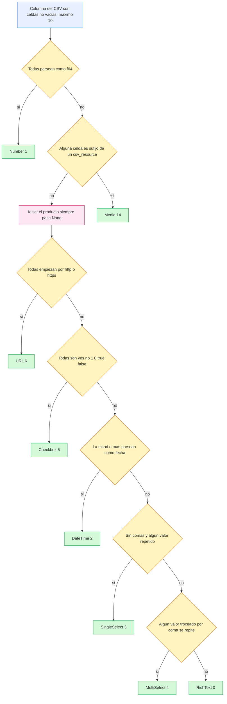
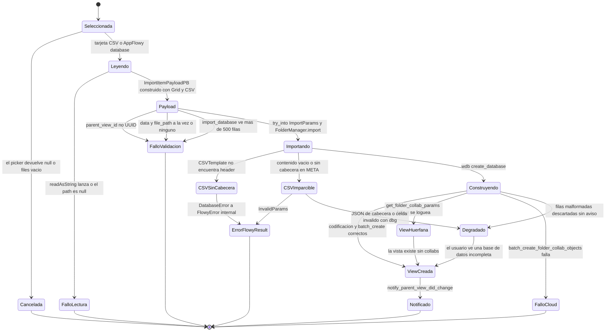
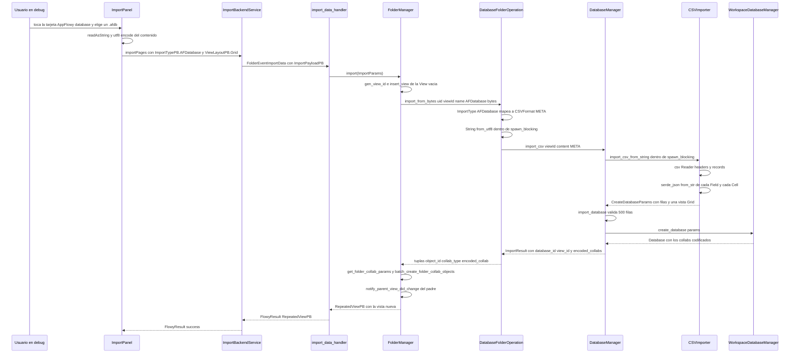

# B4.9 — Import CSV

El motor de importación de CSV es el reverso de `[[B4.5]]`, pero **no es su inverso funcional**: son dos motores distintos, en dos crates distintos, que solo comparten el enum `CSVFormat` (`appflowy/frontend/rust-lib/flowy-database2/src/services/share/csv/export.rs:13–21`). El camino público —la tarjeta «CSV» del `ImportPanel`— nunca toca `CSVImporter`; `DatabaseManager::import_csv` desvía `CSVFormat::Original` al `CSVTemplate` de `collab-database` (`appflowy/frontend/rust-lib/flowy-database2/src/manager.rs:517–523`) y reserva el `CSVImporter` de `flowy-database2` para `CSVFormat::META` (`appflowy/frontend/rust-lib/flowy-database2/src/manager.rs:525–532`). La consecuencia es que el import CSV real es **heurístico**: no lee el tipo de columna de ningún sitio y lo infiere del contenido de las celdas con una cadena de ocho detectores (`collab:collab-database/src/template/csv.rs:179–221`), mientras que el import `META` es **literal**: deserializa el `Field` y el `Cell` que el export escribió como JSON embebido en el CSV (`appflowy/frontend/rust-lib/flowy-database2/src/services/share/csv/import.rs:85–121`). Además, el evento FFI que dispara todo esto **no pertenece a `flowy-database2`** sino a `flowy-folder` (`FolderEvent::ImportData = 30`, `appflowy/frontend/rust-lib/flowy-folder/src/event_map.rs:151–152`), y hay dos bordes muertos verificados: `CSVImporter::import_csv_from_file` no tiene ningún call site, y la rama `ImportData::FilePath` del folder manager solo la usan tests de integración. Este documento traza los dos motores por separado, deriva qué valor produce cada uno de los quince `FieldType` en cada `CSVFormat`, y cierra con la matriz inversa de `[[B4.5]] §9`.

## 1. Punto de entrada (UI)

La UI ofrece **dos** tarjetas que acaban en el motor CSV, y solo una existe en compilaciones release.

1. **Tarjeta «CSV» (camino público).** La variante `ImportType.csv` del enum Dart (`appflowy/frontend/appflowy_flutter/lib/workspace/presentation/home/menu/sidebar/import/import_type.dart:7–12`) es la única de las cinco cuyo `enableOnRelease` cae en la rama `default: return true` (`appflowy/frontend/appflowy_flutter/lib/workspace/presentation/home/menu/sidebar/import/import_type.dart:49–58`), y su `allowedExtensions` es `['csv']` (`appflowy/frontend/appflowy_flutter/lib/workspace/presentation/home/menu/sidebar/import/import_type.dart:69–70`). `allowMultiSelect` es `true` para las cinco variantes sin rama `false` (`appflowy/frontend/appflowy_flutter/lib/workspace/presentation/home/menu/sidebar/import/import_type.dart:74–83`), de modo que el usuario puede subir varios CSV en la misma tanda. Al tocarla, `_importFile` lee cada fichero como `String` con `File(path).readAsString()`, toma el nombre sin extensión con `p.basenameWithoutExtension(path)` y monta un `ImportItemPayloadPB` con **`viewLayout = ViewLayoutPB.Grid` e `importType = ImportTypePB.CSV`** (`appflowy/frontend/appflowy_flutter/lib/workspace/presentation/home/menu/sidebar/import/import_panel.dart:187–196`). El layout Grid no es una coincidencia: es el único que resuelve al `FolderOperationHandler` que sabe importar CSV.
2. **Tarjeta «AppFlowy database» (solo debug).** `ImportType.afDatabase` produce `ImportTypePB.AFDatabase` con `viewLayout = ViewLayoutPB.Grid` (`appflowy/frontend/appflowy_flutter/lib/workspace/presentation/home/menu/sidebar/import/import_panel.dart:197–206`), pero `enableOnRelease` devuelve `kDebugMode` para ella (`appflowy/frontend/appflowy_flutter/lib/workspace/presentation/home/menu/sidebar/import/import_type.dart:52–54`), de modo que **no se renderiza en release**. En el lado Rust esa variante se traduce a `CSVFormat::META` (`appflowy/frontend/rust-lib/flowy-core/src/deps_resolve/folder_deps/folder_deps_database_impl.rs:275–279`), es decir: el fichero `.afdb` que consume la tarjeta «AppFlowy database» **es un CSV con metadatos**, no el JSON de raw database data. La extensión `.afdb` está en `appflowy/frontend/appflowy_flutter/lib/workspace/presentation/home/menu/sidebar/import/import_type.dart:64–66`.

Envío: el panel agrupa los items y llama a `ImportBackendService.importPages(parentViewId, importValues)` (`appflowy/frontend/appflowy_flutter/lib/workspace/presentation/home/menu/sidebar/import/import_panel.dart:210–215`), que construye un `ImportPayloadPB` y dispara `FolderEventImportData(request).send()` (`appflowy/frontend/appflowy_flutter/lib/workspace/application/settings/share/import_service.dart:18–28`). El evento FFI es `FolderEvent::ImportData` con índice `30`, `input = "ImportPayloadPB"` y `output = "RepeatedViewPB"`, registrado en el plugin `Flowy-Folder` (`appflowy/frontend/rust-lib/flowy-folder/src/event_map.rs:11–34` y `:151–152`), y lo atiende `import_data_handler` (`appflowy/frontend/rust-lib/flowy-folder/src/event_handler.rs:355–364`).

Dos bordes verificados en esta frontera:

- **El `view_id` de la vista importada no lo elige Dart.** `ImportPayloadPB` solo lleva `parent_view_id` e `items` (`appflowy/frontend/rust-lib/flowy-folder/src/entities/import.rs:63–71`); el id de la vista nueva lo genera Rust con `gen_view_id()` (`appflowy/frontend/rust-lib/flowy-folder/src/manager.rs:2055`). El `name` que Dart pone en el item es lo único que sobrevive al viaje, y se convierte en el nombre de la vista (`appflowy/frontend/rust-lib/flowy-folder/src/manager.rs:2093`), que es por eso `p.basenameWithoutExtension`.
- **`file_path` nunca se rellena desde la UI.** `import_panel.dart` fija `data` y no toca `filePath` (`appflowy/frontend/appflowy_flutter/lib/workspace/presentation/home/menu/sidebar/import/import_panel.dart:189–195`), y el `one_of` del PB (`appflowy/frontend/rust-lib/flowy-folder/src/entities/import.rs:46–52`) hace que el camino `ImportData::FilePath` (`appflowy/frontend/rust-lib/flowy-folder/src/manager.rs:2061–2065`) sea inalcanzable desde el producto; solo lo ejercitan los tests que usan `gen_csv_import_data` (`appflowy/frontend/rust-lib/event-integration-test/tests/util.rs:163–179`). Por la misma razón, `CSVImporter::import_csv_from_file` (`appflowy/frontend/rust-lib/flowy-database2/src/services/share/csv/import.rs:19–31`), que es el único punto del módulo que abre un `File`, no tiene ningún call site en todo el árbol de fuentes `[VERIFICADO]`.

**Correcciones de scope declaradas:** la construcción de los widgets, el `ValueNotifier` de carga y el `ImportCallback` son de `[[F10]]`; la semántica de campos, celdas y `TypeOption` es de `[[F02]]`; el `FolderManager::import` completo (Markdown, documentos históricos, ZIP de Notion) es de `[[B4.11]]`/`[[B4.10]]`; el export que produce estos artefactos es `[[B4.5]]` y `[[B4.6]]`.

## 2. Lado de conversión

La conversión es **100 % Rust** y está partida en dos motores que no comparten ni una línea:

| | `CSVFormat::Original` (tarjeta «CSV») | `CSVFormat::META` (tarjeta «AppFlowy database», debug) |
|---|---|---|
| Motor | `CSVTemplate` de `collab-database` | `CSVImporter` de `flowy-database2` |
| Entrada | `appflowy/frontend/rust-lib/flowy-database2/src/manager.rs:517–523` | `appflowy/frontend/rust-lib/flowy-database2/src/manager.rs:525–532` |
| Tipo de columna | **inferido** del contenido | **leído** del JSON de la cabecera |
| Decodificación percent | sí (`collab:collab-database/src/template/csv.rs:52–61`) | no (`appflowy/frontend/rust-lib/flowy-database2/src/services/share/csv/import.rs:59–61`) |
| Ejecutado en | hilo asíncrono normal | `tokio::task::spawn_blocking` |
| Intermedio | `DatabaseTemplate` → `CreateDatabaseParams` (`collab:collab-database/src/template/entity.rs:17–21`) | `CreateDatabaseParams` directo (`appflowy/frontend/rust-lib/flowy-database2/src/services/share/csv/import.rs:132–146`) |

El enrutado es literal en `import_csv`:

```rust
// appflowy/frontend/rust-lib/flowy-database2/src/manager.rs:516–533
let params = match format {
  CSVFormat::Original => {
    let mut csv_template = CSVTemplate::try_from_reader(content.as_bytes(), true, None)?;
    csv_template.reset_view_id(view_id.clone());

    let database_template = csv_template.try_into_database_template(None).await?;
    database_template.into_params()
  },

  CSVFormat::META => {
    let cloned_view_id = view_id.clone();
    tokio::task::spawn_blocking(move || {
      CSVImporter.import_csv_from_string(cloned_view_id, content, format)
    })
    .await
    .map_err(internal_error)??
  },
};
```

Tres detalles de esa bifurcación condicionan todo lo demás. Primero, el parámetro `csv_resource` que se pasa a `CSVTemplate::try_from_reader` es **`None`** en el camino del producto (`appflowy/frontend/rust-lib/flowy-database2/src/manager.rs:518`), y eso desactiva por completo la autodetección de `Media` (§4.3). Segundo, `auto_field_type` vale `true`, que es lo que enciende el heurístico (`collab:collab-database/src/template/csv.rs:63–65`). Tercero, solo la rama `META` se ejecuta en `spawn_blocking`, aunque `CSVImporter` es puramente síncrono y no bloquea: la piscina de hilos es una precaution heredada, no una necesidad medida `[INFERIDO]`.

Ambas ramas usan el constructor de atajos `csv::Reader::from_reader` (`collab:collab-database/src/template/csv.rs:40` y `appflowy/frontend/rust-lib/flowy-database2/src/services/share/csv/import.rs:50`), sin ningún `ReaderBuilder` en el crate, de modo que el dialecto aceptado es el RFC 4180 con delimitador `,`, comilla `"` y sin tolerancia a delimitadores alternativos ni a BOM `[INFERIDO]` (misma deducción que `[[B4.5]] §2`; la crate `csv` no está vendorizada en este snapshot).

El punto de convergencia es `DatabaseManager::import_database` (`appflowy/frontend/rust-lib/flowy-database2/src/manager.rs:535–536`), que aplica el límite de 500 filas y llama a `wdb.create_database(params)`; después el manager codifica el resultado con `encode_database_collabs` y lo devuelve como `ImportResult` (`appflowy/frontend/rust-lib/flowy-database2/src/manager.rs:537–546`, `collab:collab-database/src/database.rs:212–253`).

## 3. Pipeline

Diagrama del recorrido completo desde la tarjeta del `ImportPanel` hasta el `batch_create_folder_collab_objects`, con los cinco puntos en los que el control pasa de capa y las dos ramas que se separan justo antes de leer el fichero:

```mermaid
flowchart LR
  subgraph DART["Capa Dart (Flutter)"]
    CARD["Tarjeta CSV o AppFlowy database del ImportPanel"]:::ui
    READ["File readAsString y p basenameWithoutExtension"]:::ui
    ITEM["ImportItemPayloadPB data utf8 viewLayout Grid"]:::ui
    IBS["ImportBackendService.importPages"]:::ui
    EV["FolderEventImportData codigo generado"]:::ffi
  end
  subgraph FFI["Frontera FFI (dart-ffi / lib-dispatch)"]
    SEND["send serializa ImportPayloadPB"]:::ffi
    DISP["dispatcher resuelve FolderEvent::ImportData 30"]:::ffi
    BACK["RepeatedViewPB con las vistas creadas"]:::ffi
  end
  subgraph FOLDER["flowy-folder"]
    HAND["import_data_handler event_handler.rs"]:::rust
    CONV["TryInto ImportParams entities/import.rs"]:::rust
    IMP["FolderManager.import e import_single_file"]:::rust
    VIE["gen_view_id y folder.insert_view"]:::rust
    ENC["get_folder_collab_params por cada collab"]:::rust
    SYNC["batch_create_folder_collab_objects"]:::disk
    NOTIF["notify_parent_view_did_change"]:::ffi
  end
  subgraph DEPS["flowy-core"]
    FMT["ImportTypePB se mapea a CSVFormat"]:::rust
    UTF8["String from_utf8 en spawn_blocking"]:::rust
  end
  subgraph DB2["flowy-database2"]
    DISP2["DatabaseManager.import_csv"]:::rust
    LIM["import_database valida 500 filas"]:::rust
  end
  subgraph MOTOR["Los dos motores de conversion"]
    ORIG["CSVTemplate Original autodeteccion heuristica"]:::orig
    META["CSVImporter META serde_json literal"]:::meta
  end
  CARD --> READ --> ITEM --> IBS --> EV --> SEND --> DISP --> HAND
  HAND --> CONV --> IMP --> VIE --> ENC --> SYNC --> NOTIF --> BACK
  IMP --> FMT --> UTF8 --> DISP2 --> LIM
  LIM --> ORIG
  LIM --> META
  ORIG --> ENC
  META --> ENC
  classDef ui fill:#e7f0ff,stroke:#3b82f6
  classDef ffi fill:#f3e8ff,stroke:#7c3aed
  classDef rust fill:#fff3bf,stroke:#d97706
  classDef disk fill:#d3f9d8,stroke:#16a34a
  classDef orig fill:#fde7f3,stroke:#be185d
  classDef meta fill:#d3f9d8,stroke:#16a34a
```



Lectura: el grafo tiene una sola bifurcación, `LIM`, y es donde se decide el significado del fichero. Todo lo que hay por encima es **común a los cinco formatos de importación**: el panel, el PB, el handler, `FolderManager::import`, la inserción de la vista en el árbol y la subida de los collabs. Todo lo que hay por debajo es exclusivo de las bases de datos. La posición de `VIE` antes de `ENC` es importante: la vista se inserta en el `folder` **antes** de codificar y subir los collabs, de modo que un fallo de red deja una vista visible en el sidebar sin datos (`appflowy/frontend/rust-lib/flowy-folder/src/manager.rs:2093–2099` seguido de `:2134–2137`). `NOTIF` es lo único que refresca el árbol en el cliente; no hay ninguna notificación específica de «importación completada».

La cadena interna del motor `META` —el que reconstruye el `Field` y el `Cell`— es la que fija la fidelidad del round-trip:

```rust
// appflowy/frontend/rust-lib/flowy-database2/src/services/share/csv/import.rs:82–98
let fields = fields
  .into_iter()
  .enumerate()
  .map(|(index, field_meta)| match format {
    CSVFormat::Original => default_field(field_meta, index == 0),
    CSVFormat::META => {
      //
      match serde_json::from_str(&field_meta) {
        Ok(field) => field,
        Err(e) => {
          dbg!(e);
          default_field(field_meta, index == 0)
        },
      }
    },
  })
  .collect::<Vec<Field>>();
```

De ese `match` se derivan tres hechos que §5 y §9 desarrollan: la rama `Original` de `CSVImporter` es **código muerto desde la UI** (el `manager` nunca enruta `Original` a este motor), la degradación por JSON inválido es silenciosa y solo deja rastro en un `dbg!` por stdout, y el `index == 0` marca la primera columna como `is_primary` sea cual sea el formato.

## 4. Tabla formato → bloque

### 4.1 Fila de cabecera: qué produce cada `CSVFormat`

| Elemento | `CSVFormat::Original` | `CSVFormat::META` | Evidencia |
|---|---|---|---|
| Origen de los nombres | `reader.headers()` del CSV, cada `header` se convierte con `to_string()` y se toma literal | el mismo `headers()` pasa a `serde_json::from_str::<Field>` | `appflowy/frontend/rust-lib/flowy-database2/src/services/share/csv/import.rs:51–57`; `collab:collab-database/src/template/csv.rs:41–47` |
| Tipo de columna | **inferred**: `CSVField { name, field_type: FieldType::RichText }` y luego `auto_detect_field_type` lo reescribe | leído del `field_type` entero del JSON | `collab:collab-database/src/template/csv.rs:42–46` y `:63–65`; `appflowy/frontend/rust-lib/flowy-database2/src/services/share/csv/import.rs:108` |
| `id` del campo | nuevo, `gen_field_id()` por columna | **conservado**, el `id` del JSON | `collab:collab-database/src/template/builder.rs:137–146`; `collab:collab-database/src/fields/field.rs:11–20` |
| `is_primary` | `field_index == 0` | el booleano del JSON; si falta, `#[serde(default)]` | `collab:collab-database/src/template/csv.rs:97–114`; `appflowy/frontend/rust-lib/flowy-database2/src/services/share/csv/import.rs:86`; `collab:collab-database/src/fields/field.rs:18–19` |
| `type_options` | los del `FieldType` detectado (vacíos salvo Select y Date) | los del JSON, íntegros | `collab:collab-database/src/template/builder.rs:188–286`; `collab:collab-database/src/fields/field.rs:33–40` |
| Si la cabecera no parsea | `DatabaseError::InvalidCSV("No header")` → `FlowyError::internal()` | degradación a `default_field` (`RichText`) + `dbg!` | `collab:collab-database/src/template/csv.rs:48–50`; `appflowy/frontend/rust-lib/flowy-database2/src/services/share/csv/import.rs:55–57` y `:89–95` |

### 4.2 Fila de datos: qué celda produce cada `FieldType`

Las quince variantes de `FieldType` van de `RichText = 0` a `Media = 14` (`appflowy/frontend/rust-lib/flowy-database2/src/entities/field_entities.rs:425–444`). La tabla tiene una fila por variante, con el valor que la celda resultante almacena en cada `CSVFormat`.

| `FieldType` (valor) | `Original`: valor en `CELL_DATA` | `Original`: `type_options` del campo | `META`: valor de la celda | Evidencia |
|---|---|---|---|---|
| `RichText` (0) | la cadena de la celda tras percent-decode, tal cual | `RichTextTypeOption` | el `Cell` completo del JSON; si no parsea, `CELL_DATA` = `""` | `collab:collab-database/src/template/builder.rs:243–249`; `collab:collab-database/src/template/csv.rs:52–61`; `appflowy/frontend/rust-lib/flowy-database2/src/services/share/csv/import.rs:116–121` |
| `Number` (1) | la cadena tal cual, **sin** parsear a `f64`; la conversión ocurre al escribir en la celda | `NumberTypeOption::default()` (formato numérico neutro) | idéntico al `RichText`: el `Cell` serializado | `collab:collab-database/src/template/builder.rs:257–264`; `collab:collab-database/src/template/builder.rs:292–301` |
| `DateTime` (2) | la cadena pasa por `replace_cells_with_timestamp`, que la convierte a timestamp Unix o la deja tal cual | `DateTypeOption` con `date_format = FriendlyFull` forzado | el `Cell` del JSON, con el timestamp ya dentro | `collab:collab-database/src/template/builder.rs:210–227`; `collab:collab-database/src/template/date_parse.rs:4–15` |
| `SingleSelect` (3) | el texto se trocea por `SELECT_OPTION_SEPARATOR` (`","`), se construyen opciones nuevas y se guarda el **id** generado, no el nombre | `SelectTypeOption` con las opciones deduplicadas | el `Cell` del JSON, con los ids de opción originales | `collab:collab-database/src/template/builder.rs:189–209`; `collab:collab-database/src/template/option_parse.rs:5`; `collab:collab-database/src/template/option_parse.rs:28` |
| `MultiSelect` (4) | idéntico a `SingleSelect`: mismos ids, mismo `SelectTypeOption` | `SelectTypeOption` | el `Cell` del JSON | `collab:collab-database/src/template/builder.rs:189–209` |
| `Checkbox` (5) | la cadena tal cual (`"Yes"`, `"true"`, `"1"` se aceptan tal cual) | `CheckboxTypeOption` | el `Cell` del JSON | `collab:collab-database/src/template/builder.rs:250–256` |
| `URL` (6) | la cadena tal cual, **con** percent-decode (un `%20` se convierte en espacio) | **ninguno**: la rama `_` no inserta `type_options` | el `Cell` del JSON, **sin** percent-decode | `collab:collab-database/src/template/builder.rs:285–286`; `collab:collab-database/src/template/csv.rs:58` |
| `Checklist` (7) | la cadena tal cual: no se parsea la estructura de ítems | **ninguno** (inalcanzable por autodetección) | el `Cell` del JSON | `collab:collab-database/src/template/builder.rs:285–286`; `collab:collab-database/src/template/builder.rs:292–301` |
| `LastEditedTime` (8) | inalcanzable por autodetección: cae en `string_cell_template` si el tipo llegara fijado | `TimestampTypeOption::new(field_type)` | el `Cell` del JSON, pero la columna **muestra `row.modified_at`**, que se regenera | `collab:collab-database/src/template/builder.rs:228–242` |
| `CreatedTime` (9) | ídem que `LastEditedTime` | `TimestampTypeOption::new(field_type)` | ídem, muestra `row.created_at` regenerado | `collab:collab-database/src/template/builder.rs:228–242` |
| `Relation` (10) | la cadena tal cual: **no se resuelve ninguna relación**; el resultado es texto libre en una columna Relation | **ninguno** (inalcanzable por autodetección) | el `Cell` del JSON, con `row_id` que apuntan a filas de **otra** base de datos que no existe aquí | `collab:collab-database/src/template/builder.rs:285–286`; `collab:collab-database/src/template/builder.rs:292–301` |
| `Summary` (11) | la cadena tal cual | **ninguno** (inalcanzable por autodetección) | el `Cell` del JSON | `collab:collab-database/src/template/builder.rs:285–286` |
| `Translate` (12) | la cadena tal cual | **ninguno** (inalcanzable por autodetección) | el `Cell` del JSON | `collab:collab-database/src/template/builder.rs:285–286` |
| `Time` (13) | la cadena tal cual, **no** se convierte a minutos | **ninguno** (inalcanzable por autodetección) | el `Cell` del JSON | `collab:collab-database/src/template/builder.rs:285–286` |
| `Media` (14) | **inalcanzable desde la UI**: `is_media_cell` devuelve `false` cuando `csv_resource` es `None`, y el producto siempre pasa `None` | `MediaTypeOption::default()` | el `Cell` del JSON, con las URLs de `flowy-storage` **como dato**, sin descargar nada | `collab:collab-database/src/template/csv.rs:223–238`; `appflowy/frontend/rust-lib/flowy-database2/src/manager.rs:518`; `collab:collab-database/src/template/builder.rs:265–284` |

Las dos filas de abajo no son `FieldType` pero comparten la decisión de construcción:

| Elemento | `Original` | `META` | Evidencia |
|---|---|---|---|
| Altura de fila | `60` fijo en `RowTemplate` | `Default::default()` de `CreateRowParams` | `collab:collab-database/src/template/builder.rs:93–98`; `appflowy/frontend/rust-lib/flowy-database2/src/services/share/csv/import.rs:105` |
| Visibilidad de fila | `true` fijo | `Default::default()` | `collab:collab-database/src/template/builder.rs:95` |
| Número de filas | el máximo de celdas por columna (`num_rows` con `.max()`), no el número de registros leídos | uno por registro leído | `collab:collab-database/src/template/builder.rs:84–89`; `appflowy/frontend/rust-lib/flowy-database2/src/services/share/csv/import.rs:102–104` |
| Vista creada | una sola `DatabaseViewTemplate` Grid con `name = ""` y sin filtros/sorts/grupos | una sola `CreateViewParams` Grid con `name = ""` y `field_settings` recalculados | `collab:collab-database/src/template/builder.rs:109–116`; `appflowy/frontend/rust-lib/flowy-database2/src/services/share/csv/import.rs:136–145` |

### 4.3 Las ocho reglas de autodetección de `Original`

El orden de las comprobaciones es fijo y el propio código lo advierte con un comentario (`collab:collab-database/src/template/csv.rs:194`). Antes de aplicar ninguna regla se descartan las celdas vacías y se toman **como máximo las diez primeras** (`collab:collab-database/src/template/csv.rs:183–188`), y las filas cuyo número de columnas no coincide con la cabecera se excluyen del análisis (`collab:collab-database/src/template/csv.rs:159–168`).

| # | Tipo detectado | Regla | Umbral | Evidencia |
|---|---|---|---|---|
| 1 | `Number` (1) | todas las celdas parsean como `f64` | 100 % | `collab:collab-database/src/template/csv.rs:334–346` |
| 2 | `Media` (14) | alguna celda es sufijo de algún fichero de `csv_resource` | ≥ 50 %, y **siempre `false` si `csv_resource` es `None`** | `collab:collab-database/src/template/csv.rs:223–238` |
| 3 | `URL` (6) | **todas** empiezan por `http://` o `https://` | 100 % | `collab:collab-database/src/template/csv.rs:328–332` |
| 4 | `Checkbox` (5) | cada celda es `yes/no/1/0/true/false` (case-insensitive, con `trim`) | ≥ `len/2`, con salida temprana al primer valor inválido | `collab:collab-database/src/template/csv.rs:257–288` |
| 5 | `DateTime` (2) | `cast_string_to_timestamp` devuelve `Some` | ≥ 50 % | `collab:collab-database/src/template/csv.rs:240–252` |
| 6 | `SingleSelect` (3) | ningún valor contiene `,` y algún valor se repite | ≥ 2 apariciones | `collab:collab-database/src/template/csv.rs:292–307` |
| 7 | `MultiSelect` (4) | algún valor troceado por `,` se repite entre celdas | ≥ 2 apariciones | `collab:collab-database/src/template/csv.rs:311–326` |
| 8 | `RichText` (0) | valor por defecto | — | `collab:collab-database/src/template/csv.rs:220` |



Lectura: es una cadena de decisiones con salida temprana, no un sistema de puntuación. El nodo `X2` es el más importante del diagrama: `Media` está en la lista de tipos detectables, pero **desde el producto es una rama muerta**, porque `DatabaseManager::import_csv` construye el `CSVTemplate` con `csv_resource = None` (`appflowy/frontend/rust-lib/flowy-database2/src/manager.rs:518`) e `is_media_cell` cuenta `false` para cada celda cuando el recurso es `None` (`collab:collab-database/src/template/csv.rs:227–231`). El caso interesante es el orden `Number` → `Media` → `URL`: una columna de códigos postales numéricos se vuelve `Number` antes de que se considere cualquier otra cosa, y una columna de fechas en epoch se vuelve `Number` porque `cast_string_to_timestamp` acepta enteros, no al revés.

## 5. Preservación

Qué sobrevive y qué se pierde en cada sentido, con la línea que lo decide.

### 5.1 `CSVFormat::Original`: se conserva el texto y nada más

- **Solo los nombres de columna y el texto de las celdas.** El tipo de columna es una conjetura (§4.3), no un dato: el propio export lo declara lost en su doc-comment (`appflowy/frontend/rust-lib/flowy-database2/src/services/share/csv/export.rs:15–17`).
- **Los ids de opciones se regeneran.** `build_options_from_cells` deduplica los nombres de la columna y emite ids nuevos, de modo que un `MultiSelect` reimportado tiene ids distintos de los originales aunque la columna se vea idéntica (`collab:collab-database/src/template/builder.rs:190–203`, `collab:collab-database/src/template/option_parse.rs:28`).
- **El percent-decode es irreversible y no está en el export.** `CSVTemplate` aplica `percent_decode_str` a cada celda (`collab:collab-database/src/template/csv.rs:58`) mientras que el export escribe texto plano; un fichero que contenga un `%20` literal se convierte en un espacio al importar, y un `%` suelto invalida la celda entera porque el `filter_map` descarta el registro si `decode_utf8` falla (`collab:collab-database/src/template/csv.rs:58`) `[VERIFICADO]`.
- **`Relation` y `Media` no se pueden reconstruir.** Las dos caen en la rama `_ => string_cell_template`, que solo mete texto en `CELL_DATA` (`collab:collab-database/src/template/builder.rs:285`, `:292–301`): una columna de `row_id` opacos entra como texto plano en una columna `Relation` que no apunta a ninguna fila.
- **El formato numérico y de fecha se pierde aunque el tipo se acierte.** El `NumberTypeOption` que se inserta es `NumberTypeOption::default()` y el `DateTypeOption` lleva `date_format = FriendlyFull` impuesto a pelo (`collab:collab-database/src/template/builder.rs:220–221`, `:261`): el CSV no puede codificar el formato que el export usó.
- **`FieldSettings` vacío.** La rama `Original` deja `field_settings: Default::default()` en la vista (`collab:collab-database/src/template/util.rs:90`), mientras que la rama `META` los recalcula con `default_field_settings_for_fields(&fields, DatabaseLayout::Grid)` (`appflowy/frontend/rust-lib/flowy-database2/src/services/share/csv/import.rs:100`, `appflowy/frontend/rust-lib/flowy-database2/src/services/field_settings/field_settings_builder.rs:55–67`). La diferencia observable: en `META` la columna primaria queda `AlwaysShown` y las demás con la visibilidad por defecto del layout; en `Original` no hay mapa de settings y la visibilidad la resuelve el consumidor.

### 5.2 `CSVFormat::META`: fidelidad casi total de campos y celdas

Lo que se conserva, verificado por el test `export_and_then_import_meta_csv_test` (`appflowy/frontend/rust-lib/flowy-database2/tests/database/share_test/export_test.rs:25–46`):

- `Field.id`, `Field.name`, `Field.field_type`, `Field.is_primary` e **íntegro el `type_options`** (`collab:collab-database/src/fields/field.rs:10–20`). Las diez primeras columnas del grid de prueba recuperan sus `field_type` 0..9 sin ambigüedad.
- El `Cell` completo de cada celda, con su clave `field_type` (`collab:collab-database/src/rows/cell.rs:49–62`), lo que hace que `stringify_cell` vuelva a producir exactamente los mismos literales: `A`, `$1`, `2022/03/14`, `Google,Facebook`, `Yes` (`appflowy/frontend/rust-lib/flowy-database2/tests/database/share_test/export_test.rs:54–166`).

Lo que se pierde aun siendo `META`:

- **Los ids de fila.** `CreateRowParams::new(gen_row_id(), …)` genera un id nuevo por fila (`appflowy/frontend/rust-lib/flowy-database2/src/services/share/csv/import.rs:105`, `collab:collab-database/src/database.rs:1486`); el CSV `META` no los transporta porque el export no los escribe.
- **`row.created_at` y `row.modified_at`.** Se regeneran con un único `timestamp()` para toda la importación (`appflowy/frontend/rust-lib/flowy-database2/src/services/share/csv/import.rs:130`), de modo que **todas** las filas quedan con la misma fecha. Por eso `LastEditedTime` y `CreatedTime` no sobreviven al round-trip aunque el `Field` se reconstruya bien: las columnas muestran la marca de importación, no la original.
- **El nombre y el layout de la vista.** `CreateViewParams` se construye con `name: "".to_string()` y `layout: DatabaseLayout::Grid` fijos (`appflowy/frontend/rust-lib/flowy-database2/src/services/share/csv/import.rs:136–145`); el nombre real lo pone el folder manager con el `name` del PB (`appflowy/frontend/rust-lib/flowy-folder/src/manager.rs:2093`).
- **Claves antiguas de la cabecera que `serde` ignora en silencio.** El `Field` actual tiene `{id, name, field_type, icon, type_options, is_primary}` (`collab:collab-database/src/fields/field.rs:10–20`), pero los `.afdb` y los fixtures META de la historia contienen además `"visibility"` y `"width"`. Como el `derive(Deserialize)` no lleva `deny_unknown_fields`, esas dos claves **se descartan sin error ni aviso** (`appflowy/frontend/rust-lib/event-integration-test/tests/asset/database_template_1.afdb:1`, `appflowy/frontend/rust-lib/flowy-database2/tests/database/share_test/export_test.rs:104`) `[VERIFICADO]`.
- **Filtros, sorts, grupos y `layout_settings`.** No viajan en ningún `CSVFormat` y el import no los reconstruye: la vista nace con `filters: vec![]`, `sorts: vec![]` y `group_settings: vec![]` (`collab:collab-database/src/template/builder.rs:109–116`) o con los `Default` del `CreateViewParams` (`appflowy/frontend/rust-lib/flowy-database2/src/services/share/csv/import.rs:136–145`).
- **Historia y colab objects previos.** El import crea un collab nuevo; no hay ningún mecanismo de sobrescritura ni de deduplicación por `database_id`.

### 5.3 La degradación silenciosa de `META`

Dos ramas del `match` de §3 convierten un fichero corrupto en una importación aparentemente correcta:

- Cabecera que no parsea como `Field` → `dbg!(e)` a stdout y `default_field(field_meta, index == 0)`, es decir una columna `RichText` nueva con el JSON crudo como nombre (`appflowy/frontend/rust-lib/flowy-database2/src/services/share/csv/import.rs:89–95` y `:149–154`). El nombre de la columna en el grid será el JSON entero.
- Celda que no parsea como `Cell` → `cell.insert(CELL_DATA.into(), "".into())`, es decir celda vacía (`appflowy/frontend/rust-lib/flowy-database2/src/services/share/csv/import.rs:116–121`).

Ninguna de las dos propaga error, ninguna deja traza en el log estructurado y ninguna llega a la UI: el usuario ve una base de datos creada con columnas `RichText` o con celdas en blanco y no tiene forma de saber que el fichero estaba mal `[VERIFICADO]`.

## 6. Assets

El import CSV **no descarga, copia ni reescribe ningún fichero**, y hay dos ramas distintas que parecen decir lo contrario pero están muertas:

- **`CSVImporter::import_csv_from_file`** es el único punto del módulo que abre un `File` (`appflowy/frontend/rust-lib/flowy-database2/src/services/share/csv/import.rs:19–31`), y una búsqueda exhaustiva sobre `SRC/` no encuentra ningún call site: la función existe, compila y nunca se ejecuta `[VERIFICADO]`. El producto ya lee el fichero en Dart y cruza la frontera con los bytes ya dentro del PB (`appflowy/frontend/appflowy_flutter/lib/workspace/presentation/home/menu/sidebar/import/import_panel.dart:188–195`).
- **`CSVResource` y `FileUrlBuilder`.** El machinery completo para resolver assets —`CSVResource { server_url, workspace_id, files }`, `filter_out_resources` y `replace_cells_with_files` (`collab:collab-database/src/template/csv.rs:26–30`, `:121–147`, `collab:collab-database/src/template/media_parse.rs:10`)— solo se activa cuando el llamante pasa un `Some(csv_resource)` y un `Some(file_url_builder)`. `DatabaseManager::import_csv` pasa `None` en ambos (`appflowy/frontend/rust-lib/flowy-database2/src/manager.rs:518` y `:521`), de modo que **la única vía por la que un CSV puede producir una columna `Media` real no está conectada al producto**.

Consecuencias sobre los tres tipos de columna con contenido no textual:

- **`Media` en `Original`.** Inalcanzable (§4.3, regla 2): la columna queda `RichText` con los nombres de fichero como texto. El fixture `project.csv` tiene exactamente esa columna —`Files & media`, con rutas percent-encoded entre paréntesis (`appflowy/frontend/rust-lib/event-integration-test/tests/asset/project.csv:1`)— y el test de cálculos la usa para verificar que el resto de columnas se importan bien (`appflowy/frontend/rust-lib/event-integration-test/tests/database/local_test/calculate_test.rs:11–22`), no que los assets se recuperen.
- **`Media` en `META`.** El `Cell` serializado sí contiene las URLs de `flowy-storage`, y al reimportar se conservan como **datos**, no como descargas: el motor no llama a `flowy-storage` en ningún punto. Una base de datos movida entre instancias tendrá columnas `Media` que apuntan a ficheros que el gestor local no puede resolver, exactamente la misma limitación que `[[B4.6]] §6` describe para el raw database data.
- **`URL`.** No es un asset, pero sí lleva datos externos: en `Original` el percent-decode puede alterar el texto (`collab:collab-database/src/template/csv.rs:58`), en `META` se conserva literal.

No hay ruta CSV→portapapeles ni CSV→`flowy-storage` en ningún camino del producto `[VERIFICADO]`.

## 7. Encoding y nombre de archivo

- **Lectura en Dart.** `File(path).readAsString()` decodifica los bytes con UTF-8 **sustituyendo** cualquier secuencia inválida por U+FFFD, y a continuación `utf8.encode(data)` vuelve a bytear el resultado (`appflowy/frontend/appflowy_flutter/lib/workspace/presentation/home/menu/sidebar/import/import_panel.dart:188` y `:192`). Es decir, un CSV en Latin-1 **no falla**: llega a Rust con los acentos sustituidos, y el error que Rust sí sabe dar (`String::from_utf8`) nunca llega a dispararse por el camino del producto `[INFERIDO]`, por la pérdida de información que supone el doble viaje.
- **Decodificación en Rust.** `folder_deps_database_impl` convierte los bytes en `String` dentro de `spawn_blocking` y traduce el fallo de `String::from_utf8` a `FlowyError::internal()` (`appflowy/frontend/rust-lib/flowy-core/src/deps_resolve/folder_deps/folder_deps_database_impl.rs:280–283`). La rama por ruta de fichero, que sí usa `tokio::fs::read` y traduce el error a `FlowyError::invalid_data()`, es más precisa (`appflowy/frontend/rust-lib/flowy-core/src/deps_resolve/folder_deps/folder_deps_database_impl.rs:314–316`) pero no la usa la UI.
- **BOM.** No hay manejo de BOM en ningún punto de la cadena (ni en `import_panel.dart`, ni en `import.rs`, ni en `collab:collab-database/src/template/csv.rs`), y el `csv::Reader` se construye con el constructor de atajos, que no lo consume: un CSV con BOM produce una primera columna llamada `\uFEFFName` [VERIFICADO] la ausencia, [INFERIDO] el efecto, por el comportamiento estándar de `String::as_bytes` y del `headers()` de la crate `csv`.
- **Fin de línea.** El lector acepta CRLF y LF porque la crate `csv` normaliza, pero no se aplica ninguna transformation al contenido; las celdas que contienen saltos de línea literales los conservan como `\r\n` dentro del texto `[INFERIDO]`.
- **Nombre de la vista importada.** `p.basenameWithoutExtension(path)` (`appflowy/frontend/appflowy_flutter/lib/workspace/presentation/home/menu/sidebar/import/import_panel.dart:160`) viaja en `ImportItemPayloadPB.name` y Rust lo usa como nombre de la `View` (`appflowy/frontend/rust-lib/flowy-folder/src/manager.rs:2079–2093`). Si el nombre llega vacío, el `TryInto<ImportParams>` lo sustituye por la cadena literal `"Untitled"` (`appflowy/frontend/rust-lib/flowy-folder/src/entities/import.rs:87–90`).
- **Colisiones.** No hay desambiguación: dos ficheros con el mismo basename imported en la misma tanda producen dos vistas con el mismo nombre en el mismo padre `[VERIFICADO]`, el folder manager inserta cada una con `folder.insert_view(view.clone(), None)` sin índice (`appflowy/frontend/rust-lib/flowy-folder/src/manager.rs:2096–2099`).
- **Nombre del fichero en Rust.** El motor no lo ve nunca en el camino del producto; el `path` que recibe `import_from_file_path` es un `String` opaco que solo se usa con `Path::new(&path)` (`appflowy/frontend/rust-lib/flowy-core/src/deps_resolve/folder_deps/folder_deps_database_impl.rs:309–313`).

## 8. Errores

| Situación | Error producido | `ErrorCode` | Evidencia |
|---|---|---|---|
| Contenido vacío | `FlowyError::invalid_data().with_context("Import content is empty")` | `InvalidParams = 49` | `appflowy/frontend/rust-lib/flowy-database2/src/services/share/csv/import.rs:46–48`; `appflowy/frontend/rust-lib/flowy-error/src/errors.rs:137`; `appflowy/frontend/rust-lib/flowy-error/src/code.rs:138` |
| Sin cabecera (rama `META`) | `FlowyError::invalid_data().with_context("Header not found")` | `InvalidParams = 49` | `appflowy/frontend/rust-lib/flowy-database2/src/services/share/csv/import.rs:55–57` |
| Sin cabecera (rama `Original`) | `DatabaseError::InvalidCSV("No header")` convertido a `FlowyError::internal()` | `Internal = 0` | `collab:collab-database/src/template/csv.rs:48–50`; `collab:collab-database/src/error.rs:43`; `appflowy/frontend/rust-lib/flowy-error/src/impl_from/collab.rs:9–13`; `appflowy/frontend/rust-lib/flowy-error/src/code.rs:13` |
| **Más de 500 filas** | `FlowyError::invalid_data().with_context("Only support importing csv with less than 500 rows")` | `InvalidParams = 49` | `appflowy/frontend/rust-lib/flowy-database2/src/manager.rs:463–468`; aserción del test en `appflowy/frontend/rust-lib/event-integration-test/tests/folder/local_test/import_test.rs:27–40` |
| Registro CSV malformado | **ninguno**: `records().flat_map(|r| r.ok())` lo descarta | — | `collab:collab-database/src/template/csv.rs:52–54`; `appflowy/frontend/rust-lib/flowy-database2/src/services/share/csv/import.rs:59–61` |
| Cabecera META con JSON inválido | **ninguno**: `dbg!` + columna `RichText` degradada | — | `appflowy/frontend/rust-lib/flowy-database2/src/services/share/csv/import.rs:89–95` |
| Celda META con JSON inválido | **ninguno**: celda vacía | — | `appflowy/frontend/rust-lib/flowy-database2/src/services/share/csv/import.rs:116–121` |
| `data` y `file_path` ambos `None` | `FlowyError::invalid_data().with_context("The import data is empty")` | `InvalidParams = 49` | `appflowy/frontend/rust-lib/flowy-folder/src/entities/import.rs:96–98` |
| `data` y `file_path` ambos `Some` | `FlowyError::invalid_data().with_context("The import data is ambiguous")` | `InvalidParams = 49` | `appflowy/frontend/rust-lib/flowy-folder/src/entities/import.rs:99–101` |
| `parent_view_id` no vacío pero no UUID | `FlowyError::invalid_view_id()` | `ViewIdIsInvalid = 14` | `appflowy/frontend/rust-lib/flowy-folder/src/entities/import.rs:77–81`; `appflowy/frontend/rust-lib/flowy-error/src/errors.rs:115`; `appflowy/frontend/rust-lib/flowy-error/src/code.rs:43` |
| Ruta inexistente (rama por path) | `FlowyError::record_not_found().with_context("File not found")` | `RecordNotFound = 3` | `appflowy/frontend/rust-lib/flowy-core/src/deps_resolve/folder_deps/folder_deps_database_impl.rs:309–312`; `appflowy/frontend/rust-lib/flowy-error/src/errors.rs:111`; `appflowy/frontend/rust-lib/flowy-error/src/code.rs:19` |
| `spawn_blocking` abortado | `internal_error` | `Internal = 0` | `appflowy/frontend/rust-lib/flowy-database2/src/manager.rs:531` |
| Fallo al codificar un collab | `error!("import error {}", e)` y **continúa**; la vista queda creada sin datos | — | `appflowy/frontend/rust-lib/flowy-folder/src/manager.rs:2123–2129` |
| Fallo de `batch_create_folder_collab_objects` | `?` propaga el `FlowyError` del servidor | el que proceda | `appflowy/frontend/rust-lib/flowy-folder/src/manager.rs:2134–2137` |



Lectura: de los once desenlaces solo tres son **visibles** para el usuario (`Cancelada`, `ErrorFlowyResult`, `FalloCloud`); los otros ocho se convierten en una base de datos creada con datos perdidos. `Degradado` es el más peligroso porque no es un error: es una importación que termina con éxito y cuyo contenido es incorrecto, y el motor no emite ningún log estructurado —solo un `dbg!` a stdout en el caso de la cabecera. `ViewHuerfana` es el segundo: la vista se inserta en el árbol del folder (`appflowy/frontend/rust-lib/flowy-folder/src/manager.rs:2096–2099`) **antes** de codificar los collabs, así que un fallo de red deja un elemento visible en el sidebar que abre en blanco.

## 9. Round-trip

La matriz inversa de `[[B4.5]] §9`. La conclusión principal es que **el `CSVFormat::Original` que exporta la UI y el `CSVFormat::Original` que importa la UI no son el mismo formato en sentido funcional**: el export proyecta a texto formateado y el import infiere el tipo a posteriori, de modo que un `Number` exportado con `NumberFormat::USD` vuelve a entrar como `RichText` salvo que toda la columna sea numérica pura.

| Sentido | Formato | Motor | Fidelidad verificada |
|---|---|---|---|
| Exportar (UI) | `Original` | `CSVExport::export_database` | pierde tipos, ids y formats (`[[B4.5]] §5`) |
| **Importar (UI)** | `Original` | **`CSVTemplate`, no `CSVImporter`** (`appflowy/frontend/rust-lib/flowy-database2/src/manager.rs:517–523`) | heurística; los tipos se recuperan solo si el patrón de la columna encaja (§4.3) |
| Exportar (tests) | `META` | misma rama `serde_json` del export | round-trip fiel de `Field` y `Cell` |
| **Importar (debug)** | `META` | `CSVImporter.import_csv_from_string` en `spawn_blocking` (`appflowy/frontend/rust-lib/flowy-database2/src/manager.rs:525–532`) | campos y celdas íntegros; filas y vista regeneradas |
| Importar (raw JSON de `[[B4.6]]`) | — | **no existe**: `create_database_with_data` solo se llama desde `create_default_view` | imposible desde la UI |

Consecuencias verificables:

- **El `META` es el único round-trip que conserva los tipos, y está verificado por aserción.** `export_and_then_import_meta_csv_test` exporta en `META`, reimporta y comprueba que los diez `field_type` del grid de prueba se recuperan con sus valores `0..9` (`appflowy/frontend/rust-lib/flowy-database2/tests/database/share_test/export_test.rs:25–46`). El test excluye explícitamente `LastEditedTime` y `CreatedTime` del aserto de valores (`appflowy/frontend/rust-lib/flowy-database2/tests/database/share_test/export_test.rs:79–89`), coherente con §5.2.
- **El fichero `.afdb` es un `META`, no el raw JSON.** El fixture del repo lo demuestra byte a byte: `database_template_1.afdb` empieza por una cabecera CSV entrecomillada con objetos `Field` serializados (`appflowy/frontend/rust-lib/event-integration-test/tests/asset/database_template_1.afdb:1`), no por `{`. Y `ImportTypePB.AFDatabase` se mapea a `CSVFormat::META` (`appflowy/frontend/rust-lib/flowy-core/src/deps_resolve/folder_deps/folder_deps_database_impl.rs:275–279`).
- **El raw database data de `[[B4.6]]` no se puede importar desde la UI.** `create_database_with_data` (`appflowy/frontend/rust-lib/flowy-database2/src/manager.rs:405`) tiene exactamente un call site, y está en `create_default_view`, el camino que construye las bases de datos por defecto a partir de una plantilla embebida (`appflowy/frontend/rust-lib/flowy-core/src/deps_resolve/folder_deps/folder_deps_database_impl.rs:195`); ningún handler de importación lo invoca `[VERIFICADO]`. Confirma y precisa la afirmación de `[[B4.6]] §9`.
- **`HistoryDatabase` comparte motor con `CSV`.** El `match` de `import_from_bytes` solo distingue `CSV => Original` y `AFDatabase => META`; `HistoryDatabase` cae en el `_ => Original` (`appflowy/frontend/rust-lib/flowy-core/src/deps_resolve/folder_deps/folder_deps_database_impl.rs:275–279`), de modo que la tarjeta «database from v0.1.0» es exactamente el motor CSV con otra etiqueta y otra extensión filtrada. Detallado en `[[B4.10]]`.
- **La rama `CSVFormat::Original` de `CSVImporter` es inalcanzable.** Su `match` de celdas inserta el texto tal cual (`appflowy/frontend/rust-lib/flowy-database2/src/services/share/csv/import.rs:113–115`), pero ningún camino del producto enruta `Original` a ese motor; solo la ejercita el test unitario `test_import_csv_from_str` (`appflowy/frontend/rust-lib/flowy-database2/src/services/share/csv/import.rs:195–220`) `[VERIFICADO]`.
- **El límite de 500 filas es común a los dos formatos** porque se aplica en `import_database`, después de la bifurcación (`appflowy/frontend/rust-lib/flowy-database2/src/manager.rs:535–536` y `:463–468`). El test `import_492_row_csv_file_test` importa 492 filas con éxito (`appflowy/frontend/rust-lib/event-integration-test/tests/folder/local_test/import_test.rs:8–23`) y `import_10240_row_csv_file_test` recibe `ErrorCode::InvalidParams` (`appflowy/frontend/rust-lib/event-integration-test/tests/folder/local_test/import_test.rs:27–40`).
- **La ruta `FilePath` sí tiene cobertura de integración.** `gen_csv_import_data` construye el item con `file_path` en vez de `data` (`appflowy/frontend/rust-lib/event-integration-test/tests/util.rs:163–179`) y el resultado pasa por `import_from_file_path`, que fuerza `CSVFormat::Original` sin importar el `ImportType` (`appflowy/frontend/rust-lib/flowy-core/src/deps_resolve/folder_deps/folder_deps_database_impl.rs:303–322`) — otra prueba de que esa rama está desconectada de la selección de formato.

### 9.1 Secuencia extremo a extremo de un `META`



Lectura: la secuencia tiene **cuatro puntos de error reales** y el resto son degradaciones silenciosas. `DO` puede fallar al decodificar UTF-8; `DM` puede fallar por el límite de 500 filas o por cualquier error del `create_database`; `FM` puede fallar al subir los collabs y eso sí aborta. Todo lo que ocurre dentro de `CI` no puede fallar: `get_fields_and_rows` solo devuelve `Err` por contenido vacío o cabecera ausente, y el `match` de formato degrada cualquier JSON inválido a columna `RichText` o a celda vacía (`appflowy/frontend/rust-lib/flowy-database2/src/services/share/csv/import.rs:46–57` y `:89–121`). El `FM` inserta la vista antes de codificar y antes de subir, de modo que un fallo de `batch_create_folder_collab_objects` deja una vista visible y vacía.

## 10. Extensión y firma

- **Extensiones que la UI acepta.** `['csv']` para la tarjeta pública y `['afdb']` para la tarjeta de debug (`appflowy/frontend/appflowy_flutter/lib/workspace/presentation/home/menu/sidebar/import/import_type.dart:60–72`). El motor no conoce extensiones: recibe `content: String` (`appflowy/frontend/rust-lib/flowy-database2/src/manager.rs:510–515`).
- **Sniffing.** No hay ninguno. Todo elFiltering es por extensión en `FilePickerService`, y Rust acepta cualquier cosa que `csv::Reader` pueda tokenizar con `,` y `"`. Un `.csv` renombrado a `.txt` es rejected por el picker; un `.txt` renombrado a `.csv` entra como CSV y fallará o se importará como una sola columna `[INFERIDO]`.
- **Dialectos aceptados.** Delimitador `,`, comilla `"`, terminador `\r\n` o `\n`, sin detección automática de delimitador y sin tolerancia a filas de longitud irregular: `auto_detect_field_type` excluye del análisis las filas cuya longitud no coincide con la cabecera (`collab:collab-database/src/template/csv.rs:159–168`) pero `builder.rs` las rellena hasta `num_rows` con celdas ausentes (`collab:collab-database/src/template/builder.rs:84–107`), de modo que una fila corta se importa con celdas vacías a la derecha en lugar de fallar.
- **Firma.** Ninguna. No hay magic bytes ni número de versión de formato en el artefacto, y `CSVFormat` se elige por la tarjeta de la UI, no por el contenido del fichero: la misma cadena CSV se interpretaría como `Original` o como `META` según qué extensión fictitious se le dé `[INFERIDO]`.
- **PB de transporte.** `ImportPayloadPB { parent_view_id: String (1), items: Vec<ImportItemPayloadPB> (2) }` (`appflowy/frontend/rust-lib/flowy-folder/src/entities/import.rs:63–71`); `ImportItemPayloadPB { name (1), data one_of (2), file_path one_of (3), view_layout (4), import_type (5) }` (`appflowy/frontend/rust-lib/flowy-folder/src/entities/import.rs:38–61`); `ImportTypePB` con `HistoryDocument = 0`, `HistoryDatabase = 1`, `Markdown = 2`, `AFDatabase = 3`, `CSV = 4`, y `Default = Markdown` (`appflowy/frontend/rust-lib/flowy-folder/src/entities/import.rs:11–18` y `:32–36`). Contrato completo en `[[B2.1]]` y `[[B2.2]]`.
- **Evento FFI.** `FolderEvent::ImportData = 30` con `input = "ImportPayloadPB"` y `output = "RepeatedViewPB"`, registrado en el plugin `Flowy-Folder` (`appflowy/frontend/rust-lib/flowy-folder/src/event_map.rs:11–34` y `:151–152`). El vector de respuesta son las vistas creadas, no un resultado por fichero.

## 11. Ejemplos

### 11.1 `Original`: cabecera y primera fila de `project.csv`, y los tipos que produce

Entrada real del fixture que usan los tests de integración (`appflowy/frontend/rust-lib/event-integration-test/tests/asset/project.csv:1–2`), recortada a las tres primeras columnas:

```text
Project name,Status,Owner,Dates,Priority,Completion,Tasks,Blocked By,Is Blocking,Summary,Delay,Checkbox,Files & media
Research study,In Progress,Nate Martins,"April 23, 2024 → May 22, 2024",High,0.25,"Develop survey questions (…)"
```

Lectura, columna a columna, aplicando §4.3 en el orden real: `Project name` tiene un único valor distinto → `RichText`; `Status` repite `In Progress` en varias filas y no contiene comas → `SingleSelect`, con un `SelectTypeOption` de opciones deduplicadas; `Owner` son nombres propios distintos → `RichText`; `Dates` contiene el guion de rango `→` de la exportación de AppFlowy, y `cast_string_to_timestamp` no lo parsea, así que **no** es `DateTime` y cae a `RichText`; `Completion` es `0.25`, `0.5`… → `Number` con `NumberTypeOption::default()`, lo que hace que `0.25` se muestre con el formato neutro y no con el que el autor original eligió; `Summary` se detecta como `SingleSelect` antes que como `MultiSelect` porque el test de la regla 6 sale temprano en cuanto ve una coma (`collab:collab-database/src/template/csv.rs:296–299`); `Files & media` es `RichText` porque `Media` es inalcanzable. Resultado: un grid de 13 columnas en su mayoría `RichText`, con dos o tres tipos adivinados.

### 11.2 `META`: cabecera real de un `.afdb` del repo

Cabecera del fixture `database_template_1.afdb` (`appflowy/frontend/rust-lib/event-integration-test/tests/asset/database_template_1.afdb:1`), recortada a los dos primeros campos:

```text
"{""id"":""2_OVWb"",""name"":""Name"",""field_type"":0,""visibility"":true,""width"":150,""type_options"":{""0"":{""data"":""""}},""is_primary"":true}","{""id"":""xjmOSi"",""name"":""Type"",""field_type"":3,""visibility"":true,""width"":150,""type_options"":{""3"":{""content"":""{\""options\"":[{…"
```

Lectura: es un CSV `Original` cuya cabecera contiene el `Field` serializado, y el dato interesante es que **contiene `"visibility"` y `"width"`, claves que el `Field` actual ya no tiene** (`collab:collab-database/src/fields/field.rs:10–20`). `serde_json::from_str` las acepta y las descarta en silencio porque el `derive(Deserialize)` no declara `deny_unknown_fields`: la base de datos reimportada tendrá esos campos con los valores por defecto, no con los que el fichero declara `[VERIFICADO]`. El `"field_type":0` es `RichText` y el `"field_type":3` es `SingleSelect`, los mismos discriminantes del enum (`appflowy/frontend/rust-lib/flowy-database2/src/entities/field_entities.rs:425–444`).

### 11.3 `META`: lo que el round-trip verificado demuestra y lo que deja fuera

El test `history_database_import_test` importa un CSV `META` literal y comprueba los tipos 0..6 y los valores `A`, `$1`, `2022/03/14`, `Google,Facebook`, `CHECK` y la URL con su etiqueta (`appflowy/frontend/rust-lib/flowy-database2/tests/database/share_test/export_test.rs:100–113` y `:126–175`). El mismo test deja fuera del aserto `Relation`, `Summary`, `Time`, `Translate` y `Media` (`appflowy/frontend/rust-lib/flowy-database2/tests/database/share_test/export_test.rs:167–174`), que son precisamente los cinco tipos cuya celda depende de referencias externas o de ficheros. La conclusión honesta es que el round-trip `META` está verificado **para los tipos autocontenidos** y es presumible para los demás, no probado.

### 11.4 El test de integración a escala

`collab:collab-database/tests/template_test/import_csv_test.rs` importa un CSV público real de 1200 filas y 14 columnas (`collab:collab-database/tests/template_test/import_csv_test.rs:43–47`) con `auto_field_type = false`, es decir **con todos los campos forzosamente `RichText`**, y verifica que cada celda recuperada es idéntica a la del CSV original (`collab:collab-database/tests/template_test/import_csv_test.rs:53–69`). Es la prueba de que el camino `CSVTemplate` → `DatabaseTemplate` → `Database` no pierde ni una celda cuando el autodetector se apaga, y por tanto de que cualquier pérdida del camino `Original` con heurística activa proviene de la inferencia de tipos, no de la construcción de la base de datos. La cabecera del fichero, con sus 14 columnas, es `Series_reference,Period,Data_value,…,Series_title_5` (`collab:collab-database/tests/asset/selected-services-march-2024-quarter-csv.csv:1`).

**Preguntas abiertas (el orquestador las copiará a `OUT/22-preguntas-abiertas.md`):**

1. `[NO DETERMINADO]` `CSVFormat::META` es el único round-trip fiel y es alcanzable desde la UI **solo en debug**, a través de la tarjeta «AppFlowy database» (`appflowy/frontend/appflowy_flutter/lib/workspace/presentation/home/menu/sidebar/import/import_type.dart:52–54`), y ningún export de la app produce un `.afdb` (el export CSV usa siempre `Original`, `appflowy/frontend/rust-lib/flowy-database2/src/event_handler.rs:1036`). ¿Existe un «Exportar base de datos de AppFlowy» que produciría ese `.afdb`, o la tarjeta es una reliquia de v0.1.0 reutilizada?
2. `[NO DETERMINADO]` `is_media_cell` y `filter_out_resources` (`collab:collab-database/src/template/csv.rs:121–147` y `:223–238`) implementan una vía completa de resolución de assets que ningún llamante del producto activa (`appflowy/frontend/rust-lib/flowy-database2/src/manager.rs:518` y `:521` pasan `None`). ¿Es código muerto de una función que se heredó de una importación de Notion, o queda un consumidor futuro?
3. `[NO DETERMINADO]` `CSVImporter::import_csv_from_file` (`appflowy/frontend/rust-lib/flowy-database2/src/services/share/csv/import.rs:19–31`) no tiene ningún call site, y la rama `CSVFormat::Original` de `CSVImporter` tampoco es alcanzable desde `DatabaseManager::import_csv`. ¿Se mantiene `CSVImporter` por simetría con `CSVExport` o debería reducirse a la rama `META`?
4. `[NO DETERMINADO]` El límite de 500 filas (`appflowy/frontend/rust-lib/flowy-database2/src/manager.rs:463–468`) no genera ningún aviso previo ni trunca la importación: el usuario solo ve un `FlowyResult` de error tras leer los 10 000 registros. ¿Se ha considerado un aviso de «solo se importarán las primeras 500 filas» o subir el umbral?
5. `[NO DETERMINADO]` `dbg!(e)` (`appflowy/frontend/rust-lib/flowy-database2/src/services/share/csv/import.rs:92`) es el único rastro de una cabecera META corrupta y escribe a stdout en release. ¿Es intencionado como resto de depuración?

**Relacionado con:**

- `[[B4.5]]` Export CSV de base de datos — el espejo exacto: mismo enum `CSVFormat`, mismo módulo, sentido inverso. Su §9 anticipa la tabla de este §9.
- `[[B4.6]]` Export raw database data — su §9 afirma que el raw no es importable desde la UI; este documento lo confirma con la llamada única a `create_database_with_data`.
- `[[B4.10]]` Import de bases de datos históricas — `ImportType::HistoryDatabase` cae en el mismo `_ => CSVFormat::Original` y comparte motor con la tarjeta CSV.
- `[[B4.11]]` Motor de importación (Markdown, ZIP, `collab-importer`) — el `FolderManager::import` completo y el resto de `ImportType`.
- `[[F10]]` Importación (UI y orquestación Dart) — `ImportPanel`, `ImportType` e `ImportBackendService`, la frontera que dispara este motor.
- `[[F02]]` Bases de datos — `FieldType`, `TypeOption`, `Cell` y `DatabaseEditor`, la semántica que aquí solo se serializa y deserializa.
- `[[B2.1]]` Eventos FFI — `FolderEvent::ImportData` (30). `[[B2.2]]` entidades protobuf — `ImportPayloadPB`, `ImportItemPayloadPB`, `ImportTypePB`.