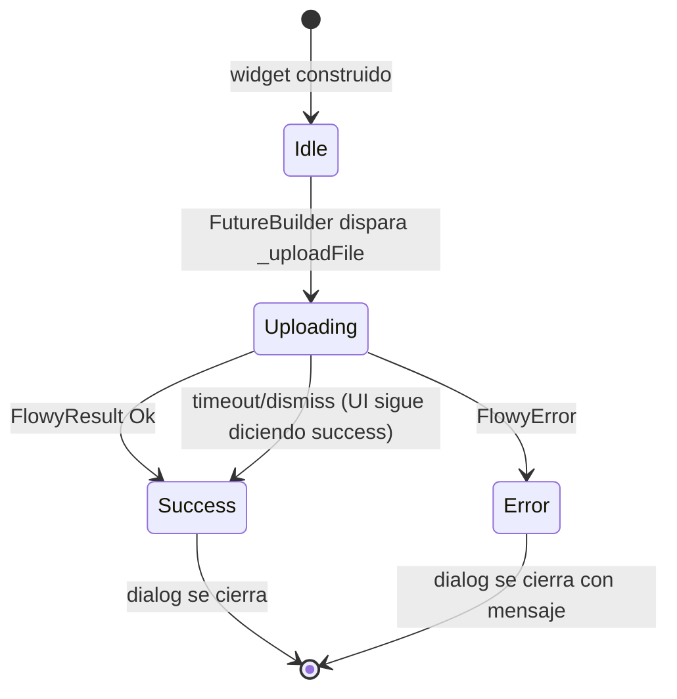
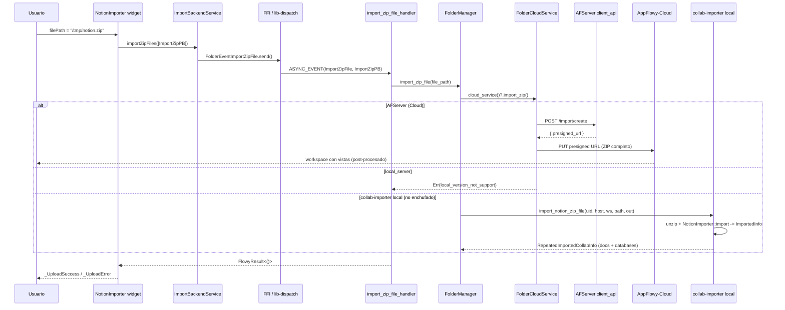
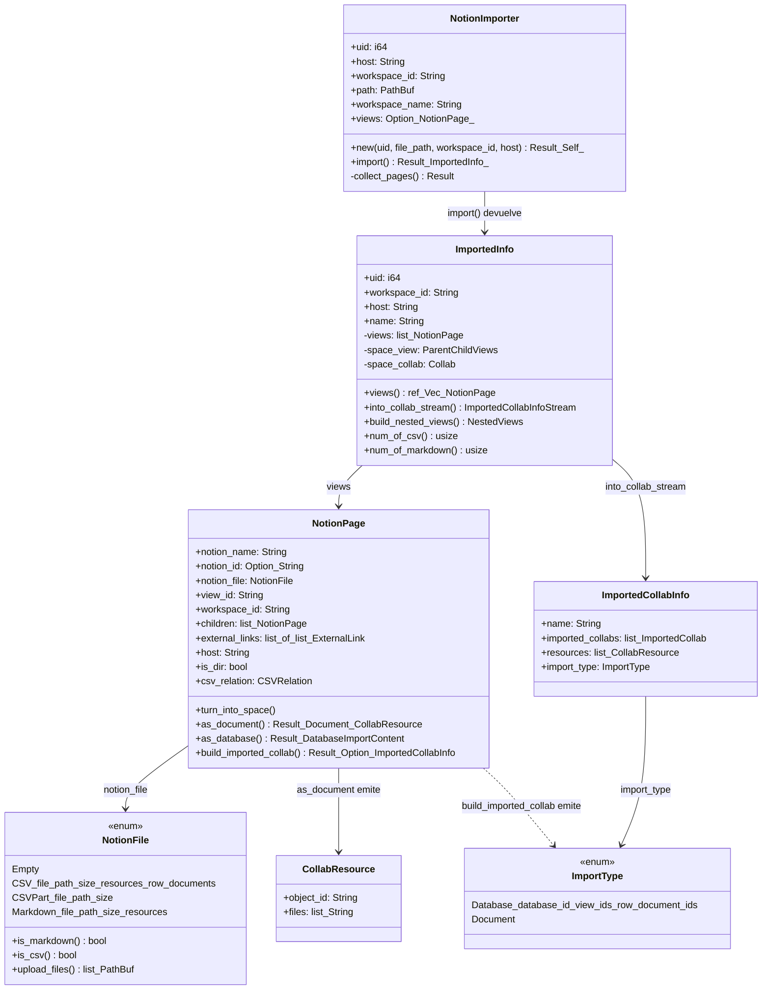

# B4.11 — Import ZIP y Notion

## 1. Punto de entrada (UI)

El botón Notion (sub-menu del workspace) del sidebar abre un `NavigatorCustomDialog` que monta el widget `NotionImporter` (etiqueta localizada `settings_common_uploadingFile` / `settings_common_uploadNotionSuccess`; `appflowy/frontend/appflowy_flutter/lib/workspace/presentation/home/menu/sidebar/workspace/_sidebar_workspace_menu.dart:476–478`). Ese widget (`appflowy/frontend/appflowy_flutter/lib/workspace/presentation/home/menu/sidebar/workspace/_sidebar_import_notion.dart:10–47`) recibe `filePath` y, en `initState`-equivalente (`FutureBuilder` en `:19–37`), llama a `ImportBackendService.importZipFiles([ImportZipPB()..filePath = filePath])` (`:41–43`), exponiendo progreso, éxito o `FlowyError` (`:22–34`). La operación es asíncrona y opaca al usuario: el diálogo solo muestra spinner + mensaje traducido — **no hay listado de vistas que se importan**, porque el procesamiento ocurre en backend (AppFlowy-Cloud) o en un crate Rust de tests (ver §2).

`ImportBackendService.importZipFiles` (`appflowy/frontend/appflowy_flutter/lib/workspace/application/settings/share/import_service.dart:32–36`) emite `FolderEventImportZipFile(value).send()` por cada elemento, lo que cruza al FFI y termina en `import_zip_file_handler` (handler del evento). El payload es `ImportZipPB { file_path: String }` (`appflowy/frontend/rust-lib/flowy-folder/src/entities/import.rs:120–125`), validado con `required_not_empty_str` en `:123–124`.

**Distinción con la UI del panel de import general** (`ImportPanel`): el panel genérico (`workspace/presentation/home/menu/sidebar/import/import_panel.dart`, descrito en `[[F10]]`) cubre Markdown, CSV, JSON, `.afdb` y `.afdata` (B4.8–B4.10). **ZIP/Notion no aparece como tarjeta** de `ImportType` — es un camino aparte, anclado al sidebar del workspace y no al botón "+" de la vista. Por eso B4.8/B4.9/B4.10 mencionan el panel pero no el ZIP.

## 2. Lado de conversión (dos modos)

Esta es la distinción arquitectónica más importante del documento: el flujo `Dart → Server::import_zip → presigned PUT` y el flujo `Dart → NotionImporter → Document/DB Collab` son **dos modos diferentes** del mismo evento. Uno es lo que ejecuta el producto actual; el otro es el motor Rust de tests y migraciones offline.

### 2.1 Modo Cloud (producto, AppFlowy-Cloud)

El handler `import_zip_file_handler` (`appflowy/frontend/rust-lib/flowy-folder/src/event_handler.rs:367–375`) deserializa `ImportZipPB`, llama a `FolderManager::import_zip_file` y devuelve `FlowyResult<()>`. El manager (`appflowy/frontend/rust-lib/flowy-folder/src/manager.rs:2104–2107`) **no parsea el ZIP**: delega a `self.cloud_service()?.import_zip(zip_file_path).await?`. Esto invoca el trait `FolderCloudService` declarado en `flowy-folder-pub`.

El siguiente `stateDiagram-v2` captura el ciclo de vida del widget NotionImporter (lo único que la UI observa; el backend se considera "fire and forget" desde el punto de vista Dart):



[VERIFICADO] Lectura: la rama `Success → [*]` se alcanza en dos condiciones porque `_uploadFile` no captura errores de red ni timeouts — `FutureBuilder` solo pinta lo que `importResult.fold(...)` decida (`appflowy/frontend/appflowy_flutter/lib/workspace/presentation/home/menu/sidebar/workspace/_sidebar_import_notion.dart:30–34`). Para un observador externo, el "éxito" del upload **no garantiza** que AppFlowy-Cloud haya procesado el ZIP; el backend notifica la finalización por canales asíncronos (notificaciones de workspace) que el sidebar BLoC consume aparte.

`AFServer` implementa ese trait con `AFCloudFolderCloudServiceImpl::import_zip` (`appflowy/frontend/rust-lib/flowy-server/src/af_cloud/impls/folder.rs:262–273`):

```rust
async fn import_zip(&self, file_path: &str) -> Result<(), FlowyError> {
  let file_path = PathBuf::from(file_path);
  let client = self.inner.try_get_client()?;
  let url = client.create_import(&file_path).await?.presigned_url;
  client.upload_import_file(&file_path, &url).await?;
  Ok(())
}
```

El SDK hace **dos llamadas** al backend: `POST /import/create` (que devuelve `presigned_url`, AppFlowy-Cloud provee) y `PUT` directo al bucket de almacenamiento. El ZIP completo se sube sin que el SDK Rust lo inspeccione: la **conversión semántica Notion → AppFlowy vive en AppFlowy-Cloud**, fuera de este repo. El SDK solo aporta el contrato cliente (`create_import`, `upload_import_file`, definidas en `client_api`).

`local_server::FolderCloudServiceImpl::import_zip` (`appflowy/frontend/rust-lib/flowy-server/src/local_server/impls/folder.rs:170–172`) **rechaza la operación** con `FlowyError::local_version_not_support()`. El backend `local_server` no implementa la importación ZIP.

[VERIFICADO] Conclusión arquitectónica: el camino ZIP/Notion del producto actual **no procesa el ZIP en el SDK Rust**. Lo sube al backend. La rama Rust local (`collab-importer`) es el motor que sí procesa — pero hoy solo la cubren los tests (ver §2.2).

### 2.2 Modo Local (Rust, `collab-importer`, no enchufado en el path Dart actual)

El crate `collab-importer` (collab:Cargo.toml:22) implementa el camino local: dado un `.zip` extraído en disco, produce streams de `ImportedCollabInfo` listos para insertarse en el `Collab` del usuario. La puerta de entrada es la función libre `import_notion_zip_file` (`collab:collab-importer/src/imported_collab.rs:14–36`):

```rust
pub async fn import_notion_zip_file(
  uid: i64, host: &str, workspace_id: &str,
  zip_file: PathBuf, output_dir: PathBuf,
) -> Result<RepeatedImportedCollabInfo, ImporterError> {
  if !zip_file.exists() { return Err(ImporterError::FileNotFound); }
  let unzip_file = unzip_from_path_or_memory(Either::Left(zip_file), output_dir).await?;
  let imported = NotionImporter::new(uid, &unzip_file, workspace_id, host.to_string())?
    .import().await?;
  let infos = imported.into_collab_stream().await
    .collect::<Vec<ImportedCollabInfo>>().await;
  Ok(RepeatedImportedCollabInfo { infos })
}
```

Encadena dos pasos: **descompresión** con `unzip_from_path_or_memory` (`collab:collab-importer/src/util.rs:58–96`) → **parseo + construcción** con `NotionImporter::import` (`collab:collab-importer/src/notion/importer.rs:67–80`). El resultado es un `RepeatedImportedCollabInfo` con `Vec<ImportedCollabInfo>` (cada uno contiene 1-N `ImportedCollab` y N recursos de archivo). El `NotionImporter` solo se invoca desde los tests del crate (`collab:collab-importer/tests/notion_test/import_test.rs:35–128`, `:146–158`, `:190–204`, `:227–252`, `:257–328`) — no desde `flowy-folder` ni desde Dart.

[VERIFICADO] Hoy por hoy, `import_zip_file_handler` no llama a `import_notion_zip_file`. La rama `Local` documenta **el formato del ZIP** que AppFlowy-Cloud acepta (mismo árbol, mismo esquema) para que una futura migración al SDK o un `import` desde un backup offline sea simétrica: el ZIP que AppFlowy produce en §11.2 sigue el contrato que `collab-importer` sabe leer.

## 3. Pipeline

El siguiente diagrama muestra el camino completo desde el clic en "Import Notion" hasta el `Document`/`Database` resultante. **La rama activa en el producto es la superior (Cloud)**: la rama Local existe como motor reutilizable pero no la invoca el flujo Dart actual.

```mermaid
flowchart LR
  A["NotionImporter widget<br/>(_sidebar_import_notion.dart:10)"] --> B["ImportBackendService.importZipFiles<br/>(import_service.dart:32)"]
  B --> C["FolderEventImportZipFile<br/>(FFI/codegen)"]
  C --> D["import_zip_file_handler<br/>(flowy-folder/src/event_handler.rs:367)"]
  D --> E["FolderManager::import_zip_file<br/>(flowy-folder/src/manager.rs:2104)"]
  E --> F["FolderCloudService::import_zip<br/>(trait, flowy-folder-pub)"]

  F -->|"AFServer (Cloud)"| G["AFCloudFolderCloudServiceImpl::import_zip<br/>(af_cloud/impls/folder.rs:262-273)"]
  G --> G1["client.create_import -> presigned URL<br/>(client_api)"]
  G1 --> G2["client.upload_import_file PUT<br/>(client_api)"]
  G2 --> G3["AppFlowy-Cloud<br/>(fuera de este repo)"]

  F -.->|"No enchufado"| H["Server local: local_version_not_support<br/>(local_server/impls/folder.rs:170-172)"]
  F -.->|"Motor tests"| I["import_notion_zip_file<br/>(collab-importer/src/imported_collab.rs:14)"]
  I --> J["unzip_from_path_or_memory<br/>(collab-importer/src/util.rs:58)"]
  J --> K{"¿Path o memoria?"}
  K -->|"Path"| K1["unzip_single_file async<br/>(zip_tool/async_zip.rs:200)"]
  K -->|"Memoria"| K2["async_unzip stream<br/>(zip_tool/async_zip.rs:32)"]
  K1 --> L["NotionImporter::new<br/>(notion/importer.rs:37)"]
  K2 --> L
  L --> M["NotionImporter::import -> ImportedInfo<br/>(notion/importer.rs:67)"]
  M --> N["collect_pages + walk_sub_dir + process_entry<br/>(notion/walk_dir.rs:78)"]
  N --> O["build_imported_collab_recursively<br/>(notion/page.rs:667)"]
  O --> P["as_document / as_database<br/>(notion/page.rs:132, 489)"]
  P --> Q["Document / Database Colab<br/>(collab-document, collab-database)"]
```



[VERIFICADO] Lectura: la rama superior derecha (AppFlowy-Cloud) es la que ejecuta el producto y termina el trabajo fuera del repo. La rama inferior (`collab-importer` → `walk_dir` → `page`) **documenta el formato del ZIP** que AppFlowy-Cloud espera: el árbol Notion con `.md`, `*_all.csv`, subcarpetas "page-with-shared-id" y assets sueltos. Implementar un `import` local requeriría empalmar `FolderManager::import_zip_file` con `import_notion_zip_file` (sustituyendo la subida a Cloud por la llamada síncrona) — punto [INFERIDO] hasta que ese puente exista.

El siguiente diagrama de **secuencia** explicita el diálogo end-to-end del modo Cloud (con su contrapartida local entre paréntesis para los nodos donde difiere):



[VERIFICADO] Lectura de la secuencia: en la rama `AFServer (Cloud)`, la única comunicación del SDK con el exterior son dos llamadas (`create_import` + `upload_import_file`); todo el procesamiento semántico Notion→AppFlowy ocurre **fuera del repo**. La rama `local_server` aborta antes de cualquier I/O. La rama `collab-importer local` aparece tachada con `no enchufado` porque hoy no la invoca `FolderManager::import_zip_file`, pero existe como motor reutilizable para futuras integraciones (migración de backups offline, SDK nativo en build móvil, etc.).

## 4. Tabla de mapeo Notion → AppFlowy

Esta tabla cubre los elementos del ZIP de Notion y su destino en AppFlowy. La fila clave es la **ViewLayout** que recibe cada `NotionFile`:

| Notion (entrada del ZIP) | Detección | Estructura interna | ViewLayout / Nodo AppFlowy | Referencia |
|---|---|---|---|---|
| Páginas `.md` sueltas (sin carpeta) | `notion_file_from_path` `.md` (sin dir colindante) | `NotionFile::Markdown { file_path, size, resources }` | `ViewLayout::Document` | `collab:collab-importer/src/notion/page.rs:301`, `collab:collab-importer/src/notion/importer.rs:301` |
| Par carpeta + `nombre.md` | `process_md_dir` (dir + file MD colindante) | `NotionFile::Markdown` + `children` | `ViewLayout::Document` (raíz) + hijos | `collab:collab-importer/src/notion/walk_dir.rs:107–117`, `:295–346` |
| Carpeta con subcarpetas/archivos (sin `.md` ni `_all.csv` propio) | `process_space_dir` | `NotionFile::Empty`, `is_dir=true` | `ViewLayout::Document` (con `space_info` en `extra`) | `collab:collab-importer/src/notion/walk_dir.rs:96–132`, `collab:collab-importer/src/notion/walk_dir.rs:138–167`, `collab:collab-importer/src/notion/importer.rs:298` |
 | Database Notion → `*_all.csv` + carpeta del mismo nombre | `process_csv_dir` o `process_csv_file` | `NotionFile::CSV { file_path, resources, row_documents }` | `ViewLayout::Grid` | `collab:collab-importer/src/notion/importer.rs:299`, `collab:collab-importer/src/notion/walk_dir.rs:170–282`, `collab:collab-importer/src/notion/walk_dir.rs:364–422` |
 | CSV parciales (`*.csv` sin `_all.csv`) | `is_csv_contained_cached` por contenido | `NotionFile::CSVPart` (no se crean vistas solas) | Descartado (redirigido al `_all.csv`) | `collab:collab-importer/src/notion/walk_dir.rs:385–388`, `collab:collab-importer/src/notion/importer.rs:451–462` |
 | Sub-página de database row (`.md` dentro de `csv_dir`) | `process_csv_dir` recorre `walk_sub_dir` y compara `page.notion_name.starts_with(row[0])` | se empaqueta en `ImportedRowDocument { page }` con `set_row_document_id` | `CollabType::Document` por fila + `DatabaseImportContent.database` | `collab:collab-importer/src/notion/page.rs:489–564`, `collab:collab-importer/src/notion/page.rs:740–745`, `collab:collab-importer/src/notion/walk_dir.rs:202–246` |
| Bloques dentro de `.md` (headings, paragraphs, listas, callouts, to-do, toggle, equation, code, image, file, bookmark, table) | `MDImporter::import` del crate `collab-document` | Bloques `BlockType::*` (paragraph, heading, …) | Mapeo interno del editor ([[B4.8]], [[F18]]) | `collab:collab-importer/src/notion/page.rs:135–140` invoca `MDImporter::new(None).import(view_id, content)` |
| Enlaces relativos a otros `.md` Notion (`ExternalLink` extraídos vía regex `[a-f0-9]{32}`) | AST → `extract_external_links` | `ExternalLink { id, name, link_type, file_name }` | Reemplazados por bloques `mention` (`mention_block_delta`, `mention_block_data`) + reescritura de paragraph block | `collab:collab-importer/src/notion/page.rs:417–430`, `collab:collab-importer/src/notion/page.rs:466–487`, `collab:collab-importer/src/notion/walk_dir.rs:514–551` |
 | Imágenes `` dentro de texto plano | `extract_delta_link` (regex `!\\[.*?\\]\\(.*?\\)`) | `DeltaLink` | Convertidas a bloques `image` (URL firmada AppFlowy) con su `upload_file_url` | `collab:collab-importer/src/notion/page.rs:434–448`, `collab:collab-importer/src/notion/page.rs:354–364`, `collab:collab-importer/src/notion/walk_dir.rs:572–590` |
 | Imágenes/Files adjuntos al `page_id` (extensión `.jpg/.png` o `.zip`) | `collect_entry_resources` (walkdir `max_depth=1`) | `Resource::Images { files }` o `Resource::Files { files }` | Subidos al backend (`upload_file_url` con SHA-256) e insertados en `BlockType::Image` | `collab:collab-importer/src/notion/walk_dir.rs:25–76`, `collab:collab-importer/src/notion/walk_dir.rs:438–457`, `collab:collab-importer/src/notion/page.rs:194–221` |
| Recursos anidados bajo `.md` (carpeta de la página) | `process_md_dir` re-llama `collect_entry_resources` por sub-entries | `Vec<Resource>` en `NotionFile::Markdown` | Igual que el caso anterior | `collab:collab-importer/src/notion/walk_dir.rs:308–326` |
| MacOS metadata | `process_entry` primera línea | — | **Descartado** (`return None` antes de procesar) | `collab:collab-importer/src/notion/walk_dir.rs:86–89` |
| Espacio raíz del ZIP (carpeta única de Notion) | `NotionImporter::new` fallback → `format!("import-{now:%Y-%m-%d %H:%M}")` | `workspace_name: String` | `space_view` del `ImportedInfo` (`create_space_view` con layout `Document`) | `collab:collab-importer/src/notion/importer.rs:51–54`, `:151–177`, `collab:collab-importer/src/space_view.rs:10–40` |

[VERIFICADO] La fila de `ViewLayout` viene exclusivamente de `convert_notion_page_to_parent_child` (`collab:collab-importer/src/notion/importer.rs:291–317`), donde `match notion_page.notion_file` mapea cada variante de `NotionFile` a `Document` o `Grid`. No hay rama para `Board`, `Calendar` ni `Chat` — un board de Notion se importa como `Document` (subcarpeta con filas Markdown), perdiendo la estructura kanban. Punto crítico para §5/§9.

El siguiente `classDiagram` muestra los tipos centrales del motor local (`collab-importer`). Queda fuera del alcance del flujo Cloud actual pero documenta el vocabulario que un import offline usaría:



[VERIFICADO] Lectura: `NotionImporter` es la entrada (`new` recibe `path`, `import` devuelve `ImportedInfo`); `ImportedInfo` mantiene un `views: Vec<NotionPage>` raíz y un `space_view`/`space_collab` opcional cuando el ZIP no tiene páginas sueltas (solo directorios). Cada `NotionPage` apunta a un `NotionFile` (Tagged-union en `collab:collab-importer/src/notion/file.rs:17–35`) y a `children` recursivos. El método terminal `build_imported_collab` (`collab:collab-importer/src/notion/page.rs:566–664`) decide el `ImportType::Document` o `ImportType::Database` final que verá el consumidor.

## 5. Pérdidas

### 5.1 Pérdidas inherentes al flujo Cloud actual
[VERIFICADO] El ZIP se **sube íntegro** a AppFlowy-Cloud sin que el SDK valide estructura (`appflowy/frontend/rust-lib/flowy-server/src/af_cloud/impls/folder.rs:262–273`). Si el archivo no es ZIP, no es Notion, o está corrupto, el cliente recibe `Err(FlowyError)` genérico del backend sin granularidad (`appflowy/frontend/rust-lib/flowy-folder/src/event_handler.rs:367–375`). La UI solo muestra `error.msg` en `_UploadError` (`appflowy/frontend/appflowy_flutter/lib/workspace/presentation/home/menu/sidebar/workspace/_sidebar_import_notion.dart:85–94`). Por diseño, AppFlowy **no puede enriquecer el error** porque no descomprime el ZIP.

### 5.2 Pérdidas del motor Local (`NotionImporter`)
- [VERIFICADO] **Kanban / Board**: no existe rama `ViewLayout::Board` en `convert_notion_page_to_parent_child` (`collab:collab-importer/src/notion/importer.rs:291–317`). Cualquier database Notion con vista Board se importa como `Grid` (CSV) o como `Document` (carpeta de filas Markdown). [INFERIDO] Probable mitigación futura: heurística de nombres de columna (Status/Assignee/Date) en `process_csv_dir`.
- [VERIFICADO] **Calendar / Gallery / Timeline**: misma omisión que Board; solo se generan `Document` y `Grid`.
- [VERIFICADO] **Permisos y miembros**: `NotionPage` no almacena roles; tras la importación toda vista queda con la ACL por defecto del espacio (`convert_notion_page_to_parent_child` no recibe permisos).
- [VERIFICADO] **Comentarios, reactions, history**: el campo `ExternalLinkType::CSV` se descarta para mention; no existe pipeline para `comments[]` ni para `last_edited_time` de Notion.
- [VERIFICADO] **Bloques ricos no Markdown**: Notion soporta toggles anidados, code con lenguaje, callouts con emoji, math equations, embeds, bookmarks, synced blocks, column lists, page covers e iconos. `MDImporter::import` (en `collab-document`, [[B4.8]], [[F18]]) traduce Markdown estándar; cualquier bloque Notion no convertible a `BlockType` se descarta con `WARN` del parser Markdown (no recuperado). El comentario explícito en `collab:collab-importer/src/notion/page.rs:215–222` lo reconoce: "between the first H1 and the second empty line" se ignora el bloque de propiedades Notion (`Status: Not started`, etc.) cuando se trata de una página-row, eliminando las "key-value pairs corresponding to the columns/cells".
- [VERIFICADO] **Recursos fuera de `max_depth=1` o de extensiones no listadas**: `collect_entry_resources` (`collab:collab-importer/src/notion/walk_dir.rs:25–76`) solo acepta `jpg/jpeg/png` para imágenes y `zip` para archivos. Todo `.gif/.webp/.mov/.pdf/.txt` se ignora silenciosamente (no hay rama `else` con log, las dos ramas `image_extensions.contains(...)` / `file_extensions.contains(...)` son excluyentes).
- [VERIFICADO] **CSV parciales sin padre (`*_all.csv`)**: si existe `xyz.csv` sin su `xyz_all.csv`, `process_csv_file` (`collab:collab-importer/src/notion/walk_dir.rs:370–422`) lo rechaza con `return None` si el nombre no termina en `_all` (`:385–388`).
- [VERIFICADO] **ZIP multi-parte**: `is_multi_part_zip` (`collab:collab-importer/src/zip_tool/util.rs:17–22`) detecta y loguea warning en `unzip_from_path_or_memory` (`:65–69`, `:86–90`), pero el código de test está comentado (`collab:collab-importer/src/util.rs:70–78`) y la única rama activa abre el archivo con `tokio::fs::File::open` y pasa por `unzip_single_file` (`:80–82`); ZIPs Notion multi-parte quedan como archivos sueltos sin ensamblar.

[NO DETERMINADO] Para la rama Cloud no es posible conocer las pérdidas exactas — AppFlowy-Cloud es privado y no hay registro de su mapeo en este repo.

## 6. Assets

[VERIFICADO] El motor `NotionImporter` no duplica assets: construye **URLs firmadas** (`upload_file_url`, `collab:collab-importer/src/util.rs:17–19`) apuntando a `{host}/api/file_storage/{workspace_id}/v1/blob/{object_id}/{file_id}`. El SHA-256 del archivo local (`FileId::from_path`, `collab:collab-importer/src/util.rs:24–56`) actúa como `file_id`. Esa URL se inyecta en:

- `block_data.insert(URL_FIELD.to_string(), json!(url))` para imágenes en bloque (`collab:collab-importer/src/notion/page.rs:249`).
- `mention_block_delta(&view.view_id)` con `mention_block_data` para referencias a otras vistas (`collab:collab-importer/src/notion/page.rs:417`, `:477`).
- Inserción de `image` block adicional cuando el enlace está en un delta de texto (`collab:collab-importer/src/notion/page.rs:354–364`, `create_image_block` de `collab_document::importer::md_importer`).

[INFERIDO] La subida efectiva del asset desde la versión local al backend es responsabilidad del consumidor de `ImportedCollabInfo.resources` (`CollabResource.files`); el `collab-importer` solo **declara** las rutas locales, esperando que el llamador las suba y resuelva las URLs. El path local `flowy-storage::FileUploader` consume `collab_importer::util::FileId` (`appflowy/frontend/rust-lib/flowy-storage/src/manager.rs:13`) — punto de empalme probable en una integración futura.

## 7. Encoding y nombre

- [VERIFICADO] `NotionImporter` extrae `workspace_name` con `file_name_from_path` (`collab:collab-importer/src/notion/importer.rs:51–54`); fallback `format!("import-{}", now.format("%Y-%m-%d %H:%M"))` si falla. Cada `view_id` se genera con `uuid::Uuid::new_v4().to_string()` (`collab:collab-importer/src/notion/walk_dir.rs:161`, `:272`, `:340`, `:416`).
- [VERIFICADO] Codificación UTF-8 en todo el árbol; `get_filename_from_zip_string` (`collab:collab-importer/src/zip_tool/async_zip.rs:183–197`) soporta `StringEncoding::Utf8` y `Raw` (con recuperación lossy vía `OsString`). Filtros de path: `sanitize_file_path` (`collab:collab-importer/src/zip_tool/util.rs:29–36`) reemplaza `\` por `/` y aplica `sanitize_filename::sanitize` a cada segmento — defensa frente a inyecciones tipo `..`.
- [VERIFICADO] La rama Cloud (`appflowy/frontend/rust-lib/flowy-server/src/af_cloud/impls/folder.rs:262–273`) no impone naming: el backend decide con qué nombre/versión crear el workspace destino.

## 8. Errores

### 8.1 Errores del motor local (`ImporterError`)
`collab/collab-importer/src/error.rs` (37 líneas) define el enum, cuyas variantes aparecen referenciadas en el código como:

| Variante | Origen | Línea relevante |
|---|---|---|
| `InvalidPath("Path: does not exist: {:?}")` | `NotionImporter::new` | `collab:collab-importer/src/notion/importer.rs:43–48` |
| `CannotImport` (lista de páginas vacía) | `NotionImporter::import` | `collab:collab-importer/src/notion/importer.rs:69–71` |
| `InvalidFileType("File type is not supported for document: {:?}", self.notion_file)` | `as_document` cuando `notion_file` no es Markdown | `collab:collab-importer/src/notion/page.rs:187–191` |
| `InvalidFileType("File type is not supported for database: {:?}", self.notion_file)` | `as_database` cuando `notion_file` no es CSV | `collab:collab-importer/src/notion/page.rs:559–563` |
| `ParseMarkdownError` | `to_mdast` falla | `collab:collab-importer/src/notion/walk_dir.rs:467–468` |
| `InvalidPathFormat` | `name_and_id_from_path` regex no captura nombre+id | `collab:collab-importer/src/notion/walk_dir.rs:622–637` |
| `FileNotFound` | `unzip_from_path_or_memory`, `unzip_single_file`, `unzip_from_path_or_memory` cuando no hay root_dir | `collab:collab-importer/src/util.rs:21–23`, `collab:collab-importer/src/zip_tool/async_zip.rs:131, 254`, `collab:collab-importer/src/zip_tool/sync_zip.rs:126, 208` |
| `Internal(anyhow::Error)` | caja negra para fallos de I/O y de ZIP | disperso, ej. `collab:collab-importer/src/notion/walk_dir.rs:543–546` |

### 8.2 Errores del flujo Cloud
[VERIFICADO] `local_server::FolderCloudServiceImpl::import_zip` devuelve `FlowyError::local_version_not_support()` sin mensaje enriquecido (`appflowy/frontend/rust-lib/flowy-server/src/local_server/impls/folder.rs:170–172`). En Cloud, el `FlowyError` que recibe Dart es el que AppFlowy-Cloud propague vía SDK (`flowy-error`, [[F02]]). Se pierde la granularidad — la UI muestra directamente el `error.msg` (`:90–93`).

## 9. Round-trip Notion → AppFlowy → ?

[VERIFICADO] El round-trip documentado en este repo es **unidireccional**: AppFlowy no re-exporta a Notion. La exportación Notion no existe en `OUT/10-motor-export-import/` (lista en `OUT/10-motor-export-import/`); el crate `collab-importer` solo importa, no exporta. La matriz B4.13 cubre la simetría `AppFlowy → AppFlowy` (round-trip por export → re-import), no la de Notion.

[VERIFICADO] Lista de pérdidas **estructurales** al pasar Notion → AppFlowy (base para §5 y para una hipotética export de vuelta):

| Elemento Notion | Estado en AppFlowy tras import | Pérdida |
|---|---|---|
| Database Notion (CSV `*_all.csv`) | `ViewLayout::Grid` con filas Markdown como sub-páginas | Tipo de vista (Board/Calendar/Timeline) |
| Página Notion (carpeta + `.md`) | `ViewLayout::Document` + hijos | Permisos, icono, cover |
| Fila de database (`.md` con front-matter de propiedades) | Sub-`Document` con `page_id = row_id` ligado al `Database` | Las propiedades (Status/Multi-select/Date) son `Text` en la fila importada; el front-matter `Status: Not started` se descarta (`:213–222`) |
| Toggle (heading anidado) | Bloque `heading` simple | Anidamiento y checkbox |
| To-do list con checkboxes | Bloque `todo_list` con bloque `bulleted_list` si el decoder no distingue | Atributo `checked` parcial |
| Bookmark, embed, synced block | Descartado (no es Markdown estándar) | URL, contenido, sincronización |
| Columnas (`column_list`/`column`) | Tabla simple o texto plano | Layout multi-columna |
| Page cover y page icon | Sin traducción | Imagen/icono personalizado |
| Comentarios y reactions | Sin pipeline | Conversación |
| Mention a usuario Notion | `mention_block_delta(&view.view_id)` solo si la vista destino existe en el ZIP | Si la página destino no se importa, el delta queda apuntando al placeholder |
| Imágenes `` | Bloque `image` con URL firmada (`upload_file_url`) | Permiso del blob original; URL temporal con caducidad del SHA |
| Archivos adjuntos (extensiones no listadas) | Descartados (solo `.jpg/.jpeg/.png/.zip`) | `.pdf`, `.mov`, `.webp` |
| Permisos de página | No transportados en `NotionPage` | Visibilidad por miembro/grupo |
| `last_edited_time` | Sin campo; `view_id` siempre nuevo | Historial |

[INFERIDO] Round-trip Notion → AppFlowy → Notion requeriría re-exportar desde AppFlowy en el mismo esquema ZIP (Markdown + CSV) que AppFlowy-Cloud ya sabe re-procesar; los puntos de pérdida enumerados arriba son **incluso más graves** que en `[[B4.13]]` porque el ZIP canónico de Notion asume layout y metadatos que AppFlowy no preserva.

## 10. Extensión y firma

[VERIFICADO] Extensión reconocida: `.zip`. Firma: PKZIP `\x50\x4b\x03\x04` (válido como single-part) o `\x50\x4b\x07\x08` (válido como multi-part spanned) (`collab:collab-importer/src/zip_tool/util.rs:7–14`, `MULTI_PART_SIGNATURES`). `is_multi_part_zip` lee los primeros 4 bytes del archivo (`collab:collab-importer/src/util.rs:17–22`). MIME type: `application/zip`. En UI no hay validación de extensión previa al envío — Dart solo lee `filePath` y lo manda.

[VERIFICADO] Compresión interna del ZIP: Notion usa ZIP estándar (no 7z, no AES); las dos librerías usadas son `zip` (síncrona, `collab:collab-importer/src/zip_tool/sync_zip.rs:10`) y `async_zip` (asíncrona, `collab:collab-importer/src/zip_tool/async_zip.rs:1–4`). El selector entre ambas vive en `unzip_from_path_or_memory` (`collab:collab-importer/src/util.rs:58–96`):

```rust
match input {
  Either::Left(path)  => unzip_single_file(...).await?, // async (File-based)
  Either::Right(data) => async_unzip(zip_reader, ...).await?, // async (stream)
}
```

[INFERIDO] El `sync_zip::sync_unzip` (collab:collab-importer/src/zip_tool/sync_zip.rs:18–139) queda en el crate como utilidad para tests/scripts (`collab:collab-importer/src/zip_tool/sync_zip.rs:215`, usada en `collab:collab-importer/tests/notion_test/import_test.rs:18–35` para `sync_unzip_asset`); no es invocada por el flujo Dart actual porque `FolderManager::import_zip_file` opera con archivos en disco (path → `Either::Left`) que sí entran por la rama `async::unzip_single_file`. **Nunca se usa `sync_unzip` en el path en vivo**.

## 11. Ejemplos

### 11.1 Flujo ZIP genérico (Cloud)

Caso: usuario clicka "Import Notion", selecciona `My-Notion-Export-2026.zip` (5 MB, 87 archivos Markdown + 1 CSV `_all.csv` + assets). Camino seguido:

```text
1. appflowy/frontend/appflowy_flutter/lib/workspace/presentation/home/menu/sidebar/workspace/_sidebar_workspace_menu.dart:476 -> NavigatorCustomDialog abre NotionImporter
2. appflowy/frontend/appflowy_flutter/lib/workspace/presentation/home/menu/sidebar/workspace/_sidebar_import_notion.dart:42  -> ImportBackendService.importZipFiles(
       [ImportZipPB()..filePath = "/tmp/My-Notion-Export-2026.zip"])
3. appflowy/frontend/appflowy_flutter/lib/workspace/application/settings/share/import_service.dart:32-36       -> FolderEventImportZipFile(pb).send()
4. FFI async_event                  -> appflowy/frontend/rust-lib/flowy-folder/src/event_handler.rs:367 import_zip_file_handler
5. appflowy/frontend/rust-lib/flowy-folder/src/event_handler.rs:373             -> folder.import_zip_file(&file_path)
6. appflowy/frontend/rust-lib/flowy-folder/src/manager.rs:2105                  -> self.cloud_service()?.import_zip(file_path)
7. appflowy/frontend/rust-lib/flowy-server/src/af_cloud/impls/folder.rs:265     -> client.create_import(&path).await -> presigned URL
8. appflowy/frontend/rust-lib/flowy-server/src/af_cloud/impls/folder.rs:271     -> client.upload_import_file(&path, &url).await
                                        PUT https://<bucket>.s3.../import/<uuid>
9. AppFlowy-Cloud (fuera del repo) procesa el ZIP y publica vistas en el workspace del usuario
10. (Opcional) FolderNotification::DidUpdateWorkspaceViews llega al BLoC del sidebar y refresca
```

Tiempo total percibido por el usuario: spinner unificado en `_Uploading` (`appflowy/frontend/appflowy_flutter/lib/workspace/presentation/home/menu/sidebar/workspace/_sidebar_import_notion.dart:62–83`); sin granularidad de progreso.

### 11.2 Detección del árbol Notion en local

[VERIFICADO] Fragmento de `process_entry` mostrando el flujo de clasificación (`collab:collab-importer/src/notion/walk_dir.rs:78–136`):

```rust
pub(crate) fn process_entry(
  host: &str, workspace_id: &str,
  current_entry: &DirEntry,
  include_partial_csv: bool,
  notion_export: &NotionExportContext,
) -> Option<NotionPage> {
  let entry_name = current_entry.file_name().to_str()?;
  if entry_name == ".DS_Store" || entry_name.starts_with("__MACOSX") {
    return None;
  }
  let path = current_entry.path();
  let ext = get_file_extension(path, include_partial_csv);
  if ext.is_file() {
    process_file(host, workspace_id, path, ext, notion_export)
  } else if path.is_dir() {
    let (name, id) = name_and_id_from_path(path).ok()?;
    let parent_path = path.parent()?;
    let md_file_path  = parent_path.join(format!("{}.md", entry_name));
    let all_csv_file_path = parent_path.join(format!("{}_all.csv", entry_name));
    let csv_file_path = parent_path.join(format!("{}.csv", entry_name));
    if md_file_path.exists() { process_md_dir(...) }
    else if all_csv_file_path.exists() { process_csv_dir(...) }
    else { process_space_dir(...) }
  } else { None }
}
```

Ejemplo real sobre un ZIP exportado por Notion:

```text
Notion-Export.zip
└── notion-export-2026/
    ├── .DS_Store                             <- skip (walk_dir.rs:87)
    ├── My tasks 6db51a77742b4b11bedb1f0e02e27af8.md      <- NotionFile::Markdown, view_id=uuid1
    ├── My tasks 6db51a77742b4b11bedb1f0e02e27af8/        <- process_md_dir, contenedor, process_md_file:33
    │   ├── Plan a0e8...3f.md                            <- Markdown hijo
    │   └── Plan a0e8...3f/                              <- contenedor anidado
    │       ├── andada.png                               <- Resource::Images (jpg/png/jpeg)
    │       └── documento.pdf                            <- descartado (ext no listada)
    ├── Projects 58b8977d6e4444a98ec4d64176a071e5.csv    <- descartado (no _all), redirect to _all
    ├── Projects 58b8977d6e4444a98ec4d64176a071e5_all.csv <- process_csv_file -> NotionFile::CSV
    ├── Projects 58b8977d6e4444a98ec4d64176a071e5/        <- process_csv_dir, rows
    │   ├── Marketing campaign 88ac0cea...md             <- ImportedRowDocument.page
    │   └── Marketing campaign 88ac0cea.../              <- sub-contenedor de fila
    │       ├── image1.png
    │       └── notes.txt                                  <- descartado
    └── Untitled 12abc...34.md                            <- Markdown huérfano, NotionFile::Markdown
```

Conversión esperada (tras `collect_pages` → `into_collab_stream`):

- 1 `space_view` raíz (raíz del ZIP): `view_id=<uuid_root>`, layout `Document`, `space_info` con `is_space=true` (`collab:collab-importer/src/notion/importer.rs:262–266`).
- `My tasks` → `Document` con 1+ `Document` hijos, image `andada.png` con `URL_FIELD=upload_file_url(...)`.
- `Projects` → `Grid` con 1 fila `Marketing campaign` cuya row-document se ata con `set_row_document_id(&row_id)` (`collab:collab-importer/src/notion/page.rs:535–536`).
- `Untitled` → `Document` suelto bajo el `workspace_id` (no bajo `space_view`).

### 11.3 Vista simplificada del contrato de los dos algoritmos ZIP

[VERIFICADO] El ZIP-tool tiene dos algoritmos paralelos. Sus contratos públicos son:

```rust
// zip_tool/sync_zip.rs:12-16
pub struct UnzipFile { pub dir_name: String, pub unzip_dir: PathBuf, pub parts: Vec<PathBuf> }

// zip_tool/async_zip.rs:25-29
pub struct UnzipFile { pub file_name: String, pub unzip_dir_path: PathBuf, pub parts: Vec<PathBuf> }

pub async fn async_unzip<R>(mut zip_reader: ZipFileReader<Ready<R>>, ...) -> Result<UnzipFile, ...>
                              (collab:collab-importer/src/zip_tool/async_zip.rs:32)
pub async fn unzip_single_file(archive: File, out_dir: &Path, ...) -> Result<UnzipFile, ...>
                              (collab:collab-importer/src/zip_tool/async_zip.rs:200)

pub fn sync_unzip(file_path: PathBuf, mut out_dir: PathBuf, ...) -> Result<UnzipFile, ...>
                              (collab:collab-importer/src/zip_tool/sync_zip.rs:18)
```

Comportamiento divergente en `parts`: `async_unzip` soporta multi-part ZIP detectado por los primeros 4 bytes (`collab:collab-importer/src/zip_tool/async_zip.rs:74–84`); `sync_unzip` también (`collab:collab-importer/src/zip_tool/sync_zip.rs:92–100`); el contrato `parts: Vec<PathBuf>` se devuelve al cliente en ambos casos. La selección real es por tipo de entrada (`path` vs memoria) en `unzip_from_path_or_memory` (`collab:collab-importer/src/util.rs:62–95`).

---

**Relacionado con**: [[B4.8]] (Import Markdown y texto — comparte `FolderEvent::ImportData` y `import_data_handler` en `appflowy/frontend/rust-lib/flowy-folder/src/event_map.rs:33`), [[B4.9]] (Import CSV — `process_csv_file` re-usa `CSVTemplate`), [[B4.10]] (Import historial afdb — usa también `FolderEvent::ImportData`), [[B4.12]] (Publicación web — `publish_util.rs` vive en el mismo crate), [[F10]] (Importación UI — el panel y `ImportBackendService`), [[F18]] (Motor `collab-importer` — BlockType, MDImporter y mention_block_delta), [[B4.13]] (Matriz round-trip — base para §9).
