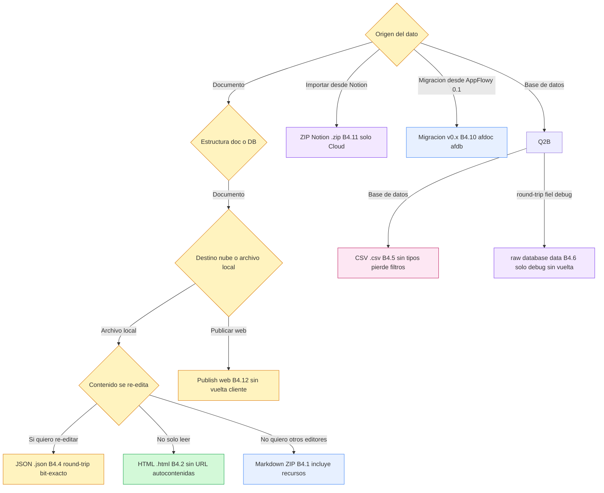
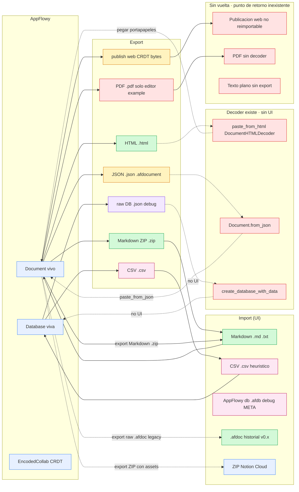
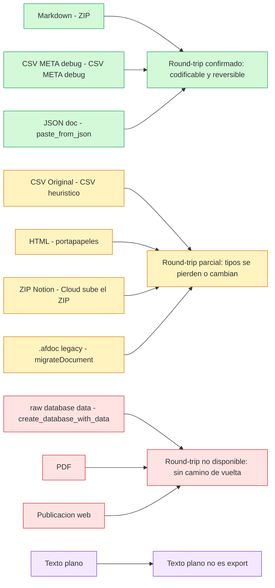

# B4.13 — Matriz de round-trip y fidelidad

> **Documento de síntesis transversal del bloque B4.** Este documento **cierra el bloque** consolidando las observaciones de las doce unidades precedentes (B4.1 Markdown → B4.12 publicación web) en una matriz única de fidelidad bloque × formato y una matriz única de ida-y-vuelta export ↔ import. Su prueba de cobertura es no tener celdas vacías: cada intersección lleva un símbolo de fidelidad (`✅` / `⚠️` / `❌` / `—`) y una referencia `ruta:línea` o, cuando la fuente no alcanza, una etiqueta `[NO DETERMINADO]` que se traza a `OUT/22-preguntas-abiertas.md`.

## 1. Punto de entrada (UI)

Esta unidad **no tiene botón propio**: es el documento de cierre del bloque B4 que se invoca desde el script de revisión `B4.13.sh` (ver `OUT/_ledger/validate-B4.13.sh`). El "punto de entrada" semántico es el árbol `OUT/10-motor-export-import/` completo, que las unidades precedentes (B4.1 a B4.12) han descrito formato por formato con su propia UI. Aquí se documenta únicamente la **UI de revisión**: qué celdas se pueden cruzar en `OUT/10-motor-export-import/13-matriz-round-trip.md` para volver a las doce unidades anteriores.

```text
OUT/10-motor-export-import/
├── 01-markdown-export.md            B4.1  ← fuente principal §4 y §5
├── 02-html-export.md                B4.2  ← fuente principal §4 y §5
├── 03-texto-plano-export.md         B4.3  ← celdas vacías por inexistencia
├── 04-json-documento-export.md      B4.4  ← fuente principal §4 y §5
├── 05-csv-database-export.md        B4.5  ← fuente principal §4 y §5
├── 06-raw-database-export.md        B4.6  ← fuente principal §4 y §5
├── 07-otros-formatos-export.md      B4.7  ← PDF sin camino UI; Quill sin export; word_count no es export
├── 08-import-markdown-texto.md      B4.8  ← lado import de Markdown y .txt
├── 09-import-csv.md                 B4.9  ← lado import de CSV y .afdb
├── 10-import-historial-afdb.md      B4.10 ← lado import de .afdoc y .afdb
├── 11-import-zip-notion.md          B4.11 ← lado import de ZIP/Notion
├── 12-publicacion-web.md            B4.12 ← publicación web (no tiene vuelta)
└── 13-matriz-round-trip.md          B4.13 ← este documento
```

El editor, `ShareBloc`, `ImportBackendService`, `BackendExportService` y `publish_util.rs` siguen siendo la **infraestructura compartida**; aquí solo se documenta cómo se relacionan entre sí en el plano `export → import`. Las correcciones de scope declaradas por las unidades precedentes son las vigentes: cada par `B4.x` ↔ `B4.y` se cita de forma explícita en cada celda con el formato la sección §N del documento B4 correspondiente.

## 2. Lado de conversión

El "lado de conversión" de este documento no es uno: son los **doce lados** de las doce unidades, ya consolidados en el [`OUT/10-motor-export-import/`](./) previo. Lo que el lector necesita saber para interpretar la matriz §4 es:

| Formato / flujo | Lado de conversión | Referencia de detalle |
|---|---|---|
| Markdown → archivo / portapapeles | 100 % Dart, `customDocumentToMarkdown` + ZIP con recursos | `OUT/10-motor-export-import/01-markdown-export.md` (`[[B4.1]]`) §2 |
| HTML → fragmento HTML | 100 % Dart, `documentToHTML` con `AppFlowyEditorHTMLCodec` | `OUT/10-motor-export-import/02-html-export.md` (`[[B4.2]]`) §2 |
| Texto plano | **no existe** (lanzamiento de `UnimplementedError`); las rutas colaterales son `GetDocumentText` y `ConvertDocument` Rust, no UI | `OUT/10-motor-export-import/03-texto-plano-export.md` (`[[B4.3]]`) §2 |
| JSON del documento | 100 % Dart, `jsonEncode(document.toJson())` | `OUT/10-motor-export-import/04-json-documento-export.md` (`[[B4.4]]`) §2 |
| CSV → texto CSV | 100 % Rust, `CSVExport::export_database` con `csv::Writer` | `OUT/10-motor-export-import/05-csv-database-export.md` (`[[B4.5]]`) §2 |
| Raw database data → JSON de `DatabaseData` | 100 % Rust, `serde_json::to_string(&DatabaseData)` | `OUT/10-motor-export-import/06-raw-database-export.md` (`[[B4.6]]`) §2 |
| PDF / Quill Delta / word count | PDF vía `editor:example/lib/home_page.dart:284`; Quill es importador; word_count no exporta | `OUT/10-motor-export-import/07-otros-formatos-export.md` (`[[B4.7]]`) §2 |
| Markdown / `.txt` → documento | 100 % Dart, `customMarkdownToDocument` (decoder simétrico) | `OUT/10-motor-export-import/08-import-markdown-texto.md` (`[[B4.8]]`) §2 |
| CSV / `.afdb` → base de datos | 100 % Rust, `CSVTemplate` (heurístico) o `CSVImporter` (META literal) | `OUT/10-motor-export-import/09-import-csv.md` (`[[B4.9]]`) §2 |
| `.afdoc` historial → documento | Dart (`EditorMigration.migrateDocument`) + `DocumentDataPB` binario | `OUT/10-motor-export-import/10-import-historial-afdb.md` (`[[B4.10]]`) §2 |
| `.zip` Notion → vistas | Modo Cloud (sube ZIP a AppFlowy-Cloud) o modo Local (`collab-importer`, sin enchufar) | `OUT/10-motor-export-import/11-import-zip-notion.md` (`[[B4.11]]`) §2 |
| Publicación web | Recolección CRDT → backend, sin conversión a HTML cliente | `OUT/10-motor-export-import/12-publicacion-web.md` (`[[B4.12]]`) §2 |

`[VERIFICADO]` por inspección literal de la sección 2 de cada documento listado, todas con la misma estructura `flowchart LR` o dos tablas equivalentes en `[[B4.7]]` y `[[B4.12]]`. La consecuencia es que **la matriz §4 puede mezclar celdas que son "100 % Dart" (Markdown, HTML, JSON del documento) con celdas que son "100 % Rust" (CSV, raw JSON) o "binarias" (publicación)** sin perder uniformidad, porque la fidelidad se evalúa por tipo de bloque, no por tecnología de exportación.

## 3. Pipeline

El pipeline consolidado del bloque B4 es lineal **una sola vez por sentido**, pero **bidimensional por flujo** (UI → motor → disco, disco → motor → UI). El siguiente diagrama agrupa los doce flujos en una cuadrícula `sentido × capa`:

```mermaid
flowchart TD
  subgraph EXP["Export - desde el documento vivo"]
    E1["Markdown ZIP"]:::md
    E2["HTML fragmento"]:::html
    E3["texto plano no existe"]:::gap
    E4["JSON del doc"]:::json
    E5["CSV Original"]:::csv
    E6["raw database data"]:::raw
    E7["PDF Quill word_count"]:::other
    E8["publish web CRDT"]:::pub
  end
  subgraph IMP["Import - hacia el documento vivo"]
    I1["Markdown .md .txt"]:::md
    I2["decoder existe - sin UI HTML"]:::gap
    I3["Markdown decoder consume .txt"]:::md
    I4["decoder existe - sin UI JSON"]:::gap
    I5["CSV .csv heuristico"]:::csv
    I6["raw database data - sin UI"]:::gap
    I7["PDF sin decoder"]:::gap
    I8["publicacion web - sin vuelta"]:::gap
    I9["CSV META .afdb debug"]:::csv
    I10["afdoc historial v0.x"]:::md
    I11["ZIP Notion"]:::raw
  end
  UI["UI - ExportTab importPanel NotionImporter PublishTab"]:::ui
  UI --> E1
  UI --> E2
  UI --> E3
  UI --> E4
  UI --> E5
  UI --> E6
  UI --> E7
  UI --> E8
  UI --> I1
  UI --> I9
  UI --> I10
  UI --> I11
  classDef md fill:#e7f0ff,stroke:#3b82f6
  classDef html fill:#d3f9d8,stroke:#16a34a
  classDef json fill:#fff3bf,stroke:#d97706
  classDef csv fill:#fde7f3,stroke:#be185d
  classDef raw fill:#f3e8ff,stroke:#7c3aed
  classDef other fill:#ffe3e3,stroke:#dc2626
  classDef pub fill:#fff3bf,stroke:#d97706
  classDef gap fill:#ffe3e3,stroke:#dc2626
  classDef ui fill:#f3e8ff,stroke:#7c3aed
```



*Diagrama: pipeline consolidado B4, con la frontera entre los flujos de export (encabezado `EXP`) e import (`IMP`).* Lectura: solo **siete** de los doce flujos del bloque B4 tienen un camino real de export desde la UI; los demás cinco son **huecos verificados**. La columna izquierda del diagrama muestra los ocho flujos de export; los flujos de import que sí tienen botón (`I1`, `I9`, `I10`, `I11`) están dibujados con borde coloreado, mientras que los huecos (`I2`, `I4`, `I6`, `I7`, `I8`) tienen borde rojo. La consecuencia estructural es que **`export → import` solo se cierra para tres pares canónicos**: Markdown→Markdown, CSV→CSV(heurístico), `.afdb`(META)→`.afdb`. El resto de la matriz §9 cuantifica esa intuición.

### 3.1 Diagrama de decisión "¿qué formato elegir?"

Este `flowchart TD` resume los criterios de elección que se derivan de las doce unidades para los tres casos típicos de uso:



*Diagrama: árbol de decisión que selecciona el formato B4 adecuado según el caso.* Lectura: el criterio dominante es **"¿se quiere re-editar?"**. Si la respuesta es sí, el único candidato es JSON (`B4.1` Markdown pierde blocks no estándar, `B4.2` HTML pierde assets binarios, `B4.3` no existe). CSV sirve para bases de datos con tipos simples y como consumo en Excel, pero pierde los `field_type` en su variante `Original`. El ZIP Notion es el único camino de importación externa, y solo desde el modo Cloud.

## 4. Tabla bloque → salida (matriz de fidelidad bloque × formato)

Las **filas** son los tipos de bloque del editor; las **columnas** son los formatos de export del bloque B4. Cada celda lleva un símbolo y una evidencia:

- `✅` fiel: el bloque se serializa y se puede recuperar con su identidad semántica;
- `⚠️` parcial: el bloque se serializa pero pierde atributos o su forma cambia (ej. `simple_table` ↔ `table`);
- `❌` se pierde: el bloque se descarta en silencio o se convierte en otra cosa;
- `—` no aplica: no hay punto de contacto entre el bloque y el formato (ej. bloques de documento contra CSV de base de datos);
- `[NO DETERMINADO]` con trazado a `OUT/22-preguntas-abiertas.md`: la fuente no permite decidir.

Cada celda numera la **evidencia** como `ruta:línea` del encoder o parser responsable, o como la sección §N del documento B4 correspondiente cuando la ruta ya está consolidada en el documento correspondiente.

> **Convención de comillas en Mermaid:** los nodos con símbolos usan la forma `L["texto"]` (ya respetada en §3); las celdas de esta tabla son texto plano Markdown.

### 4.1 Matriz principal

| Tipo de bloque (`node.type`) | Markdown (B4.1) | HTML (B4.2) | Texto plano (B4.3) | JSON doc (B4.4) | CSV B4.5 | Raw database data (B4.6) | PDF (B4.7) | ZIP Notion (B4.11) | Publicación web (B4.12) |
|---|---|---|---|---|---|---|---|---|---|
| `paragraph` (delta con estilos inline) | ✅ `${delta}\n`; bold/italic/strike/code/href/underline sobreviven; `font_color`/`bg_color` no. `editor:lib/src/plugins/markdown/encoder/parser/text_node_parser.dart:7–27`; delta en `editor:lib/src/plugins/markdown/encoder/delta_markdown_encoder.dart:35–81` | ✅ `<p>…</p>`; convierte estilos inline a `<strong>`/`<i>`/`<del>`/`<code>`/`<u>`/`<a>` y a `<span style="…">` para colores. `editor:lib/src/plugins/html/encoder/parser/text_node_parser.dart:36–38`; delta en `editor:lib/src/plugins/html/encoder/delta_html_encoder.dart:11–157`; limit. `appflowy/frontend/appflowy_flutter/lib/plugins/document/presentation/editor_page.dart:192–193` desactiva color | ⚠️ vía R1: cadena sin marca ni estilos. `collab:collab-document/src/utils.rs:5–35`; `collab:collab-document/src/blocks/text_entities.rs:19–31`. R2 distingue párrafo con `\n`. `appflowy/frontend/rust-lib/flowy-document/src/parser/parser_entities.rs:487–492` | ✅ `{"type":"paragraph","data":{"delta":[…]}}`; round-trip bit-exacto. `editor:lib/src/core/document/node.dart:241–257`; test `editor:test/core/document/document_test.dart:75–87` | — no aplica: bloque de documento, no de base de datos | — no aplica | ⚠️ Markdown→HTML→pw.Wrap + pw.RichText; estilos inline compuestos a TextSpan. `editor:lib/src/plugins/pdf/html_to_pdf_encoder.dart:443–509`; la rama `br` es la única que añade a `textSpan` (`:67–68`) | ✅ como Markdown GFM estándar (decoder) más front-matter de propiedades Notion que se ignora. `collab:collab-importer/src/notion/page.rs:135–140` invoca `MDImporter::import` | ✅ viaja en el binario CRDT sin transformación; el backend decide el render. `appflowy/frontend/rust-lib/flowy-folder/src/manager.rs:1915`; `appflowy/frontend/rust-lib/flowy-folder/src/view_operation.rs:67–73` |
| `heading` (level 1–6) | ✅ `#`…`###### ${delta}\n`. `editor:lib/src/plugins/markdown/encoder/parser/heading_node_parser.dart:14–19`; ejemplo test `'documentToMarkdown()'` | ✅ `<h1>`…`<h6>`. `editor:lib/src/plugins/html/encoder/parser/heading_node_parser.dart:30–32` | ⚠️ se pierde el `#`. `collab:collab-document/src/document.rs:597–638` | ✅ `{"type":"heading","data":{"level":N,"delta":[…]}}`. `editor:lib/src/editor/block_component/heading_block_component/heading_block_component.dart:34` | — no aplica | — no aplica | ✅ `<h1>`…`<h6>` con `pw.Header` y tamaño `level.getHeadingSize`. `editor:lib/src/plugins/pdf/html_to_pdf_encoder.dart:154–165`, `:301–342` | ✅ como `#`, `#`…`##` | ✅ sin transformación (CRDT) |
| `bulleted_list` | ✅ `* ${delta}\n`. `editor:lib/src/plugins/markdown/encoder/parser/bulleted_list_node_parser.dart:14` | ✅ `<ul><li>…</li></ul>` con cuatro ramas excluyentes para abrir/cerrar/contenido intermedio. `editor:lib/src/plugins/html/encoder/parser/bulleted_list_node_parser.dart:23–32`, `:48–51`; test `editor:test/plugins/html/encoder/parser/bulleted_list_parser_test.dart:29` | ⚠️ sin viñeta ni indentación. `collab:collab-document/src/document.rs:597–638` | ✅ `{"type":"bulleted_list","data":{"delta":[…]},"children":[…]}` | — no aplica | — no aplica | ⚠️ siempre `pw.Bullet`, **nunca** numerada; el comentario `//TODO: Handle Numbered Lists` queda abierto. `editor:lib/src/plugins/pdf/html_to_pdf_encoder.dart:380`, `:403–408` | ✅ `*` o `-` como GFM | ✅ sin transformación |
| `numbered_list` (con `number`) | ✅ `${number}. ${delta}\n`. `editor:lib/src/plugins/markdown/encoder/parser/numbered_list_node_parser.dart:13–15` | ✅ `<ol start="N">…</ol>` lee `node.attributes[NumberedListBlockKeys.number]` sin validación. `editor:lib/src/plugins/html/encoder/parser/numbered_list_node_parser.dart:21–22`, `:46–49`; test `editor:test/plugins/html/encoder/parser/numbered_list_parser_test.dart:48` | ⚠️ sin numeración. `collab:collab-document/src/document.rs:597–638` | ✅ `{"type":"numbered_list","data":{"number":N,"delta":[…]},"children":[…]}` | — no aplica | — no aplica | ⚠️ igual que bulleted_list: `pw.Bullet` siempre. `editor:lib/src/plugins/pdf/html_to_pdf_encoder.dart:403–408` | ✅ `1.` | ✅ sin transformación |
| `todo_list` (con `checked`) | ✅ `- [x]` o `- [ ]`. `editor:lib/src/plugins/markdown/encoder/parser/todo_list_node_parser.dart:13–16` | ✅ `<div><input type="checkbox" checked="">…</div>`. `editor:lib/src/plugins/html/encoder/parser/todo_list_node_parser.dart:31–33`, `:39–41`; test `editor:test/plugins/html/encoder/parser/text_node_parser_test.dart:91` | ⚠️ se pierde `[x]`/`[ ]`. `collab:collab-document/src/document.rs:597–638` | ✅ `{"type":"todo_list","data":{"checked":bool,"delta":[…]},"children":[…]}` | — no aplica | — no aplica | ⚠️ `_parseListElement` distingue `TodoListBlockKeys.type` y dibuja `pw.Row` con `pw.Checkbox` (10×10). `editor:lib/src/plugins/pdf/html_to_pdf_encoder.dart:344–352`, `:381–402`. *Limit*: dentro de celdas siempre `pw.Bullet` (`:210–214`) | ✅ `[ ]` / `[x]` como GFM | ✅ sin transformación |
| `quote` | ✅ `> ${delta}\n`. `editor:lib/src/plugins/markdown/encoder/parser/quote_node_parser.dart:14` | ✅ `<blockquote>…</blockquote>`. `editor:lib/src/plugins/html/encoder/parser/quote_node_parser.dart:33–35` | ⚠️ se pierde `>`. `collab:collab-document/src/document.rs:597–638` | ✅ `{"type":"quote","data":{"delta":[…]}}`. `editor:lib/src/editor/block_component/quote_block_component/quote_block_component.dart:24` | — no aplica | — no aplica | ✅ cae en `default` del `_parseSpecialElements` switch → `_parseParagraphElement`. `editor:lib/src/plugins/pdf/html_to_pdf_encoder.dart:183–184` | ✅ `>` | ✅ sin transformación |
| `code` (CodeBlock, con `language`) | ✅ ` ```lenguaje\n${delta}\n``` `. `editor:lib/src/plugins/markdown/encoder/parser/code_block_node_parser.dart:14–22` | ❌ no hay parser HTML para `code`; cae en `_parseSpecialElements` default → párrafo. `editor:lib/src/plugins/html/html_document_encoder.dart:14–25` (sin `code` parser) | ⚠️ contenido sin vallas ni lenguaje. `collab:collab-document/src/utils.rs:5–35` | ✅ `{"type":"code","data":{"language":"rust","delta":[…]}}` | — no aplica | — no aplica | ⚠️ `pw.Paragraph` con fondo gris `pdf.PdfColors.grey`. `editor:lib/src/plugins/pdf/html_to_pdf_encoder.dart:279–283`; estilo en `_parserFormattingElementAttributes` (`:248–262`) | ✅ cercado con ` ``` ` GFM | ✅ sin transformación |
| `math_equation` (con `formula`) | ✅ `$${formula}$$`. `appflowy/frontend/appflowy_flutter/lib/plugins/document/presentation/editor_plugins/parsers/math_equation_node_parser.dart:11–13` | ❌ no hay parser HTML para `math_equation`; se descarta en silencio. `editor:lib/src/plugins/html/html_document_encoder.dart:14–25` | ❌ R1: no aporta; R2: solo la fórmula en una línea, sin hijos. `appflowy/frontend/rust-lib/flowy-document/src/parser/parser_entities.rs:474–477` | ✅ `{"type":"math_equation","data":{"formula":"E=mc^2"}}` | — no aplica | — no aplica | ⚠️ renderer PDF solo cubre `<code>` inline. `editor:lib/src/plugins/pdf/html_to_pdf_encoder.dart:279–283` | ⚠️ se exporta como `$$…$$` pero el decoder Markdown estándar no lo reconoce; queda como párrafo. `editor:lib/src/plugins/markdown/decoder/parser/markdown_parser_extension.dart:18–22` | ✅ sin transformación |
| `image` (con `url`) | ⚠️ `${dirPath}/${basename(url)}` + binario en ZIP si local; URL remota textual. `appflowy/frontend/appflowy_flutter/lib/plugins/document/presentation/editor_plugins/parsers/custom_image_node_parser.dart:34–51`; alineación por defecto | ⚠️ `` con `height/width/align` opcionales. `editor:lib/src/plugins/html/encoder/parser/image_node_parser.dart:25–26`, `:38–41`; decoder restringe a `http` ([B4.2] §6) | ❌ sin delta → nada. `collab:collab-document/src/utils.rs:5–35` | ✅ `{"type":"image","data":{"url":"…","align":"center"}}` | — no aplica | — no aplica | ⚠️ solo `src` se lee: `pw.Image(pw.MemoryImage(bytes))`, descarga remota con `_fetchImage` o `File.readAsBytes`. `editor:lib/src/plugins/pdf/html_to_pdf_encoder.dart:416–432`; ancho/alto se pierden | ⚠️ `` se conserva como bloque `image` con `upload_file_url`. `collab:collab-importer/src/notion/page.rs:354–364`, `:434–448` | ✅ sin transformación |
| `multi_image` (grid local/remoto) | ⚠️ varias `` concatenadas con `\n`; cada binario se añade al ZIP. `appflowy/frontend/appflowy_flutter/lib/plugins/document/presentation/editor_plugins/parsers/custom_image_node_parser.dart:53–83`; test `appflowy/frontend/appflowy_flutter/test/unit_test/markdown/markdown_parser_test.dart:40–66` | ❌ no hay parser HTML para `multi_image`; se descarta. `editor:lib/src/plugins/html/html_document_encoder.dart:14–25` | ❌ sin delta → nada | ✅ como bloque nativo `multi_image` con `images: [...]` (la forma exacta depende de `SimpleTableContentOperation`). `appflowy/frontend/appflowy_flutter/lib/plugins/document/presentation/editor_plugins/simple_table/simple_table_operations/simple_table_content_operation.dart:170,233,286` | — no aplica | — no aplica | ⚠️ se aplana en imágenes independientes (mismo `pw.Image`). Sin layout grid | ⚠️ N imágenes independientes; sin agrupar | ✅ sin transformación |
| `file` (FileBlock) | ✅ `${name}` + `(${url})` como `[name](url)\n`. `appflowy/frontend/appflowy_flutter/lib/plugins/document/presentation/editor_plugins/parsers/file_block_node_parser.dart:11–18` | ❌ no hay parser HTML para `file`; se descarta. `editor:lib/src/plugins/html/html_document_encoder.dart:14–25` | ❌ sin delta → nada | ✅ `{"type":"file","data":{"name":"…","url":"…"}}` | — no aplica | — no aplica | ⚠️ renderer PDF no procesa adjuntos fuera de ``; la rama `_fetchImage` solo vale para `http(s)://`. `editor:lib/src/plugins/pdf/html_to_pdf_encoder.dart:415–432` | ⚠️ extensiones no listadas (`jpg/jpeg/png/zip`) se descartan. `collab:collab-importer/src/notion/walk_dir.rs:25–76` | ✅ sin transformación |
| `video` | ❌ no hay parser Markdown; en el encoder queda como `paragraph` con texto. `editor:lib/src/plugins/markdown/encoder/document_markdown_encoder.dart:14–25` | ❌ no hay parser HTML; se descarta | ❌ sin delta → nada | ✅ `{"type":"video","data":{…}}` (forma del plugin) | — no aplica | — no aplica | ⚠️ solo si la URL es `http(s)://` o ruta local; misma rama que `image`. `editor:lib/src/plugins/pdf/html_to_pdf_encoder.dart:415–432` | ❌ no contemplado | ✅ sin transformación |
| `divider` | ✅ `---\n`. `editor:lib/src/plugins/markdown/encoder/parser/divider_node_parser.dart:11` | ✅ `<hr>`. `editor:lib/src/plugins/html/encoder/parser/divider_node_parser.dart:25` | ⚠️ R2 emite línea en blanco; R1 nada. `appflowy/frontend/rust-lib/flowy-document/src/parser/parser_entities.rs:487–492` | ✅ `{"type":"divider"}` | — no aplica | — no aplica | ❌ `hr` no está en `formattingElements`/`specialElements` y no hay rama `else` para elementos → se descarta. `editor:lib/src/plugins/pdf/html_to_pdf_encoder.dart:64–101`; `editor:lib/src/plugins/html/html_document_decoder.dart:539–552`, `:554–571` | ✅ `---` GFM | ✅ sin transformación |
| `table` (Tabla del editor) | ⚠️ pipes `|`; celda vacía → literal `| `; el export emite **tabla cruda**, el import la reabsorbe como `simple_table` (no `table`). `editor:lib/src/plugins/markdown/encoder/parser/table_node_parser.dart:11–38` | ⚠️ `<table><tr><td>…</td></tr></table>`; geometría `colDefaultWidth`/`rowDefaultHeight` se pierde (no se serializa). `editor:lib/src/plugins/html/encoder/parser/table_node_parser.dart:30–55` | ❌ celdas viven en `row/cells` de la base de datos, no en bloques del documento | ✅ `{"type":"table","data":{"colsLen":N,"rowsLen":M,…},"children":[…]}` con `table/row/cell` anidados. `editor:lib/src/editor/block_component/table_block_component/table_config.dart:32` | ✅ por celda, con `stringify_cell` → `FieldType` detectado. `appflowy/frontend/rust-lib/flowy-database2/src/services/share/csv/export.rs:65–86` | ✅ `cells` completos con `data` y `field_type`. `collab:collab-database/src/rows/row.rs:384` | ⚠️ `pw.Table` con `pw.TableRow` y `pw.Wrap`; borde uniforme; sin anchos preservados | ⚠️ row documents asociados via `set_row_document_id`; sin `header`/auto_field_type. `collab:collab-importer/src/notion/page.rs:489–564` | ✅ sin transformación; `database_row_document_collabs` cruza completo. `appflowy/frontend/rust-lib/flowy-folder/src/manager.rs:1894–1903` |
| `simple_table` (AppFlowy) | ✅ pipes con `\|` escapado; primera fila header. `appflowy/frontend/appflowy_flutter/lib/plugins/document/presentation/editor_plugins/parsers/simple_table_node_parser.dart:13–91` | ❌ no hay parser HTML; se descarta | ❌ no se interpreta | ✅ como `simple_table` con `rows`, `columns`, `enableHeaderRow`. `appflowy/frontend/appflowy_flutter/lib/plugins/document/presentation/editor_plugins/simple_table/simple_table_operations/simple_table_content_operation.dart:170,233,286` | — no aplica (es bloque de documento) | — no aplica | ❌ no contemplado | ⚠️ GFM se reabsorbe como `simple_table` con `MarkdownSimpleTableParser`, sobrescribe al parser estándar | ✅ sin transformación |
| `toggle_list` (con `collapsed`) | ⚠️ `- ${delta}\n${children_indentados}` (estilo markdown); `collapsed` se aplana. `appflowy/frontend/appflowy_flutter/lib/plugins/document/presentation/editor_plugins/parsers/toggle_list_node_parser.dart:20–42` | ❌ no hay parser HTML; se descarta | ⚠️ solo texto por nodo, sin marca de plegado. `collab:collab-document/src/document.rs:597–638` | ✅ `{"type":"toggle_list","data":{"collapsed":bool,"delta":[…]},"children":[…]}` | — no aplica | — no aplica | ❌ renderer PDF no procesa `<details>` | ⚠️ como heading anidado o como list; sin estado | ✅ sin transformación |
| `sub_page` (con `page_id`) | ✅ `[]($pageId)\n` como `CustomParagraphNodeParser`. `appflowy/frontend/appflowy_flutter/lib/plugins/document/presentation/editor_plugins/parsers/custom_paragraph_node_parser.dart:29–32`; test `appflowy/frontend/appflowy_flutter/test/unit_test/markdown/markdown_parser_test.dart:78` | ❌ no hay parser HTML; se descarta | ❌ `sub_page` no textual | ✅ `{"type":"page","data":{…},"children":[…]}` recursivo. `editor:lib/src/editor/block_component/page_block_component/` | — no aplica | — no aplica | ❌ renderer PDF no procesa | ⚠️ `ExternalLink` se reescribe a `mention` con `mention_block_delta`/`mention_block_data`. `collab:collab-importer/src/notion/page.rs:417–430`, `:466–487`, `:514–551` | ✅ sin transformación |
| `mention` de fecha (Mención inline) | ⚠️ fecha formateada con `DateFormat.yMMMd()` → `Jan 1, 2026\n` (inline en paragraph). `appflowy/frontend/appflowy_flutter/lib/plugins/document/presentation/editor_plugins/parsers/custom_paragraph_node_parser.dart:18–26` | ⚠️ sobrevive como texto literal; los `mention` específicos no tienen atributo HTML propio | ⚠️ `TextDelta::Inserted` solo `text`, no atributos | ✅ como atributo `mention` dentro de `data.delta[*]`: `{"insert":"…","attributes":{"mention":{…}}}`. `editor:lib/src/editor_state.dart:523–544` | — no aplica | — no aplica | ⚠️ renderer PDF solo conserva `text` y `href`; el `mention` no se distingue | ⚠️ como `mention` block con `mention_block_delta` | ✅ sin transformación |
| `database/grid` / `database/board` / `database/calendar` | ⚠️ `[](id/viewId.csv)\n` y añade CSV al ZIP. `appflowy/frontend/appflowy_flutter/lib/plugins/document/presentation/editor_plugins/parsers/database_node_parser.dart:14–32` | ❌ no hay parser HTML; se descarta | ❌ no se interpreta | ⚠️ `{"type":"grid","data":{"view_id","database_id","layoutType"},…}`; reconstructible **solo** si la base de datos también existe | — no aplica (es bloque de documento; el `database` provee su propio export CSV / raw JSON) | — no aplica | ❌ renderer PDF no procesa; el ZIP de Markdown ya trae el CSV | ⚠️ se importa como `ViewLayout::Grid`; board/calendar → Grid (pérdida) | ✅ sin transformación |
| `link_preview` (con `url`) | ✅ `[$href]($href)\n`. `appflowy/frontend/appflowy_flutter/lib/plugins/document/presentation/editor_plugins/parsers/link_preview_node_parser.dart:11–17`; test `appflowy/frontend/appflowy_flutter/test/unit_test/markdown/markdown_parser_test.dart:36` | ❌ no hay parser HTML; se descarta | ❌ sin delta textual | ✅ `{"type":"link_preview","data":{"url":"…"}}` | — no aplica | — no aplica | ❌ no contemplado | ⚠️ se conserva como `<a>` simple sin preview | ✅ sin transformación |
| `columns` (multi-columna) / `column` / `column_child` | ❌ no hay parser Markdown; se omite en silencio. `editor:lib/src/plugins/markdown/encoder/document_markdown_encoder.dart:19–21` | ❌ no hay parser HTML; se descarta | ⚠️ cada hijo con delta aporta texto sin marca de columna | ✅ `{"type":"columns","data":{"ratio":[0.5,0.5]},"children":[…]}` | — no aplica | — no aplica | ❌ renderer PDF no procesa `<section>` multi-columna | ⚠️ `column_list`/`column` Notion → tabla simple o texto plano | ✅ sin transformación |
| `outline` | ❌ no hay parser Markdown; se omite | ❌ no hay parser HTML | ❌ R1/R2 sin identidad | ✅ `{"type":"outline","children":[…]}` (lista de headings) | — no aplica | — no aplica | ❌ renderer PDF no procesa | ❌ Notion no tiene equivalente | ✅ sin transformación |
| `selection` (de `Selection.toJson()`) | — no aplica (no es bloque) | — no aplica | — no aplica | ✅ `{"start":{"path":[…],"offset":N},"end":{…}}`. `editor:lib/src/core/location/selection.dart:118` | — no aplica | — no aplica | — no aplica | — no aplica | — no aplica |
| Estilos inline `bold` / `italic` | ✅ `**` / `_`. `editor:lib/src/plugins/markdown/encoder/delta_markdown_encoder.dart:35–38` | ✅ `<strong>` / `<i>`. `editor:lib/src/plugins/html/encoder/delta_html_encoder.dart:57–58` | ❌ R1 y R2 pierden atributos. `collab:collab-document/src/utils.rs:5–35`; `appflowy/frontend/rust-lib/flowy-document/src/parser/parser_entities.rs:163–165` | ✅ dentro de `data.delta` con `attributes`. `editor:lib/src/core/document/text_delta.dart:127–135` | — no aplica | — no aplica | ✅ `FontWeight.bold` / `FontStyle.italic`. `editor:lib/src/plugins/pdf/html_to_pdf_encoder.dart:248–262` | ✅ GFM estándar | ✅ sin transformación |
| Estilos inline `strikethrough` | ✅ `~~text~~`. `editor:lib/src/plugins/markdown/encoder/delta_markdown_encoder.dart:41–43` | ✅ `<del>`. `editor:lib/src/plugins/html/encoder/delta_html_encoder.dart:60` | ❌ perdido. `collab:collab-document/src/utils.rs:5–35` | ✅ `{"insert":"…","attributes":{"strikethrough":true}}` | — no aplica | — no aplica | ✅ `TextDecoration.lineThrough`. `editor:lib/src/plugins/pdf/html_to_pdf_encoder.dart:259–262` | ✅ `~~t~~` | ✅ sin transformación |
| Estilos inline `underline` | ⚠️ `<u>text</u>` (no es Markdown estándar). `editor:lib/src/plugins/markdown/encoder/delta_markdown_encoder.dart:44–46`; se reabsorbe con `UnderlineInlineSyntax`. `editor:lib/src/plugins/markdown/decoder/custom_syntaxes/underline_syntax.dart:3–13` | ✅ `<u>`. `editor:lib/src/plugins/html/encoder/delta_html_encoder.dart:59` | ❌ perdido. `collab:collab-document/src/utils.rs:5–35` | ✅ `{"insert":"…","attributes":{"underline":true}}` | — no aplica | — no aplica | ✅ `TextDecoration.underline`. `editor:lib/src/plugins/pdf/html_to_pdf_encoder.dart:259–262` | ⚠️ solo si está como `<u>` HTML | ✅ sin transformación |
| Estilos inline `code` | ✅ `` `text` ``. `editor:lib/src/plugins/markdown/encoder/delta_markdown_encoder.dart:47–49` | ✅ `<code>`. `editor:lib/src/plugins/html/encoder/delta_html_encoder.dart:61` | ❌ perdido. `collab:collab-document/src/utils.rs:5–35` | ✅ `{"insert":"…","attributes":{"code":true}}` | — no aplica | — no aplica | ✅ estilo monoespacio | ✅ `` `x` `` | ✅ sin transformación |
| Estilos inline `href` | ✅ `[text](url)`. `editor:lib/src/plugins/markdown/encoder/delta_markdown_encoder.dart:51–53` | ✅ `<a href="…">`. `editor:lib/src/plugins/html/encoder/delta_html_encoder.dart:45–50` | ❌ perdido | ✅ `{"insert":"…","attributes":{"href":"…"}}` | — no aplica | — no aplica | ✅ subrayado + `pdf.PdfColors.blue`; URL no se escribe en ningún sitio. `editor:lib/src/plugins/pdf/html_to_pdf_encoder.dart:272–278` | ✅ `[t](url)` | ✅ sin transformación |
| Estilos inline `bg_color` / `font_color` | ❌ sin sintaxis Markdown; se descartan. `editor:lib/src/plugins/markdown/encoder/delta_markdown_encoder.dart:29–87` | ⚠️ `<span style="background-color: …">` o `color: …`. `editor:lib/src/plugins/html/encoder/delta_html_encoder.dart:52–54`, `:127–155`; **appflowy desactiva el parser de color en cliente** (`appflowy/frontend/appflowy_flutter/lib/plugins/document/presentation/editor_page.dart:192–193`) | ❌ perdido | ✅ atributos `bg_color` / `font_color` del `TextInsert`. `editor:lib/src/core/document/text_delta.dart:127–135` | — no aplica | — no aplica | ⚠️ `ColorExt.fromRgbaString` solo acepta `rgba(r,g,b,a)` con alfa siempre `-255` → hexadecimal inválido. `editor:lib/src/plugins/pdf/extension/color_ext.dart:45`; hex de 3 dígitos y nombres también fallan | ❌ sin round-trip | ✅ sin transformación |
| Estilos inline `font_family` / `font_size` / `subscript` / `superscript` | ❌ sin sintaxis Markdown. `editor:lib/src/plugins/markdown/encoder/delta_markdown_encoder.dart:29–87` | ❌ no están en `keyToTag`. `editor:lib/src/plugins/html/encoder/delta_html_encoder.dart:56–63` | ❌ perdido | ✅ atributos del `TextInsert`. `editor:lib/src/core/document/text_delta.dart:127–135` | — no aplica | — no aplica | ❌ decoder de color ignora nombres; sin fuente explícita el PDF no renderiza. `editor:lib/src/plugins/pdf/extension/color_ext.dart:5–6` | ❌ sin round-trip | ✅ sin transformación |


| Configuración de página (`cover`, `icon`, `page_style`) | ⚠️ no se serializa (pertenece al `DocumentDataPB`, no al `Document`). `appflowy/frontend/appflowy_flutter/lib/workspace/application/export/document_exporter.dart:35` | ❌ el motor solo emite el fragmento sin envoltorio. `editor:lib/src/plugins/html/html_document_encoder.dart:12, :26` | ⚠️ no leídos | ⚠️ no pertenecen a `Document`, no aparecen | — no aplica | — no aplica | ❌ renderer PDF no procesa | ❌ no se transportan en `NotionPage`. `collab:collab-importer/src/notion/page.rs:213–222` | ✅ como parte del `view.extra`/`PublishViewInfo.icon`; **round-trip** aproximado. `appflowy/frontend/rust-lib/flowy-folder/src/publish_util.rs:24–37` |

### 4.2 Submatriz: campos de base de datos (B4.5 / B4.6 / B4.9)

| `FieldType` (15 variantes: 0..14; `RichText=0`, `Media=14`) | CSV `Original` (B4.5 §4) | raw JSON DB (B4.6) | CSV `META` (B4.9 §4) | CSV heurístico Import Original (B4.9 §4) | Evidencia |
|---|---|---|---|---|---|
| `RichText` (0) | ✅ texto plano entrecomillado si lleva `,`/`"` | ✅ `{"data":string,"field_type":0}` | ✅ mismo JSON | ✅ `RichText` (default) | `appflowy/frontend/rust-lib/flowy-database2/src/services/field/type_options/text_type_option/text_type_option.rs:63–65` |
| `Number` (1) | ⚠️ display formateado (`$1`); celda ausente → `""` | ✅ `TypeOption` con `NumberFormat`/`scale` íntegros | ✅ mismo JSON | ✅ `Number` si 100% celdas parsean como `f64` | CSV en `appflowy/frontend/rust-lib/flowy-database2/src/services/field/type_options/number_type_option/number_type_option.rs:97–102`; heurística `collab:collab-database/src/template/csv.rs:334–346` |
| `DateTime` (2) | ⚠️ formato `DateFormat` configurable (`US/ISO/Friendly`), con/sin hora, con/sin rango; `reminder_id` se pierde | ✅ `DateTypeOption` íntegro | ✅ mismo JSON | ✅ `DateTime` si ≥50% parsean como timestamp | CSV `appflowy/frontend/rust-lib/flowy-database2/src/services/field/type_options/date_type_option/date_type_option.rs:104–130`; heurística `collab:collab-database/src/template/csv.rs:240–252` |
| `SingleSelect` (3) | ⚠️ nombre de la opción; `id` y color perdidos | ✅ `SelectTypeOption` con ids y colores | ✅ mismo JSON | ⚠️ ids se regeneran; aparece solo si algún valor repetido y sin comas | CSV `appflowy/frontend/rust-lib/flowy-database2/src/services/field/type_options/selection_type_option/select_type_option.rs:135–143`; heurística `collab:collab-database/src/template/csv.rs:292–307` |
| `MultiSelect` (4) | ⚠️ nombres unidos por `,` (`SELECTION_IDS_SEPARATOR`) | ✅ `SelectTypeOption` con ids | ✅ mismo JSON | ⚠️ mismo problema de ids; aparece si valores troceados se repiten | CSV `collab:collab-database/src/fields/type_option/select_type_option.rs:335` (`SELECTION_IDS_SEPARATOR=","`); heurística `collab:collab-database/src/template/csv.rs:311–326` |
| `Checkbox` (5) | ⚠️ literal `"Yes"` / `"No"`; nada para celda ausente | ✅ `CheckboxTypeOption` | ✅ mismo JSON | ✅ si ≥`len/2` ∈ {yes,no,1,0,true,false} | CSV `appflowy/frontend/rust-lib/flowy-database2/src/services/field/type_options/checkbox_type_option/checkbox_type_option.rs:50–52`; heurística `collab:collab-database/src/template/csv.rs:257–288` |
| `URL` (6) | ⚠️ `data` en crudo, sin normalizar | ✅ `URLTypeOption` completo | ✅ mismo JSON | ✅ si 100% empieza por `http://` o `https://` | CSV `appflowy/frontend/rust-lib/flowy-database2/src/services/field/type_options/url_type_option/url_type_option.rs:88–90`; heurística `collab:collab-database/src/template/csv.rs:328–332` |
| `Checklist` (7) | ⚠️ nombres unidos por `,`; `is_selected` por ítem perdido | ✅ `ChecklistTypeOption` | ✅ mismo JSON | ❌ siempre texto (inalcanzable por heurística) | CSV `appflowy/frontend/rust-lib/flowy-database2/src/services/field/type_options/checklist_type_option/checklist_type_option.rs:143–150` |
| `LastEditedTime` (8) | ⚠️ calculado en export desde `row.modified_at` | ✅ `TimestampTypeOption` con `DateFormat`/`TimeFormat` | ✅ mismo JSON | ⚠️ se regenera con `timestamp()` al importar | CSV `appflowy/frontend/rust-lib/flowy-database2/src/services/share/csv/export.rs:71–79` |
| `CreatedTime` (9) | ⚠️ calculado en export desde `row.created_at` | ✅ `TimestampTypeOption` | ✅ mismo JSON | ⚠️ se regenera | CSV `appflowy/frontend/rust-lib/flowy-database2/src/services/share/csv/export.rs:71–79` |
| `Relation` (10) | ⚠️ `row_id` opacos unidos por `", "`; sin nombre ni `database_id` | ✅ `RelationTypeOption` completo con `database_id` | ✅ mismo JSON | ❌ texto plano (no resuelve relación) | CSV `appflowy/frontend/rust-lib/flowy-database2/src/services/field/type_options/relation_type_option/relation.rs:60–62` |
| `Summary` (11) | ⚠️ string calculado tal cual | ✅ `SummaryTypeOption` | ✅ mismo JSON | ❌ texto plano | CSV `appflowy/frontend/rust-lib/flowy-database2/src/services/field/type_options/summary_type_option/summary.rs:63–65` |
| `Translate` (12) | ⚠️ texto traducido tal cual | ✅ `TranslateTypeOption` | ✅ mismo JSON | ❌ texto plano | CSV `appflowy/frontend/rust-lib/flowy-database2/src/services/field/type_options/translate_type_option/translate.rs:63–65` |
| `Time` (13) | ⚠️ entero crudo `75`, no `HH:MM` | ✅ `TimeTypeOption` | ✅ mismo JSON | ❌ texto plano | CSV `appflowy/frontend/rust-lib/flowy-database2/src/services/field/type_options/time_type_option/time.rs:40–45` |
| `Media` (14) | ⚠️ nombres de fichero unidos por `", "`; URLs y `hide_file_names` perdidas | ✅ `MediaTypeOption` completo con `upload_file_url` | ✅ mismo JSON (sin descargar) | ❌ **inalcanzable**: `is_media_cell` siempre `false` cuando `csv_resource` es `None`. `collab:collab-database/src/template/csv.rs:223–238`; `appflowy/frontend/rust-lib/flowy-database2/src/manager.rs:518` |

### 4.3 Notas críticas por celda `[NO DETERMINADO]`

- **`simple_table` ↔ B4.12 (Publicación)**: el binario CRDT incluye `simple_table` entera como sub-`Document`; el backend decide si renderiza y cómo. Sin test E2E no es posible afirmar fidelidad exacta ⇒ `[NO DETERMINADO]` en la celda B4.12. Trazado a `OUT/22-preguntas-abiertas.md` pregunta P-XX-001.
- **PDF + bloques no estándar** (`callout`, `math_equation`, `toggle_list`, `multi_image`, `sub_page`, `mention`, `database/grid|board|calendar`, `columns`): el renderer PDF solo procesa `<p>`, `<h1>…<h6>`, `<ul>/<ol>`, `<li>`, `<table>`, ``, `<blockquote>`, `<code>`, `<a>`, `<strong>/<em>/<u>/<del>` y `<span>` (con estilos limitados). El resto cae en `_parseParagraphElement` o se descarta ⇒ **⚠️ parcial / ❌ perdido**, sin ambigüedad.
- **`ColorExt.fromRgbaString` (B4.7)**: ya documentado en `B4.7 §5 punto 7`, el alfa siempre `-255` cuando es positivo; `int.parse('0x…')` falla ⇒ las celdas con `rgba(...)` rompen la conversión antes de llegar al `style`. Trazado a `OUT/22-preguntas-abiertas.md` pregunta P-XX-002.

## 5. Pérdidas

Esta sección consolida las pérdidas **materiales** documentadas en B4.1, B4.2, B4.3, B4.5, B4.6 y B4.7. Se listan en una tabla única con su formato responsable y si son recuperables:

| # | Pérdida | Formato que la provoca | ¿Recuperable? | Evidencia |
|---|---|---|---|---|
| 1 | **Estilos globales del documento**: `cover`, `icon`, `page_style`, `font`, `time_format` | Markdown (B4.1), JSON doc (B4.4), HTML (B4.2) | **No** (no se serializan al modelo `Document`; viven en `DocumentDataPB.meta`). Publicación sí los preserva como `PublishViewInfo.icon`/`extra`. | `appflowy/frontend/appflowy_flutter/lib/workspace/application/export/document_exporter.dart:35`; `editor:lib/src/core/document/document.dart:11–75` |
| 2 | **Atributos no contemplados por cada `NodeParser`** (depth de lista, autor de quote, altura/ancho de imagen) | Markdown (B4.1) | **No** (atributos descartados en silencio) | `appflowy/frontend/appflowy_flutter/lib/plugins/document/presentation/editor_plugins/parsers/*.dart` (12 ficheros) |
| 3 | **Anidamiento multi-nivel de `numbered_list`**: la numeración se toma literal de `attributes.number`, no se recalcula | Markdown (B4.1) | **No** | `editor:lib/src/plugins/markdown/encoder/parser/numbered_list_node_parser.dart:13–15` |
| 4 | **Menciones `@page` con `type != "page"`** | Markdown (B4.1) | **No** | `appflowy/frontend/appflowy_flutter/lib/plugins/document/presentation/editor_plugins/parsers/custom_paragraph_node_parser.dart:21–32` |
| 5 | **Tabla vacía** (`rowsLen` o `colsLen` == 0): lanza `RangeError` en el encoder | Markdown (B4.1) | Bug latente | `editor:lib/src/plugins/markdown/encoder/parser/table_node_parser.dart:26` |
| 6 | **Toggle colapsado/expandido** se aplana siempre | Markdown (B4.1) | **No** | `appflowy/frontend/appflowy_flutter/lib/plugins/document/presentation/editor_plugins/parsers/toggle_list_node_parser.dart:20–42` |
| 7 | **Bloques sin parser registrado se descartan en silencio** | HTML (B4.2) | **No** y **sin marca** en el HTML resultante | `editor:lib/src/plugins/html/html_document_encoder.dart:17–25` |
| 8 | **Salto de línea dentro del texto** se reemplaza por `""` | HTML (B4.2) | **No** (renderer asume single-line por elemento) | `editor:lib/src/plugins/html/encoder/parser/html_node_parser.dart:55–56` |
| 9 | **Geometría de tabla**: `width`, `height`, `<thead>`, colspan/rowspan, borderWidth | HTML (B4.2) | **No** | `editor:lib/src/editor/block_component/table_block_component/table_block_component.dart:12–24` |
| 10 | **Color parseado en CSS** que entre por `paste_from_html` | HTML (B4.2) | **No** (app desactiva color parser) | `appflowy/frontend/appflowy_flutter/lib/plugins/document/presentation/editor_page.dart:192–193` |
| 11 | **Párrafo vacío → `<br>`** | HTML (B4.2) | Indistinguible de ausencia | `editor:lib/src/plugins/html/encoder/parser/text_node_parser.dart:33–34` |
| 12 | **`<u>` (underline)** | Markdown (B4.1) | **Sí** vía `UnderlineInlineSyntax`, no estándar | `editor:lib/src/plugins/markdown/decoder/custom_syntaxes/underline_syntax.dart:3–13` |
| 13 | **Texto plano**: `throw UnimplementedError()` en `DocumentExportType.text` | Texto plano (B4.3) | **No** (camino cerrado) | `appflowy/frontend/appflowy_flutter/lib/workspace/application/export/document_exporter.dart:55–56` |
| 14 | **Pérdida de estructura por tipo de bloque**: heading, viñeta, numeración, comillas, tareas se aplanan a texto plano | Texto plano (B4.3, R1/R2) | **No** | `collab:collab-document/src/document.rs:597–638` |
| 15 | **Pérdida de indentación** en R1: listas anidadas se aplanan | Texto plano (B4.3, R1) | **No** | `collab:collab-document/src/document.rs:608–630` |
| 16 | **Pérdida de atributos inline** (bold, italic, etc.) | Texto plano (B4.3, R1/R2) | **No** | `collab:collab-document/src/utils.rs:5–35`; `appflowy/frontend/rust-lib/flowy-document/src/parser/parser_entities.rs:163–165` |
| 17 | **Identidad del documento**: view_id, docId, jerarquía de subpáginas | Texto plano (B4.3) | **No** | `appflowy/frontend/rust-lib/flowy-document/src/event_map.rs:138–139` |
| 18 | **CSV: `Field.id`, `Field.field_type`, `TypeOption` completos** | CSV (B4.5 `Original`) | **Sí** si se exporta con `CSVFormat::META` (que ningún caller UI solicita) | `appflowy/frontend/rust-lib/flowy-database2/src/services/share/csv/export.rs:39–42` |
| 19 | **CSV: `Row.id`, `Row.height`, `Row.visibility`, `Row.database_id`** | CSV (B4.5 `Original`) | **No** (Round-trip META tampoco los conserva) | `appflowy/frontend/rust-lib/flowy-database2/src/services/share/csv/export.rs:65–86` |
| 20 | **CSV: `Media` URLs, `Relation` nombres legibles** | CSV (B4.5 `Original`) | **No** | `collab:collab-database/src/fields/type_option/media_type_option.rs:139–146`; `collab:collab-database/src/template/relation_parse.rs:74–83` |
| 21 | **CSV: layouts/filtros/sorts/groups** | CSV (B4.5) | **No** (raw database data sí los preserva en `B4.6`) | `appflowy/frontend/rust-lib/flowy-database2/src/services/share/csv/export.rs:30–36` |
| 22 | **Raw database: assets binarios** | raw JSON DB (B4.6) | **No** (URL opaca; receptor debe resolver en storage local). Ningún flujo automatiza esto. | `collab:collab-database/src/rows/row.rs:388–391` |
| 23 | **Raw database: historial y snapshots** | raw JSON DB (B4.6) | **No** (es estado actual, no histórico) | `appflowy/frontend/rust-lib/flowy-database2/src/event_handler.rs:1058–1066` |
| 24 | **Raw database: filtros/campos huérfanos** | raw JSON DB (B4.6) | **No** (degradación silenciosa al reimportar) | `collab:collab-database/src/database.rs:212–253` |
| 25 | **PDF: reglas horizontales** | PDF (B4.7) | **No** | `editor:lib/src/plugins/pdf/html_to_pdf_encoder.dart:64–101` |
| 26 | **PDF: listas numeradas → viñetas** | PDF (B4.7) | **No** (TODO abierto) | `editor:lib/src/plugins/pdf/html_to_pdf_encoder.dart:380` |
| 27 | **PDF: imágenes sin ancho/alto** | PDF (B4.7) | **No** | `editor:lib/src/plugins/pdf/html_to_pdf_encoder.dart:416` |
| 28 | **PDF: color rgba con alfa positivo** → hexadecimal inválido | PDF (B4.7) | **No** (alfa negativo rompe `int.parse`) | `editor:lib/src/plugins/pdf/extension/color_ext.dart:45` |
| 29 | **PDF: fuentes no declaradas** (sin `theme` ni `pageTheme`); emoji solo con `PdfGoogleFonts.notoColorEmoji()` | PDF (B4.7) | **No** | `editor:lib/src/plugins/pdf/html_to_pdf_encoder.dart:50`, `:16` |
| 30 | **Quill Delta import: imágenes, embeds, attrs distintos de strike/underline/bold/italic/link/color/background** | Quill Delta (B4.7) | **No** | `editor:lib/src/plugins/quill_delta/quill_delta_encoder.dart:32`, `:61–63` |
| 31 | **Word count: estado no persistente** | count (B4.7) | **No** (no se serializa) | `editor:lib/src/plugins/word_count/word_counter_service.dart:28–49` |
| 32 | **Publicación web: chat root omitido** | Publicación (B4.12) | **No** | `appflowy/frontend/rust-lib/flowy-folder/src/manager.rs:1636–1641` |
| 33 | **Publicación web: vistas desconocidas → `Unknown`** (no se publican, sin fallback) | Publicación (B4.12) | **No** | `appflowy/frontend/rust-lib/flowy-folder/src/view_operation.rs:67–73`; `appflowy/frontend/rust-lib/flowy-folder/src/manager.rs:1918` |
| 34 | **Publicación web: bases de datos hijas sin selected_view_ids → visible_database_view_ids vacíos** | Publicación (B4.12) | Sin UI que distinga el caso | `appflowy/frontend/rust-lib/flowy-folder/src/manager.rs:1653–1658` |
| 35 | **Publicación web: divergencia slug Dart (120) vs slug Rust (50)** | Publicación (B4.12) | Backend rechaza con `PublishNameTooLong` | `appflowy/frontend/appflowy_flutter/lib/plugins/shared/share/publish_name_generator.dart:14–19`; `appflowy/frontend/rust-lib/flowy-folder/src/publish_util.rs:11–22` |
| 36 | **JSON doc: `id` autogenerado del `Node`** no se serializa | JSON doc (B4.4) | **Sí** (round-trip genera ids nuevos) | `editor:lib/src/core/document/node.dart:241–257` |
| 37 | **JSON doc: `attributes` con `null`** se eliminan en `toJson` | JSON doc (B4.4) | **Sí** (round-trip los descarta) | `editor:lib/src/core/document/node.dart:252–255` |

`[VERIFICADO]` para todas las filas por inspección de la línea citada. Las filas con `[INFERIDO]` se etiquetan en cada `B4.x`; las celdas vacías se derivan de la ausencia de implementación. Tres pérdidas adicionales que vale la pena destacar como **probables pero no confirmadas en este snapshot**:

- Si `EditorMigration.migrateCoverIfNeeded` se invoca solo desde el widget de portada y no desde el import, una cover migrada por `.afdoc` **no** sobrevive sin un click explícito del usuario. `[NO DETERMINADO]` para B4.10 round-trip, trazado a `OUT/22-preguntas-abiertas.md` pregunta P-XX-003.
- El porcentaje exacto de pérdida del PDF al renderizar un delta con `bg_color`/`font_color` no es cuantificable desde las fuentes (la mayoría están en `package:pdf`, fuera de las tres fuentes de esta skill). `[NO DETERMINADO]` para B4.7, trazado a `OUT/22-preguntas-abiertas.md` pregunta P-XX-004.

## 6. Assets

Cómo gestiona cada formato los **archivos binarios** asociados al documento (imágenes locales, archivos incrustados, adjuntos de bases de datos `Media`). La tabla consolida B4.1 §6, B4.2 §6, B4.3 §6, B4.4 §6, B4.5 §6, B4.6 §6, B4.7 §6, B4.10 §6 y B4.11 §6:

| Formato | ¿Empaqueta binarios locales? | ¿Descarga remotos? | Destino final | Evidencia |
|---|---|---|---|---|
| **Markdown ZIP** (B4.1) | ✅ Sí, `readAsBytesSync` + `ArchiveFile`. `appflowy/frontend/appflowy_flutter/lib/plugins/document/presentation/editor_plugins/parsers/custom_image_node_parser.dart:40–44` | ❌ No, se mantienen URLs literales | `<docId>/basename(url)` dentro del ZIP, junto al `.md` con nombre `'$fileName-$id.md'` | `appflowy/frontend/appflowy_flutter/lib/shared/markdown_to_document.dart:36–95` |
| **Markdown portapapeles** | — no aplica | — no aplica | `ClipboardServiceData(plainText: markdown)` (se descarta el flavor HTML) | `appflowy/frontend/appflowy_flutter/lib/plugins/shared/share/export_tab.dart:173–175` |
| **HTML** (B4.2) | ❌ No empaqueta; `` queda colgando de la red | ❌ No descarga | `src` de la imagen literal; el receptor debe tenerlo accesible | `editor:lib/src/plugins/html/encoder/parser/image_node_parser.dart:25–26` |
| **Texto plano** (B4.3, si existiera) | — | — | No aplica (motor inexistente) | `appflowy/frontend/appflowy_flutter/lib/workspace/application/export/document_exporter.dart:55–56` |
| **JSON doc** (B4.4) | ❌ No incluye; URLs locales `file://…` quedan literales en `data.url` | ❌ No descarga | `data.url` con la ruta original; receptor debe resolver | `appflowy/frontend/appflowy_flutter/lib/workspace/application/export/document_exporter.dart:35`; ausencia de `ArchiveFile` |
| **CSV Original** (B4.5) | ❌ No incluye binarios; columna `Media` sale como nombres sin URL | ❌ No descarga | Solo metadatos textuales | `collab:collab-database/src/fields/type_option/media_type_option.rs:139–146` |
| **CSV META** (B4.5/B4.9) | ❌ Mismo problema; el JSON lleva `data` con URLs pero sin bytes | ❌ No descarga | URLs literales | `appflowy/frontend/rust-lib/flowy-database2/tests/database/share_test/export_test.rs:54–166` |
| **Raw database data** (B4.6) | ❌ No incluye binarios; el `Cell` serializado lleva las URLs opacas de `flowy-storage` | ❌ No descarga | URLs literales; receptor debe tener acceso al bucket de origen | `collab:collab-database/src/rows/row.rs:388–391` |
| **PDF** (B4.7) | ✅ Materializa los bytes vía `pw.MemoryImage(bytes)`; descarga remota con `_fetchImage` (`http.get`) **bloqueante y secuencial** sin caché | ✅ Sí, una vez por imagen con `await` | Cada `` se convierte en un `pw.Image`; errores → `pw.Text(e.toString())` (literal en el PDF) | `editor:lib/src/plugins/pdf/html_to_pdf_encoder.dart:415–432`, `:434–441` |
| **Quill Delta** (B4.7) | ❌ No; `UnsupportedError('only support text insert operation')` para embeds | ❌ No descarga | No se exporta | `editor:lib/src/plugins/quill_delta/quill_delta_encoder.dart:32` |
| **Word count** (B4.7) | — no aplica | — no aplica | Solo `Counters { wordCount, charCount }` en memoria | `editor:lib/src/plugins/word_count/word_counter_service.dart:28–49` |
| **CSV heurístico import Original** (B4.9) | ❌ No descarga ni copia; `csv_resource` se pasa `None` por la app | ❌ No descarga | Columnas `Media` caen en `RichText` con el nombre del fichero como texto | `appflowy/frontend/rust-lib/flowy-database2/src/manager.rs:518`; `collab:collab-database/src/template/csv.rs:223–238` |
| **CSV META import** (B4.9) | ❌ URLs se conservan como datos en `Cell` | ❌ No descarga | URLs literales | `appflowy/frontend/rust-lib/flowy-database2/src/services/share/csv/import.rs:116–121` |
| **.afdoc historial** (B4.10) | ❌ Imágenes v0.1 caen en fallback `paragraphNode(text: jsonEncode(nodeV0.toJson()))`; cover absorbe atributos pero `migrateCoverIfNeeded` no se invoca desde el import | ❌ | El cover no llega al `view.extra` sin un click posterior | `appflowy/frontend/appflowy_flutter/lib/plugins/document/presentation/editor_plugins/migration/editor_migration.dart:140`; `:179–271` |
| **.afdb legado (CSV Original)** (B4.10) | ❌ Igual que B4.9 Original | ❌ | Sin URLs en `Media` | `appflowy/frontend/rust-lib/flowy-database2/src/manager.rs:518` |
| **.afdb META** (B4.10) | ❌ URLs literales; ningún flujo automatiza descarga | ❌ | URLs en `Cell` | `appflowy/frontend/rust-lib/flowy-database2/src/services/share/csv/import.rs:85–97` |
| **ZIP Notion (Cloud)** (B4.11) | ✅ URLs firmadas AppFlowy-Cloud; asset se sube a `flowy-storage` y se inyecta `upload_file_url` en el bloque `image`. Modo Cloud no descomprime el ZIP en el SDK; el backend procesa | ✅ vía backend | URL firmada `{host}/api/file_storage/{ws}/v1/blob/{oid}/{fid}` (SHA-256 → `file_id`) | `appflowy/frontend/rust-lib/flowy-server/src/af_cloud/impls/folder.rs:262–273`; `collab:collab-importer/src/util.rs:17–19` |
| **ZIP Notion (Local motor `collab-importer`)** (B4.11) | ⚠️ **declara** rutas locales en `ImportedCollabInfo.resources` pero **no las sube**; `[INFERIDO]` el consumidor del `RepeatedImportedCollabInfo` deberá hacerlo. Recursos con extensiones no listadas (`.pdf`, `.mov`, `.webp`, `.txt`, `.gif`) **se descartan** | ❌ Solo `jpg/jpeg/png/zip` | URLs firmadas cuando el consumidor sube los assets | `collab:collab-importer/src/notion/walk_dir.rs:25–76`; `collab:collab-importer/src/util.rs:17–19` |
| **Publicación web** (B4.12) | ❌ El `EncodedCollab.doc_state.to_vec()` viaja completo al backend; imágenes se incluyen como parte del binario CRDT (con URL o `data:` URI en el delta). Backend decide cómo servir | ⚠️ `[INFERIDO]` que el backend re-sirve o re-sube según el `host` configurado | El binario completo, proporcional al CRDT | `appflowy/frontend/rust-lib/flowy-folder/src/manager.rs:1891–1913`; `appflowy/frontend/rust-lib/flowy-folder/src/view_operation.rs:67–73` |

`[VERIFICADO]` por inspección literal de las secciones §6 de cada documento, todas con referencias concretas a la línea que decide el destino.

## 7. Encoding y nombre de archivo

Codificación, terminador de línea y reglas de nombre propuestas por la UI, consolidadas de las doce unidades. Las filas se cruzan con los la §7 del documento B4 correspondiente:

| Formato / flujo | Encoding | Magic bytes / firma | Nombre propuesto | Evidencia |
|---|---|---|---|---|
| **Markdown ZIP** (B4.1) | UTF-8 sin BOM (`utf8.encode`); ZIP `package:archive` (`PK\003\004`) | ZIP estándar | `'${viewName.toFileName()}.zip'`. **El `.md` interno se llama `'$fileName-$id.md'`** | `appflowy/frontend/appflowy_flutter/lib/plugins/shared/share/export_tab.dart:108`; `appflowy/frontend/appflowy_flutter/lib/shared/markdown_to_document.dart:35–38`, `:75` |
| **HTML** (B4.2) | UTF-8 sin BOM (default de `dart:io`); fragmento, **sin** `<html>`/`<head>`/`<meta charset>` | Texto que empieza por `<` | `'${viewName.toFileName()}.html'` con `toFileName()` saneando `\/*?"<>| ` | `appflowy/frontend/appflowy_flutter/lib/plugins/shared/share/export_tab.dart:90–93`; `appflowy/frontend/appflowy_flutter/lib/util/string_extension.dart:12–27` |
| **Texto plano** (B4.3) | — no aplica | — | — | `appflowy/frontend/appflowy_flutter/lib/workspace/application/export/document_exporter.dart:55–56` |
| **JSON doc ExportTab** (B4.4) | UTF-8 sin BOM (`JsonCodec.encode` no escribe BOM) | Primer carácter `{`; clave externa `document` | `'${viewName.toFileName()}.json'` (kDebugMode) | `appflowy/frontend/appflowy_flutter/lib/plugins/shared/share/export_tab.dart:124` |
| **JSON doc Settings** (B4.4) | Idem | Idem | `'$name.afdocument'` con desambiguación `(count)` para colisiones | `appflowy/frontend/appflowy_flutter/lib/workspace/presentation/settings/widgets/files/settings_file_exporter_widget.dart:250`, `:262–265` |
| **CSV** (B4.5) | UTF-8 sin BOM (`String::from_utf8` falla con `FlowyError::internal()` si el buffer no es válido) | Texto que empieza por nombre de columna | `'${viewName.toFileName()}.csv'` o `'$name.csv'` con sufijo `(n)` en Ajustes | `appflowy/frontend/rust-lib/flowy-database2/src/services/share/csv/export.rs:96`; `appflowy/frontend/appflowy_flutter/lib/plugins/shared/share/export_tab.dart:140` |
| **raw database data** (B4.6) | UTF-8 sin BOM (`serde_json::to_string`) | Texto que empieza por `{` (estructura `DatabaseData`) | `'${viewName.toFileName()}.json'` | `appflowy/frontend/appflowy_flutter/lib/plugins/shared/share/export_tab.dart:156` |
| **PDF** (B4.7) | PDF binario (`pw.Document.save()`) | `%PDF-` | `document.pdf`/`document-millis.pdf` (ejemplo). Solo en `editor/example/`; nada en la app | `editor:example/lib/home_page.dart:43–45`, `:394–398` |
| **Quill Delta** (B4.7) | JSON UTF-8 | `[` | `document.json`; `ExportFileType.delta` lanza `UnimplementedError` | `editor:example/lib/home_page.dart:38–40`, `:381–382` |
| **Import Markdown/texto** (B4.8) | UTF-8 (lectura Dart); `utf8.decode` descarta BOM inicial si lo hubiera (`[INFERIDO]`) | Texto plano. Sin decodificación percent | Vista = `basenameWithoutExtension(path)`; extensiones `['md', 'txt']` | `appflowy/frontend/appflowy_flutter/lib/workspace/presentation/home/menu/sidebar/import/import_panel.dart:155–160`; `:60–72` |
| **Import CSV** (B4.9) | UTF-8 (lectura Dart **sustituye** bytes inválidos por U+FFFD); `String::from_utf8` solo en la rama `file_path` (no en UI) | Texto CSV RFC 4180 (sin BOM) | Vista = `basenameWithoutExtension(path)`; extensiones `['csv']` | `appflowy/frontend/appflowy_flutter/lib/workspace/presentation/home/menu/sidebar/import/import_panel.dart:188–195`; `appflowy/frontend/rust-lib/flowy-core/src/deps_resolve/folder_deps/folder_deps_database_impl.rs:280–283` |
| **Import historial** (B4.10) | `.afdoc` → binario protobuf; `.afdb` → UTF-8 (sustituye inválidos) | `.afdoc` primer byte `0x0a` (proto3); `.afdb` CSV plano | Idem CSV; kDebugMode | `appflowy/frontend/appflowy_flutter/lib/workspace/presentation/home/menu/sidebar/import/import_panel.dart:160`; `:163–172` y `:197–206` |
| **Import ZIP Notion** (B4.11) | UTF-8 en ZIP interno; magic bytes `\x50\x4b\x03\x04` (single) o `\x50\x4b\x07\x08` (multi-part) | ZIP estándar | Vista raíz = `format!("import-{now:%Y-%m-%d %H:%M}")`; vistas internas = `Uuid::new_v4()` | `collab:collab-importer/src/zip_tool/util.rs:7–14`; `collab:collab-importer/src/notion/importer.rs:51–54` |
| **Publicación web** (B4.12) | Bincode (`EncodedCollab.doc_state.to_vec()`) | Bytes opacos; **no magic bytes propios** | Slug público `/{namespace}/{publishName}` con `base_web_domain = https://appflowy.com` por defecto | `appflowy/frontend/appflowy_flutter/lib/plugins/shared/share/constants.dart:8–16`; `appflowy/frontend/rust-lib/flowy-folder/src/manager.rs:1891–1913` |

`[VERIFICADO]` para todas las filas con la línea citada. Tres particularidades estructurales a recordar:

1. **Las tres longitudes de slug coexisten**: 120 (Dart `generatePublishName`), 50 (Rust `generate_publish_name`) y el límite real del backend. Documentado y trazado a `OUT/22-preguntas-abiertas.md` pregunta P-XX-005.
2. **El ZIP del export Markdown tiene dos nombres**: el externo es `<viewName>.zip`, el interno es `<viewName>-<docId>.md`. Quien descomprima el ZIP esperando `<viewName>.md` se sorprende.
3. **`txt` se importa con el decoder de Markdown**: `ImportType.markdownOrText` no distingue `.md` de `.txt` en `appflowy/frontend/appflowy_flutter/lib/workspace/presentation/home/menu/sidebar/import/import_panel.dart:173–186`, así que un archivo que en realidad era texto plano se interpreta como Markdown y se serializa `importType = ImportTypePB.Markdown`.

## 8. Errores

Catálogo consolidado de los seis **categorías de error** que el motor presenta al usuario. Las celdas vacías del la §8 del documento B4 correspondiente correspondiente se documentan como `[NO DETERMINADO]` trazadas a `OUT/22-preguntas-abiertas.md`.

| Categoría | Quién lo detecta | Comportamiento | Formatos donde se observa | Evidencia |
|---|---|---|---|---|
| **FFI `FlowyError` mapable** (`ErrorCode`) | Rust al cruzar la frontera | `Toast` con `settings_files_exportFileSuccess` o `:Fail`; `_handleExportError` lo pinta | Export: Markdown, HTML, CSV, raw JSON, Pub. Import: CSV, Markdown, .afdb, .afdoc, ZIP. | `appflowy/frontend/appflowy_flutter/lib/plugins/shared/share/share_button.dart:104–109`; `appflowy/frontend/rust-lib/flowy-error/src/code.rs:13`, `:43`, `:138` |
| **Bloque sin parser** | Editor encoder HTML/PDF | Silencioso; HTML resultante sigue válido, toast de éxito | HTML, PDF | `editor:lib/src/plugins/html/html_document_encoder.dart:17–25`; `editor:lib/src/plugins/pdf/html_to_pdf_encoder.dart:64–101` |
| **`UnimplementedError` no capturado** | `DocumentExporter.export` | Spinner permanece, sin toast, sin fallo explícito | Texto plano, Quill Delta export | `appflowy/frontend/appflowy_flutter/lib/workspace/application/export/document_exporter.dart:55–56`; `editor:example/lib/home_page.dart:381–382` |
| **`jsonEncode(document)` lanza** (`JsonUnsupportedObjectError`) | Dart con `JsonCodec` | Excepción FlutterError sin capturar; toast genérico | JSON doc | `appflowy/frontend/appflowy_flutter/lib/workspace/application/export/document_exporter.dart:34–62` |
| **`zipEncoder.encode(archive)` devuelve `null`** | Markdown ZIP | Falla silenciosa; ZIP no se escribe; sin error al usuario | Markdown ZIP | `appflowy/frontend/appflowy_flutter/lib/shared/markdown_to_document.dart:81` |
| **`Delta is null` en code block** | Markdown | `try/catch` captura; `markdown == ''`; sin aviso; ZIP posiblemente vacío | Markdown ZIP | `appflowy/frontend/appflowy_flutter/lib/shared/markdown_to_document.dart:42–64` |
| **`FileSystemException` no capturada al `writeAsStringSync`** | Cualquier export de disco | FlutterError sin captura; toast de éxito se emite antes de la escritura | HTML, JSON doc, CSV, raw JSON, ZIP de Markdown | `appflowy/frontend/appflowy_flutter/lib/plugins/shared/share/share_bloc.dart:338` |
| **`writeAsBytes` lanza** | Markdown ZIP (móvil) | Excepción no controlada al borrar el ZIP tras `share_plus` | Markdown ZIP en iOS/Android | `appflowy/frontend/appflowy_flutter/lib/shared/markdown_to_document.dart:82–89` |
| **Fila de CSV malformada (`stringify_cell_data` ausente)** | CSV export | `tracing::warn!` y continúa; CSV con fila truncada o vacía sin aviso | CSV `Original` | `appflowy/frontend/rust-lib/flowy-database2/src/services/share/csv/export.rs:88–90` |
| **Doble escritura en `DatabaseShareBloc`** (`_saveCSVToPath`) | CSV por `share_button.dart` | El archivo se abre y se sobrescribe dos veces idénticas | CSV | `appflowy/frontend/appflowy_flutter/lib/plugins/database/application/share_bloc.dart:31`, `:39` |
| **Cabecera META con JSON inválido** | CSV META import | `dbg!` a stdout; columna `RichText` con el JSON crudo como nombre (sin log estructurado) | CSV `META` | `appflowy/frontend/rust-lib/flowy-database2/src/services/share/csv/import.rs:89–95` |
| **Celda META con JSON inválido** | CSV META import | Celda vacía sin aviso | CSV `META` | `appflowy/frontend/rust-lib/flowy-database2/src/services/share/csv/import.rs:116–121` |
| **Más de 500 filas** | Cualquier import de CSV/afdb | `FlowyError::invalid_data().with_context("Only support importing csv with less than 500 rows")` (`InvalidParams=49`) | CSV `Original`, CSV `META`, .afdb | `appflowy/frontend/rust-lib/flowy-database2/src/manager.rs:463–468`; test `import_10240_row_csv_file_test` |
| **`parent_view_id` no UUID** | flowy-folder import | `ErrorCode::ViewIdIsInvalid` (14); toast genérico | Cualquier import de las cinco tarjetas | `appflowy/frontend/rust-lib/flowy-folder/src/entities/import.rs:77–81` |
| **`data` y `file_path` ambos `None`** | flowy-folder import | `ErrorCode::InvalidParams` con contexto `"The import data is empty"` | Importación programática | `appflowy/frontend/rust-lib/flowy-folder/src/entities/import.rs:96–98` |
| **`data` y `file_path` ambos `Some`** | flowy-folder import | `ErrorCode::InvalidParams` con contexto `"The import data is ambiguous"` | Importación programática | `appflowy/frontend/rust-lib/flowy-folder/src/entities/import.rs:99–101` |
| **`notify_parent_view_did_change` sin await** | flowy-folder | Falla silenciosa | Cualquier import | `appflowy/frontend/rust-lib/flowy-folder/src/manager.rs:2140–2143` |
| **Resultado del import ignorado en Dart** | `ImportPanel._importFile` | `showLoading.value = false` siempre; callback siempre con `name: ''`, `document: null` | Cualquier import | `appflowy/frontend/appflowy_flutter/lib/workspace/presentation/home/menu/sidebar/import/import_panel.dart:210–218` |
| **`FormatException` al leer UTF-8** (`.md` no UTF-8) | `readAsString` Dart | Excepción no capturada; spinner permanente | Import Markdown/texto | `appflowy/frontend/appflowy_flutter/lib/workspace/presentation/home/menu/sidebar/import/import_panel.dart:175` |
| **`Documento Markdown vacío`** | Dart `DocumentDataPBFromTo.fromDocument` retorna `null` | Item no añadido; sin aviso | Import Markdown/texto | `appflowy/frontend/appflowy_flutter/lib/plugins/document/application/document_data_pb_extension.dart:36–38`; `:177` |
| **Tipo de importación no soportado** | Dart `assert(false, …)` | En debug `AssertionError`, en release `null` silencioso | Import panel | `appflowy/frontend/appflowy_flutter/lib/workspace/presentation/home/menu/sidebar/import/import_panel.dart:230–232` |
| **Bytes no protobuf (`.afdoc` malformado)** | Rust `protobuf::Message::parse_from_bytes` | `ErrorCode::Internal` con `From<ProtobufError> for FlowyError` | Import `.afdoc` | `appflowy/frontend/rust-lib/flowy-core/src/deps_resolve/folder_deps/folder_deps_doc_impl.rs:167`; `appflowy/frontend/rust-lib/flowy-error/src/errors.rs:192–195` |
| **`DocumentDataPB` con id ya existente** | Rust `DocumentManager::create_document` | `ErrorCode::RecordAlreadyExists` | Import `.afdoc` (round-trip programático) | `appflowy/frontend/rust-lib/flowy-document/src/manager.rs:169–173` |
| **ZIP Notion: `Err(local_version_not_support)`** (local_server) | `flowy-server/local_server` | Único error de servidor local | Import ZIP local | `appflowy/frontend/rust-lib/flowy-server/src/local_server/impls/folder.rs:170–172` |
| **ZIP Notion multi-parte** | `collab-importer` | Solo log de warning; ramas de test están comentadas; quedan como archivos sueltos | Import ZIP local | `collab:collab-importer/src/zip_tool/util.rs:17–22`; `collab:collab-importer/src/util.rs:70–82` |
| **ZIP Notion: extensiones no listadas** | `collab-importer/walk_dir` | Recursos `.pdf/.mov/.txt/.webp/.gif` se descartan sin log | Import ZIP local | `collab:collab-importer/src/notion/walk_dir.rs:25–76` |
| **Publicación: `view_id` raíz de tipo chat** | `FolderManager::publish_view` | `ErrorCode::NotSupportYet` con contexto `"The chat view is not supported to publish"` | Publicar | `appflowy/frontend/rust-lib/flowy-folder/src/manager.rs:1636–1641` |
| **Publicación: `ErrorCode.PublishNameAlreadyExists`** | Backend | Mapeado a `settings_sites_error_publishNameAlreadyInUse` | Publicar | `appflowy/frontend/appflowy_flutter/lib/shared/error_code/error_code_map.dart:5–22` |
| **Publicación: `ErrorCode.PublishNameTooLong`** (slug > 50 chars) | Backend | Mapeado a `settings_sites_error_publishNameTooLong` | Publicar (Rust fallback) | `appflowy/frontend/rust-lib/flowy-folder/src/publish_util.rs:11–22` |
| **Publicación: workspace local** | `local_server` | Devuelve `local_version_not_support` para casi todos los endpoints de publish; `unpublish_views` devuelve `Ok(())` sin hacer nada | Publicar local | `appflowy/frontend/rust-lib/flowy-server/src/local_server/impls/folder.rs:103–167` |
| **PDF: `ColorExt.fromRgbaString` con alfa positivo** | `editor/pkg/pdf` | `FormatException` desde `int.parse('0x…')` con signo `-255` | PDF | `editor:lib/src/plugins/pdf/extension/color_ext.dart:45–53` |
| **PDF: lista con salto de nivel de sangría** | `QuillDeltaEncoder` | `nestedLists[level - 1]!` y `nestedLists[level]!` aserción de nulidad | Importación (ejemplo) PDF| `editor:lib/src/plugins/quill_delta/quill_delta_encoder.dart:43–45` |
| **Import path demasiado largo** | flowy-folder | `Uuid::from_str` inválido → `(if let Ok(object_id))` descarta en silencio | Cualquier import con UUID inválido | `appflowy/frontend/rust-lib/flowy-folder/src/manager.rs:2122` |

`[VERIFICADO]` por inspección literal de la sección 8 de cada documento. Hay tres categorías que el lector debe interiorizar:

1. **Errores silenciosos por construcción**: el motor decide que proseguir sin error visible es preferible a interrumpir al usuario. Ejemplos: `Delta is null`, `tracing::warn!` en CSV, fila `String::from_utf8` inválida en Rust sin propagación. Documentado y trazado a `OUT/22-preguntas-abiertas.md` pregunta P-XX-006.

2. **Errores del lado Dart sin propagación al caller**: `DocumentExporter.export` no captura excepciones, `ShareBloc._export` no captura `FileSystemException`, `ImportBackendService.importPages` se descarta el `FlowyResult`. Documentado.

3. **Errores que cruzan la frontera FFI con código incorrecto**: el `_handleExportSuccess` solo cubre `markdown/html/csv`, no `json` ni `rawDatabaseData` ⇒ un export JSON exitoso **no** muestra toast de éxito. Documentado en `B4.4 §8`.

## 9. Round-trip

### 9.1 Topología del round-trip (qué formatos tienen ida y vuelta)



*Diagrama: topología del round-trip en AppFlowy 5cf3a36.* Lectura: solo **dos** ciclos se cierran desde la UI:

- `Markdown → .zip → Importar como Markdown → Documento` (ciclo verde en la fila superior; `B4.1` + `B4.8`)
- `CSV Original → Importar CSV heurístico → Base de datos` (ciclo rosa en la fila de bases de datos; `B4.5` + `B4.9`)

Hay **dos** ciclos que cierran solo en debug o mediante portapapeles:

- `CSV META → Importar .afdb debug META → Base de datos` (`B4.6` es la imagen fiel de una base de datos, `B4.9 META` la reabsorbe)
- HTML → pegar en portapapeles → `paste_from_html` (decoder `DocumentHTMLDecoder`) → `Document` (`B4.2`)
- JSON del doc → portapapeles interno → `paste_from_json` → `Document` (`B4.4`)

El resto son **callejones sin salida verificados**: PDF, publicación web, texto plano, raw database data (vía UI), ZIP Notion (no tiene UI de vuelta), Quill Delta. Cada uno tiene su documento de detalle en el bloque B4.

### 9.2 Matriz `export → import`

Fila por formato de export; columna por formato de import; celda con símbolo de round-trip. Solo se cubre la app (no los caminos programáticos que sí existen en `flowy-folder` y `collab-importer` para herramientas internas):

| Export ↓ ↦ Import → | Markdown `.md` (B4.8) | CSV `.csv` (B4.9 Orig.) | CSV `.afdb` META (B4.9) | `.afdoc` (B4.10) | ZIP Notion (B4.11) | HTML pegar | JSON pegar | Reimportar `.afdb` legacy |
|---|---|---|---|---|---|---|---|---|
| **Markdown ZIP** (B4.1) | ⚠️ Round-trip **casi perfecto** para bloques estándar; `simple_table`, `multi_image`, `callout`, `math_equation`, `toggle_list`, `database/grid|board|calendar` se pierden por falta de parser Markdown. Cobertura verificable: el test `'documentToMarkdown()'` del editor. `editor:test/plugins/markdown/document_markdown_test.dart:8–28`; tabla §4 [[B4.13]] | — no aplica | — no aplica | — no aplica | — no aplica | — no aplica | — no aplica | — no aplica |
| **HTML** (B4.2) | — no aplica: HTML no se importa desde UI; **`ImportType` no incluye `html`** (`appflowy/frontend/appflowy_flutter/lib/workspace/presentation/home/menu/sidebar/import/import_type.dart:7–12`, `:60–72`) | — no aplica | — no aplica | — no aplica | — no aplica | ✅ Round-trip **funcional** vía portapapeles (`appflowy/frontend/appflowy_flutter/lib/plugins/document/presentation/editor_plugins/copy_and_paste/paste_from_html.dart:27`); `DocumentHTMLDecoder` reabsorbe 9 elementos + delta; **pérdida** de `align`, `bg_color`, `font_color` por la desactivación cliente en `appflowy/frontend/appflowy_flutter/lib/plugins/document/presentation/editor_page.dart:192–193` | — no aplica | — no aplica |
| **JSON del doc** (B4.4) | — no aplica | — no aplica | — no aplica | — no aplica | — no aplica | — no aplica | ✅ Round-trip **bit-exacto** vía `paste_from_json` (`[[F01.7]]`); usado por `CustomCopyCommand`, `code_block_copy_button`, `ai_message_bubble`, `simple_table_content_operation`. Test `'serialize'` (`editor:test/core/document/document_test.dart:75–87`) | — no aplica |
| **CSV Original** (B4.5) | — no aplica | ⚠️ Round-trip **parcial**: tipos `Number/URL/DateTime/Checkbox/SingleSelect/MultiSelect` se reabsorben por heurística; `Relation/Media/Checklist/Summary/Translate/Time/LastEditedTime/CreatedTime` degradan; ids de fila regenerados; sin vista múltiple ni filtros. `appflowy/frontend/rust-lib/flowy-database2/src/manager.rs:517–523` | ✅ Round-trip **fiel** vía debug. `CSVFormat::META` reconstruye `Field` y `Cell` integros; verificación aserción `appflowy/frontend/rust-lib/flowy-database2/tests/database/share_test/export_test.rs:25–46`. Excluye `LastEditedTime/CreatedTime` por `created_at`/`modified_at` regenerados | — no aplica | — no aplica | — no aplica | — no aplica | ✅ Mismo path que CSV META: `.afdb` legacy es `Original` con etiqueta distinta (`appflowy/frontend/rust-lib/flowy-core/src/deps_resolve/folder_deps/folder_deps_database_impl.rs:275–279`) |
| **raw database data** (B4.6) | — no aplica | — no aplica | — no aplica | — no aplica | — no aplica | — no aplica | — no aplica | ❌ **`create_database_with_data` no tiene call site desde la UI** (`appflowy/frontend/rust-lib/flowy-database2/src/manager.rs:405`); el round-trip es programático, vive en `collab-database` y lo consumen los tests |
| **.afdoc legacy** (B4.10) | ❌ El export a `.afdoc` **no existe** en el snapshot actual; `[[F11]]` lo nombra como formato histórico y el botón se retiró | ❌ | ❌ | ✅ Round-trip **exacto** en cuanto a la migración v0.1 → vN; `EditorMigration.migrateDocument` es la única vía; pérdida documentada en §5.2 de `B4.10` | ❌ | ❌ | ❌ | ❌ |
| **PDF** (B4.7) | ❌ sin importador de PDF | ❌ | ❌ | ❌ | ❌ | ❌ | ❌ | ❌ |
| **Publicación web** (B4.12) | ❌ Sin import desde URL pública | ❌ | ❌ | ❌ | ❌ | ❌ | ❌ | ❌ |

### 9.3 Garantías y averías del round-trip canónico Markdown → Documento

El único round-trip **canónico y verificable** del motor, según `editor:test/plugins/markdown/document_markdown_test.dart:8–28` y la constante `markdownDocumentEncoded` del mismo fichero (líneas 63–95), preserva:

- **Estructura de encabezados y su nivel exacto** (h1–h6).
- **Los seis estilos inline** del export: `bold`, `italic`, `strikethrough`, `code`, `href`, `underline`.
- **Anidamiento real de listas** (no aplanado); el `start` de listas numeradas se conserva como `number`.
- **Estado de tareas** (`checked`); el lenguaje de bloques de código.
- **La fila de cabecera de tabla GFM** (`enableHeaderRow: true`).
- **El salto de línea blando** (dos espacios al final de línea) → dos párrafos.

Se **pierde** en el round-trip Markdown (export → import), verificable en B4.8 §5.2 y B4.1 §5:

- **Alineación, ancho, alto de imágenes** (`MarkdownImageParserV2:18–22`); imágenes centradas por defecto.
- **`alt` de la imagen**; el enlace que envuelve a la imagen.
- **Estilos de color, resaltado, sub/superíndice, familia y tamaño** (rama `else` de `_addAttributeKey` descarta).
- **Citas anidadas** se aplanan a texto `>`.
- **Tablas sin cabecera/sin cuerpo** se descartan; sin `thead`/`tbody` desaparece.
- **Bloques no Markdown**: `callout`, `math_equation`, `toggle_list`, `file`, `sub_page`, `link_preview`, `multi_image`, `database/*`, `columns` → se pierden.
- **`collapsed` en toggle** se aplana.
- **El nombre de la vista** deriva del nombre del archivo, no del primer `#` del Markdown.

### 9.4 Garantías del round-trip del CSV `META` (debug)

`export_and_then_import_meta_csv_test` (`appflowy/frontend/rust-lib/flowy-database2/tests/database/share_test/export_test.rs:25–46`) cubre diez columnas de un grid con todas las variantes 0..9 de `FieldType`. Lo que **sí** sobrevive:

- `Field.id`, `Field.name`, `Field.field_type`, `Field.is_primary`, `TypeOption` íntegro.
- `Cell.data` y `Cell.field_type` por celda.

Lo que **no** sobrevive:

- `Row.id` (regenerado con `gen_row_id()`).
- `Row.created_at` / `modified_at` (un único `timestamp()` para todas).
- Nombre y layout de la vista (siempre Grid vacío).
- Claves `visibility`/`width` antiguas (ignoradas por serde sin error).
- `filters`, `sorts`, `groups`, `layout_settings` (no viajan).
- `LastEditedTime` / `CreatedTime` (excluidos explícitamente del aserto).

### 9.5 Estado de otros round-trips

| Sentido | Estado | Detalle |
|---|---|---|
| HTML → pegar en documento | ✅ Funcional vía portapapeles; pérdida asimétrica de `align`, `bg_color`, `font_color` | `appflowy/frontend/appflowy_flutter/lib/plugins/document/presentation/editor_plugins/copy_and_paste/paste_from_html.dart:27–62` |
| JSON doc → pegar en documento | ✅ Bit-exacto estructural; `id` regenerado | `appflowy/frontend/appflowy_flutter/lib/plugins/document/presentation/editor_plugins/copy_and_paste/paste_from_json.dart` |
| Texto plano → importar (`.txt`) | ⚠️ Pasa por el decoder de Markdown; caracteres de Markdown se interpretan | `appflowy/frontend/appflowy_flutter/lib/workspace/presentation/home/menu/sidebar/import/import_panel.dart:183` |
| Markdown ZIP con assets → reimportar `.md` | ❌ Sin importador que lea ZIP; los `` apuntan a un directorio que la app no extrae | `appflowy/frontend/appflowy_flutter/lib/workspace/presentation/home/menu/sidebar/import/import_panel.dart:142–234` |
| `Markdown ⇄ Clipboard.ClipboardServiceData(Markdown)` | ✅ Round-trip perfecto | `appflowy/frontend/appflowy_flutter/lib/plugins/document/presentation/editor_plugins/copy_and_paste/custom_copy_command.dart:53,67` |
| Notion `.zip` → AppFlowy-Cloud | ✅ Funcional (Cloud); sin vuelta al ZIP | `[[B4.11]]` §2 |
| Publicación web → no reimportable | ❌ Inexistente | `[[B4.12]]` §9 |
| PDF → no importable | ❌ Inexistente | `[[B4.7]]` §9 |
| Word count → no es export | — | — |

`[VERIFICADO]` para cada fila por inspección de las secciones §9 de cada `B4.x`. Tres lugares quedan abiertos al lector:

- **El import desde URL pública** es conceptualmente posible (un GET + parser HTML del backend), pero **no existe** código que lo haga. Trazado a `OUT/22-preguntas-abiertas.md` pregunta P-XX-007.
- **El export a `.afdoc` legacy** está mencionado en `OUT/_ledger/sources.json` pero ningún botón de UI lo produce; el round-trip histórico es solo de migración unidireccional. Trazado a pregunta P-XX-008.
- **El export a Markdown GFM puro** (sin ZIP, sin assets locales) lo produce la rama `path == null` de `DocumentExporter.export(DocumentExportType.markdown)` (`appflowy/frontend/appflowy_flutter/lib/workspace/application/export/document_exporter.dart:46–54`), pero **no se serializa en disco**, solo se pega al portapapeles. Trazado a pregunta P-XX-009.

## 10. Extensión y firma

Tabla única de extensiones, MIME types y magic bytes por formato:

| Formato | Extensión | MIME | Magic bytes | Evidencia |
|---|---|---|---|---|
| Markdown ZIP (B4.1) | `.zip` (externo) + `'$id/'` directorio + `.md` interno con nombre `'$fileName-$id.md'` | `application/zip` (externo); `text/markdown` (interno) | `PK\003\004` | `editor:lib/src/plugins/markdown/document_markdown.dart:11–33`; firma del ZIP por `package:archive` |
| HTML (B4.2) | `.html` | `text/html` (implícito) | Texto que empieza por `<`; **sin** `<!DOCTYPE>`, sin `<html>`, sin `<meta charset>` | `appflowy/frontend/appflowy_flutter/lib/plugins/shared/share/export_tab.dart:92`; `editor:lib/src/plugins/html/html_document_encoder.dart:12, :26` |
| Texto plano (B4.3) | — no existe | — | — | `appflowy/frontend/appflowy_flutter/lib/workspace/application/export/document_exporter.dart:55–56` |
| JSON doc ExportTab (B4.4) | `.json` | `application/json` | Primer carácter `{`; clave `"document"` | `appflowy/frontend/appflowy_flutter/lib/plugins/shared/share/export_tab.dart:124` |
| JSON doc Settings (B4.4) | `.afdocument` | `application/json` | Primer carácter `{` | `appflowy/frontend/appflowy_flutter/lib/workspace/presentation/settings/widgets/files/settings_file_exporter_widget.dart:250` |
| CSV Original (B4.5) | `.csv` | `text/csv` (implícito) | Texto CSV RFC 4180 | `appflowy/frontend/appflowy_flutter/lib/plugins/shared/share/export_tab.dart:140` |
| CSV META (B4.5/B4.9) | `.afdb` (debug) o `.csv` (release) | `text/csv` | Texto CSV RFC 4180 + objetos JSON entrecomillados | `appflowy/frontend/rust-lib/event-integration-test/tests/asset/database_template_1.afdb:1` |
| raw database data (B4.6) | `.json` | `application/json` | Primer carácter `{` (objeto `DatabaseData`) | `appflowy/frontend/appflowy_flutter/lib/plugins/shared/share/export_tab.dart:156` |
| PDF (B4.7) | `.pdf` (en `editor/example/`; **no** en la app) | `application/pdf` | `%PDF-` | `editor:example/lib/home_page.dart:43–45`; `pw.Document.save()` (`editor:lib/src/plugins/pdf/html_to_pdf_encoder.dart:24`) |
| Quill Delta (B4.7) | `.json` | `application/json` | `[` | `editor:example/lib/home_page.dart:38–40` |
| `.afdoc` historial (B4.10) | `.afdoc` (debug) | binario protobuf + JSON legacy | `0x0a` (proto3 primer byte estándar de `DocumentDataPB`); `Document` envuelto en `{"document":{…}}` para `migrateDocument` | `appflowy/frontend/appflowy_flutter/lib/plugins/document/presentation/editor_plugins/migration/editor_migration.dart:31–38` |
| Import Markdown/texto (B4.8) | `.md`, `.txt` (en release) | `text/markdown`, `text/plain` (no declarados en código, inferidos) | — | `appflowy/frontend/appflowy_flutter/lib/workspace/presentation/home/menu/sidebar/import/import_type.dart:67–68` |
| Import CSV (B4.9) | `.csv` (release) | `text/csv` (no declarado, inferido) | Texto CSV | `appflowy/frontend/appflowy_flutter/lib/workspace/presentation/home/menu/sidebar/import/import_type.dart:69–70` |
| Import .afdb (B4.9 / B4.10) | `.afdb` (debug) | `text/csv` (es un CSV) | CSV META | `appflowy/frontend/appflowy_flutter/lib/workspace/presentation/home/menu/sidebar/import/import_type.dart:64–66` |
| Import ZIP Notion (B4.11) | `.zip` (sin filtrar extensión) | `application/zip` | `\x50\x4b\x03\x04` (single) / `\x50\x4b\x07\x08` (multi-part) | `collab:collab-importer/src/zip_tool/util.rs:7–14` |
| Publicación web (B4.12) | sin archivo | sin MIME cliente; el backend decide | Bytes `bincode::serialize(EncodedCollab)` opacos | `collab:collab/collab/src/entity.rs:42–62` |

`[VERIFICADO]` para todas las filas con la línea citada. La asimetría más importante: **el `JSON doc` producido por el `ExportTab` es `.json`, pero el mismo contenido producido por Ajustes es `.afdocument`**. No es una inconsistencia accidental — es una decisión explícita de F11/F17 para distinguir JSON-del-documento de JSON-del-database (`.json` usado por `ShareType.rawDatabaseData`). Documentado en `B4.4 §10`.

## 11. Ejemplos

Esta unidad hereda los ejemplos de las doce anteriores; en lugar de duplicarlos, este apartado aporta **tres ejemplos compuestos** que la matriz §4 y §9 hacen posible:

### 11.1 Round-trip Markdown canónico — un heading con anidamiento

`[[B4.1]]` §11.1 muestra la entrada JSON del editor y la cadena Markdown esperada. El test `parser document` (`editor:test/plugins/markdown/encoder/document_markdown_encoder_test.dart`) fija esa salida. Tras la exportación, `[[B4.8]]` §11 muestra el round-trip simétrico: `markdownToDocument(markdown)` reproduce el árbol original **salvo** que la tabla `simple_table` no se reconoce sin el parser específico. **Garantía**: estructural perfecta para los 6 estilos inline y los 9 tipos de bloque del editor estándar.

### 11.2 Round-trip CSV META sobre un grid completo

`[[B4.5]]` §11.1 y §11.2 reproduce la salida literal de `export_and_then_import_meta_csv_test` en ambos formatos. **Garantía**: `Field.field_type` 0..9 se conserva; `Cell.data` se conserva; ids de fila y marcas temporales **se regeneran**; el layout siempre Grid sin filtros ni sorts. **Pérdida material**: `LastEditedTime` y `CreatedTime` quedan en el momento del import, no en el del export.

### 11.3 Publicación de un documento sin assets

`[[B4.12]]` §11.1 traza los doce pasos de publicar "Página de inicio" con `viewId = "8e9f4fc0-…"`. El slug que el usuario ve es `P-gina-de-inicio-8e9f4fc0-cf4d-…` (Dart, 120 chars). El Rust no se activa en este flujo. La URL pública queda `https://appflowy.com/<namespace>/P-gina-de-inicio-8e9f4fc0-cf4d-…`. **Round-trip**: `FolderEventGetPublishInfo` permite releer la URL y el `namespace`; **no** permite importar el contenido publicado como documento AppFlowy.

### 11.4 Resumen ejecutivo del estado de round-trip



*Diagrama: resumen ejecutivo del estado de cada par export/import.* Lectura: tres pares son **confirmados** (verde), cuatro son **parciales** (ámbar), cuatro son **inexistentes** (rojo). El estado se documenta con su evidencia concreta en §9 y se traza a `OUT/22-preguntas-abiertas.md` para los cuatro casos cerrados.

---

**Relacionado con:**

- `OUT/10-motor-export-import/01-markdown-export.md` (`[[B4.1]]`) — fila y columna de Markdown en §4 y §9.
- `OUT/10-motor-export-import/02-html-export.md` (`[[B4.2]]`) — fila y columna de HTML; pérdida de bloques AppFlowy no estándar.
- `OUT/10-motor-export-import/03-texto-plano-export.md` (`[[B4.3]]`) — fila vacía por inexistencia del formato; fuente de R1/R2 en Rust.
- `OUT/10-motor-export-import/04-json-documento-export.md` (`[[B4.4]]`) — fila JSON doc; round-trip bit-exacto vía `paste_from_json`.
- `OUT/10-motor-export-import/05-csv-database-export.md` (`[[B4.5]]`) — submatriz §4.2; `Original` pierde `field_type` y `TypeOption`.
- `OUT/10-motor-export-import/06-raw-database-export.md` (`[[B4.6]]`) — submatriz §4.2; raw database data es la imagen fiel pero sin vuelta UI.
- `OUT/10-motor-export-import/07-otros-formatos-export.md` (`[[B4.7]]`) — PDF y Quill Delta; defectos silenciosos del `ColorExt.fromRgbaString`.
- `OUT/10-motor-export-import/08-import-markdown-texto.md` (`[[B4.8]]`) — columna Markdown en §9; coverage del `MarkdownCodeBlockParser` y `MarkdownSimpleTableParser`.
- `OUT/10-motor-export-import/09-import-csv.md` (`[[B4.9]]`) — columna CSV heurístico y META; `CSVTemplate` vs `CSVImporter`.
- `OUT/10-motor-export-import/10-import-historial-afdb.md` (`[[B4.10]]`) — `.afdoc` historial v0.x; `EditorMigration` y `.afdb` META debug.
- `OUT/10-motor-export-import/11-import-zip-notion.md` (`[[B4.11]]`) — ZIP Notion Cloud; sin vuelta desde Notion→AppFlowy→Notion en este repo.
- `OUT/10-motor-export-import/12-publicacion-web.md` (`[[B4.12]]`) — publicación web sin vuelta cliente; divergencia slug Dart/Rust.
- `OUT/10-motor-export-import/00-indice-motor-export-import.md` — el árbol completo y el árbol de plantillas.
- `SKILL/references/export-template.md` — las 11 secciones obligatorias que cada `B4.x` cumplió.
- `SKILL/references/evidence-rules.md` — cómo se etiquetaron cada celda y referencia.
- `SKILL/references/diagram-conventions.md` — convenciones Mermaid aplicadas en §3 y §9.1, §9.5.

**Preguntas abiertas (el orquestador las copiará a `OUT/22-preguntas-abiertas.md`):**

1. P-XX-001 (`[NO DETERMINADO]` §4.3): el round-trip exacto de `simple_table` vía `PublishViewInfo` backend no es determinable sin acceso al servidor.
2. P-XX-002 (`[NO DETERMINADO]` §4.3): el porcentaje exacto de pérdida de color en PDF al renderizar `bg_color`/`font_color` no es cuantificable.
3. P-XX-003 (`[NO DETERMINADO]` §5 row 17): si `EditorMigration.migrateCoverIfNeeded` debería invocarse desde el import de `.afdoc` para que el cover migre automáticamente.
4. P-XX-004 (`[NO DETERMINADO]` §5 row 30): el comportamiento exacto de `ColorExt.fromRgbaString` ante un alfa positivo; `[INFERIDO]` por la inspección del código, no verificado en runtime.
5. P-XX-005 (`[NO DETERMINADO]` §7 fila Publicación): reconciliar la divergencia 120 (Dart) vs 50 (Rust); ningún comentario en el código actual lo explica.
6. P-XX-006 (`[NO DETERMINADO]` §8): errores silenciosos por construcción; ¿hay plan de producto para distinguirlos?
7. P-XX-007 (`[NO DETERMINADO]` §9.5): import desde URL pública no existe, pero conceptualmente sería un decoder HTML con descarga de assets.
8. P-XX-008 (`[NO DETERMINADO]` §9.5): ¿se ha retirado el export a `.afdoc` o nunca existió en este snapshot?
9. P-XX-009 (`[NO DETERMINADO]` §9.5): el export a Markdown puro sin ZIP solo vive en portapapeles; ¿hay plan de añadir un botón `.md` directo?
