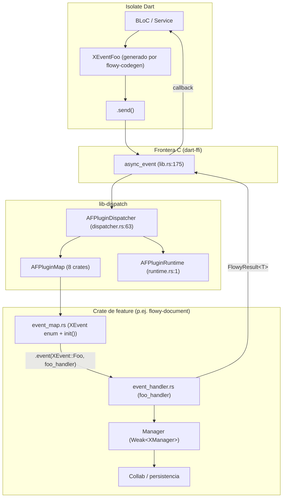
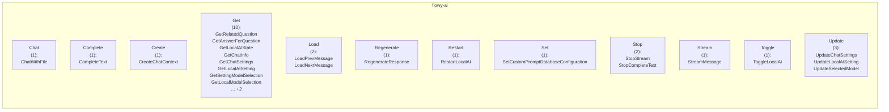

# 11 — Catálogo de eventos FFI (Dart ↔ Rust)

Este documento cataloga las **229 variantes de eventos FFI** registradas por AppFlowy en los `event_map.rs` de los 8 crates de feature (`flowy-user`, `flowy-folder`, `flowy-document`, `flowy-database2`, `flowy-ai`, `flowy-search`, `flowy-storage`, `flowy-date`). Cada variante se enumera como `#[event(input = "…", output = "…")]` sobre el enum `XEvent` (`Flowy_Event` + `ProtoBuf_Enum`) y se despacha en `lib-dispatch` hacia un handler Rust asíncrono que opera sobre el manager del crate. La fuente de datos es el catálogo determinista `OUT/_ledger/extract/events.json` (Fase A2.1, validador `validate-A2.1.sh` 11/11 OK). El catálogo es la base para los documentos B2.2 (entidades PB), B2.4 (notificaciones), B3.F01–F17 (handlers por feature) y el sub-documento `06-puente-flutter-rust/02-lib-dispatch.md`.

## 1. Cómo leer este catálogo

Cada fila de la tabla de un crate representa una variante del enum `XEvent` y aporta seis datos clave: `#` (índice en el enum), `Evento` (nombre de la variante), `Input PB` (entidad protobuf de entrada; `-` si no toma), `Output PB` (entidad protobuf de salida; `-` si no devuelve), `Handler` (función registrada en `AFPlugin::event(...)`; `—` si la variante está en el enum pero no fue asociada a un handler — los 5 casos se listan en §6), `Archivo handler` (`ruta:línea` resuelto contra `inventario.json`). La columna `Semántica` deriva en una línea qué dispara el evento a partir del nombre de la variante, los PB de entrada y salida, y el nombre del handler; va siempre etiquetada `[INFERIDO]` porque `extract_events.py` no captura `///` doc-comments del handler. Toda referencia `ruta:línea` apunta a archivos en `inventario.json` y se valida con `validate_evidence.py`.

## 2. Arquitectura del registro de eventos

El siguiente diagrama muestra cómo una llamada Dart (`XEventFoo().send()`) cruza la frontera FFI, llega al dispatcher, resuelve el `AFPlugin` del crate, localiza el handler, lo ejecuta en el `AFPluginRuntime` y devuelve un `FlowyResult<T, FlowyError>` al isolate de Dart.



Lectura: la flecha Dart → FFI cruza la frontera C ABI (`#[no_mangle] pub extern "C" fn async_event`); el dispatcher identifica el plugin por nombre, busca la variante en el mapa interno (`AFPluginEvent`), llama al handler dentro de `tokio::task::spawn_local` y devuelve un `AFPluginEventResponse` con `StatusCode::Ok` o `StatusCode::Err` + `ErrorCode`. El handler opera sobre un `Weak<XManager>` para no retener el ciclo de vida del manager.

## 3. Resumen por crate

Tabla de los 8 crates de feature con `event_map.rs` extraído. La columna `ruta:línea` apunta al sitio donde se declara el enum `XEvent` (`#[derive(Flowy_Event)]`); la columna `decl_line` es exactamente la primera línea del bloque.

| Crate | Enum | Variantes | Registradas | Sin handler | Declaración |
| --- | --- | --- | --- | --- | --- |
| `flowy-ai` | `AIEvent` | 25 | 25 | 0 | SRC/appflowy/frontend/rust-lib/flowy-ai/src/event_map.rs |
| `flowy-database2` | `DatabaseEvent` | 72 | 71 | 1 | SRC/appflowy/frontend/rust-lib/flowy-database2/src/event_map.rs |
| `flowy-date` | `DateEvent` | 1 | 1 | 0 | SRC/appflowy/frontend/rust-lib/flowy-date/src/event_map.rs |
| `flowy-document` | `DocumentEvent` | 21 | 21 | 0 | SRC/appflowy/frontend/rust-lib/flowy-document/src/event_map.rs |
| `flowy-folder` | `FolderEvent` | 51 | 48 | 3 | SRC/appflowy/frontend/rust-lib/flowy-folder/src/event_map.rs |
| `flowy-search` | `SearchEvent` | 1 | 1 | 0 | SRC/appflowy/frontend/rust-lib/flowy-search/src/event_map.rs |
| `flowy-storage` | `FileStorageEvent` | 2 | 2 | 0 | SRC/appflowy/frontend/rust-lib/flowy-storage/src/event_map.rs |
| `flowy-user` | `UserEvent` | 56 | 55 | 1 | SRC/appflowy/frontend/rust-lib/flowy-user/src/event_map.rs |

**Total**: 229 variantes, 224 registradas (`AFPlugin::event(...)`), 5 sin handler (§6). Fuente: `events.json::summary`.

## 4. Índice global de las 229 variantes

Tabla plana con las 229 variantes ordenadas por `(crate, índice)`. Cada fila es un evento que aparecerá también en §5.<crate> con el mismo número. El conteo de filas de §4 y de la suma de filas de §5.* debe ser exactamente 229 (prueba literal del ROADMAP).

| Crate | # | Evento | Input PB | Output PB | Handler | Semántica |
| --- | --- | --- | --- | --- | --- | --- |
| `flowy-ai` | 0 | `LoadPrevMessage` | `LoadPrevChatMessagePB` | `ChatMessageListPB` | `load_prev_message_handler` | Carga el recurso (LoadPrevChatMessagePB). `[INFERIDO]` |
| `flowy-ai` | 1 | `LoadNextMessage` | `LoadNextChatMessagePB` | `ChatMessageListPB` | `load_next_message_handler` | Carga el recurso (LoadNextChatMessagePB). `[INFERIDO]` |
| `flowy-ai` | 2 | `StreamMessage` | `StreamChatPayloadPB` | `ChatMessagePB` | `stream_chat_message_handler` | Inicia un stream (StreamChatPayloadPB). `[INFERIDO]` |
| `flowy-ai` | 3 | `StopStream` | `StopStreamPB` | — | `stop_stream_handler` | Detiene el stream (StopStreamPB). `[INFERIDO]` |
| `flowy-ai` | 4 | `GetRelatedQuestion` | `ChatMessageIdPB` | `RepeatedRelatedQuestionPB` | `get_related_question_handler` | Obtiene el recurso de la pregunta. `[INFERIDO]` |
| `flowy-ai` | 5 | `GetAnswerForQuestion` | `ChatMessageIdPB` | `ChatMessagePB` | `get_answer_handler` | Obtiene el recurso de la pregunta. `[INFERIDO]` |
| `flowy-ai` | 9 | `CompleteText` | `CompleteTextPB` | `CompleteTextTaskPB` | `start_complete_text_handler` | Completa el prompt (CompleteTextPB). `[INFERIDO]` |
| `flowy-ai` | 10 | `StopCompleteText` | `CompleteTextTaskPB` | — | `stop_complete_text_handler` | Procesa el recurso (CompleteTextTaskPB). `[INFERIDO]` |
| `flowy-ai` | 11 | `ChatWithFile` | `ChatFilePB` | — | `chat_file_handler` | Mensaje de chat del archivo. `[INFERIDO]` |
| `flowy-ai` | 17 | `RestartLocalAI` | — | — | `restart_local_ai_handler` | Procesa el recurso IA local. `[INFERIDO]` |
| `flowy-ai` | 18 | `ToggleLocalAI` | — | `LocalAIPB` | `toggle_local_ai_handler` | Alterna el estado IA local. `[INFERIDO]` |
| `flowy-ai` | 19 | `GetLocalAIState` | — | `LocalAIPB` | `get_local_ai_state_handler` | Obtiene el recurso IA local. `[INFERIDO]` |
| `flowy-ai` | 23 | `CreateChatContext` | `CreateChatContextPB` | — | `create_chat_context_handler` | Crea el lanzamiento del chat. `[INFERIDO]` |
| `flowy-ai` | 24 | `GetChatInfo` | `ChatId` | `ChatInfoPB` | `create_chat_context_handler` | Obtiene el recurso del chat. `[INFERIDO]` |
| `flowy-ai` | 25 | `GetChatSettings` | `ChatId` | `ChatSettingsPB` | `get_chat_settings_handler` | Obtiene el recurso del chat. `[INFERIDO]` |
| `flowy-ai` | 26 | `UpdateChatSettings` | `UpdateChatSettingsPB` | — | `update_chat_settings_handler` | Actualiza el recurso del chat. `[INFERIDO]` |
| `flowy-ai` | 27 | `RegenerateResponse` | `RegenerateResponsePB` | — | `regenerate_response_handler` | Procesa el recurso (RegenerateResponsePB). `[INFERIDO]` |
| `flowy-ai` | 29 | `GetLocalAISetting` | — | `LocalAISettingPB` | `get_local_ai_setting_handler` | Obtiene el recurso del ajuste. `[INFERIDO]` |
| `flowy-ai` | 30 | `UpdateLocalAISetting` | `LocalAISettingPB` | — | `update_local_ai_setting_handler` | Actualiza el recurso del ajuste. `[INFERIDO]` |
| `flowy-ai` | 31 | `GetSettingModelSelection` | `ModelSourcePB` | `ModelSelectionPB` | `get_setting_model_selection_handler` | Obtiene el recurso del ajuste. `[INFERIDO]` |
| `flowy-ai` | 32 | `UpdateSelectedModel` | `UpdateSelectedModelPB` | — | `update_selected_model_handler` | Actualiza el recurso del modelo. `[INFERIDO]` |
| `flowy-ai` | 33 | `GetLocalModelSelection` | — | `ModelSelectionPB` | `get_local_ai_models_handler` | Obtiene el recurso del modelo. `[INFERIDO]` |
| `flowy-ai` | 34 | `GetSourceModelSelection` | `ModelSourcePB` | `ModelSelectionPB` | `get_source_model_selection_handler` | Obtiene el recurso del modelo. `[INFERIDO]` |
| `flowy-ai` | 35 | `GetCustomPromptDatabaseConfiguration` | — | `CustomPromptDatabaseConfigurationPB` | `get_custom_prompt_database_configuration_handler` | Obtiene el recurso de la base de datos. `[INFERIDO]` |
| `flowy-ai` | 36 | `SetCustomPromptDatabaseConfiguration` | `CustomPromptDatabaseConfigurationPB` | — | `set_custom_prompt_database_configuration_handler` | Establece el recurso de la base de datos. `[INFERIDO]` |
| `flowy-database2` | 0 | `GetDatabase` | `DatabaseViewIdPB` | `DatabasePB` | `get_database_data_handler` | Obtiene el recurso de la base de datos. `[INFERIDO]` |
| `flowy-database2` | 1 | `GetDatabaseId` | `DatabaseViewIdPB` | `DatabaseIdPB` | `get_database_id_handler` | Obtiene el recurso de la base de datos. `[INFERIDO]` |
| `flowy-database2` | 2 | `GetDatabaseSetting` | `DatabaseViewIdPB` | `DatabaseViewSettingPB` | `get_database_setting_handler` | Obtiene el recurso de la base de datos. `[INFERIDO]` |
| `flowy-database2` | 3 | `UpdateDatabaseSetting` | `DatabaseSettingChangesetPB` | — | `update_database_setting_handler` | Actualiza el recurso de la base de datos. `[INFERIDO]` |
| `flowy-database2` | 4 | `GetAllFilters` | `DatabaseViewIdPB` | `RepeatedFilterPB` | `get_all_filters_handler` | Obtiene el recurso (DatabaseViewIdPB). `[INFERIDO]` |
| `flowy-database2` | 5 | `GetAllSorts` | `DatabaseViewIdPB` | `RepeatedSortPB` | `get_all_sorts_handler` | Obtiene el recurso (DatabaseViewIdPB). `[INFERIDO]` |
| `flowy-database2` | 6 | `DeleteAllSorts` | `DatabaseViewIdPB` | — | `delete_all_sorts_handler` | Elimina el recurso (DatabaseViewIdPB). `[INFERIDO]` |
| `flowy-database2` | 7 | `GetDatabaseData` | `DatabaseViewIdPB` | — | `get_database_data_handler` | Obtiene el recurso de la base de datos. `[INFERIDO]` |
| `flowy-database2` | 10 | `GetFields` | `GetFieldPayloadPB` | `RepeatedFieldPB` | `get_fields_handler` | Obtiene el recurso del campo. `[INFERIDO]` |
| `flowy-database2` | 11 | `UpdateField` | `FieldChangesetPB` | — | `update_field_handler` | Actualiza el recurso del campo. `[INFERIDO]` |
| `flowy-database2` | 12 | `UpdateFieldTypeOption` | `TypeOptionChangesetPB` | — | `update_field_type_option_handler` | Actualiza el recurso del campo. `[INFERIDO]` |
| `flowy-database2` | 14 | `DeleteField` | `DeleteFieldPayloadPB` | — | `delete_field_handler` | Elimina el recurso del campo. `[INFERIDO]` |
| `flowy-database2` | 15 | `ClearField` | `ClearFieldPayloadPB` | — | `clear_field_handler` | Limpia el recurso del campo. `[INFERIDO]` |
| `flowy-database2` | 20 | `UpdateFieldType` | `UpdateFieldTypePayloadPB` | — | `switch_to_field_handler` | Actualiza el recurso del campo. `[INFERIDO]` |
| `flowy-database2` | 21 | `DuplicateField` | `DuplicateFieldPayloadPB` | — | `duplicate_field_handler` | Duplica el recurso del campo. `[INFERIDO]` |
| `flowy-database2` | 22 | `MoveField` | `MoveFieldPayloadPB` | — | `move_field_handler` | Mueve el recurso del campo. `[INFERIDO]` |
| `flowy-database2` | 24 | `CreateField` | `CreateFieldPayloadPB` | `FieldPB` | `create_field_handler` | Crea el lanzamiento del campo. `[INFERIDO]` |
| `flowy-database2` | 25 | `GetPrimaryField` | `DatabaseViewIdPB` | `FieldPB` | `get_primary_field_handler` | Obtiene el recurso del campo. `[INFERIDO]` |
| `flowy-database2` | 30 | `CreateSelectOption` | `CreateSelectOptionPayloadPB` | `SelectOptionPB` | `new_select_option_handler` | Crea el lanzamiento (CreateSelectOptionPayloadPB). `[INFERIDO]` |
| `flowy-database2` | 31 | `InsertOrUpdateSelectOption` | `RepeatedSelectOptionPayload` | — | `insert_or_update_select_option_handler` | Inserta el recurso de la fecha. `[INFERIDO]` |
| `flowy-database2` | 32 | `DeleteSelectOption` | `RepeatedSelectOptionPayload` | — | `delete_select_option_handler` | Elimina el recurso (RepeatedSelectOptionPayload). `[INFERIDO]` |
| `flowy-database2` | 50 | `CreateRow` | `CreateRowPayloadPB` | `RowMetaPB` | `create_row_handler` | Crea el lanzamiento de la fila. `[INFERIDO]` |
| `flowy-database2` | 51 | `GetRow` | `DatabaseViewRowIdPB` | `OptionalRowPB` | `get_row_handler` | Obtiene el recurso de la fila. `[INFERIDO]` |
| `flowy-database2` | 52 | `DeleteRows` | `RepeatedRowIdPB` | — | `delete_rows_handler` | Elimina el recurso de la fila. `[INFERIDO]` |
| `flowy-database2` | 53 | `DuplicateRow` | `DatabaseViewRowIdPB` | — | `duplicate_row_handler` | Duplica el recurso de la fila. `[INFERIDO]` |
| `flowy-database2` | 54 | `MoveRow` | `MoveRowPayloadPB` | — | `move_row_handler` | Mueve el recurso de la fila. `[INFERIDO]` |
| `flowy-database2` | 55 | `GetRowMeta` | `DatabaseViewRowIdPB` | `RowMetaPB` | `get_row_meta_handler` | Obtiene el recurso de la fila. `[INFERIDO]` |
| `flowy-database2` | 56 | `UpdateRowMeta` | `UpdateRowMetaChangesetPB` | — | `update_row_meta_handler` | Actualiza el recurso de la fila. `[INFERIDO]` |
| `flowy-database2` | 57 | `RemoveCover` | `RemoveCoverPayloadPB` | — | `remove_cover_handler` | Elimina el recurso (RemoveCoverPayloadPB). `[INFERIDO]` |
| `flowy-database2` | 70 | `GetCell` | `CellIdPB` | `CellPB` | `get_cell_handler` | Obtiene el recurso de la celda. `[INFERIDO]` |
| `flowy-database2` | 71 | `UpdateCell` | `CellChangesetPB` | — | `update_cell_handler` | Actualiza el recurso de la celda. `[INFERIDO]` |
| `flowy-database2` | 72 | `UpdateSelectOptionCell` | `SelectOptionCellChangesetPB` | — | `update_select_option_cell_handler` | Actualiza el recurso de la celda. `[INFERIDO]` |
| `flowy-database2` | 73 | `UpdateChecklistCell` | `ChecklistCellDataChangesetPB` | — | `update_checklist_cell_handler` | Actualiza el recurso de la celda. `[INFERIDO]` |
| `flowy-database2` | 80 | `UpdateDateCell` | `DateCellChangesetPB` | — | `update_date_cell_handler` | Actualiza el recurso de la celda. `[INFERIDO]` |
| `flowy-database2` | 90 | `SetGroupByField` | `GroupByFieldPayloadPB` | — | `set_group_by_field_handler` | Establece el recurso del campo. `[INFERIDO]` |
| `flowy-database2` | 100 | `GetGroups` | `DatabaseViewIdPB` | `RepeatedGroupPB` | `get_groups_handler` | Obtiene el recurso (DatabaseViewIdPB). `[INFERIDO]` |
| `flowy-database2` | 101 | `GetGroup` | `DatabaseGroupIdPB` | `GroupPB` | `get_group_handler` | Obtiene el recurso (DatabaseGroupIdPB). `[INFERIDO]` |
| `flowy-database2` | 111 | `MoveGroup` | `MoveGroupPayloadPB` | — | `move_group_handler` | Mueve el recurso (MoveGroupPayloadPB). `[INFERIDO]` |
| `flowy-database2` | 112 | `MoveGroupRow` | `MoveGroupRowPayloadPB` | — | `move_group_row_handler` | Mueve el recurso de la fila. `[INFERIDO]` |
| `flowy-database2` | 113 | `UpdateGroup` | `UpdateGroupPB` | — | `update_group_handler` | Actualiza el recurso (UpdateGroupPB). `[INFERIDO]` |
| `flowy-database2` | 114 | `CreateGroup` | `CreateGroupPayloadPB` | — | `create_group_handler` | Crea el lanzamiento (CreateGroupPayloadPB). `[INFERIDO]` |
| `flowy-database2` | 115 | `DeleteGroup` | `DeleteGroupPayloadPB` | — | `delete_group_handler` | Elimina el recurso (DeleteGroupPayloadPB). `[INFERIDO]` |
| `flowy-database2` | 119 | `GetDefaultDatabaseViewId` | `DatabaseIdPB` | `DatabaseViewIdPB` | `get_default_database_view_id_handler` | Obtiene el recurso de la vista. `[INFERIDO]` |
| `flowy-database2` | 120 | `GetDatabases` | — | `RepeatedDatabaseDescriptionPB` | `get_databases_handler` | Obtiene el recurso de la base de datos. `[INFERIDO]` |
| `flowy-database2` | 121 | `SetLayoutSetting` | `LayoutSettingChangesetPB` | — | `set_layout_setting_handler` | Establece el recurso del ajuste. `[INFERIDO]` |
| `flowy-database2` | 122 | `GetLayoutSetting` | `DatabaseLayoutMetaPB` | `DatabaseLayoutSettingPB` | `get_layout_setting_handler` | Obtiene el recurso del ajuste. `[INFERIDO]` |
| `flowy-database2` | 123 | `GetAllCalendarEvents` | `CalendarEventRequestPB` | `RepeatedCalendarEventPB` | `get_calendar_events_handler` | Obtiene el recurso (CalendarEventRequestPB). `[INFERIDO]` |
| `flowy-database2` | 124 | `GetNoDateCalendarEvents` | `CalendarEventRequestPB` | `RepeatedNoDateCalendarEventPB` | `get_no_date_calendar_events_handler` | Obtiene el recurso de la fecha. `[INFERIDO]` |
| `flowy-database2` | 125 | `GetCalendarEvent` | `DatabaseViewRowIdPB` | `CalendarEventPB` | `get_calendar_event_handler` | Obtiene el recurso (DatabaseViewRowIdPB). `[INFERIDO]` |
| `flowy-database2` | 126 | `MoveCalendarEvent` | `MoveCalendarEventPB` | — | `move_calendar_event_handler` | Mueve el recurso (MoveCalendarEventPB). `[INFERIDO]` |
| `flowy-database2` | 130 | `CreateDatabaseView` | `CreateDatabaseViewPayloadPB` | — | `create_database_view` | Crea el lanzamiento de la vista. `[INFERIDO]` |
| `flowy-database2` | 141 | `ExportCSV` | `DatabaseViewIdPB` | `DatabaseExportDataPB` | `export_csv_handler` | Exporta el recurso (DatabaseViewIdPB). `[INFERIDO]` |
| `flowy-database2` | 150 | `GetDatabaseSnapshots` | `DatabaseViewIdPB` | `RepeatedDatabaseSnapshotPB` | `get_snapshots_handler` | Obtiene el recurso de la base de datos. `[INFERIDO]` |
| `flowy-database2` | 160 | `GetFieldSettings` | `FieldIdsPB` | `RepeatedFieldSettingsPB` | `get_field_settings_handler` | Obtiene el recurso del campo. `[INFERIDO]` |
| `flowy-database2` | 161 | `GetAllFieldSettings` | `DatabaseViewIdPB` | `RepeatedFieldSettingsPB` | `get_all_field_settings_handler` | Obtiene el recurso del campo. `[INFERIDO]` |
| `flowy-database2` | 162 | `UpdateFieldSettings` | `FieldSettingsChangesetPB` | — | `update_field_settings_handler` | Actualiza el recurso del campo. `[INFERIDO]` |
| `flowy-database2` | 163 | `GetAllCalculations` | `DatabaseViewIdPB` | `RepeatedCalculationsPB` | `get_all_calculations_handler` | Obtiene el recurso (DatabaseViewIdPB). `[INFERIDO]` |
| `flowy-database2` | 164 | `UpdateCalculation` | `UpdateCalculationChangesetPB` | — | `update_calculation_handler` | Actualiza el recurso (UpdateCalculationChangesetPB). `[INFERIDO]` |
| `flowy-database2` | 165 | `RemoveCalculation` | `RemoveCalculationChangesetPB` | — | `remove_calculation_handler` | Elimina el recurso (RemoveCalculationChangesetPB). `[INFERIDO]` |
| `flowy-database2` | 170 | `GetRelatedDatabaseIds` | `DatabaseViewIdPB` | `RepeatedDatabaseIdPB` | `get_related_database_ids_handler` | Obtiene el recurso de la base de datos. `[INFERIDO]` |
| `flowy-database2` | 171 | `UpdateRelationCell` | `RelationCellChangesetPB` | — | `update_relation_cell_handler` | Actualiza el recurso de la celda. `[INFERIDO]` |
| `flowy-database2` | 172 | `GetRelatedRowDatas` | `GetRelatedRowDataPB` | `RepeatedRelatedRowDataPB` | `get_related_row_datas_handler` | Obtiene el recurso de la fila. `[INFERIDO]` |
| `flowy-database2` | 173 | `GetRelatedDatabaseRows` | `DatabaseIdPB` | `RepeatedRelatedRowDataPB` | `get_related_database_rows_handler` | Obtiene el recurso de la base de datos. `[INFERIDO]` |
| `flowy-database2` | 174 | `SummarizeRow` | `SummaryRowPB` | — | `summarize_row_handler` | Resume el recurso de la fila. `[INFERIDO]` |
| `flowy-database2` | 175 | `TranslateRow` | `TranslateRowPB` | — | `translate_row_handler` | Procesa el recurso de la fila. `[INFERIDO]` |
| `flowy-database2` | 176 | `InitRow` | `DatabaseViewRowIdPB` | — | `init_row_handler` | Procesa el recurso de la fila. `[INFERIDO]` |
| `flowy-database2` | 177 | `GetAllRows` | `DatabaseViewIdPB` | `RepeatedRowMetaPB` | — | Obtiene el recurso de la fila. `[INFERIDO]` |
| `flowy-database2` | 178 | `ExportRawDatabaseData` | `DatabaseViewIdPB` | `DatabaseExportDataPB` | `export_raw_database_data_handler` | Exporta el recurso de la base de datos. `[INFERIDO]` |
| `flowy-database2` | 200 | `UpdateMediaCell` | `MediaCellChangesetPB` | — | `update_media_cell_handler` | Actualiza el recurso de la celda. `[INFERIDO]` |
| `flowy-database2` | 201 | `RenameMediaFile` | `RenameMediaChangesetPB` | — | `rename_media_cell_file_handler` | Renombra el recurso del archivo. `[INFERIDO]` |
| `flowy-database2` | 500 | `GetDatabaseCustomPrompts` | `CustomPromptDatabaseConfigPB` | `RepeatedCustomPromptPB` | `get_database_custom_prompts_handler` | Obtiene el recurso de la base de datos. `[INFERIDO]` |
| `flowy-database2` | 501 | `TestCustomPromptDatabaseConfiguration` | `DatabaseViewIdPB` | `CustomPromptDatabaseConfigPB` | `test_custom_prompt_database_configuration_handler` | Procesa el recurso de la base de datos. `[INFERIDO]` |
| `flowy-date` | 0 | `QueryDate` | `DateQueryPB` | `DateResultPB` | `query_date_handler` | Procesa el recurso de la fecha. `[INFERIDO]` |
| `flowy-document` | 0 | `CreateDocument` | `CreateDocumentPayloadPB` | — | `create_document_handler` | Crea el lanzamiento del documento. `[INFERIDO]` |
| `flowy-document` | 1 | `OpenDocument` | `OpenDocumentPayloadPB` | `DocumentDataPB` | `open_document_handler` | Abre el recurso del documento. `[INFERIDO]` |
| `flowy-document` | 2 | `CloseDocument` | `CloseDocumentPayloadPB` | — | `close_document_handler` | Cierra el recurso del documento. `[INFERIDO]` |
| `flowy-document` | 3 | `ApplyAction` | `ApplyActionPayloadPB` | — | `apply_action_handler` | Procesa el recurso (ApplyActionPayloadPB). `[INFERIDO]` |
| `flowy-document` | 4 | `GetDocumentData` | `OpenDocumentPayloadPB` | `DocumentDataPB` | `get_document_data_handler` | Obtiene el recurso del documento. `[INFERIDO]` |
| `flowy-document` | 5 | `ConvertDataToDocument` | `ConvertDataPayloadPB` | `DocumentDataPB` | `convert_data_to_document` | Procesa el recurso del documento. `[INFERIDO]` |
| `flowy-document` | 6 | `Redo` | `DocumentRedoUndoPayloadPB` | `DocumentRedoUndoResponsePB` | `redo_handler` | Procesa el recurso (DocumentRedoUndoPayloadPB). `[INFERIDO]` |
| `flowy-document` | 7 | `Undo` | `DocumentRedoUndoPayloadPB` | `DocumentRedoUndoResponsePB` | `undo_handler` | Procesa el recurso (DocumentRedoUndoPayloadPB). `[INFERIDO]` |
| `flowy-document` | 8 | `CanUndoRedo` | `DocumentRedoUndoPayloadPB` | `DocumentRedoUndoResponsePB` | `can_undo_redo_handler` | Procesa el recurso (DocumentRedoUndoPayloadPB). `[INFERIDO]` |
| `flowy-document` | 9 | `GetDocumentSnapshotMeta` | `OpenDocumentPayloadPB` | `RepeatedDocumentSnapshotMetaPB` | `get_snapshot_meta_handler` | Obtiene el recurso del documento. `[INFERIDO]` |
| `flowy-document` | 10 | `CreateText` | `TextDeltaPayloadPB` | — | `create_text_handler` | Crea el lanzamiento (TextDeltaPayloadPB). `[INFERIDO]` |
| `flowy-document` | 11 | `ApplyTextDeltaEvent` | `TextDeltaPayloadPB` | — | `apply_text_delta_handler` | Procesa el recurso (TextDeltaPayloadPB). `[INFERIDO]` |
| `flowy-document` | 12 | `ConvertDocument` | `ConvertDocumentPayloadPB` | `ConvertDocumentResponsePB` | `convert_document_handler` | Procesa el recurso del documento. `[INFERIDO]` |
| `flowy-document` | 13 | `ConvertDataToJSON` | `ConvertDataToJsonPayloadPB` | `ConvertDataToJsonResponsePB` | `convert_data_to_json_handler` | Procesa el recurso (ConvertDataToJsonPayloadPB). `[INFERIDO]` |
| `flowy-document` | 14 | `GetDocumentSnapshot` | `DocumentSnapshotMetaPB` | `DocumentSnapshotPB` | `get_snapshot_data_handler` | Obtiene el recurso del documento. `[INFERIDO]` |
| `flowy-document` | 15 | `UploadFile` | `UploadFileParamsPB` | `UploadedFilePB` | `upload_file_handler` | Sube el archivo del archivo. `[INFERIDO]` |
| `flowy-document` | 16 | `DownloadFile` | `DownloadFilePB` | — | `download_file_handler` | Descarga el archivo del archivo. `[INFERIDO]` |
| `flowy-document` | 17 | `DeleteFile` | `DeleteFilePB` | — | `delete_file_handler` | Elimina el recurso del archivo. `[INFERIDO]` |
| `flowy-document` | 18 | `SetAwarenessState` | `UpdateDocumentAwarenessStatePB` | — | `set_awareness_local_state_handler` | Establece el recurso (UpdateDocumentAwarenessStatePB). `[INFERIDO]` |
| `flowy-document` | 19 | `GetDocEncodedCollab` | `OpenDocumentPayloadPB` | `EncodedCollabPB` | `get_encode_collab_handler` | Obtiene el recurso del documento. `[INFERIDO]` |
| `flowy-document` | 20 | `GetDocumentText` | `OpenDocumentPayloadPB` | `DocumentTextPB` | `get_document_text_handler` | Obtiene el recurso del documento. `[INFERIDO]` |
| `flowy-folder` | 0 | `CreateFolderWorkspace` | — | — | — | Crea el lanzamiento del folder. `[INFERIDO]` |
| `flowy-folder` | 1 | `GetCurrentWorkspaceSetting` | — | `WorkspaceLatestPB` | `read_current_workspace_setting_handler` | Obtiene el recurso del workspace. `[INFERIDO]` |
| `flowy-folder` | 2 | `ReadCurrentWorkspace` | — | `WorkspacePB` | `read_current_workspace_handler` | Lee el estado actual del workspace. `[INFERIDO]` |
| `flowy-folder` | 3 | `DeleteWorkspace` | `WorkspaceIdPB` | — | — | Elimina el recurso del workspace. `[INFERIDO]` |
| `flowy-folder` | 5 | `ReadWorkspaceViews` | `GetWorkspaceViewPB` | `RepeatedViewPB` | `get_workspace_views_handler` | Lee el estado actual del workspace. `[INFERIDO]` |
| `flowy-folder` | 10 | `CreateView` | `CreateViewPayloadPB` | `ViewPB` | `create_view_handler` | Crea el lanzamiento de la vista. `[INFERIDO]` |
| `flowy-folder` | 11 | `GetView` | `ViewIdPB` | `ViewPB` | `get_view_handler` | Obtiene el recurso de la vista. `[INFERIDO]` |
| `flowy-folder` | 12 | `UpdateView` | `UpdateViewPayloadPB` | `ViewPB` | `update_view_handler` | Actualiza el recurso de la vista. `[INFERIDO]` |
| `flowy-folder` | 13 | `DeleteView` | `RepeatedViewIdPB` | — | `delete_view_handler` | Elimina el recurso de la vista. `[INFERIDO]` |
| `flowy-folder` | 14 | `DuplicateView` | `DuplicateViewPayloadPB` | `ViewPB` | `duplicate_view_handler` | Duplica el recurso de la vista. `[INFERIDO]` |
| `flowy-folder` | 15 | `CloseView` | `ViewIdPB` | — | `close_view_handler` | Cierra el recurso de la vista. `[INFERIDO]` |
| `flowy-folder` | 16 | `CreateOrphanView` | `CreateOrphanViewPayloadPB` | `ViewPB` | `create_orphan_view_handler` | Crea el lanzamiento de la vista. `[INFERIDO]` |
| `flowy-folder` | 17 | `GetAllViews` | — | `RepeatedViewPB` | `get_all_views_handler` | Obtiene el recurso de la vista. `[INFERIDO]` |
| `flowy-folder` | 20 | `CopyLink` | — | — | — | Procesa el recurso. `[INFERIDO]` |
| `flowy-folder` | 21 | `SetLatestView` | `ViewIdPB` | — | `set_latest_view_handler` | Establece el recurso de la vista. `[INFERIDO]` |
| `flowy-folder` | 22 | `MoveView` | `MoveViewPayloadPB` | — | `move_view_handler` | Mueve el recurso de la vista. `[INFERIDO]` |
| `flowy-folder` | 23 | `ListTrashItems` | — | `RepeatedTrashPB` | `read_trash_handler` | Lista los recursos de la papelera. `[INFERIDO]` |
| `flowy-folder` | 24 | `RestoreTrashItem` | `TrashIdPB` | — | `putback_trash_handler` | Restaura del de la papelera. `[INFERIDO]` |
| `flowy-folder` | 25 | `PermanentlyDeleteTrashItem` | `RepeatedTrashIdPB` | — | `delete_trash_handler` | Procesa el recurso de la papelera. `[INFERIDO]` |
| `flowy-folder` | 26 | `RecoverAllTrashItems` | — | — | `restore_all_trash_handler` | Procesa el recurso de la papelera. `[INFERIDO]` |
| `flowy-folder` | 27 | `PermanentlyDeleteAllTrashItem` | — | — | `delete_my_trash_handler` | Procesa el recurso de la papelera. `[INFERIDO]` |
| `flowy-folder` | 30 | `ImportData` | `ImportPayloadPB` | `RepeatedViewPB` | `import_data_handler` | Importa el recurso (ImportPayloadPB). `[INFERIDO]` |
| `flowy-folder` | 31 | `GetFolderSnapshots` | `WorkspaceIdPB` | `RepeatedFolderSnapshotPB` | `get_folder_snapshots_handler` | Obtiene el recurso del folder. `[INFERIDO]` |
| `flowy-folder` | 32 | `MoveNestedView` | `MoveNestedViewPayloadPB` | — | `move_nested_view_handler` | Mueve el recurso de la vista. `[INFERIDO]` |
| `flowy-folder` | 33 | `ReadFavorites` | — | `RepeatedFavoriteViewPB` | `read_favorites_handler` | Lee el estado actual del favorito. `[INFERIDO]` |
| `flowy-folder` | 34 | `ToggleFavorite` | `RepeatedViewIdPB` | — | `toggle_favorites_handler` | Alterna el estado del favorito. `[INFERIDO]` |
| `flowy-folder` | 35 | `UpdateViewIcon` | `UpdateViewIconPayloadPB` | — | `update_view_icon_handler` | Actualiza el recurso de la vista. `[INFERIDO]` |
| `flowy-folder` | 36 | `ReadRecentViews` | `ReadRecentViewsPB` | `RepeatedRecentViewPB` | `read_recent_views_handler` | Lee el estado actual de la vista. `[INFERIDO]` |
| `flowy-folder` | 37 | `UpdateRecentViews` | `UpdateRecentViewPayloadPB` | — | `update_recent_views_handler` | Actualiza el recurso de la vista. `[INFERIDO]` |
| `flowy-folder` | 39 | `ReadPrivateViews` | `GetWorkspaceViewPB` | `RepeatedViewPB` | `read_private_views_handler` | Lee el estado actual de la vista. `[INFERIDO]` |
| `flowy-folder` | 40 | `ReadCurrentWorkspaceViews` | — | `RepeatedViewPB` | `get_current_workspace_views_handler` | Lee el estado actual del workspace. `[INFERIDO]` |
| `flowy-folder` | 41 | `UpdateViewVisibilityStatus` | `UpdateViewVisibilityStatusPayloadPB` | — | `update_view_visibility_status_handler` | Actualiza el recurso de la vista. `[INFERIDO]` |
| `flowy-folder` | 42 | `GetViewAncestors` | `ViewIdPB` | `RepeatedViewPB` | `get_view_ancestors_handler` | Obtiene el recurso de la vista. `[INFERIDO]` |
| `flowy-folder` | 43 | `PublishView` | `PublishViewParamsPB` | — | `publish_view_handler` | Publica el recurso de la vista. `[INFERIDO]` |
| `flowy-folder` | 44 | `GetPublishInfo` | `ViewIdPB` | `PublishInfoResponsePB` | `get_publish_info_handler` | Obtiene el recurso (ViewIdPB). `[INFERIDO]` |
| `flowy-folder` | 45 | `GetPublishNamespace` | — | `PublishNamespacePB` | `get_publish_namespace_handler` | Obtiene el recurso. `[INFERIDO]` |
| `flowy-folder` | 46 | `SetPublishNamespace` | `SetPublishNamespacePayloadPB` | — | `set_publish_namespace_handler` | Establece el recurso (SetPublishNamespacePayloadPB). `[INFERIDO]` |
| `flowy-folder` | 47 | `UnpublishViews` | `UnpublishViewsPayloadPB` | — | `unpublish_views_handler` | Retira la publicación de la vista. `[INFERIDO]` |
| `flowy-folder` | 48 | `ImportZipFile` | `ImportZipPB` | — | `import_zip_file_handler` | Importa el recurso del archivo. `[INFERIDO]` |
| `flowy-folder` | 49 | `ListPublishedViews` | — | `RepeatedPublishInfoViewPB` | `list_published_views_handler` | Lista los recursos de la vista. `[INFERIDO]` |
| `flowy-folder` | 50 | `GetDefaultPublishInfo` | — | `PublishInfoResponsePB` | `get_default_publish_info_handler` | Obtiene el recurso. `[INFERIDO]` |
| `flowy-folder` | 51 | `SetDefaultPublishView` | `ViewIdPB` | — | `set_default_publish_view_handler` | Establece el recurso de la vista. `[INFERIDO]` |
| `flowy-folder` | 52 | `SetPublishName` | `SetPublishNamePB` | — | `set_publish_name_handler` | Establece el recurso (SetPublishNamePB). `[INFERIDO]` |
| `flowy-folder` | 53 | `RemoveDefaultPublishView` | — | — | `remove_default_publish_view_handler` | Elimina el recurso de la vista. `[INFERIDO]` |
| `flowy-folder` | 54 | `LockView` | `ViewIdPB` | — | `lock_view_handler` | Procesa el recurso de la vista. `[INFERIDO]` |
| `flowy-folder` | 55 | `UnlockView` | `ViewIdPB` | — | `unlock_view_handler` | Procesa el recurso de la vista. `[INFERIDO]` |
| `flowy-folder` | 56 | `SharePageWithUser` | `SharePageWithUserPayloadPB` | — | `share_page_with_user_handler` | Comparte el recurso del usuario. `[INFERIDO]` |
| `flowy-folder` | 57 | `RemoveUserFromSharedPage` | `RemoveUserFromSharedPagePayloadPB` | — | `remove_user_from_shared_page_handler` | Elimina el recurso del usuario. `[INFERIDO]` |
| `flowy-folder` | 58 | `GetSharedUsers` | `GetSharedUsersPayloadPB` | `RepeatedSharedUserPB` | `get_shared_users_handler` | Obtiene el recurso del usuario. `[INFERIDO]` |
| `flowy-folder` | 59 | `GetSharedViews` | — | `RepeatedSharedViewResponsePB` | `get_shared_views_handler` | Obtiene el recurso de la vista. `[INFERIDO]` |
| `flowy-folder` | 60 | `GetSharedViewSection` | `ViewIdPB` | `GetSharedViewSectionResponsePB` | `get_shared_view_section_handler` | Obtiene el recurso de la vista. `[INFERIDO]` |
| `flowy-search` | 0 | `StreamSearch` | `SearchQueryPB` | — | `stream_search_handler` | Inicia un stream de búsqueda. `[INFERIDO]` |
| `flowy-storage` | 0 | `RegisterStream` | `RegisterStreamPB` | — | `register_stream_handler` | Procesa el recurso (RegisterStreamPB). `[INFERIDO]` |
| `flowy-storage` | 1 | `QueryFile` | `QueryFilePB` | `FileStatePB` | `query_file_handler` | Procesa el recurso del archivo. `[INFERIDO]` |
| `flowy-user` | 0 | `SignInWithEmailPassword` | `SignInPayloadPB` | `GotrueTokenResponsePB` | `sign_in_with_email_password_handler` | Firma la acción (SignInPayloadPB). `[INFERIDO]` |
| `flowy-user` | 1 | `SignUp` | `SignUpPayloadPB` | `UserProfilePB` | `sign_up` | Firma la acción (SignUpPayloadPB). `[INFERIDO]` |
| `flowy-user` | 2 | `SignOut` | — | — | `sign_out_handler` | Firma la acción. `[INFERIDO]` |
| `flowy-user` | 3 | `UpdateUserProfile` | `UpdateUserProfilePayloadPB` | — | `update_user_profile_handler` | Actualiza el recurso del usuario. `[INFERIDO]` |
| `flowy-user` | 4 | `GetUserProfile` | — | `UserProfilePB` | `get_user_profile_handler` | Obtiene el recurso del usuario. `[INFERIDO]` |
| `flowy-user` | 6 | `InitUser` | — | — | `init_user_handler` | Procesa el recurso del usuario. `[INFERIDO]` |
| `flowy-user` | 7 | `SetAppearanceSetting` | `AppearanceSettingsPB` | — | `set_appearance_setting` | Establece el recurso del ajuste. `[INFERIDO]` |
| `flowy-user` | 8 | `GetAppearanceSetting` | — | `AppearanceSettingsPB` | `get_appearance_setting` | Obtiene el recurso del ajuste. `[INFERIDO]` |
| `flowy-user` | 9 | `GetUserSetting` | — | `UserSettingPB` | `get_user_setting` | Obtiene el recurso del usuario. `[INFERIDO]` |
| `flowy-user` | 10 | `OauthSignIn` | `OauthSignInPB` | `UserProfilePB` | `oauth_sign_in_handler` | Procesa el recurso de autenticación. `[INFERIDO]` |
| `flowy-user` | 11 | `GenerateSignInURL` | `SignInUrlPayloadPB` | `SignInUrlPB` | `gen_sign_in_url_handler` | Genera el recurso (SignInUrlPayloadPB). `[INFERIDO]` |
| `flowy-user` | 12 | `GetOauthURLWithProvider` | `OauthProviderPB` | `OauthProviderDataPB` | `sign_in_with_provider_handler` | Obtiene el recurso de autenticación. `[INFERIDO]` |
| `flowy-user` | 13 | `SetCloudConfig` | `UpdateCloudConfigPB` | — | `set_cloud_config_handler` | Establece el recurso (UpdateCloudConfigPB). `[INFERIDO]` |
| `flowy-user` | 14 | `GetCloudConfig` | — | `CloudSettingPB` | `get_cloud_config_handler` | Obtiene el recurso. `[INFERIDO]` |
| `flowy-user` | 17 | `GetAllWorkspace` | — | `RepeatedUserWorkspacePB` | `get_all_workspace_handler` | Obtiene el recurso del workspace. `[INFERIDO]` |
| `flowy-user` | 21 | `OpenWorkspace` | `OpenUserWorkspacePB` | — | `open_workspace_handler` | Abre el recurso del workspace. `[INFERIDO]` |
| `flowy-user` | 22 | `GetUserWorkspace` | `UserWorkspaceIdPB` | `UserWorkspacePB` | `get_user_workspace_handler` | Obtiene el recurso del workspace. `[INFERIDO]` |
| `flowy-user` | 24 | `UpdateNetworkState` | `NetworkStatePB` | — | `update_network_state_handler` | Actualiza el recurso (NetworkStatePB). `[INFERIDO]` |
| `flowy-user` | 25 | `GetAnonUser` | — | `UserProfilePB` | `get_anon_user_handler` | Obtiene el recurso del usuario. `[INFERIDO]` |
| `flowy-user` | 26 | `OpenAnonUser` | — | — | `open_anon_user_handler` | Abre el recurso del usuario. `[INFERIDO]` |
| `flowy-user` | 27 | `PushRealtimeEvent` | `RealtimePayloadPB` | — | `push_realtime_event_handler` | Procesa el recurso (RealtimePayloadPB). `[INFERIDO]` |
| `flowy-user` | 28 | `CreateReminder` | `ReminderPB` | — | `create_reminder_event_handler` | Crea el lanzamiento del recordatorio. `[INFERIDO]` |
| `flowy-user` | 29 | `GetAllReminders` | — | `RepeatedReminderPB` | `get_all_reminder_event_handler` | Obtiene el recurso del recordatorio. `[INFERIDO]` |
| `flowy-user` | 30 | `RemoveReminder` | `ReminderIdentifierPB` | — | `remove_reminder_event_handler` | Elimina el recurso del recordatorio. `[INFERIDO]` |
| `flowy-user` | 31 | `UpdateReminder` | `ReminderPB` | — | `update_reminder_event_handler` | Actualiza el recurso del recordatorio. `[INFERIDO]` |
| `flowy-user` | 33 | `SetDateTimeSettings` | `DateTimeSettingsPB` | — | `set_date_time_settings` | Establece el recurso del ajuste. `[INFERIDO]` |
| `flowy-user` | 34 | `GetDateTimeSettings` | — | `DateTimeSettingsPB` | `get_date_time_settings` | Obtiene el recurso del ajuste. `[INFERIDO]` |
| `flowy-user` | 35 | `SetNotificationSettings` | `NotificationSettingsPB` | — | `set_notification_settings` | Establece el recurso de notificación. `[INFERIDO]` |
| `flowy-user` | 36 | `GetNotificationSettings` | — | `NotificationSettingsPB` | `get_notification_settings` | Obtiene el recurso de notificación. `[INFERIDO]` |
| `flowy-user` | 37 | `AddWorkspaceMember` | `AddWorkspaceMemberPB` | — | — | Añade el recurso del workspace. `[INFERIDO]` |
| `flowy-user` | 38 | `RemoveWorkspaceMember` | `RemoveWorkspaceMemberPB` | — | `delete_workspace_member_handler` | Elimina el recurso del workspace. `[INFERIDO]` |
| `flowy-user` | 39 | `UpdateWorkspaceMember` | `UpdateWorkspaceMemberPB` | — | `update_workspace_member_handler` | Actualiza el recurso del workspace. `[INFERIDO]` |
| `flowy-user` | 40 | `GetWorkspaceMembers` | `QueryWorkspacePB` | `RepeatedWorkspaceMemberPB` | `get_workspace_members_handler` | Obtiene el recurso del workspace. `[INFERIDO]` |
| `flowy-user` | 41 | `ImportAppFlowyDataFolder` | `ImportAppFlowyDataPB` | — | `import_appflowy_data_folder_handler` | Importa el recurso del folder. `[INFERIDO]` |
| `flowy-user` | 42 | `CreateWorkspace` | `CreateWorkspacePB` | `UserWorkspacePB` | `create_workspace_handler` | Crea el lanzamiento del workspace. `[INFERIDO]` |
| `flowy-user` | 43 | `DeleteWorkspace` | `UserWorkspaceIdPB` | — | `delete_workspace_handler` | Elimina el recurso del workspace. `[INFERIDO]` |
| `flowy-user` | 44 | `RenameWorkspace` | `RenameWorkspacePB` | — | `rename_workspace_handler` | Renombra el recurso del workspace. `[INFERIDO]` |
| `flowy-user` | 45 | `ChangeWorkspaceIcon` | `ChangeWorkspaceIconPB` | — | `change_workspace_icon_handler` | Procesa el recurso del workspace. `[INFERIDO]` |
| `flowy-user` | 46 | `LeaveWorkspace` | `UserWorkspaceIdPB` | — | `leave_workspace_handler` | Abandona el recurso del workspace. `[INFERIDO]` |
| `flowy-user` | 47 | `InviteWorkspaceMember` | `WorkspaceMemberInvitationPB` | — | `invite_workspace_member_handler` | Invita al recurso del workspace. `[INFERIDO]` |
| `flowy-user` | 48 | `ListWorkspaceInvitations` | — | `RepeatedWorkspaceInvitationPB` | `list_workspace_invitations_handler` | Lista los recursos del workspace. `[INFERIDO]` |
| `flowy-user` | 49 | `AcceptWorkspaceInvitation` | `AcceptWorkspaceInvitationPB` | — | `accept_workspace_invitations_handler` | Procesa el recurso del workspace. `[INFERIDO]` |
| `flowy-user` | 50 | `MagicLinkSignIn` | `MagicLinkSignInPB` | `UserProfilePB` | `sign_in_with_magic_link_handler` | Procesa el recurso (MagicLinkSignInPB). `[INFERIDO]` |
| `flowy-user` | 51 | `SubscribeWorkspace` | `SubscribeWorkspacePB` | `PaymentLinkPB` | `subscribe_workspace_handler` | Suscribe al canal del workspace. `[INFERIDO]` |
| `flowy-user` | 53 | `CancelWorkspaceSubscription` | `CancelWorkspaceSubscriptionPB` | — | `cancel_workspace_subscription_handler` | Cancela la operación del workspace. `[INFERIDO]` |
| `flowy-user` | 54 | `GetWorkspaceUsage` | `UserWorkspaceIdPB` | `WorkspaceUsagePB` | `get_workspace_usage_handler` | Obtiene el recurso del workspace. `[INFERIDO]` |
| `flowy-user` | 55 | `GetBillingPortal` | — | `BillingPortalPB` | `get_billing_portal_handler` | Obtiene el recurso. `[INFERIDO]` |
| `flowy-user` | 56 | `GetMemberInfo` | `WorkspaceMemberIdPB` | `WorkspaceMemberPB` | `get_workspace_member_info` | Obtiene el recurso (WorkspaceMemberIdPB). `[INFERIDO]` |
| `flowy-user` | 57 | `UpdateWorkspaceSetting` | `UpdateUserWorkspaceSettingPB` | — | `update_workspace_setting_handler` | Actualiza el recurso del workspace. `[INFERIDO]` |
| `flowy-user` | 58 | `GetWorkspaceSetting` | `UserWorkspaceIdPB` | `WorkspaceSettingsPB` | `get_workspace_setting_handler` | Obtiene el recurso del workspace. `[INFERIDO]` |
| `flowy-user` | 59 | `GetWorkspaceSubscriptionInfo` | `UserWorkspaceIdPB` | `WorkspaceSubscriptionInfoPB` | `get_workspace_subscription_info_handler` | Obtiene el recurso del workspace. `[INFERIDO]` |
| `flowy-user` | 61 | `UpdateWorkspaceSubscriptionPaymentPeriod` | `UpdateWorkspaceSubscriptionPaymentPeriodPB` | — | `update_workspace_subscription_payment_period_handler` | Actualiza el recurso del workspace. `[INFERIDO]` |
| `flowy-user` | 62 | `GetSubscriptionPlanDetails` | — | `RepeatedSubscriptionPlanDetailPB` | `get_subscription_plan_details_handler` | Obtiene el recurso. `[INFERIDO]` |
| `flowy-user` | 63 | `NotifyDidSwitchPlan` | `SuccessWorkspaceSubscriptionPB` | — | `notify_did_switch_plan_handler` | Procesa el recurso (SuccessWorkspaceSubscriptionPB). `[INFERIDO]` |
| `flowy-user` | 64 | `DeleteAccount` | — | — | `delete_account_handler` | Elimina el recurso. `[INFERIDO]` |
| `flowy-user` | 65 | `PasscodeSignIn` | `PasscodeSignInPB` | `GotrueTokenResponsePB` | `sign_in_with_passcode_handler` | Procesa el recurso (PasscodeSignInPB). `[INFERIDO]` |

## 5. Catálogo por crate

Cada sub-sección desarrolla un crate. Las tablas siguen el mismo esquema que §4 pero incluyen el archivo del handler. Cuando un crate supera las 20 variantes, se acompaña de un `flowchart` que muestra los grupos de eventos (CRUD sobre documentos, sobre filas, etc.).

### 5.1 `flowy-ai`

**25** variantes · **25** registradas · **0** sin handler.



| # | Evento | Input PB | Output PB | Handler | Archivo handler | Semántica |
| --- | --- | --- | --- | --- | --- | --- |
| 0 | `LoadPrevMessage` | `LoadPrevChatMessagePB` | `ChatMessageListPB` | `load_prev_message_handler` | `appflowy:frontend/rust-lib/flowy-ai/src/event_handler.rs:117` | Carga el recurso (LoadPrevChatMessagePB). `[INFERIDO]` |
| 1 | `LoadNextMessage` | `LoadNextChatMessagePB` | `ChatMessageListPB` | `load_next_message_handler` | `appflowy:frontend/rust-lib/flowy-ai/src/event_handler.rs:133` | Carga el recurso (LoadNextChatMessagePB). `[INFERIDO]` |
| 2 | `StreamMessage` | `StreamChatPayloadPB` | `ChatMessagePB` | `stream_chat_message_handler` | `appflowy:frontend/rust-lib/flowy-ai/src/event_handler.rs:22` | Inicia un stream (StreamChatPayloadPB). `[INFERIDO]` |
| 3 | `StopStream` | `StopStreamPB` | — | `stop_stream_handler` | `appflowy:frontend/rust-lib/flowy-ai/src/event_handler.rs:177` | Detiene el stream (StopStreamPB). `[INFERIDO]` |
| 4 | `GetRelatedQuestion` | `ChatMessageIdPB` | `RepeatedRelatedQuestionPB` | `get_related_question_handler` | `appflowy:frontend/rust-lib/flowy-ai/src/event_handler.rs:149` | Obtiene el recurso de la pregunta. `[INFERIDO]` |
| 5 | `GetAnswerForQuestion` | `ChatMessageIdPB` | `ChatMessagePB` | `get_answer_handler` | `appflowy:frontend/rust-lib/flowy-ai/src/event_handler.rs:163` | Obtiene el recurso de la pregunta. `[INFERIDO]` |
| 9 | `CompleteText` | `CompleteTextPB` | `CompleteTextTaskPB` | `start_complete_text_handler` | `appflowy:frontend/rust-lib/flowy-ai/src/event_handler.rs:189` | Completa el prompt (CompleteTextPB). `[INFERIDO]` |
| 10 | `StopCompleteText` | `CompleteTextTaskPB` | — | `stop_complete_text_handler` | `appflowy:frontend/rust-lib/flowy-ai/src/event_handler.rs:203` | Procesa el recurso (CompleteTextTaskPB). `[INFERIDO]` |
| 11 | `ChatWithFile` | `ChatFilePB` | — | `chat_file_handler` | `appflowy:frontend/rust-lib/flowy-ai/src/event_handler.rs:213` | Mensaje de chat del archivo. `[INFERIDO]` |
| 17 | `RestartLocalAI` | — | — | `restart_local_ai_handler` | `appflowy:frontend/rust-lib/flowy-ai/src/event_handler.rs:262` | Procesa el recurso IA local. `[INFERIDO]` |
| 18 | `ToggleLocalAI` | — | `LocalAIPB` | `toggle_local_ai_handler` | `appflowy:frontend/rust-lib/flowy-ai/src/event_handler.rs:271` | Alterna el estado IA local. `[INFERIDO]` |
| 19 | `GetLocalAIState` | — | `LocalAIPB` | `get_local_ai_state_handler` | `appflowy:frontend/rust-lib/flowy-ai/src/event_handler.rs:281` | Obtiene el recurso IA local. `[INFERIDO]` |
| 23 | `CreateChatContext` | `CreateChatContextPB` | — | `create_chat_context_handler` | `appflowy:frontend/rust-lib/flowy-ai/src/event_handler.rs:290` | Crea el lanzamiento del chat. `[INFERIDO]` |
| 24 | `GetChatInfo` | `ChatId` | `ChatInfoPB` | `create_chat_context_handler` | `appflowy:frontend/rust-lib/flowy-ai/src/event_handler.rs:290` | Obtiene el recurso del chat. `[INFERIDO]` |
| 25 | `GetChatSettings` | `ChatId` | `ChatSettingsPB` | `get_chat_settings_handler` | `appflowy:frontend/rust-lib/flowy-ai/src/event_handler.rs:311` | Obtiene el recurso del chat. `[INFERIDO]` |
| 26 | `UpdateChatSettings` | `UpdateChatSettingsPB` | — | `update_chat_settings_handler` | `appflowy:frontend/rust-lib/flowy-ai/src/event_handler.rs:326` | Actualiza el recurso del chat. `[INFERIDO]` |
| 27 | `RegenerateResponse` | `RegenerateResponsePB` | — | `regenerate_response_handler` | `appflowy:frontend/rust-lib/flowy-ai/src/event_handler.rs:61` | Procesa el recurso (RegenerateResponsePB). `[INFERIDO]` |
| 29 | `GetLocalAISetting` | — | `LocalAISettingPB` | `get_local_ai_setting_handler` | `appflowy:frontend/rust-lib/flowy-ai/src/event_handler.rs:339` | Obtiene el recurso del ajuste. `[INFERIDO]` |
| 30 | `UpdateLocalAISetting` | `LocalAISettingPB` | — | `update_local_ai_setting_handler` | `appflowy:frontend/rust-lib/flowy-ai/src/event_handler.rs:358` | Actualiza el recurso del ajuste. `[INFERIDO]` |
| 31 | `GetSettingModelSelection` | `ModelSourcePB` | `ModelSelectionPB` | `get_setting_model_selection_handler` | `appflowy:frontend/rust-lib/flowy-ai/src/event_handler.rs:82` | Obtiene el recurso del ajuste. `[INFERIDO]` |
| 32 | `UpdateSelectedModel` | `UpdateSelectedModelPB` | — | `update_selected_model_handler` | `appflowy:frontend/rust-lib/flowy-ai/src/event_handler.rs:104` | Actualiza el recurso del modelo. `[INFERIDO]` |
| 33 | `GetLocalModelSelection` | — | `ModelSelectionPB` | `get_local_ai_models_handler` | `appflowy:frontend/rust-lib/flowy-ai/src/event_handler.rs:349` | Obtiene el recurso del modelo. `[INFERIDO]` |
| 34 | `GetSourceModelSelection` | `ModelSourcePB` | `ModelSelectionPB` | `get_source_model_selection_handler` | `appflowy:frontend/rust-lib/flowy-ai/src/event_handler.rs:93` | Obtiene el recurso del modelo. `[INFERIDO]` |
| 35 | `GetCustomPromptDatabaseConfiguration` | — | `CustomPromptDatabaseConfigurationPB` | `get_custom_prompt_database_configuration_handler` | `appflowy:frontend/rust-lib/flowy-ai/src/event_handler.rs:369` | Obtiene el recurso de la base de datos. `[INFERIDO]` |
| 36 | `SetCustomPromptDatabaseConfiguration` | `CustomPromptDatabaseConfigurationPB` | — | `set_custom_prompt_database_configuration_handler` | `appflowy:frontend/rust-lib/flowy-ai/src/event_handler.rs:387` | Establece el recurso de la base de datos. `[INFERIDO]` |

### 5.2 `flowy-database2`

**72** variantes · **71** registradas · **1** sin handler.

```mermaid
flowchart LR
  subgraph Cflowy_database2["flowy-database2"]
    flowy_database2_Clear["Clear<br/>(1):<br/>ClearField"]
    flowy_database2_Create["Create<br/>(5):<br/>CreateField<br/>CreateSelectOption<br/>CreateRow<br/>CreateGroup<br/>CreateDatabaseView"]
    flowy_database2_Delete["Delete<br/>(5):<br/>DeleteAllSorts<br/>DeleteField<br/>DeleteSelectOption<br/>DeleteRows<br/>DeleteGroup"]
    flowy_database2_Duplicate["Duplicate<br/>(2):<br/>DuplicateField<br/>DuplicateRow"]
    flowy_database2_Export["Export<br/>(2):<br/>ExportCSV<br/>ExportRawDatabaseData"]
    flowy_database2_Get["Get<br/>(28):<br/>GetDatabase<br/>GetDatabaseId<br/>GetDatabaseSetting<br/>GetAllFilters<br/>GetAllSorts<br/>GetDatabaseData<br/>GetFields<br/>GetPrimaryField<br/>… +20"]
    flowy_database2_Init["Init<br/>(1):<br/>InitRow"]
    flowy_database2_Insert["Insert<br/>(1):<br/>InsertOrUpdateSelectOption"]
    flowy_database2_Move["Move<br/>(5):<br/>MoveField<br/>MoveRow<br/>MoveGroup<br/>MoveGroupRow<br/>MoveCalendarEvent"]
    flowy_database2_Remove["Remove<br/>(2):<br/>RemoveCover<br/>RemoveCalculation"]
    flowy_database2_Rename["Rename<br/>(1):<br/>RenameMediaFile"]
    flowy_database2_Set["Set<br/>(2):<br/>SetGroupByField<br/>SetLayoutSetting"]
    flowy_database2_Summarize["Summarize<br/>(1):<br/>SummarizeRow"]
    flowy_database2_Test["Test<br/>(1):<br/>TestCustomPromptDatabaseConfiguration"]
    flowy_database2_Translate["Translate<br/>(1):<br/>TranslateRow"]
    flowy_database2_Update["Update<br/>(14):<br/>UpdateDatabaseSetting<br/>UpdateField<br/>UpdateFieldTypeOption<br/>UpdateFieldType<br/>UpdateRowMeta<br/>UpdateCell<br/>UpdateSelectOptionCell<br/>UpdateChecklistCell<br/>… +6"]
  end
```



| # | Evento | Input PB | Output PB | Handler | Archivo handler | Semántica |
| --- | --- | --- | --- | --- | --- | --- |
| 0 | `GetDatabase` | `DatabaseViewIdPB` | `DatabasePB` | `get_database_data_handler` | `appflowy:frontend/rust-lib/flowy-database2/src/event_handler.rs:31` | Obtiene el recurso de la base de datos. `[INFERIDO]` |
| 1 | `GetDatabaseId` | `DatabaseViewIdPB` | `DatabaseIdPB` | `get_database_id_handler` | `appflowy:frontend/rust-lib/flowy-database2/src/event_handler.rs:89` | Obtiene el recurso de la base de datos. `[INFERIDO]` |
| 2 | `GetDatabaseSetting` | `DatabaseViewIdPB` | `DatabaseViewSettingPB` | `get_database_setting_handler` | `appflowy:frontend/rust-lib/flowy-database2/src/event_handler.rs:102` | Obtiene el recurso de la base de datos. `[INFERIDO]` |
| 3 | `UpdateDatabaseSetting` | `DatabaseSettingChangesetPB` | — | `update_database_setting_handler` | `appflowy:frontend/rust-lib/flowy-database2/src/event_handler.rs:118` | Actualiza el recurso de la base de datos. `[INFERIDO]` |
| 4 | `GetAllFilters` | `DatabaseViewIdPB` | `RepeatedFilterPB` | `get_all_filters_handler` | `appflowy:frontend/rust-lib/flowy-database2/src/event_handler.rs:173` | Obtiene el recurso (DatabaseViewIdPB). `[INFERIDO]` |
| 5 | `GetAllSorts` | `DatabaseViewIdPB` | `RepeatedSortPB` | `get_all_sorts_handler` | `appflowy:frontend/rust-lib/flowy-database2/src/event_handler.rs:187` | Obtiene el recurso (DatabaseViewIdPB). `[INFERIDO]` |
| 6 | `DeleteAllSorts` | `DatabaseViewIdPB` | — | `delete_all_sorts_handler` | `appflowy:frontend/rust-lib/flowy-database2/src/event_handler.rs:201` | Elimina el recurso (DatabaseViewIdPB). `[INFERIDO]` |
| 7 | `GetDatabaseData` | `DatabaseViewIdPB` | — | `get_database_data_handler` | `appflowy:frontend/rust-lib/flowy-database2/src/event_handler.rs:31` | Obtiene el recurso de la base de datos. `[INFERIDO]` |
| 10 | `GetFields` | `GetFieldPayloadPB` | `RepeatedFieldPB` | `get_fields_handler` | `appflowy:frontend/rust-lib/flowy-database2/src/event_handler.rs:215` | Obtiene el recurso del campo. `[INFERIDO]` |
| 11 | `UpdateField` | `FieldChangesetPB` | — | `update_field_handler` | `appflowy:frontend/rust-lib/flowy-database2/src/event_handler.rs:265` | Actualiza el recurso del campo. `[INFERIDO]` |
| 12 | `UpdateFieldTypeOption` | `TypeOptionChangesetPB` | — | `update_field_type_option_handler` | `appflowy:frontend/rust-lib/flowy-database2/src/event_handler.rs:279` | Actualiza el recurso del campo. `[INFERIDO]` |
| 14 | `DeleteField` | `DeleteFieldPayloadPB` | — | `delete_field_handler` | `appflowy:frontend/rust-lib/flowy-database2/src/event_handler.rs:299` | Elimina el recurso del campo. `[INFERIDO]` |
| 15 | `ClearField` | `ClearFieldPayloadPB` | — | `clear_field_handler` | `appflowy:frontend/rust-lib/flowy-database2/src/event_handler.rs:313` | Limpia el recurso del campo. `[INFERIDO]` |
| 20 | `UpdateFieldType` | `UpdateFieldTypePayloadPB` | — | `switch_to_field_handler` | `appflowy:frontend/rust-lib/flowy-database2/src/event_handler.rs:329` | Actualiza el recurso del campo. `[INFERIDO]` |
| 21 | `DuplicateField` | `DuplicateFieldPayloadPB` | — | `duplicate_field_handler` | `appflowy:frontend/rust-lib/flowy-database2/src/event_handler.rs:351` | Duplica el recurso del campo. `[INFERIDO]` |
| 22 | `MoveField` | `MoveFieldPayloadPB` | — | `move_field_handler` | `appflowy:frontend/rust-lib/flowy-database2/src/event_handler.rs:385` | Mueve el recurso del campo. `[INFERIDO]` |
| 24 | `CreateField` | `CreateFieldPayloadPB` | `FieldPB` | `create_field_handler` | `appflowy:frontend/rust-lib/flowy-database2/src/event_handler.rs:368` | Crea el lanzamiento del campo. `[INFERIDO]` |
| 25 | `GetPrimaryField` | `DatabaseViewIdPB` | `FieldPB` | `get_primary_field_handler` | `appflowy:frontend/rust-lib/flowy-database2/src/event_handler.rs:235` | Obtiene el recurso del campo. `[INFERIDO]` |
| 30 | `CreateSelectOption` | `CreateSelectOptionPayloadPB` | `SelectOptionPB` | `new_select_option_handler` | `appflowy:frontend/rust-lib/flowy-database2/src/event_handler.rs:594` | Crea el lanzamiento (CreateSelectOptionPayloadPB). `[INFERIDO]` |
| 31 | `InsertOrUpdateSelectOption` | `RepeatedSelectOptionPayload` | — | `insert_or_update_select_option_handler` | `appflowy:frontend/rust-lib/flowy-database2/src/event_handler.rs:616` | Inserta el recurso de la fecha. `[INFERIDO]` |
| 32 | `DeleteSelectOption` | `RepeatedSelectOptionPayload` | — | `delete_select_option_handler` | `appflowy:frontend/rust-lib/flowy-database2/src/event_handler.rs:637` | Elimina el recurso (RepeatedSelectOptionPayload). `[INFERIDO]` |
| 50 | `CreateRow` | `CreateRowPayloadPB` | `RowMetaPB` | `create_row_handler` | `appflowy:frontend/rust-lib/flowy-database2/src/event_handler.rs:539` | Crea el lanzamiento de la fila. `[INFERIDO]` |
| 51 | `GetRow` | `DatabaseViewRowIdPB` | `OptionalRowPB` | `get_row_handler` | `appflowy:frontend/rust-lib/flowy-database2/src/event_handler.rs:399` | Obtiene el recurso de la fila. `[INFERIDO]` |
| 52 | `DeleteRows` | `RepeatedRowIdPB` | — | `delete_rows_handler` | `appflowy:frontend/rust-lib/flowy-database2/src/event_handler.rs:463` | Elimina el recurso de la fila. `[INFERIDO]` |
| 53 | `DuplicateRow` | `DatabaseViewRowIdPB` | — | `duplicate_row_handler` | `appflowy:frontend/rust-lib/flowy-database2/src/event_handler.rs:482` | Duplica el recurso de la fila. `[INFERIDO]` |
| 54 | `MoveRow` | `MoveRowPayloadPB` | — | `move_row_handler` | `appflowy:frontend/rust-lib/flowy-database2/src/event_handler.rs:498` | Mueve el recurso de la fila. `[INFERIDO]` |
| 55 | `GetRowMeta` | `DatabaseViewRowIdPB` | `RowMetaPB` | `get_row_meta_handler` | `appflowy:frontend/rust-lib/flowy-database2/src/event_handler.rs:427` | Obtiene el recurso de la fila. `[INFERIDO]` |
| 56 | `UpdateRowMeta` | `UpdateRowMetaChangesetPB` | — | `update_row_meta_handler` | `appflowy:frontend/rust-lib/flowy-database2/src/event_handler.rs:445` | Actualiza el recurso de la fila. `[INFERIDO]` |
| 57 | `RemoveCover` | `RemoveCoverPayloadPB` | — | `remove_cover_handler` | `appflowy:frontend/rust-lib/flowy-database2/src/event_handler.rs:514` | Elimina el recurso (RemoveCoverPayloadPB). `[INFERIDO]` |
| 70 | `GetCell` | `CellIdPB` | `CellPB` | `get_cell_handler` | `appflowy:frontend/rust-lib/flowy-database2/src/event_handler.rs:556` | Obtiene el recurso de la celda. `[INFERIDO]` |
| 71 | `UpdateCell` | `CellChangesetPB` | — | `update_cell_handler` | `appflowy:frontend/rust-lib/flowy-database2/src/event_handler.rs:573` | Actualiza el recurso de la celda. `[INFERIDO]` |
| 72 | `UpdateSelectOptionCell` | `SelectOptionCellChangesetPB` | — | `update_select_option_cell_handler` | `appflowy:frontend/rust-lib/flowy-database2/src/event_handler.rs:658` | Actualiza el recurso de la celda. `[INFERIDO]` |
| 73 | `UpdateChecklistCell` | `ChecklistCellDataChangesetPB` | — | `update_checklist_cell_handler` | `appflowy:frontend/rust-lib/flowy-database2/src/event_handler.rs:683` | Actualiza el recurso de la celda. `[INFERIDO]` |
| 80 | `UpdateDateCell` | `DateCellChangesetPB` | — | `update_date_cell_handler` | `appflowy:frontend/rust-lib/flowy-database2/src/event_handler.rs:707` | Actualiza el recurso de la celda. `[INFERIDO]` |
| 90 | `SetGroupByField` | `GroupByFieldPayloadPB` | — | `set_group_by_field_handler` | `appflowy:frontend/rust-lib/flowy-database2/src/event_handler.rs:768` | Establece el recurso del campo. `[INFERIDO]` |
| 100 | `GetGroups` | `DatabaseViewIdPB` | `RepeatedGroupPB` | `get_groups_handler` | `appflowy:frontend/rust-lib/flowy-database2/src/event_handler.rs:738` | Obtiene el recurso (DatabaseViewIdPB). `[INFERIDO]` |
| 101 | `GetGroup` | `DatabaseGroupIdPB` | `GroupPB` | `get_group_handler` | `appflowy:frontend/rust-lib/flowy-database2/src/event_handler.rs:752` | Obtiene el recurso (DatabaseGroupIdPB). `[INFERIDO]` |
| 111 | `MoveGroup` | `MoveGroupPayloadPB` | — | `move_group_handler` | `appflowy:frontend/rust-lib/flowy-database2/src/event_handler.rs:800` | Mueve el recurso (MoveGroupPayloadPB). `[INFERIDO]` |
| 112 | `MoveGroupRow` | `MoveGroupRowPayloadPB` | — | `move_group_row_handler` | `appflowy:frontend/rust-lib/flowy-database2/src/event_handler.rs:816` | Mueve el recurso de la fila. `[INFERIDO]` |
| 113 | `UpdateGroup` | `UpdateGroupPB` | — | `update_group_handler` | `appflowy:frontend/rust-lib/flowy-database2/src/event_handler.rs:784` | Actualiza el recurso (UpdateGroupPB). `[INFERIDO]` |
| 114 | `CreateGroup` | `CreateGroupPayloadPB` | — | `create_group_handler` | `appflowy:frontend/rust-lib/flowy-database2/src/event_handler.rs:838` | Crea el lanzamiento (CreateGroupPayloadPB). `[INFERIDO]` |
| 115 | `DeleteGroup` | `DeleteGroupPayloadPB` | — | `delete_group_handler` | `appflowy:frontend/rust-lib/flowy-database2/src/event_handler.rs:854` | Elimina el recurso (DeleteGroupPayloadPB). `[INFERIDO]` |
| 119 | `GetDefaultDatabaseViewId` | `DatabaseIdPB` | `DatabaseViewIdPB` | `get_default_database_view_id_handler` | `appflowy:frontend/rust-lib/flowy-database2/src/event_handler.rs:868` | Obtiene el recurso de la vista. `[INFERIDO]` |
| 120 | `GetDatabases` | — | `RepeatedDatabaseDescriptionPB` | `get_databases_handler` | `appflowy:frontend/rust-lib/flowy-database2/src/event_handler.rs:892` | Obtiene el recurso de la base de datos. `[INFERIDO]` |
| 121 | `SetLayoutSetting` | `LayoutSettingChangesetPB` | — | `set_layout_setting_handler` | `appflowy:frontend/rust-lib/flowy-database2/src/event_handler.rs:913` | Establece el recurso del ajuste. `[INFERIDO]` |
| 122 | `GetLayoutSetting` | `DatabaseLayoutMetaPB` | `DatabaseLayoutSettingPB` | `get_layout_setting_handler` | `appflowy:frontend/rust-lib/flowy-database2/src/event_handler.rs:925` | Obtiene el recurso del ajuste. `[INFERIDO]` |
| 123 | `GetAllCalendarEvents` | `CalendarEventRequestPB` | `RepeatedCalendarEventPB` | `get_calendar_events_handler` | `appflowy:frontend/rust-lib/flowy-database2/src/event_handler.rs:943` | Obtiene el recurso (CalendarEventRequestPB). `[INFERIDO]` |
| 124 | `GetNoDateCalendarEvents` | `CalendarEventRequestPB` | `RepeatedNoDateCalendarEventPB` | `get_no_date_calendar_events_handler` | `appflowy:frontend/rust-lib/flowy-database2/src/event_handler.rs:959` | Obtiene el recurso de la fecha. `[INFERIDO]` |
| 125 | `GetCalendarEvent` | `DatabaseViewRowIdPB` | `CalendarEventPB` | `get_calendar_event_handler` | `appflowy:frontend/rust-lib/flowy-database2/src/event_handler.rs:975` | Obtiene el recurso (DatabaseViewRowIdPB). `[INFERIDO]` |
| 126 | `MoveCalendarEvent` | `MoveCalendarEventPB` | — | `move_calendar_event_handler` | `appflowy:frontend/rust-lib/flowy-database2/src/event_handler.rs:994` | Mueve el recurso (MoveCalendarEventPB). `[INFERIDO]` |
| 130 | `CreateDatabaseView` | `CreateDatabaseViewPayloadPB` | — | `create_database_view` | `appflowy:frontend/rust-lib/flowy-database2/src/event_handler.rs:1020` | Crea el lanzamiento de la vista. `[INFERIDO]` |
| 141 | `ExportCSV` | `DatabaseViewIdPB` | `DatabaseExportDataPB` | `export_csv_handler` | `appflowy:frontend/rust-lib/flowy-database2/src/event_handler.rs:1029` | Exporta el recurso (DatabaseViewIdPB). `[INFERIDO]` |
| 150 | `GetDatabaseSnapshots` | `DatabaseViewIdPB` | `RepeatedDatabaseSnapshotPB` | `get_snapshots_handler` | `appflowy:frontend/rust-lib/flowy-database2/src/event_handler.rs:1058` | Obtiene el recurso de la base de datos. `[INFERIDO]` |
| 160 | `GetFieldSettings` | `FieldIdsPB` | `RepeatedFieldSettingsPB` | `get_field_settings_handler` | `appflowy:frontend/rust-lib/flowy-database2/src/event_handler.rs:1069` | Obtiene el recurso del campo. `[INFERIDO]` |
| 161 | `GetAllFieldSettings` | `DatabaseViewIdPB` | `RepeatedFieldSettingsPB` | `get_all_field_settings_handler` | `appflowy:frontend/rust-lib/flowy-database2/src/event_handler.rs:1090` | Obtiene el recurso del campo. `[INFERIDO]` |
| 162 | `UpdateFieldSettings` | `FieldSettingsChangesetPB` | — | `update_field_settings_handler` | `appflowy:frontend/rust-lib/flowy-database2/src/event_handler.rs:1113` | Actualiza el recurso del campo. `[INFERIDO]` |
| 163 | `GetAllCalculations` | `DatabaseViewIdPB` | `RepeatedCalculationsPB` | `get_all_calculations_handler` | `appflowy:frontend/rust-lib/flowy-database2/src/event_handler.rs:1129` | Obtiene el recurso (DatabaseViewIdPB). `[INFERIDO]` |
| 164 | `UpdateCalculation` | `UpdateCalculationChangesetPB` | — | `update_calculation_handler` | `appflowy:frontend/rust-lib/flowy-database2/src/event_handler.rs:1144` | Actualiza el recurso (UpdateCalculationChangesetPB). `[INFERIDO]` |
| 165 | `RemoveCalculation` | `RemoveCalculationChangesetPB` | — | `remove_calculation_handler` | `appflowy:frontend/rust-lib/flowy-database2/src/event_handler.rs:1160` | Elimina el recurso (RemoveCalculationChangesetPB). `[INFERIDO]` |
| 170 | `GetRelatedDatabaseIds` | `DatabaseViewIdPB` | `RepeatedDatabaseIdPB` | `get_related_database_ids_handler` | `appflowy:frontend/rust-lib/flowy-database2/src/event_handler.rs:1174` | Obtiene el recurso de la base de datos. `[INFERIDO]` |
| 171 | `UpdateRelationCell` | `RelationCellChangesetPB` | — | `update_relation_cell_handler` | `appflowy:frontend/rust-lib/flowy-database2/src/event_handler.rs:1183` | Actualiza el recurso de la celda. `[INFERIDO]` |
| 172 | `GetRelatedRowDatas` | `GetRelatedRowDataPB` | `RepeatedRelatedRowDataPB` | `get_related_row_datas_handler` | `appflowy:frontend/rust-lib/flowy-database2/src/event_handler.rs:1228` | Obtiene el recurso de la fila. `[INFERIDO]` |
| 173 | `GetRelatedDatabaseRows` | `DatabaseIdPB` | `RepeatedRelatedRowDataPB` | `get_related_database_rows_handler` | `appflowy:frontend/rust-lib/flowy-database2/src/event_handler.rs:1246` | Obtiene el recurso de la base de datos. `[INFERIDO]` |
| 174 | `SummarizeRow` | `SummaryRowPB` | — | `summarize_row_handler` | `appflowy:frontend/rust-lib/flowy-database2/src/event_handler.rs:1261` | Resume el recurso de la fila. `[INFERIDO]` |
| 175 | `TranslateRow` | `TranslateRowPB` | — | `translate_row_handler` | `appflowy:frontend/rust-lib/flowy-database2/src/event_handler.rs:1280` | Procesa el recurso de la fila. `[INFERIDO]` |
| 176 | `InitRow` | `DatabaseViewRowIdPB` | — | `init_row_handler` | `appflowy:frontend/rust-lib/flowy-database2/src/event_handler.rs:414` | Procesa el recurso de la fila. `[INFERIDO]` |
| 177 | `GetAllRows` | `DatabaseViewIdPB` | `RepeatedRowMetaPB` | — | — | Obtiene el recurso de la fila. `[INFERIDO]` |
| 178 | `ExportRawDatabaseData` | `DatabaseViewIdPB` | `DatabaseExportDataPB` | `export_raw_database_data_handler` | `appflowy:frontend/rust-lib/flowy-database2/src/event_handler.rs:1044` | Exporta el recurso de la base de datos. `[INFERIDO]` |
| 200 | `UpdateMediaCell` | `MediaCellChangesetPB` | — | `update_media_cell_handler` | `appflowy:frontend/rust-lib/flowy-database2/src/event_handler.rs:1301` | Actualiza el recurso de la celda. `[INFERIDO]` |
| 201 | `RenameMediaFile` | `RenameMediaChangesetPB` | — | `rename_media_cell_file_handler` | `appflowy:frontend/rust-lib/flowy-database2/src/event_handler.rs:1341` | Renombra el recurso del archivo. `[INFERIDO]` |
| 500 | `GetDatabaseCustomPrompts` | `CustomPromptDatabaseConfigPB` | `RepeatedCustomPromptPB` | `get_database_custom_prompts_handler` | `appflowy:frontend/rust-lib/flowy-database2/src/event_handler.rs:1418` | Obtiene el recurso de la base de datos. `[INFERIDO]` |
| 501 | `TestCustomPromptDatabaseConfiguration` | `DatabaseViewIdPB` | `CustomPromptDatabaseConfigPB` | `test_custom_prompt_database_configuration_handler` | `appflowy:frontend/rust-lib/flowy-database2/src/event_handler.rs:1435` | Procesa el recurso de la base de datos. `[INFERIDO]` |

### 5.3 `flowy-date`

**1** variantes · **1** registradas · **0** sin handler.

| # | Evento | Input PB | Output PB | Handler | Archivo handler | Semántica |
| --- | --- | --- | --- | --- | --- | --- |
| 0 | `QueryDate` | `DateQueryPB` | `DateResultPB` | `query_date_handler` | `appflowy:frontend/rust-lib/flowy-date/src/event_handler.rs:17` | Procesa el recurso de la fecha. `[INFERIDO]` |

### 5.4 `flowy-document`

**21** variantes · **21** registradas · **0** sin handler.

```mermaid
flowchart LR
  subgraph Cflowy_document["flowy-document"]
    flowy_document_Apply["Apply<br/>(2):<br/>ApplyAction<br/>ApplyTextDeltaEvent"]
    flowy_document_Can["Can<br/>(1):<br/>CanUndoRedo"]
    flowy_document_Close["Close<br/>(1):<br/>CloseDocument"]
    flowy_document_Convert["Convert<br/>(3):<br/>ConvertDataToDocument<br/>ConvertDocument<br/>ConvertDataToJSON"]
    flowy_document_Create["Create<br/>(2):<br/>CreateDocument<br/>CreateText"]
    flowy_document_Delete["Delete<br/>(1):<br/>DeleteFile"]
    flowy_document_Download["Download<br/>(1):<br/>DownloadFile"]
    flowy_document_Get["Get<br/>(5):<br/>GetDocumentData<br/>GetDocumentSnapshotMeta<br/>GetDocumentSnapshot<br/>GetDocEncodedCollab<br/>GetDocumentText"]
    flowy_document_Open["Open<br/>(1):<br/>OpenDocument"]
    flowy_document_Redo["Redo<br/>(1):<br/>Redo"]
    flowy_document_Set["Set<br/>(1):<br/>SetAwarenessState"]
    flowy_document_Undo["Undo<br/>(1):<br/>Undo"]
    flowy_document_Upload["Upload<br/>(1):<br/>UploadFile"]
  end
```



| # | Evento | Input PB | Output PB | Handler | Archivo handler | Semántica |
| --- | --- | --- | --- | --- | --- | --- |
| 0 | `CreateDocument` | `CreateDocumentPayloadPB` | — | `create_document_handler` | `appflowy:frontend/rust-lib/flowy-document/src/event_handler.rs:54` | Crea el lanzamiento del documento. `[INFERIDO]` |
| 1 | `OpenDocument` | `OpenDocumentPayloadPB` | `DocumentDataPB` | `open_document_handler` | `appflowy:frontend/rust-lib/flowy-document/src/event_handler.rs:69` | Abre el recurso del documento. `[INFERIDO]` |
| 2 | `CloseDocument` | `CloseDocumentPayloadPB` | — | `close_document_handler` | `appflowy:frontend/rust-lib/flowy-document/src/event_handler.rs:82` | Cierra el recurso del documento. `[INFERIDO]` |
| 3 | `ApplyAction` | `ApplyActionPayloadPB` | — | `apply_action_handler` | `appflowy:frontend/rust-lib/flowy-document/src/event_handler.rs:119` | Procesa el recurso (ApplyActionPayloadPB). `[INFERIDO]` |
| 4 | `GetDocumentData` | `OpenDocumentPayloadPB` | `DocumentDataPB` | `get_document_data_handler` | `appflowy:frontend/rust-lib/flowy-document/src/event_handler.rs:96` | Obtiene el recurso del documento. `[INFERIDO]` |
| 5 | `ConvertDataToDocument` | `ConvertDataPayloadPB` | `DocumentDataPB` | `convert_data_to_document` | `appflowy:frontend/rust-lib/flowy-document/src/event_handler.rs:164` | Procesa el recurso del documento. `[INFERIDO]` |
| 6 | `Redo` | `DocumentRedoUndoPayloadPB` | `DocumentRedoUndoResponsePB` | `redo_handler` | `appflowy:frontend/rust-lib/flowy-document/src/event_handler.rs:187` | Procesa el recurso (DocumentRedoUndoPayloadPB). `[INFERIDO]` |
| 7 | `Undo` | `DocumentRedoUndoPayloadPB` | `DocumentRedoUndoResponsePB` | `undo_handler` | `appflowy:frontend/rust-lib/flowy-document/src/event_handler.rs:206` | Procesa el recurso (DocumentRedoUndoPayloadPB). `[INFERIDO]` |
| 8 | `CanUndoRedo` | `DocumentRedoUndoPayloadPB` | `DocumentRedoUndoResponsePB` | `can_undo_redo_handler` | `appflowy:frontend/rust-lib/flowy-document/src/event_handler.rs:225` | Procesa el recurso (DocumentRedoUndoPayloadPB). `[INFERIDO]` |
| 9 | `GetDocumentSnapshotMeta` | `OpenDocumentPayloadPB` | `RepeatedDocumentSnapshotMetaPB` | `get_snapshot_meta_handler` | `appflowy:frontend/rust-lib/flowy-document/src/event_handler.rs:243` | Obtiene el recurso del documento. `[INFERIDO]` |
| 10 | `CreateText` | `TextDeltaPayloadPB` | — | `create_text_handler` | `appflowy:frontend/rust-lib/flowy-document/src/event_handler.rs:134` | Crea el lanzamiento (TextDeltaPayloadPB). `[INFERIDO]` |
| 11 | `ApplyTextDeltaEvent` | `TextDeltaPayloadPB` | — | `apply_text_delta_handler` | `appflowy:frontend/rust-lib/flowy-document/src/event_handler.rs:149` | Procesa el recurso (TextDeltaPayloadPB). `[INFERIDO]` |
| 12 | `ConvertDocument` | `ConvertDocumentPayloadPB` | `ConvertDocumentResponsePB` | `convert_document_handler` | `appflowy:frontend/rust-lib/flowy-document/src/event_handler.rs:381` | Procesa el recurso del documento. `[INFERIDO]` |
| 13 | `ConvertDataToJSON` | `ConvertDataToJsonPayloadPB` | `ConvertDataToJsonResponsePB` | `convert_data_to_json_handler` | `appflowy:frontend/rust-lib/flowy-document/src/event_handler.rs:426` | Procesa el recurso (ConvertDataToJsonPayloadPB). `[INFERIDO]` |
| 14 | `GetDocumentSnapshot` | `DocumentSnapshotMetaPB` | `DocumentSnapshotPB` | `get_snapshot_data_handler` | `appflowy:frontend/rust-lib/flowy-document/src/event_handler.rs:254` | Obtiene el recurso del documento. `[INFERIDO]` |
| 15 | `UploadFile` | `UploadFileParamsPB` | `UploadedFilePB` | `upload_file_handler` | `appflowy:frontend/rust-lib/flowy-document/src/event_handler.rs:442` | Sube el archivo del archivo. `[INFERIDO]` |
| 16 | `DownloadFile` | `DownloadFilePB` | — | `download_file_handler` | `appflowy:frontend/rust-lib/flowy-document/src/event_handler.rs:471` | Descarga el archivo del archivo. `[INFERIDO]` |
| 17 | `DeleteFile` | `DeleteFilePB` | — | `delete_file_handler` | `appflowy:frontend/rust-lib/flowy-document/src/event_handler.rs:485` | Elimina el recurso del archivo. `[INFERIDO]` |
| 18 | `SetAwarenessState` | `UpdateDocumentAwarenessStatePB` | — | `set_awareness_local_state_handler` | `appflowy:frontend/rust-lib/flowy-document/src/event_handler.rs:493` | Establece el recurso (UpdateDocumentAwarenessStatePB). `[INFERIDO]` |
| 19 | `GetDocEncodedCollab` | `OpenDocumentPayloadPB` | `EncodedCollabPB` | `get_encode_collab_handler` | `appflowy:frontend/rust-lib/flowy-document/src/event_handler.rs:39` | Obtiene el recurso del documento. `[INFERIDO]` |
| 20 | `GetDocumentText` | `OpenDocumentPayloadPB` | `DocumentTextPB` | `get_document_text_handler` | `appflowy:frontend/rust-lib/flowy-document/src/event_handler.rs:106` | Obtiene el recurso del documento. `[INFERIDO]` |

### 5.5 `flowy-folder`

**51** variantes · **48** registradas · **3** sin handler.

```mermaid
flowchart LR
  subgraph Cflowy_folder["flowy-folder"]
    flowy_folder_Close["Close<br/>(1):<br/>CloseView"]
    flowy_folder_Copy["Copy<br/>(1):<br/>CopyLink"]
    flowy_folder_Create["Create<br/>(3):<br/>CreateFolderWorkspace<br/>CreateView<br/>CreateOrphanView"]
    flowy_folder_Delete["Delete<br/>(2):<br/>DeleteWorkspace<br/>DeleteView"]
    flowy_folder_Duplicate["Duplicate<br/>(1):<br/>DuplicateView"]
    flowy_folder_Get["Get<br/>(11):<br/>GetCurrentWorkspaceSetting<br/>GetView<br/>GetAllViews<br/>GetFolderSnapshots<br/>GetViewAncestors<br/>GetPublishInfo<br/>GetPublishNamespace<br/>GetDefaultPublishInfo<br/>… +3"]
    flowy_folder_Import["Import<br/>(2):<br/>ImportData<br/>ImportZipFile"]
    flowy_folder_List["List<br/>(2):<br/>ListTrashItems<br/>ListPublishedViews"]
    flowy_folder_Lock["Lock<br/>(1):<br/>LockView"]
    flowy_folder_Move["Move<br/>(2):<br/>MoveView<br/>MoveNestedView"]
    flowy_folder_Permanently["Permanently<br/>(2):<br/>PermanentlyDeleteTrashItem<br/>PermanentlyDeleteAllTrashItem"]
    flowy_folder_Publish["Publish<br/>(1):<br/>PublishView"]
    flowy_folder_Read["Read<br/>(6):<br/>ReadCurrentWorkspace<br/>ReadWorkspaceViews<br/>ReadFavorites<br/>ReadRecentViews<br/>ReadPrivateViews<br/>ReadCurrentWorkspaceViews"]
    flowy_folder_Recover["Recover<br/>(1):<br/>RecoverAllTrashItems"]
    flowy_folder_Remove["Remove<br/>(2):<br/>RemoveDefaultPublishView<br/>RemoveUserFromSharedPage"]
    flowy_folder_Restore["Restore<br/>(1):<br/>RestoreTrashItem"]
    flowy_folder_Set["Set<br/>(4):<br/>SetLatestView<br/>SetPublishNamespace<br/>SetDefaultPublishView<br/>SetPublishName"]
    flowy_folder_Share["Share<br/>(1):<br/>SharePageWithUser"]
    flowy_folder_Toggle["Toggle<br/>(1):<br/>ToggleFavorite"]
    flowy_folder_Unlock["Unlock<br/>(1):<br/>UnlockView"]
    flowy_folder_Unpublish["Unpublish<br/>(1):<br/>UnpublishViews"]
    flowy_folder_Update["Update<br/>(4):<br/>UpdateView<br/>UpdateViewIcon<br/>UpdateRecentViews<br/>UpdateViewVisibilityStatus"]
  end
```



| # | Evento | Input PB | Output PB | Handler | Archivo handler | Semántica |
| --- | --- | --- | --- | --- | --- | --- |
| 0 | `CreateFolderWorkspace` | — | — | — | — | Crea el lanzamiento del folder. `[INFERIDO]` |
| 1 | `GetCurrentWorkspaceSetting` | — | `WorkspaceLatestPB` | `read_current_workspace_setting_handler` | `appflowy:frontend/rust-lib/flowy-folder/src/event_handler.rs:64` | Obtiene el recurso del workspace. `[INFERIDO]` |
| 2 | `ReadCurrentWorkspace` | — | `WorkspacePB` | `read_current_workspace_handler` | `appflowy:frontend/rust-lib/flowy-folder/src/event_handler.rs:73` | Lee el estado actual del workspace. `[INFERIDO]` |
| 3 | `DeleteWorkspace` | `WorkspaceIdPB` | — | — | — | Elimina el recurso del workspace. `[INFERIDO]` |
| 5 | `ReadWorkspaceViews` | `GetWorkspaceViewPB` | `RepeatedViewPB` | `get_workspace_views_handler` | `appflowy:frontend/rust-lib/flowy-folder/src/event_handler.rs:31` | Lee el estado actual del workspace. `[INFERIDO]` |
| 10 | `CreateView` | `CreateViewPayloadPB` | `ViewPB` | `create_view_handler` | `appflowy:frontend/rust-lib/flowy-folder/src/event_handler.rs:80` | Crea el lanzamiento de la vista. `[INFERIDO]` |
| 11 | `GetView` | `ViewIdPB` | `ViewPB` | `get_view_handler` | `appflowy:frontend/rust-lib/flowy-folder/src/event_handler.rs:110` | Obtiene el recurso de la vista. `[INFERIDO]` |
| 12 | `UpdateView` | `UpdateViewPayloadPB` | `ViewPB` | `update_view_handler` | `appflowy:frontend/rust-lib/flowy-folder/src/event_handler.rs:144` | Actualiza el recurso de la vista. `[INFERIDO]` |
| 13 | `DeleteView` | `RepeatedViewIdPB` | — | `delete_view_handler` | `appflowy:frontend/rust-lib/flowy-folder/src/event_handler.rs:164` | Elimina el recurso de la vista. `[INFERIDO]` |
| 14 | `DuplicateView` | `DuplicateViewPayloadPB` | `ViewPB` | `duplicate_view_handler` | `appflowy:frontend/rust-lib/flowy-folder/src/event_handler.rs:248` | Duplica el recurso de la vista. `[INFERIDO]` |
| 15 | `CloseView` | `ViewIdPB` | — | `close_view_handler` | `appflowy:frontend/rust-lib/flowy-folder/src/event_handler.rs:214` | Cierra el recurso de la vista. `[INFERIDO]` |
| 16 | `CreateOrphanView` | `CreateOrphanViewPayloadPB` | `ViewPB` | `create_orphan_view_handler` | `appflowy:frontend/rust-lib/flowy-folder/src/event_handler.rs:94` | Crea el lanzamiento de la vista. `[INFERIDO]` |
| 17 | `GetAllViews` | — | `RepeatedViewPB` | `get_all_views_handler` | `appflowy:frontend/rust-lib/flowy-folder/src/event_handler.rs:121` | Obtiene el recurso de la vista. `[INFERIDO]` |
| 20 | `CopyLink` | — | — | — | — | Procesa el recurso. `[INFERIDO]` |
| 21 | `SetLatestView` | `ViewIdPB` | — | `set_latest_view_handler` | `appflowy:frontend/rust-lib/flowy-folder/src/event_handler.rs:202` | Establece el recurso de la vista. `[INFERIDO]` |
| 22 | `MoveView` | `MoveViewPayloadPB` | — | `move_view_handler` | `appflowy:frontend/rust-lib/flowy-folder/src/event_handler.rs:225` | Mueve el recurso de la vista. `[INFERIDO]` |
| 23 | `ListTrashItems` | — | `RepeatedTrashPB` | `read_trash_handler` | `appflowy:frontend/rust-lib/flowy-folder/src/event_handler.rs:306` | Lista los recursos de la papelera. `[INFERIDO]` |
| 24 | `RestoreTrashItem` | `TrashIdPB` | — | `putback_trash_handler` | `appflowy:frontend/rust-lib/flowy-folder/src/event_handler.rs:315` | Restaura del de la papelera. `[INFERIDO]` |
| 25 | `PermanentlyDeleteTrashItem` | `RepeatedTrashIdPB` | — | `delete_trash_handler` | `appflowy:frontend/rust-lib/flowy-folder/src/event_handler.rs:325` | Procesa el recurso de la papelera. `[INFERIDO]` |
| 26 | `RecoverAllTrashItems` | — | — | `restore_all_trash_handler` | `appflowy:frontend/rust-lib/flowy-folder/src/event_handler.rs:338` | Procesa el recurso de la papelera. `[INFERIDO]` |
| 27 | `PermanentlyDeleteAllTrashItem` | — | — | `delete_my_trash_handler` | `appflowy:frontend/rust-lib/flowy-folder/src/event_handler.rs:347` | Procesa el recurso de la papelera. `[INFERIDO]` |
| 30 | `ImportData` | `ImportPayloadPB` | `RepeatedViewPB` | `import_data_handler` | `appflowy:frontend/rust-lib/flowy-folder/src/event_handler.rs:356` | Importa el recurso (ImportPayloadPB). `[INFERIDO]` |
| 31 | `GetFolderSnapshots` | `WorkspaceIdPB` | `RepeatedFolderSnapshotPB` | `get_folder_snapshots_handler` | `appflowy:frontend/rust-lib/flowy-folder/src/event_handler.rs:378` | Obtiene el recurso del folder. `[INFERIDO]` |
| 32 | `MoveNestedView` | `MoveNestedViewPayloadPB` | — | `move_nested_view_handler` | `appflowy:frontend/rust-lib/flowy-folder/src/event_handler.rs:236` | Mueve el recurso de la vista. `[INFERIDO]` |
| 33 | `ReadFavorites` | — | `RepeatedFavoriteViewPB` | `read_favorites_handler` | `appflowy:frontend/rust-lib/flowy-folder/src/event_handler.rs:260` | Lee el estado actual del favorito. `[INFERIDO]` |
| 34 | `ToggleFavorite` | `RepeatedViewIdPB` | — | `toggle_favorites_handler` | `appflowy:frontend/rust-lib/flowy-folder/src/event_handler.rs:176` | Alterna el estado del favorito. `[INFERIDO]` |
| 35 | `UpdateViewIcon` | `UpdateViewIconPayloadPB` | — | `update_view_icon_handler` | `appflowy:frontend/rust-lib/flowy-folder/src/event_handler.rs:155` | Actualiza el recurso de la vista. `[INFERIDO]` |
| 36 | `ReadRecentViews` | `ReadRecentViewsPB` | `RepeatedRecentViewPB` | `read_recent_views_handler` | `appflowy:frontend/rust-lib/flowy-folder/src/event_handler.rs:278` | Lee el estado actual de la vista. `[INFERIDO]` |
| 37 | `UpdateRecentViews` | `UpdateRecentViewPayloadPB` | — | `update_recent_views_handler` | `appflowy:frontend/rust-lib/flowy-folder/src/event_handler.rs:188` | Actualiza el recurso de la vista. `[INFERIDO]` |
| 39 | `ReadPrivateViews` | `GetWorkspaceViewPB` | `RepeatedViewPB` | `read_private_views_handler` | `appflowy:frontend/rust-lib/flowy-folder/src/event_handler.rs:52` | Lee el estado actual de la vista. `[INFERIDO]` |
| 40 | `ReadCurrentWorkspaceViews` | — | `RepeatedViewPB` | `get_current_workspace_views_handler` | `appflowy:frontend/rust-lib/flowy-folder/src/event_handler.rs:42` | Lee el estado actual del workspace. `[INFERIDO]` |
| 41 | `UpdateViewVisibilityStatus` | `UpdateViewVisibilityStatusPayloadPB` | — | `update_view_visibility_status_handler` | `appflowy:frontend/rust-lib/flowy-folder/src/event_handler.rs:389` | Actualiza el recurso de la vista. `[INFERIDO]` |
| 42 | `GetViewAncestors` | `ViewIdPB` | `RepeatedViewPB` | `get_view_ancestors_handler` | `appflowy:frontend/rust-lib/flowy-folder/src/event_handler.rs:131` | Obtiene el recurso de la vista. `[INFERIDO]` |
| 43 | `PublishView` | `PublishViewParamsPB` | — | `publish_view_handler` | `appflowy:frontend/rust-lib/flowy-folder/src/event_handler.rs:402` | Publica el recurso de la vista. `[INFERIDO]` |
| 44 | `GetPublishInfo` | `ViewIdPB` | `PublishInfoResponsePB` | `get_publish_info_handler` | `appflowy:frontend/rust-lib/flowy-folder/src/event_handler.rs:436` | Obtiene el recurso (ViewIdPB). `[INFERIDO]` |
| 45 | `GetPublishNamespace` | — | `PublishNamespacePB` | `get_publish_namespace_handler` | `appflowy:frontend/rust-lib/flowy-folder/src/event_handler.rs:471` | Obtiene el recurso. `[INFERIDO]` |
| 46 | `SetPublishNamespace` | `SetPublishNamespacePayloadPB` | — | `set_publish_namespace_handler` | `appflowy:frontend/rust-lib/flowy-folder/src/event_handler.rs:460` | Establece el recurso (SetPublishNamespacePayloadPB). `[INFERIDO]` |
| 47 | `UnpublishViews` | `UnpublishViewsPayloadPB` | — | `unpublish_views_handler` | `appflowy:frontend/rust-lib/flowy-folder/src/event_handler.rs:420` | Retira la publicación de la vista. `[INFERIDO]` |
| 48 | `ImportZipFile` | `ImportZipPB` | — | `import_zip_file_handler` | `appflowy:frontend/rust-lib/flowy-folder/src/event_handler.rs:367` | Importa el recurso del archivo. `[INFERIDO]` |
| 49 | `ListPublishedViews` | — | `RepeatedPublishInfoViewPB` | `list_published_views_handler` | `appflowy:frontend/rust-lib/flowy-folder/src/event_handler.rs:480` | Lista los recursos de la vista. `[INFERIDO]` |
| 50 | `GetDefaultPublishInfo` | — | `PublishInfoResponsePB` | `get_default_publish_info_handler` | `appflowy:frontend/rust-lib/flowy-folder/src/event_handler.rs:493` | Obtiene el recurso. `[INFERIDO]` |
| 51 | `SetDefaultPublishView` | `ViewIdPB` | — | `set_default_publish_view_handler` | `appflowy:frontend/rust-lib/flowy-folder/src/event_handler.rs:502` | Establece el recurso de la vista. `[INFERIDO]` |
| 52 | `SetPublishName` | `SetPublishNamePB` | — | `set_publish_name_handler` | `appflowy:frontend/rust-lib/flowy-folder/src/event_handler.rs:448` | Establece el recurso (SetPublishNamePB). `[INFERIDO]` |
| 53 | `RemoveDefaultPublishView` | — | — | `remove_default_publish_view_handler` | `appflowy:frontend/rust-lib/flowy-folder/src/event_handler.rs:516` | Elimina el recurso de la vista. `[INFERIDO]` |
| 54 | `LockView` | `ViewIdPB` | — | `lock_view_handler` | `appflowy:frontend/rust-lib/flowy-folder/src/event_handler.rs:525` | Procesa el recurso de la vista. `[INFERIDO]` |
| 55 | `UnlockView` | `ViewIdPB` | — | `unlock_view_handler` | `appflowy:frontend/rust-lib/flowy-folder/src/event_handler.rs:536` | Procesa el recurso de la vista. `[INFERIDO]` |
| 56 | `SharePageWithUser` | `SharePageWithUserPayloadPB` | — | `share_page_with_user_handler` | `appflowy:frontend/rust-lib/flowy-folder/src/event_handler.rs:559` | Comparte el recurso del usuario. `[INFERIDO]` |
| 57 | `RemoveUserFromSharedPage` | `RemoveUserFromSharedPagePayloadPB` | — | `remove_user_from_shared_page_handler` | `appflowy:frontend/rust-lib/flowy-folder/src/event_handler.rs:570` | Elimina el recurso del usuario. `[INFERIDO]` |
| 58 | `GetSharedUsers` | `GetSharedUsersPayloadPB` | `RepeatedSharedUserPB` | `get_shared_users_handler` | `appflowy:frontend/rust-lib/flowy-folder/src/event_handler.rs:547` | Obtiene el recurso del usuario. `[INFERIDO]` |
| 59 | `GetSharedViews` | — | `RepeatedSharedViewResponsePB` | `get_shared_views_handler` | `appflowy:frontend/rust-lib/flowy-folder/src/event_handler.rs:585` | Obtiene el recurso de la vista. `[INFERIDO]` |
| 60 | `GetSharedViewSection` | `ViewIdPB` | `GetSharedViewSectionResponsePB` | `get_shared_view_section_handler` | `appflowy:frontend/rust-lib/flowy-folder/src/event_handler.rs:594` | Obtiene el recurso de la vista. `[INFERIDO]` |

### 5.6 `flowy-search`

**1** variantes · **1** registradas · **0** sin handler.

| # | Evento | Input PB | Output PB | Handler | Archivo handler | Semántica |
| --- | --- | --- | --- | --- | --- | --- |
| 0 | `StreamSearch` | `SearchQueryPB` | — | `stream_search_handler` | `appflowy:frontend/rust-lib/flowy-search/src/event_handler.rs:18` | Inicia un stream de búsqueda. `[INFERIDO]` |

### 5.7 `flowy-storage`

**2** variantes · **2** registradas · **0** sin handler.

| # | Evento | Input PB | Output PB | Handler | Archivo handler | Semántica |
| --- | --- | --- | --- | --- | --- | --- |
| 0 | `RegisterStream` | `RegisterStreamPB` | — | `register_stream_handler` | `appflowy:frontend/rust-lib/flowy-storage/src/event_handler.rs:17` | Procesa el recurso (RegisterStreamPB). `[INFERIDO]` |
| 1 | `QueryFile` | `QueryFilePB` | `FileStatePB` | `query_file_handler` | `appflowy:frontend/rust-lib/flowy-storage/src/event_handler.rs:28` | Procesa el recurso del archivo. `[INFERIDO]` |

### 5.8 `flowy-user`

**56** variantes · **55** registradas · **1** sin handler.

```mermaid
flowchart LR
  subgraph Cflowy_user["flowy-user"]
    flowy_user_Accept["Accept<br/>(1):<br/>AcceptWorkspaceInvitation"]
    flowy_user_Add["Add<br/>(1):<br/>AddWorkspaceMember"]
    flowy_user_Cancel["Cancel<br/>(1):<br/>CancelWorkspaceSubscription"]
    flowy_user_Change["Change<br/>(1):<br/>ChangeWorkspaceIcon"]
    flowy_user_Create["Create<br/>(2):<br/>CreateReminder<br/>CreateWorkspace"]
    flowy_user_Delete["Delete<br/>(2):<br/>DeleteWorkspace<br/>DeleteAccount"]
    flowy_user_Generate["Generate<br/>(1):<br/>GenerateSignInURL"]
    flowy_user_Get["Get<br/>(18):<br/>GetUserProfile<br/>GetAppearanceSetting<br/>GetUserSetting<br/>GetOauthURLWithProvider<br/>GetCloudConfig<br/>GetAllWorkspace<br/>GetUserWorkspace<br/>GetAnonUser<br/>… +10"]
    flowy_user_Import["Import<br/>(1):<br/>ImportAppFlowyDataFolder"]
    flowy_user_Init["Init<br/>(1):<br/>InitUser"]
    flowy_user_Invite["Invite<br/>(1):<br/>InviteWorkspaceMember"]
    flowy_user_Leave["Leave<br/>(1):<br/>LeaveWorkspace"]
    flowy_user_List["List<br/>(1):<br/>ListWorkspaceInvitations"]
    flowy_user_Magic["Magic<br/>(1):<br/>MagicLinkSignIn"]
    flowy_user_Notify["Notify<br/>(1):<br/>NotifyDidSwitchPlan"]
    flowy_user_Oauth["Oauth<br/>(1):<br/>OauthSignIn"]
    flowy_user_Open["Open<br/>(2):<br/>OpenWorkspace<br/>OpenAnonUser"]
    flowy_user_Passcode["Passcode<br/>(1):<br/>PasscodeSignIn"]
    flowy_user_Push["Push<br/>(1):<br/>PushRealtimeEvent"]
    flowy_user_Remove["Remove<br/>(2):<br/>RemoveReminder<br/>RemoveWorkspaceMember"]
    flowy_user_Rename["Rename<br/>(1):<br/>RenameWorkspace"]
    flowy_user_Set["Set<br/>(4):<br/>SetAppearanceSetting<br/>SetCloudConfig<br/>SetDateTimeSettings<br/>SetNotificationSettings"]
    flowy_user_Sign["Sign<br/>(3):<br/>SignInWithEmailPassword<br/>SignUp<br/>SignOut"]
    flowy_user_Subscribe["Subscribe<br/>(1):<br/>SubscribeWorkspace"]
    flowy_user_Update["Update<br/>(6):<br/>UpdateUserProfile<br/>UpdateNetworkState<br/>UpdateReminder<br/>UpdateWorkspaceMember<br/>UpdateWorkspaceSetting<br/>UpdateWorkspaceSubscriptionPaymentPeriod"]
  end
```



| # | Evento | Input PB | Output PB | Handler | Archivo handler | Semántica |
| --- | --- | --- | --- | --- | --- | --- |
| 0 | `SignInWithEmailPassword` | `SignInPayloadPB` | `GotrueTokenResponsePB` | `sign_in_with_email_password_handler` | `appflowy:frontend/rust-lib/flowy-user/src/event_handler.rs:40` | Firma la acción (SignInPayloadPB). `[INFERIDO]` |
| 1 | `SignUp` | `SignUpPayloadPB` | `UserProfilePB` | `sign_up` | `appflowy:frontend/rust-lib/flowy-user/src/event_handler.rs:66` | Firma la acción (SignUpPayloadPB). `[INFERIDO]` |
| 2 | `SignOut` | — | — | `sign_out_handler` | `appflowy:frontend/rust-lib/flowy-user/src/event_handler.rs:123` | Firma la acción. `[INFERIDO]` |
| 3 | `UpdateUserProfile` | `UpdateUserProfilePayloadPB` | — | `update_user_profile_handler` | `appflowy:frontend/rust-lib/flowy-user/src/event_handler.rs:148` | Actualiza el recurso del usuario. `[INFERIDO]` |
| 4 | `GetUserProfile` | — | `UserProfilePB` | `get_user_profile_handler` | `appflowy:frontend/rust-lib/flowy-user/src/event_handler.rs:90` | Obtiene el recurso del usuario. `[INFERIDO]` |
| 6 | `InitUser` | — | — | `init_user_handler` | `appflowy:frontend/rust-lib/flowy-user/src/event_handler.rs:81` | Procesa el recurso del usuario. `[INFERIDO]` |
| 7 | `SetAppearanceSetting` | `AppearanceSettingsPB` | — | `set_appearance_setting` | `appflowy:frontend/rust-lib/flowy-user/src/event_handler.rs:161` | Establece el recurso del ajuste. `[INFERIDO]` |
| 8 | `GetAppearanceSetting` | — | `AppearanceSettingsPB` | `get_appearance_setting` | `appflowy:frontend/rust-lib/flowy-user/src/event_handler.rs:175` | Obtiene el recurso del ajuste. `[INFERIDO]` |
| 9 | `GetUserSetting` | — | `UserSettingPB` | `get_user_setting` | `appflowy:frontend/rust-lib/flowy-user/src/event_handler.rs:296` | Obtiene el recurso del usuario. `[INFERIDO]` |
| 10 | `OauthSignIn` | `OauthSignInPB` | `UserProfilePB` | `oauth_sign_in_handler` | `appflowy:frontend/rust-lib/flowy-user/src/event_handler.rs:331` | Procesa el recurso de autenticación. `[INFERIDO]` |
| 11 | `GenerateSignInURL` | `SignInUrlPayloadPB` | `SignInUrlPB` | `gen_sign_in_url_handler` | `appflowy:frontend/rust-lib/flowy-user/src/event_handler.rs:345` | Genera el recurso (SignInUrlPayloadPB). `[INFERIDO]` |
| 12 | `GetOauthURLWithProvider` | `OauthProviderPB` | `OauthProviderDataPB` | `sign_in_with_provider_handler` | `appflowy:frontend/rust-lib/flowy-user/src/event_handler.rs:359` | Obtiene el recurso de autenticación. `[INFERIDO]` |
| 13 | `SetCloudConfig` | `UpdateCloudConfigPB` | — | `set_cloud_config_handler` | `appflowy:frontend/rust-lib/flowy-user/src/event_handler.rs:373` | Establece el recurso (UpdateCloudConfigPB). `[INFERIDO]` |
| 14 | `GetCloudConfig` | — | `CloudSettingPB` | `get_cloud_config_handler` | `appflowy:frontend/rust-lib/flowy-user/src/event_handler.rs:411` | Obtiene el recurso. `[INFERIDO]` |
| 17 | `GetAllWorkspace` | — | `RepeatedUserWorkspacePB` | `get_all_workspace_handler` | `appflowy:frontend/rust-lib/flowy-user/src/event_handler.rs:430` | Obtiene el recurso del workspace. `[INFERIDO]` |
| 21 | `OpenWorkspace` | `OpenUserWorkspacePB` | — | `open_workspace_handler` | `appflowy:frontend/rust-lib/flowy-user/src/event_handler.rs:446` | Abre el recurso del workspace. `[INFERIDO]` |
| 22 | `GetUserWorkspace` | `UserWorkspaceIdPB` | `UserWorkspacePB` | `get_user_workspace_handler` | `appflowy:frontend/rust-lib/flowy-user/src/event_handler.rs:460` | Obtiene el recurso del workspace. `[INFERIDO]` |
| 24 | `UpdateNetworkState` | `NetworkStatePB` | — | `update_network_state_handler` | `appflowy:frontend/rust-lib/flowy-user/src/event_handler.rs:473` | Actualiza el recurso (NetworkStatePB). `[INFERIDO]` |
| 25 | `GetAnonUser` | — | `UserProfilePB` | `get_anon_user_handler` | `appflowy:frontend/rust-lib/flowy-user/src/event_handler.rs:489` | Obtiene el recurso del usuario. `[INFERIDO]` |
| 26 | `OpenAnonUser` | — | — | `open_anon_user_handler` | `appflowy:frontend/rust-lib/flowy-user/src/event_handler.rs:498` | Abre el recurso del usuario. `[INFERIDO]` |
| 27 | `PushRealtimeEvent` | `RealtimePayloadPB` | — | `push_realtime_event_handler` | `appflowy:frontend/rust-lib/flowy-user/src/event_handler.rs:505` | Procesa el recurso (RealtimePayloadPB). `[INFERIDO]` |
| 28 | `CreateReminder` | `ReminderPB` | — | `create_reminder_event_handler` | `appflowy:frontend/rust-lib/flowy-user/src/event_handler.rs:523` | Crea el lanzamiento del recordatorio. `[INFERIDO]` |
| 29 | `GetAllReminders` | — | `RepeatedReminderPB` | `get_all_reminder_event_handler` | `appflowy:frontend/rust-lib/flowy-user/src/event_handler.rs:534` | Obtiene el recurso del recordatorio. `[INFERIDO]` |
| 30 | `RemoveReminder` | `ReminderIdentifierPB` | — | `remove_reminder_event_handler` | `appflowy:frontend/rust-lib/flowy-user/src/event_handler.rs:550` | Elimina el recurso del recordatorio. `[INFERIDO]` |
| 31 | `UpdateReminder` | `ReminderPB` | — | `update_reminder_event_handler` | `appflowy:frontend/rust-lib/flowy-user/src/event_handler.rs:563` | Actualiza el recurso del recordatorio. `[INFERIDO]` |
| 33 | `SetDateTimeSettings` | `DateTimeSettingsPB` | — | `set_date_time_settings` | `appflowy:frontend/rust-lib/flowy-user/src/event_handler.rs:197` | Establece el recurso del ajuste. `[INFERIDO]` |
| 34 | `GetDateTimeSettings` | — | `DateTimeSettingsPB` | `get_date_time_settings` | `appflowy:frontend/rust-lib/flowy-user/src/event_handler.rs:212` | Obtiene el recurso del ajuste. `[INFERIDO]` |
| 35 | `SetNotificationSettings` | `NotificationSettingsPB` | — | `set_notification_settings` | `appflowy:frontend/rust-lib/flowy-user/src/event_handler.rs:237` | Establece el recurso de notificación. `[INFERIDO]` |
| 36 | `GetNotificationSettings` | — | `NotificationSettingsPB` | `get_notification_settings` | `appflowy:frontend/rust-lib/flowy-user/src/event_handler.rs:248` | Obtiene el recurso de notificación. `[INFERIDO]` |
| 37 | `AddWorkspaceMember` | `AddWorkspaceMemberPB` | — | — | — | Añade el recurso del workspace. `[INFERIDO]` |
| 38 | `RemoveWorkspaceMember` | `RemoveWorkspaceMemberPB` | — | `delete_workspace_member_handler` | `appflowy:frontend/rust-lib/flowy-user/src/event_handler.rs:574` | Elimina el recurso del workspace. `[INFERIDO]` |
| 39 | `UpdateWorkspaceMember` | `UpdateWorkspaceMemberPB` | — | `update_workspace_member_handler` | `appflowy:frontend/rust-lib/flowy-user/src/event_handler.rs:605` | Actualiza el recurso del workspace. `[INFERIDO]` |
| 40 | `GetWorkspaceMembers` | `QueryWorkspacePB` | `RepeatedWorkspaceMemberPB` | `get_workspace_members_handler` | `appflowy:frontend/rust-lib/flowy-user/src/event_handler.rs:588` | Obtiene el recurso del workspace. `[INFERIDO]` |
| 41 | `ImportAppFlowyDataFolder` | `ImportAppFlowyDataPB` | — | `import_appflowy_data_folder_handler` | `appflowy:frontend/rust-lib/flowy-user/src/event_handler.rs:268` | Importa el recurso del folder. `[INFERIDO]` |
| 42 | `CreateWorkspace` | `CreateWorkspacePB` | `UserWorkspacePB` | `create_workspace_handler` | `appflowy:frontend/rust-lib/flowy-user/src/event_handler.rs:619` | Crea el lanzamiento del workspace. `[INFERIDO]` |
| 43 | `DeleteWorkspace` | `UserWorkspaceIdPB` | — | `delete_workspace_handler` | `appflowy:frontend/rust-lib/flowy-user/src/event_handler.rs:631` | Elimina el recurso del workspace. `[INFERIDO]` |
| 44 | `RenameWorkspace` | `RenameWorkspacePB` | — | `rename_workspace_handler` | `appflowy:frontend/rust-lib/flowy-user/src/event_handler.rs:643` | Renombra el recurso del workspace. `[INFERIDO]` |
| 45 | `ChangeWorkspaceIcon` | `ChangeWorkspaceIconPB` | — | `change_workspace_icon_handler` | `appflowy:frontend/rust-lib/flowy-user/src/event_handler.rs:662` | Procesa el recurso del workspace. `[INFERIDO]` |
| 46 | `LeaveWorkspace` | `UserWorkspaceIdPB` | — | `leave_workspace_handler` | `appflowy:frontend/rust-lib/flowy-user/src/event_handler.rs:719` | Abandona el recurso del workspace. `[INFERIDO]` |
| 47 | `InviteWorkspaceMember` | `WorkspaceMemberInvitationPB` | — | `invite_workspace_member_handler` | `appflowy:frontend/rust-lib/flowy-user/src/event_handler.rs:681` | Invita al recurso del workspace. `[INFERIDO]` |
| 48 | `ListWorkspaceInvitations` | — | `RepeatedWorkspaceInvitationPB` | `list_workspace_invitations_handler` | `appflowy:frontend/rust-lib/flowy-user/src/event_handler.rs:695` | Lista los recursos del workspace. `[INFERIDO]` |
| 49 | `AcceptWorkspaceInvitation` | `AcceptWorkspaceInvitationPB` | — | `accept_workspace_invitations_handler` | `appflowy:frontend/rust-lib/flowy-user/src/event_handler.rs:710` | Procesa el recurso del workspace. `[INFERIDO]` |
| 50 | `MagicLinkSignIn` | `MagicLinkSignInPB` | `UserProfilePB` | `sign_in_with_magic_link_handler` | `appflowy:frontend/rust-lib/flowy-user/src/event_handler.rs:305` | Procesa el recurso (MagicLinkSignInPB). `[INFERIDO]` |
| 51 | `SubscribeWorkspace` | `SubscribeWorkspacePB` | `PaymentLinkPB` | `subscribe_workspace_handler` | `appflowy:frontend/rust-lib/flowy-user/src/event_handler.rs:732` | Suscribe al canal del workspace. `[INFERIDO]` |
| 53 | `CancelWorkspaceSubscription` | `CancelWorkspaceSubscriptionPB` | — | `cancel_workspace_subscription_handler` | `appflowy:frontend/rust-lib/flowy-user/src/event_handler.rs:756` | Cancela la operación del workspace. `[INFERIDO]` |
| 54 | `GetWorkspaceUsage` | `UserWorkspaceIdPB` | `WorkspaceUsagePB` | `get_workspace_usage_handler` | `appflowy:frontend/rust-lib/flowy-user/src/event_handler.rs:769` | Obtiene el recurso del workspace. `[INFERIDO]` |
| 55 | `GetBillingPortal` | — | `BillingPortalPB` | `get_billing_portal_handler` | `appflowy:frontend/rust-lib/flowy-user/src/event_handler.rs:780` | Obtiene el recurso. `[INFERIDO]` |
| 56 | `GetMemberInfo` | `WorkspaceMemberIdPB` | `WorkspaceMemberPB` | `get_workspace_member_info` | `appflowy:frontend/rust-lib/flowy-user/src/event_handler.rs:820` | Obtiene el recurso (WorkspaceMemberIdPB). `[INFERIDO]` |
| 57 | `UpdateWorkspaceSetting` | `UpdateUserWorkspaceSettingPB` | — | `update_workspace_setting_handler` | `appflowy:frontend/rust-lib/flowy-user/src/event_handler.rs:833` | Actualiza el recurso del workspace. `[INFERIDO]` |
| 58 | `GetWorkspaceSetting` | `UserWorkspaceIdPB` | `WorkspaceSettingsPB` | `get_workspace_setting_handler` | `appflowy:frontend/rust-lib/flowy-user/src/event_handler.rs:844` | Obtiene el recurso del workspace. `[INFERIDO]` |
| 59 | `GetWorkspaceSubscriptionInfo` | `UserWorkspaceIdPB` | `WorkspaceSubscriptionInfoPB` | `get_workspace_subscription_info_handler` | `appflowy:frontend/rust-lib/flowy-user/src/event_handler.rs:743` | Obtiene el recurso del workspace. `[INFERIDO]` |
| 61 | `UpdateWorkspaceSubscriptionPaymentPeriod` | `UpdateWorkspaceSubscriptionPaymentPeriodPB` | — | `update_workspace_subscription_payment_period_handler` | `appflowy:frontend/rust-lib/flowy-user/src/event_handler.rs:789` | Actualiza el recurso del workspace. `[INFERIDO]` |
| 62 | `GetSubscriptionPlanDetails` | — | `RepeatedSubscriptionPlanDetailPB` | `get_subscription_plan_details_handler` | `appflowy:frontend/rust-lib/flowy-user/src/event_handler.rs:806` | Obtiene el recurso. `[INFERIDO]` |
| 63 | `NotifyDidSwitchPlan` | `SuccessWorkspaceSubscriptionPB` | — | `notify_did_switch_plan_handler` | `appflowy:frontend/rust-lib/flowy-user/src/event_handler.rs:856` | Procesa el recurso (SuccessWorkspaceSubscriptionPB). `[INFERIDO]` |
| 64 | `DeleteAccount` | — | — | `delete_account_handler` | `appflowy:frontend/rust-lib/flowy-user/src/event_handler.rs:139` | Elimina el recurso. `[INFERIDO]` |
| 65 | `PasscodeSignIn` | `PasscodeSignInPB` | `GotrueTokenResponsePB` | `sign_in_with_passcode_handler` | `appflowy:frontend/rust-lib/flowy-user/src/event_handler.rs:318` | Procesa el recurso (PasscodeSignInPB). `[INFERIDO]` |

## 6. Eventos sin handler registrado

Hay **5 variantes** declaradas en el enum pero sin una llamada `AFPlugin::event(...)` correspondiente en el mismo `event_map.rs`. Esto indica trabajo pendiente o variantes reservadas para uso futuro; **no** es un fallo del extractor (A2.1) porque la prueba exige detectarlas y marcarlas `sin_handler: true`.

| Crate | Evento | # | Source line | Estado |
| --- | --- | --- | --- | --- |
| `flowy-database2` | `GetAllRows` | 177 | `appflowy:frontend/rust-lib/flowy-database2/src/event_map.rs:396` | Sin handler `[INFERIDO]` |
| `flowy-folder` | `CreateFolderWorkspace` | 0 | `appflowy:frontend/rust-lib/flowy-folder/src/event_map.rs:68` | Sin handler `[INFERIDO]` |
| `flowy-folder` | `DeleteWorkspace` | 3 | `appflowy:frontend/rust-lib/flowy-folder/src/event_map.rs:80` | Sin handler `[INFERIDO]` |
| `flowy-folder` | `CopyLink` | 20 | `appflowy:frontend/rust-lib/flowy-folder/src/event_map.rs:121` | Sin handler `[INFERIDO]` |
| `flowy-user` | `AddWorkspaceMember` | 37 | `appflowy:frontend/rust-lib/flowy-user/src/event_map.rs:198` | Sin handler `[INFERIDO]` |

Cada `ruta:línea` apunta al sitio del enum (no al handler). Los nombres `GetAllRows`, `CreateFolderWorkspace`, `DeleteWorkspace`, `CopyLink` y `AddWorkspaceMember` siguen el patrón verbo+objeto de la fase A2.1; están presentes en el enum pero el `event_map.rs` no los enlaza con un handler (el builder `AFPlugin::event(...)` los omite).

## 7. Conteo de filas y prueba literal

La prueba del ROADMAP exige que el número de filas del catálogo sea exactamente **229** (= `events.json::summary.total_variants`). El script `OUT/_ledger/pruebas/B2.1/count_rows_229.py` cuenta las filas de §4 y de la suma de §5.*; debe coincidir. El comando canónico de referencia es:

```bash
jq '.crates | map(.variants | length) | add' \
  OUT/_ledger/extract/events.json   # esperado: 229
```

La invariante local del catálogo es que la suma de filas en §4 = §5.1 + §5.2 + … + §5.8. Esto se comprueba programáticamente (no visualmente) en `validate-B2.1.sh`.

## 8. Cobertura y referencias cruzadas

- **B2.2 — `12-catalogo-entidades-protobuf.md`**: cada `Input PB` y `Output PB` de este catálogo debe existir como entidad en `OUT/_ledger/extract/protobuf.json`.
- **B2.4 — `14-catalogo-notificaciones.md`**: cada `AFPlugin` puede emitir `send_notification(...)` (см. `flowy-notification`); este documento es 1:1 con el sub-doc `06-puente-flutter-rust/04-notificaciones.md`.
- **B1.5 — `06-puente-flutter-rust/02-lib-dispatch.md`**: el dispatcher (229 / 224 / 8 / 5) y los detalles de `AFPlugin`.
- **Bloque B3 — F0x**: cada handler descrito aquí se documenta en detalle en el doc de su feature (p. ej. `DocumentBloc` ↔ F03 vistas, F01 documentos).
- **Bloque B4 — export/import**: los eventos con `Export…` o `Import…` se referencian desde `10-motor-export-import/`.

## 9. Preguntas abiertas

Por ahora no hay entradas `[NO DETERMINADO]`. La semántica breve es `[INFERIDO]` por construcción (ver §1). Si en una fase posterior el revisor detecta eventos cuyo nombre no baste para inferir la operación (p. ej. handler con lógica de control de flujo no trivial), se volcará aquí y en `OUT/22-preguntas-abiertas.md`.

## 10. Relacionado con

- `06-puente-flutter-rust/02-lib-dispatch.md` — `AFPlugin`, `AFPluginDispatcher`, `AFPluginRuntime`.
- `06-puente-flutter-rust/04-notificaciones.md` — canal complementario Rust → Dart.
- `07-motor-colaborativo-crdt/` — los handlers de `flowy-document`, `flowy-folder`, `flowy-database2` operan sobre el `Collab` descrito ahí.
- `B0.1` — adquisiciones (extract `events.json`).
- `B2.2` — entidades protobuf (cada PB usado por un evento).
- `B2.4` — notificaciones (los enums `XNotification` se emiten desde estos handlers).
- `B3.F01` — handlers `flowy-document` en detalle.
- `B3.F02` — handlers `flowy-database2` en detalle.
- `B3.F05` — handlers `flowy-user` en detalle.
- `B3.F06` — handlers `flowy-folder` (workspace, vista, share).
- `B3.F07` — handlers `flowy-storage`.
- `B3.F08` — handlers `flowy-search` (índice tantivy).
- `B3.F09` — handlers `flowy-ai` (chat, completion, local).

