# 12 — Catálogo de entidades protobuf (struct + enum)

Este documento cataloga las **439 entidades protobuf** (389 structs + 50 enums) extraídas por `SKILL/scripts/extract_protobuf.py` (Fase A2.2; validador `validate-A2.2.sh` 8/8 OK). Cada entidad se declara en un `frontend/rust-lib/<crate>/src/**/*.rs` con `#[derive(ProtoBuf)]` (struct) o `#[derive(ProtoBuf_Enum)]` (enum) y se codifica en tiempo de compilación por `flowy-derive` (`build-tool/flowy-derive/src/lib.rs`) hacia bincode que cruza la frontera FFI dentro de `FFIRequest.payload` o se devuelve en `FFIResponse.payload`. La fuente de datos es `OUT/_ledger/extract/protobuf.json` y la prueba del ROADMAP exige que el nº de filas de este catálogo sea exactamente **439**. **Cross-ref**: 141 inputs + 84 outputs = 225 entidades referenciadas por eventos FFI (B2.1); las **223 restantes** se documentan como payload interno, notificaciones (B2.4) o serialización.

## 1. Cómo leer este catálogo

Cada fila representa una entidad `#[derive(ProtoBuf)]` o `#[derive(ProtoBuf_Enum)]`. Las columnas son: `#` (ordinal dentro del crate), `Entidad` (nombre en `UpperCamelCase`), `Tipo` (`struct` / `enum`), `Campos` (nº de fields; en `enum` es nº de variantes), `Inputs de` (lista de nombres de eventos FFI cuya firma la consume como input — `—` si ninguno), `Outputs de` (idem como output), `Archivo` (`ruta:línea` resuelto contra `inventario.json`). La semántica breve se deriva siempre del nombre + los fields/variants + los derives; va etiquetada `[INFERIDO]` porque `extract_protobuf.py` no captura `///` doc-comments. Las entidades que no son ni input ni output de un evento (`huérfanas`) se enumeran en §6 con su `Crate` para clasificarlas como payload de notificación, payload de export/import, struct interno del manager, etc.

## 2. Arquitectura del codegen

El siguiente diagrama muestra cómo una struct `#[derive(ProtoBuf)]` se transforma en binario binario cruzando la FFI: `flowy-derive` expande el `derive` en `impl ProtoBuf for X { fn write_to_bytes() … }` y `impl TryFrom<&[u8]> for X { fn from_bytes() … }`; el código Dart se genera en build a partir de los mismos derives vía `flowy-codegen` (sub-doc `06-puente-flutter-rust/03-codegen.md`).

```mermaid
flowchart LR
  subgraph Rust["Rust (rust-lib)"]
    S["struct X { #[pb(index=N)] field: T }"]
    Derive["#[derive(ProtoBuf)]"]
    Expand["flowy-derive expand"]
    Bincode["X → Vec&lt;u8&gt;"]
    Req["FFIRequest{ event, payload: Vec&lt;u8&gt; }"]
  end
  subgraph FFI["Frontera C (dart-ffi)"]
    AsyncEv["async_event(lib.rs:175)"]
    Dispatch["AFPluginDispatcher"]
    Handler["handler.rs → FlowyResult&lt;Y&gt;"]
    Resp["FFIResponse{ payload: Vec&lt;u8&gt; }"]
  end
  subgraph Dart["Dart (packages/appflowy_backend)"]
    XGen["class XPB { factory XPB.fromBuffer(Uint8List) }"]
    Bloc["BLoC consumidor"]
  end
  S --> Derive --> Expand --> Bincode
  Bincode --> Req --> AsyncEv --> Dispatch --> Handler --> Resp
  Resp --> XGen --> Bloc
```



Lectura: el derive `ProtoBuf` se expande en tiempo de compilación en `lib_bincode` (`protobuf-rust`) y se serializa con un esquema fijo (tag + longitud + valor para cada `#[pb(index=N)]`). El byte-array resultante se embebe en `FFIRequest.payload` y cruza la frontera vía `async_event`. El handler Rust deserializa con `X::try_from(bytes)`, ejecuta su lógica y devuelve otra entidad (`Y`) en `FFIResponse.payload`. En Dart, el código generado por `flowy-codegen` reconstruye la clase con `fromBuffer(Uint8List)`.

## 3. Resumen por crate

| Crate | Structs | Enums | Total | Inputs de eventos | Outputs de eventos | Huérfanas |
| --- | --- | --- | --- | --- | --- | --- |
| `flowy-database2` | 163 | 7 | 170 | 48 | 28 | 97 |
| `flowy-user` | 66 | 16 | 82 | 34 | 21 | 30 |
| `flowy-folder` | 57 | 7 | 64 | 25 | 14 | 25 |
| `flowy-ai` | 41 | 10 | 51 | 16 | 10 | 28 |
| `flowy-document` | 43 | 7 | 50 | 14 | 9 | 27 |
| `flowy-search` | 11 | 2 | 13 | 1 | 0 | 12 |
| `dart-ffi` | 2 | 1 | 3 | 0 | 0 | 3 |
| `flowy-storage` | 3 | 0 | 3 | 2 | 1 | 0 |
| `flowy-date` | 2 | 0 | 2 | 1 | 1 | 0 |
| `flowy-notification` | 1 | 0 | 1 | 0 | 0 | 1 |

**Total**: 439 entidades en 10 crates. **225** están en `is_input_of`/`is_output_of` de al menos un evento (B2.1); **223** son `huérfanas` (sin uso directo en eventos). Cobertura cross-ref con B2.1: `0` `missing_event_pbs` (esperado 0).

## 4. Índice global de las 439 entidades

Tabla plana con las 439 entidades ordenadas por `(crate, nombre)`. Cada fila es una entidad que también aparecerá en §5.<crate>. El conteo de filas de §4 y de la suma de filas de §5.* debe ser exactamente **439** (prueba literal del ROADMAP). Las entidades con campos vacíos en `Inputs de` y `Outputs de` son `huérfanas` (se enumeran en §6).

| Crate | # | Entidad | Tipo | Campos | Inputs de | Outputs de | Archivo |
| --- | --- | --- | --- | --- | --- | --- | --- |
| `flowy-database2` | 1 | `BoardLayoutSettingPB` | struct | 2 | — | — | `appflowy:frontend/rust-lib/flowy-database2/src/entities/board_entities.rs:6` |
| `flowy-database2` | 2 | `CalculationChangesetNotificationPB` | struct | 4 | — | — | `appflowy:frontend/rust-lib/flowy-database2/src/entities/calculation/calculation_changeset.rs:41` |
| `flowy-database2` | 3 | `CalculationPB` | struct | 4 | — | — | `appflowy:frontend/rust-lib/flowy-database2/src/entities/calculation/calculation_entities.rs:12` |
| `flowy-database2` | 4 | `CalendarEventPB` | struct | 4 | — | `flowy-database2::GetCalendarEvent` | `appflowy:frontend/rust-lib/flowy-database2/src/entities/calendar_entities.rs:101` |
| `flowy-database2` | 5 | `CalendarEventRequestPB` | struct | 1 | `flowy-database2::GetAllCalendarEvents`<br/>`flowy-database2::GetNoDateCalendarEvents` | — | `appflowy:frontend/rust-lib/flowy-database2/src/entities/calendar_entities.rs:81` |
| `flowy-database2` | 6 | `CalendarLayoutSettingPB` | struct | 5 | — | — | `appflowy:frontend/rust-lib/flowy-database2/src/entities/calendar_entities.rs:11` |
| `flowy-database2` | 7 | `CellChangesetNotifyPB` | struct | 3 | — | — | `appflowy:frontend/rust-lib/flowy-database2/src/entities/cell_entities.rs:162` |
| `flowy-database2` | 8 | `CellChangesetPB` | struct | 4 | `flowy-database2::UpdateCell` | — | `appflowy:frontend/rust-lib/flowy-database2/src/entities/cell_entities.rs:147` |
| `flowy-database2` | 9 | `CellIdPB` | struct | 3 | `flowy-database2::GetCell` | — | `appflowy:frontend/rust-lib/flowy-database2/src/entities/cell_entities.rs:46` |
| `flowy-database2` | 10 | `CellPB` | struct | 4 | — | `flowy-database2::GetCell` | `appflowy:frontend/rust-lib/flowy-database2/src/entities/cell_entities.rs:84` |
| `flowy-database2` | 11 | `CheckboxCellDataPB` | struct | 1 | — | — | `appflowy:frontend/rust-lib/flowy-database2/src/entities/type_option_entities/checkbox_entities.rs:7` |
| `flowy-database2` | 12 | `CheckboxFilterPB` | struct | 1 | — | — | `appflowy:frontend/rust-lib/flowy-database2/src/entities/filter_entities/checkbox_filter.rs:7` |
| `flowy-database2` | 13 | `CheckboxGroupConfigurationPB` | struct | 1 | — | — | `appflowy:frontend/rust-lib/flowy-database2/src/entities/group_entities/configuration.rs:114` |
| `flowy-database2` | 14 | `CheckboxTypeOptionPB` | struct | 1 | — | — | `appflowy:frontend/rust-lib/flowy-database2/src/entities/type_option_entities/checkbox_entities.rs:29` |
| `flowy-database2` | 15 | `ChecklistCellDataChangesetPB` | struct | 6 | `flowy-database2::UpdateChecklistCell` | — | `appflowy:frontend/rust-lib/flowy-database2/src/entities/type_option_entities/checklist_entities.rs:19` |
| `flowy-database2` | 16 | `ChecklistCellDataPB` | struct | 3 | — | — | `appflowy:frontend/rust-lib/flowy-database2/src/entities/type_option_entities/checklist_entities.rs:7` |
| `flowy-database2` | 17 | `ChecklistCellInsertPB` | struct | 2 | — | — | `appflowy:frontend/rust-lib/flowy-database2/src/entities/type_option_entities/checklist_entities.rs:41` |
| `flowy-database2` | 18 | `ChecklistFilterPB` | struct | 1 | — | — | `appflowy:frontend/rust-lib/flowy-database2/src/entities/filter_entities/checklist_filter.rs:7` |
| `flowy-database2` | 19 | `ChecklistTypeOptionPB` | struct | 1 | — | — | `appflowy:frontend/rust-lib/flowy-database2/src/entities/type_option_entities/select_option_entities.rs:277` |
| `flowy-database2` | 20 | `ClearFieldPayloadPB` | struct | 2 | `flowy-database2::ClearField` | — | `appflowy:frontend/rust-lib/flowy-database2/src/entities/field_entities.rs:607` |
| `flowy-database2` | 21 | `CreateDatabaseViewPayloadPB` | struct | 3 | `flowy-database2::CreateDatabaseView` | — | `appflowy:frontend/rust-lib/flowy-database2/src/entities/database_entities.rs:33` |
| `flowy-database2` | 22 | `CreateFieldPayloadPB` | struct | 6 | `flowy-database2::CreateField` | — | `appflowy:frontend/rust-lib/flowy-database2/src/entities/field_entities.rs:150` |
| `flowy-database2` | 23 | `CreateGroupPayloadPB` | struct | 3 | `flowy-database2::CreateGroup` | — | `appflowy:frontend/rust-lib/flowy-database2/src/entities/group_entities/group.rs:201` |
| `flowy-database2` | 24 | `CreateRowPayloadPB` | struct | 4 | `flowy-database2::CreateRow` | — | `appflowy:frontend/rust-lib/flowy-database2/src/entities/row_entities.rs:467` |
| `flowy-database2` | 25 | `CreateSelectOptionPayloadPB` | struct | 3 | `flowy-database2::CreateSelectOption` | — | `appflowy:frontend/rust-lib/flowy-database2/src/entities/cell_entities.rs:12` |
| `flowy-database2` | 26 | `CustomPromptDatabaseConfigPB` | struct | 5 | `flowy-database2::GetDatabaseCustomPrompts` | `flowy-database2::TestCustomPromptDatabaseConfiguration` | `appflowy:frontend/rust-lib/flowy-database2/src/entities/database_entities.rs:379` |
| `flowy-database2` | 27 | `CustomPromptPB` | struct | 5 | — | — | `appflowy:frontend/rust-lib/flowy-database2/src/entities/database_entities.rs:361` |
| `flowy-database2` | 28 | `DatabaseExportDataPB` | struct | 2 | — | `flowy-database2::ExportCSV`<br/>`flowy-database2::ExportRawDatabaseData` | `appflowy:frontend/rust-lib/flowy-database2/src/entities/share_entities.rs:13` |
| `flowy-database2` | 29 | `DatabaseExportDataType` | enum | 2 | — | — | `appflowy:frontend/rust-lib/flowy-database2/src/entities/share_entities.rs:4` |
| `flowy-database2` | 30 | `DatabaseFieldChangesetPB` | struct | 4 | — | — | `appflowy:frontend/rust-lib/flowy-database2/src/entities/field_entities.rs:97` |
| `flowy-database2` | 31 | `DatabaseGroupIdPB` | struct | 2 | `flowy-database2::GetGroup` | — | `appflowy:frontend/rust-lib/flowy-database2/src/entities/database_entities.rs:219` |
| `flowy-database2` | 32 | `DatabaseIdPB` | struct | 1 | `flowy-database2::GetDefaultDatabaseViewId`<br/>`flowy-database2::GetRelatedDatabaseRows` | `flowy-database2::GetDatabaseId` | `appflowy:frontend/rust-lib/flowy-database2/src/entities/database_entities.rs:58` |
| `flowy-database2` | 33 | `DatabaseLayoutMetaPB` | struct | 2 | `flowy-database2::GetLayoutSetting` | — | `appflowy:frontend/rust-lib/flowy-database2/src/entities/database_entities.rs:245` |
| `flowy-database2` | 34 | `DatabaseLayoutSettingPB` | struct | 3 | — | `flowy-database2::GetLayoutSetting` | `appflowy:frontend/rust-lib/flowy-database2/src/entities/setting_entities.rs:114` |
| `flowy-database2` | 35 | `DatabaseMetaPB` | struct | 2 | — | — | `appflowy:frontend/rust-lib/flowy-database2/src/entities/database_entities.rs:204` |
| `flowy-database2` | 36 | `DatabaseNotification` | enum | 24 | — | — | `appflowy:frontend/rust-lib/flowy-database2/src/notification.rs:7` |
| `flowy-database2` | 37 | `DatabasePB` | struct | 4 | — | `flowy-database2::GetDatabase` | `appflowy:frontend/rust-lib/flowy-database2/src/entities/database_entities.rs:18` |
| `flowy-database2` | 38 | `DatabaseSettingChangesetPB` | struct | 10 | `flowy-database2::UpdateDatabaseSetting` | — | `appflowy:frontend/rust-lib/flowy-database2/src/entities/setting_entities.rs:72` |
| `flowy-database2` | 39 | `DatabaseSnapshotPB` | struct | 4 | — | — | `appflowy:frontend/rust-lib/flowy-database2/src/entities/database_entities.rs:312` |
| `flowy-database2` | 40 | `DatabaseSnapshotStatePB` | struct | 1 | — | — | `appflowy:frontend/rust-lib/flowy-database2/src/entities/database_entities.rs:300` |
| `flowy-database2` | 41 | `DatabaseSyncState` | enum | 4 | — | — | `appflowy:frontend/rust-lib/flowy-database2/src/entities/database_entities.rs:279` |
| `flowy-database2` | 42 | `DatabaseSyncStatePB` | struct | 1 | — | — | `appflowy:frontend/rust-lib/flowy-database2/src/entities/database_entities.rs:273` |
| `flowy-database2` | 43 | `DatabaseViewIdPB` | struct | 1 | `flowy-database2::GetDatabase`<br/>`flowy-database2::GetDatabaseId`<br/>`flowy-database2::GetDatabaseSetting`<br/>… +14 | `flowy-database2::GetDefaultDatabaseViewId` | `appflowy:frontend/rust-lib/flowy-database2/src/entities/database_entities.rs:76` |
| `flowy-database2` | 44 | `DatabaseViewRowIdPB` | struct | 3 | `flowy-database2::GetRow`<br/>`flowy-database2::DuplicateRow`<br/>`flowy-database2::GetRowMeta`<br/>… +2 | — | `appflowy:frontend/rust-lib/flowy-database2/src/entities/row_entities.rs:417` |
| `flowy-database2` | 45 | `DatabaseViewSettingPB` | struct | 6 | — | `flowy-database2::GetDatabaseSetting` | `appflowy:frontend/rust-lib/flowy-database2/src/entities/setting_entities.rs:22` |
| `flowy-database2` | 46 | `DateCellChangesetPB` | struct | 7 | `flowy-database2::UpdateDateCell` | — | `appflowy:frontend/rust-lib/flowy-database2/src/entities/type_option_entities/date_entities.rs:43` |
| `flowy-database2` | 47 | `DateCellDataPB` | struct | 5 | — | — | `appflowy:frontend/rust-lib/flowy-database2/src/entities/type_option_entities/date_entities.rs:13` |
| `flowy-database2` | 48 | `DateFilterPB` | struct | 4 | — | — | `appflowy:frontend/rust-lib/flowy-database2/src/entities/filter_entities/date_filter.rs:11` |
| `flowy-database2` | 49 | `DateFormatPB` | enum | 6 | — | — | `appflowy:frontend/rust-lib/flowy-database2/src/entities/type_option_entities/date_entities.rs:100` |
| `flowy-database2` | 50 | `DateGroupConfigurationPB` | struct | 2 | — | — | `appflowy:frontend/rust-lib/flowy-database2/src/entities/group_entities/configuration.rs:52` |
| `flowy-database2` | 51 | `DateTypeOptionPB` | struct | 3 | — | — | `appflowy:frontend/rust-lib/flowy-database2/src/entities/type_option_entities/date_entities.rs:68` |
| `flowy-database2` | 52 | `DeleteFieldPayloadPB` | struct | 2 | `flowy-database2::DeleteField` | — | `appflowy:frontend/rust-lib/flowy-database2/src/entities/field_entities.rs:631` |
| `flowy-database2` | 53 | `DeleteFilterPB` | struct | 1 | — | — | `appflowy:frontend/rust-lib/flowy-database2/src/entities/filter_entities/util.rs:244` |
| `flowy-database2` | 54 | `DeleteGroupPayloadPB` | struct | 2 | `flowy-database2::DeleteGroup` | — | `appflowy:frontend/rust-lib/flowy-database2/src/entities/group_entities/group.rs:234` |
| `flowy-database2` | 55 | `DeleteSortPayloadPB` | struct | 2 | — | — | `appflowy:frontend/rust-lib/flowy-database2/src/entities/sort_entities.rs:132` |
| `flowy-database2` | 56 | `DidFetchRowPB` | struct | 6 | — | — | `appflowy:frontend/rust-lib/flowy-database2/src/entities/view_entities.rs:116` |
| `flowy-database2` | 57 | `DuplicateFieldPayloadPB` | struct | 2 | `flowy-database2::DuplicateField` | — | `appflowy:frontend/rust-lib/flowy-database2/src/entities/field_entities.rs:576` |
| `flowy-database2` | 58 | `FieldChangesetPB` | struct | 6 | `flowy-database2::UpdateField` | — | `appflowy:frontend/rust-lib/flowy-database2/src/entities/field_entities.rs:381` |
| `flowy-database2` | 59 | `FieldIdPB` | struct | 1 | — | — | `appflowy:frontend/rust-lib/flowy-database2/src/entities/field_entities.rs:62` |
| `flowy-database2` | 60 | `FieldIdsPB` | struct | 2 | `flowy-database2::GetFieldSettings` | — | `appflowy:frontend/rust-lib/flowy-database2/src/entities/field_settings_entities.rs:58` |
| `flowy-database2` | 61 | `FieldPB` | struct | 6 | — | `flowy-database2::CreateField`<br/>`flowy-database2::GetPrimaryField` | `appflowy:frontend/rust-lib/flowy-database2/src/entities/field_entities.rs:23` |
| `flowy-database2` | 62 | `FieldSettingsChangesetPB` | struct | 5 | `flowy-database2::UpdateFieldSettings` | — | `appflowy:frontend/rust-lib/flowy-database2/src/entities/field_settings_entities.rs:103` |
| `flowy-database2` | 63 | `FieldSettingsPB` | struct | 4 | — | — | `appflowy:frontend/rust-lib/flowy-database2/src/entities/field_settings_entities.rs:14` |
| `flowy-database2` | 64 | `FieldVisibility` | enum | 3 | — | — | `appflowy:frontend/rust-lib/flowy-database2/src/entities/field_settings_entities.rs:41` |
| `flowy-database2` | 65 | `FilterChangesetNotificationPB` | struct | 2 | — | — | `appflowy:frontend/rust-lib/flowy-database2/src/entities/filter_entities/filter_changeset.rs:7` |
| `flowy-database2` | 66 | `FilterDataPB` | struct | 3 | — | — | `appflowy:frontend/rust-lib/flowy-database2/src/entities/filter_entities/util.rs:54` |
| `flowy-database2` | 67 | `FilterPB` | struct | 4 | — | — | `appflowy:frontend/rust-lib/flowy-database2/src/entities/filter_entities/util.rs:39` |
| `flowy-database2` | 68 | `GetFieldPayloadPB` | struct | 2 | `flowy-database2::GetFields` | — | `appflowy:frontend/rust-lib/flowy-database2/src/entities/field_entities.rs:341` |
| `flowy-database2` | 69 | `GetRelatedRowDataPB` | struct | 2 | `flowy-database2::GetRelatedRowDatas` | — | `appflowy:frontend/rust-lib/flowy-database2/src/entities/type_option_entities/relation_entities.rs:82` |
| `flowy-database2` | 70 | `GroupByFieldPayloadPB` | struct | 3 | `flowy-database2::SetGroupByField` | — | `appflowy:frontend/rust-lib/flowy-database2/src/entities/group_entities/group.rs:110` |
| `flowy-database2` | 71 | `GroupChangesPB` | struct | 5 | — | — | `appflowy:frontend/rust-lib/flowy-database2/src/entities/group_entities/group_changeset.rs:118` |
| `flowy-database2` | 72 | `GroupPB` | struct | 5 | — | `flowy-database2::GetGroup` | `appflowy:frontend/rust-lib/flowy-database2/src/entities/group_entities/group.rs:80` |
| `flowy-database2` | 73 | `GroupRecordPB` | struct | 2 | — | — | `appflowy:frontend/rust-lib/flowy-database2/src/entities/group_entities/configuration.rs:28` |
| `flowy-database2` | 74 | `GroupRowsNotificationPB` | struct | 4 | — | — | `appflowy:frontend/rust-lib/flowy-database2/src/entities/group_entities/group_changeset.rs:10` |
| `flowy-database2` | 75 | `GroupSettingPB` | struct | 3 | — | — | `appflowy:frontend/rust-lib/flowy-database2/src/entities/group_entities/group.rs:15` |
| `flowy-database2` | 76 | `IndexFieldPB` | struct | 2 | — | — | `appflowy:frontend/rust-lib/flowy-database2/src/entities/field_entities.rs:141` |
| `flowy-database2` | 77 | `InsertFilterPB` | struct | 2 | — | — | `appflowy:frontend/rust-lib/flowy-database2/src/entities/filter_entities/util.rs:213` |
| `flowy-database2` | 78 | `InsertedGroupPB` | struct | 2 | — | — | `appflowy:frontend/rust-lib/flowy-database2/src/entities/group_entities/group_changeset.rs:145` |
| `flowy-database2` | 79 | `InsertedRowPB` | struct | 4 | — | — | `appflowy:frontend/rust-lib/flowy-database2/src/entities/row_entities.rs:339` |
| `flowy-database2` | 80 | `LayoutSettingChangesetPB` | struct | 4 | `flowy-database2::SetLayoutSetting` | — | `appflowy:frontend/rust-lib/flowy-database2/src/entities/setting_entities.rs:170` |
| `flowy-database2` | 81 | `MediaCellChangesetPB` | struct | 4 | `flowy-database2::UpdateMediaCell` | — | `appflowy:frontend/rust-lib/flowy-database2/src/entities/type_option_entities/media_entities.rs:146` |
| `flowy-database2` | 82 | `MediaCellDataPB` | struct | 1 | — | — | `appflowy:frontend/rust-lib/flowy-database2/src/entities/type_option_entities/media_entities.rs:9` |
| `flowy-database2` | 83 | `MediaFilePB` | struct | 5 | — | — | `appflowy:frontend/rust-lib/flowy-database2/src/entities/type_option_entities/media_entities.rs:53` |
| `flowy-database2` | 84 | `MediaFilterPB` | struct | 2 | — | — | `appflowy:frontend/rust-lib/flowy-database2/src/entities/filter_entities/media_filter.rs:7` |
| `flowy-database2` | 85 | `MediaTypeOptionPB` | struct | 1 | — | — | `appflowy:frontend/rust-lib/flowy-database2/src/entities/type_option_entities/media_entities.rs:31` |
| `flowy-database2` | 86 | `MoveCalendarEventPB` | struct | 2 | `flowy-database2::MoveCalendarEvent` | — | `appflowy:frontend/rust-lib/flowy-database2/src/entities/calendar_entities.rs:122` |
| `flowy-database2` | 87 | `MoveFieldPayloadPB` | struct | 3 | `flowy-database2::MoveField` | — | `appflowy:frontend/rust-lib/flowy-database2/src/entities/database_entities.rs:89` |
| `flowy-database2` | 88 | `MoveGroupPayloadPB` | struct | 3 | `flowy-database2::MoveGroup` | — | `appflowy:frontend/rust-lib/flowy-database2/src/entities/group_entities/group_changeset.rs:78` |
| `flowy-database2` | 89 | `MoveGroupRowPayloadPB` | struct | 5 | `flowy-database2::MoveGroupRow` | — | `appflowy:frontend/rust-lib/flowy-database2/src/entities/database_entities.rs:158` |
| `flowy-database2` | 90 | `MoveRowPayloadPB` | struct | 3 | `flowy-database2::MoveRow` | — | `appflowy:frontend/rust-lib/flowy-database2/src/entities/database_entities.rs:124` |
| `flowy-database2` | 91 | `MultiSelectTypeOptionPB` | struct | 2 | — | — | `appflowy:frontend/rust-lib/flowy-database2/src/entities/type_option_entities/select_option_entities.rs:242` |
| `flowy-database2` | 92 | `NoDateCalendarEventPB` | struct | 2 | — | — | `appflowy:frontend/rust-lib/flowy-database2/src/entities/calendar_entities.rs:131` |
| `flowy-database2` | 93 | `NumberFilterPB` | struct | 2 | — | — | `appflowy:frontend/rust-lib/flowy-database2/src/entities/filter_entities/number_filter.rs:7` |
| `flowy-database2` | 94 | `NumberFormatPB` | enum | 36 | — | — | `appflowy:frontend/rust-lib/flowy-database2/src/entities/type_option_entities/number_entities.rs:43` |
| `flowy-database2` | 95 | `NumberGroupConfigurationPB` | struct | 1 | — | — | `appflowy:frontend/rust-lib/flowy-database2/src/entities/group_entities/configuration.rs:46` |
| `flowy-database2` | 96 | `NumberTypeOptionPB` | struct | 4 | — | — | `appflowy:frontend/rust-lib/flowy-database2/src/entities/type_option_entities/number_entities.rs:6` |
| `flowy-database2` | 97 | `OptionalRowPB` | struct | 1 | — | `flowy-database2::GetRow` | `appflowy:frontend/rust-lib/flowy-database2/src/entities/row_entities.rs:333` |
| `flowy-database2` | 98 | `OrderObjectPositionPB` | struct | 2 | — | — | `appflowy:frontend/rust-lib/flowy-database2/src/entities/position_entities.rs:8` |
| `flowy-database2` | 99 | `RelatedRowDataPB` | struct | 2 | — | — | `appflowy:frontend/rust-lib/flowy-database2/src/entities/type_option_entities/relation_entities.rs:67` |
| `flowy-database2` | 100 | `RelationCellChangesetPB` | struct | 4 | `flowy-database2::UpdateRelationCell` | — | `appflowy:frontend/rust-lib/flowy-database2/src/entities/type_option_entities/relation_entities.rs:30` |
| `flowy-database2` | 101 | `RelationCellDataPB` | struct | 1 | — | — | `appflowy:frontend/rust-lib/flowy-database2/src/entities/type_option_entities/relation_entities.rs:8` |
| `flowy-database2` | 102 | `RelationFilterPB` | struct | 1 | — | — | `appflowy:frontend/rust-lib/flowy-database2/src/entities/filter_entities/relation_filter.rs:7` |
| `flowy-database2` | 103 | `RelationTypeOptionPB` | struct | 1 | — | — | `appflowy:frontend/rust-lib/flowy-database2/src/entities/type_option_entities/relation_entities.rs:45` |
| `flowy-database2` | 104 | `RemoveCalculationChangesetPB` | struct | 3 | `flowy-database2::RemoveCalculation` | — | `appflowy:frontend/rust-lib/flowy-database2/src/entities/calculation/calculation_changeset.rs:26` |
| `flowy-database2` | 105 | `RemoveCoverPayloadPB` | struct | 2 | `flowy-database2::RemoveCover` | — | `appflowy:frontend/rust-lib/flowy-database2/src/entities/database_entities.rs:327` |
| `flowy-database2` | 106 | `RenameMediaChangesetPB` | struct | 4 | `flowy-database2::RenameMediaFile` | — | `appflowy:frontend/rust-lib/flowy-database2/src/entities/type_option_entities/media_entities.rs:167` |
| `flowy-database2` | 107 | `ReorderAllRowsPB` | struct | 1 | — | — | `appflowy:frontend/rust-lib/flowy-database2/src/entities/sort_entities.rs:179` |
| `flowy-database2` | 108 | `ReorderSingleRowPB` | struct | 3 | — | — | `appflowy:frontend/rust-lib/flowy-database2/src/entities/sort_entities.rs:185` |
| `flowy-database2` | 109 | `ReorderSortPayloadPB` | struct | 3 | — | — | `appflowy:frontend/rust-lib/flowy-database2/src/entities/sort_entities.rs:117` |
| `flowy-database2` | 110 | `RepeatedCalculationsPB` | struct | 1 | — | `flowy-database2::GetAllCalculations` | `appflowy:frontend/rust-lib/flowy-database2/src/entities/calculation/calculation_entities.rs:144` |
| `flowy-database2` | 111 | `RepeatedCalendarEventPB` | struct | 1 | — | `flowy-database2::GetAllCalendarEvents` | `appflowy:frontend/rust-lib/flowy-database2/src/entities/calendar_entities.rs:116` |
| `flowy-database2` | 112 | `RepeatedCellPB` | struct | 1 | — | — | `appflowy:frontend/rust-lib/flowy-database2/src/entities/cell_entities.rs:122` |
| `flowy-database2` | 113 | `RepeatedCustomPromptPB` | struct | 1 | — | `flowy-database2::GetDatabaseCustomPrompts` | `appflowy:frontend/rust-lib/flowy-database2/src/entities/database_entities.rs:355` |
| `flowy-database2` | 114 | `RepeatedDatabaseDescriptionPB` | struct | 1 | — | `flowy-database2::GetDatabases` | `appflowy:frontend/rust-lib/flowy-database2/src/entities/database_entities.rs:213` |
| `flowy-database2` | 115 | `RepeatedDatabaseIdPB` | struct | 1 | — | `flowy-database2::GetRelatedDatabaseIds` | `appflowy:frontend/rust-lib/flowy-database2/src/entities/database_entities.rs:70` |
| `flowy-database2` | 116 | `RepeatedDatabaseSnapshotPB` | struct | 1 | — | `flowy-database2::GetDatabaseSnapshots` | `appflowy:frontend/rust-lib/flowy-database2/src/entities/database_entities.rs:306` |
| `flowy-database2` | 117 | `RepeatedFieldIdPB` | struct | 1 | — | — | `appflowy:frontend/rust-lib/flowy-database2/src/entities/field_entities.rs:271` |
| `flowy-database2` | 118 | `RepeatedFieldPB` | struct | 1 | — | `flowy-database2::GetFields` | `appflowy:frontend/rust-lib/flowy-database2/src/entities/field_entities.rs:247` |
| `flowy-database2` | 119 | `RepeatedFieldSettingsPB` | struct | 1 | — | `flowy-database2::GetFieldSettings`<br/>`flowy-database2::GetAllFieldSettings` | `appflowy:frontend/rust-lib/flowy-database2/src/entities/field_settings_entities.rs:91` |
| `flowy-database2` | 120 | `RepeatedFilterPB` | struct | 1 | — | `flowy-database2::GetAllFilters` | `appflowy:frontend/rust-lib/flowy-database2/src/entities/filter_entities/util.rs:193` |
| `flowy-database2` | 121 | `RepeatedGroupPB` | struct | 1 | — | `flowy-database2::GetGroups` | `appflowy:frontend/rust-lib/flowy-database2/src/entities/group_entities/group.rs:61` |
| `flowy-database2` | 122 | `RepeatedGroupSettingPB` | struct | 1 | — | — | `appflowy:frontend/rust-lib/flowy-database2/src/entities/group_entities/group.rs:38` |
| `flowy-database2` | 123 | `RepeatedNoDateCalendarEventPB` | struct | 1 | — | `flowy-database2::GetNoDateCalendarEvents` | `appflowy:frontend/rust-lib/flowy-database2/src/entities/calendar_entities.rs:140` |
| `flowy-database2` | 124 | `RepeatedRelatedRowDataPB` | struct | 1 | — | `flowy-database2::GetRelatedRowDatas`<br/>`flowy-database2::GetRelatedDatabaseRows` | `appflowy:frontend/rust-lib/flowy-database2/src/entities/type_option_entities/relation_entities.rs:76` |
| `flowy-database2` | 125 | `RepeatedRowIdPB` | struct | 2 | `flowy-database2::DeleteRows` | — | `appflowy:frontend/rust-lib/flowy-database2/src/entities/row_entities.rs:458` |
| `flowy-database2` | 126 | `RepeatedRowMetaPB` | struct | 1 | — | `flowy-database2::GetAllRows` | `appflowy:frontend/rust-lib/flowy-database2/src/entities/row_entities.rs:142` |
| `flowy-database2` | 127 | `RepeatedSelectOptionPayload` | struct | 4 | `flowy-database2::InsertOrUpdateSelectOption`<br/>`flowy-database2::DeleteSelectOption` | — | `appflowy:frontend/rust-lib/flowy-database2/src/entities/type_option_entities/select_option_entities.rs:44` |
| `flowy-database2` | 128 | `RepeatedSortPB` | struct | 1 | — | `flowy-database2::GetAllSorts` | `appflowy:frontend/rust-lib/flowy-database2/src/entities/sort_entities.rs:49` |
| `flowy-database2` | 129 | `RichTextTypeOptionPB` | struct | 1 | — | — | `appflowy:frontend/rust-lib/flowy-database2/src/entities/type_option_entities/text_entities.rs:5` |
| `flowy-database2` | 130 | `RowCommentPayloadPB` | struct | 2 | — | — | `appflowy:frontend/rust-lib/flowy-database2/src/entities/row_entities.rs:303` |
| `flowy-database2` | 131 | `RowCoverPB` | struct | 3 | — | — | `appflowy:frontend/rust-lib/flowy-database2/src/entities/row_entities.rs:78` |
| `flowy-database2` | 132 | `RowMetaPB` | struct | 6 | — | `flowy-database2::CreateRow`<br/>`flowy-database2::GetRowMeta` | `appflowy:frontend/rust-lib/flowy-database2/src/entities/row_entities.rs:57` |
| `flowy-database2` | 133 | `RowPB` | struct | 2 | — | — | `appflowy:frontend/rust-lib/flowy-database2/src/entities/row_entities.rs:21` |
| `flowy-database2` | 134 | `RowsChangePB` | struct | 4 | — | — | `appflowy:frontend/rust-lib/flowy-database2/src/entities/view_entities.rs:21` |
| `flowy-database2` | 135 | `RowsVisibilityChangePB` | struct | 3 | — | — | `appflowy:frontend/rust-lib/flowy-database2/src/entities/view_entities.rs:9` |
| `flowy-database2` | 136 | `SelectOptionCellChangesetPB` | struct | 3 | `flowy-database2::UpdateSelectOptionCell` | — | `appflowy:frontend/rust-lib/flowy-database2/src/entities/type_option_entities/select_option_entities.rs:151` |
| `flowy-database2` | 137 | `SelectOptionCellDataPB` | struct | 1 | — | — | `appflowy:frontend/rust-lib/flowy-database2/src/entities/type_option_entities/select_option_entities.rs:107` |
| `flowy-database2` | 138 | `SelectOptionChangesetPB` | struct | 4 | — | — | `appflowy:frontend/rust-lib/flowy-database2/src/entities/type_option_entities/select_option_entities.rs:115` |
| `flowy-database2` | 139 | `SelectOptionFilterPB` | struct | 2 | — | — | `appflowy:frontend/rust-lib/flowy-database2/src/entities/filter_entities/select_option_filter.rs:9` |
| `flowy-database2` | 140 | `SelectOptionGroupConfigurationPB` | struct | 1 | — | — | `appflowy:frontend/rust-lib/flowy-database2/src/entities/group_entities/configuration.rs:22` |
| `flowy-database2` | 141 | `SelectOptionPB` | struct | 3 | — | `flowy-database2::CreateSelectOption` | `appflowy:frontend/rust-lib/flowy-database2/src/entities/type_option_entities/select_option_entities.rs:12` |
| `flowy-database2` | 142 | `SingleSelectTypeOptionPB` | struct | 2 | — | — | `appflowy:frontend/rust-lib/flowy-database2/src/entities/type_option_entities/select_option_entities.rs:207` |
| `flowy-database2` | 143 | `SortChangesetNotificationPB` | struct | 4 | — | — | `appflowy:frontend/rust-lib/flowy-database2/src/entities/sort_entities.rs:143` |
| `flowy-database2` | 144 | `SortPB` | struct | 3 | — | — | `appflowy:frontend/rust-lib/flowy-database2/src/entities/sort_entities.rs:8` |
| `flowy-database2` | 145 | `SortWithIndexPB` | struct | 2 | — | — | `appflowy:frontend/rust-lib/flowy-database2/src/entities/sort_entities.rs:40` |
| `flowy-database2` | 146 | `SummarizationTypeOptionPB` | struct | 1 | — | — | `appflowy:frontend/rust-lib/flowy-database2/src/entities/type_option_entities/summary_entities.rs:5` |
| `flowy-database2` | 147 | `SummaryRowPB` | struct | 3 | `flowy-database2::SummarizeRow` | — | `appflowy:frontend/rust-lib/flowy-database2/src/entities/row_entities.rs:484` |
| `flowy-database2` | 148 | `TextFilterPB` | struct | 2 | — | — | `appflowy:frontend/rust-lib/flowy-database2/src/entities/filter_entities/text_filter.rs:7` |
| `flowy-database2` | 149 | `TextGroupConfigurationPB` | struct | 1 | — | — | `appflowy:frontend/rust-lib/flowy-database2/src/entities/group_entities/configuration.rs:16` |
| `flowy-database2` | 150 | `TimeCellDataPB` | struct | 1 | — | — | `appflowy:frontend/rust-lib/flowy-database2/src/entities/type_option_entities/time_entities.rs:25` |
| `flowy-database2` | 151 | `TimeFilterPB` | struct | 2 | — | — | `appflowy:frontend/rust-lib/flowy-database2/src/entities/filter_entities/time_filter.rs:7` |
| `flowy-database2` | 152 | `TimeFormatPB` | enum | 2 | — | — | `appflowy:frontend/rust-lib/flowy-database2/src/entities/type_option_entities/date_entities.rs:137` |
| `flowy-database2` | 153 | `TimeTypeOptionPB` | struct | 1 | — | — | `appflowy:frontend/rust-lib/flowy-database2/src/entities/type_option_entities/time_entities.rs:5` |
| `flowy-database2` | 154 | `TimestampCellDataPB` | struct | 2 | — | — | `appflowy:frontend/rust-lib/flowy-database2/src/entities/type_option_entities/timestamp_entities.rs:7` |
| `flowy-database2` | 155 | `TimestampTypeOptionPB` | struct | 4 | — | — | `appflowy:frontend/rust-lib/flowy-database2/src/entities/type_option_entities/timestamp_entities.rs:16` |
| `flowy-database2` | 156 | `TranslateRowPB` | struct | 3 | `flowy-database2::TranslateRow` | — | `appflowy:frontend/rust-lib/flowy-database2/src/entities/row_entities.rs:496` |
| `flowy-database2` | 157 | `TranslateTypeOptionPB` | struct | 2 | — | — | `appflowy:frontend/rust-lib/flowy-database2/src/entities/type_option_entities/translate_entities.rs:5` |
| `flowy-database2` | 158 | `TypeOptionChangesetPB` | struct | 3 | `flowy-database2::UpdateFieldTypeOption` | — | `appflowy:frontend/rust-lib/flowy-database2/src/entities/field_entities.rs:306` |
| `flowy-database2` | 159 | `URLCellDataPB` | struct | 1 | — | — | `appflowy:frontend/rust-lib/flowy-database2/src/entities/type_option_entities/url_entities.rs:5` |
| `flowy-database2` | 160 | `URLGroupConfigurationPB` | struct | 1 | — | — | `appflowy:frontend/rust-lib/flowy-database2/src/entities/group_entities/configuration.rs:10` |
| `flowy-database2` | 161 | `URLTypeOptionPB` | struct | 2 | — | — | `appflowy:frontend/rust-lib/flowy-database2/src/entities/type_option_entities/url_entities.rs:11` |
| `flowy-database2` | 162 | `UpdateCalculationChangesetPB` | struct | 4 | `flowy-database2::UpdateCalculation` | — | `appflowy:frontend/rust-lib/flowy-database2/src/entities/calculation/calculation_changeset.rs:9` |
| `flowy-database2` | 163 | `UpdateFieldTypePayloadPB` | struct | 4 | `flowy-database2::UpdateFieldType` | — | `appflowy:frontend/rust-lib/flowy-database2/src/entities/field_entities.rs:209` |
| `flowy-database2` | 164 | `UpdateFilterDataPB` | struct | 2 | — | — | `appflowy:frontend/rust-lib/flowy-database2/src/entities/filter_entities/util.rs:234` |
| `flowy-database2` | 165 | `UpdateFilterTypePB` | struct | 2 | — | — | `appflowy:frontend/rust-lib/flowy-database2/src/entities/filter_entities/util.rs:224` |
| `flowy-database2` | 166 | `UpdateGroupPB` | struct | 4 | `flowy-database2::UpdateGroup` | — | `appflowy:frontend/rust-lib/flowy-database2/src/entities/group_entities/group.rs:147` |
| `flowy-database2` | 167 | `UpdateRowMetaChangesetPB` | struct | 6 | `flowy-database2::UpdateRowMeta` | — | `appflowy:frontend/rust-lib/flowy-database2/src/entities/row_entities.rs:213` |
| `flowy-database2` | 168 | `UpdateRowPayloadPB` | struct | 3 | — | — | `appflowy:frontend/rust-lib/flowy-database2/src/entities/row_entities.rs:266` |
| `flowy-database2` | 169 | `UpdateSortPayloadPB` | struct | 4 | — | — | `appflowy:frontend/rust-lib/flowy-database2/src/entities/sort_entities.rs:98` |
| `flowy-database2` | 170 | `UpdatedRowPB` | struct | 3 | — | — | `appflowy:frontend/rust-lib/flowy-database2/src/entities/row_entities.rs:392` |
| `flowy-user` | 1 | `AFRolePB` | enum | 3 | — | — | `appflowy:frontend/rust-lib/flowy-user/src/entities/workspace.rs:156` |
| `flowy-user` | 2 | `AcceptWorkspaceInvitationPB` | struct | 1 | `flowy-user::AcceptWorkspaceInvitation` | — | `appflowy:frontend/rust-lib/flowy-user/src/entities/workspace.rs:104` |
| `flowy-user` | 3 | `AddWorkspaceMemberPB` | struct | 2 | `flowy-user::AddWorkspaceMember` | — | `appflowy:frontend/rust-lib/flowy-user/src/entities/workspace.rs:112` |
| `flowy-user` | 4 | `AppFlowyCloudSettingPB` | struct | 3 | — | — | `appflowy:frontend/rust-lib/flowy-user/src/entities/user_setting.rs:269` |
| `flowy-user` | 5 | `AppearanceSettingsPB` | struct | 13 | `flowy-user::SetAppearanceSetting` | `flowy-user::GetAppearanceSetting` | `appflowy:frontend/rust-lib/flowy-user/src/entities/user_setting.rs:24` |
| `flowy-user` | 6 | `AuthStateChangedPB` | struct | 2 | — | — | `appflowy:frontend/rust-lib/flowy-user/src/entities/auth.rs:238` |
| `flowy-user` | 7 | `AuthStatePB` | enum | 4 | — | — | `appflowy:frontend/rust-lib/flowy-user/src/entities/auth.rs:247` |
| `flowy-user` | 8 | `BillingPortalPB` | struct | 1 | — | `flowy-user::GetBillingPortal` | `appflowy:frontend/rust-lib/flowy-user/src/entities/workspace.rs:475` |
| `flowy-user` | 9 | `CancelWorkspaceSubscriptionPB` | struct | 3 | `flowy-user::CancelWorkspaceSubscription` | — | `appflowy:frontend/rust-lib/flowy-user/src/entities/workspace.rs:212` |
| `flowy-user` | 10 | `ChangeWorkspaceIconPB` | struct | 2 | `flowy-user::ChangeWorkspaceIcon` | — | `appflowy:frontend/rust-lib/flowy-user/src/entities/workspace.rs:334` |
| `flowy-user` | 11 | `CloudSettingPB` | struct | 4 | — | `flowy-user::GetCloudConfig` | `appflowy:frontend/rust-lib/flowy-user/src/entities/user_setting.rs:159` |
| `flowy-user` | 12 | `CreateWorkspacePB` | struct | 2 | `flowy-user::CreateWorkspace` | — | `appflowy:frontend/rust-lib/flowy-user/src/entities/workspace.rs:241` |
| `flowy-user` | 13 | `CurrencyPB` | enum | 1 | — | — | `appflowy:frontend/rust-lib/flowy-user/src/entities/workspace.rs:755` |
| `flowy-user` | 14 | `DateTimeSettingsPB` | struct | 3 | `flowy-user::SetDateTimeSettings` | `flowy-user::GetDateTimeSettings` | `appflowy:frontend/rust-lib/flowy-user/src/entities/user_setting.rs:232` |
| `flowy-user` | 15 | `DocumentSettingsPB` | struct | 2 | — | — | `appflowy:frontend/rust-lib/flowy-user/src/entities/user_setting.rs:122` |
| `flowy-user` | 16 | `EncryptionTypePB` | enum | 2 | — | — | `appflowy:frontend/rust-lib/flowy-user/src/entities/user_profile.rs:49` |
| `flowy-user` | 17 | `GotrueTokenResponsePB` | struct | 7 | — | `flowy-user::SignInWithEmailPassword`<br/>`flowy-user::PasscodeSignIn` | `appflowy:frontend/rust-lib/flowy-user/src/entities/auth.rs:99` |
| `flowy-user` | 18 | `ImportAppFlowyDataPB` | struct | 3 | `flowy-user::ImportAppFlowyDataFolder` | — | `appflowy:frontend/rust-lib/flowy-user/src/entities/import_data.rs:6` |
| `flowy-user` | 19 | `LayoutDirectionPB` | enum | 2 | — | — | `appflowy:frontend/rust-lib/flowy-user/src/entities/user_setting.rs:88` |
| `flowy-user` | 20 | `LocaleSettingsPB` | struct | 2 | — | — | `appflowy:frontend/rust-lib/flowy-user/src/entities/user_setting.rs:104` |
| `flowy-user` | 21 | `MagicLinkSignInPB` | struct | 2 | `flowy-user::MagicLinkSignIn` | — | `appflowy:frontend/rust-lib/flowy-user/src/entities/auth.rs:81` |
| `flowy-user` | 22 | `NetworkStatePB` | struct | 1 | `flowy-user::UpdateNetworkState` | — | `appflowy:frontend/rust-lib/flowy-user/src/entities/user_setting.rs:226` |
| `flowy-user` | 23 | `NetworkTypePB` | enum | 6 | — | — | `appflowy:frontend/rust-lib/flowy-user/src/entities/user_setting.rs:204` |
| `flowy-user` | 24 | `NotificationSettingsPB` | struct | 1 | `flowy-user::SetNotificationSettings` | `flowy-user::GetNotificationSettings` | `appflowy:frontend/rust-lib/flowy-user/src/entities/user_setting.rs:254` |
| `flowy-user` | 25 | `OauthProviderDataPB` | struct | 1 | — | `flowy-user::GetOauthURLWithProvider` | `appflowy:frontend/rust-lib/flowy-user/src/entities/auth.rs:226` |
| `flowy-user` | 26 | `OauthProviderPB` | struct | 1 | `flowy-user::GetOauthURLWithProvider` | — | `appflowy:frontend/rust-lib/flowy-user/src/entities/auth.rs:166` |
| `flowy-user` | 27 | `OauthSignInPB` | struct | 2 | `flowy-user::OauthSignIn` | — | `appflowy:frontend/rust-lib/flowy-user/src/entities/auth.rs:137` |
| `flowy-user` | 28 | `OpenUserWorkspacePB` | struct | 2 | `flowy-user::OpenWorkspace` | — | `appflowy:frontend/rust-lib/flowy-user/src/entities/workspace.rs:202` |
| `flowy-user` | 29 | `PasscodeSignInPB` | struct | 2 | `flowy-user::PasscodeSignIn` | — | `appflowy:frontend/rust-lib/flowy-user/src/entities/auth.rs:90` |
| `flowy-user` | 30 | `PaymentLinkPB` | struct | 1 | — | `flowy-user::SubscribeWorkspace` | `appflowy:frontend/rust-lib/flowy-user/src/entities/workspace.rs:431` |
| `flowy-user` | 31 | `ProviderTypePB` | enum | 21 | — | — | `appflowy:frontend/rust-lib/flowy-user/src/entities/auth.rs:172` |
| `flowy-user` | 32 | `QueryWorkspacePB` | struct | 1 | `flowy-user::GetWorkspaceMembers` | — | `appflowy:frontend/rust-lib/flowy-user/src/entities/workspace.rs:123` |
| `flowy-user` | 33 | `RealtimePayloadPB` | struct | 1 | `flowy-user::PushRealtimeEvent` | — | `appflowy:frontend/rust-lib/flowy-user/src/entities/realtime.rs:4` |
| `flowy-user` | 34 | `RecurringIntervalPB` | enum | 2 | — | — | `appflowy:frontend/rust-lib/flowy-user/src/entities/workspace.rs:360` |
| `flowy-user` | 35 | `ReminderIdentifierPB` | struct | 1 | `flowy-user::RemoveReminder` | — | `appflowy:frontend/rust-lib/flowy-user/src/entities/reminder.rs:76` |
| `flowy-user` | 36 | `ReminderPB` | struct | 8 | `flowy-user::CreateReminder`<br/>`flowy-user::UpdateReminder` | — | `appflowy:frontend/rust-lib/flowy-user/src/entities/reminder.rs:6` |
| `flowy-user` | 37 | `RemoveWorkspaceMemberPB` | struct | 2 | `flowy-user::RemoveWorkspaceMember` | — | `appflowy:frontend/rust-lib/flowy-user/src/entities/workspace.rs:130` |
| `flowy-user` | 38 | `RenameWorkspacePB` | struct | 2 | `flowy-user::RenameWorkspace` | — | `appflowy:frontend/rust-lib/flowy-user/src/entities/workspace.rs:323` |
| `flowy-user` | 39 | `RepeatedReminderPB` | struct | 1 | — | `flowy-user::GetAllReminders` | `appflowy:frontend/rust-lib/flowy-user/src/entities/reminder.rs:33` |
| `flowy-user` | 40 | `RepeatedSubscriptionPlanDetailPB` | struct | 1 | — | `flowy-user::GetSubscriptionPlanDetails` | `appflowy:frontend/rust-lib/flowy-user/src/entities/workspace.rs:726` |
| `flowy-user` | 41 | `RepeatedUserWorkspacePB` | struct | 1 | — | `flowy-user::GetAllWorkspace` | `appflowy:frontend/rust-lib/flowy-user/src/entities/user_profile.rs:154` |
| `flowy-user` | 42 | `RepeatedWorkspaceInvitationPB` | struct | 1 | — | `flowy-user::ListWorkspaceInvitations` | `appflowy:frontend/rust-lib/flowy-user/src/entities/workspace.rs:66` |
| `flowy-user` | 43 | `RepeatedWorkspaceMemberPB` | struct | 1 | — | `flowy-user::GetWorkspaceMembers` | `appflowy:frontend/rust-lib/flowy-user/src/entities/workspace.rs:46` |
| `flowy-user` | 44 | `ResetWorkspacePB` | struct | 2 | — | — | `appflowy:frontend/rust-lib/flowy-user/src/entities/user_profile.rs:221` |
| `flowy-user` | 45 | `SignInPayloadPB` | struct | 5 | `flowy-user::SignInWithEmailPassword` | — | `appflowy:frontend/rust-lib/flowy-user/src/entities/auth.rs:12` |
| `flowy-user` | 46 | `SignInUrlPB` | struct | 1 | — | `flowy-user::GenerateSignInURL` | `appflowy:frontend/rust-lib/flowy-user/src/entities/auth.rs:160` |
| `flowy-user` | 47 | `SignInUrlPayloadPB` | struct | 2 | `flowy-user::GenerateSignInURL` | — | `appflowy:frontend/rust-lib/flowy-user/src/entities/auth.rs:151` |
| `flowy-user` | 48 | `SignUpPayloadPB` | struct | 5 | `flowy-user::SignUp` | — | `appflowy:frontend/rust-lib/flowy-user/src/entities/auth.rs:45` |
| `flowy-user` | 49 | `SubscribeWorkspacePB` | struct | 4 | `flowy-user::SubscribeWorkspace` | — | `appflowy:frontend/rust-lib/flowy-user/src/entities/workspace.rs:344` |
| `flowy-user` | 50 | `SubscriptionPlanDetailPB` | struct | 4 | — | — | `appflowy:frontend/rust-lib/flowy-user/src/entities/workspace.rs:732` |
| `flowy-user` | 51 | `SubscriptionPlanPB` | enum | 5 | — | — | `appflowy:frontend/rust-lib/flowy-user/src/entities/workspace.rs:385` |
| `flowy-user` | 52 | `SuccessWorkspaceSubscriptionPB` | struct | 2 | `flowy-user::NotifyDidSwitchPlan` | — | `appflowy:frontend/rust-lib/flowy-user/src/entities/workspace.rs:225` |
| `flowy-user` | 53 | `TextDirectionPB` | enum | 4 | — | — | `appflowy:frontend/rust-lib/flowy-user/src/entities/user_setting.rs:95` |
| `flowy-user` | 54 | `ThemeModePB` | enum | 3 | — | — | `appflowy:frontend/rust-lib/flowy-user/src/entities/user_setting.rs:80` |
| `flowy-user` | 55 | `UpdateCloudConfigPB` | struct | 2 | `flowy-user::SetCloudConfig` | — | `appflowy:frontend/rust-lib/flowy-user/src/entities/user_setting.rs:174` |
| `flowy-user` | 56 | `UpdateUserProfilePayloadPB` | struct | 5 | `flowy-user::UpdateUserProfile` | — | `appflowy:frontend/rust-lib/flowy-user/src/entities/user_profile.rs:75` |
| `flowy-user` | 57 | `UpdateUserWorkspaceSettingPB` | struct | 3 | `flowy-user::UpdateWorkspaceSetting` | — | `appflowy:frontend/rust-lib/flowy-user/src/entities/workspace.rs:503` |
| `flowy-user` | 58 | `UpdateWorkspaceMemberPB` | struct | 3 | `flowy-user::UpdateWorkspaceMember` | — | `appflowy:frontend/rust-lib/flowy-user/src/entities/workspace.rs:141` |
| `flowy-user` | 59 | `UpdateWorkspaceSubscriptionPaymentPeriodPB` | struct | 3 | `flowy-user::UpdateWorkspaceSubscriptionPaymentPeriod` | — | `appflowy:frontend/rust-lib/flowy-user/src/entities/workspace.rs:713` |
| `flowy-user` | 60 | `UserDateFormatPB` | enum | 5 | — | — | `appflowy:frontend/rust-lib/flowy-user/src/entities/date_time.rs:6` |
| `flowy-user` | 61 | `UserEncryptionConfigurationPB` | struct | 1 | — | — | `appflowy:frontend/rust-lib/flowy-user/src/entities/user_setting.rs:198` |
| `flowy-user` | 62 | `UserPreferencesPB` | struct | 3 | — | — | `appflowy:frontend/rust-lib/flowy-user/src/entities/user_setting.rs:12` |
| `flowy-user` | 63 | `UserProfilePB` | struct | 7 | — | `flowy-user::SignUp`<br/>`flowy-user::GetUserProfile`<br/>`flowy-user::OauthSignIn`<br/>… +2 | `appflowy:frontend/rust-lib/flowy-user/src/entities/user_profile.rs:25` |
| `flowy-user` | 64 | `UserSecretPB` | struct | 4 | — | — | `appflowy:frontend/rust-lib/flowy-user/src/entities/user_setting.rs:183` |
| `flowy-user` | 65 | `UserSettingPB` | struct | 1 | — | `flowy-user::GetUserSetting` | `appflowy:frontend/rust-lib/flowy-user/src/entities/user_profile.rs:19` |
| `flowy-user` | 66 | `UserStatePB` | struct | 1 | — | — | `appflowy:frontend/rust-lib/flowy-user/src/entities/auth.rs:232` |
| `flowy-user` | 67 | `UserTimeFormatPB` | enum | 2 | — | — | `appflowy:frontend/rust-lib/flowy-user/src/entities/date_time.rs:48` |
| `flowy-user` | 68 | `UserTokenPB` | struct | 1 | — | — | `appflowy:frontend/rust-lib/flowy-user/src/entities/user_profile.rs:13` |
| `flowy-user` | 69 | `UserWorkspaceIdPB` | struct | 1 | `flowy-user::GetUserWorkspace`<br/>`flowy-user::DeleteWorkspace`<br/>`flowy-user::LeaveWorkspace`<br/>… +3 | — | `appflowy:frontend/rust-lib/flowy-user/src/entities/workspace.rs:195` |
| `flowy-user` | 70 | `UserWorkspacePB` | struct | 7 | — | `flowy-user::GetUserWorkspace`<br/>`flowy-user::CreateWorkspace` | `appflowy:frontend/rust-lib/flowy-user/src/entities/user_profile.rs:168` |
| `flowy-user` | 71 | `WorkspaceAddOnPB` | struct | 2 | — | — | `appflowy:frontend/rust-lib/flowy-user/src/entities/workspace.rs:630` |
| `flowy-user` | 72 | `WorkspaceAddOnPBType` | enum | 2 | — | — | `appflowy:frontend/rust-lib/flowy-user/src/entities/workspace.rs:638` |
| `flowy-user` | 73 | `WorkspaceInvitationPB` | struct | 7 | — | — | `appflowy:frontend/rust-lib/flowy-user/src/entities/workspace.rs:72` |
| `flowy-user` | 74 | `WorkspaceMemberIdPB` | struct | 1 | `flowy-user::GetMemberInfo` | — | `appflowy:frontend/rust-lib/flowy-user/src/entities/workspace.rs:235` |
| `flowy-user` | 75 | `WorkspaceMemberInvitationPB` | struct | 3 | `flowy-user::InviteWorkspaceMember` | — | `appflowy:frontend/rust-lib/flowy-user/src/entities/workspace.rs:52` |
| `flowy-user` | 76 | `WorkspaceMemberPB` | struct | 5 | — | `flowy-user::GetMemberInfo` | `appflowy:frontend/rust-lib/flowy-user/src/entities/workspace.rs:16` |
| `flowy-user` | 77 | `WorkspacePlanPB` | enum | 3 | — | — | `appflowy:frontend/rust-lib/flowy-user/src/entities/workspace.rs:605` |
| `flowy-user` | 78 | `WorkspaceSettingsPB` | struct | 3 | — | `flowy-user::GetWorkspaceSetting` | `appflowy:frontend/rust-lib/flowy-user/src/entities/workspace.rs:481` |
| `flowy-user` | 79 | `WorkspaceSubscriptionInfoPB` | struct | 3 | — | `flowy-user::GetWorkspaceSubscriptionInfo` | `appflowy:frontend/rust-lib/flowy-user/src/entities/workspace.rs:529` |
| `flowy-user` | 80 | `WorkspaceSubscriptionStatusPB` | enum | 2 | — | — | `appflowy:frontend/rust-lib/flowy-user/src/entities/workspace.rs:691` |
| `flowy-user` | 81 | `WorkspaceSubscriptionV2PB` | struct | 5 | — | — | `appflowy:frontend/rust-lib/flowy-user/src/entities/workspace.rs:645` |
| `flowy-user` | 82 | `WorkspaceUsagePB` | struct | 9 | — | `flowy-user::GetWorkspaceUsage` | `appflowy:frontend/rust-lib/flowy-user/src/entities/workspace.rs:437` |
| `flowy-folder` | 1 | `AFAccessLevelPB` | enum | 4 | — | — | `appflowy:frontend/rust-lib/flowy-folder/src/entities/view.rs:727` |
| `flowy-folder` | 2 | `AFRolePB` | enum | 3 | — | — | `appflowy:frontend/rust-lib/flowy-folder/src/entities/view.rs:775` |
| `flowy-folder` | 3 | `ChildViewUpdatePB` | struct | 4 | — | — | `appflowy:frontend/rust-lib/flowy-folder/src/entities/view.rs:25` |
| `flowy-folder` | 4 | `CreateOrphanViewPayloadPB` | struct | 4 | `flowy-folder::CreateOrphanView` | — | `appflowy:frontend/rust-lib/flowy-folder/src/entities/view.rs:356` |
| `flowy-folder` | 5 | `CreateViewPayloadPB` | struct | 11 | `flowy-folder::CreateView` | — | `appflowy:frontend/rust-lib/flowy-folder/src/entities/view.rs:301` |
| `flowy-folder` | 6 | `CreateWorkspacePayloadPB` | struct | 2 | — | — | `appflowy:frontend/rust-lib/flowy-folder/src/entities/workspace.rs:65` |
| `flowy-folder` | 7 | `DeletedViewPB` | struct | 2 | — | — | `appflowy:frontend/rust-lib/flowy-folder/src/entities/view.rs:464` |
| `flowy-folder` | 8 | `DuplicateViewPayloadPB` | struct | 6 | `flowy-folder::DuplicateView` | — | `appflowy:frontend/rust-lib/flowy-folder/src/entities/view.rs:671` |
| `flowy-folder` | 9 | `FolderSnapshotPB` | struct | 4 | — | — | `appflowy:frontend/rust-lib/flowy-folder/src/entities/workspace.rs:189` |
| `flowy-folder` | 10 | `FolderSnapshotStatePB` | struct | 1 | — | — | `appflowy:frontend/rust-lib/flowy-folder/src/entities/workspace.rs:204` |
| `flowy-folder` | 11 | `FolderSyncStatePB` | struct | 2 | — | — | `appflowy:frontend/rust-lib/flowy-folder/src/entities/workspace.rs:210` |
| `flowy-folder` | 12 | `FolderViewMinimalPB` | struct | 4 | — | — | `appflowy:frontend/rust-lib/flowy-folder/src/entities/publish.rs:43` |
| `flowy-folder` | 13 | `GetSharedUsersPayloadPB` | struct | 1 | `flowy-folder::GetSharedUsers` | — | `appflowy:frontend/rust-lib/flowy-folder/src/entities/view.rs:922` |
| `flowy-folder` | 14 | `GetSharedViewSectionResponsePB` | struct | 1 | — | `flowy-folder::GetSharedViewSection` | `appflowy:frontend/rust-lib/flowy-folder/src/entities/view.rs:950` |
| `flowy-folder` | 15 | `GetWorkspaceViewPB` | struct | 1 | `flowy-folder::ReadWorkspaceViews`<br/>`flowy-folder::ReadPrivateViews` | — | `appflowy:frontend/rust-lib/flowy-folder/src/entities/workspace.rs:116` |
| `flowy-folder` | 16 | `ImportItemPayloadPB` | struct | 5 | — | — | `appflowy:frontend/rust-lib/flowy-folder/src/entities/import.rs:39` |
| `flowy-folder` | 17 | `ImportPayloadPB` | struct | 2 | `flowy-folder::ImportData` | — | `appflowy:frontend/rust-lib/flowy-folder/src/entities/import.rs:64` |
| `flowy-folder` | 18 | `ImportTypePB` | enum | 5 | — | — | `appflowy:frontend/rust-lib/flowy-folder/src/entities/import.rs:12` |
| `flowy-folder` | 19 | `ImportZipPB` | struct | 1 | `flowy-folder::ImportZipFile` | — | `appflowy:frontend/rust-lib/flowy-folder/src/entities/import.rs:121` |
| `flowy-folder` | 20 | `MoveNestedViewPayloadPB` | struct | 5 | `flowy-folder::MoveNestedView` | — | `appflowy:frontend/rust-lib/flowy-folder/src/entities/view.rs:577` |
| `flowy-folder` | 21 | `MoveViewPayloadPB` | struct | 3 | `flowy-folder::MoveView` | — | `appflowy:frontend/rust-lib/flowy-folder/src/entities/view.rs:557` |
| `flowy-folder` | 22 | `PublishInfoResponsePB` | struct | 6 | — | `flowy-folder::GetPublishInfo`<br/>`flowy-folder::GetDefaultPublishInfo` | `appflowy:frontend/rust-lib/flowy-folder/src/entities/publish.rs:66` |
| `flowy-folder` | 23 | `PublishInfoViewPB` | struct | 2 | — | — | `appflowy:frontend/rust-lib/flowy-folder/src/entities/publish.rs:26` |
| `flowy-folder` | 24 | `PublishNamespacePB` | struct | 1 | — | `flowy-folder::GetPublishNamespace` | `appflowy:frontend/rust-lib/flowy-folder/src/entities/publish.rs:107` |
| `flowy-folder` | 25 | `PublishViewParamsPB` | struct | 3 | `flowy-folder::PublishView` | — | `appflowy:frontend/rust-lib/flowy-folder/src/entities/publish.rs:8` |
| `flowy-folder` | 26 | `ReadRecentViewsPB` | struct | 2 | `flowy-folder::ReadRecentViews` | — | `appflowy:frontend/rust-lib/flowy-folder/src/entities/view.rs:252` |
| `flowy-folder` | 27 | `RemoveUserFromSharedPagePayloadPB` | struct | 2 | `flowy-folder::RemoveUserFromSharedPage` | — | `appflowy:frontend/rust-lib/flowy-folder/src/entities/view.rs:841` |
| `flowy-folder` | 28 | `RepeatedFavoriteViewPB` | struct | 1 | — | `flowy-folder::ReadFavorites` | `appflowy:frontend/rust-lib/flowy-folder/src/entities/view.rs:246` |
| `flowy-folder` | 29 | `RepeatedFolderSnapshotPB` | struct | 1 | — | `flowy-folder::GetFolderSnapshots` | `appflowy:frontend/rust-lib/flowy-folder/src/entities/workspace.rs:183` |
| `flowy-folder` | 30 | `RepeatedPublishInfoViewPB` | struct | 1 | — | `flowy-folder::ListPublishedViews` | `appflowy:frontend/rust-lib/flowy-folder/src/entities/publish.rs:95` |
| `flowy-folder` | 31 | `RepeatedRecentViewPB` | struct | 1 | — | `flowy-folder::ReadRecentViews` | `appflowy:frontend/rust-lib/flowy-folder/src/entities/view.rs:261` |
| `flowy-folder` | 32 | `RepeatedSharedUserPB` | struct | 1 | — | `flowy-folder::GetSharedUsers` | `appflowy:frontend/rust-lib/flowy-folder/src/entities/view.rs:904` |
| `flowy-folder` | 33 | `RepeatedSharedViewResponsePB` | struct | 1 | — | `flowy-folder::GetSharedViews` | `appflowy:frontend/rust-lib/flowy-folder/src/entities/view.rs:936` |
| `flowy-folder` | 34 | `RepeatedTrashIdPB` | struct | 1 | `flowy-folder::PermanentlyDeleteTrashItem` | — | `appflowy:frontend/rust-lib/flowy-folder/src/entities/trash.rs:70` |
| `flowy-folder` | 35 | `RepeatedTrashPB` | struct | 1 | — | `flowy-folder::ListTrashItems` | `appflowy:frontend/rust-lib/flowy-folder/src/entities/trash.rs:40` |
| `flowy-folder` | 36 | `RepeatedViewIdPB` | struct | 1 | `flowy-folder::DeleteView`<br/>`flowy-folder::ToggleFavorite` | — | `appflowy:frontend/rust-lib/flowy-folder/src/entities/view.rs:295` |
| `flowy-folder` | 37 | `RepeatedViewPB` | struct | 1 | — | `flowy-folder::ReadWorkspaceViews`<br/>`flowy-folder::GetAllViews`<br/>`flowy-folder::ImportData`<br/>… +3 | `appflowy:frontend/rust-lib/flowy-folder/src/entities/view.rs:240` |
| `flowy-folder` | 38 | `RepeatedWorkspacePB` | struct | 1 | — | — | `appflowy:frontend/rust-lib/flowy-folder/src/entities/workspace.rs:53` |
| `flowy-folder` | 39 | `SectionViewPB` | struct | 2 | — | — | `appflowy:frontend/rust-lib/flowy-folder/src/entities/view.rs:267` |
| `flowy-folder` | 40 | `SectionViewsPB` | struct | 2 | — | — | `appflowy:frontend/rust-lib/flowy-folder/src/entities/view.rs:231` |
| `flowy-folder` | 41 | `SetPublishNamePB` | struct | 2 | `flowy-folder::SetPublishName` | — | `appflowy:frontend/rust-lib/flowy-folder/src/entities/view.rs:455` |
| `flowy-folder` | 42 | `SetPublishNamespacePayloadPB` | struct | 1 | `flowy-folder::SetPublishNamespace` | — | `appflowy:frontend/rust-lib/flowy-folder/src/entities/publish.rs:101` |
| `flowy-folder` | 43 | `SharePageWithUserPayloadPB` | struct | 4 | `flowy-folder::SharePageWithUser` | — | `appflowy:frontend/rust-lib/flowy-folder/src/entities/view.rs:814` |
| `flowy-folder` | 44 | `SharedUserPB` | struct | 5 | — | — | `appflowy:frontend/rust-lib/flowy-folder/src/entities/view.rs:858` |
| `flowy-folder` | 45 | `SharedViewPB` | struct | 2 | — | — | `appflowy:frontend/rust-lib/flowy-folder/src/entities/view.rs:928` |
| `flowy-folder` | 46 | `SharedViewSectionPB` | enum | 3 | — | — | `appflowy:frontend/rust-lib/flowy-folder/src/entities/view.rs:942` |
| `flowy-folder` | 47 | `TrashIdPB` | struct | 1 | `flowy-folder::RestoreTrashItem` | — | `appflowy:frontend/rust-lib/flowy-folder/src/entities/trash.rs:56` |
| `flowy-folder` | 48 | `TrashPB` | struct | 4 | — | — | `appflowy:frontend/rust-lib/flowy-folder/src/entities/trash.rs:5` |
| `flowy-folder` | 49 | `UnpublishViewsPayloadPB` | struct | 1 | `flowy-folder::UnpublishViews` | — | `appflowy:frontend/rust-lib/flowy-folder/src/entities/publish.rs:20` |
| `flowy-folder` | 50 | `UpdateRecentViewPayloadPB` | struct | 2 | `flowy-folder::UpdateRecentViews` | — | `appflowy:frontend/rust-lib/flowy-folder/src/entities/view.rs:651` |
| `flowy-folder` | 51 | `UpdateViewIconPayloadPB` | struct | 2 | `flowy-folder::UpdateViewIcon` | — | `appflowy:frontend/rust-lib/flowy-folder/src/entities/icon.rs:80` |
| `flowy-folder` | 52 | `UpdateViewPayloadPB` | struct | 7 | `flowy-folder::UpdateView` | — | `appflowy:frontend/rust-lib/flowy-folder/src/entities/view.rs:481` |
| `flowy-folder` | 53 | `UpdateViewVisibilityStatusPayloadPB` | struct | 2 | `flowy-folder::UpdateViewVisibilityStatus` | — | `appflowy:frontend/rust-lib/flowy-folder/src/entities/view.rs:662` |
| `flowy-folder` | 54 | `UpdateWorkspacePayloadPB` | struct | 3 | — | — | `appflowy:frontend/rust-lib/flowy-folder/src/entities/workspace.rs:146` |
| `flowy-folder` | 55 | `UserFolderPB` | struct | 2 | — | — | `appflowy:frontend/rust-lib/flowy-folder/src/entities/workspace.rs:228` |
| `flowy-folder` | 56 | `ViewIconPB` | struct | 2 | — | — | `appflowy:frontend/rust-lib/flowy-folder/src/entities/icon.rs:45` |
| `flowy-folder` | 57 | `ViewIconTypePB` | enum | 3 | — | — | `appflowy:frontend/rust-lib/flowy-folder/src/entities/icon.rs:7` |
| `flowy-folder` | 58 | `ViewIdPB` | struct | 1 | `flowy-folder::GetView`<br/>`flowy-folder::CloseView`<br/>`flowy-folder::SetLatestView`<br/>… +6 | — | `appflowy:frontend/rust-lib/flowy-folder/src/entities/view.rs:444` |
| `flowy-folder` | 59 | `ViewLayoutPB` | enum | 5 | — | — | `appflowy:frontend/rust-lib/flowy-folder/src/entities/view.rs:188` |
| `flowy-folder` | 60 | `ViewPB` | struct | 13 | — | `flowy-folder::CreateView`<br/>`flowy-folder::GetView`<br/>`flowy-folder::UpdateView`<br/>… +2 | `appflowy:frontend/rust-lib/flowy-folder/src/entities/view.rs:40` |
| `flowy-folder` | 61 | `ViewSectionPB` | enum | 2 | — | — | `appflowy:frontend/rust-lib/flowy-folder/src/entities/view.rs:345` |
| `flowy-folder` | 62 | `WorkspaceIdPB` | struct | 1 | `flowy-folder::DeleteWorkspace`<br/>`flowy-folder::GetFolderSnapshots` | — | `appflowy:frontend/rust-lib/flowy-folder/src/entities/workspace.rs:95` |
| `flowy-folder` | 63 | `WorkspaceLatestPB` | struct | 2 | — | `flowy-folder::GetCurrentWorkspaceSetting` | `appflowy:frontend/rust-lib/flowy-folder/src/entities/workspace.rs:137` |
| `flowy-folder` | 64 | `WorkspacePB` | struct | 4 | — | `flowy-folder::ReadCurrentWorkspace` | `appflowy:frontend/rust-lib/flowy-folder/src/entities/workspace.rs:15` |
| `flowy-ai` | 1 | `AIModelPB` | struct | 3 | — | — | `appflowy:frontend/rust-lib/flowy-ai/src/entities.rs:239` |
| `flowy-ai` | 2 | `AvailableModelPB` | struct | 3 | — | — | `appflowy:frontend/rust-lib/flowy-ai/src/entities.rs:195` |
| `flowy-ai` | 3 | `ChatFilePB` | struct | 2 | `flowy-ai::ChatWithFile` | — | `appflowy:frontend/rust-lib/flowy-ai/src/entities.rs:511` |
| `flowy-ai` | 4 | `ChatId` | struct | 1 | `flowy-ai::GetChatInfo`<br/>`flowy-ai::GetChatSettings` | — | `appflowy:frontend/rust-lib/flowy-ai/src/entities.rs:15` |
| `flowy-ai` | 5 | `ChatInfoPB` | struct | 2 | — | `flowy-ai::GetChatInfo` | `appflowy:frontend/rust-lib/flowy-ai/src/entities.rs:22` |
| `flowy-ai` | 6 | `ChatMessageErrorPB` | struct | 2 | — | — | `appflowy:frontend/rust-lib/flowy-ai/src/entities.rs:312` |
| `flowy-ai` | 7 | `ChatMessageIdPB` | struct | 2 | `flowy-ai::GetRelatedQuestion`<br/>`flowy-ai::GetAnswerForQuestion` | — | `appflowy:frontend/rust-lib/flowy-ai/src/entities.rs:349` |
| `flowy-ai` | 8 | `ChatMessageListPB` | struct | 3 | — | `flowy-ai::LoadPrevMessage`<br/>`flowy-ai::LoadNextMessage` | `appflowy:frontend/rust-lib/flowy-ai/src/entities.rs:176` |
| `flowy-ai` | 9 | `ChatMessageMetaPB` | struct | 5 | — | — | `appflowy:frontend/rust-lib/flowy-ai/src/entities.rs:109` |
| `flowy-ai` | 10 | `ChatMessagePB` | struct | 7 | — | `flowy-ai::StreamMessage`<br/>`flowy-ai::GetAnswerForQuestion` | `appflowy:frontend/rust-lib/flowy-ai/src/entities.rs:286` |
| `flowy-ai` | 11 | `ChatMessageTypePB` | enum | 2 | — | — | `appflowy:frontend/rust-lib/flowy-ai/src/entities.rs:143` |
| `flowy-ai` | 12 | `ChatNotification` | enum | 10 | — | — | `appflowy:frontend/rust-lib/flowy-ai/src/notification.rs:8` |
| `flowy-ai` | 13 | `ChatSettingsPB` | struct | 1 | — | `flowy-ai::GetChatSettings` | `appflowy:frontend/rust-lib/flowy-ai/src/entities.rs:611` |
| `flowy-ai` | 14 | `ChatStatePB` | struct | 2 | — | — | `appflowy:frontend/rust-lib/flowy-ai/src/entities.rs:495` |
| `flowy-ai` | 15 | `CompleteTextPB` | struct | 9 | `flowy-ai::CompleteText` | — | `appflowy:frontend/rust-lib/flowy-ai/src/entities.rs:424` |
| `flowy-ai` | 16 | `CompleteTextTaskPB` | struct | 1 | `flowy-ai::StopCompleteText` | `flowy-ai::CompleteText` | `appflowy:frontend/rust-lib/flowy-ai/src/entities.rs:454` |
| `flowy-ai` | 17 | `CompletionRecordPB` | struct | 2 | — | — | `appflowy:frontend/rust-lib/flowy-ai/src/entities.rs:473` |
| `flowy-ai` | 18 | `CompletionTypePB` | enum | 8 | — | — | `appflowy:frontend/rust-lib/flowy-ai/src/entities.rs:460` |
| `flowy-ai` | 19 | `ContextLoaderTypePB` | enum | 4 | — | — | `appflowy:frontend/rust-lib/flowy-ai/src/entities.rs:127` |
| `flowy-ai` | 20 | `CreateChatContextPB` | struct | 4 | `flowy-ai::CreateChatContext` | — | `appflowy:frontend/rust-lib/flowy-ai/src/entities.rs:593` |
| `flowy-ai` | 21 | `CustomPromptDatabaseConfigurationPB` | struct | 5 | `flowy-ai::SetCustomPromptDatabaseConfiguration` | `flowy-ai::GetCustomPromptDatabaseConfiguration` | `appflowy:frontend/rust-lib/flowy-ai/src/entities.rs:752` |
| `flowy-ai` | 22 | `CustomPromptDatabaseViewIdPB` | struct | 1 | — | — | `appflowy:frontend/rust-lib/flowy-ai/src/entities.rs:746` |
| `flowy-ai` | 23 | `FilePB` | struct | 2 | — | — | `appflowy:frontend/rust-lib/flowy-ai/src/entities.rs:31` |
| `flowy-ai` | 24 | `LLMModelPB` | struct | 5 | — | — | `appflowy:frontend/rust-lib/flowy-ai/src/entities.rs:394` |
| `flowy-ai` | 25 | `LackOfAIResourcePB` | struct | 2 | — | — | `appflowy:frontend/rust-lib/flowy-ai/src/entities.rs:710` |
| `flowy-ai` | 26 | `LackOfAIResourceTypePB` | enum | 3 | — | — | `appflowy:frontend/rust-lib/flowy-ai/src/entities.rs:719` |
| `flowy-ai` | 27 | `LoadNextChatMessagePB` | struct | 3 | `flowy-ai::LoadNextMessage` | — | `appflowy:frontend/rust-lib/flowy-ai/src/entities.rs:163` |
| `flowy-ai` | 28 | `LoadPrevChatMessagePB` | struct | 3 | `flowy-ai::LoadPrevMessage` | — | `appflowy:frontend/rust-lib/flowy-ai/src/entities.rs:150` |
| `flowy-ai` | 29 | `LocalAIPB` | struct | 3 | — | `flowy-ai::ToggleLocalAI`<br/>`flowy-ai::GetLocalAIState` | `appflowy:frontend/rust-lib/flowy-ai/src/entities.rs:581` |
| `flowy-ai` | 30 | `LocalAISettingPB` | struct | 3 | `flowy-ai::UpdateLocalAISetting` | `flowy-ai::GetLocalAISetting` | `appflowy:frontend/rust-lib/flowy-ai/src/entities.rs:675` |
| `flowy-ai` | 31 | `LocalModelStatePB` | struct | 5 | — | — | `appflowy:frontend/rust-lib/flowy-ai/src/entities.rs:522` |
| `flowy-ai` | 32 | `ModelSelectionPB` | struct | 2 | — | `flowy-ai::GetSettingModelSelection`<br/>`flowy-ai::GetLocalModelSelection`<br/>`flowy-ai::GetSourceModelSelection` | `appflowy:frontend/rust-lib/flowy-ai/src/entities.rs:224` |
| `flowy-ai` | 33 | `ModelSourcePB` | struct | 1 | `flowy-ai::GetSettingModelSelection`<br/>`flowy-ai::GetSourceModelSelection` | — | `appflowy:frontend/rust-lib/flowy-ai/src/entities.rs:207` |
| `flowy-ai` | 34 | `ModelTypePB` | enum | 2 | — | — | `appflowy:frontend/rust-lib/flowy-ai/src/entities.rs:504` |
| `flowy-ai` | 35 | `PendingResourcePB` | struct | 4 | — | — | `appflowy:frontend/rust-lib/flowy-ai/src/entities.rs:540` |
| `flowy-ai` | 36 | `PendingResourceTypePB` | enum | 2 | — | — | `appflowy:frontend/rust-lib/flowy-ai/src/entities.rs:555` |
| `flowy-ai` | 37 | `PredefinedFormatPB` | struct | 2 | — | — | `appflowy:frontend/rust-lib/flowy-ai/src/entities.rs:627` |
| `flowy-ai` | 38 | `RegenerateResponsePB` | struct | 5 | `flowy-ai::RegenerateResponse` | — | `appflowy:frontend/rust-lib/flowy-ai/src/entities.rs:90` |
| `flowy-ai` | 39 | `RelatedQuestionPB` | struct | 1 | — | — | `appflowy:frontend/rust-lib/flowy-ai/src/entities.rs:358` |
| `flowy-ai` | 40 | `RepeatedAIModelPB` | struct | 1 | — | — | `appflowy:frontend/rust-lib/flowy-ai/src/entities.rs:233` |
| `flowy-ai` | 41 | `RepeatedChatMessagePB` | struct | 1 | — | — | `appflowy:frontend/rust-lib/flowy-ai/src/entities.rs:335` |
| `flowy-ai` | 42 | `RepeatedRelatedQuestionPB` | struct | 2 | — | `flowy-ai::GetRelatedQuestion` | `appflowy:frontend/rust-lib/flowy-ai/src/entities.rs:372` |
| `flowy-ai` | 43 | `ResponseImageFormatPB` | enum | 3 | — | — | `appflowy:frontend/rust-lib/flowy-ai/src/entities.rs:636` |
| `flowy-ai` | 44 | `ResponseTextFormatPB` | enum | 4 | — | — | `appflowy:frontend/rust-lib/flowy-ai/src/entities.rs:644` |
| `flowy-ai` | 45 | `RunningStatePB` | enum | 5 | — | — | `appflowy:frontend/rust-lib/flowy-ai/src/entities.rs:571` |
| `flowy-ai` | 46 | `SendChatPayloadPB` | struct | 3 | — | — | `appflowy:frontend/rust-lib/flowy-ai/src/entities.rs:39` |
| `flowy-ai` | 47 | `ServerModelSelectionPB` | struct | 1 | — | — | `appflowy:frontend/rust-lib/flowy-ai/src/entities.rs:189` |
| `flowy-ai` | 48 | `StopStreamPB` | struct | 1 | `flowy-ai::StopStream` | — | `appflowy:frontend/rust-lib/flowy-ai/src/entities.rs:136` |
| `flowy-ai` | 49 | `StreamChatPayloadPB` | struct | 7 | `flowy-ai::StreamMessage` | — | `appflowy:frontend/rust-lib/flowy-ai/src/entities.rs:53` |
| `flowy-ai` | 50 | `UpdateChatSettingsPB` | struct | 2 | `flowy-ai::UpdateChatSettings` | — | `appflowy:frontend/rust-lib/flowy-ai/src/entities.rs:617` |
| `flowy-ai` | 51 | `UpdateSelectedModelPB` | struct | 2 | `flowy-ai::UpdateSelectedModel` | — | `appflowy:frontend/rust-lib/flowy-ai/src/entities.rs:214` |
| `flowy-document` | 1 | `ApplyActionPayloadPB` | struct | 2 | `flowy-document::ApplyAction` | — | `appflowy:frontend/rust-lib/flowy-document/src/entities.rs:173` |
| `flowy-document` | 2 | `BlockActionPB` | struct | 2 | — | — | `appflowy:frontend/rust-lib/flowy-document/src/entities.rs:275` |
| `flowy-document` | 3 | `BlockActionPayloadPB` | struct | 5 | — | — | `appflowy:frontend/rust-lib/flowy-document/src/entities.rs:284` |
| `flowy-document` | 4 | `BlockActionTypePB` | enum | 6 | — | — | `appflowy:frontend/rust-lib/flowy-document/src/entities.rs:308` |
| `flowy-document` | 5 | `BlockEventPB` | struct | 1 | — | — | `appflowy:frontend/rust-lib/flowy-document/src/entities.rs:348` |
| `flowy-document` | 6 | `BlockEventPayloadPB` | struct | 4 | — | — | `appflowy:frontend/rust-lib/flowy-document/src/entities.rs:354` |
| `flowy-document` | 7 | `BlockPB` | struct | 7 | — | — | `appflowy:frontend/rust-lib/flowy-document/src/entities.rs:219` |
| `flowy-document` | 8 | `ChildrenPB` | struct | 1 | — | — | `appflowy:frontend/rust-lib/flowy-document/src/entities.rs:269` |
| `flowy-document` | 9 | `CloseDocumentPayloadPB` | struct | 1 | `flowy-document::CloseDocument` | — | `appflowy:frontend/rust-lib/flowy-document/src/entities.rs:153` |
| `flowy-document` | 10 | `ConvertDataPayloadPB` | struct | 2 | `flowy-document::ConvertDataToDocument` | — | `appflowy:frontend/rust-lib/flowy-document/src/entities.rs:433` |
| `flowy-document` | 11 | `ConvertDataToJsonPayloadPB` | struct | 2 | `flowy-document::ConvertDataToJSON` | — | `appflowy:frontend/rust-lib/flowy-document/src/parser/parser_entities.rs:511` |
| `flowy-document` | 12 | `ConvertDataToJsonResponsePB` | struct | 1 | — | `flowy-document::ConvertDataToJSON` | `appflowy:frontend/rust-lib/flowy-document/src/parser/parser_entities.rs:526` |
| `flowy-document` | 13 | `ConvertDocumentPayloadPB` | struct | 3 | `flowy-document::ConvertDocument` | — | `appflowy:frontend/rust-lib/flowy-document/src/parser/parser_entities.rs:61` |
| `flowy-document` | 14 | `ConvertDocumentResponsePB` | struct | 3 | — | `flowy-document::ConvertDocument` | `appflowy:frontend/rust-lib/flowy-document/src/parser/parser_entities.rs:73` |
| `flowy-document` | 15 | `ConvertType` | enum | 1 | — | — | `appflowy:frontend/rust-lib/flowy-document/src/entities.rs:412` |
| `flowy-document` | 16 | `CreateDocumentPayloadPB` | struct | 2 | `flowy-document::CreateDocument` | — | `appflowy:frontend/rust-lib/flowy-document/src/entities.rs:125` |
| `flowy-document` | 17 | `DeleteFilePB` | struct | 1 | `flowy-document::DeleteFile` | — | `appflowy:frontend/rust-lib/flowy-document/src/entities.rs:118` |
| `flowy-document` | 18 | `DeltaTypePB` | enum | 3 | — | — | `appflowy:frontend/rust-lib/flowy-document/src/entities.rs:324` |
| `flowy-document` | 19 | `DocEventPB` | struct | 3 | — | — | `appflowy:frontend/rust-lib/flowy-document/src/entities.rs:336` |
| `flowy-document` | 20 | `DocumentAwarenessPositionPB` | struct | 2 | — | — | `appflowy:frontend/rust-lib/flowy-document/src/entities.rs:638` |
| `flowy-document` | 21 | `DocumentAwarenessSelectionPB` | struct | 2 | — | — | `appflowy:frontend/rust-lib/flowy-document/src/entities.rs:630` |
| `flowy-document` | 22 | `DocumentAwarenessStatePB` | struct | 5 | — | — | `appflowy:frontend/rust-lib/flowy-document/src/entities.rs:587` |
| `flowy-document` | 23 | `DocumentAwarenessStatesPB` | struct | 1 | — | — | `appflowy:frontend/rust-lib/flowy-document/src/entities.rs:561` |
| `flowy-document` | 24 | `DocumentAwarenessUserPB` | struct | 2 | — | — | `appflowy:frontend/rust-lib/flowy-document/src/entities.rs:613` |
| `flowy-document` | 25 | `DocumentDataPB` | struct | 3 | — | `flowy-document::OpenDocument`<br/>`flowy-document::GetDocumentData`<br/>`flowy-document::ConvertDataToDocument` | `appflowy:frontend/rust-lib/flowy-document/src/entities.rs:202` |
| `flowy-document` | 26 | `DocumentNotification` | enum | 5 | — | — | `appflowy:frontend/rust-lib/flowy-document/src/notification.rs:7` |
| `flowy-document` | 27 | `DocumentRedoUndoPayloadPB` | struct | 1 | `flowy-document::Redo`<br/>`flowy-document::Undo`<br/>`flowy-document::CanUndoRedo` | — | `appflowy:frontend/rust-lib/flowy-document/src/entities.rs:49` |
| `flowy-document` | 28 | `DocumentRedoUndoResponsePB` | struct | 3 | — | `flowy-document::Redo`<br/>`flowy-document::Undo`<br/>`flowy-document::CanUndoRedo` | `appflowy:frontend/rust-lib/flowy-document/src/entities.rs:69` |
| `flowy-document` | 29 | `DocumentSnapshotMetaPB` | struct | 3 | `flowy-document::GetDocumentSnapshot` | — | `appflowy:frontend/rust-lib/flowy-document/src/entities.rs:462` |
| `flowy-document` | 30 | `DocumentSnapshotPB` | struct | 2 | — | `flowy-document::GetDocumentSnapshot` | `appflowy:frontend/rust-lib/flowy-document/src/entities.rs:474` |
| `flowy-document` | 31 | `DocumentSnapshotStatePB` | struct | 1 | — | — | `appflowy:frontend/rust-lib/flowy-document/src/entities.rs:483` |
| `flowy-document` | 32 | `DocumentSyncState` | enum | 4 | — | — | `appflowy:frontend/rust-lib/flowy-document/src/entities.rs:495` |
| `flowy-document` | 33 | `DocumentSyncStatePB` | struct | 1 | — | — | `appflowy:frontend/rust-lib/flowy-document/src/entities.rs:489` |
| `flowy-document` | 34 | `DocumentTextPB` | struct | 1 | — | `flowy-document::GetDocumentText` | `appflowy:frontend/rust-lib/flowy-document/src/entities.rs:214` |
| `flowy-document` | 35 | `DownloadFilePB` | struct | 2 | `flowy-document::DownloadFile` | — | `appflowy:frontend/rust-lib/flowy-document/src/entities.rs:107` |
| `flowy-document` | 36 | `EditPayloadPB` | struct | 2 | — | — | `appflowy:frontend/rust-lib/flowy-document/src/entities.rs:393` |
| `flowy-document` | 37 | `EncodedCollabPB` | struct | 2 | — | `flowy-document::GetDocEncodedCollab` | `appflowy:frontend/rust-lib/flowy-document/src/entities.rs:20` |
| `flowy-document` | 38 | `ExportDataPB` | struct | 2 | — | — | `appflowy:frontend/rust-lib/flowy-document/src/entities.rs:403` |
| `flowy-document` | 39 | `ExportType` | enum | 4 | — | — | `appflowy:frontend/rust-lib/flowy-document/src/entities.rs:369` |
| `flowy-document` | 40 | `InputType` | enum | 2 | — | — | `appflowy:frontend/rust-lib/flowy-document/src/parser/parser_entities.rs:504` |
| `flowy-document` | 41 | `MetaPB` | struct | 2 | — | — | `appflowy:frontend/rust-lib/flowy-document/src/entities.rs:261` |
| `flowy-document` | 42 | `OpenDocumentPayloadPB` | struct | 1 | `flowy-document::OpenDocument`<br/>`flowy-document::GetDocumentData`<br/>`flowy-document::GetDocumentSnapshotMeta`<br/>… +2 | — | `appflowy:frontend/rust-lib/flowy-document/src/entities.rs:28` |
| `flowy-document` | 43 | `ParseTypePB` | struct | 3 | — | — | `appflowy:frontend/rust-lib/flowy-document/src/parser/parser_entities.rs:44` |
| `flowy-document` | 44 | `RangePB` | struct | 2 | — | — | `appflowy:frontend/rust-lib/flowy-document/src/parser/parser_entities.rs:29` |
| `flowy-document` | 45 | `RepeatedDocumentSnapshotMetaPB` | struct | 1 | — | `flowy-document::GetDocumentSnapshotMeta` | `appflowy:frontend/rust-lib/flowy-document/src/entities.rs:456` |
| `flowy-document` | 46 | `SelectionPB` | struct | 3 | — | — | `appflowy:frontend/rust-lib/flowy-document/src/parser/parser_entities.rs:17` |
| `flowy-document` | 47 | `TextDeltaPayloadPB` | struct | 3 | `flowy-document::CreateText`<br/>`flowy-document::ApplyTextDeltaEvent` | — | `appflowy:frontend/rust-lib/flowy-document/src/entities.rs:516` |
| `flowy-document` | 48 | `UpdateDocumentAwarenessStatePB` | struct | 3 | `flowy-document::SetAwarenessState` | — | `appflowy:frontend/rust-lib/flowy-document/src/entities.rs:577` |
| `flowy-document` | 49 | `UploadFileParamsPB` | struct | 3 | `flowy-document::UploadFile` | — | `appflowy:frontend/rust-lib/flowy-document/src/entities.rs:81` |
| `flowy-document` | 50 | `UploadedFilePB` | struct | 2 | — | `flowy-document::UploadFile` | `appflowy:frontend/rust-lib/flowy-document/src/entities.rs:96` |
| `flowy-search` | 1 | `LocalSearchResponseItemPB` | struct | 4 | — | — | `appflowy:frontend/rust-lib/flowy-search/src/entities/result.rs:92` |
| `flowy-search` | 2 | `RepeatedLocalSearchResponseItemPB` | struct | 1 | — | — | `appflowy:frontend/rust-lib/flowy-search/src/entities/result.rs:86` |
| `flowy-search` | 3 | `RepeatedSearchResponseItemPB` | struct | 1 | — | — | `appflowy:frontend/rust-lib/flowy-search/src/entities/result.rs:62` |
| `flowy-search` | 4 | `RepeatedSearchSummaryPB` | struct | 1 | — | — | `appflowy:frontend/rust-lib/flowy-search/src/entities/result.rs:32` |
| `flowy-search` | 5 | `ResultIconPB` | struct | 2 | — | — | `appflowy:frontend/rust-lib/flowy-search/src/entities/result.rs:156` |
| `flowy-search` | 6 | `ResultIconTypePB` | enum | 3 | — | — | `appflowy:frontend/rust-lib/flowy-search/src/entities/result.rs:107` |
| `flowy-search` | 7 | `SearchFilterPB` | struct | 1 | — | — | `appflowy:frontend/rust-lib/flowy-search/src/entities/search_filter.rs:4` |
| `flowy-search` | 8 | `SearchNotification` | enum | 2 | — | — | `appflowy:frontend/rust-lib/flowy-search/src/entities/notification.rs:14` |
| `flowy-search` | 9 | `SearchQueryPB` | struct | 4 | `flowy-search::StreamSearch` | — | `appflowy:frontend/rust-lib/flowy-search/src/entities/query.rs:4` |
| `flowy-search` | 10 | `SearchResponseItemPB` | struct | 5 | — | — | `appflowy:frontend/rust-lib/flowy-search/src/entities/result.rs:68` |
| `flowy-search` | 11 | `SearchSourcePB` | struct | 3 | — | — | `appflowy:frontend/rust-lib/flowy-search/src/entities/result.rs:50` |
| `flowy-search` | 12 | `SearchStatePB` | struct | 2 | — | — | `appflowy:frontend/rust-lib/flowy-search/src/entities/notification.rs:5` |
| `flowy-search` | 13 | `SearchSummaryPB` | struct | 3 | — | — | `appflowy:frontend/rust-lib/flowy-search/src/entities/result.rs:38` |
| `dart-ffi` | 1 | `FFIRequest` | struct | 2 | — | — | `appflowy:frontend/rust-lib/dart-ffi/src/model/ffi_request.rs:7` |
| `dart-ffi` | 2 | `FFIResponse` | struct | 2 | — | — | `appflowy:frontend/rust-lib/dart-ffi/src/model/ffi_response.rs:13` |
| `dart-ffi` | 3 | `FFIStatusCode` | enum | 3 | — | — | `appflowy:frontend/rust-lib/dart-ffi/src/model/ffi_response.rs:5` |
| `flowy-storage` | 1 | `FileStatePB` | struct | 2 | — | `flowy-storage::QueryFile` | `appflowy:frontend/rust-lib/flowy-storage/src/entities.rs:16` |
| `flowy-storage` | 2 | `QueryFilePB` | struct | 1 | `flowy-storage::QueryFile` | — | `appflowy:frontend/rust-lib/flowy-storage/src/entities.rs:10` |
| `flowy-storage` | 3 | `RegisterStreamPB` | struct | 1 | `flowy-storage::RegisterStream` | — | `appflowy:frontend/rust-lib/flowy-storage/src/entities.rs:4` |
| `flowy-date` | 1 | `DateQueryPB` | struct | 1 | `flowy-date::QueryDate` | — | `appflowy:frontend/rust-lib/flowy-date/src/entities.rs:4` |
| `flowy-date` | 2 | `DateResultPB` | struct | 1 | — | `flowy-date::QueryDate` | `appflowy:frontend/rust-lib/flowy-date/src/entities.rs:10` |
| `flowy-notification` | 1 | `SubscribeObject` | struct | 5 | — | — | `appflowy:frontend/rust-lib/flowy-notification/src/entities/subject.rs:6` |

## 5. Catálogo por crate

Cada sub-sección desarrolla un crate. Las tablas siguen el mismo esquema que §4 (sin la columna `Crate` redundante). Cuando un crate supera las 20 entidades, se acompaña de un `flowchart LR` que agrupa los nombres por prefijo.

### 5.1 `flowy-database2`

**170 entidades** (163 structs + 7 enums).


| # | Entidad | Tipo | Campos | Inputs de | Outputs de | Archivo | Semántica |
| --- | --- | --- | --- | --- | --- | --- | --- |
| 1 | `BoardLayoutSettingPB` | struct | 2 | — | — | `appflowy:frontend/rust-lib/flowy-database2/src/entities/board_entities.rs:6` | Estructura protobuf (BoardLayoutSettingPB). `[INFERIDO]` |
| 2 | `CalculationChangesetNotificationPB` | struct | 4 | — | — | `appflowy:frontend/rust-lib/flowy-database2/src/entities/calculation/calculation_changeset.rs:41` | Payload de notificación de calculation changeset. `[INFERIDO]` |
| 3 | `CalculationPB` | struct | 4 | — | — | `appflowy:frontend/rust-lib/flowy-database2/src/entities/calculation/calculation_entities.rs:12` | Estructura protobuf (CalculationPB). `[INFERIDO]` |
| 4 | `CalendarEventPB` | struct | 4 | — | `flowy-database2::GetCalendarEvent` | `appflowy:frontend/rust-lib/flowy-database2/src/entities/calendar_entities.rs:101` | Estructura protobuf (CalendarEventPB). `[INFERIDO]` |
| 5 | `CalendarEventRequestPB` | struct | 1 | `flowy-database2::GetAllCalendarEvents`<br/>`flowy-database2::GetNoDateCalendarEvents` | — | `appflowy:frontend/rust-lib/flowy-database2/src/entities/calendar_entities.rs:81` | Petición de calendar event. `[INFERIDO]` |
| 6 | `CalendarLayoutSettingPB` | struct | 5 | — | — | `appflowy:frontend/rust-lib/flowy-database2/src/entities/calendar_entities.rs:11` | Estructura protobuf (CalendarLayoutSettingPB). `[INFERIDO]` |
| 7 | `CellChangesetNotifyPB` | struct | 3 | — | — | `appflowy:frontend/rust-lib/flowy-database2/src/entities/cell_entities.rs:162` | Estructura protobuf (CellChangesetNotifyPB). `[INFERIDO]` |
| 8 | `CellChangesetPB` | struct | 4 | `flowy-database2::UpdateCell` | — | `appflowy:frontend/rust-lib/flowy-database2/src/entities/cell_entities.rs:147` | Cambios (changeset) sobre cell. `[INFERIDO]` |
| 9 | `CellIdPB` | struct | 3 | `flowy-database2::GetCell` | — | `appflowy:frontend/rust-lib/flowy-database2/src/entities/cell_entities.rs:46` | Identificador de cell. `[INFERIDO]` |
| 10 | `CellPB` | struct | 4 | — | `flowy-database2::GetCell` | `appflowy:frontend/rust-lib/flowy-database2/src/entities/cell_entities.rs:84` | Estructura protobuf (CellPB). `[INFERIDO]` |
| 11 | `CheckboxCellDataPB` | struct | 1 | — | — | `appflowy:frontend/rust-lib/flowy-database2/src/entities/type_option_entities/checkbox_entities.rs:7` | Datos de celda de checkbox. `[INFERIDO]` |
| 12 | `CheckboxFilterPB` | struct | 1 | — | — | `appflowy:frontend/rust-lib/flowy-database2/src/entities/filter_entities/checkbox_filter.rs:7` | Estructura protobuf (CheckboxFilterPB). `[INFERIDO]` |
| 13 | `CheckboxGroupConfigurationPB` | struct | 1 | — | — | `appflowy:frontend/rust-lib/flowy-database2/src/entities/group_entities/configuration.rs:114` | Configuración de checkbox group. `[INFERIDO]` |
| 14 | `CheckboxTypeOptionPB` | struct | 1 | — | — | `appflowy:frontend/rust-lib/flowy-database2/src/entities/type_option_entities/checkbox_entities.rs:29` | Estructura protobuf (CheckboxTypeOptionPB). `[INFERIDO]` |
| 15 | `ChecklistCellDataChangesetPB` | struct | 6 | `flowy-database2::UpdateChecklistCell` | — | `appflowy:frontend/rust-lib/flowy-database2/src/entities/type_option_entities/checklist_entities.rs:19` | Cambios (changeset) sobre checklist cell data. `[INFERIDO]` |
| 16 | `ChecklistCellDataPB` | struct | 3 | — | — | `appflowy:frontend/rust-lib/flowy-database2/src/entities/type_option_entities/checklist_entities.rs:7` | Datos de celda de checklist. `[INFERIDO]` |
| 17 | `ChecklistCellInsertPB` | struct | 2 | — | — | `appflowy:frontend/rust-lib/flowy-database2/src/entities/type_option_entities/checklist_entities.rs:41` | Estructura protobuf (ChecklistCellInsertPB). `[INFERIDO]` |
| 18 | `ChecklistFilterPB` | struct | 1 | — | — | `appflowy:frontend/rust-lib/flowy-database2/src/entities/filter_entities/checklist_filter.rs:7` | Estructura protobuf (ChecklistFilterPB). `[INFERIDO]` |
| 19 | `ChecklistTypeOptionPB` | struct | 1 | — | — | `appflowy:frontend/rust-lib/flowy-database2/src/entities/type_option_entities/select_option_entities.rs:277` | Estructura protobuf (ChecklistTypeOptionPB). `[INFERIDO]` |
| 20 | `ClearFieldPayloadPB` | struct | 2 | `flowy-database2::ClearField` | — | `appflowy:frontend/rust-lib/flowy-database2/src/entities/field_entities.rs:607` | Payload de clear field. `[INFERIDO]` |
| 21 | `CreateDatabaseViewPayloadPB` | struct | 3 | `flowy-database2::CreateDatabaseView` | — | `appflowy:frontend/rust-lib/flowy-database2/src/entities/database_entities.rs:33` | Payload de create database view. `[INFERIDO]` |
| 22 | `CreateFieldPayloadPB` | struct | 6 | `flowy-database2::CreateField` | — | `appflowy:frontend/rust-lib/flowy-database2/src/entities/field_entities.rs:150` | Payload de create field. `[INFERIDO]` |
| 23 | `CreateGroupPayloadPB` | struct | 3 | `flowy-database2::CreateGroup` | — | `appflowy:frontend/rust-lib/flowy-database2/src/entities/group_entities/group.rs:201` | Payload de create group. `[INFERIDO]` |
| 24 | `CreateRowPayloadPB` | struct | 4 | `flowy-database2::CreateRow` | — | `appflowy:frontend/rust-lib/flowy-database2/src/entities/row_entities.rs:467` | Payload de create row. `[INFERIDO]` |
| 25 | `CreateSelectOptionPayloadPB` | struct | 3 | `flowy-database2::CreateSelectOption` | — | `appflowy:frontend/rust-lib/flowy-database2/src/entities/cell_entities.rs:12` | Payload de create select option. `[INFERIDO]` |
| 26 | `CustomPromptDatabaseConfigPB` | struct | 5 | `flowy-database2::GetDatabaseCustomPrompts` | `flowy-database2::TestCustomPromptDatabaseConfiguration` | `appflowy:frontend/rust-lib/flowy-database2/src/entities/database_entities.rs:379` | Configuración de custom prompt database. `[INFERIDO]` |
| 27 | `CustomPromptPB` | struct | 5 | — | — | `appflowy:frontend/rust-lib/flowy-database2/src/entities/database_entities.rs:361` | Estructura protobuf (CustomPromptPB). `[INFERIDO]` |
| 28 | `DatabaseExportDataPB` | struct | 2 | — | `flowy-database2::ExportCSV`<br/>`flowy-database2::ExportRawDatabaseData` | `appflowy:frontend/rust-lib/flowy-database2/src/entities/share_entities.rs:13` | Datos de database export. `[INFERIDO]` |
| 29 | `DatabaseExportDataType` | enum | 2 | — | — | `appflowy:frontend/rust-lib/flowy-database2/src/entities/share_entities.rs:4` | Enumeración protobuf DatabaseExportDataType. `[INFERIDO]` |
| 30 | `DatabaseFieldChangesetPB` | struct | 4 | — | — | `appflowy:frontend/rust-lib/flowy-database2/src/entities/field_entities.rs:97` | Cambios (changeset) sobre database field. `[INFERIDO]` |
| 31 | `DatabaseGroupIdPB` | struct | 2 | `flowy-database2::GetGroup` | — | `appflowy:frontend/rust-lib/flowy-database2/src/entities/database_entities.rs:219` | Identificador de database group. `[INFERIDO]` |
| 32 | `DatabaseIdPB` | struct | 1 | `flowy-database2::GetDefaultDatabaseViewId`<br/>`flowy-database2::GetRelatedDatabaseRows` | `flowy-database2::GetDatabaseId` | `appflowy:frontend/rust-lib/flowy-database2/src/entities/database_entities.rs:58` | Identificador de database. `[INFERIDO]` |
| 33 | `DatabaseLayoutMetaPB` | struct | 2 | `flowy-database2::GetLayoutSetting` | — | `appflowy:frontend/rust-lib/flowy-database2/src/entities/database_entities.rs:245` | Metadatos de database layout. `[INFERIDO]` |
| 34 | `DatabaseLayoutSettingPB` | struct | 3 | — | `flowy-database2::GetLayoutSetting` | `appflowy:frontend/rust-lib/flowy-database2/src/entities/setting_entities.rs:114` | Estructura protobuf (DatabaseLayoutSettingPB). `[INFERIDO]` |
| 35 | `DatabaseMetaPB` | struct | 2 | — | — | `appflowy:frontend/rust-lib/flowy-database2/src/entities/database_entities.rs:204` | Metadatos de database. `[INFERIDO]` |
| 36 | `DatabaseNotification` | enum | 24 | — | — | `appflowy:frontend/rust-lib/flowy-database2/src/notification.rs:7` | Enumeración protobuf DatabaseNotification. `[INFERIDO]` |
| 37 | `DatabasePB` | struct | 4 | — | `flowy-database2::GetDatabase` | `appflowy:frontend/rust-lib/flowy-database2/src/entities/database_entities.rs:18` | Estructura protobuf (DatabasePB). `[INFERIDO]` |
| 38 | `DatabaseSettingChangesetPB` | struct | 10 | `flowy-database2::UpdateDatabaseSetting` | — | `appflowy:frontend/rust-lib/flowy-database2/src/entities/setting_entities.rs:72` | Cambios (changeset) sobre database setting. `[INFERIDO]` |
| 39 | `DatabaseSnapshotPB` | struct | 4 | — | — | `appflowy:frontend/rust-lib/flowy-database2/src/entities/database_entities.rs:312` | Snapshot serializado de database. `[INFERIDO]` |
| 40 | `DatabaseSnapshotStatePB` | struct | 1 | — | — | `appflowy:frontend/rust-lib/flowy-database2/src/entities/database_entities.rs:300` | Estructura protobuf (DatabaseSnapshotStatePB). `[INFERIDO]` |
| 41 | `DatabaseSyncState` | enum | 4 | — | — | `appflowy:frontend/rust-lib/flowy-database2/src/entities/database_entities.rs:279` | Enumeración protobuf DatabaseSyncState. `[INFERIDO]` |
| 42 | `DatabaseSyncStatePB` | struct | 1 | — | — | `appflowy:frontend/rust-lib/flowy-database2/src/entities/database_entities.rs:273` | Estructura protobuf (DatabaseSyncStatePB). `[INFERIDO]` |
| 43 | `DatabaseViewIdPB` | struct | 1 | `flowy-database2::GetDatabase`<br/>`flowy-database2::GetDatabaseId`<br/>`flowy-database2::GetDatabaseSetting`<br/>… +14 | `flowy-database2::GetDefaultDatabaseViewId` | `appflowy:frontend/rust-lib/flowy-database2/src/entities/database_entities.rs:76` | Identificador de database view. `[INFERIDO]` |
| 44 | `DatabaseViewRowIdPB` | struct | 3 | `flowy-database2::GetRow`<br/>`flowy-database2::DuplicateRow`<br/>`flowy-database2::GetRowMeta`<br/>… +2 | — | `appflowy:frontend/rust-lib/flowy-database2/src/entities/row_entities.rs:417` | Identificador de database view row. `[INFERIDO]` |
| 45 | `DatabaseViewSettingPB` | struct | 6 | — | `flowy-database2::GetDatabaseSetting` | `appflowy:frontend/rust-lib/flowy-database2/src/entities/setting_entities.rs:22` | Estructura protobuf (DatabaseViewSettingPB). `[INFERIDO]` |
| 46 | `DateCellChangesetPB` | struct | 7 | `flowy-database2::UpdateDateCell` | — | `appflowy:frontend/rust-lib/flowy-database2/src/entities/type_option_entities/date_entities.rs:43` | Cambios (changeset) sobre date cell. `[INFERIDO]` |
| 47 | `DateCellDataPB` | struct | 5 | — | — | `appflowy:frontend/rust-lib/flowy-database2/src/entities/type_option_entities/date_entities.rs:13` | Datos de celda de date. `[INFERIDO]` |
| 48 | `DateFilterPB` | struct | 4 | — | — | `appflowy:frontend/rust-lib/flowy-database2/src/entities/filter_entities/date_filter.rs:11` | Estructura protobuf (DateFilterPB). `[INFERIDO]` |
| 49 | `DateFormatPB` | enum | 6 | — | — | `appflowy:frontend/rust-lib/flowy-database2/src/entities/type_option_entities/date_entities.rs:100` | Enumeración protobuf DateFormatPB. `[INFERIDO]` |
| 50 | `DateGroupConfigurationPB` | struct | 2 | — | — | `appflowy:frontend/rust-lib/flowy-database2/src/entities/group_entities/configuration.rs:52` | Configuración de date group. `[INFERIDO]` |
| 51 | `DateTypeOptionPB` | struct | 3 | — | — | `appflowy:frontend/rust-lib/flowy-database2/src/entities/type_option_entities/date_entities.rs:68` | Estructura protobuf (DateTypeOptionPB). `[INFERIDO]` |
| 52 | `DeleteFieldPayloadPB` | struct | 2 | `flowy-database2::DeleteField` | — | `appflowy:frontend/rust-lib/flowy-database2/src/entities/field_entities.rs:631` | Payload de delete field. `[INFERIDO]` |
| 53 | `DeleteFilterPB` | struct | 1 | — | — | `appflowy:frontend/rust-lib/flowy-database2/src/entities/filter_entities/util.rs:244` | Estructura protobuf (DeleteFilterPB). `[INFERIDO]` |
| 54 | `DeleteGroupPayloadPB` | struct | 2 | `flowy-database2::DeleteGroup` | — | `appflowy:frontend/rust-lib/flowy-database2/src/entities/group_entities/group.rs:234` | Payload de delete group. `[INFERIDO]` |
| 55 | `DeleteSortPayloadPB` | struct | 2 | — | — | `appflowy:frontend/rust-lib/flowy-database2/src/entities/sort_entities.rs:132` | Payload de delete sort. `[INFERIDO]` |
| 56 | `DidFetchRowPB` | struct | 6 | — | — | `appflowy:frontend/rust-lib/flowy-database2/src/entities/view_entities.rs:116` | Estructura protobuf (DidFetchRowPB). `[INFERIDO]` |
| 57 | `DuplicateFieldPayloadPB` | struct | 2 | `flowy-database2::DuplicateField` | — | `appflowy:frontend/rust-lib/flowy-database2/src/entities/field_entities.rs:576` | Payload de duplicate field. `[INFERIDO]` |
| 58 | `FieldChangesetPB` | struct | 6 | `flowy-database2::UpdateField` | — | `appflowy:frontend/rust-lib/flowy-database2/src/entities/field_entities.rs:381` | Cambios (changeset) sobre field. `[INFERIDO]` |
| 59 | `FieldIdPB` | struct | 1 | — | — | `appflowy:frontend/rust-lib/flowy-database2/src/entities/field_entities.rs:62` | Identificador de field. `[INFERIDO]` |
| 60 | `FieldIdsPB` | struct | 2 | `flowy-database2::GetFieldSettings` | — | `appflowy:frontend/rust-lib/flowy-database2/src/entities/field_settings_entities.rs:58` | Estructura protobuf (FieldIdsPB). `[INFERIDO]` |
| 61 | `FieldPB` | struct | 6 | — | `flowy-database2::CreateField`<br/>`flowy-database2::GetPrimaryField` | `appflowy:frontend/rust-lib/flowy-database2/src/entities/field_entities.rs:23` | Estructura protobuf (FieldPB). `[INFERIDO]` |
| 62 | `FieldSettingsChangesetPB` | struct | 5 | `flowy-database2::UpdateFieldSettings` | — | `appflowy:frontend/rust-lib/flowy-database2/src/entities/field_settings_entities.rs:103` | Cambios (changeset) sobre field settings. `[INFERIDO]` |
| 63 | `FieldSettingsPB` | struct | 4 | — | — | `appflowy:frontend/rust-lib/flowy-database2/src/entities/field_settings_entities.rs:14` | Ajustes de field. `[INFERIDO]` |
| 64 | `FieldVisibility` | enum | 3 | — | — | `appflowy:frontend/rust-lib/flowy-database2/src/entities/field_settings_entities.rs:41` | visibilidad field. `[INFERIDO]` |
| 65 | `FilterChangesetNotificationPB` | struct | 2 | — | — | `appflowy:frontend/rust-lib/flowy-database2/src/entities/filter_entities/filter_changeset.rs:7` | Payload de notificación de filter changeset. `[INFERIDO]` |
| 66 | `FilterDataPB` | struct | 3 | — | — | `appflowy:frontend/rust-lib/flowy-database2/src/entities/filter_entities/util.rs:54` | Datos de filter. `[INFERIDO]` |
| 67 | `FilterPB` | struct | 4 | — | — | `appflowy:frontend/rust-lib/flowy-database2/src/entities/filter_entities/util.rs:39` | Estructura protobuf (FilterPB). `[INFERIDO]` |
| 68 | `GetFieldPayloadPB` | struct | 2 | `flowy-database2::GetFields` | — | `appflowy:frontend/rust-lib/flowy-database2/src/entities/field_entities.rs:341` | Payload de get field. `[INFERIDO]` |
| 69 | `GetRelatedRowDataPB` | struct | 2 | `flowy-database2::GetRelatedRowDatas` | — | `appflowy:frontend/rust-lib/flowy-database2/src/entities/type_option_entities/relation_entities.rs:82` | Datos de get related row. `[INFERIDO]` |
| 70 | `GroupByFieldPayloadPB` | struct | 3 | `flowy-database2::SetGroupByField` | — | `appflowy:frontend/rust-lib/flowy-database2/src/entities/group_entities/group.rs:110` | Payload de group by field. `[INFERIDO]` |
| 71 | `GroupChangesPB` | struct | 5 | — | — | `appflowy:frontend/rust-lib/flowy-database2/src/entities/group_entities/group_changeset.rs:118` | Estructura protobuf (GroupChangesPB). `[INFERIDO]` |
| 72 | `GroupPB` | struct | 5 | — | `flowy-database2::GetGroup` | `appflowy:frontend/rust-lib/flowy-database2/src/entities/group_entities/group.rs:80` | Estructura protobuf (GroupPB). `[INFERIDO]` |
| 73 | `GroupRecordPB` | struct | 2 | — | — | `appflowy:frontend/rust-lib/flowy-database2/src/entities/group_entities/configuration.rs:28` | Estructura protobuf (GroupRecordPB). `[INFERIDO]` |
| 74 | `GroupRowsNotificationPB` | struct | 4 | — | — | `appflowy:frontend/rust-lib/flowy-database2/src/entities/group_entities/group_changeset.rs:10` | Payload de notificación de group rows. `[INFERIDO]` |
| 75 | `GroupSettingPB` | struct | 3 | — | — | `appflowy:frontend/rust-lib/flowy-database2/src/entities/group_entities/group.rs:15` | Estructura protobuf (GroupSettingPB). `[INFERIDO]` |
| 76 | `IndexFieldPB` | struct | 2 | — | — | `appflowy:frontend/rust-lib/flowy-database2/src/entities/field_entities.rs:141` | Estructura protobuf (IndexFieldPB). `[INFERIDO]` |
| 77 | `InsertFilterPB` | struct | 2 | — | — | `appflowy:frontend/rust-lib/flowy-database2/src/entities/filter_entities/util.rs:213` | Estructura protobuf (InsertFilterPB). `[INFERIDO]` |
| 78 | `InsertedGroupPB` | struct | 2 | — | — | `appflowy:frontend/rust-lib/flowy-database2/src/entities/group_entities/group_changeset.rs:145` | Estructura protobuf (InsertedGroupPB). `[INFERIDO]` |
| 79 | `InsertedRowPB` | struct | 4 | — | — | `appflowy:frontend/rust-lib/flowy-database2/src/entities/row_entities.rs:339` | Estructura protobuf (InsertedRowPB). `[INFERIDO]` |
| 80 | `LayoutSettingChangesetPB` | struct | 4 | `flowy-database2::SetLayoutSetting` | — | `appflowy:frontend/rust-lib/flowy-database2/src/entities/setting_entities.rs:170` | Cambios (changeset) sobre layout setting. `[INFERIDO]` |
| 81 | `MediaCellChangesetPB` | struct | 4 | `flowy-database2::UpdateMediaCell` | — | `appflowy:frontend/rust-lib/flowy-database2/src/entities/type_option_entities/media_entities.rs:146` | Cambios (changeset) sobre media cell. `[INFERIDO]` |
| 82 | `MediaCellDataPB` | struct | 1 | — | — | `appflowy:frontend/rust-lib/flowy-database2/src/entities/type_option_entities/media_entities.rs:9` | Datos de celda de media. `[INFERIDO]` |
| 83 | `MediaFilePB` | struct | 5 | — | — | `appflowy:frontend/rust-lib/flowy-database2/src/entities/type_option_entities/media_entities.rs:53` | Estructura protobuf (MediaFilePB). `[INFERIDO]` |
| 84 | `MediaFilterPB` | struct | 2 | — | — | `appflowy:frontend/rust-lib/flowy-database2/src/entities/filter_entities/media_filter.rs:7` | Estructura protobuf (MediaFilterPB). `[INFERIDO]` |
| 85 | `MediaTypeOptionPB` | struct | 1 | — | — | `appflowy:frontend/rust-lib/flowy-database2/src/entities/type_option_entities/media_entities.rs:31` | Estructura protobuf (MediaTypeOptionPB). `[INFERIDO]` |
| 86 | `MoveCalendarEventPB` | struct | 2 | `flowy-database2::MoveCalendarEvent` | — | `appflowy:frontend/rust-lib/flowy-database2/src/entities/calendar_entities.rs:122` | Estructura protobuf (MoveCalendarEventPB). `[INFERIDO]` |
| 87 | `MoveFieldPayloadPB` | struct | 3 | `flowy-database2::MoveField` | — | `appflowy:frontend/rust-lib/flowy-database2/src/entities/database_entities.rs:89` | Payload de move field. `[INFERIDO]` |
| 88 | `MoveGroupPayloadPB` | struct | 3 | `flowy-database2::MoveGroup` | — | `appflowy:frontend/rust-lib/flowy-database2/src/entities/group_entities/group_changeset.rs:78` | Payload de move group. `[INFERIDO]` |
| 89 | `MoveGroupRowPayloadPB` | struct | 5 | `flowy-database2::MoveGroupRow` | — | `appflowy:frontend/rust-lib/flowy-database2/src/entities/database_entities.rs:158` | Payload de move group row. `[INFERIDO]` |
| 90 | `MoveRowPayloadPB` | struct | 3 | `flowy-database2::MoveRow` | — | `appflowy:frontend/rust-lib/flowy-database2/src/entities/database_entities.rs:124` | Payload de move row. `[INFERIDO]` |
| 91 | `MultiSelectTypeOptionPB` | struct | 2 | — | — | `appflowy:frontend/rust-lib/flowy-database2/src/entities/type_option_entities/select_option_entities.rs:242` | Estructura protobuf (MultiSelectTypeOptionPB). `[INFERIDO]` |
| 92 | `NoDateCalendarEventPB` | struct | 2 | — | — | `appflowy:frontend/rust-lib/flowy-database2/src/entities/calendar_entities.rs:131` | Estructura protobuf (NoDateCalendarEventPB). `[INFERIDO]` |
| 93 | `NumberFilterPB` | struct | 2 | — | — | `appflowy:frontend/rust-lib/flowy-database2/src/entities/filter_entities/number_filter.rs:7` | Estructura protobuf (NumberFilterPB). `[INFERIDO]` |
| 94 | `NumberFormatPB` | enum | 36 | — | — | `appflowy:frontend/rust-lib/flowy-database2/src/entities/type_option_entities/number_entities.rs:43` | Enumeración protobuf NumberFormatPB. `[INFERIDO]` |
| 95 | `NumberGroupConfigurationPB` | struct | 1 | — | — | `appflowy:frontend/rust-lib/flowy-database2/src/entities/group_entities/configuration.rs:46` | Configuración de number group. `[INFERIDO]` |
| 96 | `NumberTypeOptionPB` | struct | 4 | — | — | `appflowy:frontend/rust-lib/flowy-database2/src/entities/type_option_entities/number_entities.rs:6` | Estructura protobuf (NumberTypeOptionPB). `[INFERIDO]` |
| 97 | `OptionalRowPB` | struct | 1 | — | `flowy-database2::GetRow` | `appflowy:frontend/rust-lib/flowy-database2/src/entities/row_entities.rs:333` | Estructura protobuf (OptionalRowPB). `[INFERIDO]` |
| 98 | `OrderObjectPositionPB` | struct | 2 | — | — | `appflowy:frontend/rust-lib/flowy-database2/src/entities/position_entities.rs:8` | Estructura protobuf (OrderObjectPositionPB). `[INFERIDO]` |
| 99 | `RelatedRowDataPB` | struct | 2 | — | — | `appflowy:frontend/rust-lib/flowy-database2/src/entities/type_option_entities/relation_entities.rs:67` | Datos de related row. `[INFERIDO]` |
| 100 | `RelationCellChangesetPB` | struct | 4 | `flowy-database2::UpdateRelationCell` | — | `appflowy:frontend/rust-lib/flowy-database2/src/entities/type_option_entities/relation_entities.rs:30` | Cambios (changeset) sobre relation cell. `[INFERIDO]` |
| 101 | `RelationCellDataPB` | struct | 1 | — | — | `appflowy:frontend/rust-lib/flowy-database2/src/entities/type_option_entities/relation_entities.rs:8` | Datos de celda de relation. `[INFERIDO]` |
| 102 | `RelationFilterPB` | struct | 1 | — | — | `appflowy:frontend/rust-lib/flowy-database2/src/entities/filter_entities/relation_filter.rs:7` | Estructura protobuf (RelationFilterPB). `[INFERIDO]` |
| 103 | `RelationTypeOptionPB` | struct | 1 | — | — | `appflowy:frontend/rust-lib/flowy-database2/src/entities/type_option_entities/relation_entities.rs:45` | Estructura protobuf (RelationTypeOptionPB). `[INFERIDO]` |
| 104 | `RemoveCalculationChangesetPB` | struct | 3 | `flowy-database2::RemoveCalculation` | — | `appflowy:frontend/rust-lib/flowy-database2/src/entities/calculation/calculation_changeset.rs:26` | Cambios (changeset) sobre remove calculation. `[INFERIDO]` |
| 105 | `RemoveCoverPayloadPB` | struct | 2 | `flowy-database2::RemoveCover` | — | `appflowy:frontend/rust-lib/flowy-database2/src/entities/database_entities.rs:327` | Payload de remove cover. `[INFERIDO]` |
| 106 | `RenameMediaChangesetPB` | struct | 4 | `flowy-database2::RenameMediaFile` | — | `appflowy:frontend/rust-lib/flowy-database2/src/entities/type_option_entities/media_entities.rs:167` | Cambios (changeset) sobre rename media. `[INFERIDO]` |
| 107 | `ReorderAllRowsPB` | struct | 1 | — | — | `appflowy:frontend/rust-lib/flowy-database2/src/entities/sort_entities.rs:179` | Estructura protobuf (ReorderAllRowsPB). `[INFERIDO]` |
| 108 | `ReorderSingleRowPB` | struct | 3 | — | — | `appflowy:frontend/rust-lib/flowy-database2/src/entities/sort_entities.rs:185` | Estructura protobuf (ReorderSingleRowPB). `[INFERIDO]` |
| 109 | `ReorderSortPayloadPB` | struct | 3 | — | — | `appflowy:frontend/rust-lib/flowy-database2/src/entities/sort_entities.rs:117` | Payload de reorder sort. `[INFERIDO]` |
| 110 | `RepeatedCalculationsPB` | struct | 1 | — | `flowy-database2::GetAllCalculations` | `appflowy:frontend/rust-lib/flowy-database2/src/entities/calculation/calculation_entities.rs:144` | Estructura protobuf (RepeatedCalculationsPB). `[INFERIDO]` |
| 111 | `RepeatedCalendarEventPB` | struct | 1 | — | `flowy-database2::GetAllCalendarEvents` | `appflowy:frontend/rust-lib/flowy-database2/src/entities/calendar_entities.rs:116` | Estructura protobuf (RepeatedCalendarEventPB). `[INFERIDO]` |
| 112 | `RepeatedCellPB` | struct | 1 | — | — | `appflowy:frontend/rust-lib/flowy-database2/src/entities/cell_entities.rs:122` | Estructura protobuf (RepeatedCellPB). `[INFERIDO]` |
| 113 | `RepeatedCustomPromptPB` | struct | 1 | — | `flowy-database2::GetDatabaseCustomPrompts` | `appflowy:frontend/rust-lib/flowy-database2/src/entities/database_entities.rs:355` | Estructura protobuf (RepeatedCustomPromptPB). `[INFERIDO]` |
| 114 | `RepeatedDatabaseDescriptionPB` | struct | 1 | — | `flowy-database2::GetDatabases` | `appflowy:frontend/rust-lib/flowy-database2/src/entities/database_entities.rs:213` | Estructura protobuf (RepeatedDatabaseDescriptionPB). `[INFERIDO]` |
| 115 | `RepeatedDatabaseIdPB` | struct | 1 | — | `flowy-database2::GetRelatedDatabaseIds` | `appflowy:frontend/rust-lib/flowy-database2/src/entities/database_entities.rs:70` | Identificador de repeated database. `[INFERIDO]` |
| 116 | `RepeatedDatabaseSnapshotPB` | struct | 1 | — | `flowy-database2::GetDatabaseSnapshots` | `appflowy:frontend/rust-lib/flowy-database2/src/entities/database_entities.rs:306` | Snapshot serializado de repeated database. `[INFERIDO]` |
| 117 | `RepeatedFieldIdPB` | struct | 1 | — | — | `appflowy:frontend/rust-lib/flowy-database2/src/entities/field_entities.rs:271` | Identificador de repeated field. `[INFERIDO]` |
| 118 | `RepeatedFieldPB` | struct | 1 | — | `flowy-database2::GetFields` | `appflowy:frontend/rust-lib/flowy-database2/src/entities/field_entities.rs:247` | Estructura protobuf (RepeatedFieldPB). `[INFERIDO]` |
| 119 | `RepeatedFieldSettingsPB` | struct | 1 | — | `flowy-database2::GetFieldSettings`<br/>`flowy-database2::GetAllFieldSettings` | `appflowy:frontend/rust-lib/flowy-database2/src/entities/field_settings_entities.rs:91` | Ajustes de repeated field. `[INFERIDO]` |
| 120 | `RepeatedFilterPB` | struct | 1 | — | `flowy-database2::GetAllFilters` | `appflowy:frontend/rust-lib/flowy-database2/src/entities/filter_entities/util.rs:193` | Estructura protobuf (RepeatedFilterPB). `[INFERIDO]` |
| 121 | `RepeatedGroupPB` | struct | 1 | — | `flowy-database2::GetGroups` | `appflowy:frontend/rust-lib/flowy-database2/src/entities/group_entities/group.rs:61` | Estructura protobuf (RepeatedGroupPB). `[INFERIDO]` |
| 122 | `RepeatedGroupSettingPB` | struct | 1 | — | — | `appflowy:frontend/rust-lib/flowy-database2/src/entities/group_entities/group.rs:38` | Estructura protobuf (RepeatedGroupSettingPB). `[INFERIDO]` |
| 123 | `RepeatedNoDateCalendarEventPB` | struct | 1 | — | `flowy-database2::GetNoDateCalendarEvents` | `appflowy:frontend/rust-lib/flowy-database2/src/entities/calendar_entities.rs:140` | Estructura protobuf (RepeatedNoDateCalendarEventPB). `[INFERIDO]` |
| 124 | `RepeatedRelatedRowDataPB` | struct | 1 | — | `flowy-database2::GetRelatedRowDatas`<br/>`flowy-database2::GetRelatedDatabaseRows` | `appflowy:frontend/rust-lib/flowy-database2/src/entities/type_option_entities/relation_entities.rs:76` | Datos de repeated related row. `[INFERIDO]` |
| 125 | `RepeatedRowIdPB` | struct | 2 | `flowy-database2::DeleteRows` | — | `appflowy:frontend/rust-lib/flowy-database2/src/entities/row_entities.rs:458` | Identificador de repeated row. `[INFERIDO]` |
| 126 | `RepeatedRowMetaPB` | struct | 1 | — | `flowy-database2::GetAllRows` | `appflowy:frontend/rust-lib/flowy-database2/src/entities/row_entities.rs:142` | Metadatos de repeated row. `[INFERIDO]` |
| 127 | `RepeatedSelectOptionPayload` | struct | 4 | `flowy-database2::InsertOrUpdateSelectOption`<br/>`flowy-database2::DeleteSelectOption` | — | `appflowy:frontend/rust-lib/flowy-database2/src/entities/type_option_entities/select_option_entities.rs:44` | Payload de repeated select option. `[INFERIDO]` |
| 128 | `RepeatedSortPB` | struct | 1 | — | `flowy-database2::GetAllSorts` | `appflowy:frontend/rust-lib/flowy-database2/src/entities/sort_entities.rs:49` | Estructura protobuf (RepeatedSortPB). `[INFERIDO]` |
| 129 | `RichTextTypeOptionPB` | struct | 1 | — | — | `appflowy:frontend/rust-lib/flowy-database2/src/entities/type_option_entities/text_entities.rs:5` | Estructura protobuf (RichTextTypeOptionPB). `[INFERIDO]` |
| 130 | `RowCommentPayloadPB` | struct | 2 | — | — | `appflowy:frontend/rust-lib/flowy-database2/src/entities/row_entities.rs:303` | Payload de row comment. `[INFERIDO]` |
| 131 | `RowCoverPB` | struct | 3 | — | — | `appflowy:frontend/rust-lib/flowy-database2/src/entities/row_entities.rs:78` | Estructura protobuf (RowCoverPB). `[INFERIDO]` |
| 132 | `RowMetaPB` | struct | 6 | — | `flowy-database2::CreateRow`<br/>`flowy-database2::GetRowMeta` | `appflowy:frontend/rust-lib/flowy-database2/src/entities/row_entities.rs:57` | Metadatos de row. `[INFERIDO]` |
| 133 | `RowPB` | struct | 2 | — | — | `appflowy:frontend/rust-lib/flowy-database2/src/entities/row_entities.rs:21` | Estructura protobuf (RowPB). `[INFERIDO]` |
| 134 | `RowsChangePB` | struct | 4 | — | — | `appflowy:frontend/rust-lib/flowy-database2/src/entities/view_entities.rs:21` | Estructura protobuf (RowsChangePB). `[INFERIDO]` |
| 135 | `RowsVisibilityChangePB` | struct | 3 | — | — | `appflowy:frontend/rust-lib/flowy-database2/src/entities/view_entities.rs:9` | Estructura protobuf (RowsVisibilityChangePB). `[INFERIDO]` |
| 136 | `SelectOptionCellChangesetPB` | struct | 3 | `flowy-database2::UpdateSelectOptionCell` | — | `appflowy:frontend/rust-lib/flowy-database2/src/entities/type_option_entities/select_option_entities.rs:151` | Cambios (changeset) sobre select option cell. `[INFERIDO]` |
| 137 | `SelectOptionCellDataPB` | struct | 1 | — | — | `appflowy:frontend/rust-lib/flowy-database2/src/entities/type_option_entities/select_option_entities.rs:107` | Datos de celda de select option. `[INFERIDO]` |
| 138 | `SelectOptionChangesetPB` | struct | 4 | — | — | `appflowy:frontend/rust-lib/flowy-database2/src/entities/type_option_entities/select_option_entities.rs:115` | Cambios (changeset) sobre select option. `[INFERIDO]` |
| 139 | `SelectOptionFilterPB` | struct | 2 | — | — | `appflowy:frontend/rust-lib/flowy-database2/src/entities/filter_entities/select_option_filter.rs:9` | Estructura protobuf (SelectOptionFilterPB). `[INFERIDO]` |
| 140 | `SelectOptionGroupConfigurationPB` | struct | 1 | — | — | `appflowy:frontend/rust-lib/flowy-database2/src/entities/group_entities/configuration.rs:22` | Configuración de select option group. `[INFERIDO]` |
| 141 | `SelectOptionPB` | struct | 3 | — | `flowy-database2::CreateSelectOption` | `appflowy:frontend/rust-lib/flowy-database2/src/entities/type_option_entities/select_option_entities.rs:12` | Estructura protobuf (SelectOptionPB). `[INFERIDO]` |
| 142 | `SingleSelectTypeOptionPB` | struct | 2 | — | — | `appflowy:frontend/rust-lib/flowy-database2/src/entities/type_option_entities/select_option_entities.rs:207` | Estructura protobuf (SingleSelectTypeOptionPB). `[INFERIDO]` |
| 143 | `SortChangesetNotificationPB` | struct | 4 | — | — | `appflowy:frontend/rust-lib/flowy-database2/src/entities/sort_entities.rs:143` | Payload de notificación de sort changeset. `[INFERIDO]` |
| 144 | `SortPB` | struct | 3 | — | — | `appflowy:frontend/rust-lib/flowy-database2/src/entities/sort_entities.rs:8` | Estructura protobuf (SortPB). `[INFERIDO]` |
| 145 | `SortWithIndexPB` | struct | 2 | — | — | `appflowy:frontend/rust-lib/flowy-database2/src/entities/sort_entities.rs:40` | Estructura protobuf (SortWithIndexPB). `[INFERIDO]` |
| 146 | `SummarizationTypeOptionPB` | struct | 1 | — | — | `appflowy:frontend/rust-lib/flowy-database2/src/entities/type_option_entities/summary_entities.rs:5` | Estructura protobuf (SummarizationTypeOptionPB). `[INFERIDO]` |
| 147 | `SummaryRowPB` | struct | 3 | `flowy-database2::SummarizeRow` | — | `appflowy:frontend/rust-lib/flowy-database2/src/entities/row_entities.rs:484` | Estructura protobuf (SummaryRowPB). `[INFERIDO]` |
| 148 | `TextFilterPB` | struct | 2 | — | — | `appflowy:frontend/rust-lib/flowy-database2/src/entities/filter_entities/text_filter.rs:7` | Estructura protobuf (TextFilterPB). `[INFERIDO]` |
| 149 | `TextGroupConfigurationPB` | struct | 1 | — | — | `appflowy:frontend/rust-lib/flowy-database2/src/entities/group_entities/configuration.rs:16` | Configuración de text group. `[INFERIDO]` |
| 150 | `TimeCellDataPB` | struct | 1 | — | — | `appflowy:frontend/rust-lib/flowy-database2/src/entities/type_option_entities/time_entities.rs:25` | Datos de celda de time. `[INFERIDO]` |
| 151 | `TimeFilterPB` | struct | 2 | — | — | `appflowy:frontend/rust-lib/flowy-database2/src/entities/filter_entities/time_filter.rs:7` | Estructura protobuf (TimeFilterPB). `[INFERIDO]` |
| 152 | `TimeFormatPB` | enum | 2 | — | — | `appflowy:frontend/rust-lib/flowy-database2/src/entities/type_option_entities/date_entities.rs:137` | Enumeración protobuf TimeFormatPB. `[INFERIDO]` |
| 153 | `TimeTypeOptionPB` | struct | 1 | — | — | `appflowy:frontend/rust-lib/flowy-database2/src/entities/type_option_entities/time_entities.rs:5` | Estructura protobuf (TimeTypeOptionPB). `[INFERIDO]` |
| 154 | `TimestampCellDataPB` | struct | 2 | — | — | `appflowy:frontend/rust-lib/flowy-database2/src/entities/type_option_entities/timestamp_entities.rs:7` | Datos de celda de timestamp. `[INFERIDO]` |
| 155 | `TimestampTypeOptionPB` | struct | 4 | — | — | `appflowy:frontend/rust-lib/flowy-database2/src/entities/type_option_entities/timestamp_entities.rs:16` | Estructura protobuf (TimestampTypeOptionPB). `[INFERIDO]` |
| 156 | `TranslateRowPB` | struct | 3 | `flowy-database2::TranslateRow` | — | `appflowy:frontend/rust-lib/flowy-database2/src/entities/row_entities.rs:496` | Estructura protobuf (TranslateRowPB). `[INFERIDO]` |
| 157 | `TranslateTypeOptionPB` | struct | 2 | — | — | `appflowy:frontend/rust-lib/flowy-database2/src/entities/type_option_entities/translate_entities.rs:5` | Estructura protobuf (TranslateTypeOptionPB). `[INFERIDO]` |
| 158 | `TypeOptionChangesetPB` | struct | 3 | `flowy-database2::UpdateFieldTypeOption` | — | `appflowy:frontend/rust-lib/flowy-database2/src/entities/field_entities.rs:306` | Cambios (changeset) sobre type option. `[INFERIDO]` |
| 159 | `URLCellDataPB` | struct | 1 | — | — | `appflowy:frontend/rust-lib/flowy-database2/src/entities/type_option_entities/url_entities.rs:5` | Datos de celda de url. `[INFERIDO]` |
| 160 | `URLGroupConfigurationPB` | struct | 1 | — | — | `appflowy:frontend/rust-lib/flowy-database2/src/entities/group_entities/configuration.rs:10` | Configuración de urlgroup. `[INFERIDO]` |
| 161 | `URLTypeOptionPB` | struct | 2 | — | — | `appflowy:frontend/rust-lib/flowy-database2/src/entities/type_option_entities/url_entities.rs:11` | Estructura protobuf (URLTypeOptionPB). `[INFERIDO]` |
| 162 | `UpdateCalculationChangesetPB` | struct | 4 | `flowy-database2::UpdateCalculation` | — | `appflowy:frontend/rust-lib/flowy-database2/src/entities/calculation/calculation_changeset.rs:9` | Cambios (changeset) sobre update calculation. `[INFERIDO]` |
| 163 | `UpdateFieldTypePayloadPB` | struct | 4 | `flowy-database2::UpdateFieldType` | — | `appflowy:frontend/rust-lib/flowy-database2/src/entities/field_entities.rs:209` | Payload de update field type. `[INFERIDO]` |
| 164 | `UpdateFilterDataPB` | struct | 2 | — | — | `appflowy:frontend/rust-lib/flowy-database2/src/entities/filter_entities/util.rs:234` | Datos de update filter. `[INFERIDO]` |
| 165 | `UpdateFilterTypePB` | struct | 2 | — | — | `appflowy:frontend/rust-lib/flowy-database2/src/entities/filter_entities/util.rs:224` | Estructura protobuf (UpdateFilterTypePB). `[INFERIDO]` |
| 166 | `UpdateGroupPB` | struct | 4 | `flowy-database2::UpdateGroup` | — | `appflowy:frontend/rust-lib/flowy-database2/src/entities/group_entities/group.rs:147` | Estructura protobuf (UpdateGroupPB). `[INFERIDO]` |
| 167 | `UpdateRowMetaChangesetPB` | struct | 6 | `flowy-database2::UpdateRowMeta` | — | `appflowy:frontend/rust-lib/flowy-database2/src/entities/row_entities.rs:213` | Cambios (changeset) sobre update row meta. `[INFERIDO]` |
| 168 | `UpdateRowPayloadPB` | struct | 3 | — | — | `appflowy:frontend/rust-lib/flowy-database2/src/entities/row_entities.rs:266` | Payload de update row. `[INFERIDO]` |
| 169 | `UpdateSortPayloadPB` | struct | 4 | — | — | `appflowy:frontend/rust-lib/flowy-database2/src/entities/sort_entities.rs:98` | Payload de update sort. `[INFERIDO]` |
| 170 | `UpdatedRowPB` | struct | 3 | — | — | `appflowy:frontend/rust-lib/flowy-database2/src/entities/row_entities.rs:392` | Estructura protobuf (UpdatedRowPB). `[INFERIDO]` |

### 5.2 `flowy-user`

**82 entidades** (66 structs + 16 enums).


| # | Entidad | Tipo | Campos | Inputs de | Outputs de | Archivo | Semántica |
| --- | --- | --- | --- | --- | --- | --- | --- |
| 1 | `AFRolePB` | enum | 3 | — | — | `appflowy:frontend/rust-lib/flowy-user/src/entities/workspace.rs:156` | Enumeración protobuf AFRolePB. `[INFERIDO]` |
| 2 | `AcceptWorkspaceInvitationPB` | struct | 1 | `flowy-user::AcceptWorkspaceInvitation` | — | `appflowy:frontend/rust-lib/flowy-user/src/entities/workspace.rs:104` | Estructura protobuf (AcceptWorkspaceInvitationPB). `[INFERIDO]` |
| 3 | `AddWorkspaceMemberPB` | struct | 2 | `flowy-user::AddWorkspaceMember` | — | `appflowy:frontend/rust-lib/flowy-user/src/entities/workspace.rs:112` | Estructura protobuf (AddWorkspaceMemberPB). `[INFERIDO]` |
| 4 | `AppFlowyCloudSettingPB` | struct | 3 | — | — | `appflowy:frontend/rust-lib/flowy-user/src/entities/user_setting.rs:269` | Estructura protobuf (AppFlowyCloudSettingPB). `[INFERIDO]` |
| 5 | `AppearanceSettingsPB` | struct | 13 | `flowy-user::SetAppearanceSetting` | `flowy-user::GetAppearanceSetting` | `appflowy:frontend/rust-lib/flowy-user/src/entities/user_setting.rs:24` | Ajustes de appearance. `[INFERIDO]` |
| 6 | `AuthStateChangedPB` | struct | 2 | — | — | `appflowy:frontend/rust-lib/flowy-user/src/entities/auth.rs:238` | Estructura protobuf (AuthStateChangedPB). `[INFERIDO]` |
| 7 | `AuthStatePB` | enum | 4 | — | — | `appflowy:frontend/rust-lib/flowy-user/src/entities/auth.rs:247` | Enumeración protobuf AuthStatePB. `[INFERIDO]` |
| 8 | `BillingPortalPB` | struct | 1 | — | `flowy-user::GetBillingPortal` | `appflowy:frontend/rust-lib/flowy-user/src/entities/workspace.rs:475` | Estructura protobuf (BillingPortalPB). `[INFERIDO]` |
| 9 | `CancelWorkspaceSubscriptionPB` | struct | 3 | `flowy-user::CancelWorkspaceSubscription` | — | `appflowy:frontend/rust-lib/flowy-user/src/entities/workspace.rs:212` | Estructura protobuf (CancelWorkspaceSubscriptionPB). `[INFERIDO]` |
| 10 | `ChangeWorkspaceIconPB` | struct | 2 | `flowy-user::ChangeWorkspaceIcon` | — | `appflowy:frontend/rust-lib/flowy-user/src/entities/workspace.rs:334` | Estructura protobuf (ChangeWorkspaceIconPB). `[INFERIDO]` |
| 11 | `CloudSettingPB` | struct | 4 | — | `flowy-user::GetCloudConfig` | `appflowy:frontend/rust-lib/flowy-user/src/entities/user_setting.rs:159` | Estructura protobuf (CloudSettingPB). `[INFERIDO]` |
| 12 | `CreateWorkspacePB` | struct | 2 | `flowy-user::CreateWorkspace` | — | `appflowy:frontend/rust-lib/flowy-user/src/entities/workspace.rs:241` | Estructura protobuf (CreateWorkspacePB). `[INFERIDO]` |
| 13 | `CurrencyPB` | enum | 1 | — | — | `appflowy:frontend/rust-lib/flowy-user/src/entities/workspace.rs:755` | Enumeración protobuf CurrencyPB. `[INFERIDO]` |
| 14 | `DateTimeSettingsPB` | struct | 3 | `flowy-user::SetDateTimeSettings` | `flowy-user::GetDateTimeSettings` | `appflowy:frontend/rust-lib/flowy-user/src/entities/user_setting.rs:232` | Ajustes de date time. `[INFERIDO]` |
| 15 | `DocumentSettingsPB` | struct | 2 | — | — | `appflowy:frontend/rust-lib/flowy-user/src/entities/user_setting.rs:122` | Ajustes de document. `[INFERIDO]` |
| 16 | `EncryptionTypePB` | enum | 2 | — | — | `appflowy:frontend/rust-lib/flowy-user/src/entities/user_profile.rs:49` | tipo / categoría encryption. `[INFERIDO]` |
| 17 | `GotrueTokenResponsePB` | struct | 7 | — | `flowy-user::SignInWithEmailPassword`<br/>`flowy-user::PasscodeSignIn` | `appflowy:frontend/rust-lib/flowy-user/src/entities/auth.rs:99` | Respuesta de gotrue token. `[INFERIDO]` |
| 18 | `ImportAppFlowyDataPB` | struct | 3 | `flowy-user::ImportAppFlowyDataFolder` | — | `appflowy:frontend/rust-lib/flowy-user/src/entities/import_data.rs:6` | Datos de import app flowy. `[INFERIDO]` |
| 19 | `LayoutDirectionPB` | enum | 2 | — | — | `appflowy:frontend/rust-lib/flowy-user/src/entities/user_setting.rs:88` | Enumeración protobuf LayoutDirectionPB. `[INFERIDO]` |
| 20 | `LocaleSettingsPB` | struct | 2 | — | — | `appflowy:frontend/rust-lib/flowy-user/src/entities/user_setting.rs:104` | Ajustes de locale. `[INFERIDO]` |
| 21 | `MagicLinkSignInPB` | struct | 2 | `flowy-user::MagicLinkSignIn` | — | `appflowy:frontend/rust-lib/flowy-user/src/entities/auth.rs:81` | Estructura protobuf (MagicLinkSignInPB). `[INFERIDO]` |
| 22 | `NetworkStatePB` | struct | 1 | `flowy-user::UpdateNetworkState` | — | `appflowy:frontend/rust-lib/flowy-user/src/entities/user_setting.rs:226` | Estructura protobuf (NetworkStatePB). `[INFERIDO]` |
| 23 | `NetworkTypePB` | enum | 6 | — | — | `appflowy:frontend/rust-lib/flowy-user/src/entities/user_setting.rs:204` | tipo / categoría network. `[INFERIDO]` |
| 24 | `NotificationSettingsPB` | struct | 1 | `flowy-user::SetNotificationSettings` | `flowy-user::GetNotificationSettings` | `appflowy:frontend/rust-lib/flowy-user/src/entities/user_setting.rs:254` | Ajustes de notification. `[INFERIDO]` |
| 25 | `OauthProviderDataPB` | struct | 1 | — | `flowy-user::GetOauthURLWithProvider` | `appflowy:frontend/rust-lib/flowy-user/src/entities/auth.rs:226` | Datos de oauth provider. `[INFERIDO]` |
| 26 | `OauthProviderPB` | struct | 1 | `flowy-user::GetOauthURLWithProvider` | — | `appflowy:frontend/rust-lib/flowy-user/src/entities/auth.rs:166` | Estructura protobuf (OauthProviderPB). `[INFERIDO]` |
| 27 | `OauthSignInPB` | struct | 2 | `flowy-user::OauthSignIn` | — | `appflowy:frontend/rust-lib/flowy-user/src/entities/auth.rs:137` | Estructura protobuf (OauthSignInPB). `[INFERIDO]` |
| 28 | `OpenUserWorkspacePB` | struct | 2 | `flowy-user::OpenWorkspace` | — | `appflowy:frontend/rust-lib/flowy-user/src/entities/workspace.rs:202` | Estructura protobuf (OpenUserWorkspacePB). `[INFERIDO]` |
| 29 | `PasscodeSignInPB` | struct | 2 | `flowy-user::PasscodeSignIn` | — | `appflowy:frontend/rust-lib/flowy-user/src/entities/auth.rs:90` | Estructura protobuf (PasscodeSignInPB). `[INFERIDO]` |
| 30 | `PaymentLinkPB` | struct | 1 | — | `flowy-user::SubscribeWorkspace` | `appflowy:frontend/rust-lib/flowy-user/src/entities/workspace.rs:431` | Estructura protobuf (PaymentLinkPB). `[INFERIDO]` |
| 31 | `ProviderTypePB` | enum | 21 | — | — | `appflowy:frontend/rust-lib/flowy-user/src/entities/auth.rs:172` | tipo / categoría provider. `[INFERIDO]` |
| 32 | `QueryWorkspacePB` | struct | 1 | `flowy-user::GetWorkspaceMembers` | — | `appflowy:frontend/rust-lib/flowy-user/src/entities/workspace.rs:123` | Estructura protobuf (QueryWorkspacePB). `[INFERIDO]` |
| 33 | `RealtimePayloadPB` | struct | 1 | `flowy-user::PushRealtimeEvent` | — | `appflowy:frontend/rust-lib/flowy-user/src/entities/realtime.rs:4` | Payload de realtime. `[INFERIDO]` |
| 34 | `RecurringIntervalPB` | enum | 2 | — | — | `appflowy:frontend/rust-lib/flowy-user/src/entities/workspace.rs:360` | Enumeración protobuf RecurringIntervalPB. `[INFERIDO]` |
| 35 | `ReminderIdentifierPB` | struct | 1 | `flowy-user::RemoveReminder` | — | `appflowy:frontend/rust-lib/flowy-user/src/entities/reminder.rs:76` | Estructura protobuf (ReminderIdentifierPB). `[INFERIDO]` |
| 36 | `ReminderPB` | struct | 8 | `flowy-user::CreateReminder`<br/>`flowy-user::UpdateReminder` | — | `appflowy:frontend/rust-lib/flowy-user/src/entities/reminder.rs:6` | Estructura protobuf (ReminderPB). `[INFERIDO]` |
| 37 | `RemoveWorkspaceMemberPB` | struct | 2 | `flowy-user::RemoveWorkspaceMember` | — | `appflowy:frontend/rust-lib/flowy-user/src/entities/workspace.rs:130` | Estructura protobuf (RemoveWorkspaceMemberPB). `[INFERIDO]` |
| 38 | `RenameWorkspacePB` | struct | 2 | `flowy-user::RenameWorkspace` | — | `appflowy:frontend/rust-lib/flowy-user/src/entities/workspace.rs:323` | Estructura protobuf (RenameWorkspacePB). `[INFERIDO]` |
| 39 | `RepeatedReminderPB` | struct | 1 | — | `flowy-user::GetAllReminders` | `appflowy:frontend/rust-lib/flowy-user/src/entities/reminder.rs:33` | Estructura protobuf (RepeatedReminderPB). `[INFERIDO]` |
| 40 | `RepeatedSubscriptionPlanDetailPB` | struct | 1 | — | `flowy-user::GetSubscriptionPlanDetails` | `appflowy:frontend/rust-lib/flowy-user/src/entities/workspace.rs:726` | Estructura protobuf (RepeatedSubscriptionPlanDetailPB). `[INFERIDO]` |
| 41 | `RepeatedUserWorkspacePB` | struct | 1 | — | `flowy-user::GetAllWorkspace` | `appflowy:frontend/rust-lib/flowy-user/src/entities/user_profile.rs:154` | Estructura protobuf (RepeatedUserWorkspacePB). `[INFERIDO]` |
| 42 | `RepeatedWorkspaceInvitationPB` | struct | 1 | — | `flowy-user::ListWorkspaceInvitations` | `appflowy:frontend/rust-lib/flowy-user/src/entities/workspace.rs:66` | Estructura protobuf (RepeatedWorkspaceInvitationPB). `[INFERIDO]` |
| 43 | `RepeatedWorkspaceMemberPB` | struct | 1 | — | `flowy-user::GetWorkspaceMembers` | `appflowy:frontend/rust-lib/flowy-user/src/entities/workspace.rs:46` | Estructura protobuf (RepeatedWorkspaceMemberPB). `[INFERIDO]` |
| 44 | `ResetWorkspacePB` | struct | 2 | — | — | `appflowy:frontend/rust-lib/flowy-user/src/entities/user_profile.rs:221` | Estructura protobuf (ResetWorkspacePB). `[INFERIDO]` |
| 45 | `SignInPayloadPB` | struct | 5 | `flowy-user::SignInWithEmailPassword` | — | `appflowy:frontend/rust-lib/flowy-user/src/entities/auth.rs:12` | Payload de sign in. `[INFERIDO]` |
| 46 | `SignInUrlPB` | struct | 1 | — | `flowy-user::GenerateSignInURL` | `appflowy:frontend/rust-lib/flowy-user/src/entities/auth.rs:160` | Estructura protobuf (SignInUrlPB). `[INFERIDO]` |
| 47 | `SignInUrlPayloadPB` | struct | 2 | `flowy-user::GenerateSignInURL` | — | `appflowy:frontend/rust-lib/flowy-user/src/entities/auth.rs:151` | Payload de sign in url. `[INFERIDO]` |
| 48 | `SignUpPayloadPB` | struct | 5 | `flowy-user::SignUp` | — | `appflowy:frontend/rust-lib/flowy-user/src/entities/auth.rs:45` | Payload de sign up. `[INFERIDO]` |
| 49 | `SubscribeWorkspacePB` | struct | 4 | `flowy-user::SubscribeWorkspace` | — | `appflowy:frontend/rust-lib/flowy-user/src/entities/workspace.rs:344` | Estructura protobuf (SubscribeWorkspacePB). `[INFERIDO]` |
| 50 | `SubscriptionPlanDetailPB` | struct | 4 | — | — | `appflowy:frontend/rust-lib/flowy-user/src/entities/workspace.rs:732` | Estructura protobuf (SubscriptionPlanDetailPB). `[INFERIDO]` |
| 51 | `SubscriptionPlanPB` | enum | 5 | — | — | `appflowy:frontend/rust-lib/flowy-user/src/entities/workspace.rs:385` | Enumeración protobuf SubscriptionPlanPB. `[INFERIDO]` |
| 52 | `SuccessWorkspaceSubscriptionPB` | struct | 2 | `flowy-user::NotifyDidSwitchPlan` | — | `appflowy:frontend/rust-lib/flowy-user/src/entities/workspace.rs:225` | Estructura protobuf (SuccessWorkspaceSubscriptionPB). `[INFERIDO]` |
| 53 | `TextDirectionPB` | enum | 4 | — | — | `appflowy:frontend/rust-lib/flowy-user/src/entities/user_setting.rs:95` | Enumeración protobuf TextDirectionPB. `[INFERIDO]` |
| 54 | `ThemeModePB` | enum | 3 | — | — | `appflowy:frontend/rust-lib/flowy-user/src/entities/user_setting.rs:80` | Enumeración protobuf ThemeModePB. `[INFERIDO]` |
| 55 | `UpdateCloudConfigPB` | struct | 2 | `flowy-user::SetCloudConfig` | — | `appflowy:frontend/rust-lib/flowy-user/src/entities/user_setting.rs:174` | Configuración de update cloud. `[INFERIDO]` |
| 56 | `UpdateUserProfilePayloadPB` | struct | 5 | `flowy-user::UpdateUserProfile` | — | `appflowy:frontend/rust-lib/flowy-user/src/entities/user_profile.rs:75` | Payload de update user profile. `[INFERIDO]` |
| 57 | `UpdateUserWorkspaceSettingPB` | struct | 3 | `flowy-user::UpdateWorkspaceSetting` | — | `appflowy:frontend/rust-lib/flowy-user/src/entities/workspace.rs:503` | Estructura protobuf (UpdateUserWorkspaceSettingPB). `[INFERIDO]` |
| 58 | `UpdateWorkspaceMemberPB` | struct | 3 | `flowy-user::UpdateWorkspaceMember` | — | `appflowy:frontend/rust-lib/flowy-user/src/entities/workspace.rs:141` | Estructura protobuf (UpdateWorkspaceMemberPB). `[INFERIDO]` |
| 59 | `UpdateWorkspaceSubscriptionPaymentPeriodPB` | struct | 3 | `flowy-user::UpdateWorkspaceSubscriptionPaymentPeriod` | — | `appflowy:frontend/rust-lib/flowy-user/src/entities/workspace.rs:713` | Estructura protobuf (UpdateWorkspaceSubscriptionPaymentPeriodPB). `[INFERIDO]` |
| 60 | `UserDateFormatPB` | enum | 5 | — | — | `appflowy:frontend/rust-lib/flowy-user/src/entities/date_time.rs:6` | Enumeración protobuf UserDateFormatPB. `[INFERIDO]` |
| 61 | `UserEncryptionConfigurationPB` | struct | 1 | — | — | `appflowy:frontend/rust-lib/flowy-user/src/entities/user_setting.rs:198` | Configuración de user encryption. `[INFERIDO]` |
| 62 | `UserPreferencesPB` | struct | 3 | — | — | `appflowy:frontend/rust-lib/flowy-user/src/entities/user_setting.rs:12` | Estructura protobuf (UserPreferencesPB). `[INFERIDO]` |
| 63 | `UserProfilePB` | struct | 7 | — | `flowy-user::SignUp`<br/>`flowy-user::GetUserProfile`<br/>`flowy-user::OauthSignIn`<br/>… +2 | `appflowy:frontend/rust-lib/flowy-user/src/entities/user_profile.rs:25` | Estructura protobuf (UserProfilePB). `[INFERIDO]` |
| 64 | `UserSecretPB` | struct | 4 | — | — | `appflowy:frontend/rust-lib/flowy-user/src/entities/user_setting.rs:183` | Estructura protobuf (UserSecretPB). `[INFERIDO]` |
| 65 | `UserSettingPB` | struct | 1 | — | `flowy-user::GetUserSetting` | `appflowy:frontend/rust-lib/flowy-user/src/entities/user_profile.rs:19` | Estructura protobuf (UserSettingPB). `[INFERIDO]` |
| 66 | `UserStatePB` | struct | 1 | — | — | `appflowy:frontend/rust-lib/flowy-user/src/entities/auth.rs:232` | Estructura protobuf (UserStatePB). `[INFERIDO]` |
| 67 | `UserTimeFormatPB` | enum | 2 | — | — | `appflowy:frontend/rust-lib/flowy-user/src/entities/date_time.rs:48` | Enumeración protobuf UserTimeFormatPB. `[INFERIDO]` |
| 68 | `UserTokenPB` | struct | 1 | — | — | `appflowy:frontend/rust-lib/flowy-user/src/entities/user_profile.rs:13` | Estructura protobuf (UserTokenPB). `[INFERIDO]` |
| 69 | `UserWorkspaceIdPB` | struct | 1 | `flowy-user::GetUserWorkspace`<br/>`flowy-user::DeleteWorkspace`<br/>`flowy-user::LeaveWorkspace`<br/>… +3 | — | `appflowy:frontend/rust-lib/flowy-user/src/entities/workspace.rs:195` | Identificador de user workspace. `[INFERIDO]` |
| 70 | `UserWorkspacePB` | struct | 7 | — | `flowy-user::GetUserWorkspace`<br/>`flowy-user::CreateWorkspace` | `appflowy:frontend/rust-lib/flowy-user/src/entities/user_profile.rs:168` | Estructura protobuf (UserWorkspacePB). `[INFERIDO]` |
| 71 | `WorkspaceAddOnPB` | struct | 2 | — | — | `appflowy:frontend/rust-lib/flowy-user/src/entities/workspace.rs:630` | Estructura protobuf (WorkspaceAddOnPB). `[INFERIDO]` |
| 72 | `WorkspaceAddOnPBType` | enum | 2 | — | — | `appflowy:frontend/rust-lib/flowy-user/src/entities/workspace.rs:638` | Enumeración protobuf WorkspaceAddOnPBType. `[INFERIDO]` |
| 73 | `WorkspaceInvitationPB` | struct | 7 | — | — | `appflowy:frontend/rust-lib/flowy-user/src/entities/workspace.rs:72` | Estructura protobuf (WorkspaceInvitationPB). `[INFERIDO]` |
| 74 | `WorkspaceMemberIdPB` | struct | 1 | `flowy-user::GetMemberInfo` | — | `appflowy:frontend/rust-lib/flowy-user/src/entities/workspace.rs:235` | Identificador de workspace member. `[INFERIDO]` |
| 75 | `WorkspaceMemberInvitationPB` | struct | 3 | `flowy-user::InviteWorkspaceMember` | — | `appflowy:frontend/rust-lib/flowy-user/src/entities/workspace.rs:52` | Estructura protobuf (WorkspaceMemberInvitationPB). `[INFERIDO]` |
| 76 | `WorkspaceMemberPB` | struct | 5 | — | `flowy-user::GetMemberInfo` | `appflowy:frontend/rust-lib/flowy-user/src/entities/workspace.rs:16` | Estructura protobuf (WorkspaceMemberPB). `[INFERIDO]` |
| 77 | `WorkspacePlanPB` | enum | 3 | — | — | `appflowy:frontend/rust-lib/flowy-user/src/entities/workspace.rs:605` | Enumeración protobuf WorkspacePlanPB. `[INFERIDO]` |
| 78 | `WorkspaceSettingsPB` | struct | 3 | — | `flowy-user::GetWorkspaceSetting` | `appflowy:frontend/rust-lib/flowy-user/src/entities/workspace.rs:481` | Ajustes de workspace. `[INFERIDO]` |
| 79 | `WorkspaceSubscriptionInfoPB` | struct | 3 | — | `flowy-user::GetWorkspaceSubscriptionInfo` | `appflowy:frontend/rust-lib/flowy-user/src/entities/workspace.rs:529` | Información de workspace subscription. `[INFERIDO]` |
| 80 | `WorkspaceSubscriptionStatusPB` | enum | 2 | — | — | `appflowy:frontend/rust-lib/flowy-user/src/entities/workspace.rs:691` | Enumeración protobuf WorkspaceSubscriptionStatusPB. `[INFERIDO]` |
| 81 | `WorkspaceSubscriptionV2PB` | struct | 5 | — | — | `appflowy:frontend/rust-lib/flowy-user/src/entities/workspace.rs:645` | Estructura protobuf (WorkspaceSubscriptionV2PB). `[INFERIDO]` |
| 82 | `WorkspaceUsagePB` | struct | 9 | — | `flowy-user::GetWorkspaceUsage` | `appflowy:frontend/rust-lib/flowy-user/src/entities/workspace.rs:437` | Estructura protobuf (WorkspaceUsagePB). `[INFERIDO]` |

### 5.3 `flowy-folder`

**64 entidades** (57 structs + 7 enums).

```mermaid
flowchart LR
  subgraph Cflowy_folder["flowy-folder"]
    flowy_folder_Child["Child<br/>(1):<br/>ChildViewUpdatePB"]
    flowy_folder_Create["Create<br/>(3):<br/>CreateOrphanViewPayloadPB<br/>CreateViewPayloadPB<br/>CreateWorkspacePayloadPB"]
    flowy_folder_Deleted["Deleted<br/>(1):<br/>DeletedViewPB"]
    flowy_folder_Duplicate["Duplicate<br/>(1):<br/>DuplicateViewPayloadPB"]
    flowy_folder_Folder["Folder<br/>(4):<br/>FolderSnapshotPB<br/>FolderSnapshotStatePB<br/>FolderSyncStatePB<br/>FolderViewMinimalPB"]
    flowy_folder_Get["Get<br/>(3):<br/>GetSharedUsersPayloadPB<br/>GetSharedViewSectionResponsePB<br/>GetWorkspaceViewPB"]
    flowy_folder_Import["Import<br/>(4):<br/>ImportItemPayloadPB<br/>ImportPayloadPB<br/>ImportTypePB<br/>ImportZipPB"]
    flowy_folder_Move["Move<br/>(2):<br/>MoveNestedViewPayloadPB<br/>MoveViewPayloadPB"]
    flowy_folder_Other["Other<br/>(2):<br/>AFAccessLevelPB<br/>AFRolePB"]
    flowy_folder_Publish["Publish<br/>(4):<br/>PublishInfoResponsePB<br/>PublishInfoViewPB<br/>PublishNamespacePB<br/>PublishViewParamsPB"]
    flowy_folder_Read["Read<br/>(1):<br/>ReadRecentViewsPB"]
    flowy_folder_Remove["Remove<br/>(1):<br/>RemoveUserFromSharedPagePayloadPB"]
    flowy_folder_Repeated["Repeated<br/>(11):<br/>RepeatedFavoriteViewPB<br/>RepeatedFolderSnapshotPB<br/>RepeatedPublishInfoViewPB<br/>RepeatedRecentViewPB<br/>RepeatedSharedUserPB<br/>RepeatedSharedViewResponsePB<br/>RepeatedTrashIdPB<br/>RepeatedTrashPB<br/>… +3"]
    flowy_folder_Section["Section<br/>(2):<br/>SectionViewPB<br/>SectionViewsPB"]
    flowy_folder_Set["Set<br/>(2):<br/>SetPublishNamePB<br/>SetPublishNamespacePayloadPB"]
    flowy_folder_Share["Share<br/>(1):<br/>SharePageWithUserPayloadPB"]
    flowy_folder_Shared["Shared<br/>(3):<br/>SharedUserPB<br/>SharedViewPB<br/>SharedViewSectionPB"]
    flowy_folder_Trash["Trash<br/>(2):<br/>TrashIdPB<br/>TrashPB"]
    flowy_folder_Unpublish["Unpublish<br/>(1):<br/>UnpublishViewsPayloadPB"]
    flowy_folder_Update["Update<br/>(5):<br/>UpdateRecentViewPayloadPB<br/>UpdateViewIconPayloadPB<br/>UpdateViewPayloadPB<br/>UpdateViewVisibilityStatusPayloadPB<br/>UpdateWorkspacePayloadPB"]
    flowy_folder_User["User<br/>(1):<br/>UserFolderPB"]
    flowy_folder_View["View<br/>(6):<br/>ViewIconPB<br/>ViewIconTypePB<br/>ViewIdPB<br/>ViewLayoutPB<br/>ViewPB<br/>ViewSectionPB"]
    flowy_folder_Workspace["Workspace<br/>(3):<br/>WorkspaceIdPB<br/>WorkspaceLatestPB<br/>WorkspacePB"]
  end
```



| # | Entidad | Tipo | Campos | Inputs de | Outputs de | Archivo | Semántica |
| --- | --- | --- | --- | --- | --- | --- | --- |
| 1 | `AFAccessLevelPB` | enum | 4 | — | — | `appflowy:frontend/rust-lib/flowy-folder/src/entities/view.rs:727` | Enumeración protobuf AFAccessLevelPB. `[INFERIDO]` |
| 2 | `AFRolePB` | enum | 3 | — | — | `appflowy:frontend/rust-lib/flowy-folder/src/entities/view.rs:775` | Enumeración protobuf AFRolePB. `[INFERIDO]` |
| 3 | `ChildViewUpdatePB` | struct | 4 | — | — | `appflowy:frontend/rust-lib/flowy-folder/src/entities/view.rs:25` | Estructura protobuf (ChildViewUpdatePB). `[INFERIDO]` |
| 4 | `CreateOrphanViewPayloadPB` | struct | 4 | `flowy-folder::CreateOrphanView` | — | `appflowy:frontend/rust-lib/flowy-folder/src/entities/view.rs:356` | Payload de create orphan view. `[INFERIDO]` |
| 5 | `CreateViewPayloadPB` | struct | 11 | `flowy-folder::CreateView` | — | `appflowy:frontend/rust-lib/flowy-folder/src/entities/view.rs:301` | Payload de create view. `[INFERIDO]` |
| 6 | `CreateWorkspacePayloadPB` | struct | 2 | — | — | `appflowy:frontend/rust-lib/flowy-folder/src/entities/workspace.rs:65` | Payload de create workspace. `[INFERIDO]` |
| 7 | `DeletedViewPB` | struct | 2 | — | — | `appflowy:frontend/rust-lib/flowy-folder/src/entities/view.rs:464` | Estructura protobuf (DeletedViewPB). `[INFERIDO]` |
| 8 | `DuplicateViewPayloadPB` | struct | 6 | `flowy-folder::DuplicateView` | — | `appflowy:frontend/rust-lib/flowy-folder/src/entities/view.rs:671` | Payload de duplicate view. `[INFERIDO]` |
| 9 | `FolderSnapshotPB` | struct | 4 | — | — | `appflowy:frontend/rust-lib/flowy-folder/src/entities/workspace.rs:189` | Snapshot serializado de folder. `[INFERIDO]` |
| 10 | `FolderSnapshotStatePB` | struct | 1 | — | — | `appflowy:frontend/rust-lib/flowy-folder/src/entities/workspace.rs:204` | Estructura protobuf (FolderSnapshotStatePB). `[INFERIDO]` |
| 11 | `FolderSyncStatePB` | struct | 2 | — | — | `appflowy:frontend/rust-lib/flowy-folder/src/entities/workspace.rs:210` | Estructura protobuf (FolderSyncStatePB). `[INFERIDO]` |
| 12 | `FolderViewMinimalPB` | struct | 4 | — | — | `appflowy:frontend/rust-lib/flowy-folder/src/entities/publish.rs:43` | Estructura protobuf (FolderViewMinimalPB). `[INFERIDO]` |
| 13 | `GetSharedUsersPayloadPB` | struct | 1 | `flowy-folder::GetSharedUsers` | — | `appflowy:frontend/rust-lib/flowy-folder/src/entities/view.rs:922` | Payload de get shared users. `[INFERIDO]` |
| 14 | `GetSharedViewSectionResponsePB` | struct | 1 | — | `flowy-folder::GetSharedViewSection` | `appflowy:frontend/rust-lib/flowy-folder/src/entities/view.rs:950` | Respuesta de get shared view section. `[INFERIDO]` |
| 15 | `GetWorkspaceViewPB` | struct | 1 | `flowy-folder::ReadWorkspaceViews`<br/>`flowy-folder::ReadPrivateViews` | — | `appflowy:frontend/rust-lib/flowy-folder/src/entities/workspace.rs:116` | Lectura de workspace view. `[INFERIDO]` |
| 16 | `ImportItemPayloadPB` | struct | 5 | — | — | `appflowy:frontend/rust-lib/flowy-folder/src/entities/import.rs:39` | Payload de import item. `[INFERIDO]` |
| 17 | `ImportPayloadPB` | struct | 2 | `flowy-folder::ImportData` | — | `appflowy:frontend/rust-lib/flowy-folder/src/entities/import.rs:64` | Payload de import. `[INFERIDO]` |
| 18 | `ImportTypePB` | enum | 5 | — | — | `appflowy:frontend/rust-lib/flowy-folder/src/entities/import.rs:12` | tipo / categoría import. `[INFERIDO]` |
| 19 | `ImportZipPB` | struct | 1 | `flowy-folder::ImportZipFile` | — | `appflowy:frontend/rust-lib/flowy-folder/src/entities/import.rs:121` | Importación de zip. `[INFERIDO]` |
| 20 | `MoveNestedViewPayloadPB` | struct | 5 | `flowy-folder::MoveNestedView` | — | `appflowy:frontend/rust-lib/flowy-folder/src/entities/view.rs:577` | Payload de move nested view. `[INFERIDO]` |
| 21 | `MoveViewPayloadPB` | struct | 3 | `flowy-folder::MoveView` | — | `appflowy:frontend/rust-lib/flowy-folder/src/entities/view.rs:557` | Payload de move view. `[INFERIDO]` |
| 22 | `PublishInfoResponsePB` | struct | 6 | — | `flowy-folder::GetPublishInfo`<br/>`flowy-folder::GetDefaultPublishInfo` | `appflowy:frontend/rust-lib/flowy-folder/src/entities/publish.rs:66` | Respuesta de publish info. `[INFERIDO]` |
| 23 | `PublishInfoViewPB` | struct | 2 | — | — | `appflowy:frontend/rust-lib/flowy-folder/src/entities/publish.rs:26` | Estructura protobuf (PublishInfoViewPB). `[INFERIDO]` |
| 24 | `PublishNamespacePB` | struct | 1 | — | `flowy-folder::GetPublishNamespace` | `appflowy:frontend/rust-lib/flowy-folder/src/entities/publish.rs:107` | Estructura protobuf (PublishNamespacePB). `[INFERIDO]` |
| 25 | `PublishViewParamsPB` | struct | 3 | `flowy-folder::PublishView` | — | `appflowy:frontend/rust-lib/flowy-folder/src/entities/publish.rs:8` | Estructura protobuf (PublishViewParamsPB). `[INFERIDO]` |
| 26 | `ReadRecentViewsPB` | struct | 2 | `flowy-folder::ReadRecentViews` | — | `appflowy:frontend/rust-lib/flowy-folder/src/entities/view.rs:252` | Estructura protobuf (ReadRecentViewsPB). `[INFERIDO]` |
| 27 | `RemoveUserFromSharedPagePayloadPB` | struct | 2 | `flowy-folder::RemoveUserFromSharedPage` | — | `appflowy:frontend/rust-lib/flowy-folder/src/entities/view.rs:841` | Payload de remove user from shared page. `[INFERIDO]` |
| 28 | `RepeatedFavoriteViewPB` | struct | 1 | — | `flowy-folder::ReadFavorites` | `appflowy:frontend/rust-lib/flowy-folder/src/entities/view.rs:246` | Estructura protobuf (RepeatedFavoriteViewPB). `[INFERIDO]` |
| 29 | `RepeatedFolderSnapshotPB` | struct | 1 | — | `flowy-folder::GetFolderSnapshots` | `appflowy:frontend/rust-lib/flowy-folder/src/entities/workspace.rs:183` | Snapshot serializado de repeated folder. `[INFERIDO]` |
| 30 | `RepeatedPublishInfoViewPB` | struct | 1 | — | `flowy-folder::ListPublishedViews` | `appflowy:frontend/rust-lib/flowy-folder/src/entities/publish.rs:95` | Estructura protobuf (RepeatedPublishInfoViewPB). `[INFERIDO]` |
| 31 | `RepeatedRecentViewPB` | struct | 1 | — | `flowy-folder::ReadRecentViews` | `appflowy:frontend/rust-lib/flowy-folder/src/entities/view.rs:261` | Estructura protobuf (RepeatedRecentViewPB). `[INFERIDO]` |
| 32 | `RepeatedSharedUserPB` | struct | 1 | — | `flowy-folder::GetSharedUsers` | `appflowy:frontend/rust-lib/flowy-folder/src/entities/view.rs:904` | Estructura protobuf (RepeatedSharedUserPB). `[INFERIDO]` |
| 33 | `RepeatedSharedViewResponsePB` | struct | 1 | — | `flowy-folder::GetSharedViews` | `appflowy:frontend/rust-lib/flowy-folder/src/entities/view.rs:936` | Respuesta de repeated shared view. `[INFERIDO]` |
| 34 | `RepeatedTrashIdPB` | struct | 1 | `flowy-folder::PermanentlyDeleteTrashItem` | — | `appflowy:frontend/rust-lib/flowy-folder/src/entities/trash.rs:70` | Identificador de repeated trash. `[INFERIDO]` |
| 35 | `RepeatedTrashPB` | struct | 1 | — | `flowy-folder::ListTrashItems` | `appflowy:frontend/rust-lib/flowy-folder/src/entities/trash.rs:40` | Estructura protobuf (RepeatedTrashPB). `[INFERIDO]` |
| 36 | `RepeatedViewIdPB` | struct | 1 | `flowy-folder::DeleteView`<br/>`flowy-folder::ToggleFavorite` | — | `appflowy:frontend/rust-lib/flowy-folder/src/entities/view.rs:295` | Identificador de repeated view. `[INFERIDO]` |
| 37 | `RepeatedViewPB` | struct | 1 | — | `flowy-folder::ReadWorkspaceViews`<br/>`flowy-folder::GetAllViews`<br/>`flowy-folder::ImportData`<br/>… +3 | `appflowy:frontend/rust-lib/flowy-folder/src/entities/view.rs:240` | Estructura protobuf (RepeatedViewPB). `[INFERIDO]` |
| 38 | `RepeatedWorkspacePB` | struct | 1 | — | — | `appflowy:frontend/rust-lib/flowy-folder/src/entities/workspace.rs:53` | Estructura protobuf (RepeatedWorkspacePB). `[INFERIDO]` |
| 39 | `SectionViewPB` | struct | 2 | — | — | `appflowy:frontend/rust-lib/flowy-folder/src/entities/view.rs:267` | Estructura protobuf (SectionViewPB). `[INFERIDO]` |
| 40 | `SectionViewsPB` | struct | 2 | — | — | `appflowy:frontend/rust-lib/flowy-folder/src/entities/view.rs:231` | Estructura protobuf (SectionViewsPB). `[INFERIDO]` |
| 41 | `SetPublishNamePB` | struct | 2 | `flowy-folder::SetPublishName` | — | `appflowy:frontend/rust-lib/flowy-folder/src/entities/view.rs:455` | Estructura protobuf (SetPublishNamePB). `[INFERIDO]` |
| 42 | `SetPublishNamespacePayloadPB` | struct | 1 | `flowy-folder::SetPublishNamespace` | — | `appflowy:frontend/rust-lib/flowy-folder/src/entities/publish.rs:101` | Payload de set publish namespace. `[INFERIDO]` |
| 43 | `SharePageWithUserPayloadPB` | struct | 4 | `flowy-folder::SharePageWithUser` | — | `appflowy:frontend/rust-lib/flowy-folder/src/entities/view.rs:814` | Payload de share page with user. `[INFERIDO]` |
| 44 | `SharedUserPB` | struct | 5 | — | — | `appflowy:frontend/rust-lib/flowy-folder/src/entities/view.rs:858` | Estructura protobuf (SharedUserPB). `[INFERIDO]` |
| 45 | `SharedViewPB` | struct | 2 | — | — | `appflowy:frontend/rust-lib/flowy-folder/src/entities/view.rs:928` | Estructura protobuf (SharedViewPB). `[INFERIDO]` |
| 46 | `SharedViewSectionPB` | enum | 3 | — | — | `appflowy:frontend/rust-lib/flowy-folder/src/entities/view.rs:942` | Enumeración protobuf SharedViewSectionPB. `[INFERIDO]` |
| 47 | `TrashIdPB` | struct | 1 | `flowy-folder::RestoreTrashItem` | — | `appflowy:frontend/rust-lib/flowy-folder/src/entities/trash.rs:56` | Identificador de trash. `[INFERIDO]` |
| 48 | `TrashPB` | struct | 4 | — | — | `appflowy:frontend/rust-lib/flowy-folder/src/entities/trash.rs:5` | Estructura protobuf (TrashPB). `[INFERIDO]` |
| 49 | `UnpublishViewsPayloadPB` | struct | 1 | `flowy-folder::UnpublishViews` | — | `appflowy:frontend/rust-lib/flowy-folder/src/entities/publish.rs:20` | Payload de unpublish views. `[INFERIDO]` |
| 50 | `UpdateRecentViewPayloadPB` | struct | 2 | `flowy-folder::UpdateRecentViews` | — | `appflowy:frontend/rust-lib/flowy-folder/src/entities/view.rs:651` | Payload de update recent view. `[INFERIDO]` |
| 51 | `UpdateViewIconPayloadPB` | struct | 2 | `flowy-folder::UpdateViewIcon` | — | `appflowy:frontend/rust-lib/flowy-folder/src/entities/icon.rs:80` | Payload de update view icon. `[INFERIDO]` |
| 52 | `UpdateViewPayloadPB` | struct | 7 | `flowy-folder::UpdateView` | — | `appflowy:frontend/rust-lib/flowy-folder/src/entities/view.rs:481` | Payload de update view. `[INFERIDO]` |
| 53 | `UpdateViewVisibilityStatusPayloadPB` | struct | 2 | `flowy-folder::UpdateViewVisibilityStatus` | — | `appflowy:frontend/rust-lib/flowy-folder/src/entities/view.rs:662` | Payload de update view visibility status. `[INFERIDO]` |
| 54 | `UpdateWorkspacePayloadPB` | struct | 3 | — | — | `appflowy:frontend/rust-lib/flowy-folder/src/entities/workspace.rs:146` | Payload de update workspace. `[INFERIDO]` |
| 55 | `UserFolderPB` | struct | 2 | — | — | `appflowy:frontend/rust-lib/flowy-folder/src/entities/workspace.rs:228` | Estructura protobuf (UserFolderPB). `[INFERIDO]` |
| 56 | `ViewIconPB` | struct | 2 | — | — | `appflowy:frontend/rust-lib/flowy-folder/src/entities/icon.rs:45` | Estructura protobuf (ViewIconPB). `[INFERIDO]` |
| 57 | `ViewIconTypePB` | enum | 3 | — | — | `appflowy:frontend/rust-lib/flowy-folder/src/entities/icon.rs:7` | tipo / categoría view icon. `[INFERIDO]` |
| 58 | `ViewIdPB` | struct | 1 | `flowy-folder::GetView`<br/>`flowy-folder::CloseView`<br/>`flowy-folder::SetLatestView`<br/>… +6 | — | `appflowy:frontend/rust-lib/flowy-folder/src/entities/view.rs:444` | Identificador de view. `[INFERIDO]` |
| 59 | `ViewLayoutPB` | enum | 5 | — | — | `appflowy:frontend/rust-lib/flowy-folder/src/entities/view.rs:188` | layout view. `[INFERIDO]` |
| 60 | `ViewPB` | struct | 13 | — | `flowy-folder::CreateView`<br/>`flowy-folder::GetView`<br/>`flowy-folder::UpdateView`<br/>… +2 | `appflowy:frontend/rust-lib/flowy-folder/src/entities/view.rs:40` | Estructura protobuf (ViewPB). `[INFERIDO]` |
| 61 | `ViewSectionPB` | enum | 2 | — | — | `appflowy:frontend/rust-lib/flowy-folder/src/entities/view.rs:345` | Enumeración protobuf ViewSectionPB. `[INFERIDO]` |
| 62 | `WorkspaceIdPB` | struct | 1 | `flowy-folder::DeleteWorkspace`<br/>`flowy-folder::GetFolderSnapshots` | — | `appflowy:frontend/rust-lib/flowy-folder/src/entities/workspace.rs:95` | Identificador de workspace. `[INFERIDO]` |
| 63 | `WorkspaceLatestPB` | struct | 2 | — | `flowy-folder::GetCurrentWorkspaceSetting` | `appflowy:frontend/rust-lib/flowy-folder/src/entities/workspace.rs:137` | Estructura protobuf (WorkspaceLatestPB). `[INFERIDO]` |
| 64 | `WorkspacePB` | struct | 4 | — | `flowy-folder::ReadCurrentWorkspace` | `appflowy:frontend/rust-lib/flowy-folder/src/entities/workspace.rs:15` | Estructura protobuf (WorkspacePB). `[INFERIDO]` |

### 5.4 `flowy-ai`

**51 entidades** (41 structs + 10 enums).

```mermaid
flowchart LR
  subgraph Cflowy_ai["flowy-ai"]
    flowy_ai_Available["Available<br/>(1):<br/>AvailableModelPB"]
    flowy_ai_Chat["Chat<br/>(12):<br/>ChatFilePB<br/>ChatId<br/>ChatInfoPB<br/>ChatMessageErrorPB<br/>ChatMessageIdPB<br/>ChatMessageListPB<br/>ChatMessageMetaPB<br/>ChatMessagePB<br/>… +4"]
    flowy_ai_Complete["Complete<br/>(2):<br/>CompleteTextPB<br/>CompleteTextTaskPB"]
    flowy_ai_Completion["Completion<br/>(2):<br/>CompletionRecordPB<br/>CompletionTypePB"]
    flowy_ai_Context["Context<br/>(1):<br/>ContextLoaderTypePB"]
    flowy_ai_Create["Create<br/>(1):<br/>CreateChatContextPB"]
    flowy_ai_Custom["Custom<br/>(2):<br/>CustomPromptDatabaseConfigurationPB<br/>CustomPromptDatabaseViewIdPB"]
    flowy_ai_File["File<br/>(1):<br/>FilePB"]
    flowy_ai_Lack["Lack<br/>(2):<br/>LackOfAIResourcePB<br/>LackOfAIResourceTypePB"]
    flowy_ai_Load["Load<br/>(2):<br/>LoadNextChatMessagePB<br/>LoadPrevChatMessagePB"]
    flowy_ai_Local["Local<br/>(3):<br/>LocalAIPB<br/>LocalAISettingPB<br/>LocalModelStatePB"]
    flowy_ai_Model["Model<br/>(3):<br/>ModelSelectionPB<br/>ModelSourcePB<br/>ModelTypePB"]
    flowy_ai_Other["Other<br/>(2):<br/>AIModelPB<br/>LLMModelPB"]
    flowy_ai_Pending["Pending<br/>(2):<br/>PendingResourcePB<br/>PendingResourceTypePB"]
    flowy_ai_Predefined["Predefined<br/>(1):<br/>PredefinedFormatPB"]
    flowy_ai_Regenerate["Regenerate<br/>(1):<br/>RegenerateResponsePB"]
    flowy_ai_Related["Related<br/>(1):<br/>RelatedQuestionPB"]
    flowy_ai_Repeated["Repeated<br/>(3):<br/>RepeatedAIModelPB<br/>RepeatedChatMessagePB<br/>RepeatedRelatedQuestionPB"]
    flowy_ai_Response["Response<br/>(2):<br/>ResponseImageFormatPB<br/>ResponseTextFormatPB"]
    flowy_ai_Running["Running<br/>(1):<br/>RunningStatePB"]
    flowy_ai_Send["Send<br/>(1):<br/>SendChatPayloadPB"]
    flowy_ai_Server["Server<br/>(1):<br/>ServerModelSelectionPB"]
    flowy_ai_Stop["Stop<br/>(1):<br/>StopStreamPB"]
    flowy_ai_Stream["Stream<br/>(1):<br/>StreamChatPayloadPB"]
    flowy_ai_Update["Update<br/>(2):<br/>UpdateChatSettingsPB<br/>UpdateSelectedModelPB"]
  end
```



| # | Entidad | Tipo | Campos | Inputs de | Outputs de | Archivo | Semántica |
| --- | --- | --- | --- | --- | --- | --- | --- |
| 1 | `AIModelPB` | struct | 3 | — | — | `appflowy:frontend/rust-lib/flowy-ai/src/entities.rs:239` | Estructura protobuf (AIModelPB). `[INFERIDO]` |
| 2 | `AvailableModelPB` | struct | 3 | — | — | `appflowy:frontend/rust-lib/flowy-ai/src/entities.rs:195` | Estructura protobuf (AvailableModelPB). `[INFERIDO]` |
| 3 | `ChatFilePB` | struct | 2 | `flowy-ai::ChatWithFile` | — | `appflowy:frontend/rust-lib/flowy-ai/src/entities.rs:511` | Estructura protobuf (ChatFilePB). `[INFERIDO]` |
| 4 | `ChatId` | struct | 1 | `flowy-ai::GetChatInfo`<br/>`flowy-ai::GetChatSettings` | — | `appflowy:frontend/rust-lib/flowy-ai/src/entities.rs:15` | Identificador de chat id. `[INFERIDO]` |
| 5 | `ChatInfoPB` | struct | 2 | — | `flowy-ai::GetChatInfo` | `appflowy:frontend/rust-lib/flowy-ai/src/entities.rs:22` | Información de chat. `[INFERIDO]` |
| 6 | `ChatMessageErrorPB` | struct | 2 | — | — | `appflowy:frontend/rust-lib/flowy-ai/src/entities.rs:312` | Estructura protobuf (ChatMessageErrorPB). `[INFERIDO]` |
| 7 | `ChatMessageIdPB` | struct | 2 | `flowy-ai::GetRelatedQuestion`<br/>`flowy-ai::GetAnswerForQuestion` | — | `appflowy:frontend/rust-lib/flowy-ai/src/entities.rs:349` | Identificador de chat message. `[INFERIDO]` |
| 8 | `ChatMessageListPB` | struct | 3 | — | `flowy-ai::LoadPrevMessage`<br/>`flowy-ai::LoadNextMessage` | `appflowy:frontend/rust-lib/flowy-ai/src/entities.rs:176` | Lista de chat message. `[INFERIDO]` |
| 9 | `ChatMessageMetaPB` | struct | 5 | — | — | `appflowy:frontend/rust-lib/flowy-ai/src/entities.rs:109` | Metadatos de chat message. `[INFERIDO]` |
| 10 | `ChatMessagePB` | struct | 7 | — | `flowy-ai::StreamMessage`<br/>`flowy-ai::GetAnswerForQuestion` | `appflowy:frontend/rust-lib/flowy-ai/src/entities.rs:286` | Estructura protobuf (ChatMessagePB). `[INFERIDO]` |
| 11 | `ChatMessageTypePB` | enum | 2 | — | — | `appflowy:frontend/rust-lib/flowy-ai/src/entities.rs:143` | tipo / categoría chat message. `[INFERIDO]` |
| 12 | `ChatNotification` | enum | 10 | — | — | `appflowy:frontend/rust-lib/flowy-ai/src/notification.rs:8` | Enumeración protobuf ChatNotification. `[INFERIDO]` |
| 13 | `ChatSettingsPB` | struct | 1 | — | `flowy-ai::GetChatSettings` | `appflowy:frontend/rust-lib/flowy-ai/src/entities.rs:611` | Ajustes de chat. `[INFERIDO]` |
| 14 | `ChatStatePB` | struct | 2 | — | — | `appflowy:frontend/rust-lib/flowy-ai/src/entities.rs:495` | Estructura protobuf (ChatStatePB). `[INFERIDO]` |
| 15 | `CompleteTextPB` | struct | 9 | `flowy-ai::CompleteText` | — | `appflowy:frontend/rust-lib/flowy-ai/src/entities.rs:424` | Estructura protobuf (CompleteTextPB). `[INFERIDO]` |
| 16 | `CompleteTextTaskPB` | struct | 1 | `flowy-ai::StopCompleteText` | `flowy-ai::CompleteText` | `appflowy:frontend/rust-lib/flowy-ai/src/entities.rs:454` | Estructura protobuf (CompleteTextTaskPB). `[INFERIDO]` |
| 17 | `CompletionRecordPB` | struct | 2 | — | — | `appflowy:frontend/rust-lib/flowy-ai/src/entities.rs:473` | Estructura protobuf (CompletionRecordPB). `[INFERIDO]` |
| 18 | `CompletionTypePB` | enum | 8 | — | — | `appflowy:frontend/rust-lib/flowy-ai/src/entities.rs:460` | tipo / categoría completion. `[INFERIDO]` |
| 19 | `ContextLoaderTypePB` | enum | 4 | — | — | `appflowy:frontend/rust-lib/flowy-ai/src/entities.rs:127` | tipo / categoría context loader. `[INFERIDO]` |
| 20 | `CreateChatContextPB` | struct | 4 | `flowy-ai::CreateChatContext` | — | `appflowy:frontend/rust-lib/flowy-ai/src/entities.rs:593` | Estructura protobuf (CreateChatContextPB). `[INFERIDO]` |
| 21 | `CustomPromptDatabaseConfigurationPB` | struct | 5 | `flowy-ai::SetCustomPromptDatabaseConfiguration` | `flowy-ai::GetCustomPromptDatabaseConfiguration` | `appflowy:frontend/rust-lib/flowy-ai/src/entities.rs:752` | Configuración de custom prompt database. `[INFERIDO]` |
| 22 | `CustomPromptDatabaseViewIdPB` | struct | 1 | — | — | `appflowy:frontend/rust-lib/flowy-ai/src/entities.rs:746` | Identificador de custom prompt database view. `[INFERIDO]` |
| 23 | `FilePB` | struct | 2 | — | — | `appflowy:frontend/rust-lib/flowy-ai/src/entities.rs:31` | Estructura protobuf (FilePB). `[INFERIDO]` |
| 24 | `LLMModelPB` | struct | 5 | — | — | `appflowy:frontend/rust-lib/flowy-ai/src/entities.rs:394` | Estructura protobuf (LLMModelPB). `[INFERIDO]` |
| 25 | `LackOfAIResourcePB` | struct | 2 | — | — | `appflowy:frontend/rust-lib/flowy-ai/src/entities.rs:710` | Estructura protobuf (LackOfAIResourcePB). `[INFERIDO]` |
| 26 | `LackOfAIResourceTypePB` | enum | 3 | — | — | `appflowy:frontend/rust-lib/flowy-ai/src/entities.rs:719` | tipo / categoría lack of airesource. `[INFERIDO]` |
| 27 | `LoadNextChatMessagePB` | struct | 3 | `flowy-ai::LoadNextMessage` | — | `appflowy:frontend/rust-lib/flowy-ai/src/entities.rs:163` | Estructura protobuf (LoadNextChatMessagePB). `[INFERIDO]` |
| 28 | `LoadPrevChatMessagePB` | struct | 3 | `flowy-ai::LoadPrevMessage` | — | `appflowy:frontend/rust-lib/flowy-ai/src/entities.rs:150` | Estructura protobuf (LoadPrevChatMessagePB). `[INFERIDO]` |
| 29 | `LocalAIPB` | struct | 3 | — | `flowy-ai::ToggleLocalAI`<br/>`flowy-ai::GetLocalAIState` | `appflowy:frontend/rust-lib/flowy-ai/src/entities.rs:581` | Estructura protobuf (LocalAIPB). `[INFERIDO]` |
| 30 | `LocalAISettingPB` | struct | 3 | `flowy-ai::UpdateLocalAISetting` | `flowy-ai::GetLocalAISetting` | `appflowy:frontend/rust-lib/flowy-ai/src/entities.rs:675` | Estructura protobuf (LocalAISettingPB). `[INFERIDO]` |
| 31 | `LocalModelStatePB` | struct | 5 | — | — | `appflowy:frontend/rust-lib/flowy-ai/src/entities.rs:522` | Estructura protobuf (LocalModelStatePB). `[INFERIDO]` |
| 32 | `ModelSelectionPB` | struct | 2 | — | `flowy-ai::GetSettingModelSelection`<br/>`flowy-ai::GetLocalModelSelection`<br/>`flowy-ai::GetSourceModelSelection` | `appflowy:frontend/rust-lib/flowy-ai/src/entities.rs:224` | Estructura protobuf (ModelSelectionPB). `[INFERIDO]` |
| 33 | `ModelSourcePB` | struct | 1 | `flowy-ai::GetSettingModelSelection`<br/>`flowy-ai::GetSourceModelSelection` | — | `appflowy:frontend/rust-lib/flowy-ai/src/entities.rs:207` | Estructura protobuf (ModelSourcePB). `[INFERIDO]` |
| 34 | `ModelTypePB` | enum | 2 | — | — | `appflowy:frontend/rust-lib/flowy-ai/src/entities.rs:504` | tipo / categoría model. `[INFERIDO]` |
| 35 | `PendingResourcePB` | struct | 4 | — | — | `appflowy:frontend/rust-lib/flowy-ai/src/entities.rs:540` | Estructura protobuf (PendingResourcePB). `[INFERIDO]` |
| 36 | `PendingResourceTypePB` | enum | 2 | — | — | `appflowy:frontend/rust-lib/flowy-ai/src/entities.rs:555` | tipo / categoría pending resource. `[INFERIDO]` |
| 37 | `PredefinedFormatPB` | struct | 2 | — | — | `appflowy:frontend/rust-lib/flowy-ai/src/entities.rs:627` | Estructura protobuf (PredefinedFormatPB). `[INFERIDO]` |
| 38 | `RegenerateResponsePB` | struct | 5 | `flowy-ai::RegenerateResponse` | — | `appflowy:frontend/rust-lib/flowy-ai/src/entities.rs:90` | Respuesta de regenerate. `[INFERIDO]` |
| 39 | `RelatedQuestionPB` | struct | 1 | — | — | `appflowy:frontend/rust-lib/flowy-ai/src/entities.rs:358` | Estructura protobuf (RelatedQuestionPB). `[INFERIDO]` |
| 40 | `RepeatedAIModelPB` | struct | 1 | — | — | `appflowy:frontend/rust-lib/flowy-ai/src/entities.rs:233` | Estructura protobuf (RepeatedAIModelPB). `[INFERIDO]` |
| 41 | `RepeatedChatMessagePB` | struct | 1 | — | — | `appflowy:frontend/rust-lib/flowy-ai/src/entities.rs:335` | Estructura protobuf (RepeatedChatMessagePB). `[INFERIDO]` |
| 42 | `RepeatedRelatedQuestionPB` | struct | 2 | — | `flowy-ai::GetRelatedQuestion` | `appflowy:frontend/rust-lib/flowy-ai/src/entities.rs:372` | Estructura protobuf (RepeatedRelatedQuestionPB). `[INFERIDO]` |
| 43 | `ResponseImageFormatPB` | enum | 3 | — | — | `appflowy:frontend/rust-lib/flowy-ai/src/entities.rs:636` | Enumeración protobuf ResponseImageFormatPB. `[INFERIDO]` |
| 44 | `ResponseTextFormatPB` | enum | 4 | — | — | `appflowy:frontend/rust-lib/flowy-ai/src/entities.rs:644` | Enumeración protobuf ResponseTextFormatPB. `[INFERIDO]` |
| 45 | `RunningStatePB` | enum | 5 | — | — | `appflowy:frontend/rust-lib/flowy-ai/src/entities.rs:571` | Enumeración protobuf RunningStatePB. `[INFERIDO]` |
| 46 | `SendChatPayloadPB` | struct | 3 | — | — | `appflowy:frontend/rust-lib/flowy-ai/src/entities.rs:39` | Payload de send chat. `[INFERIDO]` |
| 47 | `ServerModelSelectionPB` | struct | 1 | — | — | `appflowy:frontend/rust-lib/flowy-ai/src/entities.rs:189` | Estructura protobuf (ServerModelSelectionPB). `[INFERIDO]` |
| 48 | `StopStreamPB` | struct | 1 | `flowy-ai::StopStream` | — | `appflowy:frontend/rust-lib/flowy-ai/src/entities.rs:136` | Estructura protobuf (StopStreamPB). `[INFERIDO]` |
| 49 | `StreamChatPayloadPB` | struct | 7 | `flowy-ai::StreamMessage` | — | `appflowy:frontend/rust-lib/flowy-ai/src/entities.rs:53` | Payload de stream chat. `[INFERIDO]` |
| 50 | `UpdateChatSettingsPB` | struct | 2 | `flowy-ai::UpdateChatSettings` | — | `appflowy:frontend/rust-lib/flowy-ai/src/entities.rs:617` | Ajustes de update chat. `[INFERIDO]` |
| 51 | `UpdateSelectedModelPB` | struct | 2 | `flowy-ai::UpdateSelectedModel` | — | `appflowy:frontend/rust-lib/flowy-ai/src/entities.rs:214` | Estructura protobuf (UpdateSelectedModelPB). `[INFERIDO]` |

### 5.5 `flowy-document`

**50 entidades** (43 structs + 7 enums).

```mermaid
flowchart LR
  subgraph Cflowy_document["flowy-document"]
    flowy_document_Apply["Apply<br/>(1):<br/>ApplyActionPayloadPB"]
    flowy_document_Block["Block<br/>(6):<br/>BlockActionPB<br/>BlockActionPayloadPB<br/>BlockActionTypePB<br/>BlockEventPB<br/>BlockEventPayloadPB<br/>BlockPB"]
    flowy_document_Children["Children<br/>(1):<br/>ChildrenPB"]
    flowy_document_Close["Close<br/>(1):<br/>CloseDocumentPayloadPB"]
    flowy_document_Convert["Convert<br/>(6):<br/>ConvertDataPayloadPB<br/>ConvertDataToJsonPayloadPB<br/>ConvertDataToJsonResponsePB<br/>ConvertDocumentPayloadPB<br/>ConvertDocumentResponsePB<br/>ConvertType"]
    flowy_document_Create["Create<br/>(1):<br/>CreateDocumentPayloadPB"]
    flowy_document_Delete["Delete<br/>(1):<br/>DeleteFilePB"]
    flowy_document_Delta["Delta<br/>(1):<br/>DeltaTypePB"]
    flowy_document_Doc["Doc<br/>(1):<br/>DocEventPB"]
    flowy_document_Document["Document<br/>(15):<br/>DocumentAwarenessPositionPB<br/>DocumentAwarenessSelectionPB<br/>DocumentAwarenessStatePB<br/>DocumentAwarenessStatesPB<br/>DocumentAwarenessUserPB<br/>DocumentDataPB<br/>DocumentNotification<br/>DocumentRedoUndoPayloadPB<br/>… +7"]
    flowy_document_Download["Download<br/>(1):<br/>DownloadFilePB"]
    flowy_document_Edit["Edit<br/>(1):<br/>EditPayloadPB"]
    flowy_document_Encoded["Encoded<br/>(1):<br/>EncodedCollabPB"]
    flowy_document_Export["Export<br/>(2):<br/>ExportDataPB<br/>ExportType"]
    flowy_document_Input["Input<br/>(1):<br/>InputType"]
    flowy_document_Meta["Meta<br/>(1):<br/>MetaPB"]
    flowy_document_Open["Open<br/>(1):<br/>OpenDocumentPayloadPB"]
    flowy_document_Parse["Parse<br/>(1):<br/>ParseTypePB"]
    flowy_document_Range["Range<br/>(1):<br/>RangePB"]
    flowy_document_Repeated["Repeated<br/>(1):<br/>RepeatedDocumentSnapshotMetaPB"]
    flowy_document_Selection["Selection<br/>(1):<br/>SelectionPB"]
    flowy_document_Text["Text<br/>(1):<br/>TextDeltaPayloadPB"]
    flowy_document_Update["Update<br/>(1):<br/>UpdateDocumentAwarenessStatePB"]
    flowy_document_Upload["Upload<br/>(1):<br/>UploadFileParamsPB"]
    flowy_document_Uploaded["Uploaded<br/>(1):<br/>UploadedFilePB"]
  end
```



| # | Entidad | Tipo | Campos | Inputs de | Outputs de | Archivo | Semántica |
| --- | --- | --- | --- | --- | --- | --- | --- |
| 1 | `ApplyActionPayloadPB` | struct | 2 | `flowy-document::ApplyAction` | — | `appflowy:frontend/rust-lib/flowy-document/src/entities.rs:173` | Payload de apply action. `[INFERIDO]` |
| 2 | `BlockActionPB` | struct | 2 | — | — | `appflowy:frontend/rust-lib/flowy-document/src/entities.rs:275` | Estructura protobuf (BlockActionPB). `[INFERIDO]` |
| 3 | `BlockActionPayloadPB` | struct | 5 | — | — | `appflowy:frontend/rust-lib/flowy-document/src/entities.rs:284` | Payload de block action. `[INFERIDO]` |
| 4 | `BlockActionTypePB` | enum | 6 | — | — | `appflowy:frontend/rust-lib/flowy-document/src/entities.rs:308` | tipo / categoría block action. `[INFERIDO]` |
| 5 | `BlockEventPB` | struct | 1 | — | — | `appflowy:frontend/rust-lib/flowy-document/src/entities.rs:348` | Estructura protobuf (BlockEventPB). `[INFERIDO]` |
| 6 | `BlockEventPayloadPB` | struct | 4 | — | — | `appflowy:frontend/rust-lib/flowy-document/src/entities.rs:354` | Payload de block event. `[INFERIDO]` |
| 7 | `BlockPB` | struct | 7 | — | — | `appflowy:frontend/rust-lib/flowy-document/src/entities.rs:219` | Estructura protobuf (BlockPB). `[INFERIDO]` |
| 8 | `ChildrenPB` | struct | 1 | — | — | `appflowy:frontend/rust-lib/flowy-document/src/entities.rs:269` | Estructura protobuf (ChildrenPB). `[INFERIDO]` |
| 9 | `CloseDocumentPayloadPB` | struct | 1 | `flowy-document::CloseDocument` | — | `appflowy:frontend/rust-lib/flowy-document/src/entities.rs:153` | Payload de close document. `[INFERIDO]` |
| 10 | `ConvertDataPayloadPB` | struct | 2 | `flowy-document::ConvertDataToDocument` | — | `appflowy:frontend/rust-lib/flowy-document/src/entities.rs:433` | Payload de convert data. `[INFERIDO]` |
| 11 | `ConvertDataToJsonPayloadPB` | struct | 2 | `flowy-document::ConvertDataToJSON` | — | `appflowy:frontend/rust-lib/flowy-document/src/parser/parser_entities.rs:511` | Payload de convert data to json. `[INFERIDO]` |
| 12 | `ConvertDataToJsonResponsePB` | struct | 1 | — | `flowy-document::ConvertDataToJSON` | `appflowy:frontend/rust-lib/flowy-document/src/parser/parser_entities.rs:526` | Respuesta de convert data to json. `[INFERIDO]` |
| 13 | `ConvertDocumentPayloadPB` | struct | 3 | `flowy-document::ConvertDocument` | — | `appflowy:frontend/rust-lib/flowy-document/src/parser/parser_entities.rs:61` | Payload de convert document. `[INFERIDO]` |
| 14 | `ConvertDocumentResponsePB` | struct | 3 | — | `flowy-document::ConvertDocument` | `appflowy:frontend/rust-lib/flowy-document/src/parser/parser_entities.rs:73` | Respuesta de convert document. `[INFERIDO]` |
| 15 | `ConvertType` | enum | 1 | — | — | `appflowy:frontend/rust-lib/flowy-document/src/entities.rs:412` | Enumeración protobuf ConvertType. `[INFERIDO]` |
| 16 | `CreateDocumentPayloadPB` | struct | 2 | `flowy-document::CreateDocument` | — | `appflowy:frontend/rust-lib/flowy-document/src/entities.rs:125` | Payload de create document. `[INFERIDO]` |
| 17 | `DeleteFilePB` | struct | 1 | `flowy-document::DeleteFile` | — | `appflowy:frontend/rust-lib/flowy-document/src/entities.rs:118` | Estructura protobuf (DeleteFilePB). `[INFERIDO]` |
| 18 | `DeltaTypePB` | enum | 3 | — | — | `appflowy:frontend/rust-lib/flowy-document/src/entities.rs:324` | tipo / categoría delta. `[INFERIDO]` |
| 19 | `DocEventPB` | struct | 3 | — | — | `appflowy:frontend/rust-lib/flowy-document/src/entities.rs:336` | Estructura protobuf (DocEventPB). `[INFERIDO]` |
| 20 | `DocumentAwarenessPositionPB` | struct | 2 | — | — | `appflowy:frontend/rust-lib/flowy-document/src/entities.rs:638` | Estructura protobuf (DocumentAwarenessPositionPB). `[INFERIDO]` |
| 21 | `DocumentAwarenessSelectionPB` | struct | 2 | — | — | `appflowy:frontend/rust-lib/flowy-document/src/entities.rs:630` | Estructura protobuf (DocumentAwarenessSelectionPB). `[INFERIDO]` |
| 22 | `DocumentAwarenessStatePB` | struct | 5 | — | — | `appflowy:frontend/rust-lib/flowy-document/src/entities.rs:587` | Estructura protobuf (DocumentAwarenessStatePB). `[INFERIDO]` |
| 23 | `DocumentAwarenessStatesPB` | struct | 1 | — | — | `appflowy:frontend/rust-lib/flowy-document/src/entities.rs:561` | Estructura protobuf (DocumentAwarenessStatesPB). `[INFERIDO]` |
| 24 | `DocumentAwarenessUserPB` | struct | 2 | — | — | `appflowy:frontend/rust-lib/flowy-document/src/entities.rs:613` | Estructura protobuf (DocumentAwarenessUserPB). `[INFERIDO]` |
| 25 | `DocumentDataPB` | struct | 3 | — | `flowy-document::OpenDocument`<br/>`flowy-document::GetDocumentData`<br/>`flowy-document::ConvertDataToDocument` | `appflowy:frontend/rust-lib/flowy-document/src/entities.rs:202` | Datos de document. `[INFERIDO]` |
| 26 | `DocumentNotification` | enum | 5 | — | — | `appflowy:frontend/rust-lib/flowy-document/src/notification.rs:7` | Enumeración protobuf DocumentNotification. `[INFERIDO]` |
| 27 | `DocumentRedoUndoPayloadPB` | struct | 1 | `flowy-document::Redo`<br/>`flowy-document::Undo`<br/>`flowy-document::CanUndoRedo` | — | `appflowy:frontend/rust-lib/flowy-document/src/entities.rs:49` | Payload de document redo undo. `[INFERIDO]` |
| 28 | `DocumentRedoUndoResponsePB` | struct | 3 | — | `flowy-document::Redo`<br/>`flowy-document::Undo`<br/>`flowy-document::CanUndoRedo` | `appflowy:frontend/rust-lib/flowy-document/src/entities.rs:69` | Respuesta de document redo undo. `[INFERIDO]` |
| 29 | `DocumentSnapshotMetaPB` | struct | 3 | `flowy-document::GetDocumentSnapshot` | — | `appflowy:frontend/rust-lib/flowy-document/src/entities.rs:462` | Metadatos de document snapshot. `[INFERIDO]` |
| 30 | `DocumentSnapshotPB` | struct | 2 | — | `flowy-document::GetDocumentSnapshot` | `appflowy:frontend/rust-lib/flowy-document/src/entities.rs:474` | Snapshot serializado de document. `[INFERIDO]` |
| 31 | `DocumentSnapshotStatePB` | struct | 1 | — | — | `appflowy:frontend/rust-lib/flowy-document/src/entities.rs:483` | Estructura protobuf (DocumentSnapshotStatePB). `[INFERIDO]` |
| 32 | `DocumentSyncState` | enum | 4 | — | — | `appflowy:frontend/rust-lib/flowy-document/src/entities.rs:495` | Enumeración protobuf DocumentSyncState. `[INFERIDO]` |
| 33 | `DocumentSyncStatePB` | struct | 1 | — | — | `appflowy:frontend/rust-lib/flowy-document/src/entities.rs:489` | Estructura protobuf (DocumentSyncStatePB). `[INFERIDO]` |
| 34 | `DocumentTextPB` | struct | 1 | — | `flowy-document::GetDocumentText` | `appflowy:frontend/rust-lib/flowy-document/src/entities.rs:214` | Estructura protobuf (DocumentTextPB). `[INFERIDO]` |
| 35 | `DownloadFilePB` | struct | 2 | `flowy-document::DownloadFile` | — | `appflowy:frontend/rust-lib/flowy-document/src/entities.rs:107` | Estructura protobuf (DownloadFilePB). `[INFERIDO]` |
| 36 | `EditPayloadPB` | struct | 2 | — | — | `appflowy:frontend/rust-lib/flowy-document/src/entities.rs:393` | Payload de edit. `[INFERIDO]` |
| 37 | `EncodedCollabPB` | struct | 2 | — | `flowy-document::GetDocEncodedCollab` | `appflowy:frontend/rust-lib/flowy-document/src/entities.rs:20` | Estructura protobuf (EncodedCollabPB). `[INFERIDO]` |
| 38 | `ExportDataPB` | struct | 2 | — | — | `appflowy:frontend/rust-lib/flowy-document/src/entities.rs:403` | Datos de export. `[INFERIDO]` |
| 39 | `ExportType` | enum | 4 | — | — | `appflowy:frontend/rust-lib/flowy-document/src/entities.rs:369` | Enumeración protobuf ExportType. `[INFERIDO]` |
| 40 | `InputType` | enum | 2 | — | — | `appflowy:frontend/rust-lib/flowy-document/src/parser/parser_entities.rs:504` | Enumeración protobuf InputType. `[INFERIDO]` |
| 41 | `MetaPB` | struct | 2 | — | — | `appflowy:frontend/rust-lib/flowy-document/src/entities.rs:261` | Estructura protobuf (MetaPB). `[INFERIDO]` |
| 42 | `OpenDocumentPayloadPB` | struct | 1 | `flowy-document::OpenDocument`<br/>`flowy-document::GetDocumentData`<br/>`flowy-document::GetDocumentSnapshotMeta`<br/>… +2 | — | `appflowy:frontend/rust-lib/flowy-document/src/entities.rs:28` | Payload de open document. `[INFERIDO]` |
| 43 | `ParseTypePB` | struct | 3 | — | — | `appflowy:frontend/rust-lib/flowy-document/src/parser/parser_entities.rs:44` | Estructura protobuf (ParseTypePB). `[INFERIDO]` |
| 44 | `RangePB` | struct | 2 | — | — | `appflowy:frontend/rust-lib/flowy-document/src/parser/parser_entities.rs:29` | Estructura protobuf (RangePB). `[INFERIDO]` |
| 45 | `RepeatedDocumentSnapshotMetaPB` | struct | 1 | — | `flowy-document::GetDocumentSnapshotMeta` | `appflowy:frontend/rust-lib/flowy-document/src/entities.rs:456` | Metadatos de repeated document snapshot. `[INFERIDO]` |
| 46 | `SelectionPB` | struct | 3 | — | — | `appflowy:frontend/rust-lib/flowy-document/src/parser/parser_entities.rs:17` | Estructura protobuf (SelectionPB). `[INFERIDO]` |
| 47 | `TextDeltaPayloadPB` | struct | 3 | `flowy-document::CreateText`<br/>`flowy-document::ApplyTextDeltaEvent` | — | `appflowy:frontend/rust-lib/flowy-document/src/entities.rs:516` | Payload de text delta. `[INFERIDO]` |
| 48 | `UpdateDocumentAwarenessStatePB` | struct | 3 | `flowy-document::SetAwarenessState` | — | `appflowy:frontend/rust-lib/flowy-document/src/entities.rs:577` | Estructura protobuf (UpdateDocumentAwarenessStatePB). `[INFERIDO]` |
| 49 | `UploadFileParamsPB` | struct | 3 | `flowy-document::UploadFile` | — | `appflowy:frontend/rust-lib/flowy-document/src/entities.rs:81` | Subida de file params. `[INFERIDO]` |
| 50 | `UploadedFilePB` | struct | 2 | — | `flowy-document::UploadFile` | `appflowy:frontend/rust-lib/flowy-document/src/entities.rs:96` | Subida de ed file. `[INFERIDO]` |

### 5.6 `flowy-search`

**13 entidades** (11 structs + 2 enums).

| # | Entidad | Tipo | Campos | Inputs de | Outputs de | Archivo | Semántica |
| --- | --- | --- | --- | --- | --- | --- | --- |
| 1 | `LocalSearchResponseItemPB` | struct | 4 | — | — | `appflowy:frontend/rust-lib/flowy-search/src/entities/result.rs:92` | Estructura protobuf (LocalSearchResponseItemPB). `[INFERIDO]` |
| 2 | `RepeatedLocalSearchResponseItemPB` | struct | 1 | — | — | `appflowy:frontend/rust-lib/flowy-search/src/entities/result.rs:86` | Estructura protobuf (RepeatedLocalSearchResponseItemPB). `[INFERIDO]` |
| 3 | `RepeatedSearchResponseItemPB` | struct | 1 | — | — | `appflowy:frontend/rust-lib/flowy-search/src/entities/result.rs:62` | Estructura protobuf (RepeatedSearchResponseItemPB). `[INFERIDO]` |
| 4 | `RepeatedSearchSummaryPB` | struct | 1 | — | — | `appflowy:frontend/rust-lib/flowy-search/src/entities/result.rs:32` | Resumen de repeated search. `[INFERIDO]` |
| 5 | `ResultIconPB` | struct | 2 | — | — | `appflowy:frontend/rust-lib/flowy-search/src/entities/result.rs:156` | Estructura protobuf (ResultIconPB). `[INFERIDO]` |
| 6 | `ResultIconTypePB` | enum | 3 | — | — | `appflowy:frontend/rust-lib/flowy-search/src/entities/result.rs:107` | tipo / categoría result icon. `[INFERIDO]` |
| 7 | `SearchFilterPB` | struct | 1 | — | — | `appflowy:frontend/rust-lib/flowy-search/src/entities/search_filter.rs:4` | Estructura protobuf (SearchFilterPB). `[INFERIDO]` |
| 8 | `SearchNotification` | enum | 2 | — | — | `appflowy:frontend/rust-lib/flowy-search/src/entities/notification.rs:14` | Enumeración protobuf SearchNotification. `[INFERIDO]` |
| 9 | `SearchQueryPB` | struct | 4 | `flowy-search::StreamSearch` | — | `appflowy:frontend/rust-lib/flowy-search/src/entities/query.rs:4` | Estructura protobuf (SearchQueryPB). `[INFERIDO]` |
| 10 | `SearchResponseItemPB` | struct | 5 | — | — | `appflowy:frontend/rust-lib/flowy-search/src/entities/result.rs:68` | Estructura protobuf (SearchResponseItemPB). `[INFERIDO]` |
| 11 | `SearchSourcePB` | struct | 3 | — | — | `appflowy:frontend/rust-lib/flowy-search/src/entities/result.rs:50` | Estructura protobuf (SearchSourcePB). `[INFERIDO]` |
| 12 | `SearchStatePB` | struct | 2 | — | — | `appflowy:frontend/rust-lib/flowy-search/src/entities/notification.rs:5` | Estructura protobuf (SearchStatePB). `[INFERIDO]` |
| 13 | `SearchSummaryPB` | struct | 3 | — | — | `appflowy:frontend/rust-lib/flowy-search/src/entities/result.rs:38` | Resumen de search. `[INFERIDO]` |

### 5.7 `dart-ffi`

**3 entidades** (2 structs + 1 enums).

| # | Entidad | Tipo | Campos | Inputs de | Outputs de | Archivo | Semántica |
| --- | --- | --- | --- | --- | --- | --- | --- |
| 1 | `FFIRequest` | struct | 2 | — | — | `appflowy:frontend/rust-lib/dart-ffi/src/model/ffi_request.rs:7` | Estructura protobuf (FFIRequest). `[INFERIDO]` |
| 2 | `FFIResponse` | struct | 2 | — | — | `appflowy:frontend/rust-lib/dart-ffi/src/model/ffi_response.rs:13` | Estructura protobuf (FFIResponse). `[INFERIDO]` |
| 3 | `FFIStatusCode` | enum | 3 | — | — | `appflowy:frontend/rust-lib/dart-ffi/src/model/ffi_response.rs:5` | Códigos de estado de la FFI (Ok / Err / Internal). `[INFERIDO]` |

### 5.8 `flowy-storage`

**3 entidades** (3 structs + 0 enums).

| # | Entidad | Tipo | Campos | Inputs de | Outputs de | Archivo | Semántica |
| --- | --- | --- | --- | --- | --- | --- | --- |
| 1 | `FileStatePB` | struct | 2 | — | `flowy-storage::QueryFile` | `appflowy:frontend/rust-lib/flowy-storage/src/entities.rs:16` | Estructura protobuf (FileStatePB). `[INFERIDO]` |
| 2 | `QueryFilePB` | struct | 1 | `flowy-storage::QueryFile` | — | `appflowy:frontend/rust-lib/flowy-storage/src/entities.rs:10` | Estructura protobuf (QueryFilePB). `[INFERIDO]` |
| 3 | `RegisterStreamPB` | struct | 1 | `flowy-storage::RegisterStream` | — | `appflowy:frontend/rust-lib/flowy-storage/src/entities.rs:4` | Estructura protobuf (RegisterStreamPB). `[INFERIDO]` |

### 5.9 `flowy-date`

**2 entidades** (2 structs + 0 enums).

| # | Entidad | Tipo | Campos | Inputs de | Outputs de | Archivo | Semántica |
| --- | --- | --- | --- | --- | --- | --- | --- |
| 1 | `DateQueryPB` | struct | 1 | `flowy-date::QueryDate` | — | `appflowy:frontend/rust-lib/flowy-date/src/entities.rs:4` | Estructura protobuf (DateQueryPB). `[INFERIDO]` |
| 2 | `DateResultPB` | struct | 1 | — | `flowy-date::QueryDate` | `appflowy:frontend/rust-lib/flowy-date/src/entities.rs:10` | Resultado de date. `[INFERIDO]` |

### 5.10 `flowy-notification`

**1 entidades** (1 structs + 0 enums).

| # | Entidad | Tipo | Campos | Inputs de | Outputs de | Archivo | Semántica |
| --- | --- | --- | --- | --- | --- | --- | --- |
| 1 | `SubscribeObject` | struct | 5 | — | — | `appflowy:frontend/rust-lib/flowy-notification/src/entities/subject.rs:6` | Estructura protobuf (SubscribeObject). `[INFERIDO]` |

## 6. Entidades sin uso en eventos (huérfanas)

Hay **223 entidades** que no aparecen en `is_input_of` ni en `is_output_of` de ningún evento FFI de B2.1. Esto puede deberse a: payload de notificación (`flowy-notification`, B2.4), payload de export/import (`filter`/`type_control`/etc., Bloque B4), struct interno de un manager, o entidad pendiente de uso. El muestreo en auditoría debe verificar ≥ 30 % de esta lista para descartar errores del extractor.

| # | Entidad | Tipo | Campos | Crate | Archivo | Estado |
| --- | --- | --- | --- | --- | --- | --- |
| 1 | `FFIRequest` | struct | 2 | `dart-ffi` | `appflowy:frontend/rust-lib/dart-ffi/src/model/ffi_request.rs:7` | Huérfana `[INFERIDO]` |
| 2 | `FFIResponse` | struct | 2 | `dart-ffi` | `appflowy:frontend/rust-lib/dart-ffi/src/model/ffi_response.rs:13` | Huérfana `[INFERIDO]` |
| 3 | `FFIStatusCode` | enum | 3 | `dart-ffi` | `appflowy:frontend/rust-lib/dart-ffi/src/model/ffi_response.rs:5` | Huérfana `[INFERIDO]` |
| 4 | `AIModelPB` | struct | 3 | `flowy-ai` | `appflowy:frontend/rust-lib/flowy-ai/src/entities.rs:239` | Huérfana `[INFERIDO]` |
| 5 | `AvailableModelPB` | struct | 3 | `flowy-ai` | `appflowy:frontend/rust-lib/flowy-ai/src/entities.rs:195` | Huérfana `[INFERIDO]` |
| 6 | `ChatMessageErrorPB` | struct | 2 | `flowy-ai` | `appflowy:frontend/rust-lib/flowy-ai/src/entities.rs:312` | Huérfana `[INFERIDO]` |
| 7 | `ChatMessageMetaPB` | struct | 5 | `flowy-ai` | `appflowy:frontend/rust-lib/flowy-ai/src/entities.rs:109` | Huérfana `[INFERIDO]` |
| 8 | `ChatMessageTypePB` | enum | 2 | `flowy-ai` | `appflowy:frontend/rust-lib/flowy-ai/src/entities.rs:143` | Huérfana `[INFERIDO]` |
| 9 | `ChatNotification` | enum | 10 | `flowy-ai` | `appflowy:frontend/rust-lib/flowy-ai/src/notification.rs:8` | Huérfana `[INFERIDO]` |
| 10 | `ChatStatePB` | struct | 2 | `flowy-ai` | `appflowy:frontend/rust-lib/flowy-ai/src/entities.rs:495` | Huérfana `[INFERIDO]` |
| 11 | `CompletionRecordPB` | struct | 2 | `flowy-ai` | `appflowy:frontend/rust-lib/flowy-ai/src/entities.rs:473` | Huérfana `[INFERIDO]` |
| 12 | `CompletionTypePB` | enum | 8 | `flowy-ai` | `appflowy:frontend/rust-lib/flowy-ai/src/entities.rs:460` | Huérfana `[INFERIDO]` |
| 13 | `ContextLoaderTypePB` | enum | 4 | `flowy-ai` | `appflowy:frontend/rust-lib/flowy-ai/src/entities.rs:127` | Huérfana `[INFERIDO]` |
| 14 | `CustomPromptDatabaseViewIdPB` | struct | 1 | `flowy-ai` | `appflowy:frontend/rust-lib/flowy-ai/src/entities.rs:746` | Huérfana `[INFERIDO]` |
| 15 | `FilePB` | struct | 2 | `flowy-ai` | `appflowy:frontend/rust-lib/flowy-ai/src/entities.rs:31` | Huérfana `[INFERIDO]` |
| 16 | `LLMModelPB` | struct | 5 | `flowy-ai` | `appflowy:frontend/rust-lib/flowy-ai/src/entities.rs:394` | Huérfana `[INFERIDO]` |
| 17 | `LackOfAIResourcePB` | struct | 2 | `flowy-ai` | `appflowy:frontend/rust-lib/flowy-ai/src/entities.rs:710` | Huérfana `[INFERIDO]` |
| 18 | `LackOfAIResourceTypePB` | enum | 3 | `flowy-ai` | `appflowy:frontend/rust-lib/flowy-ai/src/entities.rs:719` | Huérfana `[INFERIDO]` |
| 19 | `LocalModelStatePB` | struct | 5 | `flowy-ai` | `appflowy:frontend/rust-lib/flowy-ai/src/entities.rs:522` | Huérfana `[INFERIDO]` |
| 20 | `ModelTypePB` | enum | 2 | `flowy-ai` | `appflowy:frontend/rust-lib/flowy-ai/src/entities.rs:504` | Huérfana `[INFERIDO]` |
| 21 | `PendingResourcePB` | struct | 4 | `flowy-ai` | `appflowy:frontend/rust-lib/flowy-ai/src/entities.rs:540` | Huérfana `[INFERIDO]` |
| 22 | `PendingResourceTypePB` | enum | 2 | `flowy-ai` | `appflowy:frontend/rust-lib/flowy-ai/src/entities.rs:555` | Huérfana `[INFERIDO]` |
| 23 | `PredefinedFormatPB` | struct | 2 | `flowy-ai` | `appflowy:frontend/rust-lib/flowy-ai/src/entities.rs:627` | Huérfana `[INFERIDO]` |
| 24 | `RelatedQuestionPB` | struct | 1 | `flowy-ai` | `appflowy:frontend/rust-lib/flowy-ai/src/entities.rs:358` | Huérfana `[INFERIDO]` |
| 25 | `RepeatedAIModelPB` | struct | 1 | `flowy-ai` | `appflowy:frontend/rust-lib/flowy-ai/src/entities.rs:233` | Huérfana `[INFERIDO]` |
| 26 | `RepeatedChatMessagePB` | struct | 1 | `flowy-ai` | `appflowy:frontend/rust-lib/flowy-ai/src/entities.rs:335` | Huérfana `[INFERIDO]` |
| 27 | `ResponseImageFormatPB` | enum | 3 | `flowy-ai` | `appflowy:frontend/rust-lib/flowy-ai/src/entities.rs:636` | Huérfana `[INFERIDO]` |
| 28 | `ResponseTextFormatPB` | enum | 4 | `flowy-ai` | `appflowy:frontend/rust-lib/flowy-ai/src/entities.rs:644` | Huérfana `[INFERIDO]` |
| 29 | `RunningStatePB` | enum | 5 | `flowy-ai` | `appflowy:frontend/rust-lib/flowy-ai/src/entities.rs:571` | Huérfana `[INFERIDO]` |
| 30 | `SendChatPayloadPB` | struct | 3 | `flowy-ai` | `appflowy:frontend/rust-lib/flowy-ai/src/entities.rs:39` | Huérfana `[INFERIDO]` |
| 31 | `ServerModelSelectionPB` | struct | 1 | `flowy-ai` | `appflowy:frontend/rust-lib/flowy-ai/src/entities.rs:189` | Huérfana `[INFERIDO]` |
| 32 | `BoardLayoutSettingPB` | struct | 2 | `flowy-database2` | `appflowy:frontend/rust-lib/flowy-database2/src/entities/board_entities.rs:6` | Huérfana `[INFERIDO]` |
| 33 | `CalculationChangesetNotificationPB` | struct | 4 | `flowy-database2` | `appflowy:frontend/rust-lib/flowy-database2/src/entities/calculation/calculation_changeset.rs:41` | Huérfana `[INFERIDO]` |
| 34 | `CalculationPB` | struct | 4 | `flowy-database2` | `appflowy:frontend/rust-lib/flowy-database2/src/entities/calculation/calculation_entities.rs:12` | Huérfana `[INFERIDO]` |
| 35 | `CalendarLayoutSettingPB` | struct | 5 | `flowy-database2` | `appflowy:frontend/rust-lib/flowy-database2/src/entities/calendar_entities.rs:11` | Huérfana `[INFERIDO]` |
| 36 | `CellChangesetNotifyPB` | struct | 3 | `flowy-database2` | `appflowy:frontend/rust-lib/flowy-database2/src/entities/cell_entities.rs:162` | Huérfana `[INFERIDO]` |
| 37 | `CheckboxCellDataPB` | struct | 1 | `flowy-database2` | `appflowy:frontend/rust-lib/flowy-database2/src/entities/type_option_entities/checkbox_entities.rs:7` | Huérfana `[INFERIDO]` |
| 38 | `CheckboxFilterPB` | struct | 1 | `flowy-database2` | `appflowy:frontend/rust-lib/flowy-database2/src/entities/filter_entities/checkbox_filter.rs:7` | Huérfana `[INFERIDO]` |
| 39 | `CheckboxGroupConfigurationPB` | struct | 1 | `flowy-database2` | `appflowy:frontend/rust-lib/flowy-database2/src/entities/group_entities/configuration.rs:114` | Huérfana `[INFERIDO]` |
| 40 | `CheckboxTypeOptionPB` | struct | 1 | `flowy-database2` | `appflowy:frontend/rust-lib/flowy-database2/src/entities/type_option_entities/checkbox_entities.rs:29` | Huérfana `[INFERIDO]` |
| 41 | `ChecklistCellDataPB` | struct | 3 | `flowy-database2` | `appflowy:frontend/rust-lib/flowy-database2/src/entities/type_option_entities/checklist_entities.rs:7` | Huérfana `[INFERIDO]` |
| 42 | `ChecklistCellInsertPB` | struct | 2 | `flowy-database2` | `appflowy:frontend/rust-lib/flowy-database2/src/entities/type_option_entities/checklist_entities.rs:41` | Huérfana `[INFERIDO]` |
| 43 | `ChecklistFilterPB` | struct | 1 | `flowy-database2` | `appflowy:frontend/rust-lib/flowy-database2/src/entities/filter_entities/checklist_filter.rs:7` | Huérfana `[INFERIDO]` |
| 44 | `ChecklistTypeOptionPB` | struct | 1 | `flowy-database2` | `appflowy:frontend/rust-lib/flowy-database2/src/entities/type_option_entities/select_option_entities.rs:277` | Huérfana `[INFERIDO]` |
| 45 | `CustomPromptPB` | struct | 5 | `flowy-database2` | `appflowy:frontend/rust-lib/flowy-database2/src/entities/database_entities.rs:361` | Huérfana `[INFERIDO]` |
| 46 | `DatabaseExportDataType` | enum | 2 | `flowy-database2` | `appflowy:frontend/rust-lib/flowy-database2/src/entities/share_entities.rs:4` | Huérfana `[INFERIDO]` |
| 47 | `DatabaseFieldChangesetPB` | struct | 4 | `flowy-database2` | `appflowy:frontend/rust-lib/flowy-database2/src/entities/field_entities.rs:97` | Huérfana `[INFERIDO]` |
| 48 | `DatabaseMetaPB` | struct | 2 | `flowy-database2` | `appflowy:frontend/rust-lib/flowy-database2/src/entities/database_entities.rs:204` | Huérfana `[INFERIDO]` |
| 49 | `DatabaseNotification` | enum | 24 | `flowy-database2` | `appflowy:frontend/rust-lib/flowy-database2/src/notification.rs:7` | Huérfana `[INFERIDO]` |
| 50 | `DatabaseSnapshotPB` | struct | 4 | `flowy-database2` | `appflowy:frontend/rust-lib/flowy-database2/src/entities/database_entities.rs:312` | Huérfana `[INFERIDO]` |
| 51 | `DatabaseSnapshotStatePB` | struct | 1 | `flowy-database2` | `appflowy:frontend/rust-lib/flowy-database2/src/entities/database_entities.rs:300` | Huérfana `[INFERIDO]` |
| 52 | `DatabaseSyncState` | enum | 4 | `flowy-database2` | `appflowy:frontend/rust-lib/flowy-database2/src/entities/database_entities.rs:279` | Huérfana `[INFERIDO]` |
| 53 | `DatabaseSyncStatePB` | struct | 1 | `flowy-database2` | `appflowy:frontend/rust-lib/flowy-database2/src/entities/database_entities.rs:273` | Huérfana `[INFERIDO]` |
| 54 | `DateCellDataPB` | struct | 5 | `flowy-database2` | `appflowy:frontend/rust-lib/flowy-database2/src/entities/type_option_entities/date_entities.rs:13` | Huérfana `[INFERIDO]` |
| 55 | `DateFilterPB` | struct | 4 | `flowy-database2` | `appflowy:frontend/rust-lib/flowy-database2/src/entities/filter_entities/date_filter.rs:11` | Huérfana `[INFERIDO]` |
| 56 | `DateFormatPB` | enum | 6 | `flowy-database2` | `appflowy:frontend/rust-lib/flowy-database2/src/entities/type_option_entities/date_entities.rs:100` | Huérfana `[INFERIDO]` |
| 57 | `DateGroupConfigurationPB` | struct | 2 | `flowy-database2` | `appflowy:frontend/rust-lib/flowy-database2/src/entities/group_entities/configuration.rs:52` | Huérfana `[INFERIDO]` |
| 58 | `DateTypeOptionPB` | struct | 3 | `flowy-database2` | `appflowy:frontend/rust-lib/flowy-database2/src/entities/type_option_entities/date_entities.rs:68` | Huérfana `[INFERIDO]` |
| 59 | `DeleteFilterPB` | struct | 1 | `flowy-database2` | `appflowy:frontend/rust-lib/flowy-database2/src/entities/filter_entities/util.rs:244` | Huérfana `[INFERIDO]` |
| 60 | `DeleteSortPayloadPB` | struct | 2 | `flowy-database2` | `appflowy:frontend/rust-lib/flowy-database2/src/entities/sort_entities.rs:132` | Huérfana `[INFERIDO]` |
| 61 | `DidFetchRowPB` | struct | 6 | `flowy-database2` | `appflowy:frontend/rust-lib/flowy-database2/src/entities/view_entities.rs:116` | Huérfana `[INFERIDO]` |
| 62 | `FieldIdPB` | struct | 1 | `flowy-database2` | `appflowy:frontend/rust-lib/flowy-database2/src/entities/field_entities.rs:62` | Huérfana `[INFERIDO]` |
| 63 | `FieldSettingsPB` | struct | 4 | `flowy-database2` | `appflowy:frontend/rust-lib/flowy-database2/src/entities/field_settings_entities.rs:14` | Huérfana `[INFERIDO]` |
| 64 | `FieldVisibility` | enum | 3 | `flowy-database2` | `appflowy:frontend/rust-lib/flowy-database2/src/entities/field_settings_entities.rs:41` | Huérfana `[INFERIDO]` |
| 65 | `FilterChangesetNotificationPB` | struct | 2 | `flowy-database2` | `appflowy:frontend/rust-lib/flowy-database2/src/entities/filter_entities/filter_changeset.rs:7` | Huérfana `[INFERIDO]` |
| 66 | `FilterDataPB` | struct | 3 | `flowy-database2` | `appflowy:frontend/rust-lib/flowy-database2/src/entities/filter_entities/util.rs:54` | Huérfana `[INFERIDO]` |
| 67 | `FilterPB` | struct | 4 | `flowy-database2` | `appflowy:frontend/rust-lib/flowy-database2/src/entities/filter_entities/util.rs:39` | Huérfana `[INFERIDO]` |
| 68 | `GroupChangesPB` | struct | 5 | `flowy-database2` | `appflowy:frontend/rust-lib/flowy-database2/src/entities/group_entities/group_changeset.rs:118` | Huérfana `[INFERIDO]` |
| 69 | `GroupRecordPB` | struct | 2 | `flowy-database2` | `appflowy:frontend/rust-lib/flowy-database2/src/entities/group_entities/configuration.rs:28` | Huérfana `[INFERIDO]` |
| 70 | `GroupRowsNotificationPB` | struct | 4 | `flowy-database2` | `appflowy:frontend/rust-lib/flowy-database2/src/entities/group_entities/group_changeset.rs:10` | Huérfana `[INFERIDO]` |
| 71 | `GroupSettingPB` | struct | 3 | `flowy-database2` | `appflowy:frontend/rust-lib/flowy-database2/src/entities/group_entities/group.rs:15` | Huérfana `[INFERIDO]` |
| 72 | `IndexFieldPB` | struct | 2 | `flowy-database2` | `appflowy:frontend/rust-lib/flowy-database2/src/entities/field_entities.rs:141` | Huérfana `[INFERIDO]` |
| 73 | `InsertFilterPB` | struct | 2 | `flowy-database2` | `appflowy:frontend/rust-lib/flowy-database2/src/entities/filter_entities/util.rs:213` | Huérfana `[INFERIDO]` |
| 74 | `InsertedGroupPB` | struct | 2 | `flowy-database2` | `appflowy:frontend/rust-lib/flowy-database2/src/entities/group_entities/group_changeset.rs:145` | Huérfana `[INFERIDO]` |
| 75 | `InsertedRowPB` | struct | 4 | `flowy-database2` | `appflowy:frontend/rust-lib/flowy-database2/src/entities/row_entities.rs:339` | Huérfana `[INFERIDO]` |
| 76 | `MediaCellDataPB` | struct | 1 | `flowy-database2` | `appflowy:frontend/rust-lib/flowy-database2/src/entities/type_option_entities/media_entities.rs:9` | Huérfana `[INFERIDO]` |
| 77 | `MediaFilePB` | struct | 5 | `flowy-database2` | `appflowy:frontend/rust-lib/flowy-database2/src/entities/type_option_entities/media_entities.rs:53` | Huérfana `[INFERIDO]` |
| 78 | `MediaFilterPB` | struct | 2 | `flowy-database2` | `appflowy:frontend/rust-lib/flowy-database2/src/entities/filter_entities/media_filter.rs:7` | Huérfana `[INFERIDO]` |
| 79 | `MediaTypeOptionPB` | struct | 1 | `flowy-database2` | `appflowy:frontend/rust-lib/flowy-database2/src/entities/type_option_entities/media_entities.rs:31` | Huérfana `[INFERIDO]` |
| 80 | `MultiSelectTypeOptionPB` | struct | 2 | `flowy-database2` | `appflowy:frontend/rust-lib/flowy-database2/src/entities/type_option_entities/select_option_entities.rs:242` | Huérfana `[INFERIDO]` |
| 81 | `NoDateCalendarEventPB` | struct | 2 | `flowy-database2` | `appflowy:frontend/rust-lib/flowy-database2/src/entities/calendar_entities.rs:131` | Huérfana `[INFERIDO]` |
| 82 | `NumberFilterPB` | struct | 2 | `flowy-database2` | `appflowy:frontend/rust-lib/flowy-database2/src/entities/filter_entities/number_filter.rs:7` | Huérfana `[INFERIDO]` |
| 83 | `NumberFormatPB` | enum | 36 | `flowy-database2` | `appflowy:frontend/rust-lib/flowy-database2/src/entities/type_option_entities/number_entities.rs:43` | Huérfana `[INFERIDO]` |
| 84 | `NumberGroupConfigurationPB` | struct | 1 | `flowy-database2` | `appflowy:frontend/rust-lib/flowy-database2/src/entities/group_entities/configuration.rs:46` | Huérfana `[INFERIDO]` |
| 85 | `NumberTypeOptionPB` | struct | 4 | `flowy-database2` | `appflowy:frontend/rust-lib/flowy-database2/src/entities/type_option_entities/number_entities.rs:6` | Huérfana `[INFERIDO]` |
| 86 | `OrderObjectPositionPB` | struct | 2 | `flowy-database2` | `appflowy:frontend/rust-lib/flowy-database2/src/entities/position_entities.rs:8` | Huérfana `[INFERIDO]` |
| 87 | `RelatedRowDataPB` | struct | 2 | `flowy-database2` | `appflowy:frontend/rust-lib/flowy-database2/src/entities/type_option_entities/relation_entities.rs:67` | Huérfana `[INFERIDO]` |
| 88 | `RelationCellDataPB` | struct | 1 | `flowy-database2` | `appflowy:frontend/rust-lib/flowy-database2/src/entities/type_option_entities/relation_entities.rs:8` | Huérfana `[INFERIDO]` |
| 89 | `RelationFilterPB` | struct | 1 | `flowy-database2` | `appflowy:frontend/rust-lib/flowy-database2/src/entities/filter_entities/relation_filter.rs:7` | Huérfana `[INFERIDO]` |
| 90 | `RelationTypeOptionPB` | struct | 1 | `flowy-database2` | `appflowy:frontend/rust-lib/flowy-database2/src/entities/type_option_entities/relation_entities.rs:45` | Huérfana `[INFERIDO]` |
| 91 | `ReorderAllRowsPB` | struct | 1 | `flowy-database2` | `appflowy:frontend/rust-lib/flowy-database2/src/entities/sort_entities.rs:179` | Huérfana `[INFERIDO]` |
| 92 | `ReorderSingleRowPB` | struct | 3 | `flowy-database2` | `appflowy:frontend/rust-lib/flowy-database2/src/entities/sort_entities.rs:185` | Huérfana `[INFERIDO]` |
| 93 | `ReorderSortPayloadPB` | struct | 3 | `flowy-database2` | `appflowy:frontend/rust-lib/flowy-database2/src/entities/sort_entities.rs:117` | Huérfana `[INFERIDO]` |
| 94 | `RepeatedCellPB` | struct | 1 | `flowy-database2` | `appflowy:frontend/rust-lib/flowy-database2/src/entities/cell_entities.rs:122` | Huérfana `[INFERIDO]` |
| 95 | `RepeatedFieldIdPB` | struct | 1 | `flowy-database2` | `appflowy:frontend/rust-lib/flowy-database2/src/entities/field_entities.rs:271` | Huérfana `[INFERIDO]` |
| 96 | `RepeatedGroupSettingPB` | struct | 1 | `flowy-database2` | `appflowy:frontend/rust-lib/flowy-database2/src/entities/group_entities/group.rs:38` | Huérfana `[INFERIDO]` |
| 97 | `RichTextTypeOptionPB` | struct | 1 | `flowy-database2` | `appflowy:frontend/rust-lib/flowy-database2/src/entities/type_option_entities/text_entities.rs:5` | Huérfana `[INFERIDO]` |
| 98 | `RowCommentPayloadPB` | struct | 2 | `flowy-database2` | `appflowy:frontend/rust-lib/flowy-database2/src/entities/row_entities.rs:303` | Huérfana `[INFERIDO]` |
| 99 | `RowCoverPB` | struct | 3 | `flowy-database2` | `appflowy:frontend/rust-lib/flowy-database2/src/entities/row_entities.rs:78` | Huérfana `[INFERIDO]` |
| 100 | `RowPB` | struct | 2 | `flowy-database2` | `appflowy:frontend/rust-lib/flowy-database2/src/entities/row_entities.rs:21` | Huérfana `[INFERIDO]` |
| 101 | `RowsChangePB` | struct | 4 | `flowy-database2` | `appflowy:frontend/rust-lib/flowy-database2/src/entities/view_entities.rs:21` | Huérfana `[INFERIDO]` |
| 102 | `RowsVisibilityChangePB` | struct | 3 | `flowy-database2` | `appflowy:frontend/rust-lib/flowy-database2/src/entities/view_entities.rs:9` | Huérfana `[INFERIDO]` |
| 103 | `SelectOptionCellDataPB` | struct | 1 | `flowy-database2` | `appflowy:frontend/rust-lib/flowy-database2/src/entities/type_option_entities/select_option_entities.rs:107` | Huérfana `[INFERIDO]` |
| 104 | `SelectOptionChangesetPB` | struct | 4 | `flowy-database2` | `appflowy:frontend/rust-lib/flowy-database2/src/entities/type_option_entities/select_option_entities.rs:115` | Huérfana `[INFERIDO]` |
| 105 | `SelectOptionFilterPB` | struct | 2 | `flowy-database2` | `appflowy:frontend/rust-lib/flowy-database2/src/entities/filter_entities/select_option_filter.rs:9` | Huérfana `[INFERIDO]` |
| 106 | `SelectOptionGroupConfigurationPB` | struct | 1 | `flowy-database2` | `appflowy:frontend/rust-lib/flowy-database2/src/entities/group_entities/configuration.rs:22` | Huérfana `[INFERIDO]` |
| 107 | `SingleSelectTypeOptionPB` | struct | 2 | `flowy-database2` | `appflowy:frontend/rust-lib/flowy-database2/src/entities/type_option_entities/select_option_entities.rs:207` | Huérfana `[INFERIDO]` |
| 108 | `SortChangesetNotificationPB` | struct | 4 | `flowy-database2` | `appflowy:frontend/rust-lib/flowy-database2/src/entities/sort_entities.rs:143` | Huérfana `[INFERIDO]` |
| 109 | `SortPB` | struct | 3 | `flowy-database2` | `appflowy:frontend/rust-lib/flowy-database2/src/entities/sort_entities.rs:8` | Huérfana `[INFERIDO]` |
| 110 | `SortWithIndexPB` | struct | 2 | `flowy-database2` | `appflowy:frontend/rust-lib/flowy-database2/src/entities/sort_entities.rs:40` | Huérfana `[INFERIDO]` |
| 111 | `SummarizationTypeOptionPB` | struct | 1 | `flowy-database2` | `appflowy:frontend/rust-lib/flowy-database2/src/entities/type_option_entities/summary_entities.rs:5` | Huérfana `[INFERIDO]` |
| 112 | `TextFilterPB` | struct | 2 | `flowy-database2` | `appflowy:frontend/rust-lib/flowy-database2/src/entities/filter_entities/text_filter.rs:7` | Huérfana `[INFERIDO]` |
| 113 | `TextGroupConfigurationPB` | struct | 1 | `flowy-database2` | `appflowy:frontend/rust-lib/flowy-database2/src/entities/group_entities/configuration.rs:16` | Huérfana `[INFERIDO]` |
| 114 | `TimeCellDataPB` | struct | 1 | `flowy-database2` | `appflowy:frontend/rust-lib/flowy-database2/src/entities/type_option_entities/time_entities.rs:25` | Huérfana `[INFERIDO]` |
| 115 | `TimeFilterPB` | struct | 2 | `flowy-database2` | `appflowy:frontend/rust-lib/flowy-database2/src/entities/filter_entities/time_filter.rs:7` | Huérfana `[INFERIDO]` |
| 116 | `TimeFormatPB` | enum | 2 | `flowy-database2` | `appflowy:frontend/rust-lib/flowy-database2/src/entities/type_option_entities/date_entities.rs:137` | Huérfana `[INFERIDO]` |
| 117 | `TimeTypeOptionPB` | struct | 1 | `flowy-database2` | `appflowy:frontend/rust-lib/flowy-database2/src/entities/type_option_entities/time_entities.rs:5` | Huérfana `[INFERIDO]` |
| 118 | `TimestampCellDataPB` | struct | 2 | `flowy-database2` | `appflowy:frontend/rust-lib/flowy-database2/src/entities/type_option_entities/timestamp_entities.rs:7` | Huérfana `[INFERIDO]` |
| 119 | `TimestampTypeOptionPB` | struct | 4 | `flowy-database2` | `appflowy:frontend/rust-lib/flowy-database2/src/entities/type_option_entities/timestamp_entities.rs:16` | Huérfana `[INFERIDO]` |
| 120 | `TranslateTypeOptionPB` | struct | 2 | `flowy-database2` | `appflowy:frontend/rust-lib/flowy-database2/src/entities/type_option_entities/translate_entities.rs:5` | Huérfana `[INFERIDO]` |
| 121 | `URLCellDataPB` | struct | 1 | `flowy-database2` | `appflowy:frontend/rust-lib/flowy-database2/src/entities/type_option_entities/url_entities.rs:5` | Huérfana `[INFERIDO]` |
| 122 | `URLGroupConfigurationPB` | struct | 1 | `flowy-database2` | `appflowy:frontend/rust-lib/flowy-database2/src/entities/group_entities/configuration.rs:10` | Huérfana `[INFERIDO]` |
| 123 | `URLTypeOptionPB` | struct | 2 | `flowy-database2` | `appflowy:frontend/rust-lib/flowy-database2/src/entities/type_option_entities/url_entities.rs:11` | Huérfana `[INFERIDO]` |
| 124 | `UpdateFilterDataPB` | struct | 2 | `flowy-database2` | `appflowy:frontend/rust-lib/flowy-database2/src/entities/filter_entities/util.rs:234` | Huérfana `[INFERIDO]` |
| 125 | `UpdateFilterTypePB` | struct | 2 | `flowy-database2` | `appflowy:frontend/rust-lib/flowy-database2/src/entities/filter_entities/util.rs:224` | Huérfana `[INFERIDO]` |
| 126 | `UpdateRowPayloadPB` | struct | 3 | `flowy-database2` | `appflowy:frontend/rust-lib/flowy-database2/src/entities/row_entities.rs:266` | Huérfana `[INFERIDO]` |
| 127 | `UpdateSortPayloadPB` | struct | 4 | `flowy-database2` | `appflowy:frontend/rust-lib/flowy-database2/src/entities/sort_entities.rs:98` | Huérfana `[INFERIDO]` |
| 128 | `UpdatedRowPB` | struct | 3 | `flowy-database2` | `appflowy:frontend/rust-lib/flowy-database2/src/entities/row_entities.rs:392` | Huérfana `[INFERIDO]` |
| 129 | `BlockActionPB` | struct | 2 | `flowy-document` | `appflowy:frontend/rust-lib/flowy-document/src/entities.rs:275` | Huérfana `[INFERIDO]` |
| 130 | `BlockActionPayloadPB` | struct | 5 | `flowy-document` | `appflowy:frontend/rust-lib/flowy-document/src/entities.rs:284` | Huérfana `[INFERIDO]` |
| 131 | `BlockActionTypePB` | enum | 6 | `flowy-document` | `appflowy:frontend/rust-lib/flowy-document/src/entities.rs:308` | Huérfana `[INFERIDO]` |
| 132 | `BlockEventPB` | struct | 1 | `flowy-document` | `appflowy:frontend/rust-lib/flowy-document/src/entities.rs:348` | Huérfana `[INFERIDO]` |
| 133 | `BlockEventPayloadPB` | struct | 4 | `flowy-document` | `appflowy:frontend/rust-lib/flowy-document/src/entities.rs:354` | Huérfana `[INFERIDO]` |
| 134 | `BlockPB` | struct | 7 | `flowy-document` | `appflowy:frontend/rust-lib/flowy-document/src/entities.rs:219` | Huérfana `[INFERIDO]` |
| 135 | `ChildrenPB` | struct | 1 | `flowy-document` | `appflowy:frontend/rust-lib/flowy-document/src/entities.rs:269` | Huérfana `[INFERIDO]` |
| 136 | `ConvertType` | enum | 1 | `flowy-document` | `appflowy:frontend/rust-lib/flowy-document/src/entities.rs:412` | Huérfana `[INFERIDO]` |
| 137 | `DeltaTypePB` | enum | 3 | `flowy-document` | `appflowy:frontend/rust-lib/flowy-document/src/entities.rs:324` | Huérfana `[INFERIDO]` |
| 138 | `DocEventPB` | struct | 3 | `flowy-document` | `appflowy:frontend/rust-lib/flowy-document/src/entities.rs:336` | Huérfana `[INFERIDO]` |
| 139 | `DocumentAwarenessPositionPB` | struct | 2 | `flowy-document` | `appflowy:frontend/rust-lib/flowy-document/src/entities.rs:638` | Huérfana `[INFERIDO]` |
| 140 | `DocumentAwarenessSelectionPB` | struct | 2 | `flowy-document` | `appflowy:frontend/rust-lib/flowy-document/src/entities.rs:630` | Huérfana `[INFERIDO]` |
| 141 | `DocumentAwarenessStatePB` | struct | 5 | `flowy-document` | `appflowy:frontend/rust-lib/flowy-document/src/entities.rs:587` | Huérfana `[INFERIDO]` |
| 142 | `DocumentAwarenessStatesPB` | struct | 1 | `flowy-document` | `appflowy:frontend/rust-lib/flowy-document/src/entities.rs:561` | Huérfana `[INFERIDO]` |
| 143 | `DocumentAwarenessUserPB` | struct | 2 | `flowy-document` | `appflowy:frontend/rust-lib/flowy-document/src/entities.rs:613` | Huérfana `[INFERIDO]` |
| 144 | `DocumentNotification` | enum | 5 | `flowy-document` | `appflowy:frontend/rust-lib/flowy-document/src/notification.rs:7` | Huérfana `[INFERIDO]` |
| 145 | `DocumentSnapshotStatePB` | struct | 1 | `flowy-document` | `appflowy:frontend/rust-lib/flowy-document/src/entities.rs:483` | Huérfana `[INFERIDO]` |
| 146 | `DocumentSyncState` | enum | 4 | `flowy-document` | `appflowy:frontend/rust-lib/flowy-document/src/entities.rs:495` | Huérfana `[INFERIDO]` |
| 147 | `DocumentSyncStatePB` | struct | 1 | `flowy-document` | `appflowy:frontend/rust-lib/flowy-document/src/entities.rs:489` | Huérfana `[INFERIDO]` |
| 148 | `EditPayloadPB` | struct | 2 | `flowy-document` | `appflowy:frontend/rust-lib/flowy-document/src/entities.rs:393` | Huérfana `[INFERIDO]` |
| 149 | `ExportDataPB` | struct | 2 | `flowy-document` | `appflowy:frontend/rust-lib/flowy-document/src/entities.rs:403` | Huérfana `[INFERIDO]` |
| 150 | `ExportType` | enum | 4 | `flowy-document` | `appflowy:frontend/rust-lib/flowy-document/src/entities.rs:369` | Huérfana `[INFERIDO]` |
| 151 | `InputType` | enum | 2 | `flowy-document` | `appflowy:frontend/rust-lib/flowy-document/src/parser/parser_entities.rs:504` | Huérfana `[INFERIDO]` |
| 152 | `MetaPB` | struct | 2 | `flowy-document` | `appflowy:frontend/rust-lib/flowy-document/src/entities.rs:261` | Huérfana `[INFERIDO]` |
| 153 | `ParseTypePB` | struct | 3 | `flowy-document` | `appflowy:frontend/rust-lib/flowy-document/src/parser/parser_entities.rs:44` | Huérfana `[INFERIDO]` |
| 154 | `RangePB` | struct | 2 | `flowy-document` | `appflowy:frontend/rust-lib/flowy-document/src/parser/parser_entities.rs:29` | Huérfana `[INFERIDO]` |
| 155 | `SelectionPB` | struct | 3 | `flowy-document` | `appflowy:frontend/rust-lib/flowy-document/src/parser/parser_entities.rs:17` | Huérfana `[INFERIDO]` |
| 156 | `AFAccessLevelPB` | enum | 4 | `flowy-folder` | `appflowy:frontend/rust-lib/flowy-folder/src/entities/view.rs:727` | Huérfana `[INFERIDO]` |
| 157 | `AFRolePB` | enum | 3 | `flowy-folder` | `appflowy:frontend/rust-lib/flowy-folder/src/entities/view.rs:775` | Huérfana `[INFERIDO]` |
| 158 | `ChildViewUpdatePB` | struct | 4 | `flowy-folder` | `appflowy:frontend/rust-lib/flowy-folder/src/entities/view.rs:25` | Huérfana `[INFERIDO]` |
| 159 | `CreateWorkspacePayloadPB` | struct | 2 | `flowy-folder` | `appflowy:frontend/rust-lib/flowy-folder/src/entities/workspace.rs:65` | Huérfana `[INFERIDO]` |
| 160 | `DeletedViewPB` | struct | 2 | `flowy-folder` | `appflowy:frontend/rust-lib/flowy-folder/src/entities/view.rs:464` | Huérfana `[INFERIDO]` |
| 161 | `FolderSnapshotPB` | struct | 4 | `flowy-folder` | `appflowy:frontend/rust-lib/flowy-folder/src/entities/workspace.rs:189` | Huérfana `[INFERIDO]` |
| 162 | `FolderSnapshotStatePB` | struct | 1 | `flowy-folder` | `appflowy:frontend/rust-lib/flowy-folder/src/entities/workspace.rs:204` | Huérfana `[INFERIDO]` |
| 163 | `FolderSyncStatePB` | struct | 2 | `flowy-folder` | `appflowy:frontend/rust-lib/flowy-folder/src/entities/workspace.rs:210` | Huérfana `[INFERIDO]` |
| 164 | `FolderViewMinimalPB` | struct | 4 | `flowy-folder` | `appflowy:frontend/rust-lib/flowy-folder/src/entities/publish.rs:43` | Huérfana `[INFERIDO]` |
| 165 | `ImportItemPayloadPB` | struct | 5 | `flowy-folder` | `appflowy:frontend/rust-lib/flowy-folder/src/entities/import.rs:39` | Huérfana `[INFERIDO]` |
| 166 | `ImportTypePB` | enum | 5 | `flowy-folder` | `appflowy:frontend/rust-lib/flowy-folder/src/entities/import.rs:12` | Huérfana `[INFERIDO]` |
| 167 | `PublishInfoViewPB` | struct | 2 | `flowy-folder` | `appflowy:frontend/rust-lib/flowy-folder/src/entities/publish.rs:26` | Huérfana `[INFERIDO]` |
| 168 | `RepeatedWorkspacePB` | struct | 1 | `flowy-folder` | `appflowy:frontend/rust-lib/flowy-folder/src/entities/workspace.rs:53` | Huérfana `[INFERIDO]` |
| 169 | `SectionViewPB` | struct | 2 | `flowy-folder` | `appflowy:frontend/rust-lib/flowy-folder/src/entities/view.rs:267` | Huérfana `[INFERIDO]` |
| 170 | `SectionViewsPB` | struct | 2 | `flowy-folder` | `appflowy:frontend/rust-lib/flowy-folder/src/entities/view.rs:231` | Huérfana `[INFERIDO]` |
| 171 | `SharedUserPB` | struct | 5 | `flowy-folder` | `appflowy:frontend/rust-lib/flowy-folder/src/entities/view.rs:858` | Huérfana `[INFERIDO]` |
| 172 | `SharedViewPB` | struct | 2 | `flowy-folder` | `appflowy:frontend/rust-lib/flowy-folder/src/entities/view.rs:928` | Huérfana `[INFERIDO]` |
| 173 | `SharedViewSectionPB` | enum | 3 | `flowy-folder` | `appflowy:frontend/rust-lib/flowy-folder/src/entities/view.rs:942` | Huérfana `[INFERIDO]` |
| 174 | `TrashPB` | struct | 4 | `flowy-folder` | `appflowy:frontend/rust-lib/flowy-folder/src/entities/trash.rs:5` | Huérfana `[INFERIDO]` |
| 175 | `UpdateWorkspacePayloadPB` | struct | 3 | `flowy-folder` | `appflowy:frontend/rust-lib/flowy-folder/src/entities/workspace.rs:146` | Huérfana `[INFERIDO]` |
| 176 | `UserFolderPB` | struct | 2 | `flowy-folder` | `appflowy:frontend/rust-lib/flowy-folder/src/entities/workspace.rs:228` | Huérfana `[INFERIDO]` |
| 177 | `ViewIconPB` | struct | 2 | `flowy-folder` | `appflowy:frontend/rust-lib/flowy-folder/src/entities/icon.rs:45` | Huérfana `[INFERIDO]` |
| 178 | `ViewIconTypePB` | enum | 3 | `flowy-folder` | `appflowy:frontend/rust-lib/flowy-folder/src/entities/icon.rs:7` | Huérfana `[INFERIDO]` |
| 179 | `ViewLayoutPB` | enum | 5 | `flowy-folder` | `appflowy:frontend/rust-lib/flowy-folder/src/entities/view.rs:188` | Huérfana `[INFERIDO]` |
| 180 | `ViewSectionPB` | enum | 2 | `flowy-folder` | `appflowy:frontend/rust-lib/flowy-folder/src/entities/view.rs:345` | Huérfana `[INFERIDO]` |
| 181 | `SubscribeObject` | struct | 5 | `flowy-notification` | `appflowy:frontend/rust-lib/flowy-notification/src/entities/subject.rs:6` | Huérfana `[INFERIDO]` |
| 182 | `LocalSearchResponseItemPB` | struct | 4 | `flowy-search` | `appflowy:frontend/rust-lib/flowy-search/src/entities/result.rs:92` | Huérfana `[INFERIDO]` |
| 183 | `RepeatedLocalSearchResponseItemPB` | struct | 1 | `flowy-search` | `appflowy:frontend/rust-lib/flowy-search/src/entities/result.rs:86` | Huérfana `[INFERIDO]` |
| 184 | `RepeatedSearchResponseItemPB` | struct | 1 | `flowy-search` | `appflowy:frontend/rust-lib/flowy-search/src/entities/result.rs:62` | Huérfana `[INFERIDO]` |
| 185 | `RepeatedSearchSummaryPB` | struct | 1 | `flowy-search` | `appflowy:frontend/rust-lib/flowy-search/src/entities/result.rs:32` | Huérfana `[INFERIDO]` |
| 186 | `ResultIconPB` | struct | 2 | `flowy-search` | `appflowy:frontend/rust-lib/flowy-search/src/entities/result.rs:156` | Huérfana `[INFERIDO]` |
| 187 | `ResultIconTypePB` | enum | 3 | `flowy-search` | `appflowy:frontend/rust-lib/flowy-search/src/entities/result.rs:107` | Huérfana `[INFERIDO]` |
| 188 | `SearchFilterPB` | struct | 1 | `flowy-search` | `appflowy:frontend/rust-lib/flowy-search/src/entities/search_filter.rs:4` | Huérfana `[INFERIDO]` |
| 189 | `SearchNotification` | enum | 2 | `flowy-search` | `appflowy:frontend/rust-lib/flowy-search/src/entities/notification.rs:14` | Huérfana `[INFERIDO]` |
| 190 | `SearchResponseItemPB` | struct | 5 | `flowy-search` | `appflowy:frontend/rust-lib/flowy-search/src/entities/result.rs:68` | Huérfana `[INFERIDO]` |
| 191 | `SearchSourcePB` | struct | 3 | `flowy-search` | `appflowy:frontend/rust-lib/flowy-search/src/entities/result.rs:50` | Huérfana `[INFERIDO]` |
| 192 | `SearchStatePB` | struct | 2 | `flowy-search` | `appflowy:frontend/rust-lib/flowy-search/src/entities/notification.rs:5` | Huérfana `[INFERIDO]` |
| 193 | `SearchSummaryPB` | struct | 3 | `flowy-search` | `appflowy:frontend/rust-lib/flowy-search/src/entities/result.rs:38` | Huérfana `[INFERIDO]` |
| 194 | `AFRolePB` | enum | 3 | `flowy-user` | `appflowy:frontend/rust-lib/flowy-user/src/entities/workspace.rs:156` | Huérfana `[INFERIDO]` |
| 195 | `AppFlowyCloudSettingPB` | struct | 3 | `flowy-user` | `appflowy:frontend/rust-lib/flowy-user/src/entities/user_setting.rs:269` | Huérfana `[INFERIDO]` |
| 196 | `AuthStateChangedPB` | struct | 2 | `flowy-user` | `appflowy:frontend/rust-lib/flowy-user/src/entities/auth.rs:238` | Huérfana `[INFERIDO]` |
| 197 | `AuthStatePB` | enum | 4 | `flowy-user` | `appflowy:frontend/rust-lib/flowy-user/src/entities/auth.rs:247` | Huérfana `[INFERIDO]` |
| 198 | `CurrencyPB` | enum | 1 | `flowy-user` | `appflowy:frontend/rust-lib/flowy-user/src/entities/workspace.rs:755` | Huérfana `[INFERIDO]` |
| 199 | `DocumentSettingsPB` | struct | 2 | `flowy-user` | `appflowy:frontend/rust-lib/flowy-user/src/entities/user_setting.rs:122` | Huérfana `[INFERIDO]` |
| 200 | `EncryptionTypePB` | enum | 2 | `flowy-user` | `appflowy:frontend/rust-lib/flowy-user/src/entities/user_profile.rs:49` | Huérfana `[INFERIDO]` |
| 201 | `LayoutDirectionPB` | enum | 2 | `flowy-user` | `appflowy:frontend/rust-lib/flowy-user/src/entities/user_setting.rs:88` | Huérfana `[INFERIDO]` |
| 202 | `LocaleSettingsPB` | struct | 2 | `flowy-user` | `appflowy:frontend/rust-lib/flowy-user/src/entities/user_setting.rs:104` | Huérfana `[INFERIDO]` |
| 203 | `NetworkTypePB` | enum | 6 | `flowy-user` | `appflowy:frontend/rust-lib/flowy-user/src/entities/user_setting.rs:204` | Huérfana `[INFERIDO]` |
| 204 | `ProviderTypePB` | enum | 21 | `flowy-user` | `appflowy:frontend/rust-lib/flowy-user/src/entities/auth.rs:172` | Huérfana `[INFERIDO]` |
| 205 | `RecurringIntervalPB` | enum | 2 | `flowy-user` | `appflowy:frontend/rust-lib/flowy-user/src/entities/workspace.rs:360` | Huérfana `[INFERIDO]` |
| 206 | `ResetWorkspacePB` | struct | 2 | `flowy-user` | `appflowy:frontend/rust-lib/flowy-user/src/entities/user_profile.rs:221` | Huérfana `[INFERIDO]` |
| 207 | `SubscriptionPlanDetailPB` | struct | 4 | `flowy-user` | `appflowy:frontend/rust-lib/flowy-user/src/entities/workspace.rs:732` | Huérfana `[INFERIDO]` |
| 208 | `SubscriptionPlanPB` | enum | 5 | `flowy-user` | `appflowy:frontend/rust-lib/flowy-user/src/entities/workspace.rs:385` | Huérfana `[INFERIDO]` |
| 209 | `TextDirectionPB` | enum | 4 | `flowy-user` | `appflowy:frontend/rust-lib/flowy-user/src/entities/user_setting.rs:95` | Huérfana `[INFERIDO]` |
| 210 | `ThemeModePB` | enum | 3 | `flowy-user` | `appflowy:frontend/rust-lib/flowy-user/src/entities/user_setting.rs:80` | Huérfana `[INFERIDO]` |
| 211 | `UserDateFormatPB` | enum | 5 | `flowy-user` | `appflowy:frontend/rust-lib/flowy-user/src/entities/date_time.rs:6` | Huérfana `[INFERIDO]` |
| 212 | `UserEncryptionConfigurationPB` | struct | 1 | `flowy-user` | `appflowy:frontend/rust-lib/flowy-user/src/entities/user_setting.rs:198` | Huérfana `[INFERIDO]` |
| 213 | `UserPreferencesPB` | struct | 3 | `flowy-user` | `appflowy:frontend/rust-lib/flowy-user/src/entities/user_setting.rs:12` | Huérfana `[INFERIDO]` |
| 214 | `UserSecretPB` | struct | 4 | `flowy-user` | `appflowy:frontend/rust-lib/flowy-user/src/entities/user_setting.rs:183` | Huérfana `[INFERIDO]` |
| 215 | `UserStatePB` | struct | 1 | `flowy-user` | `appflowy:frontend/rust-lib/flowy-user/src/entities/auth.rs:232` | Huérfana `[INFERIDO]` |
| 216 | `UserTimeFormatPB` | enum | 2 | `flowy-user` | `appflowy:frontend/rust-lib/flowy-user/src/entities/date_time.rs:48` | Huérfana `[INFERIDO]` |
| 217 | `UserTokenPB` | struct | 1 | `flowy-user` | `appflowy:frontend/rust-lib/flowy-user/src/entities/user_profile.rs:13` | Huérfana `[INFERIDO]` |
| 218 | `WorkspaceAddOnPB` | struct | 2 | `flowy-user` | `appflowy:frontend/rust-lib/flowy-user/src/entities/workspace.rs:630` | Huérfana `[INFERIDO]` |
| 219 | `WorkspaceAddOnPBType` | enum | 2 | `flowy-user` | `appflowy:frontend/rust-lib/flowy-user/src/entities/workspace.rs:638` | Huérfana `[INFERIDO]` |
| 220 | `WorkspaceInvitationPB` | struct | 7 | `flowy-user` | `appflowy:frontend/rust-lib/flowy-user/src/entities/workspace.rs:72` | Huérfana `[INFERIDO]` |
| 221 | `WorkspacePlanPB` | enum | 3 | `flowy-user` | `appflowy:frontend/rust-lib/flowy-user/src/entities/workspace.rs:605` | Huérfana `[INFERIDO]` |
| 222 | `WorkspaceSubscriptionStatusPB` | enum | 2 | `flowy-user` | `appflowy:frontend/rust-lib/flowy-user/src/entities/workspace.rs:691` | Huérfana `[INFERIDO]` |
| 223 | `WorkspaceSubscriptionV2PB` | struct | 5 | `flowy-user` | `appflowy:frontend/rust-lib/flowy-user/src/entities/workspace.rs:645` | Huérfana `[INFERIDO]` |

Cada entidad va con su `ruta:línea` resuelta en `inventario.json` (el test `validate_evidence` falla si falta). El campo `Crate` permite triage por origen (p. ej. `flowy-search` probablemente tiene entidades internas del índice tantivy; `flowy-notification` tiene el payload de `NotificationBuilder`).

## 7. Conteo de filas y prueba literal

La prueba del ROADMAP exige que el número de filas del catálogo sea exactamente **439** (= `protobuf.json::summary.total_entities`). El script `OUT/_ledger/pruebas/B2.2/count_rows_439.py` cuenta las filas de §4 y de la suma de §5.*; debe coincidir. Las filas de §6 deben sumar 223. El comando canónico externo:

```bash
jq '.summary.total_entities' \
  OUT/_ledger/extract/protobuf.json   # esperado: 439
```

## 8. Cobertura y referencias cruzadas

- **B2.1 — `11-catalogo-eventos-ffi.md`**: cada `Input PB` / `Output PB` de las 229 variantes debe existir aquí. `cross_ref.missing_event_pbs` está en **0** (esperado 0; la validación A2.2 lo verifica).
- **B1.5 — `06-puente-flutter-rust/03-codegen.md`**: los macros `ProtoBuf`, `ProtoBuf_Enum`, `Flowy_Event` y el generador `flowy-codegen`.
- **B2.4 — `14-catalogo-notificaciones.md`**: cada `NotificationBuilder.send_notification(<PB>)` referencia una entidad de este catálogo (probablemente la mayoría de las 223 huérfanas).
- **Bloque B4 — export/import**: entidades con sufijo `Export*PB` o `Import*PB` se referencian desde `10-motor-export-import/`.
- **Bloque B3 — F01–F17**: cada feature documenta las entidades que manipula en su(s) sección(es) `Payloads` / `Entidades`.

## 9. Preguntas abiertas

Sin entradas por ahora. Si el revisor detecta entidades cuya semántica no sea derivable (p. ej. `TypeOptionData` con 30+ fields, structs `DB` con un solo `value: String`), se volcará una entrada `[NO DETERMINADO]` aquí y en `OUT/22-preguntas-abiertas.md`.

## 10. Relacionado con

- `06-puente-flutter-rust/03-codegen.md` — `flowy-derive`, `flowy-codegen`, macros `ProtoBuf*`.
- `06-puente-flutter-rust/01-ffi.md` — `FFIRequest`, `FFIResponse`, `FFIStatusCode`.
- `11-catalogo-eventos-ffi.md` — 229 eventos FFI que consumen estas entidades.
- `B0.1` — `protobuf.json` con `validate-A2.2.sh` 8/8 OK.
- `B2.4` — entidades emitidas vía `send_notification`.
- `B4` — entidades `Export*PB` / `Import*PB`.

