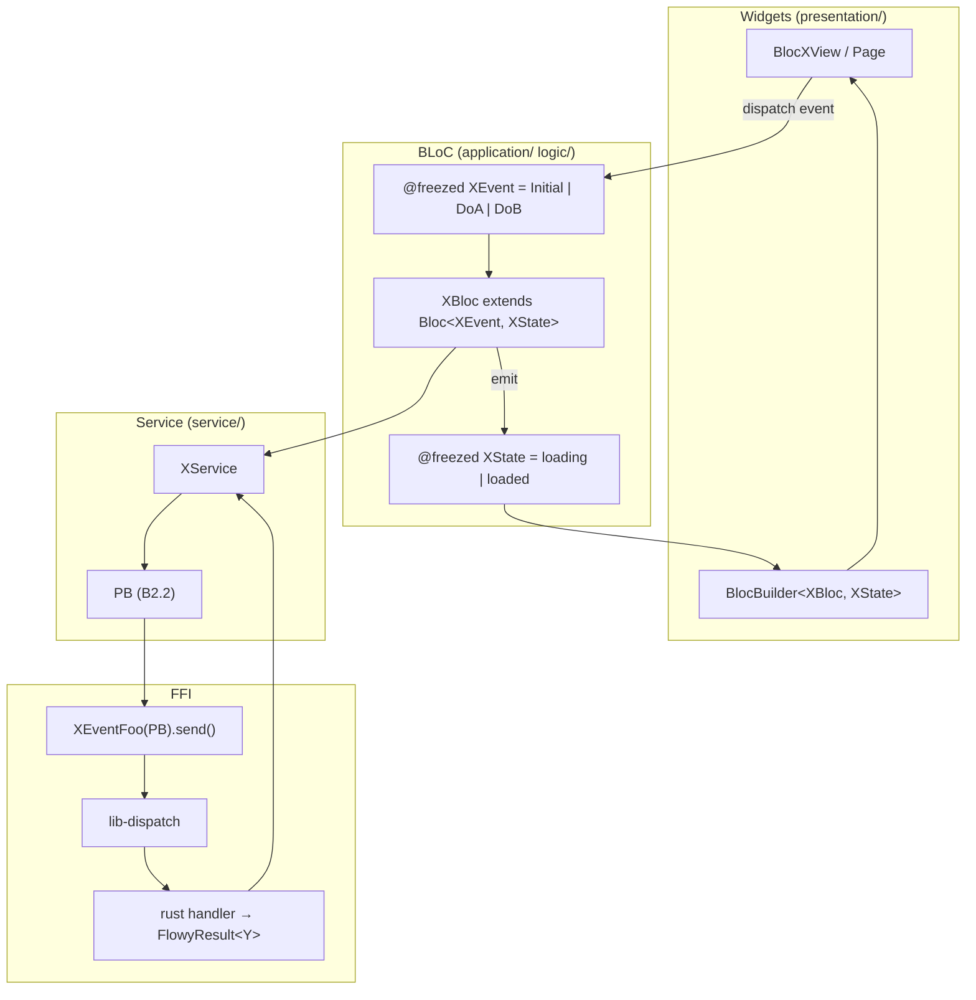

# 13 — Catálogo de BLoCs y Cubits

Este documento cataloga los **142 BLoCs y Cubits** (125 `Bloc` + 17 `Cubit`) extraídos por `SKILL/scripts/extract_blocs.py` (Fase A2.4; validador `validate-A2.4.sh` 8/8 OK) a partir de los {n_scanned} archivos Dart de `frontend/appflowy_flutter/lib/`. Cada BLoC se declara con `extends Bloc<Event, State>` o `extends Cubit<State>` y define sus eventos con `@freezed` (o con `sealed class`). La mayoría (125) tiene eventos `freezed` y 33 viven específicamente en `plugins/database/application/`. La semántica breve se deriva siempre del nombre + servicios inyectados + state_fields, etiquetada `[INFERIDO]` porque `extract_blocs.py` no captura `///` doc-comments. El catálogo es la base para los documentos B3.F01–F17 (handlers por feature) y se cruza con B2.1 (eventos FFI) y B2.2 (entidades PB).

## 1. Cómo leer este catálogo

Cada fila representa un BLoC o Cubit. Las columnas son: `#` (ordinal dentro de la carpeta), `BLoC` (nombre de la clase), `Tipo` (`Bloc` / `Cubit`), `Eventos (n)` (nº de variantes del enum de eventos; 0 para Cubits sin eventos), `State fields (n)` (nº de `factory` del state), `Inyectados (n)` (nº de servicios pasados al constructor), `PB (n)` (nº de fields cuyo tipo es `*PB` — referencia a B2.2), `Archivo` (`ruta:línea` resuelto contra `inventario.json`), `Semántica` (derivada del nombre + heurística de carpeta + servicios). Las celdas con `—` indican lista `vacía`. La semántica SIEMPRE va etiquetada `[INFERIDO]`. Los BLoCs `Cubit` con estado inicial se distinguen porque su `state_type` empieza con un factory `loading` (campo `state_factory_initial`).

## 2. Arquitectura BLoC en AppFlowy

El siguiente diagrama muestra el flujo típico de un BLoC: la UI dispara un evento, el BLoC lo procesa, delega en un `Service` que envía un evento FFI (`XEventFoo(...).send()`) y recibe un `FlowyResult<T, FlowyError>`, actualiza el `State` y la UI se reconstruye con `BlocBuilder`/`BlocListener`.



Lectura: el `XBloc` recibe eventos tipados (lib `flutter_bloc` + `@freezed` para que cada `factory` sea una subclase inmutable). Para hacer una llamada FFI delega en un `XService` (regla no estricta; en la base actual el 6 % de BLoCs tiene `injected_services` detectados automáticamente, el resto los obtiene de un singleton `getIt`). El `XService` envía el evento FFI por `appflowy_backend` y el resultado vuelve al `BLoC` que emite un nuevo estado.

## 3. Resumen por carpeta

| Carpeta Dart (L1/L2) | Bloc | Cubit | Total | Sin freezed | Con services | Con PB |
| --- | --- | --- | --- | --- | --- | --- |
| `plugins/database` | 48 | 2 | 50 | 2 | 1 | 22 |
| `workspace/application` | 34 | 5 | 39 | 5 | 2 | 23 |
| `plugins/document` | 8 | 3 | 11 | 3 | 1 | 2 |
| `plugins/ai_chat` | 6 | 2 | 8 | 2 | 0 | 0 |
| `user/application` | 8 | 0 | 8 | 0 | 1 | 3 |
| `ai/service` | 2 | 3 | 5 | 3 | 0 | 2 |
| `mobile/application` | 5 | 0 | 5 | 0 | 0 | 2 |
| `mobile/presentation` | 2 | 2 | 4 | 2 | 0 | 0 |
| `workspace/presentation` | 4 | 0 | 4 | 0 | 3 | 4 |
| `features/page_access_level` | 1 | 0 | 1 | 0 | 0 | 0 |
| `features/settings` | 1 | 0 | 1 | 0 | 0 | 0 |
| `features/share_tab` | 1 | 0 | 1 | 0 | 0 | 0 |
| `features/shared_section` | 1 | 0 | 1 | 0 | 0 | 0 |
| `features/workspace` | 1 | 0 | 1 | 0 | 0 | 0 |
| `plugins/database_document` | 1 | 0 | 1 | 0 | 0 | 1 |
| `plugins/shared` | 1 | 0 | 1 | 0 | 0 | 0 |
| `plugins/trash` | 1 | 0 | 1 | 0 | 0 | 1 |

**Total**: 142 en 17 carpetas. **Sin freezed**: BLoCs o Cubits sin eventos detectados (típicamente Cubits). **Con services**: sólo el 8/142 tienen servicios inyectados extraídos automáticamente; el resto usa `getIt` o un singleton del paquete `flowy_infra`. **Con PB**: BLoCs cuyo `state_fields` contiene al menos un tipo terminado en `PB` (referencia a B2.2).

## 4. Índice global de los 142 BLoCs/Cubits

Tabla plana con los 142 BLoCs/Cubits ordenados por `(carpeta, nombre)`. Cada fila es una entrada que también aparece en §5.<carpeta>. El conteo de filas de §4 y de la suma de filas de §5.* debe ser exactamente **142** (prueba literal del ROADMAP). Las entradas con `Inyectados (n) = 0` y `Sin services detectado` suelen ser BLoCs que obtienen dependencias vía `getIt` o singleton.

| Carpeta | # | BLoC | Tipo | Eventos | State fields | Inyectados | PB | Archivo |
| --- | --- | --- | --- | --- | --- | --- | --- | --- |
| `plugins/database` | 1 | `BoardActionsCubit` | Cubit | 0 | 0 | 0 | 0 | `appflowy:frontend/appflowy_flutter/lib/plugins/database/board/application/board_actions_bloc.dart:8` |
| `plugins/database` | 2 | `BoardBloc` | Bloc | 16 | 0 | 0 | 0 | `appflowy:frontend/appflowy_flutter/lib/plugins/database/board/application/board_bloc.dart:30` |
| `plugins/database` | 3 | `CalculationsBloc` | Bloc | 5 | 2 | 0 | 1 | `appflowy:frontend/appflowy_flutter/lib/plugins/database/grid/application/calculations/calculations_bloc.dart:11` |
| `plugins/database` | 4 | `CalendarBloc` | Bloc | 15 | 11 | 0 | 3 | `appflowy:frontend/appflowy_flutter/lib/plugins/database/calendar/application/calendar_bloc.dart:21` |
| `plugins/database` | 5 | `CalendarEventEditorBloc` | Bloc | 3 | 1 | 0 | 0 | `appflowy:frontend/appflowy_flutter/lib/plugins/database/calendar/application/calendar_event_editor_bloc.dart:12` |
| `plugins/database` | 6 | `CalendarSettingBloc` | Bloc | 3 | 1 | 0 | 1 | `appflowy:frontend/appflowy_flutter/lib/plugins/database/calendar/application/calendar_setting_bloc.dart:10` |
| `plugins/database` | 7 | `CardBloc` | Bloc | 4 | 4 | 0 | 1 | `appflowy:frontend/appflowy_flutter/lib/plugins/database/widgets/card/card_bloc.dart:16` |
| `plugins/database` | 8 | `CheckboxCellBloc` | Bloc | 4 | 2 | 0 | 0 | `appflowy:frontend/appflowy_flutter/lib/plugins/database/application/cell/bloc/checkbox_cell_bloc.dart:10` |
| `plugins/database` | 9 | `ChecklistCellBloc` | Bloc | 8 | 4 | 0 | 0 | `appflowy:frontend/appflowy_flutter/lib/plugins/database/application/cell/bloc/checklist_cell_bloc.dart:19` |
| `plugins/database` | 10 | `DatabaseGroupBloc` | Bloc | 4 | 4 | 0 | 2 | `appflowy:frontend/appflowy_flutter/lib/plugins/database/application/setting/group_bloc.dart:14` |
| `plugins/database` | 11 | `DatabaseLayoutBloc` | Bloc | 2 | 2 | 0 | 1 | `appflowy:frontend/appflowy_flutter/lib/plugins/database/application/layout/layout_bloc.dart:7` |
| `plugins/database` | 12 | `DatabasePropertyBloc` | Bloc | 4 | 2 | 0 | 0 | `appflowy:frontend/appflowy_flutter/lib/plugins/database/application/setting/property_bloc.dart:13` |
| `plugins/database` | 13 | `DatabaseShareBloc` | Bloc | 1 | 0 | 0 | 0 | `appflowy:frontend/appflowy_flutter/lib/plugins/database/application/share_bloc.dart:13` |
| `plugins/database` | 14 | `DatabaseSyncBloc` | Bloc | 3 | 3 | 0 | 0 | `appflowy:frontend/appflowy_flutter/lib/plugins/database/application/sync/database_sync_bloc.dart:16` |
| `plugins/database` | 15 | `DatabaseTabBarBloc` | Bloc | 8 | 6 | 0 | 1 | `appflowy:frontend/appflowy_flutter/lib/plugins/database/application/tab_bar_bloc.dart:18` |
| `plugins/database` | 16 | `DatabaseViewSettingExtensionBloc` | Bloc | 2 | 2 | 0 | 0 | `appflowy:frontend/appflowy_flutter/lib/plugins/database/grid/application/grid_accessory_bloc.dart:5` |
| `plugins/database` | 17 | `DateCellBloc` | Bloc | 2 | 2 | 0 | 0 | `appflowy:frontend/appflowy_flutter/lib/plugins/database/application/cell/bloc/date_cell_bloc.dart:13` |
| `plugins/database` | 18 | `DateCellEditorBloc` | Bloc | 10 | 7 | 0 | 1 | `appflowy:frontend/appflowy_flutter/lib/plugins/database/application/cell/bloc/date_cell_editor_bloc.dart:28` |
| `plugins/database` | 19 | `EditSelectOptionBloc` | Bloc | 3 | 2 | 0 | 1 | `appflowy:frontend/appflowy_flutter/lib/plugins/database/application/field/type_option/edit_select_option_bloc.dart:7` |
| `plugins/database` | 20 | `FieldCellBloc` | Bloc | 4 | 4 | 0 | 0 | `appflowy:frontend/appflowy_flutter/lib/plugins/database/application/field/field_cell_bloc.dart:10` |
| `plugins/database` | 21 | `FieldEditorBloc` | Bloc | 9 | 2 | 0 | 0 | `appflowy:frontend/appflowy_flutter/lib/plugins/database/application/field/field_editor_bloc.dart:17` |
| `plugins/database` | 22 | `FilterEditorBloc` | Bloc | 6 | 3 | 0 | 0 | `appflowy:frontend/appflowy_flutter/lib/plugins/database/grid/application/filter/filter_editor_bloc.dart:15` |
| `plugins/database` | 23 | `GridBloc` | Bloc | 11 | 12 | 0 | 1 | `appflowy:frontend/appflowy_flutter/lib/plugins/database/grid/application/grid_bloc.dart:21` |
| `plugins/database` | 24 | `GridHeaderBloc` | Bloc | 6 | 3 | 0 | 0 | `appflowy:frontend/appflowy_flutter/lib/plugins/database/grid/application/grid_header_bloc.dart:13` |
| `plugins/database` | 25 | `MediaCellBloc` | Bloc | 9 | 3 | 1 | 2 | `appflowy:frontend/appflowy_flutter/lib/plugins/database/application/cell/bloc/media_cell_bloc.dart:20` |
| `plugins/database` | 26 | `MobileRowDetailBloc` | Bloc | 4 | 3 | 0 | 0 | `appflowy:frontend/appflowy_flutter/lib/plugins/database/grid/application/row/mobile_row_detail_bloc.dart:12` |
| `plugins/database` | 27 | `NumberCellBloc` | Bloc | 3 | 2 | 0 | 0 | `appflowy:frontend/appflowy_flutter/lib/plugins/database/application/cell/bloc/number_cell_bloc.dart:9` |
| `plugins/database` | 28 | `NumberFormatBloc` | Bloc | 1 | 2 | 0 | 1 | `appflowy:frontend/appflowy_flutter/lib/plugins/database/application/field/type_option/number_format_bloc.dart:6` |
| `plugins/database` | 29 | `RelatedRowDetailPageBloc` | Bloc | 1 | 0 | 0 | 0 | `appflowy:frontend/appflowy_flutter/lib/plugins/database/application/row/related_row_detail_bloc.dart:15` |
| `plugins/database` | 30 | `RelationCellBloc` | Bloc | 4 | 3 | 0 | 1 | `appflowy:frontend/appflowy_flutter/lib/plugins/database/application/cell/bloc/relation_cell_bloc.dart:17` |
| `plugins/database` | 31 | `RelationDatabaseListCubit` | Cubit | 0 | 0 | 0 | 0 | `appflowy:frontend/appflowy_flutter/lib/plugins/database/application/field/type_option/relation_type_option_cubit.dart:9` |
| `plugins/database` | 32 | `RelationRowSearchBloc` | Bloc | 5 | 2 | 0 | 1 | `appflowy:frontend/appflowy_flutter/lib/plugins/database/application/cell/bloc/relation_row_search_bloc.dart:11` |
| `plugins/database` | 33 | `RowBannerBloc` | Bloc | 6 | 0 | 0 | 0 | `appflowy:frontend/appflowy_flutter/lib/plugins/database/application/row/row_banner_bloc.dart:17` |
| `plugins/database` | 34 | `RowBloc` | Bloc | 2 | 2 | 0 | 0 | `appflowy:frontend/appflowy_flutter/lib/plugins/database/grid/application/row/row_bloc.dart:16` |
| `plugins/database` | 35 | `RowDetailBloc` | Bloc | 12 | 7 | 0 | 1 | `appflowy:frontend/appflowy_flutter/lib/plugins/database/grid/application/row/row_detail_bloc.dart:19` |
| `plugins/database` | 36 | `RowDocumentBloc` | Bloc | 4 | 2 | 0 | 1 | `appflowy:frontend/appflowy_flutter/lib/plugins/database/grid/application/row/row_document_bloc.dart:17` |
| `plugins/database` | 37 | `SelectOptionCellBloc` | Bloc | 2 | 2 | 0 | 1 | `appflowy:frontend/appflowy_flutter/lib/plugins/database/application/cell/bloc/select_option_cell_bloc.dart:10` |
| `plugins/database` | 38 | `SelectOptionCellEditorBloc` | Bloc | 17 | 5 | 0 | 2 | `appflowy:frontend/appflowy_flutter/lib/plugins/database/application/cell/bloc/select_option_cell_editor_bloc.dart:21` |
| `plugins/database` | 39 | `SelectOptionTypeOptionBloc` | Bloc | 6 | 3 | 0 | 1 | `appflowy:frontend/appflowy_flutter/lib/plugins/database/application/field/type_option/select_option_type_option_bloc.dart:8` |
| `plugins/database` | 40 | `SortEditorBloc` | Bloc | 7 | 3 | 0 | 0 | `appflowy:frontend/appflowy_flutter/lib/plugins/database/grid/application/sort/sort_editor_bloc.dart:15` |
| `plugins/database` | 41 | `SummaryCellBloc` | Bloc | 3 | 2 | 0 | 0 | `appflowy:frontend/appflowy_flutter/lib/plugins/database/application/cell/bloc/summary_cell_bloc.dart:9` |
| `plugins/database` | 42 | `SummaryRowBloc` | Bloc | 2 | 2 | 0 | 0 | `appflowy:frontend/appflowy_flutter/lib/plugins/database/application/cell/bloc/summary_row_bloc.dart:9` |
| `plugins/database` | 43 | `TextCellBloc` | Bloc | 4 | 5 | 0 | 0 | `appflowy:frontend/appflowy_flutter/lib/plugins/database/application/cell/bloc/text_cell_bloc.dart:10` |
| `plugins/database` | 44 | `TimeCellBloc` | Bloc | 3 | 2 | 0 | 0 | `appflowy:frontend/appflowy_flutter/lib/plugins/database/application/cell/bloc/time_cell_bloc.dart:11` |
| `plugins/database` | 45 | `TimestampCellBloc` | Bloc | 2 | 4 | 0 | 1 | `appflowy:frontend/appflowy_flutter/lib/plugins/database/application/cell/bloc/timestamp_cell_bloc.dart:10` |
| `plugins/database` | 46 | `TranslateCellBloc` | Bloc | 3 | 2 | 0 | 0 | `appflowy:frontend/appflowy_flutter/lib/plugins/database/application/cell/bloc/translate_cell_bloc.dart:9` |
| `plugins/database` | 47 | `TranslateRowBloc` | Bloc | 2 | 2 | 0 | 0 | `appflowy:frontend/appflowy_flutter/lib/plugins/database/application/cell/bloc/translate_row_bloc.dart:9` |
| `plugins/database` | 48 | `TranslateTypeOptionBloc` | Bloc | 1 | 2 | 0 | 1 | `appflowy:frontend/appflowy_flutter/lib/plugins/database/application/field/type_option/translate_type_option_bloc.dart:8` |
| `plugins/database` | 49 | `URLCellBloc` | Bloc | 3 | 3 | 0 | 0 | `appflowy:frontend/appflowy_flutter/lib/plugins/database/application/cell/bloc/url_cell_bloc.dart:11` |
| `plugins/database` | 50 | `UnscheduleEventsBloc` | Bloc | 4 | 3 | 0 | 3 | `appflowy:frontend/appflowy_flutter/lib/plugins/database/calendar/application/unschedule_event_bloc.dart:15` |
| `workspace/application` | 1 | `ActionNavigationBloc` | Bloc | 1 | 0 | 0 | 0 | `appflowy:frontend/appflowy_flutter/lib/workspace/application/action_navigation/action_navigation_bloc.dart:11` |
| `workspace/application` | 2 | `AppFlowyCloudSettingBloc` | Bloc | 5 | 4 | 0 | 2 | `appflowy:frontend/appflowy_flutter/lib/workspace/application/settings/appflowy_cloud_setting_bloc.dart:14` |
| `workspace/application` | 3 | `AppFlowyCloudURLsBloc` | Bloc | 5 | 6 | 0 | 0 | `appflowy:frontend/appflowy_flutter/lib/workspace/application/settings/appflowy_cloud_urls_bloc.dart:11` |
| `workspace/application` | 4 | `AppearanceSettingsCubit` | Cubit | 0 | 15 | 0 | 2 | `appflowy:frontend/appflowy_flutter/lib/workspace/application/settings/appearance/appearance_cubit.dart:35` |
| `workspace/application` | 5 | `CloudSettingBloc` | Bloc | 2 | 1 | 0 | 0 | `appflowy:frontend/appflowy_flutter/lib/workspace/application/settings/cloud_setting_bloc.dart:6` |
| `workspace/application` | 6 | `CommandPaletteBloc` | Bloc | 11 | 13 | 3 | 6 | `appflowy:frontend/appflowy_flutter/lib/workspace/application/command_palette/command_palette_bloc.dart:30` |
| `workspace/application` | 7 | `CreateFileSettingsCubit` | Cubit | 0 | 0 | 0 | 0 | `appflowy:frontend/appflowy_flutter/lib/workspace/application/settings/create_file_settings_cubit.dart:5` |
| `workspace/application` | 8 | `EditPanelBloc` | Bloc | 2 | 2 | 0 | 0 | `appflowy:frontend/appflowy_flutter/lib/workspace/application/edit_panel/edit_panel_bloc.dart:6` |
| `workspace/application` | 9 | `FavoriteBloc` | Bloc | 6 | 4 | 0 | 3 | `appflowy:frontend/appflowy_flutter/lib/workspace/application/favorite/favorite_bloc.dart:13` |
| `workspace/application` | 10 | `FolderBloc` | Bloc | 2 | 2 | 0 | 0 | `appflowy:frontend/appflowy_flutter/lib/workspace/application/sidebar/folder/folder_bloc.dart:30` |
| `workspace/application` | 11 | `HomeBloc` | Bloc | 3 | 3 | 0 | 2 | `appflowy:frontend/appflowy_flutter/lib/workspace/application/home/home_bloc.dart:11` |
| `workspace/application` | 12 | `HomeSettingBloc` | Bloc | 10 | 10 | 0 | 1 | `appflowy:frontend/appflowy_flutter/lib/workspace/application/home/home_setting_bloc.dart:12` |
| `workspace/application` | 13 | `LocalAIOnBoardingBloc` | Bloc | 4 | 2 | 0 | 0 | `appflowy:frontend/appflowy_flutter/lib/workspace/application/settings/ai/local_ai_on_boarding_bloc.dart:15` |
| `workspace/application` | 14 | `LocalAiPluginBloc` | Bloc | 4 | 0 | 0 | 0 | `appflowy:frontend/appflowy_flutter/lib/workspace/application/settings/ai/local_ai_bloc.dart:13` |
| `workspace/application` | 15 | `MenuUserBloc` | Bloc | 3 | 3 | 0 | 2 | `appflowy:frontend/appflowy_flutter/lib/workspace/application/menu/menu_user_bloc.dart:12` |
| `workspace/application` | 16 | `NotificationSettingsCubit` | Cubit | 0 | 2 | 1 | 0 | `appflowy:frontend/appflowy_flutter/lib/workspace/application/settings/notifications/notification_settings_cubit.dart:13` |
| `workspace/application` | 17 | `OllamaSettingBloc` | Bloc | 7 | 8 | 0 | 4 | `appflowy:frontend/appflowy_flutter/lib/workspace/application/settings/ai/ollama_setting_bloc.dart:18` |
| `workspace/application` | 18 | `RecentViewsBloc` | Bloc | 6 | 3 | 0 | 2 | `appflowy:frontend/appflowy_flutter/lib/workspace/application/recent/recent_views_bloc.dart:8` |
| `workspace/application` | 19 | `RenameViewBloc` | Bloc | 1 | 1 | 0 | 0 | `appflowy:frontend/appflowy_flutter/lib/workspace/application/sidebar/rename_view/rename_view_bloc.dart:6` |
| `workspace/application` | 20 | `SearchResultListBloc` | Bloc | 3 | 4 | 0 | 1 | `appflowy:frontend/appflowy_flutter/lib/workspace/application/command_palette/search_result_list_bloc.dart:10` |
| `workspace/application` | 21 | `SettingFileImportBloc` | Bloc | 2 | 2 | 0 | 0 | `appflowy:frontend/appflowy_flutter/lib/workspace/application/settings/setting_file_importer_bloc.dart:15` |
| `workspace/application` | 22 | `SettingsAIBloc` | Bloc | 6 | 4 | 0 | 3 | `appflowy:frontend/appflowy_flutter/lib/workspace/application/settings/ai/settings_ai_bloc.dart:15` |
| `workspace/application` | 23 | `SettingsBillingBloc` | Bloc | 7 | 0 | 0 | 0 | `appflowy:frontend/appflowy_flutter/lib/workspace/application/settings/billing/settings_billing_bloc.dart:24` |
| `workspace/application` | 24 | `SettingsDialogBloc` | Bloc | 3 | 3 | 0 | 1 | `appflowy:frontend/appflowy_flutter/lib/workspace/application/settings/settings_dialog_bloc.dart:30` |
| `workspace/application` | 25 | `SettingsFileExporterCubit` | Cubit | 0 | 0 | 0 | 0 | `appflowy:frontend/appflowy_flutter/lib/workspace/application/settings/settings_file_exporter_cubit.dart:52` |
| `workspace/application` | 26 | `SettingsPlanBloc` | Bloc | 4 | 0 | 0 | 0 | `appflowy:frontend/appflowy_flutter/lib/workspace/application/settings/plan/settings_plan_bloc.dart:20` |
| `workspace/application` | 27 | `SettingsUserViewBloc` | Bloc | 7 | 2 | 0 | 1 | `appflowy:frontend/appflowy_flutter/lib/workspace/application/user/settings_user_bloc.dart:11` |
| `workspace/application` | 28 | `ShortcutsCubit` | Cubit | 0 | 3 | 0 | 0 | `appflowy:frontend/appflowy_flutter/lib/workspace/application/settings/shortcuts/settings_shortcuts_cubit.dart:42` |
| `workspace/application` | 29 | `SidebarPlanBloc` | Bloc | 5 | 5 | 0 | 2 | `appflowy:frontend/appflowy_flutter/lib/workspace/application/sidebar/billing/sidebar_plan_bloc.dart:18` |
| `workspace/application` | 30 | `SidebarSectionsBloc` | Bloc | 6 | 4 | 0 | 1 | `appflowy:frontend/appflowy_flutter/lib/workspace/application/menu/sidebar_sections_bloc.dart:47` |
| `workspace/application` | 31 | `SpaceBloc` | Bloc | 14 | 8 | 0 | 3 | `appflowy:frontend/appflowy_flutter/lib/workspace/application/sidebar/space/space_bloc.dart:65` |
| `workspace/application` | 32 | `SpaceSearchBloc` | Bloc | 2 | 1 | 0 | 1 | `appflowy:frontend/appflowy_flutter/lib/workspace/application/sidebar/space/space_search_bloc.dart:8` |
| `workspace/application` | 33 | `TabsBloc` | Bloc | 12 | 0 | 0 | 0 | `appflowy:frontend/appflowy_flutter/lib/workspace/application/tabs/tabs_bloc.dart:22` |
| `workspace/application` | 34 | `ViewBloc` | Bloc | 14 | 7 | 0 | 2 | `appflowy:frontend/appflowy_flutter/lib/workspace/application/view/view_bloc.dart:26` |
| `workspace/application` | 35 | `ViewInfoBloc` | Bloc | 6 | 4 | 0 | 1 | `appflowy:frontend/appflowy_flutter/lib/workspace/application/view_info/view_info_bloc.dart:12` |
| `workspace/application` | 36 | `ViewTitleBarBloc` | Bloc | 2 | 2 | 0 | 1 | `appflowy:frontend/appflowy_flutter/lib/workspace/application/view_title/view_title_bar_bloc.dart:10` |
| `workspace/application` | 37 | `ViewTitleBloc` | Bloc | 2 | 3 | 0 | 1 | `appflowy:frontend/appflowy_flutter/lib/workspace/application/view_title/view_title_bloc.dart:9` |
| `workspace/application` | 38 | `WorkspaceBloc` | Bloc | 3 | 3 | 0 | 1 | `appflowy:frontend/appflowy_flutter/lib/workspace/application/workspace/workspace_bloc.dart:11` |
| `workspace/application` | 39 | `WorkspaceSettingsBloc` | Bloc | 5 | 4 | 0 | 2 | `appflowy:frontend/appflowy_flutter/lib/workspace/application/settings/workspace/workspace_settings_bloc.dart:13` |
| `plugins/document` | 1 | `AiWriterCubit` | Cubit | 0 | 0 | 0 | 0 | `appflowy:frontend/appflowy_flutter/lib/plugins/document/presentation/editor_plugins/ai/operations/ai_writer_cubit.dart:24` |
| `plugins/document` | 2 | `BlockActionOptionCubit` | Cubit | 0 | 0 | 0 | 0 | `appflowy:frontend/appflowy_flutter/lib/plugins/document/presentation/editor_plugins/actions/block_action_option_cubit.dart:18` |
| `plugins/document` | 3 | `ChangeCoverPopoverBloc` | Bloc | 3 | 0 | 0 | 0 | `appflowy:frontend/appflowy_flutter/lib/plugins/document/presentation/editor_plugins/header/cover_editor_bloc.dart:12` |
| `plugins/document` | 4 | `CoverImagePickerBloc` | Bloc | 5 | 0 | 0 | 0 | `appflowy:frontend/appflowy_flutter/lib/plugins/document/presentation/editor_plugins/header/custom_cover_picker_bloc.dart:20` |
| `plugins/document` | 5 | `DocumentAppearanceCubit` | Cubit | 0 | 0 | 0 | 0 | `appflowy:frontend/appflowy_flutter/lib/plugins/document/application/document_appearance_cubit.dart:62` |
| `plugins/document` | 6 | `DocumentBloc` | Bloc | 8 | 9 | 3 | 2 | `appflowy:frontend/appflowy_flutter/lib/plugins/document/application/document_bloc.dart:46` |
| `plugins/document` | 7 | `DocumentCollaboratorsBloc` | Bloc | 2 | 2 | 0 | 0 | `appflowy:frontend/appflowy_flutter/lib/plugins/document/application/document_collaborators_bloc.dart:19` |
| `plugins/document` | 8 | `DocumentImmersiveCoverBloc` | Bloc | 2 | 3 | 0 | 0 | `appflowy:frontend/appflowy_flutter/lib/plugins/document/presentation/editor_plugins/cover/document_immersive_cover_bloc.dart:12` |
| `plugins/document` | 9 | `DocumentSyncBloc` | Bloc | 3 | 3 | 0 | 0 | `appflowy:frontend/appflowy_flutter/lib/plugins/document/application/document_sync_bloc.dart:15` |
| `plugins/document` | 10 | `MentionPageBloc` | Bloc | 4 | 5 | 0 | 1 | `appflowy:frontend/appflowy_flutter/lib/plugins/document/presentation/editor_plugins/mention/mention_page_bloc.dart:21` |
| `plugins/document` | 11 | `PageStyleIconBloc` | Bloc | 2 | 1 | 0 | 0 | `appflowy:frontend/appflowy_flutter/lib/plugins/document/presentation/editor_plugins/page_style/_page_style_icon_bloc.dart:9` |
| `plugins/ai_chat` | 1 | `ChatAIMessageBloc` | Bloc | 10 | 5 | 0 | 0 | `appflowy:frontend/appflowy_flutter/lib/plugins/ai_chat/application/chat_ai_message_bloc.dart:13` |
| `plugins/ai_chat` | 2 | `ChatBloc` | Bloc | 15 | 3 | 0 | 0 | `appflowy:frontend/appflowy_flutter/lib/plugins/ai_chat/application/chat_bloc.dart:30` |
| `plugins/ai_chat` | 3 | `ChatInputControlCubit` | Cubit | 0 | 0 | 0 | 0 | `appflowy:frontend/appflowy_flutter/lib/plugins/ai_chat/application/chat_input_control_cubit.dart:14` |
| `plugins/ai_chat` | 4 | `ChatInputFileBloc` | Bloc | 1 | 1 | 0 | 0 | `appflowy:frontend/appflowy_flutter/lib/plugins/ai_chat/application/chat_input_file_bloc.dart:6` |
| `plugins/ai_chat` | 5 | `ChatMemberBloc` | Bloc | 2 | 1 | 0 | 0 | `appflowy:frontend/appflowy_flutter/lib/plugins/ai_chat/application/chat_member_bloc.dart:10` |
| `plugins/ai_chat` | 6 | `ChatSelectMessageBloc` | Bloc | 6 | 3 | 0 | 0 | `appflowy:frontend/appflowy_flutter/lib/plugins/ai_chat/application/chat_select_message_bloc.dart:8` |
| `plugins/ai_chat` | 7 | `ChatUserCubit` | Cubit | 0 | 0 | 0 | 0 | `appflowy:frontend/appflowy_flutter/lib/plugins/ai_chat/application/chat_user_cubit.dart:10` |
| `plugins/ai_chat` | 8 | `ChatUserMessageBloc` | Bloc | 4 | 3 | 0 | 0 | `appflowy:frontend/appflowy_flutter/lib/plugins/ai_chat/application/chat_user_message_bloc.dart:7` |
| `user/application` | 1 | `AnonUserBloc` | Bloc | 3 | 2 | 0 | 2 | `appflowy:frontend/appflowy_flutter/lib/user/application/anon_user_bloc.dart:9` |
| `user/application` | 2 | `NotificationFilterBloc` | Bloc | 2 | 1 | 0 | 0 | `appflowy:frontend/appflowy_flutter/lib/user/application/notification_filter/notification_filter_bloc.dart:5` |
| `user/application` | 3 | `PasswordBloc` | Bloc | 6 | 6 | 0 | 0 | `appflowy:frontend/appflowy_flutter/lib/user/application/password/password_bloc.dart:14` |
| `user/application` | 4 | `ReminderBloc` | Bloc | 14 | 0 | 1 | 0 | `appflowy:frontend/appflowy_flutter/lib/user/application/reminder/reminder_bloc.dart:30` |
| `user/application` | 5 | `SignInBloc` | Bloc | 13 | 10 | 0 | 1 | `appflowy:frontend/appflowy_flutter/lib/user/application/sign_in_bloc.dart:20` |
| `user/application` | 6 | `SignUpBloc` | Bloc | 4 | 8 | 0 | 1 | `appflowy:frontend/appflowy_flutter/lib/user/application/sign_up_bloc.dart:13` |
| `user/application` | 7 | `SplashBloc` | Bloc | 1 | 1 | 0 | 0 | `appflowy:frontend/appflowy_flutter/lib/user/application/splash_bloc.dart:8` |
| `user/application` | 8 | `WorkspaceErrorBloc` | Bloc | 3 | 3 | 0 | 0 | `appflowy:frontend/appflowy_flutter/lib/user/application/workspace_error_bloc.dart:10` |
| `ai/service` | 1 | `AIPromptInputBloc` | Bloc | 8 | 6 | 0 | 1 | `appflowy:frontend/appflowy_flutter/lib/ai/service/ai_prompt_input_bloc.dart:12` |
| `ai/service` | 2 | `AiPromptDatabaseSelectorCubit` | Cubit | 0 | 0 | 0 | 0 | `appflowy:frontend/appflowy_flutter/lib/ai/service/ai_prompt_database_selector_cubit.dart:10` |
| `ai/service` | 3 | `AiPromptSelectorCubit` | Cubit | 0 | 0 | 0 | 0 | `appflowy:frontend/appflowy_flutter/lib/ai/service/ai_prompt_selector_cubit.dart:18` |
| `ai/service` | 4 | `SelectModelBloc` | Bloc | 2 | 2 | 0 | 2 | `appflowy:frontend/appflowy_flutter/lib/ai/service/select_model_bloc.dart:10` |
| `ai/service` | 5 | `ViewSelectorCubit` | Cubit | 0 | 2 | 0 | 0 | `appflowy:frontend/appflowy_flutter/lib/ai/service/view_selector_cubit.dart:102` |
| `mobile/application` | 1 | `DocumentPageStyleBloc` | Bloc | 5 | 6 | 0 | 0 | `appflowy:frontend/appflowy_flutter/lib/mobile/application/page_style/document_page_style_bloc.dart:14` |
| `mobile/application` | 2 | `MobileViewPageBloc` | Bloc | 2 | 4 | 0 | 2 | `appflowy:frontend/appflowy_flutter/lib/mobile/application/base/mobile_view_page_bloc.dart:13` |
| `mobile/application` | 3 | `NotificationReminderBloc` | Bloc | 2 | 8 | 0 | 1 | `appflowy:frontend/appflowy_flutter/lib/mobile/application/notification/notification_reminder_bloc.dart:19` |
| `mobile/application` | 4 | `RecentViewBloc` | Bloc | 3 | 5 | 0 | 0 | `appflowy:frontend/appflowy_flutter/lib/mobile/application/recent/recent_view_bloc.dart:13` |
| `mobile/application` | 5 | `UserProfileBloc` | Bloc | 1 | 0 | 0 | 0 | `appflowy:frontend/appflowy_flutter/lib/mobile/application/user_profile/user_profile_bloc.dart:10` |
| `mobile/presentation` | 1 | `MobileFilterEditorCubit` | Cubit | 0 | 0 | 0 | 0 | `appflowy:frontend/appflowy_flutter/lib/mobile/presentation/database/view/database_filter_bottom_sheet_cubit.dart:7` |
| `mobile/presentation` | 2 | `MobileSortEditorCubit` | Cubit | 0 | 0 | 0 | 0 | `appflowy:frontend/appflowy_flutter/lib/mobile/presentation/database/view/database_sort_bottom_sheet_cubit.dart:7` |
| `mobile/presentation` | 3 | `SpaceOrderBloc` | Bloc | 3 | 3 | 0 | 0 | `appflowy:frontend/appflowy_flutter/lib/mobile/presentation/home/tab/space_order_bloc.dart:34` |
| `mobile/presentation` | 4 | `ViewAncestorBloc` | Bloc | 1 | 3 | 0 | 0 | `appflowy:frontend/appflowy_flutter/lib/mobile/presentation/search/mobile_view_ancestors.dart:10` |
| `workspace/presentation` | 1 | `FavoriteMenuBloc` | Bloc | 2 | 5 | 1 | 5 | `appflowy:frontend/appflowy_flutter/lib/workspace/presentation/home/menu/sidebar/favorites/favorite_menu_bloc.dart:7` |
| `workspace/presentation` | 2 | `FavoritePinBloc` | Bloc | 2 | 2 | 1 | 2 | `appflowy:frontend/appflowy_flutter/lib/workspace/presentation/home/menu/sidebar/favorites/favorite_pin_bloc.dart:8` |
| `workspace/presentation` | 3 | `SettingsSitesBloc` | Bloc | 7 | 6 | 0 | 3 | `appflowy:frontend/appflowy_flutter/lib/workspace/presentation/settings/pages/sites/settings_sites_bloc.dart:20` |
| `workspace/presentation` | 4 | `WorkspaceMemberBloc` | Bloc | 12 | 6 | 1 | 3 | `appflowy:frontend/appflowy_flutter/lib/workspace/presentation/settings/widgets/members/workspace_member_bloc.dart:31` |
| `features/page_access_level` | 1 | `PageAccessLevelBloc` | Bloc | 5 | 0 | 0 | 0 | `appflowy:frontend/appflowy_flutter/lib/features/page_access_level/logic/page_access_level_bloc.dart:16` |
| `features/settings` | 1 | `DataLocationBloc` | Bloc | 4 | 0 | 0 | 0 | `appflowy:frontend/appflowy_flutter/lib/features/settings/logic/data_location_bloc.dart:7` |
| `features/share_tab` | 1 | `ShareTabBloc` | Bloc | 8 | 0 | 0 | 0 | `appflowy:frontend/appflowy_flutter/lib/features/share_tab/logic/share_tab_bloc.dart:18` |
| `features/shared_section` | 1 | `SharedSectionBloc` | Bloc | 5 | 0 | 0 | 0 | `appflowy:frontend/appflowy_flutter/lib/features/shared_section/logic/shared_section_bloc.dart:15` |
| `features/workspace` | 1 | `UserWorkspaceBloc` | Bloc | 13 | 0 | 0 | 0 | `appflowy:frontend/appflowy_flutter/lib/features/workspace/logic/workspace_bloc.dart:36` |
| `plugins/database_document` | 1 | `DatabaseDocumentTitleBloc` | Bloc | 4 | 5 | 0 | 1 | `appflowy:frontend/appflowy_flutter/lib/plugins/database_document/presentation/database_document_title_bloc.dart:18` |
| `plugins/shared` | 1 | `ShareBloc` | Bloc | 9 | 13 | 0 | 0 | `appflowy:frontend/appflowy_flutter/lib/plugins/shared/share/share_bloc.dart:21` |
| `plugins/trash` | 1 | `TrashBloc` | Bloc | 6 | 2 | 0 | 1 | `appflowy:frontend/appflowy_flutter/lib/plugins/trash/application/trash_bloc.dart:11` |

## 5. Catálogo por carpeta

Cada sub-sección desarrolla una carpeta Dart L1/L2. Las tablas siguen el mismo esquema que §4 (sin la columna `Carpeta` redundante). Cuando una carpeta supera los 20 BLoCs, se acompaña de un `flowchart LR` que agrupa los nombres por prefijo.

### 5.1 `plugins/database`

**50 BLoCs/Cubits** (48 Bloc + 2 Cubit).

```mermaid
flowchart LR
  subgraph Cplugins_database["plugins/database"]
    plugins_database_Board["Board<br/>(2):<br/>BoardActionsCubit<br/>BoardBloc"]
    plugins_database_Calculations["Calculations<br/>(1):<br/>CalculationsBloc"]
    plugins_database_Calendar["Calendar<br/>(3):<br/>CalendarBloc<br/>CalendarEventEditorBloc<br/>CalendarSettingBloc"]
    plugins_database_Card["Card<br/>(1):<br/>CardBloc"]
    plugins_database_Checkbox["Checkbox<br/>(1):<br/>CheckboxCellBloc"]
    plugins_database_Checklist["Checklist<br/>(1):<br/>ChecklistCellBloc"]
    plugins_database_Database["Database<br/>(7):<br/>DatabaseGroupBloc<br/>DatabaseLayoutBloc<br/>DatabasePropertyBloc<br/>DatabaseShareBloc<br/>DatabaseSyncBloc<br/>DatabaseTabBarBloc<br/>DatabaseViewSettingExtensionBloc"]
    plugins_database_Date["Date<br/>(2):<br/>DateCellBloc<br/>DateCellEditorBloc"]
    plugins_database_Edit["Edit<br/>(1):<br/>EditSelectOptionBloc"]
    plugins_database_Field["Field<br/>(2):<br/>FieldCellBloc<br/>FieldEditorBloc"]
    plugins_database_Filter["Filter<br/>(1):<br/>FilterEditorBloc"]
    plugins_database_Grid["Grid<br/>(2):<br/>GridBloc<br/>GridHeaderBloc"]
    plugins_database_Media["Media<br/>(1):<br/>MediaCellBloc"]
    plugins_database_Mobile["Mobile<br/>(1):<br/>MobileRowDetailBloc"]
    plugins_database_Number["Number<br/>(2):<br/>NumberCellBloc<br/>NumberFormatBloc"]
    plugins_database_Other["Other<br/>(1):<br/>URLCellBloc"]
    plugins_database_Related["Related<br/>(1):<br/>RelatedRowDetailPageBloc"]
    plugins_database_Relation["Relation<br/>(3):<br/>RelationCellBloc<br/>RelationDatabaseListCubit<br/>RelationRowSearchBloc"]
    plugins_database_Row["Row<br/>(4):<br/>RowBannerBloc<br/>RowBloc<br/>RowDetailBloc<br/>RowDocumentBloc"]
    plugins_database_Select["Select<br/>(3):<br/>SelectOptionCellBloc<br/>SelectOptionCellEditorBloc<br/>SelectOptionTypeOptionBloc"]
    plugins_database_Sort["Sort<br/>(1):<br/>SortEditorBloc"]
    plugins_database_Summary["Summary<br/>(2):<br/>SummaryCellBloc<br/>SummaryRowBloc"]
    plugins_database_Text["Text<br/>(1):<br/>TextCellBloc"]
    plugins_database_Time["Time<br/>(1):<br/>TimeCellBloc"]
    plugins_database_Timestamp["Timestamp<br/>(1):<br/>TimestampCellBloc"]
    plugins_database_Translate["Translate<br/>(3):<br/>TranslateCellBloc<br/>TranslateRowBloc<br/>TranslateTypeOptionBloc"]
    plugins_database_Unschedule["Unschedule<br/>(1):<br/>UnscheduleEventsBloc"]
  end
```



| # | BLoC | Tipo | Eventos (n) | State fields (n) | Inyectados (n) | PB (n) | Archivo | Semántica |
| --- | --- | --- | --- | --- | --- | --- | --- | --- |
| 1 | `BoardActionsCubit` | Cubit | 0 | 0 | 0 | 0 | `appflowy:frontend/appflowy_flutter/lib/plugins/database/board/application/board_actions_bloc.dart:8` | BLoC BoardActionsCubit. `[INFERIDO]` |
| 2 | `BoardBloc` | Bloc | 16 | 0 | 0 | 0 | `appflowy:frontend/appflowy_flutter/lib/plugins/database/board/application/board_bloc.dart:30` | BLoC BoardBloc. `[INFERIDO]` |
| 3 | `CalculationsBloc` | Bloc | 5 | 2 | 0 | 1 | `appflowy:frontend/appflowy_flutter/lib/plugins/database/grid/application/calculations/calculations_bloc.dart:11` | BLoC CalculationsBloc. `[INFERIDO]` |
| 4 | `CalendarBloc` | Bloc | 15 | 11 | 0 | 3 | `appflowy:frontend/appflowy_flutter/lib/plugins/database/calendar/application/calendar_bloc.dart:21` | BLoC CalendarBloc. `[INFERIDO]` |
| 5 | `CalendarEventEditorBloc` | Bloc | 3 | 1 | 0 | 0 | `appflowy:frontend/appflowy_flutter/lib/plugins/database/calendar/application/calendar_event_editor_bloc.dart:12` | gestión del editor calendar event. `[INFERIDO]` |
| 6 | `CalendarSettingBloc` | Bloc | 3 | 1 | 0 | 1 | `appflowy:frontend/appflowy_flutter/lib/plugins/database/calendar/application/calendar_setting_bloc.dart:10` | ajuste calendar. `[INFERIDO]` |
| 7 | `CardBloc` | Bloc | 4 | 4 | 0 | 1 | `appflowy:frontend/appflowy_flutter/lib/plugins/database/widgets/card/card_bloc.dart:16` | BLoC CardBloc. `[INFERIDO]` |
| 8 | `CheckboxCellBloc` | Bloc | 4 | 2 | 0 | 0 | `appflowy:frontend/appflowy_flutter/lib/plugins/database/application/cell/bloc/checkbox_cell_bloc.dart:10` | celda checkbox de database. `[INFERIDO]` |
| 9 | `ChecklistCellBloc` | Bloc | 8 | 4 | 0 | 0 | `appflowy:frontend/appflowy_flutter/lib/plugins/database/application/cell/bloc/checklist_cell_bloc.dart:19` | celda checklist de database. `[INFERIDO]` |
| 10 | `DatabaseGroupBloc` | Bloc | 4 | 4 | 0 | 2 | `appflowy:frontend/appflowy_flutter/lib/plugins/database/application/setting/group_bloc.dart:14` | BLoC DatabaseGroupBloc. `[INFERIDO]` |
| 11 | `DatabaseLayoutBloc` | Bloc | 2 | 2 | 0 | 1 | `appflowy:frontend/appflowy_flutter/lib/plugins/database/application/layout/layout_bloc.dart:7` | BLoC DatabaseLayoutBloc. `[INFERIDO]` |
| 12 | `DatabasePropertyBloc` | Bloc | 4 | 2 | 0 | 0 | `appflowy:frontend/appflowy_flutter/lib/plugins/database/application/setting/property_bloc.dart:13` | BLoC DatabasePropertyBloc. `[INFERIDO]` |
| 13 | `DatabaseShareBloc` | Bloc | 1 | 0 | 0 | 0 | `appflowy:frontend/appflowy_flutter/lib/plugins/database/application/share_bloc.dart:13` | compartir database. `[INFERIDO]` |
| 14 | `DatabaseSyncBloc` | Bloc | 3 | 3 | 0 | 0 | `appflowy:frontend/appflowy_flutter/lib/plugins/database/application/sync/database_sync_bloc.dart:16` | BLoC DatabaseSyncBloc. `[INFERIDO]` |
| 15 | `DatabaseTabBarBloc` | Bloc | 8 | 6 | 0 | 1 | `appflowy:frontend/appflowy_flutter/lib/plugins/database/application/tab_bar_bloc.dart:18` | tab database. `[INFERIDO]` |
| 16 | `DatabaseViewSettingExtensionBloc` | Bloc | 2 | 2 | 0 | 0 | `appflowy:frontend/appflowy_flutter/lib/plugins/database/grid/application/grid_accessory_bloc.dart:5` | gestión de la vista database. `[INFERIDO]` |
| 17 | `DateCellBloc` | Bloc | 2 | 2 | 0 | 0 | `appflowy:frontend/appflowy_flutter/lib/plugins/database/application/cell/bloc/date_cell_bloc.dart:13` | celda date de database. `[INFERIDO]` |
| 18 | `DateCellEditorBloc` | Bloc | 10 | 7 | 0 | 1 | `appflowy:frontend/appflowy_flutter/lib/plugins/database/application/cell/bloc/date_cell_editor_bloc.dart:28` | gestión del editor date cell. `[INFERIDO]` |
| 19 | `EditSelectOptionBloc` | Bloc | 3 | 2 | 0 | 1 | `appflowy:frontend/appflowy_flutter/lib/plugins/database/application/field/type_option/edit_select_option_bloc.dart:7` | BLoC EditSelectOptionBloc. `[INFERIDO]` |
| 20 | `FieldCellBloc` | Bloc | 4 | 4 | 0 | 0 | `appflowy:frontend/appflowy_flutter/lib/plugins/database/application/field/field_cell_bloc.dart:10` | celda field de database. `[INFERIDO]` |
| 21 | `FieldEditorBloc` | Bloc | 9 | 2 | 0 | 0 | `appflowy:frontend/appflowy_flutter/lib/plugins/database/application/field/field_editor_bloc.dart:17` | gestión del editor field. `[INFERIDO]` |
| 22 | `FilterEditorBloc` | Bloc | 6 | 3 | 0 | 0 | `appflowy:frontend/appflowy_flutter/lib/plugins/database/grid/application/filter/filter_editor_bloc.dart:15` | gestión del editor filter. `[INFERIDO]` |
| 23 | `GridBloc` | Bloc | 11 | 12 | 0 | 1 | `appflowy:frontend/appflowy_flutter/lib/plugins/database/grid/application/grid_bloc.dart:21` | BLoC GridBloc. `[INFERIDO]` |
| 24 | `GridHeaderBloc` | Bloc | 6 | 3 | 0 | 0 | `appflowy:frontend/appflowy_flutter/lib/plugins/database/grid/application/grid_header_bloc.dart:13` | BLoC GridHeaderBloc. `[INFERIDO]` |
| 25 | `MediaCellBloc` | Bloc | 9 | 3 | 1 | 2 | `appflowy:frontend/appflowy_flutter/lib/plugins/database/application/cell/bloc/media_cell_bloc.dart:20` | celda media de database. `[INFERIDO]` |
| 26 | `MobileRowDetailBloc` | Bloc | 4 | 3 | 0 | 0 | `appflowy:frontend/appflowy_flutter/lib/plugins/database/grid/application/row/mobile_row_detail_bloc.dart:12` | fila mobile de database. `[INFERIDO]` |
| 27 | `NumberCellBloc` | Bloc | 3 | 2 | 0 | 0 | `appflowy:frontend/appflowy_flutter/lib/plugins/database/application/cell/bloc/number_cell_bloc.dart:9` | celda number de database. `[INFERIDO]` |
| 28 | `NumberFormatBloc` | Bloc | 1 | 2 | 0 | 1 | `appflowy:frontend/appflowy_flutter/lib/plugins/database/application/field/type_option/number_format_bloc.dart:6` | BLoC NumberFormatBloc. `[INFERIDO]` |
| 29 | `RelatedRowDetailPageBloc` | Bloc | 1 | 0 | 0 | 0 | `appflowy:frontend/appflowy_flutter/lib/plugins/database/application/row/related_row_detail_bloc.dart:15` | fila related de database. `[INFERIDO]` |
| 30 | `RelationCellBloc` | Bloc | 4 | 3 | 0 | 1 | `appflowy:frontend/appflowy_flutter/lib/plugins/database/application/cell/bloc/relation_cell_bloc.dart:17` | celda relation de database. `[INFERIDO]` |
| 31 | `RelationDatabaseListCubit` | Cubit | 0 | 0 | 0 | 0 | `appflowy:frontend/appflowy_flutter/lib/plugins/database/application/field/type_option/relation_type_option_cubit.dart:9` | gestiona relation de database. `[INFERIDO]` |
| 32 | `RelationRowSearchBloc` | Bloc | 5 | 2 | 0 | 1 | `appflowy:frontend/appflowy_flutter/lib/plugins/database/application/cell/bloc/relation_row_search_bloc.dart:11` | fila relation de database. `[INFERIDO]` |
| 33 | `RowBannerBloc` | Bloc | 6 | 0 | 0 | 0 | `appflowy:frontend/appflowy_flutter/lib/plugins/database/application/row/row_banner_bloc.dart:17` | BLoC RowBannerBloc. `[INFERIDO]` |
| 34 | `RowBloc` | Bloc | 2 | 2 | 0 | 0 | `appflowy:frontend/appflowy_flutter/lib/plugins/database/grid/application/row/row_bloc.dart:16` | BLoC RowBloc. `[INFERIDO]` |
| 35 | `RowDetailBloc` | Bloc | 12 | 7 | 0 | 1 | `appflowy:frontend/appflowy_flutter/lib/plugins/database/grid/application/row/row_detail_bloc.dart:19` | BLoC RowDetailBloc. `[INFERIDO]` |
| 36 | `RowDocumentBloc` | Bloc | 4 | 2 | 0 | 1 | `appflowy:frontend/appflowy_flutter/lib/plugins/database/grid/application/row/row_document_bloc.dart:17` | gestión del documento row. `[INFERIDO]` |
| 37 | `SelectOptionCellBloc` | Bloc | 2 | 2 | 0 | 1 | `appflowy:frontend/appflowy_flutter/lib/plugins/database/application/cell/bloc/select_option_cell_bloc.dart:10` | celda select option de database. `[INFERIDO]` |
| 38 | `SelectOptionCellEditorBloc` | Bloc | 17 | 5 | 0 | 2 | `appflowy:frontend/appflowy_flutter/lib/plugins/database/application/cell/bloc/select_option_cell_editor_bloc.dart:21` | gestión del editor select option cell. `[INFERIDO]` |
| 39 | `SelectOptionTypeOptionBloc` | Bloc | 6 | 3 | 0 | 1 | `appflowy:frontend/appflowy_flutter/lib/plugins/database/application/field/type_option/select_option_type_option_bloc.dart:8` | BLoC SelectOptionTypeOptionBloc. `[INFERIDO]` |
| 40 | `SortEditorBloc` | Bloc | 7 | 3 | 0 | 0 | `appflowy:frontend/appflowy_flutter/lib/plugins/database/grid/application/sort/sort_editor_bloc.dart:15` | gestión del editor sort. `[INFERIDO]` |
| 41 | `SummaryCellBloc` | Bloc | 3 | 2 | 0 | 0 | `appflowy:frontend/appflowy_flutter/lib/plugins/database/application/cell/bloc/summary_cell_bloc.dart:9` | celda summary de database. `[INFERIDO]` |
| 42 | `SummaryRowBloc` | Bloc | 2 | 2 | 0 | 0 | `appflowy:frontend/appflowy_flutter/lib/plugins/database/application/cell/bloc/summary_row_bloc.dart:9` | fila summary de database. `[INFERIDO]` |
| 43 | `TextCellBloc` | Bloc | 4 | 5 | 0 | 0 | `appflowy:frontend/appflowy_flutter/lib/plugins/database/application/cell/bloc/text_cell_bloc.dart:10` | celda text de database. `[INFERIDO]` |
| 44 | `TimeCellBloc` | Bloc | 3 | 2 | 0 | 0 | `appflowy:frontend/appflowy_flutter/lib/plugins/database/application/cell/bloc/time_cell_bloc.dart:11` | celda time de database. `[INFERIDO]` |
| 45 | `TimestampCellBloc` | Bloc | 2 | 4 | 0 | 1 | `appflowy:frontend/appflowy_flutter/lib/plugins/database/application/cell/bloc/timestamp_cell_bloc.dart:10` | celda timestamp de database. `[INFERIDO]` |
| 46 | `TranslateCellBloc` | Bloc | 3 | 2 | 0 | 0 | `appflowy:frontend/appflowy_flutter/lib/plugins/database/application/cell/bloc/translate_cell_bloc.dart:9` | celda translate de database. `[INFERIDO]` |
| 47 | `TranslateRowBloc` | Bloc | 2 | 2 | 0 | 0 | `appflowy:frontend/appflowy_flutter/lib/plugins/database/application/cell/bloc/translate_row_bloc.dart:9` | fila translate de database. `[INFERIDO]` |
| 48 | `TranslateTypeOptionBloc` | Bloc | 1 | 2 | 0 | 1 | `appflowy:frontend/appflowy_flutter/lib/plugins/database/application/field/type_option/translate_type_option_bloc.dart:8` | BLoC TranslateTypeOptionBloc. `[INFERIDO]` |
| 49 | `URLCellBloc` | Bloc | 3 | 3 | 0 | 0 | `appflowy:frontend/appflowy_flutter/lib/plugins/database/application/cell/bloc/url_cell_bloc.dart:11` | celda url de database. `[INFERIDO]` |
| 50 | `UnscheduleEventsBloc` | Bloc | 4 | 3 | 0 | 3 | `appflowy:frontend/appflowy_flutter/lib/plugins/database/calendar/application/unschedule_event_bloc.dart:15` | BLoC UnscheduleEventsBloc. `[INFERIDO]` |

### 5.2 `workspace/application`

**39 BLoCs/Cubits** (34 Bloc + 5 Cubit).

```mermaid
flowchart LR
  subgraph Cworkspace_application["workspace/application"]
    workspace_application_Action["Action<br/>(1):<br/>ActionNavigationBloc"]
    workspace_application_App["App<br/>(2):<br/>AppFlowyCloudSettingBloc<br/>AppFlowyCloudURLsBloc"]
    workspace_application_Appearance["Appearance<br/>(1):<br/>AppearanceSettingsCubit"]
    workspace_application_Cloud["Cloud<br/>(1):<br/>CloudSettingBloc"]
    workspace_application_Command["Command<br/>(1):<br/>CommandPaletteBloc"]
    workspace_application_Create["Create<br/>(1):<br/>CreateFileSettingsCubit"]
    workspace_application_Edit["Edit<br/>(1):<br/>EditPanelBloc"]
    workspace_application_Favorite["Favorite<br/>(1):<br/>FavoriteBloc"]
    workspace_application_Folder["Folder<br/>(1):<br/>FolderBloc"]
    workspace_application_Home["Home<br/>(2):<br/>HomeBloc<br/>HomeSettingBloc"]
    workspace_application_Local["Local<br/>(2):<br/>LocalAIOnBoardingBloc<br/>LocalAiPluginBloc"]
    workspace_application_Menu["Menu<br/>(1):<br/>MenuUserBloc"]
    workspace_application_Notification["Notification<br/>(1):<br/>NotificationSettingsCubit"]
    workspace_application_Ollama["Ollama<br/>(1):<br/>OllamaSettingBloc"]
    workspace_application_Recent["Recent<br/>(1):<br/>RecentViewsBloc"]
    workspace_application_Rename["Rename<br/>(1):<br/>RenameViewBloc"]
    workspace_application_Search["Search<br/>(1):<br/>SearchResultListBloc"]
    workspace_application_Setting["Setting<br/>(1):<br/>SettingFileImportBloc"]
    workspace_application_Settings["Settings<br/>(6):<br/>SettingsAIBloc<br/>SettingsBillingBloc<br/>SettingsDialogBloc<br/>SettingsFileExporterCubit<br/>SettingsPlanBloc<br/>SettingsUserViewBloc"]
    workspace_application_Shortcuts["Shortcuts<br/>(1):<br/>ShortcutsCubit"]
    workspace_application_Sidebar["Sidebar<br/>(2):<br/>SidebarPlanBloc<br/>SidebarSectionsBloc"]
    workspace_application_Space["Space<br/>(2):<br/>SpaceBloc<br/>SpaceSearchBloc"]
    workspace_application_Tabs["Tabs<br/>(1):<br/>TabsBloc"]
    workspace_application_View["View<br/>(4):<br/>ViewBloc<br/>ViewInfoBloc<br/>ViewTitleBarBloc<br/>ViewTitleBloc"]
    workspace_application_Workspace["Workspace<br/>(2):<br/>WorkspaceBloc<br/>WorkspaceSettingsBloc"]
  end
```



| # | BLoC | Tipo | Eventos (n) | State fields (n) | Inyectados (n) | PB (n) | Archivo | Semántica |
| --- | --- | --- | --- | --- | --- | --- | --- | --- |
| 1 | `ActionNavigationBloc` | Bloc | 1 | 0 | 0 | 0 | `appflowy:frontend/appflowy_flutter/lib/workspace/application/action_navigation/action_navigation_bloc.dart:11` | navegación action. `[INFERIDO]` |
| 2 | `AppFlowyCloudSettingBloc` | Bloc | 5 | 4 | 0 | 2 | `appflowy:frontend/appflowy_flutter/lib/workspace/application/settings/appflowy_cloud_setting_bloc.dart:14` | ajuste app flowy cloud. `[INFERIDO]` |
| 3 | `AppFlowyCloudURLsBloc` | Bloc | 5 | 6 | 0 | 0 | `appflowy:frontend/appflowy_flutter/lib/workspace/application/settings/appflowy_cloud_urls_bloc.dart:11` | BLoC AppFlowyCloudURLsBloc. `[INFERIDO]` |
| 4 | `AppearanceSettingsCubit` | Cubit | 0 | 15 | 0 | 2 | `appflowy:frontend/appflowy_flutter/lib/workspace/application/settings/appearance/appearance_cubit.dart:35` | ajustes appearance. `[INFERIDO]` |
| 5 | `CloudSettingBloc` | Bloc | 2 | 1 | 0 | 0 | `appflowy:frontend/appflowy_flutter/lib/workspace/application/settings/cloud_setting_bloc.dart:6` | ajuste cloud. `[INFERIDO]` |
| 6 | `CommandPaletteBloc` | Bloc | 11 | 13 | 3 | 6 | `appflowy:frontend/appflowy_flutter/lib/workspace/application/command_palette/command_palette_bloc.dart:30` | BLoC CommandPaletteBloc. `[INFERIDO]` |
| 7 | `CreateFileSettingsCubit` | Cubit | 0 | 0 | 0 | 0 | `appflowy:frontend/appflowy_flutter/lib/workspace/application/settings/create_file_settings_cubit.dart:5` | ajustes create file. `[INFERIDO]` |
| 8 | `EditPanelBloc` | Bloc | 2 | 2 | 0 | 0 | `appflowy:frontend/appflowy_flutter/lib/workspace/application/edit_panel/edit_panel_bloc.dart:6` | BLoC EditPanelBloc. `[INFERIDO]` |
| 9 | `FavoriteBloc` | Bloc | 6 | 4 | 0 | 3 | `appflowy:frontend/appflowy_flutter/lib/workspace/application/favorite/favorite_bloc.dart:13` | BLoC FavoriteBloc. `[INFERIDO]` |
| 10 | `FolderBloc` | Bloc | 2 | 2 | 0 | 0 | `appflowy:frontend/appflowy_flutter/lib/workspace/application/sidebar/folder/folder_bloc.dart:30` | BLoC FolderBloc. `[INFERIDO]` |
| 11 | `HomeBloc` | Bloc | 3 | 3 | 0 | 2 | `appflowy:frontend/appflowy_flutter/lib/workspace/application/home/home_bloc.dart:11` | BLoC HomeBloc. `[INFERIDO]` |
| 12 | `HomeSettingBloc` | Bloc | 10 | 10 | 0 | 1 | `appflowy:frontend/appflowy_flutter/lib/workspace/application/home/home_setting_bloc.dart:12` | ajuste home. `[INFERIDO]` |
| 13 | `LocalAIOnBoardingBloc` | Bloc | 4 | 2 | 0 | 0 | `appflowy:frontend/appflowy_flutter/lib/workspace/application/settings/ai/local_ai_on_boarding_bloc.dart:15` | vista board local aion. `[INFERIDO]` |
| 14 | `LocalAiPluginBloc` | Bloc | 4 | 0 | 0 | 0 | `appflowy:frontend/appflowy_flutter/lib/workspace/application/settings/ai/local_ai_bloc.dart:13` | BLoC LocalAiPluginBloc. `[INFERIDO]` |
| 15 | `MenuUserBloc` | Bloc | 3 | 3 | 0 | 2 | `appflowy:frontend/appflowy_flutter/lib/workspace/application/menu/menu_user_bloc.dart:12` | usuario menu. `[INFERIDO]` |
| 16 | `NotificationSettingsCubit` | Cubit | 0 | 2 | 1 | 0 | `appflowy:frontend/appflowy_flutter/lib/workspace/application/settings/notifications/notification_settings_cubit.dart:13` | ajustes notification. `[INFERIDO]` |
| 17 | `OllamaSettingBloc` | Bloc | 7 | 8 | 0 | 4 | `appflowy:frontend/appflowy_flutter/lib/workspace/application/settings/ai/ollama_setting_bloc.dart:18` | ajuste ollama. `[INFERIDO]` |
| 18 | `RecentViewsBloc` | Bloc | 6 | 3 | 0 | 2 | `appflowy:frontend/appflowy_flutter/lib/workspace/application/recent/recent_views_bloc.dart:8` | gestión de la vista recent. `[INFERIDO]` |
| 19 | `RenameViewBloc` | Bloc | 1 | 1 | 0 | 0 | `appflowy:frontend/appflowy_flutter/lib/workspace/application/sidebar/rename_view/rename_view_bloc.dart:6` | gestión de la vista rename. `[INFERIDO]` |
| 20 | `SearchResultListBloc` | Bloc | 3 | 4 | 0 | 1 | `appflowy:frontend/appflowy_flutter/lib/workspace/application/command_palette/search_result_list_bloc.dart:10` | BLoC SearchResultListBloc. `[INFERIDO]` |
| 21 | `SettingFileImportBloc` | Bloc | 2 | 2 | 0 | 0 | `appflowy:frontend/appflowy_flutter/lib/workspace/application/settings/setting_file_importer_bloc.dart:15` | importación setting file. `[INFERIDO]` |
| 22 | `SettingsAIBloc` | Bloc | 6 | 4 | 0 | 3 | `appflowy:frontend/appflowy_flutter/lib/workspace/application/settings/ai/settings_ai_bloc.dart:15` | IA settings. `[INFERIDO]` |
| 23 | `SettingsBillingBloc` | Bloc | 7 | 0 | 0 | 0 | `appflowy:frontend/appflowy_flutter/lib/workspace/application/settings/billing/settings_billing_bloc.dart:24` | BLoC SettingsBillingBloc. `[INFERIDO]` |
| 24 | `SettingsDialogBloc` | Bloc | 3 | 3 | 0 | 1 | `appflowy:frontend/appflowy_flutter/lib/workspace/application/settings/settings_dialog_bloc.dart:30` | BLoC SettingsDialogBloc. `[INFERIDO]` |
| 25 | `SettingsFileExporterCubit` | Cubit | 0 | 0 | 0 | 0 | `appflowy:frontend/appflowy_flutter/lib/workspace/application/settings/settings_file_exporter_cubit.dart:52` | exportación settings file. `[INFERIDO]` |
| 26 | `SettingsPlanBloc` | Bloc | 4 | 0 | 0 | 0 | `appflowy:frontend/appflowy_flutter/lib/workspace/application/settings/plan/settings_plan_bloc.dart:20` | BLoC SettingsPlanBloc. `[INFERIDO]` |
| 27 | `SettingsUserViewBloc` | Bloc | 7 | 2 | 0 | 1 | `appflowy:frontend/appflowy_flutter/lib/workspace/application/user/settings_user_bloc.dart:11` | gestión de la vista settings user. `[INFERIDO]` |
| 28 | `ShortcutsCubit` | Cubit | 0 | 3 | 0 | 0 | `appflowy:frontend/appflowy_flutter/lib/workspace/application/settings/shortcuts/settings_shortcuts_cubit.dart:42` | BLoC ShortcutsCubit. `[INFERIDO]` |
| 29 | `SidebarPlanBloc` | Bloc | 5 | 5 | 0 | 2 | `appflowy:frontend/appflowy_flutter/lib/workspace/application/sidebar/billing/sidebar_plan_bloc.dart:18` | BLoC SidebarPlanBloc. `[INFERIDO]` |
| 30 | `SidebarSectionsBloc` | Bloc | 6 | 4 | 0 | 1 | `appflowy:frontend/appflowy_flutter/lib/workspace/application/menu/sidebar_sections_bloc.dart:47` | BLoC SidebarSectionsBloc. `[INFERIDO]` |
| 31 | `SpaceBloc` | Bloc | 14 | 8 | 0 | 3 | `appflowy:frontend/appflowy_flutter/lib/workspace/application/sidebar/space/space_bloc.dart:65` | BLoC SpaceBloc. `[INFERIDO]` |
| 32 | `SpaceSearchBloc` | Bloc | 2 | 1 | 0 | 1 | `appflowy:frontend/appflowy_flutter/lib/workspace/application/sidebar/space/space_search_bloc.dart:8` | búsqueda space. `[INFERIDO]` |
| 33 | `TabsBloc` | Bloc | 12 | 0 | 0 | 0 | `appflowy:frontend/appflowy_flutter/lib/workspace/application/tabs/tabs_bloc.dart:22` | BLoC TabsBloc. `[INFERIDO]` |
| 34 | `ViewBloc` | Bloc | 14 | 7 | 0 | 2 | `appflowy:frontend/appflowy_flutter/lib/workspace/application/view/view_bloc.dart:26` | BLoC ViewBloc. `[INFERIDO]` |
| 35 | `ViewInfoBloc` | Bloc | 6 | 4 | 0 | 1 | `appflowy:frontend/appflowy_flutter/lib/workspace/application/view_info/view_info_bloc.dart:12` | BLoC ViewInfoBloc. `[INFERIDO]` |
| 36 | `ViewTitleBarBloc` | Bloc | 2 | 2 | 0 | 1 | `appflowy:frontend/appflowy_flutter/lib/workspace/application/view_title/view_title_bar_bloc.dart:10` | BLoC ViewTitleBarBloc. `[INFERIDO]` |
| 37 | `ViewTitleBloc` | Bloc | 2 | 3 | 0 | 1 | `appflowy:frontend/appflowy_flutter/lib/workspace/application/view_title/view_title_bloc.dart:9` | BLoC ViewTitleBloc. `[INFERIDO]` |
| 38 | `WorkspaceBloc` | Bloc | 3 | 3 | 0 | 1 | `appflowy:frontend/appflowy_flutter/lib/workspace/application/workspace/workspace_bloc.dart:11` | BLoC WorkspaceBloc. `[INFERIDO]` |
| 39 | `WorkspaceSettingsBloc` | Bloc | 5 | 4 | 0 | 2 | `appflowy:frontend/appflowy_flutter/lib/workspace/application/settings/workspace/workspace_settings_bloc.dart:13` | ajustes workspace. `[INFERIDO]` |

### 5.3 `plugins/document`

**11 BLoCs/Cubits** (8 Bloc + 3 Cubit).

| # | BLoC | Tipo | Eventos (n) | State fields (n) | Inyectados (n) | PB (n) | Archivo | Semántica |
| --- | --- | --- | --- | --- | --- | --- | --- | --- |
| 1 | `AiWriterCubit` | Cubit | 0 | 0 | 0 | 0 | `appflowy:frontend/appflowy_flutter/lib/plugins/document/presentation/editor_plugins/ai/operations/ai_writer_cubit.dart:24` | BLoC AiWriterCubit. `[INFERIDO]` |
| 2 | `BlockActionOptionCubit` | Cubit | 0 | 0 | 0 | 0 | `appflowy:frontend/appflowy_flutter/lib/plugins/document/presentation/editor_plugins/actions/block_action_option_cubit.dart:18` | BLoC BlockActionOptionCubit. `[INFERIDO]` |
| 3 | `ChangeCoverPopoverBloc` | Bloc | 3 | 0 | 0 | 0 | `appflowy:frontend/appflowy_flutter/lib/plugins/document/presentation/editor_plugins/header/cover_editor_bloc.dart:12` | BLoC ChangeCoverPopoverBloc. `[INFERIDO]` |
| 4 | `CoverImagePickerBloc` | Bloc | 5 | 0 | 0 | 0 | `appflowy:frontend/appflowy_flutter/lib/plugins/document/presentation/editor_plugins/header/custom_cover_picker_bloc.dart:20` | BLoC CoverImagePickerBloc. `[INFERIDO]` |
| 5 | `DocumentAppearanceCubit` | Cubit | 0 | 0 | 0 | 0 | `appflowy:frontend/appflowy_flutter/lib/plugins/document/application/document_appearance_cubit.dart:62` | BLoC DocumentAppearanceCubit. `[INFERIDO]` |
| 6 | `DocumentBloc` | Bloc | 8 | 9 | 3 | 2 | `appflowy:frontend/appflowy_flutter/lib/plugins/document/application/document_bloc.dart:46` | BLoC DocumentBloc. `[INFERIDO]` |
| 7 | `DocumentCollaboratorsBloc` | Bloc | 2 | 2 | 0 | 0 | `appflowy:frontend/appflowy_flutter/lib/plugins/document/application/document_collaborators_bloc.dart:19` | BLoC DocumentCollaboratorsBloc. `[INFERIDO]` |
| 8 | `DocumentImmersiveCoverBloc` | Bloc | 2 | 3 | 0 | 0 | `appflowy:frontend/appflowy_flutter/lib/plugins/document/presentation/editor_plugins/cover/document_immersive_cover_bloc.dart:12` | BLoC DocumentImmersiveCoverBloc. `[INFERIDO]` |
| 9 | `DocumentSyncBloc` | Bloc | 3 | 3 | 0 | 0 | `appflowy:frontend/appflowy_flutter/lib/plugins/document/application/document_sync_bloc.dart:15` | BLoC DocumentSyncBloc. `[INFERIDO]` |
| 10 | `MentionPageBloc` | Bloc | 4 | 5 | 0 | 1 | `appflowy:frontend/appflowy_flutter/lib/plugins/document/presentation/editor_plugins/mention/mention_page_bloc.dart:21` | BLoC MentionPageBloc. `[INFERIDO]` |
| 11 | `PageStyleIconBloc` | Bloc | 2 | 1 | 0 | 0 | `appflowy:frontend/appflowy_flutter/lib/plugins/document/presentation/editor_plugins/page_style/_page_style_icon_bloc.dart:9` | BLoC PageStyleIconBloc. `[INFERIDO]` |

### 5.4 `plugins/ai_chat`

**8 BLoCs/Cubits** (6 Bloc + 2 Cubit).

| # | BLoC | Tipo | Eventos (n) | State fields (n) | Inyectados (n) | PB (n) | Archivo | Semántica |
| --- | --- | --- | --- | --- | --- | --- | --- | --- |
| 1 | `ChatAIMessageBloc` | Bloc | 10 | 5 | 0 | 0 | `appflowy:frontend/appflowy_flutter/lib/plugins/ai_chat/application/chat_ai_message_bloc.dart:13` | IA chat. `[INFERIDO]` |
| 2 | `ChatBloc` | Bloc | 15 | 3 | 0 | 0 | `appflowy:frontend/appflowy_flutter/lib/plugins/ai_chat/application/chat_bloc.dart:30` | BLoC ChatBloc. `[INFERIDO]` |
| 3 | `ChatInputControlCubit` | Cubit | 0 | 0 | 0 | 0 | `appflowy:frontend/appflowy_flutter/lib/plugins/ai_chat/application/chat_input_control_cubit.dart:14` | BLoC ChatInputControlCubit. `[INFERIDO]` |
| 4 | `ChatInputFileBloc` | Bloc | 1 | 1 | 0 | 0 | `appflowy:frontend/appflowy_flutter/lib/plugins/ai_chat/application/chat_input_file_bloc.dart:6` | BLoC ChatInputFileBloc. `[INFERIDO]` |
| 5 | `ChatMemberBloc` | Bloc | 2 | 1 | 0 | 0 | `appflowy:frontend/appflowy_flutter/lib/plugins/ai_chat/application/chat_member_bloc.dart:10` | BLoC ChatMemberBloc. `[INFERIDO]` |
| 6 | `ChatSelectMessageBloc` | Bloc | 6 | 3 | 0 | 0 | `appflowy:frontend/appflowy_flutter/lib/plugins/ai_chat/application/chat_select_message_bloc.dart:8` | BLoC ChatSelectMessageBloc. `[INFERIDO]` |
| 7 | `ChatUserCubit` | Cubit | 0 | 0 | 0 | 0 | `appflowy:frontend/appflowy_flutter/lib/plugins/ai_chat/application/chat_user_cubit.dart:10` | usuario chat. `[INFERIDO]` |
| 8 | `ChatUserMessageBloc` | Bloc | 4 | 3 | 0 | 0 | `appflowy:frontend/appflowy_flutter/lib/plugins/ai_chat/application/chat_user_message_bloc.dart:7` | usuario chat. `[INFERIDO]` |

### 5.5 `user/application`

**8 BLoCs/Cubits** (8 Bloc + 0 Cubit).

| # | BLoC | Tipo | Eventos (n) | State fields (n) | Inyectados (n) | PB (n) | Archivo | Semántica |
| --- | --- | --- | --- | --- | --- | --- | --- | --- |
| 1 | `AnonUserBloc` | Bloc | 3 | 2 | 0 | 2 | `appflowy:frontend/appflowy_flutter/lib/user/application/anon_user_bloc.dart:9` | usuario anon. `[INFERIDO]` |
| 2 | `NotificationFilterBloc` | Bloc | 2 | 1 | 0 | 0 | `appflowy:frontend/appflowy_flutter/lib/user/application/notification_filter/notification_filter_bloc.dart:5` | BLoC NotificationFilterBloc. `[INFERIDO]` |
| 3 | `PasswordBloc` | Bloc | 6 | 6 | 0 | 0 | `appflowy:frontend/appflowy_flutter/lib/user/application/password/password_bloc.dart:14` | BLoC PasswordBloc. `[INFERIDO]` |
| 4 | `ReminderBloc` | Bloc | 14 | 0 | 1 | 0 | `appflowy:frontend/appflowy_flutter/lib/user/application/reminder/reminder_bloc.dart:30` | BLoC ReminderBloc. `[INFERIDO]` |
| 5 | `SignInBloc` | Bloc | 13 | 10 | 0 | 1 | `appflowy:frontend/appflowy_flutter/lib/user/application/sign_in_bloc.dart:20` | BLoC SignInBloc. `[INFERIDO]` |
| 6 | `SignUpBloc` | Bloc | 4 | 8 | 0 | 1 | `appflowy:frontend/appflowy_flutter/lib/user/application/sign_up_bloc.dart:13` | BLoC SignUpBloc. `[INFERIDO]` |
| 7 | `SplashBloc` | Bloc | 1 | 1 | 0 | 0 | `appflowy:frontend/appflowy_flutter/lib/user/application/splash_bloc.dart:8` | BLoC SplashBloc. `[INFERIDO]` |
| 8 | `WorkspaceErrorBloc` | Bloc | 3 | 3 | 0 | 0 | `appflowy:frontend/appflowy_flutter/lib/user/application/workspace_error_bloc.dart:10` | BLoC WorkspaceErrorBloc. `[INFERIDO]` |

### 5.6 `ai/service`

**5 BLoCs/Cubits** (2 Bloc + 3 Cubit).

| # | BLoC | Tipo | Eventos (n) | State fields (n) | Inyectados (n) | PB (n) | Archivo | Semántica |
| --- | --- | --- | --- | --- | --- | --- | --- | --- |
| 1 | `AIPromptInputBloc` | Bloc | 8 | 6 | 0 | 1 | `appflowy:frontend/appflowy_flutter/lib/ai/service/ai_prompt_input_bloc.dart:12` | BLoC AIPromptInputBloc. `[INFERIDO]` |
| 2 | `AiPromptDatabaseSelectorCubit` | Cubit | 0 | 0 | 0 | 0 | `appflowy:frontend/appflowy_flutter/lib/ai/service/ai_prompt_database_selector_cubit.dart:10` | gestiona ai prompt de database. `[INFERIDO]` |
| 3 | `AiPromptSelectorCubit` | Cubit | 0 | 0 | 0 | 0 | `appflowy:frontend/appflowy_flutter/lib/ai/service/ai_prompt_selector_cubit.dart:18` | BLoC AiPromptSelectorCubit. `[INFERIDO]` |
| 4 | `SelectModelBloc` | Bloc | 2 | 2 | 0 | 2 | `appflowy:frontend/appflowy_flutter/lib/ai/service/select_model_bloc.dart:10` | BLoC SelectModelBloc. `[INFERIDO]` |
| 5 | `ViewSelectorCubit` | Cubit | 0 | 2 | 0 | 0 | `appflowy:frontend/appflowy_flutter/lib/ai/service/view_selector_cubit.dart:102` | BLoC ViewSelectorCubit. `[INFERIDO]` |

### 5.7 `mobile/application`

**5 BLoCs/Cubits** (5 Bloc + 0 Cubit).

| # | BLoC | Tipo | Eventos (n) | State fields (n) | Inyectados (n) | PB (n) | Archivo | Semántica |
| --- | --- | --- | --- | --- | --- | --- | --- | --- |
| 1 | `DocumentPageStyleBloc` | Bloc | 5 | 6 | 0 | 0 | `appflowy:frontend/appflowy_flutter/lib/mobile/application/page_style/document_page_style_bloc.dart:14` | BLoC DocumentPageStyleBloc. `[INFERIDO]` |
| 2 | `MobileViewPageBloc` | Bloc | 2 | 4 | 0 | 2 | `appflowy:frontend/appflowy_flutter/lib/mobile/application/base/mobile_view_page_bloc.dart:13` | gestión de la vista mobile. `[INFERIDO]` |
| 3 | `NotificationReminderBloc` | Bloc | 2 | 8 | 0 | 1 | `appflowy:frontend/appflowy_flutter/lib/mobile/application/notification/notification_reminder_bloc.dart:19` | BLoC NotificationReminderBloc. `[INFERIDO]` |
| 4 | `RecentViewBloc` | Bloc | 3 | 5 | 0 | 0 | `appflowy:frontend/appflowy_flutter/lib/mobile/application/recent/recent_view_bloc.dart:13` | gestión de la vista recent. `[INFERIDO]` |
| 5 | `UserProfileBloc` | Bloc | 1 | 0 | 0 | 0 | `appflowy:frontend/appflowy_flutter/lib/mobile/application/user_profile/user_profile_bloc.dart:10` | BLoC UserProfileBloc. `[INFERIDO]` |

### 5.8 `mobile/presentation`

**4 BLoCs/Cubits** (2 Bloc + 2 Cubit).

| # | BLoC | Tipo | Eventos (n) | State fields (n) | Inyectados (n) | PB (n) | Archivo | Semántica |
| --- | --- | --- | --- | --- | --- | --- | --- | --- |
| 1 | `MobileFilterEditorCubit` | Cubit | 0 | 0 | 0 | 0 | `appflowy:frontend/appflowy_flutter/lib/mobile/presentation/database/view/database_filter_bottom_sheet_cubit.dart:7` | gestión del editor mobile filter. `[INFERIDO]` |
| 2 | `MobileSortEditorCubit` | Cubit | 0 | 0 | 0 | 0 | `appflowy:frontend/appflowy_flutter/lib/mobile/presentation/database/view/database_sort_bottom_sheet_cubit.dart:7` | gestión del editor mobile sort. `[INFERIDO]` |
| 3 | `SpaceOrderBloc` | Bloc | 3 | 3 | 0 | 0 | `appflowy:frontend/appflowy_flutter/lib/mobile/presentation/home/tab/space_order_bloc.dart:34` | BLoC SpaceOrderBloc. `[INFERIDO]` |
| 4 | `ViewAncestorBloc` | Bloc | 1 | 3 | 0 | 0 | `appflowy:frontend/appflowy_flutter/lib/mobile/presentation/search/mobile_view_ancestors.dart:10` | BLoC ViewAncestorBloc. `[INFERIDO]` |

### 5.9 `workspace/presentation`

**4 BLoCs/Cubits** (4 Bloc + 0 Cubit).

| # | BLoC | Tipo | Eventos (n) | State fields (n) | Inyectados (n) | PB (n) | Archivo | Semántica |
| --- | --- | --- | --- | --- | --- | --- | --- | --- |
| 1 | `FavoriteMenuBloc` | Bloc | 2 | 5 | 1 | 5 | `appflowy:frontend/appflowy_flutter/lib/workspace/presentation/home/menu/sidebar/favorites/favorite_menu_bloc.dart:7` | BLoC FavoriteMenuBloc. `[INFERIDO]` |
| 2 | `FavoritePinBloc` | Bloc | 2 | 2 | 1 | 2 | `appflowy:frontend/appflowy_flutter/lib/workspace/presentation/home/menu/sidebar/favorites/favorite_pin_bloc.dart:8` | BLoC FavoritePinBloc. `[INFERIDO]` |
| 3 | `SettingsSitesBloc` | Bloc | 7 | 6 | 0 | 3 | `appflowy:frontend/appflowy_flutter/lib/workspace/presentation/settings/pages/sites/settings_sites_bloc.dart:20` | BLoC SettingsSitesBloc. `[INFERIDO]` |
| 4 | `WorkspaceMemberBloc` | Bloc | 12 | 6 | 1 | 3 | `appflowy:frontend/appflowy_flutter/lib/workspace/presentation/settings/widgets/members/workspace_member_bloc.dart:31` | BLoC WorkspaceMemberBloc. `[INFERIDO]` |

### 5.10 `features/page_access_level`

**1 BLoCs/Cubits** (1 Bloc + 0 Cubit).

| # | BLoC | Tipo | Eventos (n) | State fields (n) | Inyectados (n) | PB (n) | Archivo | Semántica |
| --- | --- | --- | --- | --- | --- | --- | --- | --- |
| 1 | `PageAccessLevelBloc` | Bloc | 5 | 0 | 0 | 0 | `appflowy:frontend/appflowy_flutter/lib/features/page_access_level/logic/page_access_level_bloc.dart:16` | BLoC PageAccessLevelBloc. `[INFERIDO]` |

### 5.11 `features/settings`

**1 BLoCs/Cubits** (1 Bloc + 0 Cubit).

| # | BLoC | Tipo | Eventos (n) | State fields (n) | Inyectados (n) | PB (n) | Archivo | Semántica |
| --- | --- | --- | --- | --- | --- | --- | --- | --- |
| 1 | `DataLocationBloc` | Bloc | 4 | 0 | 0 | 0 | `appflowy:frontend/appflowy_flutter/lib/features/settings/logic/data_location_bloc.dart:7` | BLoC DataLocationBloc. `[INFERIDO]` |

### 5.12 `features/share_tab`

**1 BLoCs/Cubits** (1 Bloc + 0 Cubit).

| # | BLoC | Tipo | Eventos (n) | State fields (n) | Inyectados (n) | PB (n) | Archivo | Semántica |
| --- | --- | --- | --- | --- | --- | --- | --- | --- |
| 1 | `ShareTabBloc` | Bloc | 8 | 0 | 0 | 0 | `appflowy:frontend/appflowy_flutter/lib/features/share_tab/logic/share_tab_bloc.dart:18` | tab share. `[INFERIDO]` |

### 5.13 `features/shared_section`

**1 BLoCs/Cubits** (1 Bloc + 0 Cubit).

| # | BLoC | Tipo | Eventos (n) | State fields (n) | Inyectados (n) | PB (n) | Archivo | Semántica |
| --- | --- | --- | --- | --- | --- | --- | --- | --- |
| 1 | `SharedSectionBloc` | Bloc | 5 | 0 | 0 | 0 | `appflowy:frontend/appflowy_flutter/lib/features/shared_section/logic/shared_section_bloc.dart:15` | BLoC SharedSectionBloc. `[INFERIDO]` |

### 5.14 `features/workspace`

**1 BLoCs/Cubits** (1 Bloc + 0 Cubit).

| # | BLoC | Tipo | Eventos (n) | State fields (n) | Inyectados (n) | PB (n) | Archivo | Semántica |
| --- | --- | --- | --- | --- | --- | --- | --- | --- |
| 1 | `UserWorkspaceBloc` | Bloc | 13 | 0 | 0 | 0 | `appflowy:frontend/appflowy_flutter/lib/features/workspace/logic/workspace_bloc.dart:36` | workspace user. `[INFERIDO]` |

### 5.15 `plugins/database_document`

**1 BLoCs/Cubits** (1 Bloc + 0 Cubit).

| # | BLoC | Tipo | Eventos (n) | State fields (n) | Inyectados (n) | PB (n) | Archivo | Semántica |
| --- | --- | --- | --- | --- | --- | --- | --- | --- |
| 1 | `DatabaseDocumentTitleBloc` | Bloc | 4 | 5 | 0 | 1 | `appflowy:frontend/appflowy_flutter/lib/plugins/database_document/presentation/database_document_title_bloc.dart:18` | gestión del documento database. `[INFERIDO]` |

### 5.16 `plugins/shared`

**1 BLoCs/Cubits** (1 Bloc + 0 Cubit).

| # | BLoC | Tipo | Eventos (n) | State fields (n) | Inyectados (n) | PB (n) | Archivo | Semántica |
| --- | --- | --- | --- | --- | --- | --- | --- | --- |
| 1 | `ShareBloc` | Bloc | 9 | 13 | 0 | 0 | `appflowy:frontend/appflowy_flutter/lib/plugins/shared/share/share_bloc.dart:21` | BLoC ShareBloc. `[INFERIDO]` |

### 5.17 `plugins/trash`

**1 BLoCs/Cubits** (1 Bloc + 0 Cubit).

| # | BLoC | Tipo | Eventos (n) | State fields (n) | Inyectados (n) | PB (n) | Archivo | Semántica |
| --- | --- | --- | --- | --- | --- | --- | --- | --- |
| 1 | `TrashBloc` | Bloc | 6 | 2 | 0 | 1 | `appflowy:frontend/appflowy_flutter/lib/plugins/trash/application/trash_bloc.dart:11` | BLoC TrashBloc. `[INFERIDO]` |

## 6. BLoCs sin servicios inyectados detectados

Hay **134** BLoCs/Cubits con `injected_services = []`. Esto se debe a que `extract_blocs.py` sólo detecta servicios explícitamente pasados al constructor (`super(…, this.xService)`), no los obtenidos vía `getIt`/`Get.find()` (que es el patrón dominante en AppFlowy). Esta sección los enumera como referencia para auditoría manual de la FFI cruzada.

| # | BLoC | Carpeta | Tipo | Eventos (n) | Archivo |
| --- | --- | --- | --- | --- | --- |
| 1 | `AIPromptInputBloc` | `ai/service` | Bloc | 8 | `appflowy:frontend/appflowy_flutter/lib/ai/service/ai_prompt_input_bloc.dart:12` |
| 2 | `AiPromptDatabaseSelectorCubit` | `ai/service` | Cubit | 0 | `appflowy:frontend/appflowy_flutter/lib/ai/service/ai_prompt_database_selector_cubit.dart:10` |
| 3 | `AiPromptSelectorCubit` | `ai/service` | Cubit | 0 | `appflowy:frontend/appflowy_flutter/lib/ai/service/ai_prompt_selector_cubit.dart:18` |
| 4 | `SelectModelBloc` | `ai/service` | Bloc | 2 | `appflowy:frontend/appflowy_flutter/lib/ai/service/select_model_bloc.dart:10` |
| 5 | `ViewSelectorCubit` | `ai/service` | Cubit | 0 | `appflowy:frontend/appflowy_flutter/lib/ai/service/view_selector_cubit.dart:102` |
| 6 | `PageAccessLevelBloc` | `features/page_access_level` | Bloc | 5 | `appflowy:frontend/appflowy_flutter/lib/features/page_access_level/logic/page_access_level_bloc.dart:16` |
| 7 | `DataLocationBloc` | `features/settings` | Bloc | 4 | `appflowy:frontend/appflowy_flutter/lib/features/settings/logic/data_location_bloc.dart:7` |
| 8 | `ShareTabBloc` | `features/share_tab` | Bloc | 8 | `appflowy:frontend/appflowy_flutter/lib/features/share_tab/logic/share_tab_bloc.dart:18` |
| 9 | `SharedSectionBloc` | `features/shared_section` | Bloc | 5 | `appflowy:frontend/appflowy_flutter/lib/features/shared_section/logic/shared_section_bloc.dart:15` |
| 10 | `UserWorkspaceBloc` | `features/workspace` | Bloc | 13 | `appflowy:frontend/appflowy_flutter/lib/features/workspace/logic/workspace_bloc.dart:36` |
| 11 | `DocumentPageStyleBloc` | `mobile/application` | Bloc | 5 | `appflowy:frontend/appflowy_flutter/lib/mobile/application/page_style/document_page_style_bloc.dart:14` |
| 12 | `MobileViewPageBloc` | `mobile/application` | Bloc | 2 | `appflowy:frontend/appflowy_flutter/lib/mobile/application/base/mobile_view_page_bloc.dart:13` |
| 13 | `NotificationReminderBloc` | `mobile/application` | Bloc | 2 | `appflowy:frontend/appflowy_flutter/lib/mobile/application/notification/notification_reminder_bloc.dart:19` |
| 14 | `RecentViewBloc` | `mobile/application` | Bloc | 3 | `appflowy:frontend/appflowy_flutter/lib/mobile/application/recent/recent_view_bloc.dart:13` |
| 15 | `UserProfileBloc` | `mobile/application` | Bloc | 1 | `appflowy:frontend/appflowy_flutter/lib/mobile/application/user_profile/user_profile_bloc.dart:10` |
| 16 | `MobileFilterEditorCubit` | `mobile/presentation` | Cubit | 0 | `appflowy:frontend/appflowy_flutter/lib/mobile/presentation/database/view/database_filter_bottom_sheet_cubit.dart:7` |
| 17 | `MobileSortEditorCubit` | `mobile/presentation` | Cubit | 0 | `appflowy:frontend/appflowy_flutter/lib/mobile/presentation/database/view/database_sort_bottom_sheet_cubit.dart:7` |
| 18 | `SpaceOrderBloc` | `mobile/presentation` | Bloc | 3 | `appflowy:frontend/appflowy_flutter/lib/mobile/presentation/home/tab/space_order_bloc.dart:34` |
| 19 | `ViewAncestorBloc` | `mobile/presentation` | Bloc | 1 | `appflowy:frontend/appflowy_flutter/lib/mobile/presentation/search/mobile_view_ancestors.dart:10` |
| 20 | `ChatAIMessageBloc` | `plugins/ai_chat` | Bloc | 10 | `appflowy:frontend/appflowy_flutter/lib/plugins/ai_chat/application/chat_ai_message_bloc.dart:13` |
| 21 | `ChatBloc` | `plugins/ai_chat` | Bloc | 15 | `appflowy:frontend/appflowy_flutter/lib/plugins/ai_chat/application/chat_bloc.dart:30` |
| 22 | `ChatInputControlCubit` | `plugins/ai_chat` | Cubit | 0 | `appflowy:frontend/appflowy_flutter/lib/plugins/ai_chat/application/chat_input_control_cubit.dart:14` |
| 23 | `ChatInputFileBloc` | `plugins/ai_chat` | Bloc | 1 | `appflowy:frontend/appflowy_flutter/lib/plugins/ai_chat/application/chat_input_file_bloc.dart:6` |
| 24 | `ChatMemberBloc` | `plugins/ai_chat` | Bloc | 2 | `appflowy:frontend/appflowy_flutter/lib/plugins/ai_chat/application/chat_member_bloc.dart:10` |
| 25 | `ChatSelectMessageBloc` | `plugins/ai_chat` | Bloc | 6 | `appflowy:frontend/appflowy_flutter/lib/plugins/ai_chat/application/chat_select_message_bloc.dart:8` |
| 26 | `ChatUserCubit` | `plugins/ai_chat` | Cubit | 0 | `appflowy:frontend/appflowy_flutter/lib/plugins/ai_chat/application/chat_user_cubit.dart:10` |
| 27 | `ChatUserMessageBloc` | `plugins/ai_chat` | Bloc | 4 | `appflowy:frontend/appflowy_flutter/lib/plugins/ai_chat/application/chat_user_message_bloc.dart:7` |
| 28 | `BoardActionsCubit` | `plugins/database` | Cubit | 0 | `appflowy:frontend/appflowy_flutter/lib/plugins/database/board/application/board_actions_bloc.dart:8` |
| 29 | `BoardBloc` | `plugins/database` | Bloc | 16 | `appflowy:frontend/appflowy_flutter/lib/plugins/database/board/application/board_bloc.dart:30` |
| 30 | `CalculationsBloc` | `plugins/database` | Bloc | 5 | `appflowy:frontend/appflowy_flutter/lib/plugins/database/grid/application/calculations/calculations_bloc.dart:11` |
| 31 | `CalendarBloc` | `plugins/database` | Bloc | 15 | `appflowy:frontend/appflowy_flutter/lib/plugins/database/calendar/application/calendar_bloc.dart:21` |
| 32 | `CalendarEventEditorBloc` | `plugins/database` | Bloc | 3 | `appflowy:frontend/appflowy_flutter/lib/plugins/database/calendar/application/calendar_event_editor_bloc.dart:12` |
| 33 | `CalendarSettingBloc` | `plugins/database` | Bloc | 3 | `appflowy:frontend/appflowy_flutter/lib/plugins/database/calendar/application/calendar_setting_bloc.dart:10` |
| 34 | `CardBloc` | `plugins/database` | Bloc | 4 | `appflowy:frontend/appflowy_flutter/lib/plugins/database/widgets/card/card_bloc.dart:16` |
| 35 | `CheckboxCellBloc` | `plugins/database` | Bloc | 4 | `appflowy:frontend/appflowy_flutter/lib/plugins/database/application/cell/bloc/checkbox_cell_bloc.dart:10` |
| 36 | `ChecklistCellBloc` | `plugins/database` | Bloc | 8 | `appflowy:frontend/appflowy_flutter/lib/plugins/database/application/cell/bloc/checklist_cell_bloc.dart:19` |
| 37 | `DatabaseGroupBloc` | `plugins/database` | Bloc | 4 | `appflowy:frontend/appflowy_flutter/lib/plugins/database/application/setting/group_bloc.dart:14` |
| 38 | `DatabaseLayoutBloc` | `plugins/database` | Bloc | 2 | `appflowy:frontend/appflowy_flutter/lib/plugins/database/application/layout/layout_bloc.dart:7` |
| 39 | `DatabasePropertyBloc` | `plugins/database` | Bloc | 4 | `appflowy:frontend/appflowy_flutter/lib/plugins/database/application/setting/property_bloc.dart:13` |
| 40 | `DatabaseShareBloc` | `plugins/database` | Bloc | 1 | `appflowy:frontend/appflowy_flutter/lib/plugins/database/application/share_bloc.dart:13` |
| 41 | `DatabaseSyncBloc` | `plugins/database` | Bloc | 3 | `appflowy:frontend/appflowy_flutter/lib/plugins/database/application/sync/database_sync_bloc.dart:16` |
| 42 | `DatabaseTabBarBloc` | `plugins/database` | Bloc | 8 | `appflowy:frontend/appflowy_flutter/lib/plugins/database/application/tab_bar_bloc.dart:18` |
| 43 | `DatabaseViewSettingExtensionBloc` | `plugins/database` | Bloc | 2 | `appflowy:frontend/appflowy_flutter/lib/plugins/database/grid/application/grid_accessory_bloc.dart:5` |
| 44 | `DateCellBloc` | `plugins/database` | Bloc | 2 | `appflowy:frontend/appflowy_flutter/lib/plugins/database/application/cell/bloc/date_cell_bloc.dart:13` |
| 45 | `DateCellEditorBloc` | `plugins/database` | Bloc | 10 | `appflowy:frontend/appflowy_flutter/lib/plugins/database/application/cell/bloc/date_cell_editor_bloc.dart:28` |
| 46 | `EditSelectOptionBloc` | `plugins/database` | Bloc | 3 | `appflowy:frontend/appflowy_flutter/lib/plugins/database/application/field/type_option/edit_select_option_bloc.dart:7` |
| 47 | `FieldCellBloc` | `plugins/database` | Bloc | 4 | `appflowy:frontend/appflowy_flutter/lib/plugins/database/application/field/field_cell_bloc.dart:10` |
| 48 | `FieldEditorBloc` | `plugins/database` | Bloc | 9 | `appflowy:frontend/appflowy_flutter/lib/plugins/database/application/field/field_editor_bloc.dart:17` |
| 49 | `FilterEditorBloc` | `plugins/database` | Bloc | 6 | `appflowy:frontend/appflowy_flutter/lib/plugins/database/grid/application/filter/filter_editor_bloc.dart:15` |
| 50 | `GridBloc` | `plugins/database` | Bloc | 11 | `appflowy:frontend/appflowy_flutter/lib/plugins/database/grid/application/grid_bloc.dart:21` |
| 51 | `GridHeaderBloc` | `plugins/database` | Bloc | 6 | `appflowy:frontend/appflowy_flutter/lib/plugins/database/grid/application/grid_header_bloc.dart:13` |
| 52 | `MobileRowDetailBloc` | `plugins/database` | Bloc | 4 | `appflowy:frontend/appflowy_flutter/lib/plugins/database/grid/application/row/mobile_row_detail_bloc.dart:12` |
| 53 | `NumberCellBloc` | `plugins/database` | Bloc | 3 | `appflowy:frontend/appflowy_flutter/lib/plugins/database/application/cell/bloc/number_cell_bloc.dart:9` |
| 54 | `NumberFormatBloc` | `plugins/database` | Bloc | 1 | `appflowy:frontend/appflowy_flutter/lib/plugins/database/application/field/type_option/number_format_bloc.dart:6` |
| 55 | `RelatedRowDetailPageBloc` | `plugins/database` | Bloc | 1 | `appflowy:frontend/appflowy_flutter/lib/plugins/database/application/row/related_row_detail_bloc.dart:15` |
| 56 | `RelationCellBloc` | `plugins/database` | Bloc | 4 | `appflowy:frontend/appflowy_flutter/lib/plugins/database/application/cell/bloc/relation_cell_bloc.dart:17` |
| 57 | `RelationDatabaseListCubit` | `plugins/database` | Cubit | 0 | `appflowy:frontend/appflowy_flutter/lib/plugins/database/application/field/type_option/relation_type_option_cubit.dart:9` |
| 58 | `RelationRowSearchBloc` | `plugins/database` | Bloc | 5 | `appflowy:frontend/appflowy_flutter/lib/plugins/database/application/cell/bloc/relation_row_search_bloc.dart:11` |
| 59 | `RowBannerBloc` | `plugins/database` | Bloc | 6 | `appflowy:frontend/appflowy_flutter/lib/plugins/database/application/row/row_banner_bloc.dart:17` |
| 60 | `RowBloc` | `plugins/database` | Bloc | 2 | `appflowy:frontend/appflowy_flutter/lib/plugins/database/grid/application/row/row_bloc.dart:16` |
| 61 | `RowDetailBloc` | `plugins/database` | Bloc | 12 | `appflowy:frontend/appflowy_flutter/lib/plugins/database/grid/application/row/row_detail_bloc.dart:19` |
| 62 | `RowDocumentBloc` | `plugins/database` | Bloc | 4 | `appflowy:frontend/appflowy_flutter/lib/plugins/database/grid/application/row/row_document_bloc.dart:17` |
| 63 | `SelectOptionCellBloc` | `plugins/database` | Bloc | 2 | `appflowy:frontend/appflowy_flutter/lib/plugins/database/application/cell/bloc/select_option_cell_bloc.dart:10` |
| 64 | `SelectOptionCellEditorBloc` | `plugins/database` | Bloc | 17 | `appflowy:frontend/appflowy_flutter/lib/plugins/database/application/cell/bloc/select_option_cell_editor_bloc.dart:21` |
| 65 | `SelectOptionTypeOptionBloc` | `plugins/database` | Bloc | 6 | `appflowy:frontend/appflowy_flutter/lib/plugins/database/application/field/type_option/select_option_type_option_bloc.dart:8` |
| 66 | `SortEditorBloc` | `plugins/database` | Bloc | 7 | `appflowy:frontend/appflowy_flutter/lib/plugins/database/grid/application/sort/sort_editor_bloc.dart:15` |
| 67 | `SummaryCellBloc` | `plugins/database` | Bloc | 3 | `appflowy:frontend/appflowy_flutter/lib/plugins/database/application/cell/bloc/summary_cell_bloc.dart:9` |
| 68 | `SummaryRowBloc` | `plugins/database` | Bloc | 2 | `appflowy:frontend/appflowy_flutter/lib/plugins/database/application/cell/bloc/summary_row_bloc.dart:9` |
| 69 | `TextCellBloc` | `plugins/database` | Bloc | 4 | `appflowy:frontend/appflowy_flutter/lib/plugins/database/application/cell/bloc/text_cell_bloc.dart:10` |
| 70 | `TimeCellBloc` | `plugins/database` | Bloc | 3 | `appflowy:frontend/appflowy_flutter/lib/plugins/database/application/cell/bloc/time_cell_bloc.dart:11` |
| 71 | `TimestampCellBloc` | `plugins/database` | Bloc | 2 | `appflowy:frontend/appflowy_flutter/lib/plugins/database/application/cell/bloc/timestamp_cell_bloc.dart:10` |
| 72 | `TranslateCellBloc` | `plugins/database` | Bloc | 3 | `appflowy:frontend/appflowy_flutter/lib/plugins/database/application/cell/bloc/translate_cell_bloc.dart:9` |
| 73 | `TranslateRowBloc` | `plugins/database` | Bloc | 2 | `appflowy:frontend/appflowy_flutter/lib/plugins/database/application/cell/bloc/translate_row_bloc.dart:9` |
| 74 | `TranslateTypeOptionBloc` | `plugins/database` | Bloc | 1 | `appflowy:frontend/appflowy_flutter/lib/plugins/database/application/field/type_option/translate_type_option_bloc.dart:8` |
| 75 | `URLCellBloc` | `plugins/database` | Bloc | 3 | `appflowy:frontend/appflowy_flutter/lib/plugins/database/application/cell/bloc/url_cell_bloc.dart:11` |
| 76 | `UnscheduleEventsBloc` | `plugins/database` | Bloc | 4 | `appflowy:frontend/appflowy_flutter/lib/plugins/database/calendar/application/unschedule_event_bloc.dart:15` |
| 77 | `DatabaseDocumentTitleBloc` | `plugins/database_document` | Bloc | 4 | `appflowy:frontend/appflowy_flutter/lib/plugins/database_document/presentation/database_document_title_bloc.dart:18` |
| 78 | `AiWriterCubit` | `plugins/document` | Cubit | 0 | `appflowy:frontend/appflowy_flutter/lib/plugins/document/presentation/editor_plugins/ai/operations/ai_writer_cubit.dart:24` |
| 79 | `BlockActionOptionCubit` | `plugins/document` | Cubit | 0 | `appflowy:frontend/appflowy_flutter/lib/plugins/document/presentation/editor_plugins/actions/block_action_option_cubit.dart:18` |
| 80 | `ChangeCoverPopoverBloc` | `plugins/document` | Bloc | 3 | `appflowy:frontend/appflowy_flutter/lib/plugins/document/presentation/editor_plugins/header/cover_editor_bloc.dart:12` |
| 81 | `CoverImagePickerBloc` | `plugins/document` | Bloc | 5 | `appflowy:frontend/appflowy_flutter/lib/plugins/document/presentation/editor_plugins/header/custom_cover_picker_bloc.dart:20` |
| 82 | `DocumentAppearanceCubit` | `plugins/document` | Cubit | 0 | `appflowy:frontend/appflowy_flutter/lib/plugins/document/application/document_appearance_cubit.dart:62` |
| 83 | `DocumentCollaboratorsBloc` | `plugins/document` | Bloc | 2 | `appflowy:frontend/appflowy_flutter/lib/plugins/document/application/document_collaborators_bloc.dart:19` |
| 84 | `DocumentImmersiveCoverBloc` | `plugins/document` | Bloc | 2 | `appflowy:frontend/appflowy_flutter/lib/plugins/document/presentation/editor_plugins/cover/document_immersive_cover_bloc.dart:12` |
| 85 | `DocumentSyncBloc` | `plugins/document` | Bloc | 3 | `appflowy:frontend/appflowy_flutter/lib/plugins/document/application/document_sync_bloc.dart:15` |
| 86 | `MentionPageBloc` | `plugins/document` | Bloc | 4 | `appflowy:frontend/appflowy_flutter/lib/plugins/document/presentation/editor_plugins/mention/mention_page_bloc.dart:21` |
| 87 | `PageStyleIconBloc` | `plugins/document` | Bloc | 2 | `appflowy:frontend/appflowy_flutter/lib/plugins/document/presentation/editor_plugins/page_style/_page_style_icon_bloc.dart:9` |
| 88 | `ShareBloc` | `plugins/shared` | Bloc | 9 | `appflowy:frontend/appflowy_flutter/lib/plugins/shared/share/share_bloc.dart:21` |
| 89 | `TrashBloc` | `plugins/trash` | Bloc | 6 | `appflowy:frontend/appflowy_flutter/lib/plugins/trash/application/trash_bloc.dart:11` |
| 90 | `AnonUserBloc` | `user/application` | Bloc | 3 | `appflowy:frontend/appflowy_flutter/lib/user/application/anon_user_bloc.dart:9` |
| 91 | `NotificationFilterBloc` | `user/application` | Bloc | 2 | `appflowy:frontend/appflowy_flutter/lib/user/application/notification_filter/notification_filter_bloc.dart:5` |
| 92 | `PasswordBloc` | `user/application` | Bloc | 6 | `appflowy:frontend/appflowy_flutter/lib/user/application/password/password_bloc.dart:14` |
| 93 | `SignInBloc` | `user/application` | Bloc | 13 | `appflowy:frontend/appflowy_flutter/lib/user/application/sign_in_bloc.dart:20` |
| 94 | `SignUpBloc` | `user/application` | Bloc | 4 | `appflowy:frontend/appflowy_flutter/lib/user/application/sign_up_bloc.dart:13` |
| 95 | `SplashBloc` | `user/application` | Bloc | 1 | `appflowy:frontend/appflowy_flutter/lib/user/application/splash_bloc.dart:8` |
| 96 | `WorkspaceErrorBloc` | `user/application` | Bloc | 3 | `appflowy:frontend/appflowy_flutter/lib/user/application/workspace_error_bloc.dart:10` |
| 97 | `ActionNavigationBloc` | `workspace/application` | Bloc | 1 | `appflowy:frontend/appflowy_flutter/lib/workspace/application/action_navigation/action_navigation_bloc.dart:11` |
| 98 | `AppFlowyCloudSettingBloc` | `workspace/application` | Bloc | 5 | `appflowy:frontend/appflowy_flutter/lib/workspace/application/settings/appflowy_cloud_setting_bloc.dart:14` |
| 99 | `AppFlowyCloudURLsBloc` | `workspace/application` | Bloc | 5 | `appflowy:frontend/appflowy_flutter/lib/workspace/application/settings/appflowy_cloud_urls_bloc.dart:11` |
| 100 | `AppearanceSettingsCubit` | `workspace/application` | Cubit | 0 | `appflowy:frontend/appflowy_flutter/lib/workspace/application/settings/appearance/appearance_cubit.dart:35` |
| 101 | `CloudSettingBloc` | `workspace/application` | Bloc | 2 | `appflowy:frontend/appflowy_flutter/lib/workspace/application/settings/cloud_setting_bloc.dart:6` |
| 102 | `CreateFileSettingsCubit` | `workspace/application` | Cubit | 0 | `appflowy:frontend/appflowy_flutter/lib/workspace/application/settings/create_file_settings_cubit.dart:5` |
| 103 | `EditPanelBloc` | `workspace/application` | Bloc | 2 | `appflowy:frontend/appflowy_flutter/lib/workspace/application/edit_panel/edit_panel_bloc.dart:6` |
| 104 | `FavoriteBloc` | `workspace/application` | Bloc | 6 | `appflowy:frontend/appflowy_flutter/lib/workspace/application/favorite/favorite_bloc.dart:13` |
| 105 | `FolderBloc` | `workspace/application` | Bloc | 2 | `appflowy:frontend/appflowy_flutter/lib/workspace/application/sidebar/folder/folder_bloc.dart:30` |
| 106 | `HomeBloc` | `workspace/application` | Bloc | 3 | `appflowy:frontend/appflowy_flutter/lib/workspace/application/home/home_bloc.dart:11` |
| 107 | `HomeSettingBloc` | `workspace/application` | Bloc | 10 | `appflowy:frontend/appflowy_flutter/lib/workspace/application/home/home_setting_bloc.dart:12` |
| 108 | `LocalAIOnBoardingBloc` | `workspace/application` | Bloc | 4 | `appflowy:frontend/appflowy_flutter/lib/workspace/application/settings/ai/local_ai_on_boarding_bloc.dart:15` |
| 109 | `LocalAiPluginBloc` | `workspace/application` | Bloc | 4 | `appflowy:frontend/appflowy_flutter/lib/workspace/application/settings/ai/local_ai_bloc.dart:13` |
| 110 | `MenuUserBloc` | `workspace/application` | Bloc | 3 | `appflowy:frontend/appflowy_flutter/lib/workspace/application/menu/menu_user_bloc.dart:12` |
| 111 | `OllamaSettingBloc` | `workspace/application` | Bloc | 7 | `appflowy:frontend/appflowy_flutter/lib/workspace/application/settings/ai/ollama_setting_bloc.dart:18` |
| 112 | `RecentViewsBloc` | `workspace/application` | Bloc | 6 | `appflowy:frontend/appflowy_flutter/lib/workspace/application/recent/recent_views_bloc.dart:8` |
| 113 | `RenameViewBloc` | `workspace/application` | Bloc | 1 | `appflowy:frontend/appflowy_flutter/lib/workspace/application/sidebar/rename_view/rename_view_bloc.dart:6` |
| 114 | `SearchResultListBloc` | `workspace/application` | Bloc | 3 | `appflowy:frontend/appflowy_flutter/lib/workspace/application/command_palette/search_result_list_bloc.dart:10` |
| 115 | `SettingFileImportBloc` | `workspace/application` | Bloc | 2 | `appflowy:frontend/appflowy_flutter/lib/workspace/application/settings/setting_file_importer_bloc.dart:15` |
| 116 | `SettingsAIBloc` | `workspace/application` | Bloc | 6 | `appflowy:frontend/appflowy_flutter/lib/workspace/application/settings/ai/settings_ai_bloc.dart:15` |
| 117 | `SettingsBillingBloc` | `workspace/application` | Bloc | 7 | `appflowy:frontend/appflowy_flutter/lib/workspace/application/settings/billing/settings_billing_bloc.dart:24` |
| 118 | `SettingsDialogBloc` | `workspace/application` | Bloc | 3 | `appflowy:frontend/appflowy_flutter/lib/workspace/application/settings/settings_dialog_bloc.dart:30` |
| 119 | `SettingsFileExporterCubit` | `workspace/application` | Cubit | 0 | `appflowy:frontend/appflowy_flutter/lib/workspace/application/settings/settings_file_exporter_cubit.dart:52` |
| 120 | `SettingsPlanBloc` | `workspace/application` | Bloc | 4 | `appflowy:frontend/appflowy_flutter/lib/workspace/application/settings/plan/settings_plan_bloc.dart:20` |
| 121 | `SettingsUserViewBloc` | `workspace/application` | Bloc | 7 | `appflowy:frontend/appflowy_flutter/lib/workspace/application/user/settings_user_bloc.dart:11` |
| 122 | `ShortcutsCubit` | `workspace/application` | Cubit | 0 | `appflowy:frontend/appflowy_flutter/lib/workspace/application/settings/shortcuts/settings_shortcuts_cubit.dart:42` |
| 123 | `SidebarPlanBloc` | `workspace/application` | Bloc | 5 | `appflowy:frontend/appflowy_flutter/lib/workspace/application/sidebar/billing/sidebar_plan_bloc.dart:18` |
| 124 | `SidebarSectionsBloc` | `workspace/application` | Bloc | 6 | `appflowy:frontend/appflowy_flutter/lib/workspace/application/menu/sidebar_sections_bloc.dart:47` |
| 125 | `SpaceBloc` | `workspace/application` | Bloc | 14 | `appflowy:frontend/appflowy_flutter/lib/workspace/application/sidebar/space/space_bloc.dart:65` |
| 126 | `SpaceSearchBloc` | `workspace/application` | Bloc | 2 | `appflowy:frontend/appflowy_flutter/lib/workspace/application/sidebar/space/space_search_bloc.dart:8` |
| 127 | `TabsBloc` | `workspace/application` | Bloc | 12 | `appflowy:frontend/appflowy_flutter/lib/workspace/application/tabs/tabs_bloc.dart:22` |
| 128 | `ViewBloc` | `workspace/application` | Bloc | 14 | `appflowy:frontend/appflowy_flutter/lib/workspace/application/view/view_bloc.dart:26` |
| 129 | `ViewInfoBloc` | `workspace/application` | Bloc | 6 | `appflowy:frontend/appflowy_flutter/lib/workspace/application/view_info/view_info_bloc.dart:12` |
| 130 | `ViewTitleBarBloc` | `workspace/application` | Bloc | 2 | `appflowy:frontend/appflowy_flutter/lib/workspace/application/view_title/view_title_bar_bloc.dart:10` |
| 131 | `ViewTitleBloc` | `workspace/application` | Bloc | 2 | `appflowy:frontend/appflowy_flutter/lib/workspace/application/view_title/view_title_bloc.dart:9` |
| 132 | `WorkspaceBloc` | `workspace/application` | Bloc | 3 | `appflowy:frontend/appflowy_flutter/lib/workspace/application/workspace/workspace_bloc.dart:11` |
| 133 | `WorkspaceSettingsBloc` | `workspace/application` | Bloc | 5 | `appflowy:frontend/appflowy_flutter/lib/workspace/application/settings/workspace/workspace_settings_bloc.dart:13` |
| 134 | `SettingsSitesBloc` | `workspace/presentation` | Bloc | 7 | `appflowy:frontend/appflowy_flutter/lib/workspace/presentation/settings/pages/sites/settings_sites_bloc.dart:20` |

## 7. Conteo de filas y prueba literal

La prueba del ROADMAP exige que el número de filas del catálogo sea exactamente **142** (= `summary.total_blocs + summary.total_cubits = 125 + 17`). El script `OUT/_ledger/pruebas/B2.3/count_rows_142.py` cuenta las filas de §4 y de la suma de §5.*; debe coincidir. El comando canónico externo es:

```bash
jq '.summary.total_blocs + .summary.total_cubits' \
  OUT/_ledger/extract/blocs.json   # esperado: 142
```

## 8. Cobertura y referencias cruzadas

- **B2.1 — `11-catalogo-eventos-ffi.md`**: cada BLoC típicamente envía 1–N eventos FFI; los `injected_services` extraídos (8/142) son la fuente directa; el resto cruza por `getIt`/singleton.
- **B2.2 — `12-catalogo-entidades-protobuf.md`**: cada BLoC cuya `state_fields` contiene `*PB` (18/142) se cruza con las entidades de ese catálogo.
- **B1.5 — `06-puente-flutter-rust/02-lib-dispatch.md`**: el dispatcher (229 eventos / 224 handlers).
- **B1.6 — `07-motor-colaborativo-crdt/`**: los BLoCs que manejan `Document` o `View` operan sobre el `Collab`.
- **Bloque B3 — F0x**: cada feature documenta sus BLoCs principales en su doc de feature (ej. `DocumentBloc` en F01, `ShareBloc` en F12).
- **B5 — Secuencias globales**: las `sequenceDiagram` trazan `Bloc → Service → FFI` para los flujos principales.

## 9. Preguntas abiertas

Sin entradas por ahora. Si el revisor detecta BLoCs cuya semántica no se derive del patrón (p. ej. BLoCs `Cross-file` con `events_source` cross-file y muchos servicios sin detectar), se volcará una entrada `[NO DETERMINADO]` aquí y en `OUT/22-preguntas-abiertas.md`.

## 10. Relacionado con

- `06-puente-flutter-rust/02-lib-dispatch.md` — dispatcher.
- `11-catalogo-eventos-ffi.md` — eventos FFI consumidos por los BLoCs.
- `12-catalogo-entidades-protobuf.md` — entidades manejadas en el state.
- `B0.1` — `blocs.json` con `validate-A2.4.sh` 8/8 OK.
- `B3.F0x` — cada BLoC en su feature.
- `B5` — `sequenceDiagram` de los flujos principales.

