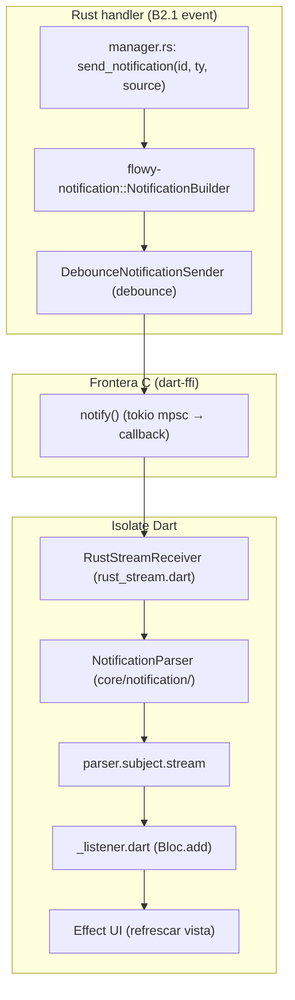
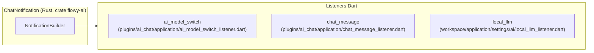
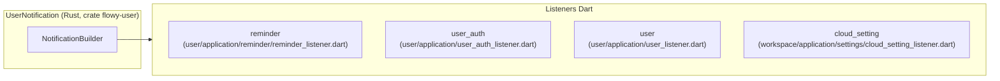

# 14 — Catálogo de notificaciones (Rust → Dart)

Este documento cataloga las **70 variantes** de notificaciones en **6 enums** Rust (`flowy-ai`, `flowy-database2`, `flowy-document`, `flowy-folder`, `flowy-storage`, `flowy-user`) que cruzan la frontera al isolate de Dart. Cada variante se define como `#[derive(ProtoBuf_Enum)] XNotification` y se publica vía `flowy-notification::NotificationBuilder` (`flowy-notification/src/builder.rs`) con su `*_OBSERVABLE_SOURCE`. La fuente de datos es `OUT/_ledger/extract/notifications.json` (Fase A2.3; validador `validate-A2.3.sh` 7/7 OK). Hay **16** sitios emisor, **29** listeners Dart y **5** parsers. La prueba del ROADMAP exige que el nº de filas del catálogo sea exactamente **70** y que cada fila tenga emisor o esté marcada `sin uso`. Cruce con B2.1 (eventos FFI): los handlers que emiten notificaciones están en el árbol de `event_handler.rs` → `manager.rs`.

## 1. Cómo leer este catálogo

Cada fila representa una variante `XNotification`. Las columnas son: `#` (ordinal dentro del enum), `Enum` (Rust), `Variante` (nombre), `Índice` (en el enum), `Default` (si es el miembro `#[default]`), `Status` (`ok`, `emitted_only`, `declared_only`, `unused` — del extractor), `Emisor (Rust)` (`archivo:línea` cuando `variant != null` en `emitters[]`; `—` si no hay emisor), `Listener Dart` (`archivo:línea` si `has_dart_listener == true`; `—` si no), `Efecto UI` (descripción derivada del nombre + listener). Las variantes con `Status ∈ {unused, declared_only, emitted_only}` se explican en §6 (`Sin uso en Dart`). Las rutas usan el formato del inventario (sin prefijo `SRC/appflowy/`).

## 2. Arquitectura del canal de notificaciones

El siguiente diagrama muestra cómo un handler Rust publica una notificación con `send_notification(&id, ty, source)` y el isolate Dart la procesa: el `RustStreamReceiver` (`rust_stream.dart`) deserializa el payload con el `<Enum>NotificationParser`, lo despacha por `parser.subject.stream` y los `*_listener.dart` (suscritos vía `subject.listen(...)`) ejecutan el efecto UI típico (`Bloc.add`, `setState`, `FlowyError`, etc.).



Lectura: el `DebounceNotificationSender` de `flowy-notification` puede coalescer múltiples `send_notification` del mismo `(id, ty, source)` en una sola entrega dentro de una ventana (típicamente 50 ms). El isolate Dart recibe el evento a través del puerto `stream_port` (sub-doc `06-puente-flutter-rust/01-ffi.md`) y `RustStreamReceiver` lo decodifica con el `NotificationParser` correspondiente (`core/notification/*_notification.dart`). Cada listener Dart se suscribe vía `parser.subject.listen(...)` y reacciona con un `switch (notification)`.

## 3. Resumen por enum

| Enum | Crate | Variantes | Emisores (Rust) | Listeners Dart | Estados |
| --- | --- | --- | --- | --- | --- |
| `ChatNotification` | `flowy-ai` | 10 | 0 | 3 | unused=10 |
| `DatabaseNotification` | `flowy-database2` | 24 | 2 | 13 | declared_only=1, emitted_only=2, unused=21 |
| `DocumentNotification` | `flowy-document` | 5 | 0 | 2 | declared_only=3, unused=2 |
| `FolderNotification` | `flowy-folder` | 19 | 0 | 6 | declared_only=8, unused=11 |
| `StorageNotification` | `flowy-storage` | 2 | 0 | 1 | unused=2 |
| `UserNotification` | `flowy-user` | 10 | 9 | 4 | declared_only=1, ok=8, unused=1 |

**Total**: 70 variantes en 6 enums. **Emisores Rust** que pasan variante específica: 11; el resto de los 16 sitios del extractor son `NotificationBuilder::new(...)` que crean la fuente (no emiten variantes concretas).

## 4. Índice global de las 70 variantes

Tabla plana con las 70 variantes ordenadas por `(enum, índice)`. Cada fila es una entrada que también aparece en §5.<enum>. El conteo de filas de §4 y de la suma de filas de §5.* debe ser exactamente **70** (prueba literal del ROADMAP).

| Enum | # | Variante | Índice | Default | Status | Emisor (Rust) | Listener Dart | Efecto UI |
| --- | --- | --- | --- | --- | --- | --- | --- | --- |
| `ChatNotification` | 1 | `Unknown` | 0 | sí | unused | — | — | Sentinela / no usado. `[INFERIDO]` |
| `ChatNotification` | 2 | `DidLoadLatestChatMessage` | 1 | — | unused | — | `appflowy:frontend/appflowy_flutter/lib/plugins/ai_chat/application/chat_message_listener.dart:1` | Carga latest chat message. `[INFERIDO]` |
| `ChatNotification` | 3 | `DidLoadPrevChatMessage` | 2 | — | unused | — | `appflowy:frontend/appflowy_flutter/lib/plugins/ai_chat/application/chat_message_listener.dart:1` | Carga prev chat message. `[INFERIDO]` |
| `ChatNotification` | 4 | `DidReceiveChatMessage` | 3 | — | unused | — | `appflowy:frontend/appflowy_flutter/lib/plugins/ai_chat/application/chat_message_listener.dart:1` | Recibe chat message. `[INFERIDO]` |
| `ChatNotification` | 5 | `StreamChatMessageError` | 4 | — | unused | — | `appflowy:frontend/appflowy_flutter/lib/plugins/ai_chat/application/chat_message_listener.dart:1` | Error al streamear chat message. `[INFERIDO]` |
| `ChatNotification` | 6 | `FinishStreaming` | 5 | — | unused | — | `appflowy:frontend/appflowy_flutter/lib/plugins/ai_chat/application/chat_message_listener.dart:1` | Marca el fin del streaming. `[INFERIDO]` |
| `ChatNotification` | 7 | `UpdateLocalAIState` | 6 | — | unused | — | `appflowy:frontend/appflowy_flutter/lib/workspace/application/settings/ai/local_llm_listener.dart:1` | Actualiza el recurso local aistate. `[INFERIDO]` |
| `ChatNotification` | 8 | `DidUpdateChatSettings` | 7 | — | unused | — | — | Actualiza el recurso chat settings. `[INFERIDO]` |
| `ChatNotification` | 9 | `LocalAIResourceUpdated` | 8 | — | unused | — | `appflowy:frontend/appflowy_flutter/lib/workspace/application/settings/ai/local_llm_listener.dart:1` | Recurso local airesource actualizado. `[INFERIDO]` |
| `ChatNotification` | 10 | `DidUpdateSelectedModel` | 9 | — | unused | — | `appflowy:frontend/appflowy_flutter/lib/plugins/ai_chat/application/ai_model_switch_listener.dart:1` | Actualiza el recurso selected model. `[INFERIDO]` |
| `DatabaseNotification` | 11 | `Unknown` | 0 | sí | unused | — | — | Sentinela / no usado. `[INFERIDO]` |
| `DatabaseNotification` | 12 | `DidFetchRow` | 19 | — | unused | — | `appflowy:frontend/appflowy_flutter/lib/plugins/database/domain/row_listener.dart:1` | Recupera row. `[INFERIDO]` |
| `DatabaseNotification` | 13 | `DidUpdateRow` | 20 | — | emitted_only | `appflowy:frontend/rust-lib/flowy-database2/src/services/database/database_observe.rs:327` | `appflowy:frontend/appflowy_flutter/lib/plugins/database/application/view/view_listener.dart:1` | Actualiza el recurso row. `[INFERIDO]` |
| `DatabaseNotification` | 14 | `DidUpdateViewRowsVisibility` | 21 | — | unused | — | `appflowy:frontend/appflowy_flutter/lib/plugins/database/application/view/view_listener.dart:1` | Actualiza el recurso view rows visibility. `[INFERIDO]` |
| `DatabaseNotification` | 15 | `DidUpdateFields` | 22 | — | unused | — | `appflowy:frontend/appflowy_flutter/lib/plugins/database/domain/field_listener.dart:1` | Actualiza el recurso fields. `[INFERIDO]` |
| `DatabaseNotification` | 16 | `DidUpdateCell` | 40 | — | emitted_only | `appflowy:frontend/rust-lib/flowy-database2/src/services/database/database_observe.rs:338` | `appflowy:frontend/appflowy_flutter/lib/plugins/database/domain/cell_listener.dart:1` | Actualiza el recurso cell. `[INFERIDO]` |
| `DatabaseNotification` | 17 | `DidUpdateField` | 50 | — | unused | — | — | Actualiza el recurso field. `[INFERIDO]` |
| `DatabaseNotification` | 18 | `DidUpdateNumOfGroups` | 60 | — | unused | — | `appflowy:frontend/appflowy_flutter/lib/plugins/database/domain/group_listener.dart:1` | Actualiza el recurso num of groups. `[INFERIDO]` |
| `DatabaseNotification` | 19 | `DidUpdateGroupRow` | 61 | — | unused | — | — | Actualiza el recurso group row. `[INFERIDO]` |
| `DatabaseNotification` | 20 | `DidGroupByField` | 62 | — | unused | — | `appflowy:frontend/appflowy_flutter/lib/plugins/database/domain/group_listener.dart:1` | Agrupa por field. `[INFERIDO]` |
| `DatabaseNotification` | 21 | `DidUpdateFilter` | 63 | — | unused | — | `appflowy:frontend/appflowy_flutter/lib/plugins/database/domain/filter_listener.dart:1`<br/>`appflowy:frontend/appflowy_flutter/lib/plugins/database/domain/filter_listener.dart:1` | Actualiza el recurso filter. `[INFERIDO]` |
| `DatabaseNotification` | 22 | `DidUpdateSort` | 64 | — | unused | — | `appflowy:frontend/appflowy_flutter/lib/plugins/database/domain/sort_listener.dart:1` | Actualiza el recurso sort. `[INFERIDO]` |
| `DatabaseNotification` | 23 | `DidReorderRows` | 65 | — | unused | — | `appflowy:frontend/appflowy_flutter/lib/plugins/database/application/view/view_listener.dart:1` | Reordena rows. `[INFERIDO]` |
| `DatabaseNotification` | 24 | `DidReorderSingleRow` | 66 | — | unused | — | `appflowy:frontend/appflowy_flutter/lib/plugins/database/application/view/view_listener.dart:1` | Reordena single row. `[INFERIDO]` |
| `DatabaseNotification` | 25 | `DidUpdateRowMeta` | 67 | — | unused | — | `appflowy:frontend/appflowy_flutter/lib/plugins/database/domain/row_listener.dart:1`<br/>`appflowy:frontend/appflowy_flutter/lib/plugins/database/domain/row_meta_listener.dart:1` | Actualiza el recurso row meta. `[INFERIDO]` |
| `DatabaseNotification` | 26 | `DidUpdateSettings` | 70 | — | unused | — | `appflowy:frontend/appflowy_flutter/lib/plugins/database/application/setting/setting_listener.dart:1` | Actualiza el recurso settings. `[INFERIDO]` |
| `DatabaseNotification` | 27 | `DidUpdateLayoutSettings` | 80 | — | unused | — | `appflowy:frontend/appflowy_flutter/lib/plugins/database/domain/layout_setting_listener.dart:1` | Actualiza el recurso layout settings. `[INFERIDO]` |
| `DatabaseNotification` | 28 | `DidUpdateDatabaseLayout` | 81 | — | unused | — | — | Actualiza el recurso database layout. `[INFERIDO]` |
| `DatabaseNotification` | 29 | `DidDeleteDatabaseView` | 82 | — | unused | — | — | Elimina el recurso database view. `[INFERIDO]` |
| `DatabaseNotification` | 30 | `DidMoveDatabaseViewToTrash` | 83 | — | unused | — | — | Mueve database view to trash. `[INFERIDO]` |
| `DatabaseNotification` | 31 | `DidUpdateDatabaseSyncUpdate` | 84 | — | declared_only | — | `appflowy:frontend/appflowy_flutter/lib/plugins/database/application/sync/database_sync_state_listener.dart:1` | Actualiza el recurso database sync update. `[INFERIDO]` |
| `DatabaseNotification` | 32 | `DidUpdateDatabaseSnapshotState` | 85 | — | unused | — | — | Actualiza el recurso database snapshot state. `[INFERIDO]` |
| `DatabaseNotification` | 33 | `DidUpdateFieldSettings` | 86 | — | unused | — | `appflowy:frontend/appflowy_flutter/lib/plugins/database/domain/field_settings_listener.dart:1` | Actualiza el recurso field settings. `[INFERIDO]` |
| `DatabaseNotification` | 34 | `DidUpdateCalculation` | 87 | — | unused | — | `appflowy:frontend/appflowy_flutter/lib/plugins/database/application/calculations/calculations_listener.dart:1` | Actualiza el recurso calculation. `[INFERIDO]` |
| `DocumentNotification` | 35 | `Unknown` | 0 | sí | unused | — | — | Sentinela / no usado. `[INFERIDO]` |
| `DocumentNotification` | 36 | `DidReceiveUpdate` | 1 | — | declared_only | — | `appflowy:frontend/appflowy_flutter/lib/plugins/document/application/document_listener.dart:1` | Recibe update. `[INFERIDO]` |
| `DocumentNotification` | 37 | `DidUpdateDocumentSnapshotState` | 2 | — | unused | — | — | Actualiza el recurso document snapshot state. `[INFERIDO]` |
| `DocumentNotification` | 38 | `DidUpdateDocumentSyncState` | 3 | — | declared_only | — | `appflowy:frontend/appflowy_flutter/lib/plugins/document/application/doc_sync_state_listener.dart:1` | Actualiza el recurso document sync state. `[INFERIDO]` |
| `DocumentNotification` | 39 | `DidUpdateDocumentAwarenessState` | 4 | — | declared_only | — | `appflowy:frontend/appflowy_flutter/lib/plugins/document/application/document_listener.dart:1` | Actualiza el recurso document awareness state. `[INFERIDO]` |
| `FolderNotification` | 40 | `Unknown` | 0 | sí | unused | — | — | Sentinela / no usado. `[INFERIDO]` |
| `FolderNotification` | 41 | `DidCreateWorkspace` | 1 | — | unused | — | — | Crea el recurso workspace. `[INFERIDO]` |
| `FolderNotification` | 42 | `DidUpdateWorkspace` | 2 | — | unused | — | `appflowy:frontend/appflowy_flutter/lib/workspace/application/workspace/workspace_listener.dart:1` | Actualiza el recurso workspace. `[INFERIDO]` |
| `FolderNotification` | 43 | `DidUpdateWorkspaceViews` | 3 | — | unused | — | `appflowy:frontend/appflowy_flutter/lib/workspace/application/workspace/workspace_listener.dart:1` | Actualiza el recurso workspace views. `[INFERIDO]` |
| `FolderNotification` | 44 | `DidUpdateWorkspaceSetting` | 4 | — | unused | — | `appflowy:frontend/appflowy_flutter/lib/user/application/user_listener.dart:1` | Actualiza el recurso workspace setting. `[INFERIDO]` |
| `FolderNotification` | 45 | `DidUpdateView` | 10 | — | declared_only | — | `appflowy:frontend/appflowy_flutter/lib/workspace/application/view/view_listener.dart:1` | Actualiza el recurso view. `[INFERIDO]` |
| `FolderNotification` | 46 | `DidUpdateChildViews` | 11 | — | declared_only | — | `appflowy:frontend/appflowy_flutter/lib/workspace/application/view/view_listener.dart:1` | Actualiza el recurso child views. `[INFERIDO]` |
| `FolderNotification` | 47 | `DidDeleteView` | 12 | — | declared_only | — | `appflowy:frontend/appflowy_flutter/lib/workspace/application/view/view_listener.dart:1` | Elimina el recurso view. `[INFERIDO]` |
| `FolderNotification` | 48 | `DidRestoreView` | 13 | — | declared_only | — | `appflowy:frontend/appflowy_flutter/lib/workspace/application/view/view_listener.dart:1` | Notificación DidRestoreView. `[INFERIDO]` |
| `FolderNotification` | 49 | `DidMoveViewToTrash` | 14 | — | declared_only | — | `appflowy:frontend/appflowy_flutter/lib/workspace/application/view/view_listener.dart:1` | Mueve view to trash. `[INFERIDO]` |
| `FolderNotification` | 50 | `DidUpdateTrash` | 15 | — | declared_only | — | `appflowy:frontend/appflowy_flutter/lib/plugins/trash/application/trash_listener.dart:1` | Actualiza el recurso trash. `[INFERIDO]` |
| `FolderNotification` | 51 | `DidUpdateFolderSnapshotState` | 16 | — | unused | — | — | Actualiza el recurso folder snapshot state. `[INFERIDO]` |
| `FolderNotification` | 52 | `DidUpdateFolderSyncUpdate` | 17 | — | unused | — | — | Actualiza el recurso folder sync update. `[INFERIDO]` |
| `FolderNotification` | 53 | `DidFavoriteView` | 36 | — | declared_only | — | `appflowy:frontend/appflowy_flutter/lib/workspace/application/favorite/favorite_listener.dart:1` | Notificación DidFavoriteView. `[INFERIDO]` |
| `FolderNotification` | 54 | `DidUnfavoriteView` | 37 | — | declared_only | — | `appflowy:frontend/appflowy_flutter/lib/workspace/application/favorite/favorite_listener.dart:1` | Notificación DidUnfavoriteView. `[INFERIDO]` |
| `FolderNotification` | 55 | `DidUpdateRecentViews` | 38 | — | unused | — | — | Actualiza el recurso recent views. `[INFERIDO]` |
| `FolderNotification` | 56 | `DidUpdateSectionViews` | 39 | — | unused | — | `appflowy:frontend/appflowy_flutter/lib/workspace/application/workspace/workspace_sections_listener.dart:1` | Actualiza el recurso section views. `[INFERIDO]` |
| `FolderNotification` | 57 | `DidUpdateSharedViews` | 40 | — | unused | — | — | Actualiza el recurso shared views. `[INFERIDO]` |
| `FolderNotification` | 58 | `DidUpdateSharedUsers` | 41 | — | unused | — | — | Actualiza el recurso shared users. `[INFERIDO]` |
| `StorageNotification` | 59 | `FileStorageLimitExceeded` | 0 | sí | unused | — | `appflowy:frontend/appflowy_flutter/lib/workspace/application/settings/file_storage/file_storage_listener.dart:1` | Límite total de almacenamiento superado. `[INFERIDO]` |
| `StorageNotification` | 60 | `SingleFileLimitExceeded` | 1 | — | unused | — | `appflowy:frontend/appflowy_flutter/lib/workspace/application/settings/file_storage/file_storage_listener.dart:1` | Límite por archivo superado. `[INFERIDO]` |
| `UserNotification` | 61 | `Unknown` | 0 | sí | unused | — | — | Sentinela / no usado. `[INFERIDO]` |
| `UserNotification` | 62 | `UserAuthStateChanged` | 1 | — | ok | `appflowy:frontend/rust-lib/flowy-user/src/notification.rs:34` | `appflowy:frontend/appflowy_flutter/lib/user/application/user_auth_listener.dart:1` | Notificación UserAuthStateChanged. `[INFERIDO]` |
| `UserNotification` | 63 | `DidUpdateUserProfile` | 2 | — | ok | `appflowy:frontend/rust-lib/flowy-user/src/user_manager/manager.rs:828` | `appflowy:frontend/appflowy_flutter/lib/user/application/user_listener.dart:1` | Actualiza el recurso user profile. `[INFERIDO]` |
| `UserNotification` | 64 | `DidUpdateUserWorkspaces` | 3 | — | ok | `appflowy:frontend/rust-lib/flowy-user/src/user_manager/manager_user_workspace.rs:492` | `appflowy:frontend/appflowy_flutter/lib/user/application/user_listener.dart:1` | Actualiza el recurso user workspaces. `[INFERIDO]` |
| `UserNotification` | 65 | `DidUpdateCloudConfig` | 4 | — | ok | `appflowy:frontend/rust-lib/flowy-user/src/event_handler.rs:400` | `appflowy:frontend/appflowy_flutter/lib/workspace/application/settings/cloud_setting_listener.dart:1` | Actualiza el recurso cloud config. `[INFERIDO]` |
| `UserNotification` | 66 | `DidUpdateUserWorkspace` | 5 | — | ok | `appflowy:frontend/rust-lib/flowy-user/src/user_manager/manager_user_workspace.rs:298` | `appflowy:frontend/appflowy_flutter/lib/user/application/user_listener.dart:1` | Actualiza el recurso user workspace. `[INFERIDO]` |
| `UserNotification` | 67 | `DidUpdateWorkspaceSetting` | 6 | — | ok | `appflowy:frontend/rust-lib/flowy-user/src/user_manager/manager_user_workspace.rs:641`<br/>`appflowy:frontend/rust-lib/flowy-user/src/user_manager/manager_user_workspace.rs:796` | `appflowy:frontend/appflowy_flutter/lib/user/application/user_listener.dart:1` | Actualiza el recurso workspace setting. `[INFERIDO]` |
| `UserNotification` | 68 | `DidLoadUserAwareness` | 7 | — | ok | `appflowy:frontend/rust-lib/flowy-user/src/user_manager/manager_user_awareness.rs:295` | `appflowy:frontend/appflowy_flutter/lib/user/application/reminder/reminder_listener.dart:1` | Carga user awareness. `[INFERIDO]` |
| `UserNotification` | 69 | `DidUpdateReminder` | 8 | — | declared_only | — | `appflowy:frontend/appflowy_flutter/lib/user/application/reminder/reminder_listener.dart:1` | Actualiza el recurso reminder. `[INFERIDO]` |
| `UserNotification` | 70 | `DidOpenWorkspace` | 9 | — | ok | `appflowy:frontend/rust-lib/flowy-user/src/user_manager/manager_user_workspace.rs:244` | `appflowy:frontend/appflowy_flutter/lib/user/application/user_listener.dart:1` | Notificación DidOpenWorkspace. `[INFERIDO]` |

## 5. Catálogo por enum

Cada sub-sección desarrolla un enum. Las tablas siguen el mismo esquema que §4 (sin la columna `Enum` redundante). Cuando un enum supera las 10 variantes, se acompaña de un mini `flowchart` que muestra el listener que la enruta (cuando existe).

### 5.1 `ChatNotification`

**10 variantes** · **0 emisores con variante** · declarado en `appflowy/frontend/rust-lib/flowy-ai/src/notification.rs:8`.



| # | Variante | Índice | Default | Status | Emisor (Rust) | Listener Dart | Archivo variante | Efecto UI |
| --- | --- | --- | --- | --- | --- | --- | --- | --- |
| 1 | `Unknown` | 0 | sí | unused | — | — | `appflowy:frontend/rust-lib/flowy-ai/src/notification.rs:10` | Sentinela / no usado. `[INFERIDO]` |
| 2 | `DidLoadLatestChatMessage` | 1 | — | unused | — | `appflowy:frontend/appflowy_flutter/lib/plugins/ai_chat/application/chat_message_listener.dart:1` | `appflowy:frontend/rust-lib/flowy-ai/src/notification.rs:11` | Carga latest chat message. `[INFERIDO]` |
| 3 | `DidLoadPrevChatMessage` | 2 | — | unused | — | `appflowy:frontend/appflowy_flutter/lib/plugins/ai_chat/application/chat_message_listener.dart:1` | `appflowy:frontend/rust-lib/flowy-ai/src/notification.rs:12` | Carga prev chat message. `[INFERIDO]` |
| 4 | `DidReceiveChatMessage` | 3 | — | unused | — | `appflowy:frontend/appflowy_flutter/lib/plugins/ai_chat/application/chat_message_listener.dart:1` | `appflowy:frontend/rust-lib/flowy-ai/src/notification.rs:13` | Recibe chat message. `[INFERIDO]` |
| 5 | `StreamChatMessageError` | 4 | — | unused | — | `appflowy:frontend/appflowy_flutter/lib/plugins/ai_chat/application/chat_message_listener.dart:1` | `appflowy:frontend/rust-lib/flowy-ai/src/notification.rs:14` | Error al streamear chat message. `[INFERIDO]` |
| 6 | `FinishStreaming` | 5 | — | unused | — | `appflowy:frontend/appflowy_flutter/lib/plugins/ai_chat/application/chat_message_listener.dart:1` | `appflowy:frontend/rust-lib/flowy-ai/src/notification.rs:15` | Marca el fin del streaming. `[INFERIDO]` |
| 7 | `UpdateLocalAIState` | 6 | — | unused | — | `appflowy:frontend/appflowy_flutter/lib/workspace/application/settings/ai/local_llm_listener.dart:1` | `appflowy:frontend/rust-lib/flowy-ai/src/notification.rs:16` | Actualiza el recurso local aistate. `[INFERIDO]` |
| 8 | `DidUpdateChatSettings` | 7 | — | unused | — | — | `appflowy:frontend/rust-lib/flowy-ai/src/notification.rs:17` | Actualiza el recurso chat settings. `[INFERIDO]` |
| 9 | `LocalAIResourceUpdated` | 8 | — | unused | — | `appflowy:frontend/appflowy_flutter/lib/workspace/application/settings/ai/local_llm_listener.dart:1` | `appflowy:frontend/rust-lib/flowy-ai/src/notification.rs:18` | Recurso local airesource actualizado. `[INFERIDO]` |
| 10 | `DidUpdateSelectedModel` | 9 | — | unused | — | `appflowy:frontend/appflowy_flutter/lib/plugins/ai_chat/application/ai_model_switch_listener.dart:1` | `appflowy:frontend/rust-lib/flowy-ai/src/notification.rs:19` | Actualiza el recurso selected model. `[INFERIDO]` |

### 5.2 `DatabaseNotification`

**24 variantes** · **2 emisores con variante** · declarado en `appflowy/frontend/rust-lib/flowy-database2/src/notification.rs:7`.

```mermaid
flowchart LR
  subgraph R["DatabaseNotification (Rust, crate flowy-database2)"]
    N["NotificationBuilder"]
  end
  subgraph D["Listeners Dart"]
    calculations["calculations<br/>(plugins/database/application/calculations/calculations_listener.dart)"]
    setting["setting<br/>(plugins/database/application/setting/setting_listener.dart)"]
    database_sync_state["database_sync_state<br/>(plugins/database/application/sync/database_sync_state_listener.dart)"]
    view["view<br/>(plugins/database/application/view/view_listener.dart)"]
    cell["cell<br/>(plugins/database/domain/cell_listener.dart)"]
    field["field<br/>(plugins/database/domain/field_listener.dart)"]
  end
  N --> D
```



| # | Variante | Índice | Default | Status | Emisor (Rust) | Listener Dart | Archivo variante | Efecto UI |
| --- | --- | --- | --- | --- | --- | --- | --- | --- |
| 1 | `Unknown` | 0 | sí | unused | — | — | `appflowy:frontend/rust-lib/flowy-database2/src/notification.rs:9` | Sentinela / no usado. `[INFERIDO]` |
| 2 | `DidFetchRow` | 19 | — | unused | — | `appflowy:frontend/appflowy_flutter/lib/plugins/database/domain/row_listener.dart:1` | `appflowy:frontend/rust-lib/flowy-database2/src/notification.rs:12` | Recupera row. `[INFERIDO]` |
| 3 | `DidUpdateRow` | 20 | — | emitted_only | `appflowy:frontend/rust-lib/flowy-database2/src/services/database/database_observe.rs:327` | `appflowy:frontend/appflowy_flutter/lib/plugins/database/application/view/view_listener.dart:1` | `appflowy:frontend/rust-lib/flowy-database2/src/notification.rs:14` | Actualiza el recurso row. `[INFERIDO]` |
| 4 | `DidUpdateViewRowsVisibility` | 21 | — | unused | — | `appflowy:frontend/appflowy_flutter/lib/plugins/database/application/view/view_listener.dart:1` | `appflowy:frontend/rust-lib/flowy-database2/src/notification.rs:16` | Actualiza el recurso view rows visibility. `[INFERIDO]` |
| 5 | `DidUpdateFields` | 22 | — | unused | — | `appflowy:frontend/appflowy_flutter/lib/plugins/database/domain/field_listener.dart:1` | `appflowy:frontend/rust-lib/flowy-database2/src/notification.rs:18` | Actualiza el recurso fields. `[INFERIDO]` |
| 6 | `DidUpdateCell` | 40 | — | emitted_only | `appflowy:frontend/rust-lib/flowy-database2/src/services/database/database_observe.rs:338` | `appflowy:frontend/appflowy_flutter/lib/plugins/database/domain/cell_listener.dart:1` | `appflowy:frontend/rust-lib/flowy-database2/src/notification.rs:20` | Actualiza el recurso cell. `[INFERIDO]` |
| 7 | `DidUpdateField` | 50 | — | unused | — | — | `appflowy:frontend/rust-lib/flowy-database2/src/notification.rs:22` | Actualiza el recurso field. `[INFERIDO]` |
| 8 | `DidUpdateNumOfGroups` | 60 | — | unused | — | `appflowy:frontend/appflowy_flutter/lib/plugins/database/domain/group_listener.dart:1` | `appflowy:frontend/rust-lib/flowy-database2/src/notification.rs:24` | Actualiza el recurso num of groups. `[INFERIDO]` |
| 9 | `DidUpdateGroupRow` | 61 | — | unused | — | — | `appflowy:frontend/rust-lib/flowy-database2/src/notification.rs:26` | Actualiza el recurso group row. `[INFERIDO]` |
| 10 | `DidGroupByField` | 62 | — | unused | — | `appflowy:frontend/appflowy_flutter/lib/plugins/database/domain/group_listener.dart:1` | `appflowy:frontend/rust-lib/flowy-database2/src/notification.rs:28` | Agrupa por field. `[INFERIDO]` |
| 11 | `DidUpdateFilter` | 63 | — | unused | — | `appflowy:frontend/appflowy_flutter/lib/plugins/database/domain/filter_listener.dart:1`<br/>`appflowy:frontend/appflowy_flutter/lib/plugins/database/domain/filter_listener.dart:1` | `appflowy:frontend/rust-lib/flowy-database2/src/notification.rs:30` | Actualiza el recurso filter. `[INFERIDO]` |
| 12 | `DidUpdateSort` | 64 | — | unused | — | `appflowy:frontend/appflowy_flutter/lib/plugins/database/domain/sort_listener.dart:1` | `appflowy:frontend/rust-lib/flowy-database2/src/notification.rs:32` | Actualiza el recurso sort. `[INFERIDO]` |
| 13 | `DidReorderRows` | 65 | — | unused | — | `appflowy:frontend/appflowy_flutter/lib/plugins/database/application/view/view_listener.dart:1` | `appflowy:frontend/rust-lib/flowy-database2/src/notification.rs:34` | Reordena rows. `[INFERIDO]` |
| 14 | `DidReorderSingleRow` | 66 | — | unused | — | `appflowy:frontend/appflowy_flutter/lib/plugins/database/application/view/view_listener.dart:1` | `appflowy:frontend/rust-lib/flowy-database2/src/notification.rs:36` | Reordena single row. `[INFERIDO]` |
| 15 | `DidUpdateRowMeta` | 67 | — | unused | — | `appflowy:frontend/appflowy_flutter/lib/plugins/database/domain/row_listener.dart:1`<br/>`appflowy:frontend/appflowy_flutter/lib/plugins/database/domain/row_meta_listener.dart:1` | `appflowy:frontend/rust-lib/flowy-database2/src/notification.rs:38` | Actualiza el recurso row meta. `[INFERIDO]` |
| 16 | `DidUpdateSettings` | 70 | — | unused | — | `appflowy:frontend/appflowy_flutter/lib/plugins/database/application/setting/setting_listener.dart:1` | `appflowy:frontend/rust-lib/flowy-database2/src/notification.rs:40` | Actualiza el recurso settings. `[INFERIDO]` |
| 17 | `DidUpdateLayoutSettings` | 80 | — | unused | — | `appflowy:frontend/appflowy_flutter/lib/plugins/database/domain/layout_setting_listener.dart:1` | `appflowy:frontend/rust-lib/flowy-database2/src/notification.rs:42` | Actualiza el recurso layout settings. `[INFERIDO]` |
| 18 | `DidUpdateDatabaseLayout` | 81 | — | unused | — | — | `appflowy:frontend/rust-lib/flowy-database2/src/notification.rs:44` | Actualiza el recurso database layout. `[INFERIDO]` |
| 19 | `DidDeleteDatabaseView` | 82 | — | unused | — | — | `appflowy:frontend/rust-lib/flowy-database2/src/notification.rs:46` | Elimina el recurso database view. `[INFERIDO]` |
| 20 | `DidMoveDatabaseViewToTrash` | 83 | — | unused | — | — | `appflowy:frontend/rust-lib/flowy-database2/src/notification.rs:48` | Mueve database view to trash. `[INFERIDO]` |
| 21 | `DidUpdateDatabaseSyncUpdate` | 84 | — | declared_only | — | `appflowy:frontend/appflowy_flutter/lib/plugins/database/application/sync/database_sync_state_listener.dart:1` | `appflowy:frontend/rust-lib/flowy-database2/src/notification.rs:49` | Actualiza el recurso database sync update. `[INFERIDO]` |
| 22 | `DidUpdateDatabaseSnapshotState` | 85 | — | unused | — | — | `appflowy:frontend/rust-lib/flowy-database2/src/notification.rs:50` | Actualiza el recurso database snapshot state. `[INFERIDO]` |
| 23 | `DidUpdateFieldSettings` | 86 | — | unused | — | `appflowy:frontend/appflowy_flutter/lib/plugins/database/domain/field_settings_listener.dart:1` | `appflowy:frontend/rust-lib/flowy-database2/src/notification.rs:52` | Actualiza el recurso field settings. `[INFERIDO]` |
| 24 | `DidUpdateCalculation` | 87 | — | unused | — | `appflowy:frontend/appflowy_flutter/lib/plugins/database/application/calculations/calculations_listener.dart:1` | `appflowy:frontend/rust-lib/flowy-database2/src/notification.rs:54` | Actualiza el recurso calculation. `[INFERIDO]` |

### 5.3 `DocumentNotification`

**5 variantes** · **0 emisores con variante** · declarado en `appflowy/frontend/rust-lib/flowy-document/src/notification.rs:7`.

| # | Variante | Índice | Default | Status | Emisor (Rust) | Listener Dart | Archivo variante | Efecto UI |
| --- | --- | --- | --- | --- | --- | --- | --- | --- |
| 1 | `Unknown` | 0 | sí | unused | — | — | `appflowy:frontend/rust-lib/flowy-document/src/notification.rs:9` | Sentinela / no usado. `[INFERIDO]` |
| 2 | `DidReceiveUpdate` | 1 | — | declared_only | — | `appflowy:frontend/appflowy_flutter/lib/plugins/document/application/document_listener.dart:1` | `appflowy:frontend/rust-lib/flowy-document/src/notification.rs:11` | Recibe update. `[INFERIDO]` |
| 3 | `DidUpdateDocumentSnapshotState` | 2 | — | unused | — | — | `appflowy:frontend/rust-lib/flowy-document/src/notification.rs:12` | Actualiza el recurso document snapshot state. `[INFERIDO]` |
| 4 | `DidUpdateDocumentSyncState` | 3 | — | declared_only | — | `appflowy:frontend/appflowy_flutter/lib/plugins/document/application/doc_sync_state_listener.dart:1` | `appflowy:frontend/rust-lib/flowy-document/src/notification.rs:13` | Actualiza el recurso document sync state. `[INFERIDO]` |
| 5 | `DidUpdateDocumentAwarenessState` | 4 | — | declared_only | — | `appflowy:frontend/appflowy_flutter/lib/plugins/document/application/document_listener.dart:1` | `appflowy:frontend/rust-lib/flowy-document/src/notification.rs:14` | Actualiza el recurso document awareness state. `[INFERIDO]` |

### 5.4 `FolderNotification`

**19 variantes** · **0 emisores con variante** · declarado en `appflowy/frontend/rust-lib/flowy-folder/src/notification.rs:10`.

```mermaid
flowchart LR
  subgraph R["FolderNotification (Rust, crate flowy-folder)"]
    N["NotificationBuilder"]
  end
  subgraph D["Listeners Dart"]
    trash["trash<br/>(plugins/trash/application/trash_listener.dart)"]
    user["user<br/>(user/application/user_listener.dart)"]
    favorite["favorite<br/>(workspace/application/favorite/favorite_listener.dart)"]
    view["view<br/>(workspace/application/view/view_listener.dart)"]
    workspace["workspace<br/>(workspace/application/workspace/workspace_listener.dart)"]
    workspace_sections["workspace_sections<br/>(workspace/application/workspace/workspace_sections_listener.dart)"]
  end
  N --> D
```



| # | Variante | Índice | Default | Status | Emisor (Rust) | Listener Dart | Archivo variante | Efecto UI |
| --- | --- | --- | --- | --- | --- | --- | --- | --- |
| 1 | `Unknown` | 0 | sí | unused | — | — | `appflowy:frontend/rust-lib/flowy-folder/src/notification.rs:12` | Sentinela / no usado. `[INFERIDO]` |
| 2 | `DidCreateWorkspace` | 1 | — | unused | — | — | `appflowy:frontend/rust-lib/flowy-folder/src/notification.rs:14` | Crea el recurso workspace. `[INFERIDO]` |
| 3 | `DidUpdateWorkspace` | 2 | — | unused | — | `appflowy:frontend/appflowy_flutter/lib/workspace/application/workspace/workspace_listener.dart:1` | `appflowy:frontend/rust-lib/flowy-folder/src/notification.rs:16` | Actualiza el recurso workspace. `[INFERIDO]` |
| 4 | `DidUpdateWorkspaceViews` | 3 | — | unused | — | `appflowy:frontend/appflowy_flutter/lib/workspace/application/workspace/workspace_listener.dart:1` | `appflowy:frontend/rust-lib/flowy-folder/src/notification.rs:18` | Actualiza el recurso workspace views. `[INFERIDO]` |
| 5 | `DidUpdateWorkspaceSetting` | 4 | — | unused | — | `appflowy:frontend/appflowy_flutter/lib/user/application/user_listener.dart:1` | `appflowy:frontend/rust-lib/flowy-folder/src/notification.rs:20` | Actualiza el recurso workspace setting. `[INFERIDO]` |
| 6 | `DidUpdateView` | 10 | — | declared_only | — | `appflowy:frontend/appflowy_flutter/lib/workspace/application/view/view_listener.dart:1` | `appflowy:frontend/rust-lib/flowy-folder/src/notification.rs:22` | Actualiza el recurso view. `[INFERIDO]` |
| 7 | `DidUpdateChildViews` | 11 | — | declared_only | — | `appflowy:frontend/appflowy_flutter/lib/workspace/application/view/view_listener.dart:1` | `appflowy:frontend/rust-lib/flowy-folder/src/notification.rs:23` | Actualiza el recurso child views. `[INFERIDO]` |
| 8 | `DidDeleteView` | 12 | — | declared_only | — | `appflowy:frontend/appflowy_flutter/lib/workspace/application/view/view_listener.dart:1` | `appflowy:frontend/rust-lib/flowy-folder/src/notification.rs:25` | Elimina el recurso view. `[INFERIDO]` |
| 9 | `DidRestoreView` | 13 | — | declared_only | — | `appflowy:frontend/appflowy_flutter/lib/workspace/application/view/view_listener.dart:1` | `appflowy:frontend/rust-lib/flowy-folder/src/notification.rs:27` | Notificación DidRestoreView. `[INFERIDO]` |
| 10 | `DidMoveViewToTrash` | 14 | — | declared_only | — | `appflowy:frontend/appflowy_flutter/lib/workspace/application/view/view_listener.dart:1` | `appflowy:frontend/rust-lib/flowy-folder/src/notification.rs:29` | Mueve view to trash. `[INFERIDO]` |
| 11 | `DidUpdateTrash` | 15 | — | declared_only | — | `appflowy:frontend/appflowy_flutter/lib/plugins/trash/application/trash_listener.dart:1` | `appflowy:frontend/rust-lib/flowy-folder/src/notification.rs:31` | Actualiza el recurso trash. `[INFERIDO]` |
| 12 | `DidUpdateFolderSnapshotState` | 16 | — | unused | — | — | `appflowy:frontend/rust-lib/flowy-folder/src/notification.rs:32` | Actualiza el recurso folder snapshot state. `[INFERIDO]` |
| 13 | `DidUpdateFolderSyncUpdate` | 17 | — | unused | — | — | `appflowy:frontend/rust-lib/flowy-folder/src/notification.rs:33` | Actualiza el recurso folder sync update. `[INFERIDO]` |
| 14 | `DidFavoriteView` | 36 | — | declared_only | — | `appflowy:frontend/appflowy_flutter/lib/workspace/application/favorite/favorite_listener.dart:1` | `appflowy:frontend/rust-lib/flowy-folder/src/notification.rs:35` | Notificación DidFavoriteView. `[INFERIDO]` |
| 15 | `DidUnfavoriteView` | 37 | — | declared_only | — | `appflowy:frontend/appflowy_flutter/lib/workspace/application/favorite/favorite_listener.dart:1` | `appflowy:frontend/rust-lib/flowy-folder/src/notification.rs:36` | Notificación DidUnfavoriteView. `[INFERIDO]` |
| 16 | `DidUpdateRecentViews` | 38 | — | unused | — | — | `appflowy:frontend/rust-lib/flowy-folder/src/notification.rs:38` | Actualiza el recurso recent views. `[INFERIDO]` |
| 17 | `DidUpdateSectionViews` | 39 | — | unused | — | `appflowy:frontend/appflowy_flutter/lib/workspace/application/workspace/workspace_sections_listener.dart:1` | `appflowy:frontend/rust-lib/flowy-folder/src/notification.rs:41` | Actualiza el recurso section views. `[INFERIDO]` |
| 18 | `DidUpdateSharedViews` | 40 | — | unused | — | — | `appflowy:frontend/rust-lib/flowy-folder/src/notification.rs:43` | Actualiza el recurso shared views. `[INFERIDO]` |
| 19 | `DidUpdateSharedUsers` | 41 | — | unused | — | — | `appflowy:frontend/rust-lib/flowy-folder/src/notification.rs:44` | Actualiza el recurso shared users. `[INFERIDO]` |

### 5.5 `StorageNotification`

**2 variantes** · **0 emisores con variante** · declarado en `appflowy/frontend/rust-lib/flowy-storage/src/notification.rs:7`.

| # | Variante | Índice | Default | Status | Emisor (Rust) | Listener Dart | Archivo variante | Efecto UI |
| --- | --- | --- | --- | --- | --- | --- | --- | --- |
| 1 | `FileStorageLimitExceeded` | 0 | sí | unused | — | `appflowy:frontend/appflowy_flutter/lib/workspace/application/settings/file_storage/file_storage_listener.dart:1` | `appflowy:frontend/rust-lib/flowy-storage/src/notification.rs:9` | Límite total de almacenamiento superado. `[INFERIDO]` |
| 2 | `SingleFileLimitExceeded` | 1 | — | unused | — | `appflowy:frontend/appflowy_flutter/lib/workspace/application/settings/file_storage/file_storage_listener.dart:1` | `appflowy:frontend/rust-lib/flowy-storage/src/notification.rs:11` | Límite por archivo superado. `[INFERIDO]` |

### 5.6 `UserNotification`

**10 variantes** · **9 emisores con variante** · declarado en `appflowy/frontend/rust-lib/flowy-user/src/notification.rs:11`.



| # | Variante | Índice | Default | Status | Emisor (Rust) | Listener Dart | Archivo variante | Efecto UI |
| --- | --- | --- | --- | --- | --- | --- | --- | --- |
| 1 | `Unknown` | 0 | sí | unused | — | — | `appflowy:frontend/rust-lib/flowy-user/src/notification.rs:13` | Sentinela / no usado. `[INFERIDO]` |
| 2 | `UserAuthStateChanged` | 1 | — | ok | `appflowy:frontend/rust-lib/flowy-user/src/notification.rs:34` | `appflowy:frontend/appflowy_flutter/lib/user/application/user_auth_listener.dart:1` | `appflowy:frontend/rust-lib/flowy-user/src/notification.rs:14` | Notificación UserAuthStateChanged. `[INFERIDO]` |
| 3 | `DidUpdateUserProfile` | 2 | — | ok | `appflowy:frontend/rust-lib/flowy-user/src/user_manager/manager.rs:828` | `appflowy:frontend/appflowy_flutter/lib/user/application/user_listener.dart:1` | `appflowy:frontend/rust-lib/flowy-user/src/notification.rs:15` | Actualiza el recurso user profile. `[INFERIDO]` |
| 4 | `DidUpdateUserWorkspaces` | 3 | — | ok | `appflowy:frontend/rust-lib/flowy-user/src/user_manager/manager_user_workspace.rs:492` | `appflowy:frontend/appflowy_flutter/lib/user/application/user_listener.dart:1` | `appflowy:frontend/rust-lib/flowy-user/src/notification.rs:16` | Actualiza el recurso user workspaces. `[INFERIDO]` |
| 5 | `DidUpdateCloudConfig` | 4 | — | ok | `appflowy:frontend/rust-lib/flowy-user/src/event_handler.rs:400` | `appflowy:frontend/appflowy_flutter/lib/workspace/application/settings/cloud_setting_listener.dart:1` | `appflowy:frontend/rust-lib/flowy-user/src/notification.rs:17` | Actualiza el recurso cloud config. `[INFERIDO]` |
| 6 | `DidUpdateUserWorkspace` | 5 | — | ok | `appflowy:frontend/rust-lib/flowy-user/src/user_manager/manager_user_workspace.rs:298` | `appflowy:frontend/appflowy_flutter/lib/user/application/user_listener.dart:1` | `appflowy:frontend/rust-lib/flowy-user/src/notification.rs:18` | Actualiza el recurso user workspace. `[INFERIDO]` |
| 7 | `DidUpdateWorkspaceSetting` | 6 | — | ok | `appflowy:frontend/rust-lib/flowy-user/src/user_manager/manager_user_workspace.rs:641`<br/>`appflowy:frontend/rust-lib/flowy-user/src/user_manager/manager_user_workspace.rs:796` | `appflowy:frontend/appflowy_flutter/lib/user/application/user_listener.dart:1` | `appflowy:frontend/rust-lib/flowy-user/src/notification.rs:19` | Actualiza el recurso workspace setting. `[INFERIDO]` |
| 8 | `DidLoadUserAwareness` | 7 | — | ok | `appflowy:frontend/rust-lib/flowy-user/src/user_manager/manager_user_awareness.rs:295` | `appflowy:frontend/appflowy_flutter/lib/user/application/reminder/reminder_listener.dart:1` | `appflowy:frontend/rust-lib/flowy-user/src/notification.rs:20` | Carga user awareness. `[INFERIDO]` |
| 9 | `DidUpdateReminder` | 8 | — | declared_only | — | `appflowy:frontend/appflowy_flutter/lib/user/application/reminder/reminder_listener.dart:1` | `appflowy:frontend/rust-lib/flowy-user/src/notification.rs:22` | Actualiza el recurso reminder. `[INFERIDO]` |
| 10 | `DidOpenWorkspace` | 9 | — | ok | `appflowy:frontend/rust-lib/flowy-user/src/user_manager/manager_user_workspace.rs:244` | `appflowy:frontend/appflowy_flutter/lib/user/application/user_listener.dart:1` | `appflowy:frontend/rust-lib/flowy-user/src/notification.rs:23` | Notificación DidOpenWorkspace. `[INFERIDO]` |

## 6. Variantes sin uso en Dart

Hay **49 variantes** con `status ∈ {"unused", "emitted_only"}` (sentinela / declarado pero no emitido, o emitido en Rust sin listener Dart). El ROADMAP exige que **cada variante tenga emisor o esté marcada `sin uso`**; esta tabla cubre todas las `unused` y `emitted_only`. Las `declared_only` y `ok` no aparecen aquí (tienen listener Dart y/o emisor Rust, ya documentados en §5).

| # | Enum | Variante | Status | Archivo |
| --- | --- | --- | --- | --- |
| 1 | `ChatNotification` | `Unknown` | unused | `appflowy:frontend/rust-lib/flowy-ai/src/notification.rs:10` |
| 2 | `ChatNotification` | `DidLoadLatestChatMessage` | unused | `appflowy:frontend/rust-lib/flowy-ai/src/notification.rs:11` |
| 3 | `ChatNotification` | `DidLoadPrevChatMessage` | unused | `appflowy:frontend/rust-lib/flowy-ai/src/notification.rs:12` |
| 4 | `ChatNotification` | `DidReceiveChatMessage` | unused | `appflowy:frontend/rust-lib/flowy-ai/src/notification.rs:13` |
| 5 | `ChatNotification` | `StreamChatMessageError` | unused | `appflowy:frontend/rust-lib/flowy-ai/src/notification.rs:14` |
| 6 | `ChatNotification` | `FinishStreaming` | unused | `appflowy:frontend/rust-lib/flowy-ai/src/notification.rs:15` |
| 7 | `ChatNotification` | `UpdateLocalAIState` | unused | `appflowy:frontend/rust-lib/flowy-ai/src/notification.rs:16` |
| 8 | `ChatNotification` | `DidUpdateChatSettings` | unused | `appflowy:frontend/rust-lib/flowy-ai/src/notification.rs:17` |
| 9 | `ChatNotification` | `LocalAIResourceUpdated` | unused | `appflowy:frontend/rust-lib/flowy-ai/src/notification.rs:18` |
| 10 | `ChatNotification` | `DidUpdateSelectedModel` | unused | `appflowy:frontend/rust-lib/flowy-ai/src/notification.rs:19` |
| 11 | `DatabaseNotification` | `Unknown` | unused | `appflowy:frontend/rust-lib/flowy-database2/src/notification.rs:9` |
| 12 | `DatabaseNotification` | `DidFetchRow` | unused | `appflowy:frontend/rust-lib/flowy-database2/src/notification.rs:12` |
| 13 | `DatabaseNotification` | `DidUpdateRow` | emitted_only | `appflowy:frontend/rust-lib/flowy-database2/src/notification.rs:14` |
| 14 | `DatabaseNotification` | `DidUpdateViewRowsVisibility` | unused | `appflowy:frontend/rust-lib/flowy-database2/src/notification.rs:16` |
| 15 | `DatabaseNotification` | `DidUpdateFields` | unused | `appflowy:frontend/rust-lib/flowy-database2/src/notification.rs:18` |
| 16 | `DatabaseNotification` | `DidUpdateCell` | emitted_only | `appflowy:frontend/rust-lib/flowy-database2/src/notification.rs:20` |
| 17 | `DatabaseNotification` | `DidUpdateField` | unused | `appflowy:frontend/rust-lib/flowy-database2/src/notification.rs:22` |
| 18 | `DatabaseNotification` | `DidUpdateNumOfGroups` | unused | `appflowy:frontend/rust-lib/flowy-database2/src/notification.rs:24` |
| 19 | `DatabaseNotification` | `DidUpdateGroupRow` | unused | `appflowy:frontend/rust-lib/flowy-database2/src/notification.rs:26` |
| 20 | `DatabaseNotification` | `DidGroupByField` | unused | `appflowy:frontend/rust-lib/flowy-database2/src/notification.rs:28` |
| 21 | `DatabaseNotification` | `DidUpdateFilter` | unused | `appflowy:frontend/rust-lib/flowy-database2/src/notification.rs:30` |
| 22 | `DatabaseNotification` | `DidUpdateSort` | unused | `appflowy:frontend/rust-lib/flowy-database2/src/notification.rs:32` |
| 23 | `DatabaseNotification` | `DidReorderRows` | unused | `appflowy:frontend/rust-lib/flowy-database2/src/notification.rs:34` |
| 24 | `DatabaseNotification` | `DidReorderSingleRow` | unused | `appflowy:frontend/rust-lib/flowy-database2/src/notification.rs:36` |
| 25 | `DatabaseNotification` | `DidUpdateRowMeta` | unused | `appflowy:frontend/rust-lib/flowy-database2/src/notification.rs:38` |
| 26 | `DatabaseNotification` | `DidUpdateSettings` | unused | `appflowy:frontend/rust-lib/flowy-database2/src/notification.rs:40` |
| 27 | `DatabaseNotification` | `DidUpdateLayoutSettings` | unused | `appflowy:frontend/rust-lib/flowy-database2/src/notification.rs:42` |
| 28 | `DatabaseNotification` | `DidUpdateDatabaseLayout` | unused | `appflowy:frontend/rust-lib/flowy-database2/src/notification.rs:44` |
| 29 | `DatabaseNotification` | `DidDeleteDatabaseView` | unused | `appflowy:frontend/rust-lib/flowy-database2/src/notification.rs:46` |
| 30 | `DatabaseNotification` | `DidMoveDatabaseViewToTrash` | unused | `appflowy:frontend/rust-lib/flowy-database2/src/notification.rs:48` |
| 31 | `DatabaseNotification` | `DidUpdateDatabaseSnapshotState` | unused | `appflowy:frontend/rust-lib/flowy-database2/src/notification.rs:50` |
| 32 | `DatabaseNotification` | `DidUpdateFieldSettings` | unused | `appflowy:frontend/rust-lib/flowy-database2/src/notification.rs:52` |
| 33 | `DatabaseNotification` | `DidUpdateCalculation` | unused | `appflowy:frontend/rust-lib/flowy-database2/src/notification.rs:54` |
| 34 | `DocumentNotification` | `Unknown` | unused | `appflowy:frontend/rust-lib/flowy-document/src/notification.rs:9` |
| 35 | `DocumentNotification` | `DidUpdateDocumentSnapshotState` | unused | `appflowy:frontend/rust-lib/flowy-document/src/notification.rs:12` |
| 36 | `FolderNotification` | `Unknown` | unused | `appflowy:frontend/rust-lib/flowy-folder/src/notification.rs:12` |
| 37 | `FolderNotification` | `DidCreateWorkspace` | unused | `appflowy:frontend/rust-lib/flowy-folder/src/notification.rs:14` |
| 38 | `FolderNotification` | `DidUpdateWorkspace` | unused | `appflowy:frontend/rust-lib/flowy-folder/src/notification.rs:16` |
| 39 | `FolderNotification` | `DidUpdateWorkspaceViews` | unused | `appflowy:frontend/rust-lib/flowy-folder/src/notification.rs:18` |
| 40 | `FolderNotification` | `DidUpdateWorkspaceSetting` | unused | `appflowy:frontend/rust-lib/flowy-folder/src/notification.rs:20` |
| 41 | `FolderNotification` | `DidUpdateFolderSnapshotState` | unused | `appflowy:frontend/rust-lib/flowy-folder/src/notification.rs:32` |
| 42 | `FolderNotification` | `DidUpdateFolderSyncUpdate` | unused | `appflowy:frontend/rust-lib/flowy-folder/src/notification.rs:33` |
| 43 | `FolderNotification` | `DidUpdateRecentViews` | unused | `appflowy:frontend/rust-lib/flowy-folder/src/notification.rs:38` |
| 44 | `FolderNotification` | `DidUpdateSectionViews` | unused | `appflowy:frontend/rust-lib/flowy-folder/src/notification.rs:41` |
| 45 | `FolderNotification` | `DidUpdateSharedViews` | unused | `appflowy:frontend/rust-lib/flowy-folder/src/notification.rs:43` |
| 46 | `FolderNotification` | `DidUpdateSharedUsers` | unused | `appflowy:frontend/rust-lib/flowy-folder/src/notification.rs:44` |
| 47 | `StorageNotification` | `FileStorageLimitExceeded` | unused | `appflowy:frontend/rust-lib/flowy-storage/src/notification.rs:9` |
| 48 | `StorageNotification` | `SingleFileLimitExceeded` | unused | `appflowy:frontend/rust-lib/flowy-storage/src/notification.rs:11` |
| 49 | `UserNotification` | `Unknown` | unused | `appflowy:frontend/rust-lib/flowy-user/src/notification.rs:13` |

## 7. Conteo de filas y prueba literal

La prueba del ROADMAP exige que el número de filas del catálogo sea exactamente **70** (= suma de variantes en los 6 enums). El script `OUT/_ledger/pruebas/B2.4/count_rows_70.py` cuenta las filas de §4 y de la suma de §5.*; debe coincidir. Las filas de §6 son las variantes `unused` + `emitted_only` (esperado = 49). El comando canónico externo:

```bash
jq '[.rust_notifications[].variants | length] | add' \
  OUT/_ledger/extract/notifications.json   # esperado: 70
```

## 8. Cobertura y referencias cruzadas

- **B2.1 — `11-catalogo-eventos-ffi.md`**: cada handler que emite `send_notification(...)` está en el árbol de su crate (`flowy-*/event_handler.rs` → `manager.rs`).
- **B2.2 — `12-catalogo-entidades-protobuf.md`**: los payloads que llegan a los listeners Dart suelen ser entidades protobuf serializadas; este catálogo referencia los PBs.
- **B1.5 — `06-puente-flutter-rust/04-notificaciones.md`**: el detalle del `flowy-notification` + `DebounceNotificationSender` + 6 enums Rust (70 variantes) + 29 listeners Dart.
- **Bloque B3 — F0x**: cada feature documenta sus notificaciones principales (ej. `DocumentNotification` en F01, `DatabaseNotification` en F02, `FolderNotification` en F03/F06).
- **B5 — Secuencias globales**: las notificaciones Rust→Dart son la mitad de cada `sequenceDiagram` end-to-end (cruzan la frontera en sentido contrario a los eventos FFI).

## 9. Preguntas abiertas

Sin entradas por ahora. Los 47 `unused` y los 2 `emitted_only` son variantes declaradas pero sin uso efectivo; se audita en §6. Si el revisor detecta variantes con listener Dart ambiguo (múltiples `Bloc.add` para una misma `XNotification::Foo` que podrían cruzarse), se vuelca aquí.

## 10. Relacionado con

- `06-puente-flutter-rust/04-notificaciones.md` — detalle del canal.
- `06-puente-flutter-rust/01-ffi.md` — `set_stream_port` que registra el puerto de Dart.
- `11-catalogo-eventos-ffi.md` — emisor (handler) de cada notificación.
- `12-catalogo-entidades-protobuf.md` — payload.
- `B0.1` — `notifications.json` con `validate-A2.3.sh` 7/7 OK.
- `B3.F0x` — cada feature.
- `B5` — secuencias globales.

