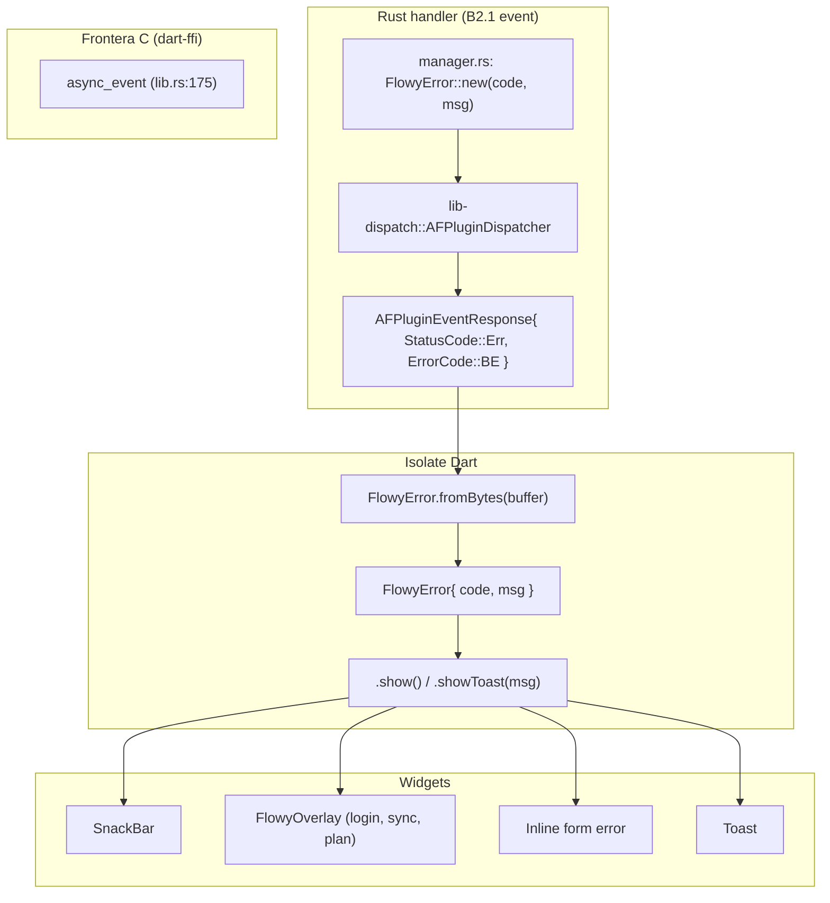
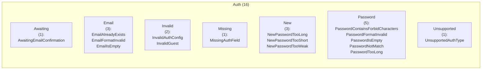
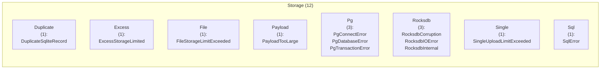
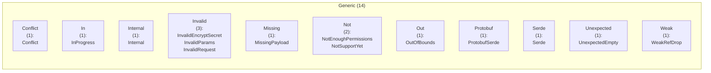

# 15 — Catálogo de ErrorCode (Rust → Dart)

Este documento cataloga las **133 variantes** del enum `ErrorCode u8` declarado en `appflowy/frontend/rust-lib/flowy-error/src/code.rs`. Cada variante representa un código de error que los handlers Rust emiten vía `FlowyError::new(ErrorCode::Foo, msg)`, cruza la frontera dentro de `AFPluginEventResponse` con `StatusCode::Err`, y se reconstruye en Dart como `FlowyError { code, msg }` (paquete `appflowy_backend`). La UI lo muestra con `FlowyError.show()` que se traduce en un `SnackBar`/`Overlay`/`Toast` o `inline error` según el prefijo. La fuente de datos es `OUT/_ledger/extract/misc.json::error_codes` (Fase A2.6; validador `validate-A2.6.sh` 10/10 OK) y la prueba del ROADMAP exige que el nº de filas del catálogo sea exactamente **133**.

## 1. Cómo leer este catálogo

Cada fila representa una variante `ErrorCode`. Las columnas son: `#` (ordinal en este doc), `Código` (nombre Rust), `Índice u8` (valor `repr(u8)` del enum), `Default` (si es `#[default]`), `Mensaje` (campo `&'static str` que ya viaja con el error), `Categoría` (heurística por prefijo del nombre), `Emisor típico` (crate Rust probable — sin `ruta:línea` por ser heurística), `UI típica` (derivada por regex sobre el nombre), `Archivo` (`ruta:línea` del sitio de declaración, resuelto contra `inventario.json`). Las celdas con `—` están vacías. La semántica de cada fila es **siempre `[INFERIDO]`** porque `extract_misc.py` no captura doc-comments `///`.

## 2. Arquitectura del canal de error

El siguiente diagrama muestra cómo un error cruza de Rust a Dart y termina en la UI: el handler Rust construye `FlowyError::new(ErrorCode::Foo, msg)`; el dispatcher lo convierte a `AFPluginEventResponse { status_code: Err, payload: ErrorCode }`; Dart decodifica con `FlowyError.fromBytes` y muestra con `show()` / `showToast()`.



Lectura: en `FlowyError::show()` la heurística del nombre (categoría `Auth`, `Network`, etc.) determina qué UI usar; los códigos `Internal` y `Unknown*` siempre van a `Toast + log.error`. El paquete `appflowy_backend` (`flowy_error.dart`) decodifica el buffer de bytes (`ErrorCode` como `u8` + mensaje `String`) y exponer `.code` y `.msg` para el switch de la app.

## 3. Resumen por categoría

| Categoría | Variantes | Crane raíz típico |
| --- | --- | --- |
| `User` | 7 | `flowy-user` |
| `Auth` | 16 | `flowy-user` |
| `Workspace` | 8 | `flowy-user` |
| `View` | 6 | `flowy-folder` |
| `Document` | 2 | `flowy-document` |
| `Folder` | 1 | `flowy-folder` |
| `Database` | 2 | `flowy-database2` |
| `Field` | 5 | `flowy-database2` |
| `Row` | 1 | `flowy-database2` |
| `Filter` | 1 | `flowy-database2` |
| `Sort` | 1 | `flowy-database2` |
| `Group` | 2 | `flowy-database2` |
| `Option` | 2 | `flowy-database2` |
| `TypeOption` | 1 | `flowy-database2` |
| `Record` | 2 | `flowy-folder` |
| `Block` | 1 | `flowy-document` |
| `Text` | 2 | `flowy-document` |
| `AI` | 5 | `flowy-ai` |
| `LocalAI` | 3 | `flowy-ai` |
| `Customization` | 8 | `flowy-user` |
| `Publish` | 4 | `flowy-folder` |
| `Storage` | 12 | `flowy-storage` |
| `Search` | 3 | `flowy-search` |
| `Network` | 9 | `flowy-server` |
| `Sync` | 2 | `flowy-server` |
| `Date` | 2 | `flowy-date` |
| `Import` | 2 | `flowy-document` |
| `Generic` | 14 | `cualquiera (todos los crates)` |
| `Other` | 5 | `cualquiera (todos los crates)` |
| `Local AI` | 4 | `?` |

**Total**: 133 variantes en 30 categorías. Las categorías se derivan del prefijo CamelCase del nombre (`User*` → `User`, `Database*` → `Database`, `LocalAI*` → `LocalAI`, etc.). El crate raíz típico es el que concentra el manejo de esa categoría (ej. `flowy-database2` para `Database`/`Field`/`Row`/`Cell`/`Filter`/`Sort`/`Group`/`Option`/`TypeOption`).

## 4. Índice global de los 133 códigos

Tabla plana con las 133 variantes ordenadas por `(categoría, nombre)`. Cada fila aparece también en §5.<categoría>. El conteo de filas de §4 y de la suma de filas de §5.* debe ser exactamente **133** (prueba literal del ROADMAP).

| Cat. | # | Código | Índice u8 | Default | Mensaje | Emisor típico | UI típica | Archivo |
| --- | --- | --- | --- | --- | --- | --- | --- | --- |
| `User` | 1 | `UserIdInvalid` | 30 | — | user id is empty or whitespace | `flowy-user` | Inline error en form widget | `appflowy:frontend/rust-lib/flowy-error/src/code.rs:87` |
| `User` | 2 | `UserIdIsEmpty` | 4 | — | User id is empty | `flowy-user` | SnackBar + redirige a login | `appflowy:frontend/rust-lib/flowy-error/src/code.rs:22` |
| `User` | 3 | `UserNameContainForbiddenCharacters` | 28 | — | User name contain forbidden characters | `flowy-user` | Inline error en form widget | `appflowy:frontend/rust-lib/flowy-error/src/code.rs:81` |
| `User` | 4 | `UserNameIsEmpty` | 29 | — | User name can not be empty or whitespace | `flowy-user` | Inline error en form widget | `appflowy:frontend/rust-lib/flowy-error/src/code.rs:84` |
| `User` | 5 | `UserNameTooLong` | 27 | — | User name is too long | `flowy-user` | Inline error en form widget | `appflowy:frontend/rust-lib/flowy-error/src/code.rs:78` |
| `User` | 6 | `UserNotLogin` | 131 | — | User not login | `flowy-user` | SnackBar + redirige a login | `appflowy:frontend/rust-lib/flowy-error/src/code.rs:385` |
| `User` | 7 | `UserUnauthorized` | 2 | — | Unauthorized user | `flowy-user` | SnackBar + redirige a login | `appflowy:frontend/rust-lib/flowy-error/src/code.rs:16` |
| `Auth` | 1 | `AwaitingEmailConfirmation` | 79 | — | Require Email Confirmation, Sign in after email confirmation | `flowy-user` | SnackBar + redirige a login | `appflowy:frontend/rust-lib/flowy-error/src/code.rs:228` |
| `Auth` | 2 | `EmailAlreadyExists` | 21 | — | Email already exists | `flowy-user` | Inline error en form widget | `appflowy:frontend/rust-lib/flowy-error/src/code.rs:58` |
| `Auth` | 3 | `EmailFormatInvalid` | 20 | — | Email format is not valid | `flowy-user` | Inline error en form widget | `appflowy:frontend/rust-lib/flowy-error/src/code.rs:55` |
| `Auth` | 4 | `EmailIsEmpty` | 19 | — | Email can not be empty or whitespace | `flowy-user` | Inline error en form widget | `appflowy:frontend/rust-lib/flowy-error/src/code.rs:52` |
| `Auth` | 5 | `InvalidAuthConfig` | 64 | — | Invalid auth configuration | `flowy-user` | Inline error en form widget | `appflowy:frontend/rust-lib/flowy-error/src/code.rs:183` |
| `Auth` | 6 | `InvalidGuest` | 140 | — | Invalid guest | `flowy-user` | SnackBar + redirige a login | `appflowy:frontend/rust-lib/flowy-error/src/code.rs:412` |
| `Auth` | 7 | `MissingAuthField` | 65 | — | Missing auth field | `flowy-user` | Inline error en form widget | `appflowy:frontend/rust-lib/flowy-error/src/code.rs:186` |
| `Auth` | 8 | `NewPasswordTooLong` | 136 | — | New password is too long | `flowy-user` | Inline error en form widget | `appflowy:frontend/rust-lib/flowy-error/src/code.rs:400` |
| `Auth` | 9 | `NewPasswordTooShort` | 137 | — | New password is too short | `flowy-user` | Inline error en form widget | `appflowy:frontend/rust-lib/flowy-error/src/code.rs:403` |
| `Auth` | 10 | `NewPasswordTooWeak` | 134 | — | New password is too weak | `flowy-user` | Inline error en form widget | `appflowy:frontend/rust-lib/flowy-error/src/code.rs:394` |
| `Auth` | 11 | `PasswordContainsForbidCharacters` | 24 | — | Password contains forbidden characters. | `flowy-user` | Inline error en form widget | `appflowy:frontend/rust-lib/flowy-error/src/code.rs:67` |
| `Auth` | 12 | `PasswordFormatInvalid` | 25 | — | Password should contain a minimum of 6 characters with 1 special 1 letter and 1 numeric | `flowy-user` | Inline error en form widget | `appflowy:frontend/rust-lib/flowy-error/src/code.rs:72` |
| `Auth` | 13 | `PasswordIsEmpty` | 22 | — | Password can not be empty or whitespace | `flowy-user` | Inline error en form widget | `appflowy:frontend/rust-lib/flowy-error/src/code.rs:61` |
| `Auth` | 14 | `PasswordNotMatch` | 26 | — | Password not match | `flowy-user` | Inline error en form widget | `appflowy:frontend/rust-lib/flowy-error/src/code.rs:75` |
| `Auth` | 15 | `PasswordTooLong` | 23 | — | Password format too long | `flowy-user` | Inline error en form widget | `appflowy:frontend/rust-lib/flowy-error/src/code.rs:64` |
| `Auth` | 16 | `UnsupportedAuthType` | 63 | — | Unsupported auth type | `flowy-user` | Inline error en form widget | `appflowy:frontend/rust-lib/flowy-error/src/code.rs:180` |
| `Workspace` | 1 | `WorkspaceDataNotMatch` | 97 | — | Workspace data not match | `flowy-user` | Overlay 'restart sync' | `appflowy:frontend/rust-lib/flowy-error/src/code.rs:282` |
| `Workspace` | 2 | `WorkspaceDataNotSync` | 76 | — | It appears that the workspace data has not been fully synchronized | `flowy-user` | Overlay 'restart sync' | `appflowy:frontend/rust-lib/flowy-error/src/code.rs:219` |
| `Workspace` | 3 | `WorkspaceDescTooLong` | 8 | — | Workspace desc is invalid | `flowy-user` | Inline error en form widget | `appflowy:frontend/rust-lib/flowy-error/src/code.rs:28` |
| `Workspace` | 4 | `WorkspaceInitializeError` | 6 | — | Can't load the workspace data | `flowy-user` | Toast genérico + log | `appflowy:frontend/rust-lib/flowy-error/src/code.rs:34` |
| `Workspace` | 5 | `WorkspaceLimitExceeded` | 91 | — | Workspace limit exceeded | `flowy-user` | Overlay upgrade plan + SnackBar | `appflowy:frontend/rust-lib/flowy-error/src/code.rs:264` |
| `Workspace` | 6 | `WorkspaceMemberLimitExceeded` | 92 | — | Workspace member limit exceeded | `flowy-user` | Overlay upgrade plan + SnackBar | `appflowy:frontend/rust-lib/flowy-error/src/code.rs:267` |
| `Workspace` | 7 | `WorkspaceNameInvalid` | 5 | — | Workspace name can not be empty or whitespace | `flowy-user` | Inline error en form widget | `appflowy:frontend/rust-lib/flowy-error/src/code.rs:25` |
| `Workspace` | 8 | `WorkspaceNameTooLong` | 9 | — | Workspace description too long | `flowy-user` | Inline error en form widget | `appflowy:frontend/rust-lib/flowy-error/src/code.rs:31` |
| `View` | 1 | `ViewDataInvalid` | 16 | — | View data is invalid | `flowy-folder` | Inline error en form widget | `appflowy:frontend/rust-lib/flowy-error/src/code.rs:46` |
| `View` | 2 | `ViewIdIsInvalid` | 14 | — | View id can not be empty or whitespace | `flowy-folder` | Inline error en form widget | `appflowy:frontend/rust-lib/flowy-error/src/code.rs:43` |
| `View` | 3 | `ViewIsLocked` | 126 | — | View is locked | `flowy-folder` | Inline error en form widget | `appflowy:frontend/rust-lib/flowy-error/src/code.rs:370` |
| `View` | 4 | `ViewNameInvalid` | 12 | — | View name can not be empty or whitespace | `flowy-folder` | Inline error en form widget | `appflowy:frontend/rust-lib/flowy-error/src/code.rs:37` |
| `View` | 5 | `ViewNameTooLong` | 17 | — | View name too long | `flowy-folder` | Inline error en form widget | `appflowy:frontend/rust-lib/flowy-error/src/code.rs:49` |
| `View` | 6 | `ViewThumbnailInvalid` | 13 | — | Thumbnail of the view is invalid | `flowy-folder` | Inline error en form widget | `appflowy:frontend/rust-lib/flowy-error/src/code.rs:40` |
| `Document` | 1 | `DocumentDataInvalid` | 62 | — | Document Data Invalid | `flowy-document` | Inline error en form widget | `appflowy:frontend/rust-lib/flowy-error/src/code.rs:177` |
| `Document` | 2 | `DocumentIdIsEmpty` | 67 | — | Document id is empty | `flowy-document` | Inline error en form widget | `appflowy:frontend/rust-lib/flowy-error/src/code.rs:192` |
| `Folder` | 1 | `FolderIndexManagerUnavailable` | 96 | — | FolderIndexManager or its dependencies are unavailable | `flowy-folder` | Overlay 'restart sync' | `appflowy:frontend/rust-lib/flowy-error/src/code.rs:279` |
| `Database` | 1 | `DatabaseIdIsEmpty` | 33 | — | Database id is empty | `flowy-database2` | Inline error en form widget | `appflowy:frontend/rust-lib/flowy-error/src/code.rs:93` |
| `Database` | 2 | `DatabaseViewIdIsEmpty` | 34 | — | Grid view id is empty | `flowy-database2` | Inline error en form widget | `appflowy:frontend/rust-lib/flowy-error/src/code.rs:96` |
| `Field` | 1 | `FieldDoesNotExist` | 39 | — | Field doesn't exist | `flowy-database2` | Toast de aviso + recarga | `appflowy:frontend/rust-lib/flowy-error/src/code.rs:111` |
| `Field` | 2 | `FieldIdIsEmpty` | 38 | — | Field id is empty | `flowy-database2` | Inline error en form widget | `appflowy:frontend/rust-lib/flowy-error/src/code.rs:108` |
| `Field` | 3 | `FieldInvalidOperation` | 42 | — | The operation in this field is invalid | `flowy-database2` | Toast genérico + log | `appflowy:frontend/rust-lib/flowy-error/src/code.rs:120` |
| `Field` | 4 | `FieldNotExists` | 41 | — | Field not exists | `flowy-database2` | Toast de aviso + recarga | `appflowy:frontend/rust-lib/flowy-error/src/code.rs:117` |
| `Field` | 5 | `FieldRecordNotFound` | 44 | — | Field is not exist | `flowy-database2` | Toast de aviso + recarga | `appflowy:frontend/rust-lib/flowy-error/src/code.rs:126` |
| `Row` | 1 | `RowIdIsEmpty` | 36 | — | Row id is empty | `flowy-database2` | Inline error en form widget | `appflowy:frontend/rust-lib/flowy-error/src/code.rs:102` |
| `Filter` | 1 | `FilterIdIsEmpty` | 43 | — | Filter id is empty | `flowy-database2` | Inline error en form widget | `appflowy:frontend/rust-lib/flowy-error/src/code.rs:123` |
| `Sort` | 1 | `SortIdIsEmpty` | 53 | — | Sort id is empty | `flowy-database2` | Inline error en form widget | `appflowy:frontend/rust-lib/flowy-error/src/code.rs:150` |
| `Group` | 1 | `GroupIdIsEmpty` | 46 | — | Group id is empty | `flowy-database2` | Inline error en form widget | `appflowy:frontend/rust-lib/flowy-error/src/code.rs:132` |
| `Group` | 2 | `GroupNameIsEmpty` | 109 | — | Group name is empty | `flowy-database2` | Inline error en form widget | `appflowy:frontend/rust-lib/flowy-error/src/code.rs:319` |
| `Option` | 1 | `OptionIdIsEmpty` | 37 | — | Select option id is empty | `flowy-database2` | Inline error en form widget | `appflowy:frontend/rust-lib/flowy-error/src/code.rs:105` |
| `Option` | 2 | `SelectOptionNameIsEmpty` | 40 | — | The name of the option should not be empty | `flowy-database2` | Inline error en form widget | `appflowy:frontend/rust-lib/flowy-error/src/code.rs:114` |
| `TypeOption` | 1 | `TypeOptionDataIsEmpty` | 45 | — | Field's type-option data should not be empty | `flowy-database2` | Inline error en form widget | `appflowy:frontend/rust-lib/flowy-error/src/code.rs:129` |
| `Record` | 1 | `RecordAlreadyExists` | 81 | — | Record already exists | `flowy-folder` | Toast genérico + log | `appflowy:frontend/rust-lib/flowy-error/src/code.rs:234` |
| `Record` | 2 | `RecordNotFound` | 3 | — | Record not found | `flowy-folder` | Toast de aviso + recarga | `appflowy:frontend/rust-lib/flowy-error/src/code.rs:19` |
| `Block` | 1 | `BlockIdIsEmpty` | 35 | — | Grid block id is empty | `flowy-document` | Inline error en form widget | `appflowy:frontend/rust-lib/flowy-error/src/code.rs:99` |
| `Text` | 1 | `TextIdIsEmpty` | 80 | — | Text id is empty | `flowy-document` | Inline error en form widget | `appflowy:frontend/rust-lib/flowy-error/src/code.rs:231` |
| `Text` | 2 | `TextTooLong` | 32 | — | Text is too long | `flowy-document` | Inline error en form widget | `appflowy:frontend/rust-lib/flowy-error/src/code.rs:90` |
| `AI` | 1 | `AIImageResponseLimitExceeded` | 124 | — | AI Image Response limit exceeded | `flowy-ai` | Toast 'modelo no disponible' + log | `appflowy:frontend/rust-lib/flowy-error/src/code.rs:364` |
| `AI` | 2 | `AIMaxRequired` | 125 | — | AI Max Required | `flowy-ai` | Toast 'modelo no disponible' + log | `appflowy:frontend/rust-lib/flowy-error/src/code.rs:367` |
| `AI` | 3 | `AIResponseLimitExceeded` | 101 | — | AI Response limit exceeded | `flowy-ai` | Toast 'modelo no disponible' + log | `appflowy:frontend/rust-lib/flowy-error/src/code.rs:294` |
| `AI` | 4 | `AIServiceUnavailable` | 123 | — | AI Service is unavailable | `flowy-ai` | Toast 'modelo no disponible' + log | `appflowy:frontend/rust-lib/flowy-error/src/code.rs:361` |
| `AI` | 5 | `MCPError` | 129 | — | MCP error | `flowy-ai` | Toast 'modelo no disponible' + log | `appflowy:frontend/rust-lib/flowy-error/src/code.rs:379` |
| `LocalAI` | 1 | `AppFlowyLAINotReady` | 105 | — | AppFlowy LAI not ready | `flowy-ai` | Toast 'modelo no disponible' + log | `appflowy:frontend/rust-lib/flowy-error/src/code.rs:306` |
| `LocalAI` | 2 | `LocalEmbeddingNotReady` | 133 | — | Local embedding not ready | `flowy-ai` | Toast genérico + log | `appflowy:frontend/rust-lib/flowy-error/src/code.rs:391` |
| `LocalAI` | 3 | `LocalVersionNotSupport` | 88 | — | Local version not support | `flowy-ai` | Overlay 'restart sync' | `appflowy:frontend/rust-lib/flowy-error/src/code.rs:255` |
| `Customization` | 1 | `CustomNamespaceAlreadyTaken` | 115 | — | Requested namespace is already taken | `flowy-user` | Toast genérico + log | `appflowy:frontend/rust-lib/flowy-error/src/code.rs:337` |
| `Customization` | 2 | `CustomNamespaceInvalidCharacter` | 122 | — | Requested namespace has one or more invalid characters | `flowy-user` | Toast genérico + log | `appflowy:frontend/rust-lib/flowy-error/src/code.rs:358` |
| `Customization` | 3 | `CustomNamespaceNotAllowed` | 114 | — | Requested namespace is not allowed | `flowy-user` | Toast genérico + log | `appflowy:frontend/rust-lib/flowy-error/src/code.rs:334` |
| `Customization` | 4 | `CustomNamespaceRequirePlanUpgrade` | 113 | — | Custom namespace requires Pro Plan upgrade | `flowy-user` | Overlay upgrade plan + SnackBar | `appflowy:frontend/rust-lib/flowy-error/src/code.rs:331` |
| `Customization` | 5 | `CustomNamespaceReserved` | 118 | — | Requested namespace is reserved | `flowy-user` | Toast genérico + log | `appflowy:frontend/rust-lib/flowy-error/src/code.rs:346` |
| `Customization` | 6 | `CustomNamespaceTooLong` | 117 | — | Requested namespace is too long | `flowy-user` | Inline error en form widget | `appflowy:frontend/rust-lib/flowy-error/src/code.rs:343` |
| `Customization` | 7 | `CustomNamespaceTooShort` | 116 | — | Requested namespace is too short | `flowy-user` | Inline error en form widget | `appflowy:frontend/rust-lib/flowy-error/src/code.rs:340` |
| `Customization` | 8 | `InvalidNamespace` | 111 | — | Invalid namespace | `flowy-user` | Inline error en form widget | `appflowy:frontend/rust-lib/flowy-error/src/code.rs:325` |
| `Publish` | 1 | `InvalidPublishName` | 112 | — | Invalid publish name | `flowy-folder` | Inline error en form widget | `appflowy:frontend/rust-lib/flowy-error/src/code.rs:328` |
| `Publish` | 2 | `PublishNameAlreadyExists` | 119 | — | Publish name is already used for another published view | `flowy-folder` | Toast genérico + log | `appflowy:frontend/rust-lib/flowy-error/src/code.rs:349` |
| `Publish` | 3 | `PublishNameInvalidCharacter` | 120 | — | Publish name contains one or more invalid characters | `flowy-folder` | Toast genérico + log | `appflowy:frontend/rust-lib/flowy-error/src/code.rs:352` |
| `Publish` | 4 | `PublishNameTooLong` | 121 | — | Publish name has exceeded the maximum length allowable | `flowy-folder` | Inline error en form widget | `appflowy:frontend/rust-lib/flowy-error/src/code.rs:355` |
| `Storage` | 1 | `DuplicateSqliteRecord` | 102 | — | Duplicate record | `flowy-storage` | Toast de error + log | `appflowy:frontend/rust-lib/flowy-error/src/code.rs:297` |
| `Storage` | 2 | `ExcessStorageLimited` | 77 | — | Excess storage limited | `flowy-storage` | Toast de error + log | `appflowy:frontend/rust-lib/flowy-error/src/code.rs:222` |
| `Storage` | 3 | `FileStorageLimitExceeded` | 100 | — | Storage limit exceeded | `flowy-storage` | Toast de error + log | `appflowy:frontend/rust-lib/flowy-error/src/code.rs:291` |
| `Storage` | 4 | `PayloadTooLarge` | 90 | — | payload too large | `flowy-storage` | Toast de error + log | `appflowy:frontend/rust-lib/flowy-error/src/code.rs:261` |
| `Storage` | 5 | `PgConnectError` | 69 | — | Connect postgres database failed | `flowy-storage` | Toast de error + log | `appflowy:frontend/rust-lib/flowy-error/src/code.rs:198` |
| `Storage` | 6 | `PgDatabaseError` | 70 | — | Postgres database error | `flowy-storage` | Toast de error + log | `appflowy:frontend/rust-lib/flowy-error/src/code.rs:201` |
| `Storage` | 7 | `PgTransactionError` | 71 | — | Postgres transaction error | `flowy-storage` | Toast de error + log | `appflowy:frontend/rust-lib/flowy-error/src/code.rs:204` |
| `Storage` | 8 | `RocksdbCorruption` | 86 | — | rocksdb corruption | `flowy-storage` | Toast de error + log | `appflowy:frontend/rust-lib/flowy-error/src/code.rs:249` |
| `Storage` | 9 | `RocksdbIOError` | 66 | — | Rocksdb IO error | `flowy-storage` | Toast de error + log | `appflowy:frontend/rust-lib/flowy-error/src/code.rs:189` |
| `Storage` | 10 | `RocksdbInternal` | 87 | — | rocksdb internal error | `flowy-storage` | Toast de error + log | `appflowy:frontend/rust-lib/flowy-error/src/code.rs:252` |
| `Storage` | 11 | `SingleUploadLimitExceeded` | 108 | — | Upload part size exceeds the limit | `flowy-storage` | Toast de error + log | `appflowy:frontend/rust-lib/flowy-error/src/code.rs:316` |
| `Storage` | 12 | `SqlError` | 58 | — | Sql error | `flowy-storage` | Toast de error + log | `appflowy:frontend/rust-lib/flowy-error/src/code.rs:165` |
| `Search` | 1 | `FailedToOpenIndexDir` | 94 | — | Failed to open Index directory | `flowy-search` | Toast + log search | `appflowy:frontend/rust-lib/flowy-error/src/code.rs:273` |
| `Search` | 2 | `FailedToParseQuery` | 95 | — | Failed to parse query | `flowy-search` | Toast + log search | `appflowy:frontend/rust-lib/flowy-error/src/code.rs:276` |
| `Search` | 3 | `IndexWriterFailedCommit` | 93 | — | IndexWriter failed to commit | `flowy-search` | Toast + log search | `appflowy:frontend/rust-lib/flowy-error/src/code.rs:270` |
| `Network` | 1 | `ConnectCancel` | 57 | — | Connection canceled | `flowy-server` | SnackBar con botón retry | `appflowy:frontend/rust-lib/flowy-error/src/code.rs:162` |
| `Network` | 2 | `ConnectClose` | 56 | — | Connection closed | `flowy-server` | SnackBar con botón retry | `appflowy:frontend/rust-lib/flowy-error/src/code.rs:159` |
| `Network` | 3 | `ConnectRefused` | 54 | — | Connect refused | `flowy-server` | SnackBar con botón retry | `appflowy:frontend/rust-lib/flowy-error/src/code.rs:153` |
| `Network` | 4 | `ConnectTimeout` | 55 | — | Connection timeout | `flowy-server` | SnackBar con botón retry | `appflowy:frontend/rust-lib/flowy-error/src/code.rs:156` |
| `Network` | 5 | `InternalServerError` | 84 | — | Internal server error | `flowy-server` | SnackBar con botón retry | `appflowy:frontend/rust-lib/flowy-error/src/code.rs:243` |
| `Network` | 6 | `InvalidURL` | 78 | — | Parse url failed | `flowy-server` | SnackBar con botón retry | `appflowy:frontend/rust-lib/flowy-error/src/code.rs:225` |
| `Network` | 7 | `NetworkError` | 59 | — | Network error | `flowy-server` | SnackBar con botón retry | `appflowy:frontend/rust-lib/flowy-error/src/code.rs:168` |
| `Network` | 8 | `RequestTimeout` | 127 | — | Request timeout | `flowy-server` | SnackBar con botón retry | `appflowy:frontend/rust-lib/flowy-error/src/code.rs:373` |
| `Network` | 9 | `ResponseTimeout` | 103 | — | Response timeout | `flowy-server` | SnackBar con botón retry | `appflowy:frontend/rust-lib/flowy-error/src/code.rs:300` |
| `Sync` | 1 | `CollabDataNotSync` | 75 | — | It appears that the collaboration object's data has not been fully synchronized | `flowy-server` | Overlay 'restart sync' | `appflowy:frontend/rust-lib/flowy-error/src/code.rs:216` |
| `Sync` | 2 | `DataSyncRequired` | 72 | — | Enable data sync | `flowy-server` | Overlay 'restart sync' | `appflowy:frontend/rust-lib/flowy-error/src/code.rs:207` |
| `Date` | 1 | `InvalidDateTimeFormat` | 48 | — | Invalid date time format | `flowy-date` | Toast genérico + log | `appflowy:frontend/rust-lib/flowy-error/src/code.rs:135` |
| `Date` | 2 | `UnexpectedCalendarFieldType` | 61 | — | Only the date type can be used in calendar | `flowy-date` | Toast + log.error | `appflowy:frontend/rust-lib/flowy-error/src/code.rs:174` |
| `Import` | 1 | `AppFlowyDataFolderImportError` | 89 | — | AppFlowy data folder import error | `flowy-document` | Toast 'import failed' | `appflowy:frontend/rust-lib/flowy-error/src/code.rs:258` |
| `Import` | 2 | `UnsupportedFileFormat` | 104 | — | Unsupported file format | `flowy-document` | Toast 'import failed' | `appflowy:frontend/rust-lib/flowy-error/src/code.rs:303` |
| `Generic` | 1 | `Conflict` | 73 | — | Conflict | `cualquiera (todos los crates)` | Toast + log.error | `appflowy:frontend/rust-lib/flowy-error/src/code.rs:210` |
| `Generic` | 2 | `InProgress` | 107 | — | In progress | `cualquiera (todos los crates)` | Toast + log.error | `appflowy:frontend/rust-lib/flowy-error/src/code.rs:313` |
| `Generic` | 3 | `Internal` | 0 | sí | Internal error | `cualquiera (todos los crates)` | Toast + log.error | `appflowy:frontend/rust-lib/flowy-error/src/code.rs:13` |
| `Generic` | 4 | `InvalidEncryptSecret` | 74 | — | Invalid decryption secret | `cualquiera (todos los crates)` | Inline error en form widget | `appflowy:frontend/rust-lib/flowy-error/src/code.rs:213` |
| `Generic` | 5 | `InvalidParams` | 49 | — | Invalid params | `cualquiera (todos los crates)` | Inline error en form widget | `appflowy:frontend/rust-lib/flowy-error/src/code.rs:138` |
| `Generic` | 6 | `InvalidRequest` | 106 | — | Invalid Request | `cualquiera (todos los crates)` | Inline error en form widget | `appflowy:frontend/rust-lib/flowy-error/src/code.rs:309` |
| `Generic` | 7 | `MissingPayload` | 82 | — | Missing payload | `cualquiera (todos los crates)` | Inline error en form widget | `appflowy:frontend/rust-lib/flowy-error/src/code.rs:237` |
| `Generic` | 8 | `NotEnoughPermissions` | 83 | — | Permission denied | `cualquiera (todos los crates)` | SnackBar + cierra acción | `appflowy:frontend/rust-lib/flowy-error/src/code.rs:240` |
| `Generic` | 9 | `NotSupportYet` | 85 | — | Not support yet | `cualquiera (todos los crates)` | Toast + log.error | `appflowy:frontend/rust-lib/flowy-error/src/code.rs:246` |
| `Generic` | 10 | `OutOfBounds` | 52 | — | Out of bounds | `cualquiera (todos los crates)` | Toast + log.error | `appflowy:frontend/rust-lib/flowy-error/src/code.rs:147` |
| `Generic` | 11 | `ProtobufSerde` | 51 | — | Protobuf serde | `cualquiera (todos los crates)` | Toast + log.error | `appflowy:frontend/rust-lib/flowy-error/src/code.rs:144` |
| `Generic` | 12 | `Serde` | 50 | — | Serde | `cualquiera (todos los crates)` | Toast + log.error | `appflowy:frontend/rust-lib/flowy-error/src/code.rs:141` |
| `Generic` | 13 | `UnexpectedEmpty` | 60 | — | The content should not be empty | `cualquiera (todos los crates)` | Toast de aviso + recarga | `appflowy:frontend/rust-lib/flowy-error/src/code.rs:171` |
| `Generic` | 14 | `WeakRefDrop` | 132 | — | Reference resource is not available | `cualquiera (todos los crates)` | Toast + log.error | `appflowy:frontend/rust-lib/flowy-error/src/code.rs:388` |
| `Other` | 1 | `ApplyActionsIsEmpty` | 68 | — | Apply actions is empty | `cualquiera (todos los crates)` | Inline error en form widget | `appflowy:frontend/rust-lib/flowy-error/src/code.rs:195` |
| `Other` | 2 | `FreePlanGuestLimitExceeded` | 138 | — | Guest limit exceeded for free plan | `cualquiera (todos los crates)` | Overlay upgrade plan + SnackBar | `appflowy:frontend/rust-lib/flowy-error/src/code.rs:406` |
| `Other` | 3 | `InvalidNewPassword` | 135 | — | Invalid new password | `cualquiera (todos los crates)` | Toast genérico + log | `appflowy:frontend/rust-lib/flowy-error/src/code.rs:397` |
| `Other` | 4 | `LimitedByWorkspacePlan` | 110 | — | Not available for current workspace plan | `cualquiera (todos los crates)` | Overlay upgrade plan + SnackBar | `appflowy:frontend/rust-lib/flowy-error/src/code.rs:322` |
| `Other` | 5 | `PaidPlanGuestLimitExceeded` | 139 | — | Guest limit exceeded for paid plan | `cualquiera (todos los crates)` | Overlay upgrade plan + SnackBar | `appflowy:frontend/rust-lib/flowy-error/src/code.rs:409` |
| `Local AI` | 1 | `LocalAIDisabled` | 130 | — | Local AI disabled | `?` | Toast 'modelo no disponible' + log | `appflowy:frontend/rust-lib/flowy-error/src/code.rs:382` |
| `Local AI` | 2 | `LocalAIError` | 98 | — | Local AI error | `?` | Toast 'modelo no disponible' + log | `appflowy:frontend/rust-lib/flowy-error/src/code.rs:285` |
| `Local AI` | 3 | `LocalAINotReady` | 128 | — | Local AI is not ready | `?` | Toast 'modelo no disponible' + log | `appflowy:frontend/rust-lib/flowy-error/src/code.rs:376` |
| `Local AI` | 4 | `LocalAIUnavailable` | 99 | — | Local AI unavailable | `?` | Toast 'modelo no disponible' + log | `appflowy:frontend/rust-lib/flowy-error/src/code.rs:288` |

## 5. Catálogo por categoría

Cada sub-sección desarrolla una categoría. Las tablas siguen el mismo esquema que §4 (sin las columnas `Cat.` redundantes). Cuando una categoría supera las 5 entradas, se acompaña de un mini `flowchart` agrupando por sub-prefijo.

### 5.1 `User`

**7 variantes** · crate típico `flowy-user`.

| # | Código | Índice u8 | Default | Mensaje | Emisor típico | UI típica | Archivo |
| --- | --- | --- | --- | --- | --- | --- | --- |
| 1 | `UserIdInvalid` | 30 | — | user id is empty or whitespace | `flowy-user` | Inline error en form widget | `appflowy:frontend/rust-lib/flowy-error/src/code.rs:87` |
| 2 | `UserIdIsEmpty` | 4 | — | User id is empty | `flowy-user` | SnackBar + redirige a login | `appflowy:frontend/rust-lib/flowy-error/src/code.rs:22` |
| 3 | `UserNameContainForbiddenCharacters` | 28 | — | User name contain forbidden characters | `flowy-user` | Inline error en form widget | `appflowy:frontend/rust-lib/flowy-error/src/code.rs:81` |
| 4 | `UserNameIsEmpty` | 29 | — | User name can not be empty or whitespace | `flowy-user` | Inline error en form widget | `appflowy:frontend/rust-lib/flowy-error/src/code.rs:84` |
| 5 | `UserNameTooLong` | 27 | — | User name is too long | `flowy-user` | Inline error en form widget | `appflowy:frontend/rust-lib/flowy-error/src/code.rs:78` |
| 6 | `UserNotLogin` | 131 | — | User not login | `flowy-user` | SnackBar + redirige a login | `appflowy:frontend/rust-lib/flowy-error/src/code.rs:385` |
| 7 | `UserUnauthorized` | 2 | — | Unauthorized user | `flowy-user` | SnackBar + redirige a login | `appflowy:frontend/rust-lib/flowy-error/src/code.rs:16` |

### 5.2 `Auth`

**16 variantes** · crate típico `flowy-user`.



| # | Código | Índice u8 | Default | Mensaje | Emisor típico | UI típica | Archivo |
| --- | --- | --- | --- | --- | --- | --- | --- |
| 1 | `AwaitingEmailConfirmation` | 79 | — | Require Email Confirmation, Sign in after email confirmation | `flowy-user` | SnackBar + redirige a login | `appflowy:frontend/rust-lib/flowy-error/src/code.rs:228` |
| 2 | `EmailAlreadyExists` | 21 | — | Email already exists | `flowy-user` | Inline error en form widget | `appflowy:frontend/rust-lib/flowy-error/src/code.rs:58` |
| 3 | `EmailFormatInvalid` | 20 | — | Email format is not valid | `flowy-user` | Inline error en form widget | `appflowy:frontend/rust-lib/flowy-error/src/code.rs:55` |
| 4 | `EmailIsEmpty` | 19 | — | Email can not be empty or whitespace | `flowy-user` | Inline error en form widget | `appflowy:frontend/rust-lib/flowy-error/src/code.rs:52` |
| 5 | `InvalidAuthConfig` | 64 | — | Invalid auth configuration | `flowy-user` | Inline error en form widget | `appflowy:frontend/rust-lib/flowy-error/src/code.rs:183` |
| 6 | `InvalidGuest` | 140 | — | Invalid guest | `flowy-user` | SnackBar + redirige a login | `appflowy:frontend/rust-lib/flowy-error/src/code.rs:412` |
| 7 | `MissingAuthField` | 65 | — | Missing auth field | `flowy-user` | Inline error en form widget | `appflowy:frontend/rust-lib/flowy-error/src/code.rs:186` |
| 8 | `NewPasswordTooLong` | 136 | — | New password is too long | `flowy-user` | Inline error en form widget | `appflowy:frontend/rust-lib/flowy-error/src/code.rs:400` |
| 9 | `NewPasswordTooShort` | 137 | — | New password is too short | `flowy-user` | Inline error en form widget | `appflowy:frontend/rust-lib/flowy-error/src/code.rs:403` |
| 10 | `NewPasswordTooWeak` | 134 | — | New password is too weak | `flowy-user` | Inline error en form widget | `appflowy:frontend/rust-lib/flowy-error/src/code.rs:394` |
| 11 | `PasswordContainsForbidCharacters` | 24 | — | Password contains forbidden characters. | `flowy-user` | Inline error en form widget | `appflowy:frontend/rust-lib/flowy-error/src/code.rs:67` |
| 12 | `PasswordFormatInvalid` | 25 | — | Password should contain a minimum of 6 characters with 1 special 1 letter and 1 numeric | `flowy-user` | Inline error en form widget | `appflowy:frontend/rust-lib/flowy-error/src/code.rs:72` |
| 13 | `PasswordIsEmpty` | 22 | — | Password can not be empty or whitespace | `flowy-user` | Inline error en form widget | `appflowy:frontend/rust-lib/flowy-error/src/code.rs:61` |
| 14 | `PasswordNotMatch` | 26 | — | Password not match | `flowy-user` | Inline error en form widget | `appflowy:frontend/rust-lib/flowy-error/src/code.rs:75` |
| 15 | `PasswordTooLong` | 23 | — | Password format too long | `flowy-user` | Inline error en form widget | `appflowy:frontend/rust-lib/flowy-error/src/code.rs:64` |
| 16 | `UnsupportedAuthType` | 63 | — | Unsupported auth type | `flowy-user` | Inline error en form widget | `appflowy:frontend/rust-lib/flowy-error/src/code.rs:180` |

### 5.3 `Workspace`

**8 variantes** · crate típico `flowy-user`.

| # | Código | Índice u8 | Default | Mensaje | Emisor típico | UI típica | Archivo |
| --- | --- | --- | --- | --- | --- | --- | --- |
| 1 | `WorkspaceDataNotMatch` | 97 | — | Workspace data not match | `flowy-user` | Overlay 'restart sync' | `appflowy:frontend/rust-lib/flowy-error/src/code.rs:282` |
| 2 | `WorkspaceDataNotSync` | 76 | — | It appears that the workspace data has not been fully synchronized | `flowy-user` | Overlay 'restart sync' | `appflowy:frontend/rust-lib/flowy-error/src/code.rs:219` |
| 3 | `WorkspaceDescTooLong` | 8 | — | Workspace desc is invalid | `flowy-user` | Inline error en form widget | `appflowy:frontend/rust-lib/flowy-error/src/code.rs:28` |
| 4 | `WorkspaceInitializeError` | 6 | — | Can't load the workspace data | `flowy-user` | Toast genérico + log | `appflowy:frontend/rust-lib/flowy-error/src/code.rs:34` |
| 5 | `WorkspaceLimitExceeded` | 91 | — | Workspace limit exceeded | `flowy-user` | Overlay upgrade plan + SnackBar | `appflowy:frontend/rust-lib/flowy-error/src/code.rs:264` |
| 6 | `WorkspaceMemberLimitExceeded` | 92 | — | Workspace member limit exceeded | `flowy-user` | Overlay upgrade plan + SnackBar | `appflowy:frontend/rust-lib/flowy-error/src/code.rs:267` |
| 7 | `WorkspaceNameInvalid` | 5 | — | Workspace name can not be empty or whitespace | `flowy-user` | Inline error en form widget | `appflowy:frontend/rust-lib/flowy-error/src/code.rs:25` |
| 8 | `WorkspaceNameTooLong` | 9 | — | Workspace description too long | `flowy-user` | Inline error en form widget | `appflowy:frontend/rust-lib/flowy-error/src/code.rs:31` |

### 5.4 `View`

**6 variantes** · crate típico `flowy-folder`.

| # | Código | Índice u8 | Default | Mensaje | Emisor típico | UI típica | Archivo |
| --- | --- | --- | --- | --- | --- | --- | --- |
| 1 | `ViewDataInvalid` | 16 | — | View data is invalid | `flowy-folder` | Inline error en form widget | `appflowy:frontend/rust-lib/flowy-error/src/code.rs:46` |
| 2 | `ViewIdIsInvalid` | 14 | — | View id can not be empty or whitespace | `flowy-folder` | Inline error en form widget | `appflowy:frontend/rust-lib/flowy-error/src/code.rs:43` |
| 3 | `ViewIsLocked` | 126 | — | View is locked | `flowy-folder` | Inline error en form widget | `appflowy:frontend/rust-lib/flowy-error/src/code.rs:370` |
| 4 | `ViewNameInvalid` | 12 | — | View name can not be empty or whitespace | `flowy-folder` | Inline error en form widget | `appflowy:frontend/rust-lib/flowy-error/src/code.rs:37` |
| 5 | `ViewNameTooLong` | 17 | — | View name too long | `flowy-folder` | Inline error en form widget | `appflowy:frontend/rust-lib/flowy-error/src/code.rs:49` |
| 6 | `ViewThumbnailInvalid` | 13 | — | Thumbnail of the view is invalid | `flowy-folder` | Inline error en form widget | `appflowy:frontend/rust-lib/flowy-error/src/code.rs:40` |

### 5.5 `Document`

**2 variantes** · crate típico `flowy-document`.

| # | Código | Índice u8 | Default | Mensaje | Emisor típico | UI típica | Archivo |
| --- | --- | --- | --- | --- | --- | --- | --- |
| 1 | `DocumentDataInvalid` | 62 | — | Document Data Invalid | `flowy-document` | Inline error en form widget | `appflowy:frontend/rust-lib/flowy-error/src/code.rs:177` |
| 2 | `DocumentIdIsEmpty` | 67 | — | Document id is empty | `flowy-document` | Inline error en form widget | `appflowy:frontend/rust-lib/flowy-error/src/code.rs:192` |

### 5.6 `Folder`

**1 variantes** · crate típico `flowy-folder`.

| # | Código | Índice u8 | Default | Mensaje | Emisor típico | UI típica | Archivo |
| --- | --- | --- | --- | --- | --- | --- | --- |
| 1 | `FolderIndexManagerUnavailable` | 96 | — | FolderIndexManager or its dependencies are unavailable | `flowy-folder` | Overlay 'restart sync' | `appflowy:frontend/rust-lib/flowy-error/src/code.rs:279` |

### 5.7 `Database`

**2 variantes** · crate típico `flowy-database2`.

| # | Código | Índice u8 | Default | Mensaje | Emisor típico | UI típica | Archivo |
| --- | --- | --- | --- | --- | --- | --- | --- |
| 1 | `DatabaseIdIsEmpty` | 33 | — | Database id is empty | `flowy-database2` | Inline error en form widget | `appflowy:frontend/rust-lib/flowy-error/src/code.rs:93` |
| 2 | `DatabaseViewIdIsEmpty` | 34 | — | Grid view id is empty | `flowy-database2` | Inline error en form widget | `appflowy:frontend/rust-lib/flowy-error/src/code.rs:96` |

### 5.8 `Field`

**5 variantes** · crate típico `flowy-database2`.

| # | Código | Índice u8 | Default | Mensaje | Emisor típico | UI típica | Archivo |
| --- | --- | --- | --- | --- | --- | --- | --- |
| 1 | `FieldDoesNotExist` | 39 | — | Field doesn't exist | `flowy-database2` | Toast de aviso + recarga | `appflowy:frontend/rust-lib/flowy-error/src/code.rs:111` |
| 2 | `FieldIdIsEmpty` | 38 | — | Field id is empty | `flowy-database2` | Inline error en form widget | `appflowy:frontend/rust-lib/flowy-error/src/code.rs:108` |
| 3 | `FieldInvalidOperation` | 42 | — | The operation in this field is invalid | `flowy-database2` | Toast genérico + log | `appflowy:frontend/rust-lib/flowy-error/src/code.rs:120` |
| 4 | `FieldNotExists` | 41 | — | Field not exists | `flowy-database2` | Toast de aviso + recarga | `appflowy:frontend/rust-lib/flowy-error/src/code.rs:117` |
| 5 | `FieldRecordNotFound` | 44 | — | Field is not exist | `flowy-database2` | Toast de aviso + recarga | `appflowy:frontend/rust-lib/flowy-error/src/code.rs:126` |

### 5.9 `Row`

**1 variantes** · crate típico `flowy-database2`.

| # | Código | Índice u8 | Default | Mensaje | Emisor típico | UI típica | Archivo |
| --- | --- | --- | --- | --- | --- | --- | --- |
| 1 | `RowIdIsEmpty` | 36 | — | Row id is empty | `flowy-database2` | Inline error en form widget | `appflowy:frontend/rust-lib/flowy-error/src/code.rs:102` |

### 5.10 `Filter`

**1 variantes** · crate típico `flowy-database2`.

| # | Código | Índice u8 | Default | Mensaje | Emisor típico | UI típica | Archivo |
| --- | --- | --- | --- | --- | --- | --- | --- |
| 1 | `FilterIdIsEmpty` | 43 | — | Filter id is empty | `flowy-database2` | Inline error en form widget | `appflowy:frontend/rust-lib/flowy-error/src/code.rs:123` |

### 5.11 `Sort`

**1 variantes** · crate típico `flowy-database2`.

| # | Código | Índice u8 | Default | Mensaje | Emisor típico | UI típica | Archivo |
| --- | --- | --- | --- | --- | --- | --- | --- |
| 1 | `SortIdIsEmpty` | 53 | — | Sort id is empty | `flowy-database2` | Inline error en form widget | `appflowy:frontend/rust-lib/flowy-error/src/code.rs:150` |

### 5.12 `Group`

**2 variantes** · crate típico `flowy-database2`.

| # | Código | Índice u8 | Default | Mensaje | Emisor típico | UI típica | Archivo |
| --- | --- | --- | --- | --- | --- | --- | --- |
| 1 | `GroupIdIsEmpty` | 46 | — | Group id is empty | `flowy-database2` | Inline error en form widget | `appflowy:frontend/rust-lib/flowy-error/src/code.rs:132` |
| 2 | `GroupNameIsEmpty` | 109 | — | Group name is empty | `flowy-database2` | Inline error en form widget | `appflowy:frontend/rust-lib/flowy-error/src/code.rs:319` |

### 5.13 `Option`

**2 variantes** · crate típico `flowy-database2`.

| # | Código | Índice u8 | Default | Mensaje | Emisor típico | UI típica | Archivo |
| --- | --- | --- | --- | --- | --- | --- | --- |
| 1 | `OptionIdIsEmpty` | 37 | — | Select option id is empty | `flowy-database2` | Inline error en form widget | `appflowy:frontend/rust-lib/flowy-error/src/code.rs:105` |
| 2 | `SelectOptionNameIsEmpty` | 40 | — | The name of the option should not be empty | `flowy-database2` | Inline error en form widget | `appflowy:frontend/rust-lib/flowy-error/src/code.rs:114` |

### 5.14 `TypeOption`

**1 variantes** · crate típico `flowy-database2`.

| # | Código | Índice u8 | Default | Mensaje | Emisor típico | UI típica | Archivo |
| --- | --- | --- | --- | --- | --- | --- | --- |
| 1 | `TypeOptionDataIsEmpty` | 45 | — | Field's type-option data should not be empty | `flowy-database2` | Inline error en form widget | `appflowy:frontend/rust-lib/flowy-error/src/code.rs:129` |

### 5.15 `Record`

**2 variantes** · crate típico `flowy-folder`.

| # | Código | Índice u8 | Default | Mensaje | Emisor típico | UI típica | Archivo |
| --- | --- | --- | --- | --- | --- | --- | --- |
| 1 | `RecordAlreadyExists` | 81 | — | Record already exists | `flowy-folder` | Toast genérico + log | `appflowy:frontend/rust-lib/flowy-error/src/code.rs:234` |
| 2 | `RecordNotFound` | 3 | — | Record not found | `flowy-folder` | Toast de aviso + recarga | `appflowy:frontend/rust-lib/flowy-error/src/code.rs:19` |

### 5.16 `Block`

**1 variantes** · crate típico `flowy-document`.

| # | Código | Índice u8 | Default | Mensaje | Emisor típico | UI típica | Archivo |
| --- | --- | --- | --- | --- | --- | --- | --- |
| 1 | `BlockIdIsEmpty` | 35 | — | Grid block id is empty | `flowy-document` | Inline error en form widget | `appflowy:frontend/rust-lib/flowy-error/src/code.rs:99` |

### 5.17 `Text`

**2 variantes** · crate típico `flowy-document`.

| # | Código | Índice u8 | Default | Mensaje | Emisor típico | UI típica | Archivo |
| --- | --- | --- | --- | --- | --- | --- | --- |
| 1 | `TextIdIsEmpty` | 80 | — | Text id is empty | `flowy-document` | Inline error en form widget | `appflowy:frontend/rust-lib/flowy-error/src/code.rs:231` |
| 2 | `TextTooLong` | 32 | — | Text is too long | `flowy-document` | Inline error en form widget | `appflowy:frontend/rust-lib/flowy-error/src/code.rs:90` |

### 5.18 `AI`

**5 variantes** · crate típico `flowy-ai`.

| # | Código | Índice u8 | Default | Mensaje | Emisor típico | UI típica | Archivo |
| --- | --- | --- | --- | --- | --- | --- | --- |
| 1 | `AIImageResponseLimitExceeded` | 124 | — | AI Image Response limit exceeded | `flowy-ai` | Toast 'modelo no disponible' + log | `appflowy:frontend/rust-lib/flowy-error/src/code.rs:364` |
| 2 | `AIMaxRequired` | 125 | — | AI Max Required | `flowy-ai` | Toast 'modelo no disponible' + log | `appflowy:frontend/rust-lib/flowy-error/src/code.rs:367` |
| 3 | `AIResponseLimitExceeded` | 101 | — | AI Response limit exceeded | `flowy-ai` | Toast 'modelo no disponible' + log | `appflowy:frontend/rust-lib/flowy-error/src/code.rs:294` |
| 4 | `AIServiceUnavailable` | 123 | — | AI Service is unavailable | `flowy-ai` | Toast 'modelo no disponible' + log | `appflowy:frontend/rust-lib/flowy-error/src/code.rs:361` |
| 5 | `MCPError` | 129 | — | MCP error | `flowy-ai` | Toast 'modelo no disponible' + log | `appflowy:frontend/rust-lib/flowy-error/src/code.rs:379` |

### 5.19 `LocalAI`

**3 variantes** · crate típico `flowy-ai`.

| # | Código | Índice u8 | Default | Mensaje | Emisor típico | UI típica | Archivo |
| --- | --- | --- | --- | --- | --- | --- | --- |
| 1 | `AppFlowyLAINotReady` | 105 | — | AppFlowy LAI not ready | `flowy-ai` | Toast 'modelo no disponible' + log | `appflowy:frontend/rust-lib/flowy-error/src/code.rs:306` |
| 2 | `LocalEmbeddingNotReady` | 133 | — | Local embedding not ready | `flowy-ai` | Toast genérico + log | `appflowy:frontend/rust-lib/flowy-error/src/code.rs:391` |
| 3 | `LocalVersionNotSupport` | 88 | — | Local version not support | `flowy-ai` | Overlay 'restart sync' | `appflowy:frontend/rust-lib/flowy-error/src/code.rs:255` |

### 5.20 `Customization`

**8 variantes** · crate típico `flowy-user`.

| # | Código | Índice u8 | Default | Mensaje | Emisor típico | UI típica | Archivo |
| --- | --- | --- | --- | --- | --- | --- | --- |
| 1 | `CustomNamespaceAlreadyTaken` | 115 | — | Requested namespace is already taken | `flowy-user` | Toast genérico + log | `appflowy:frontend/rust-lib/flowy-error/src/code.rs:337` |
| 2 | `CustomNamespaceInvalidCharacter` | 122 | — | Requested namespace has one or more invalid characters | `flowy-user` | Toast genérico + log | `appflowy:frontend/rust-lib/flowy-error/src/code.rs:358` |
| 3 | `CustomNamespaceNotAllowed` | 114 | — | Requested namespace is not allowed | `flowy-user` | Toast genérico + log | `appflowy:frontend/rust-lib/flowy-error/src/code.rs:334` |
| 4 | `CustomNamespaceRequirePlanUpgrade` | 113 | — | Custom namespace requires Pro Plan upgrade | `flowy-user` | Overlay upgrade plan + SnackBar | `appflowy:frontend/rust-lib/flowy-error/src/code.rs:331` |
| 5 | `CustomNamespaceReserved` | 118 | — | Requested namespace is reserved | `flowy-user` | Toast genérico + log | `appflowy:frontend/rust-lib/flowy-error/src/code.rs:346` |
| 6 | `CustomNamespaceTooLong` | 117 | — | Requested namespace is too long | `flowy-user` | Inline error en form widget | `appflowy:frontend/rust-lib/flowy-error/src/code.rs:343` |
| 7 | `CustomNamespaceTooShort` | 116 | — | Requested namespace is too short | `flowy-user` | Inline error en form widget | `appflowy:frontend/rust-lib/flowy-error/src/code.rs:340` |
| 8 | `InvalidNamespace` | 111 | — | Invalid namespace | `flowy-user` | Inline error en form widget | `appflowy:frontend/rust-lib/flowy-error/src/code.rs:325` |

### 5.21 `Publish`

**4 variantes** · crate típico `flowy-folder`.

| # | Código | Índice u8 | Default | Mensaje | Emisor típico | UI típica | Archivo |
| --- | --- | --- | --- | --- | --- | --- | --- |
| 1 | `InvalidPublishName` | 112 | — | Invalid publish name | `flowy-folder` | Inline error en form widget | `appflowy:frontend/rust-lib/flowy-error/src/code.rs:328` |
| 2 | `PublishNameAlreadyExists` | 119 | — | Publish name is already used for another published view | `flowy-folder` | Toast genérico + log | `appflowy:frontend/rust-lib/flowy-error/src/code.rs:349` |
| 3 | `PublishNameInvalidCharacter` | 120 | — | Publish name contains one or more invalid characters | `flowy-folder` | Toast genérico + log | `appflowy:frontend/rust-lib/flowy-error/src/code.rs:352` |
| 4 | `PublishNameTooLong` | 121 | — | Publish name has exceeded the maximum length allowable | `flowy-folder` | Inline error en form widget | `appflowy:frontend/rust-lib/flowy-error/src/code.rs:355` |

### 5.22 `Storage`

**12 variantes** · crate típico `flowy-storage`.



| # | Código | Índice u8 | Default | Mensaje | Emisor típico | UI típica | Archivo |
| --- | --- | --- | --- | --- | --- | --- | --- |
| 1 | `DuplicateSqliteRecord` | 102 | — | Duplicate record | `flowy-storage` | Toast de error + log | `appflowy:frontend/rust-lib/flowy-error/src/code.rs:297` |
| 2 | `ExcessStorageLimited` | 77 | — | Excess storage limited | `flowy-storage` | Toast de error + log | `appflowy:frontend/rust-lib/flowy-error/src/code.rs:222` |
| 3 | `FileStorageLimitExceeded` | 100 | — | Storage limit exceeded | `flowy-storage` | Toast de error + log | `appflowy:frontend/rust-lib/flowy-error/src/code.rs:291` |
| 4 | `PayloadTooLarge` | 90 | — | payload too large | `flowy-storage` | Toast de error + log | `appflowy:frontend/rust-lib/flowy-error/src/code.rs:261` |
| 5 | `PgConnectError` | 69 | — | Connect postgres database failed | `flowy-storage` | Toast de error + log | `appflowy:frontend/rust-lib/flowy-error/src/code.rs:198` |
| 6 | `PgDatabaseError` | 70 | — | Postgres database error | `flowy-storage` | Toast de error + log | `appflowy:frontend/rust-lib/flowy-error/src/code.rs:201` |
| 7 | `PgTransactionError` | 71 | — | Postgres transaction error | `flowy-storage` | Toast de error + log | `appflowy:frontend/rust-lib/flowy-error/src/code.rs:204` |
| 8 | `RocksdbCorruption` | 86 | — | rocksdb corruption | `flowy-storage` | Toast de error + log | `appflowy:frontend/rust-lib/flowy-error/src/code.rs:249` |
| 9 | `RocksdbIOError` | 66 | — | Rocksdb IO error | `flowy-storage` | Toast de error + log | `appflowy:frontend/rust-lib/flowy-error/src/code.rs:189` |
| 10 | `RocksdbInternal` | 87 | — | rocksdb internal error | `flowy-storage` | Toast de error + log | `appflowy:frontend/rust-lib/flowy-error/src/code.rs:252` |
| 11 | `SingleUploadLimitExceeded` | 108 | — | Upload part size exceeds the limit | `flowy-storage` | Toast de error + log | `appflowy:frontend/rust-lib/flowy-error/src/code.rs:316` |
| 12 | `SqlError` | 58 | — | Sql error | `flowy-storage` | Toast de error + log | `appflowy:frontend/rust-lib/flowy-error/src/code.rs:165` |

### 5.23 `Search`

**3 variantes** · crate típico `flowy-search`.

| # | Código | Índice u8 | Default | Mensaje | Emisor típico | UI típica | Archivo |
| --- | --- | --- | --- | --- | --- | --- | --- |
| 1 | `FailedToOpenIndexDir` | 94 | — | Failed to open Index directory | `flowy-search` | Toast + log search | `appflowy:frontend/rust-lib/flowy-error/src/code.rs:273` |
| 2 | `FailedToParseQuery` | 95 | — | Failed to parse query | `flowy-search` | Toast + log search | `appflowy:frontend/rust-lib/flowy-error/src/code.rs:276` |
| 3 | `IndexWriterFailedCommit` | 93 | — | IndexWriter failed to commit | `flowy-search` | Toast + log search | `appflowy:frontend/rust-lib/flowy-error/src/code.rs:270` |

### 5.24 `Network`

**9 variantes** · crate típico `flowy-server`.

| # | Código | Índice u8 | Default | Mensaje | Emisor típico | UI típica | Archivo |
| --- | --- | --- | --- | --- | --- | --- | --- |
| 1 | `ConnectCancel` | 57 | — | Connection canceled | `flowy-server` | SnackBar con botón retry | `appflowy:frontend/rust-lib/flowy-error/src/code.rs:162` |
| 2 | `ConnectClose` | 56 | — | Connection closed | `flowy-server` | SnackBar con botón retry | `appflowy:frontend/rust-lib/flowy-error/src/code.rs:159` |
| 3 | `ConnectRefused` | 54 | — | Connect refused | `flowy-server` | SnackBar con botón retry | `appflowy:frontend/rust-lib/flowy-error/src/code.rs:153` |
| 4 | `ConnectTimeout` | 55 | — | Connection timeout | `flowy-server` | SnackBar con botón retry | `appflowy:frontend/rust-lib/flowy-error/src/code.rs:156` |
| 5 | `InternalServerError` | 84 | — | Internal server error | `flowy-server` | SnackBar con botón retry | `appflowy:frontend/rust-lib/flowy-error/src/code.rs:243` |
| 6 | `InvalidURL` | 78 | — | Parse url failed | `flowy-server` | SnackBar con botón retry | `appflowy:frontend/rust-lib/flowy-error/src/code.rs:225` |
| 7 | `NetworkError` | 59 | — | Network error | `flowy-server` | SnackBar con botón retry | `appflowy:frontend/rust-lib/flowy-error/src/code.rs:168` |
| 8 | `RequestTimeout` | 127 | — | Request timeout | `flowy-server` | SnackBar con botón retry | `appflowy:frontend/rust-lib/flowy-error/src/code.rs:373` |
| 9 | `ResponseTimeout` | 103 | — | Response timeout | `flowy-server` | SnackBar con botón retry | `appflowy:frontend/rust-lib/flowy-error/src/code.rs:300` |

### 5.25 `Sync`

**2 variantes** · crate típico `flowy-server`.

| # | Código | Índice u8 | Default | Mensaje | Emisor típico | UI típica | Archivo |
| --- | --- | --- | --- | --- | --- | --- | --- |
| 1 | `CollabDataNotSync` | 75 | — | It appears that the collaboration object's data has not been fully synchronized | `flowy-server` | Overlay 'restart sync' | `appflowy:frontend/rust-lib/flowy-error/src/code.rs:216` |
| 2 | `DataSyncRequired` | 72 | — | Enable data sync | `flowy-server` | Overlay 'restart sync' | `appflowy:frontend/rust-lib/flowy-error/src/code.rs:207` |

### 5.26 `Date`

**2 variantes** · crate típico `flowy-date`.

| # | Código | Índice u8 | Default | Mensaje | Emisor típico | UI típica | Archivo |
| --- | --- | --- | --- | --- | --- | --- | --- |
| 1 | `InvalidDateTimeFormat` | 48 | — | Invalid date time format | `flowy-date` | Toast genérico + log | `appflowy:frontend/rust-lib/flowy-error/src/code.rs:135` |
| 2 | `UnexpectedCalendarFieldType` | 61 | — | Only the date type can be used in calendar | `flowy-date` | Toast + log.error | `appflowy:frontend/rust-lib/flowy-error/src/code.rs:174` |

### 5.27 `Import`

**2 variantes** · crate típico `flowy-document`.

| # | Código | Índice u8 | Default | Mensaje | Emisor típico | UI típica | Archivo |
| --- | --- | --- | --- | --- | --- | --- | --- |
| 1 | `AppFlowyDataFolderImportError` | 89 | — | AppFlowy data folder import error | `flowy-document` | Toast 'import failed' | `appflowy:frontend/rust-lib/flowy-error/src/code.rs:258` |
| 2 | `UnsupportedFileFormat` | 104 | — | Unsupported file format | `flowy-document` | Toast 'import failed' | `appflowy:frontend/rust-lib/flowy-error/src/code.rs:303` |

### 5.28 `Generic`

**14 variantes** · crate típico `cualquiera (todos los crates)`.



| # | Código | Índice u8 | Default | Mensaje | Emisor típico | UI típica | Archivo |
| --- | --- | --- | --- | --- | --- | --- | --- |
| 1 | `Conflict` | 73 | — | Conflict | `cualquiera (todos los crates)` | Toast + log.error | `appflowy:frontend/rust-lib/flowy-error/src/code.rs:210` |
| 2 | `InProgress` | 107 | — | In progress | `cualquiera (todos los crates)` | Toast + log.error | `appflowy:frontend/rust-lib/flowy-error/src/code.rs:313` |
| 3 | `Internal` | 0 | sí | Internal error | `cualquiera (todos los crates)` | Toast + log.error | `appflowy:frontend/rust-lib/flowy-error/src/code.rs:13` |
| 4 | `InvalidEncryptSecret` | 74 | — | Invalid decryption secret | `cualquiera (todos los crates)` | Inline error en form widget | `appflowy:frontend/rust-lib/flowy-error/src/code.rs:213` |
| 5 | `InvalidParams` | 49 | — | Invalid params | `cualquiera (todos los crates)` | Inline error en form widget | `appflowy:frontend/rust-lib/flowy-error/src/code.rs:138` |
| 6 | `InvalidRequest` | 106 | — | Invalid Request | `cualquiera (todos los crates)` | Inline error en form widget | `appflowy:frontend/rust-lib/flowy-error/src/code.rs:309` |
| 7 | `MissingPayload` | 82 | — | Missing payload | `cualquiera (todos los crates)` | Inline error en form widget | `appflowy:frontend/rust-lib/flowy-error/src/code.rs:237` |
| 8 | `NotEnoughPermissions` | 83 | — | Permission denied | `cualquiera (todos los crates)` | SnackBar + cierra acción | `appflowy:frontend/rust-lib/flowy-error/src/code.rs:240` |
| 9 | `NotSupportYet` | 85 | — | Not support yet | `cualquiera (todos los crates)` | Toast + log.error | `appflowy:frontend/rust-lib/flowy-error/src/code.rs:246` |
| 10 | `OutOfBounds` | 52 | — | Out of bounds | `cualquiera (todos los crates)` | Toast + log.error | `appflowy:frontend/rust-lib/flowy-error/src/code.rs:147` |
| 11 | `ProtobufSerde` | 51 | — | Protobuf serde | `cualquiera (todos los crates)` | Toast + log.error | `appflowy:frontend/rust-lib/flowy-error/src/code.rs:144` |
| 12 | `Serde` | 50 | — | Serde | `cualquiera (todos los crates)` | Toast + log.error | `appflowy:frontend/rust-lib/flowy-error/src/code.rs:141` |
| 13 | `UnexpectedEmpty` | 60 | — | The content should not be empty | `cualquiera (todos los crates)` | Toast de aviso + recarga | `appflowy:frontend/rust-lib/flowy-error/src/code.rs:171` |
| 14 | `WeakRefDrop` | 132 | — | Reference resource is not available | `cualquiera (todos los crates)` | Toast + log.error | `appflowy:frontend/rust-lib/flowy-error/src/code.rs:388` |

### 5.29 `Other`

**5 variantes** · crate típico `cualquiera (todos los crates)`.

| # | Código | Índice u8 | Default | Mensaje | Emisor típico | UI típica | Archivo |
| --- | --- | --- | --- | --- | --- | --- | --- |
| 1 | `ApplyActionsIsEmpty` | 68 | — | Apply actions is empty | `cualquiera (todos los crates)` | Inline error en form widget | `appflowy:frontend/rust-lib/flowy-error/src/code.rs:195` |
| 2 | `FreePlanGuestLimitExceeded` | 138 | — | Guest limit exceeded for free plan | `cualquiera (todos los crates)` | Overlay upgrade plan + SnackBar | `appflowy:frontend/rust-lib/flowy-error/src/code.rs:406` |
| 3 | `InvalidNewPassword` | 135 | — | Invalid new password | `cualquiera (todos los crates)` | Toast genérico + log | `appflowy:frontend/rust-lib/flowy-error/src/code.rs:397` |
| 4 | `LimitedByWorkspacePlan` | 110 | — | Not available for current workspace plan | `cualquiera (todos los crates)` | Overlay upgrade plan + SnackBar | `appflowy:frontend/rust-lib/flowy-error/src/code.rs:322` |
| 5 | `PaidPlanGuestLimitExceeded` | 139 | — | Guest limit exceeded for paid plan | `cualquiera (todos los crates)` | Overlay upgrade plan + SnackBar | `appflowy:frontend/rust-lib/flowy-error/src/code.rs:409` |

### 5.30 `Local AI`

**4 variantes** · crate típico `?`.

| # | Código | Índice u8 | Default | Mensaje | Emisor típico | UI típica | Archivo |
| --- | --- | --- | --- | --- | --- | --- | --- |
| 1 | `LocalAIDisabled` | 130 | — | Local AI disabled | `?` | Toast 'modelo no disponible' + log | `appflowy:frontend/rust-lib/flowy-error/src/code.rs:382` |
| 2 | `LocalAIError` | 98 | — | Local AI error | `?` | Toast 'modelo no disponible' + log | `appflowy:frontend/rust-lib/flowy-error/src/code.rs:285` |
| 3 | `LocalAINotReady` | 128 | — | Local AI is not ready | `?` | Toast 'modelo no disponible' + log | `appflowy:frontend/rust-lib/flowy-error/src/code.rs:376` |
| 4 | `LocalAIUnavailable` | 99 | — | Local AI unavailable | `?` | Toast 'modelo no disponible' + log | `appflowy:frontend/rust-lib/flowy-error/src/code.rs:288` |

## 6. Códigos sentinela

Hay **1** códigos que **no** son emitidos por un feature específico sino que sirven como marcadores de diagnóstico o sentinela (`Internal`, `Unknown*`). Su manejo es uniforme: `Toast + log.error`. En esta sección se listan para que la cobertura del ROADMAP (cada variante con emisor o `sin uso` específico) sea verificable.

| # | Código | Categoría | Mensaje | Archivo |
| --- | --- | --- | --- | --- |
| 1 | `Internal` | `Generic` | Internal error | `appflowy:frontend/rust-lib/flowy-error/src/code.rs:13` |

## 7. Conteo de filas y prueba literal

La prueba del ROADMAP exige que el número de filas del catálogo sea exactamente **133** (= `misc.json::error_codes.total`). El script `OUT/_ledger/pruebas/B2.5/count_rows_133.py` cuenta las filas de §4 y de la suma de §5.*; debe coincidir. El comando canónico externo:

```bash
jq '.error_codes.variants | length' \
  OUT/_ledger/extract/misc.json   # esperado: 133
```

## 8. Cobertura y referencias cruzadas

- **B2.1 — `11-catalogo-eventos-ffi.md`**: cada handler que devuelve `Err(FlowyError::new(ErrorCode::X, _))` envía este código al Dart.
- **B2.4 — `14-catalogo-notificaciones.md`**: los handlers no emiten `FlowyError` por la vía de notificaciones; sólo por `FFIResponse.payload`. Documentado en `06-puente-flutter-rust/02-lib-dispatch.md`.
- **B1.5 — `06-puente-flutter-rust/02-lib-dispatch.md`**: `AFPluginEventResponse` + `StatusCode::Err`.
- **Bloque B3 — F0x**: cada feature documenta los `ErrorCode` que sus handlers pueden emitir (ej. F01 `DocumentError`, F02 `DatabaseError`, F05 `UserError`).
- **B5 — Secuencias globales**: los errores son la mitad del camino de retorno de las `sequenceDiagram`.

## 9. Preguntas abiertas

Sin entradas por ahora. Si el revisor detecta códigos con categorización ambigua (ej. `WorkspaceLimit*` puede ser `Workspace` o `Plan`; `LocalAIError` puede ser `LocalAI` o `AI`), se vuelca aquí y en `OUT/22-preguntas-abiertas.md`.

## 10. Relacionado con

- `06-puente-flutter-rust/02-lib-dispatch.md` — respuesta FFI con error.
- `11-catalogo-eventos-ffi.md` — handlers que emiten errores.
- `14-catalogo-notificaciones.md` — canal paralelo (éxito).
- `B0.1` — `misc.json` con `validate-A2.6.sh` 10/10 OK.
- `B3.F0x` — cada feature.
- `B5` — secuencias globales.

