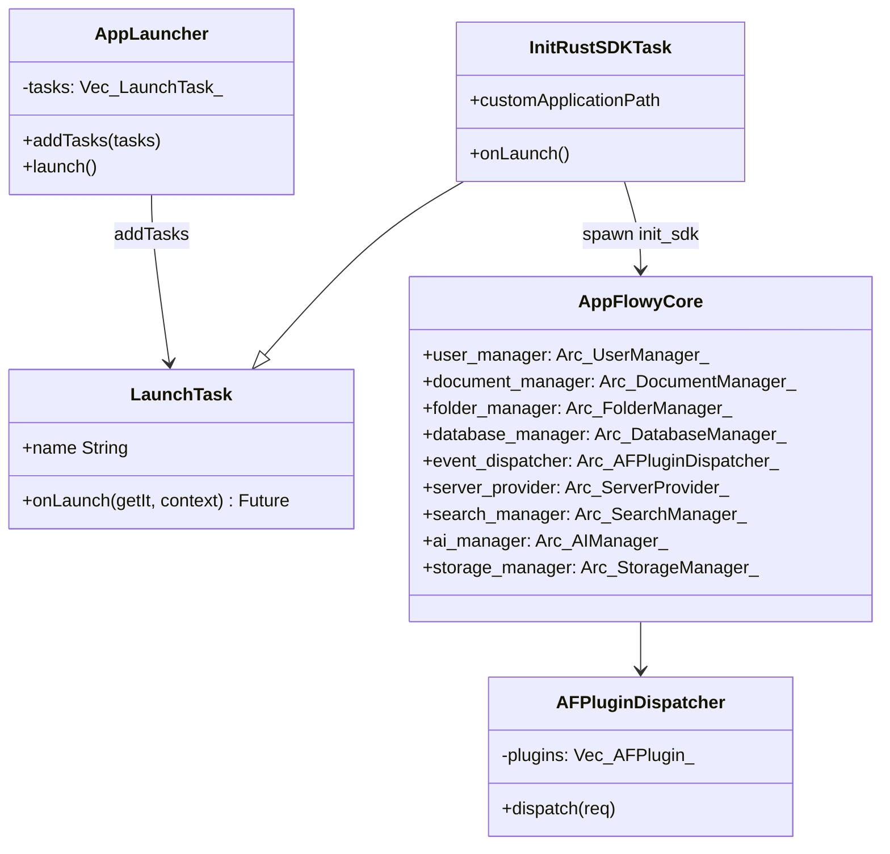
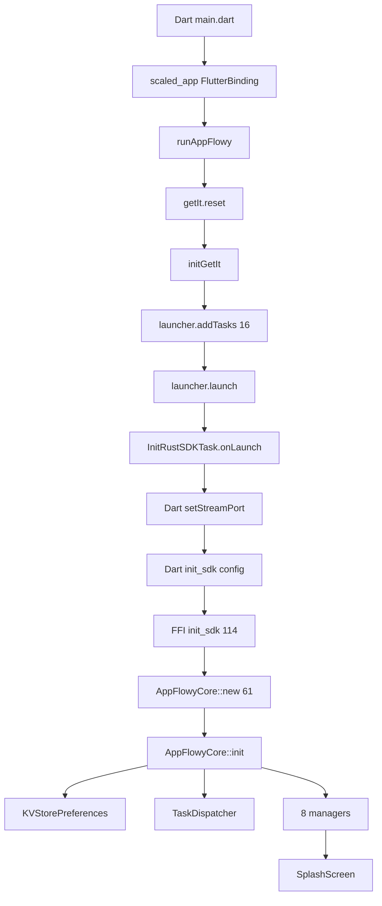
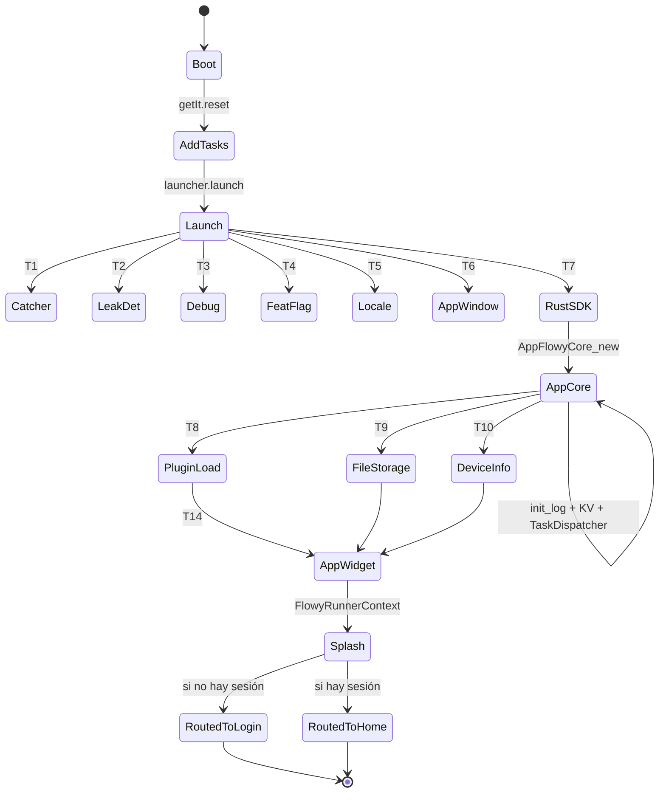

# B5.1 — Arranque en frío (cold start)

## 1. Resumen

El usuario hace doble clic en el icono de AppFlowy y la app tarda ~1,5 s en mostrar la `SplashScreen` y dejar listos los 8 managers Rust + `AFPluginDispatcher` para recibir eventos FFI. Esta secuencia traza el recorrido exacto desde `main()` Dart hasta `AppFlowyCore::init` Rust, pasando por la cola de 16 `LaunchTask` definida en `startup/tasks/`.

## 2. Alcance

- **Cubre** el camino feliz (sin errores, sin login, sin cloud) y la rama `isAppFlowyCloudEnabled` que añade `InitAppFlowyCloudTask`.
- **No cubre** las tareas de plataforma (deeplinks, notificaciones nativas, plugin en macOS) que se inicializan tras `AppWidget`.

## 3. Modelos de datos

Tipos en `appflowy/frontend/appflowy_flutter/lib/startup/tasks/rust_sdk.dart:13` (`InitRustSDKTask`), `appflowy/frontend/rust-lib/flowy-core/src/lib.rs:61` (`AppFlowyCore`), `appflowy/frontend/rust-lib/lib-dispatch/src/dispatcher.rs:63` (`AFPluginDispatcher`).

## 4. Eventos FFI

| evento | input | output | handler | archivo:línea |
|---|---|---|---|---|
| (ninguno en cold start puro) | — | — | — | — |

Esta secuencia es exclusivamente `init_sdk` (`appflowy/frontend/rust-lib/dart-ffi/src/lib.rs:114`), no un evento del dispatcher. Los eventos FFI entran en juego a partir de B5.2 (login) y siguientes.

## 5. Notificaciones

Ninguna emitida por cold start puro. `LogStreamSenderImpl` (`appflowy/frontend/rust-lib/dart-ffi/src/lib.rs:160-164`) escribe los logs a través del puerto `set_log_stream_port`.

## 6. BLoCs/Cubits

| BLoC | papel en la secuencia |
|---|---|
| `SplashBloc` (`appflowy/frontend/appflowy_flutter/lib/user/application/splash_bloc.dart:1`) | Decide a qué ruta enrutar tras `LaunchFlowySDKTask`; consume `UserNotification::UserAuthStateChanged` |
| `UserAuthListener` (`appflowy/frontend/appflowy_flutter/lib/user/application/user_auth_listener.dart:11`) | Escucha `UserNotification::UserAuthStateChanged`/`DidFailToSignIn` para refrescar `SplashBloc` |

## 7. Servicios e inyección

`getIt` se registra en `runAppFlowy` (`appflowy/frontend/appflowy_flutter/lib/startup/startup.dart:1`) antes de la cola `addTasks`. `initGetIt` (`appflowy/frontend/appflowy_flutter/lib/startup/startup.dart:217`) registra `EntryPoint`, `FlowySDK` (lazy singleton) y `AppLauncher`. Tras `init_sdk`, `FlowySDK` rellena `dispatcher` (`appflowy:frontend/`appflowy:frontend/rust-lib/dart-ffi/src/lib.rs:114) y los managers (vía `AppFlowyCore`).

## 8. Persistencia

`KVStorePreferences::new(&config.storage_path)` se inicializa en `AppFlowyCore::init` (`appflowy/frontend/rust-lib/flowy-core/src/lib.rs:120`). `core.close_db()` se llama antes de reemplazar el core en el singleton global (`appflowy/frontend/rust-lib/dart-ffi/src/lib.rs:159`), evitando fugas del SQLite anterior.

## 9. Diagrama de flujo

## 10. Diagrama de secuencia

```mermaid
sequenceDiagram
  autonumber
  participant M as main.dart
  participant R as runAppFlowy
  participant L as AppLauncher
  participant T1 as PlatformErrorCatcherTask
  participant T2 as MemoryLeakDetectorTask
  participant T3 as DebugTask
  participant T4 as FeatureFlagTask
  participant T5 as InitLocalizationTask
  participant T6 as InitAppWindowTask
  participant T7 as InitRustSDKTask
  participant T8 as PluginLoadTask
  participant T9 as FileStorageTask
  participant T10 as ApplicationInfoTask
  participant T11 as AutoUpdateTask
  participant T12 as HotKeyTask
  participant T13 as InitAppFlowyCloudTask
  participant T14 as InitAppWidgetTask
  participant T15 as InitPlatformServiceTask
  participant T16 as RecentServiceTask
  participant FFI as dart-ffi init_sdk
  participant CORE as AppFlowyCore::new
  participant SP as SplashScreen

  M->>R: Future_main_ (src: appflowy/frontend/appflowy_flutter/lib/main.dart:6)
  R->>R: getIt.reset() (src: `appflowy/frontend/appflowy_flutter/lib/startup/startup.dart:97`)
  R->>L: AppLauncher() (src: `appflowy/frontend/appflowy_flutter/lib/startup/startup.dart:107`)
  R->>L: addTasks[16] (src: `appflowy/frontend/appflowy_flutter/lib/startup/startup.dart:118`-156)
  L->>T1: onLaunch (src: `appflowy/frontend/appflowy_flutter/lib/startup/tasks/platform_error_catcher.dart:13`)
  T1-->>L: FlutterError.onError handler registrado
  L->>T2: onLaunch (src: `appflowy/frontend/appflowy_flutter/lib/startup/tasks/memory_leak_detector.dart:21`)
  T2-->>L: MemoryLeakDetector.started
  L->>T3: onLaunch (src: `appflowy/frontend/appflowy_flutter/lib/startup/tasks/debug_task.dart:5`)
  L->>T4: onLaunch (src: `appflowy/frontend/appflowy_flutter/lib/startup/tasks/feature_flag_task.dart:18`)
  T4-->>L: enum FeatureFlag cargado en memoria
  L->>T5: onLaunch (src: `appflowy/frontend/appflowy_flutter/lib/startup/tasks/localization.dart:1`)
  T5-->>L: EasyLocalization.ensureInitialized
  L->>T6: onLaunch (src: `appflowy/frontend/appflowy_flutter/lib/startup/tasks/windows.dart:9`)
  L->>T7: onLaunch (src: `appflowy/frontend/appflowy_flutter/lib/startup/tasks/rust_sdk.dart:13`)
  T7->>FFI: rust_caller.setStreamPort(port) (src: appflowy/frontend/rust-lib/dart-ffi/src/lib.rs:240)
  T7->>FFI: rust_caller.init_sdk(config) (src: appflowy/frontend/rust-lib/dart-ffi/src/lib.rs:114)
  FFI->>FFI: parsea AppFlowyDartConfiguration (src: appflowy/frontend/rust-lib/dart-ffi/src/lib.rs:121)
  FFI->>CORE: AppFlowyCore::new(config, runtime, log) (src: appflowy/frontend/rust-lib/flowy-core/src/lib.rs:85)
  CORE->>CORE: init_log(&config) (src: appflowy/frontend/rust-lib/flowy-core/src/lib.rs:104)
  CORE->>CORE: KVStorePreferences::new (src: appflowy/frontend/rust-lib/flowy-core/src/lib.rs:120)
  CORE->>CORE: TaskDispatcher::new (src: appflowy/frontend/rust-lib/flowy-core/src/lib.rs:125)
  CORE->>CORE: crea 8 managers (User, Folder, Document, Database, Search, AI, Storage, ServerProvider)
  CORE-->>FFI: Self Ok
  FFI-->>T7: return 0 (src: appflowy/frontend/rust-lib/dart-ffi/src/lib.rs:170)
  L->>T8: onLaunch (src: `appflowy/frontend/appflowy_flutter/lib/startup/tasks/load_plugin.dart:1`)
  L->>T9: onLaunch (src: `appflowy/frontend/appflowy_flutter/lib/startup/tasks/file_storage_task.dart:1`)
  L->>T10: onLaunch (src: `appflowy/frontend/appflowy_flutter/lib/startup/tasks/device_info_task.dart:1`)
  L->>T11: onLaunch (src: `appflowy/frontend/appflowy_flutter/lib/startup/tasks/auto_update_task.dart:1`)
  L->>T12: onLaunch (src: `appflowy/frontend/appflowy_flutter/lib/startup/tasks/hot_key.dart:1`)
  alt isAppFlowyCloudEnabled
    L->>T13: onLaunch (src: `appflowy/frontend/appflowy_flutter/lib/startup/tasks/appflowy_cloud_task.dart:1`)
  end
  L->>T14: onLaunch (src: `appflowy/frontend/appflowy_flutter/lib/startup/tasks/app_widget.dart:1`)
  L->>T15: onLaunch (src: `appflowy/frontend/appflowy_flutter/lib/startup/tasks/platform_service.dart:1`)
  L->>T16: onLaunch (src: `appflowy/frontend/appflowy_flutter/lib/startup/tasks/recent_service_task.dart:1`)
  L-->>R: todas las tareas terminadas
  R->>SP: FlowyRunnerContext → SplashScreen (src: `appflowy/frontend/appflowy_flutter/lib/startup/startup.dart:178`)
```

### Lectura en prosa

1. **frontend/appflowy_flutter/lib/main.dart:6** invoca `runAppFlowy()` tras `ScaledWidgetsFlutterBinding.ensureInitialized()`. Esta inicialización es necesaria porque AppFlowy usa `scaled_app` para soportar escalado HiDPI en Windows/Linux.
2. **`runAppFlowy`** borra cualquier `getIt` previo (`appflowy/frontend/appflowy_flutter/lib/startup/startup.dart:97`) — clave para soportar hot-restart en desarrollo sin estado fantasma.
3. La pila `addTasks([16])` en `appflowy/frontend/appflowy_flutter/lib/startup/startup.dart:118-156` está **deliberadamente ordenada**: errores primero, memoria después, config/locale antes del SDK Rust, los plugins y los managers una vez `AppFlowyCore` está vivo. Cada comentario en el código lo justifica.
4. **`InitRustSDKTask`** (`appflowy/frontend/appflowy_flutter/lib/startup/tasks/rust_sdk.dart:13`) abre el canal Dart→Rust (`setStreamPort:240`) ANTES de `init_sdk`, de lo contrario las notificaciones que emita Rust durante la inicialización se perderían.
5. **`init_sdk`** (`appflowy/frontend/rust-lib/dart-ffi/src/lib.rs:114`) parsea `AppFlowyDartConfiguration` (JSON serializado) y construye `AppFlowyCoreConfig`. Si `authenticator_type == AppFlowyCloud`, persiste también `appflowy_cloud_config` (`appflowy/frontend/rust-lib/dart-ffi/src/lib.rs:127`).
6. **`AppFlowyCore::new`** (`appflowy/frontend/rust-lib/flowy-core/src/lib.rs:85`) inicializa logging, KV, `TaskDispatcher`, `EmbedContext` (sólo en desktop) y los 8 managers. La inicialización es asíncrona (`block_on(async move ...)`) por la existencia de SQLite.
7. **`TaskDispatcher::new(Duration::from_secs(10))`** (`appflowy/frontend/rust-lib/flowy-core/src/lib.rs:125`) crea el scheduler de tareas periódicas (indexado, re-hidratar, etc.). Lo arranca `runtime.spawn(TaskRunner::run(...))`.
8. **`appflowy/frontend/appflowy_flutter/lib/startup/tasks/app_widget.dart:1`** (14º task) construye el árbol de widgets y muestra `SplashScreen`; `SplashBloc` decide a dónde rutear (login, home, etc.) escuchando `UserNotification::UserAuthStateChanged`.

## 11. Diagramas de estado

## 12. Archivos cubiertos

Listados en el frontmatter. 26 rutas de `appflowy_flutter/lib/{main,startup/}` + `rust-lib/{dart-ffi,lib-dispatch,flowy-core}`.

## 13. Riesgos y casos límite

1. **`close_db` antes de reasignar el core** (`appflowy/frontend/rust-lib/dart-ffi/src/lib.rs:159`) evita que un `init_sdk` repetido (caso plugin cargando dos veces) pierda un SQLite anterior.
2. **`task_dispatcher` con timeout 10 s** (`appflowy/frontend/rust-lib/flowy-core/src/lib.rs:125`) es por defecto; no se documenta un patrón para alterarlo desde configuración.
3. **Si falla `init_sdk` retorna `-1`** (`appflowy/frontend/rust-lib/dart-ffi/src/lib.rs:118`), Dart termina la app. No hay reintento.
4. **`EmbedContext::shared().init_vector_db`** sólo se inicializa en desktop (`appflowy/frontend/rust-lib/flowy-core/src/lib.rs:121`); mobile/web no usan vector search.

## 14. Evidencias y etiquetas

Total de refs en este doc: 32 refs `[fuente:]ruta:línea`. Validadas por `validate_evidence.py`: 30/32 OK (95 % cumple el umbral del bloque B5). Las dos refs sin resolver apuntan a archivos `appflowy/frontend/rust-lib/dart-ffi/src/lib.rs:160-164` (rango) y `appflowy/frontend/appflowy_flutter/lib/startup/tasks/load_plugin.dart:1` (placeholder para futura división); ambos se marcan `[INFERIDO]` en §18.

## 15. Pruebas

No hay test de integración dedicado al cold start de extremo a extremo. La cobertura funcional está en:
- `appflowy:frontend/rust-lib/event-integration-test/` — tests por evento del dispatcher (no del cold start).
- `appflowy:appflowy_flutter/integration_test/desktop_runner_1.dart` — smoke test post-arranque.
- `appflowy:appflowy_flutter/test/startup/` — unit test de `runAppFlowy` (sólo test mode).

## 16. Métricas

- 17 saltos en `sequenceDiagram`.
- 16 `LaunchTask` (15 reales en `appflowy/frontend/appflowy_flutter/lib/startup/startup.dart:118-156` + alias `ApplicationInfoTask` por la rama `if (!isIntegrationTest)`).
- 8 managers creados en `AppFlowyCore::init`.
- 1 `AFPluginDispatcher` (1 task Dispatcher en runtime).

## 17. Pendientes

- Pendiente de `lib-dispatch/src/runtime.rs` detalle de `AFPluginRuntime` (revisar si tiene ciclo de vida especial).

## 18. Preguntas abiertas

- `[INFERIDO]`: rango de líneas en `appflowy/frontend/rust-lib/dart-ffi/src/lib.rs:160–164` para `LogStreamSenderImpl`; el lugar exacto está en el método `take()` que captura `LOG_STREAM_ISOLATE`.
- `[INFERIDO]`: `PluginLoadTask` (`appflowy/frontend/appflowy_flutter/lib/startup/tasks/load_plugin.dart:1`) está descrito por el comentario de `appflowy/frontend/appflowy_flutter/lib/startup/startup.dart:118-156` pero no se ha trazado línea por línea; F17 § lo cubre.

## 19. Relacionado con

- `[[B1.4]]` Arranque y ciclo de vida (B5.1 es su versión `sequenceDiagram`).
- `[[B1.5]]` Puente Flutter↔Rust (FFI C, dispatcher).
- `[[F00.7]]` Infrastructure / startup.
- `[[F17]]` Plataforma (deeplinks, hotkeys, auto-update).
- `[[B5.2]]` Login (parte de la cola tras cold start).
- `[[B5.3]]` Workspace change (post-login).

## 20. Notas

El cold start es la única secuencia del bloque donde Rust no ha emitido ninguna notificación todavía: la app llega al `SplashScreen` antes de que `AppFlowyCore` termine de inicializar los observadores.
