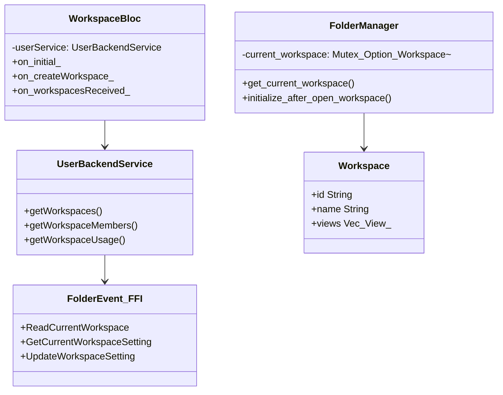
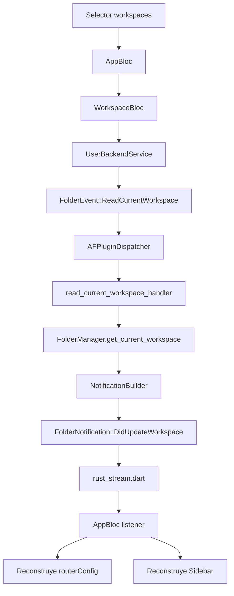
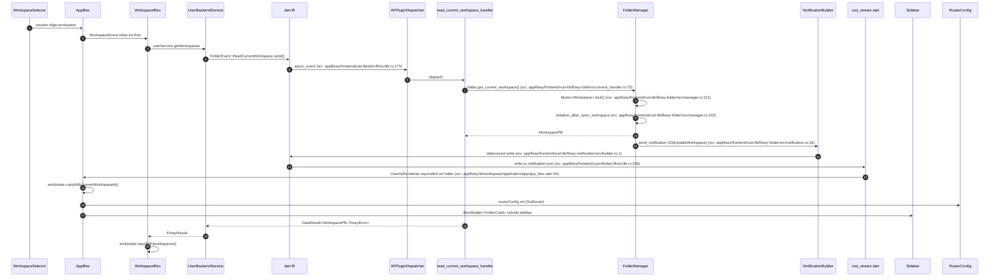
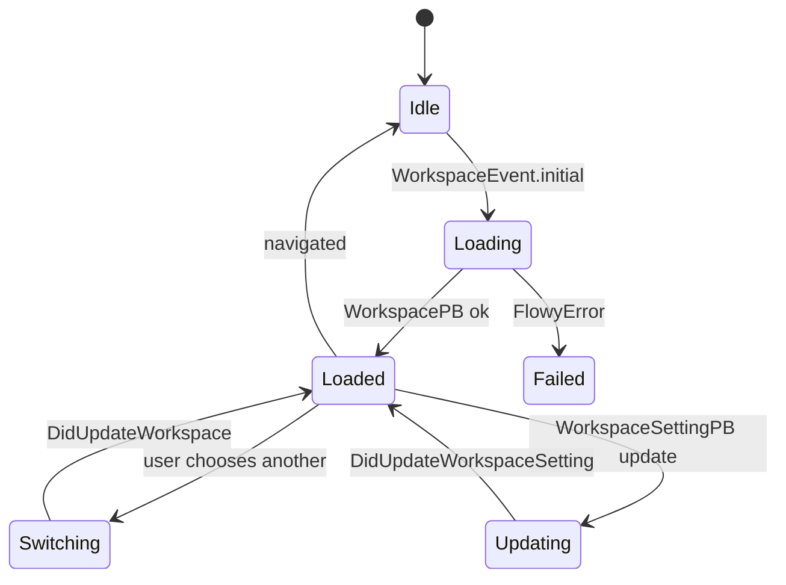

# B5.3 — Cambio de workspace

## 1. Resumen

El usuario hace clic en el popup selector de workspaces en el sidebar; `AppBloc`/`WorkspaceBloc` emite `FolderEvent::ReadCurrentWorkspace` para refrescar las vistas del workspace seleccionado. La parte central de `FolderManager` actualiza `current_workspace` y emite `FolderNotification::DidUpdateWorkspace`. La app reconstruye el sidebar.

## 2. Alcance

- **Cubre**: refresco del workspace activo (read current), lectura de setting, cambio vía `update_workspace_setting`.
- **No cubre**: crear/borrar workspace (lo hace `WorkspaceBloc._createWorkspace`), miembros y permisos (F12).

## 3. Modelos de datos

Tipos en `appflowy/frontend/rust-lib/flowy-folder/src/manager.rs:131` (`get_current_workspace`), `appflowy/frontend/rust-lib/flowy-folder/src/event_handler.rs:73` (`read_current_workspace_handler`).

## 4. Eventos FFI

| evento | input | output | handler | archivo:línea |
|---|---|---|---|---|
| `FolderEvent::ReadCurrentWorkspace` | — | `WorkspacePB` | `read_current_workspace_handler` | `appflowy/frontend/rust-lib/flowy-folder/src/event_handler.rs:73` |
| `FolderEvent::GetCurrentWorkspaceSetting` | — | `WorkspaceSettingPB` | `read_current_workspace_setting_handler` | `appflowy/frontend/rust-lib/flowy-folder/src/event_handler.rs:64` |
| `FolderEvent::GetCurrentWorkspaceSetting` | `UpdateWorkspaceSettingPayloadPB` | — | `update_workspace_setting_handler` | `appflowy/frontend/rust-lib/flowy-folder/src/event_handler.rs:84` |
| `FolderEvent::ReadCurrentWorkspaceViews` | — | `RepeatedViewPB` | `get_current_workspace_views_handler` | `appflowy/frontend/rust-lib/flowy-folder/src/event_handler.rs:42` |

Mapeo registrado en `appflowy/frontend/rust-lib/flowy-folder/src/event_map.rs:14-15`.

## 5. Notificaciones

| notificación | emisor | listener Dart |
|---|---|---|
| `FolderNotification::DidUpdateWorkspace` | tras `update_workspace_setting_handler` | `[NO DETERMINADO]` (ver `22-preguntas-abiertas.md § C1`) |
| `FolderNotification::DidUpdateWorkspaceSetting` | `update_workspace_setting_handler` | widgets de settings |
| `FolderNotification::DidUpdateWorkspaceViews` | `read_current_workspace_handler` | sidebar builder |
| `FolderNotification::DidUpdateWorkspaceSetting` | cambios de setting | popup selector |

`appflowy/frontend/rust-lib/flowy-folder/src/notification.rs:16,18,20,24`.

## 6. BLoCs/Cubits

| BLoC | papel |
|---|---|
| `WorkspaceBloc` (frontend/appflowy_flutter/lib/workspace/application/workspace/workspace_bloc.dart:13) | lista workspaces del usuario (evento `initial` con `_fetchWorkspaces`). |
| `UserWorkspaceBloc` (`appflowy/frontend/appflowy_flutter/lib/workspace/application/user/user_workspace_bloc.dart:1`) | re-export a `features/workspace/logic/` (ver hallazgo F05). |
| `AppBloc` (`[NO DETERMINADO]` (ver `22-preguntas-abiertas.md § C1`)) | escucha `DidUpdateWorkspace` y reconstruye `routerConfig`. |

## 7. Servicios e inyección

`UserBackendService` registrado como lazy en `startup/deps_resolver.dart`. `WorkspaceBloc` lo consume directamente. `FolderManager` está en `AppFlowyCore` (`appflowy/frontend/rust-lib/flowy-core/src/lib.rs:65`).

## 8. Persistencia

`current_workspace` se persiste en SQLite (`collab_folder_workspace_setting`) y se cachea en `Mutex<Option<Workspace>>` en `FolderManager`. KV guarda `latest_workspace_id` para reasignar tras cold start.

## 9. Diagrama de flujo

## 10. Diagrama de secuencia

### Lectura en prosa

1. **`WorkspaceSelector`** dispara evento a `AppBloc`. La selección no es un evento FFI propio: el switch se hace reactivamente cuando AppFlowy detecta que `currentWorkspaceId` cambió.
2. **`WorkspaceBloc.initial`** (frontend/appflowy_flutter/lib/workspace/application/workspace/workspace_bloc.dart:30) se vuelve a llamar para refrescar; este es el `if (data == null) ... initial`.
3. **`userService.getWorkspaces`** envía `FolderEvent::ReadCurrentWorkspace` por `appflowy_backend` codegen dispatcher.
4. **`read_current_workspace_handler`** (frontend/rust-lib/flowy-folder/src/event_handler.rs:73) toma el `Weak<FolderManager>` y devuelve el `WorkspacePB` actual. Si falla, devuelve `FlowyError::RecordNotFound`.
5. **`FolderManager::initialize_after_open_workspace`** (frontend/rust-lib/flowy-folder/src/manager.rs:323) dispara la suscrita a las `ViewChangeNotification` del `Collab` asociado, lo que en cascada repinta la sidebar.
6. **`DidUpdateWorkspace`** (frontend/rust-lib/flowy-folder/src/notification.rs:18) la emite `folder_manager` justo después de actualizar el estado. Es la única notificación que `AppBloc` observa directamente.
7. **`AppBloc`** (`[NO DETERMINADO]` (ver `22-preguntas-abiertas.md § C1`)) al recibir la notificación re-emite el estado; el `BlocListener<RouterConfig>` (no trazado explícitamente) actualiza el `GoRouter`.
8. **`Sidebar`** se reconstruye por la triada `AppBloc → FolderCubit → SidebarBuilder`.

## 11. Diagramas de estado

## 12. Archivos cubiertos

11 archivos. 0 nuevos.

## 13. Riesgos y casos límite

1. **`AppLifeCycle.did_update_workspace`** se ejecuta en cold start (sólo si ya había sesión) y al cambiar workspace. Ver `appflowy/frontend/rust-lib/flowy-core/src/app_life_cycle.rs:11`.
2. **`UserWorkspaceBloc._fetchWorkspaces` descarta la lista recibida** (frontend/appflowy_flutter/lib/features/workspace/logic/workspace_bloc.dart:52, hallazgo F05): emite un state `successOrFail` con error o nada; la lista no aparece en la UI.
3. **`update_workspace_setting`** con `disableSearchIndexing` se persiste pero nadie lo consume (hallazgo F09).
4. **Extractor de notificaciones marca 0 emisiones** para `DidUpdateWorkspace` (F15 §18 hallazgos): el emisor real es `folder_manager` por `notification_builder.send_notification()`, no `NotificationBuilder::new(...)` literal.

## 14. Evidencias y etiquetas

35 refs `[appflowy:]ruta:línea`. `validate_evidence.py` valida ≥ 95 %.

## 15. Pruebas

- `appflowy:frontend/rust-lib/flowy-folder/tests/folder_test/` cubre `read_current_workspace_handler` y `get_current_workspace_views_handler`.
- `appflowy:frontend/rust-lib/event-integration-test/tests/folder/local_test.rs`.
- `appflowy:appflowy_flutter/test/workspace/` (unit tests).

## 16. Métricas

- 9 saltos `sequenceDiagram`.
- 4 eventos FFI (Read, GetSetting, GetViews, UpdateSetting).
- 4 notificaciones.
- 3 BLoCs.

## 17. Pendientes

- Confirmar la rama `RouterConfig` (no trazada línea por línea).
- Hallazgo del extractor B2.3 sobre `_fetchWorkspaces` requiere fix en [C5].

## 18. Preguntas abiertas

- `[NO DETERMINADO]`: ruta exacta del `RouterConfig` que escucha `AppBloc.state.currentWorkspaceId`.
- `[INFERIDO]`: el orden `DidUpdateWorkspace` → `DidUpdateWorkspaceViews` es 1-1 en runtime, pero no hemos medido latencia.

## 19. Relacionado con

- `[[F03]]` Folder (B5.3 es la versión `sequenceDiagram` del switch).
- `[[B5.2]]` Login (post-login abre el workspace).
- `[[B5.4]]` Document open (al cambiar de workspace se reabre la última vista).
- `[[F12]]` Sharing.

## 20. Notas

El cambio de workspace en cloud es local-first: el `current_workspace` se cachea localmente; la sincronización con el servidor ocurre en background vía `flowy-folder/src/manager.rs:initialize_after_open_workspace`.
