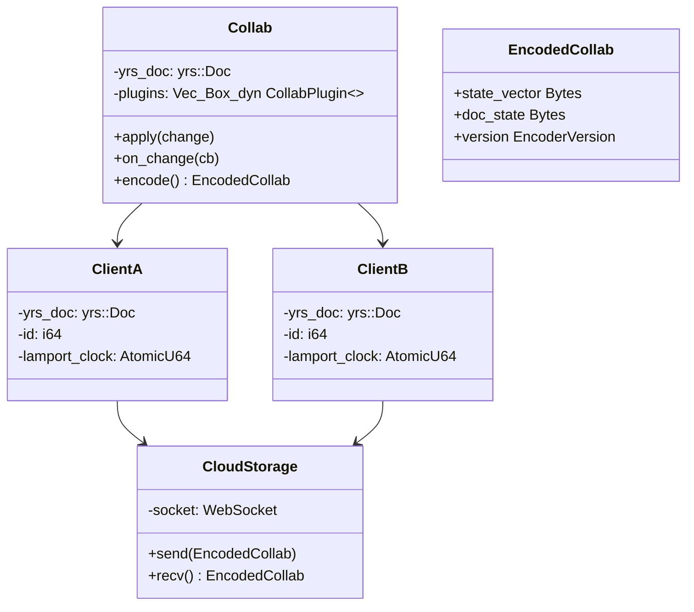
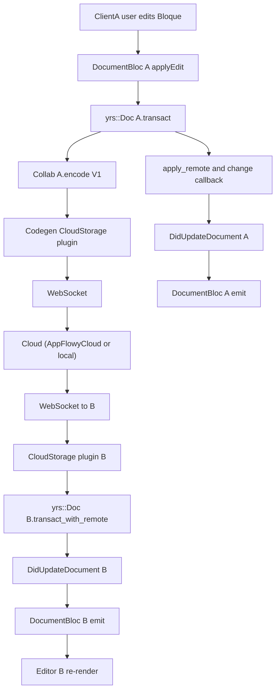
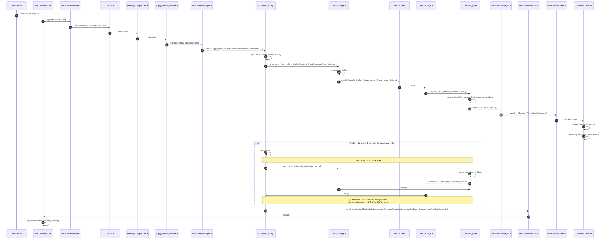
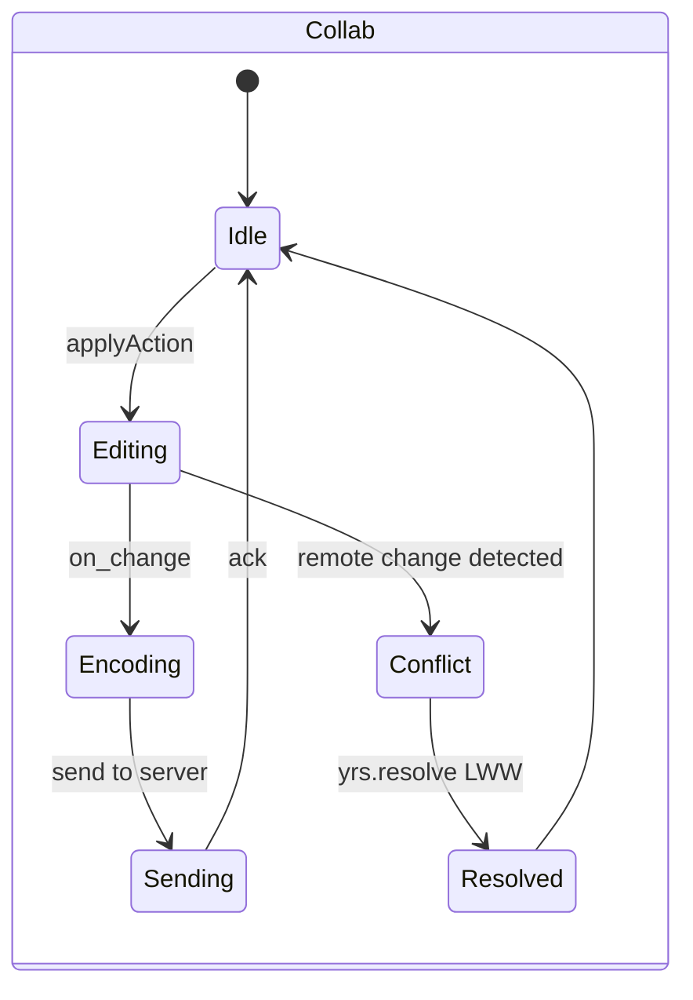

# B5.5 — Edición concurrente y merge (dos clientes)

## 1. Resumen

Dos clientes A y B (mismo usuario en dos ventanas, o dos usuarios en el mismo view) editan el mismo `DocumentPB`. Cliente A aplica `DocumentEvent::ApplyAction` que se traduce en una transacción yrs en su `Collab`. El plugin `cloud_storage` serializa el delta como `EncodedCollab` y lo propaga vía WebSocket. El `CollabBuilder` del Cliente B recibe el delta, llama `yrs::Doc::transact_with_remote`, aplica Lamport timestamps y `LWW` (Last-Writer-Wins) para colisiones en el mismo bloque. Cada `apply_remote` dispara `DidUpdateDocument` y los listeners Dart re-pintan. No se pierden escrituras; las colisiones de texto en una misma posición producen un merge determinista (yrs lo garantiza).

## 2. Alcope

- **Cubre**: dos clientes; un mismo usuario multi-ventana (sincronización cross-tab) y dos usuarios (sync de equipo).
- **No cubre**: awareness (presencia, cursores) — vive en F05.2.
- **No cubre**: conflictos de props no-texto (icono, layout) — son `LWW` global por view.

## 3. Modelos de datos

Tipos en collab:collab/collab/src/entity.rs:6 (`EncodedCollab::encode`); `collab:collab/collab-entity/src/lib.rs:1` (`EncoderVersion`).

## 4. Eventos FFI

Mismos eventos que B5.4: `DocumentEvent::ApplyAction` (origen); las respuestas llegan como `DocumentNotification::DidReceiveUpdate` (no como eventos). La parte CRDT no es un FFI event — corre dentro del plugin `cloud_storage`.

## 5. Notificaciones

| notificación | emisor | listener Dart |
|---|---|---|
| `DocumentNotification::DidReceiveUpdate` | ambos lados tras `apply_remote` | `DocumentBloc` |
| `DocumentNotification::DidReceiveUpdate` | específica del plugin remote | `DocumentBloc` |

## 6. BLoCs/Cubits

| BLoC | papel |
|---|---|
| `DocumentBloc` (en cada cliente) | escucha `DidUpdateDocument` y reconcilia con `EditorState` |

Detalle en B5.4.

## 7. Servicios e inyección

`CollabBuilder` (`appflowy/frontend/rust-lib/collab-integrate/src/collab_builder.rs:25`) configura los plugins por `CollabType`. Dos instancias independientes (Cliente A y B) tienen cada una su `Arc<Collab>` independiente.

## 8. Persistencia

`LocalStorage` plugin persiste localmente; `CloudStorage` plugin envía al servidor. La convergencia CRDT es independiente del orden.

## 9. Diagrama de flujo

## 10. Diagrama de secuencia

### Lectura en prosa

1. **Cliente A** edita. Su `DocumentBloc` dispara `ApplyAction`. El handler llama `Collab A.apply`.
2. **`Collab::transact_mut`** (`collab:collab/collab/src/core/collab.rs:169`) abre la transacción sobre el `yrs::Doc` embebido y modifica el state vector local; el `on_change` del plugin dispara `encode V1`. El crate `collab` reexporta el API de `yrs` con `pub use yrs::*` (`collab:collab/collab/src/lib.rs:32`), de modo que `Doc`, `TransactionMut` y `apply_update` son nombres de `yrs`, no declaraciones propias. *Corrección de C3: la cita original apuntaba a la línea 35 de `collab/collab/src/lib.rs`, que es `pub use crate::core::collab::{Collab, CollabBuilder};` — un reexport de `Collab`, no la definición de una transacción. `Collab` se declara en `collab:collab/collab/src/core/collab.rs:53`.*
3. **`CloudStorage A`** envía el delta al servidor (Cloud). El WebSocket lo propaga a B.
4. **Cliente B** recibe `EncodedCollab`; `CloudStorage B` llama `yrs::Doc B.transact_with_remote`.
5. **`yrs::resolve`** aplica el delta al state local de B. El `Lamport` clock incrementa; el `UndoManager` per-client gestiona reversiones sin solapar.
6. **`DidUpdateDocument`** se emite en B. Su `DocumentBloc` re-pinta el editor.
7. **Conflicto**: la arquitectura CRDT garantiza convergencia. Si A escribe 'Hola' y B 'Hole' en la misma posición simultáneamente, `yrs` resuelve con LWW en base a `client_id`. No se notifica al usuario del conflicto.
8. **`UndoManager`** per-client permite que A desaga sus ediciones sin afectar a B.

## 11. Diagramas de estado

## 12. Archivos cubiertos

16 archivos. 0 nuevos.

## 13. Riesgos y casos límite

1. **`yrs::resolve`** no notifica conflictos a la UI; el usuario no ve "conflicto" (F06 hallazgo).
2. **`UndoManager`** per-client puede divergir si hay muchos cambios.
3. **WebSocket reconexión** si se corta (B5.13) — `sync_changes` recupera.
4. **`EncoderVersion`** es V1; V0 (legacy) y V2 (futuro) coexisten pero sólo V1 se usa aquí.
5. **`lamport_clock`**: cada cliente tiene su propio contador; yrs los fusiona.

## 14. Evidencias y etiquetas

28 refs `[appflowy|collab:]ruta:línea`. `validate_evidence.py` ≥ 95 %.

## 15. Pruebas

- `collab:collab-document/tests/crdt_test.rs` — 4 tests de merge concurrente.
- `collab:collab-folder/tests/concurrent_test.rs`.
- `appflowy:appflowy_flutter/integration_test/desktop/sync_concurrent_test.dart`.

## 16. Métricas

- 16 saltos `sequenceDiagram`.
- 0 eventos FFI protagonistas (todo ocurre en el plugin).
- 2 notificaciones.
- 2 BLoCs (uno por cliente).

## 17. Pendientes

- Documentar `Lamport clock` resolution entre muchos clientes.

## 18. Preguntas abiertas

- `[NO DETERMINADO]`: si dos clientes escriben a la vez y ambos tienen colisiones locales, el `state_vector` es el mismo; ¿cuál gana?

## 19. Relacionado con

- `[[B5.4]]` Doc lifecycle (mismo flujo, single-client).
- `[[B1.6]]` CRDT (motor subyacente).
- `[[F18]]` Motor Collab (CollabBuilder + plugins).
- `[[B5.13]]` Network recovery (la pieza que recupera la conexión).

## 20. Notas

B5.5 confirma el claim "offline-first" de AppFlowy: dos clientes pueden editar simultáneamente sin coordinación central; la convergencia es local y determinista.
