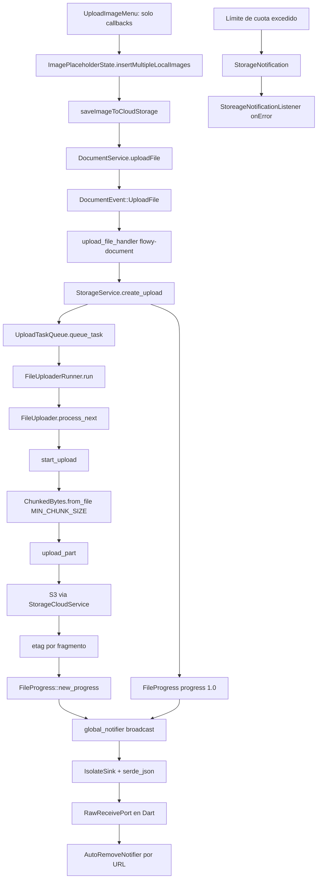
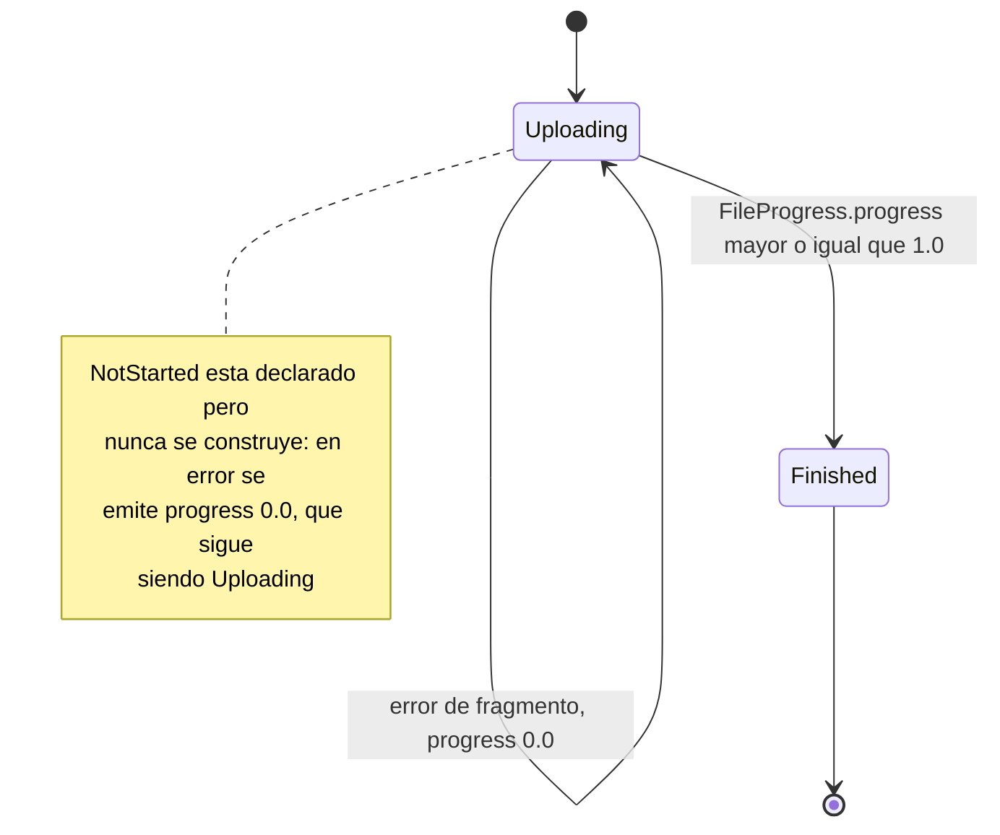

# B5.7 — Subir imagen

## 1. Resumen

El usuario elige una imagen local desde el `UploadImageMenu` del editor, un `StatefulWidget` que **solo emite callbacks** (`onSelectedLocalImages`, `onSelectedAIImage`, `onSelectedNetworkImage`, `onSelectedColor`) y no habla con el backend. Quien inicia la subida es `ImagePlaceholderState`, que llama a `saveImageToCloudStorage` (`appflowy/frontend/appflowy_flutter/lib/plugins/document/presentation/editor_plugins/image/image_util.dart:44`) y de ahí a `DocumentService.uploadFile` (`appflowy/frontend/appflowy_flutter/lib/plugins/document/application/document_service.dart:153`). Ese método dispara `DocumentEvent::UploadFile`, un evento del crate **`flowy-document`**, no de `flowy-storage`: su handler `upload_file_handler` (`appflowy/frontend/rust-lib/flowy-document/src/event_handler.rs:442`) baja hasta `StorageService::create_upload`. En Rust, `StorageManager` encola un `UploadTask`, `FileUploaderRunner` lo toma, y `start_upload` trocea el fichero con `ChunkedBytes` (`MIN_CHUNK_SIZE` = 5 MB) y sube cada fragmento.

Hay **dos canales de retorno distintos y es fácil confundirlos**. El canal de cuota usa el sistema de notificaciones protobuf (`StorageNotification`, dos variantes) y solo comunica errores. El canal de progreso usa un `IsolateSink` y transporta `FileProgress` **serializado a JSON**, no protobuf. Ninguno de los dos pasa por `NotificationBuilder` en el caso del progreso.

> **Corrección de C3 (2026-10-21).** La primera redacción de este documento tenía tres tipos inventados (`ChunkedByteUploader`, `FileCache`, `ImageBlockService`), dos notificaciones inexistentes de progreso y de fin de subida, un fichero inexistente (`image_upload.dart`) y atribuía el disparo de la subida a `RegisterStream`. La reescritura siguió la corrección del revisor de gate-100 de C3, que verificó el 100 % de las afirmaciones y halló 27 falsas. Ver `OUT/_ledger/pruebas/C3/README-contraste-B5-B2.md`.

## 2. Alcance

- **Cubre**: el camino feliz de subir una imagen local: selección, disparo del evento FFI, encolado, troceado, subida por fragmentos, publicación del progreso y escritura de la URL en el nodo de imagen.
- **No cubre**: los otros tres tipos de `UploadImageMenu` (IA, URL de red y color), que no pasan por `flowy-storage`; el `FileTempStorage` y la reanudación tras reinicio (F07); la descarga (`QueryFile`).

## 3. Modelos de datos

Este diagrama muestra los tipos Rust reales, con los nombres exactos de los campos tal y como están declarados en `appflowy/frontend/rust-lib/flowy-storage/src/uploader.rs` y `appflowy/frontend/rust-lib/flowy-storage/src/manager.rs`.

```mermaid
classDiagram
  class StorageManager {
    +storage_service: Arc_dyn_StorageService
    -cloud_service: Arc_dyn_StorageCloudService
    -user_service: Arc_dyn_StorageUserService
    -uploader: Arc_FileUploader
    -progress_notifiers: Arc_DashMap
    -global_notifier: GlobalNotifier
    +register_file_progress_stream(port: i64)
    +get_file_state(file_id) FileUploadState
    +update_network_reachable(reachable: bool)
  }
  class FileUploader {
    -storage_service: Arc_dyn_StorageService
    -queue: Arc_UploadTaskQueue
    -max_uploads: u8
    -current_uploads: AtomicU8
    -pause_sync: AtomicBool
    -disable_upload: Arc_AtomicBool
    +process_next() Option
    +all_tasks() Vec_UploadTask
    +pause()
    +resume()
  }
  class FileUploaderRunner {
    +run(weak_uploader, notifier)
  }
  class UploadTaskQueue {
    -tasks: RwLock_BinaryHeap_UploadTask
    -notifier: watch_Sender_Signal
    +queue_task(UploadTask)
    +remove_task(workspace_id, parent_dir, file_id)
  }
  class Signal {
    <<enumeration>>
    Proceed
  }
  class UploadTask {
    <<enumeration>>
    Task
    BackgroundTask
  }
  class ChunkedBytes {
    -file: File
    -chunk_size: usize
    -file_size: u64
    -current_offset: u64
    +from_file(path, chunk_size)
    +next_chunk() Option
    +total_chunks() usize
    +set_offset(offset)
  }
  class FileProgress {
    +file_url: String
    +file_id: String
    +progress: f64
    +error: Option_String
  }
  class FileUploadState {
    <<enumeration>>
    NotStarted
    Uploading
    Finished
  }
  class FileTempStorage {
    +root: PathBuf
  }
  StorageManager --> FileUploader : uploader
  FileUploaderRunner --> UploadTaskQueue : run
  FileUploader --> UploadTaskQueue : queue
  UploadTaskQueue --> Signal : notifier
  UploadTaskQueue --> UploadTask : BinaryHeap
  FileUploader --> ChunkedBytes : start_upload
  FileProgress --> FileUploadState : se deriva en manager.rs linea 105
  FileProgress --> IsolateSink : serde_json
```

Declaraciones: `StorageManager` en `appflowy/frontend/rust-lib/flowy-storage/src/manager.rs:43`, `FileUploader` en `appflowy/frontend/rust-lib/flowy-storage/src/uploader.rs:58`, `FileUploaderRunner` en `appflowy/frontend/rust-lib/flowy-storage/src/uploader.rs:252`, `UploadTaskQueue` en `appflowy/frontend/rust-lib/flowy-storage/src/uploader.rs:21`, `Signal` en `appflowy/frontend/rust-lib/flowy-storage/src/uploader.rs:15`, `UploadTask` en `appflowy/frontend/rust-lib/flowy-storage/src/uploader.rs:298`, `ChunkedBytes` en `appflowy/frontend/rust-lib/flowy-storage-pub/src/chunked_byte.rs:14`, `FileProgress` en `appflowy/frontend/rust-lib/flowy-storage-pub/src/storage.rs:66`, `FileUploadState` en `appflowy/frontend/rust-lib/flowy-storage-pub/src/storage.rs:59` y `FileTempStorage` en `appflowy/frontend/rust-lib/flowy-storage/src/file_cache.rs:8`.

Dos detalles del modelo que sostienen el resto de la secuencia:

- **La cola es un `BinaryHeap`, no una `VecDeque`** (`appflowy/frontend/rust-lib/flowy-storage/src/uploader.rs:22`), así que el orden de salida de las tareas no es FIFO sino el del `Ord` de `UploadTask`.
- **`FileProgress` y `FileUploadState` viajan por caminos distintos**. `FileProgress` es lo que se publica y serializa; `FileUploadState` se deriva de él en `StorageManager::new` (`appflowy/frontend/rust-lib/flowy-storage/src/manager.rs:105–126`) solo para alimentar los `ProgressNotifier` internos, indexados por `file_id`, y **nunca se serializa** (deriva solo `Clone, Debug`).

## 4. Eventos FFI

La subida la dispara un evento de `flowy-document`, no de `flowy-storage`. Los dos crates participan, pero en eventos distintos.

| crate | evento | input | output | handler | archivo:línea |
|---|---|---|---|---|---|
| `flowy-document` | `DocumentEvent::UploadFile` | `UploadFileParamsPB` | `UploadedFilePB` | `upload_file_handler` | `appflowy/frontend/rust-lib/flowy-document/src/event_map.rs:48` |
| `flowy-storage` | `FileStorageEvent::RegisterStream` | `RegisterStreamPB` | — | `register_stream_handler` | `appflowy/frontend/rust-lib/flowy-storage/src/event_map.rs:12` |
| `flowy-storage` | `FileStorageEvent::QueryFile` | `QueryFilePB` | `FileStatePB` | `query_file_handler` | `appflowy/frontend/rust-lib/flowy-storage/src/event_map.rs:13` |

`[[B2.1]]` confirma que `FileStorageEvent` tiene exactamente estas dos variantes, ambas con handler. Ninguna se llama `Upload`: **`RegisterStream` no dispara nada related con ficheros**, solo abre el canal de progreso (el payload es un `port` de isolate). El encolado real ocurre en el `upload_file_handler` de `flowy-document`, que desciende hasta `StorageService::create_upload`.

`RegisterStream` se envía **una única vez**, al construir `FileStorageService` en el arranque, y no por cada fichero (`appflowy/frontend/appflowy_flutter/lib/startup/tasks/file_storage_task.dart:52`).

## 5. Notificaciones

El enum `StorageNotification` (`appflowy/frontend/rust-lib/flowy-storage/src/notification.rs:7`) tiene **dos** variantes, ambas de agotamiento de cuota, y ninguna informa del progreso:

| notificación | emisor | listener Dart | efecto |
|---|---|---|---|
| `StorageNotification::FileStorageLimitExceeded` | `make_notification` (`appflowy/frontend/rust-lib/flowy-storage/src/notification.rs:22`) | `StoreageNotificationListener` (`appflowy/frontend/appflowy_flutter/lib/workspace/application/settings/file_storage/file_storage_listener.dart:24`) | `onError(FlowyError)` |
| `StorageNotification::SingleFileLimitExceeded` | `make_notification` (`appflowy/frontend/rust-lib/flowy-storage/src/notification.rs:22`) | el mismo listener | `onError(FlowyError)` |

El parser Dart `StoregeNotificationParser` filtra por el literal `source == "storage"` (`appflowy/frontend/appflowy_flutter/lib/workspace/application/settings/file_storage/file_storage_listener.dart:19`), que corresponde a la constante Rust `OBSERVABLE_SOURCE = "storage"` (`appflowy/frontend/rust-lib/flowy-storage/src/notification.rs:4`), y el `switch` del listener se limita a llamar a `onError` en ambas ramas (`appflowy/frontend/appflowy_flutter/lib/workspace/application/settings/file_storage/file_storage_listener.dart:37–43`). Ese canal **no transporta progreso ni finalización**.

## 6. BLoCs/Cubits

Ninguno. `[[B2.3]]` no registra ningún bloc en `flowy-storage`, ni en `appflowy/frontend/appflowy_flutter/lib/startup/tasks/file_storage_task.dart`, ni en `image/`. El estado de la subida vive en un `AutoRemoveNotifier<FileProgress>` por URL, dentro de un `Map<String, AutoRemoveNotifier<FileProgress>>` en `FileStorageService` (`appflowy/frontend/appflowy_flutter/lib/startup/tasks/file_storage_task.dart:56`), y el del documento en el `DocumentBloc` ya existente.

| pieza | papel |
|---|---|
| `UploadImageMenu` (`appflowy/frontend/appflowy_flutter/lib/plugins/document/presentation/editor_plugins/image/upload_image_menu/upload_image_menu.dart:34`) | solo UI; emite callbacks, no conoce el backend |
| `ImagePlaceholderState` (`appflowy/frontend/appflowy_flutter/lib/plugins/document/presentation/editor_plugins/image/image_placeholder.dart:278`) | pide la URL y escribe el atributo en el nodo |
| `FileStorageService` (`appflowy/frontend/appflowy_flutter/lib/startup/tasks/file_storage_task.dart:31`) | emite `RegisterStream`, escucha el `RawReceivePort`, reparte `FileProgress` por URL |

## 7. Servicios e inyección

`StorageManager` se construye de forma indirecta: `AppFlowyCore::init` (`appflowy/frontend/rust-lib/flowy-core/src/lib.rs:124`) invoca `FileStorageResolver::resolve` (`appflowy/frontend/rust-lib/flowy-core/src/lib.rs:179`), que hace `Arc::new(StorageManager::new(...))` en `appflowy/frontend/rust-lib/flowy-core/src/deps_resolve/file_storage_deps.rs:21`. El campo que lo guarda se declara en `appflowy/frontend/rust-lib/flowy-core/src/lib.rs:74`.

En Dart, `FileStorageTask` (`appflowy/frontend/appflowy_flutter/lib/startup/tasks/file_storage_task.dart:18`) es un `LaunchTask` del arranque que registra `FileStorageService` como singleton en `getIt` con `dispose` explícito. `FileUploader` recibe su `StorageService` por constructor (`appflowy/frontend/rust-lib/flowy-storage/src/uploader.rs:74`), y el backend concreto (S3 o local) lo decide `ServerProvider` a través del trait `StorageCloudService` (`appflowy/frontend/rust-lib/flowy-storage-pub/src/cloud.rs:9`).

## 8. Persistencia

La tabla `upload_file_table` guarda `workspace_id`, `file_id`, `parent_dir`, `local_file_path`, `content_type`, `chunk_size`, `num_chunk`, `upload_id`, `created_at` e `is_finish` (`appflowy/frontend/rust-lib/flowy-storage/src/sqlite_sql.rs:14`). **No guarda `retry_count`**: `prepare_upload_task` (`appflowy/frontend/rust-lib/flowy-storage/src/manager.rs:236`) reconstruye las tareas pendientes con `retry_count: 0` fijo (`appflowy/frontend/rust-lib/flowy-storage/src/manager.rs:251`), de modo que una tarea reanudada tras reiniciar la app tiene el contador a cero.

`FileTempStorage` (`appflowy/frontend/rust-lib/flowy-storage/src/file_cache.rs:8`) copia el fichero original a `{root}/cache_files` y lo borra al completar la subida (`appflowy/frontend/rust-lib/flowy-storage/src/file_cache.rs:31`, `appflowy/frontend/rust-lib/flowy-storage/src/file_cache.rs:85`). **No guarda la URL final en disco**: esa vive en SQLite y se recalcula con `get_object_url_v1` (`appflowy/frontend/rust-lib/flowy-storage/src/manager.rs:833`).

## 9. Diagrama de flujo

Este diagrama muestra el camino feliz completo, con el canal de progreso en la margen derecha y el canal de cuota aparte.

Las aristas `FP → GN → IS → FFI2 → NTF` son el canal de progreso; `QUOTA → SN → LST` es el canal de notificaciones, y no se cruzan.

## 10. Diagrama de secuencia

Este diagrama traza la subida completa. Los `src:` señalan los saltos cuyo origen está verificado en el código.

```mermaid
sequenceDiagram
  autonumber
  participant ED as Editor
  participant UM as UploadImageMenu
  participant IPS as ImagePlaceholderState
  participant SVC as FileStorageService
  participant DS as DocumentService
  participant FFI as dart-ffi
  participant DSP as AFPluginDispatcher
  participant UFH as upload_file_handler
  participant SM as StorageManager
  participant UTQ as UploadTaskQueue
  participant RUN as FileUploaderRunner
  participant FU as FileUploader
  participant SU as start_upload
  participant CB as ChunkedBytes
  participant SC as StorageCloudService
  participant S3 as S3
  participant SINK as IsolateSink
  participant PORT as RawReceivePort

  Note over SVC: arranque de la app, una sola vez
  SVC->>FFI: RegisterStreamPB(port) (src: appflowy/frontend/appflowy_flutter/lib/startup/tasks/file_storage_task.dart:52)
  FFI->>DSP: async_event (src: appflowy/frontend/rust-lib/dart-ffi/src/lib.rs:175)
  DSP->>SM: register_file_progress_stream(port) (src: appflowy/frontend/rust-lib/flowy-storage/src/manager.rs:138)
  SM->>SINK: tokio::spawn, suscribe global_notifier
  ED->>UM: se abre el menu de imagen
  UM->>IPS: onSelectedLocalImages(List_XFile)
  IPS->>SI: saveImageToCloudStorage(path, documentId)
  SI->>DS: uploadFile(localFilePath, documentId)
  DS->>FFI: DocumentEventUploadFile(UploadFileParamsPB)
  FFI->>UFH: async_event (src: appflowy/frontend/rust-lib/flowy-document/src/event_map.rs:48)
  UFH->>SM: create_upload(workspace_id, parent_dir, file_path) (src: appflowy/frontend/rust-lib/flowy-storage/src/manager.rs:349)
  SM->>UTQ: task_queue.queue_task(UploadTask) (src: appflowy/frontend/rust-lib/flowy-storage/src/manager.rs:409)
  UTQ->>RUN: notifier.send(Signal::Proceed)
  RUN->>FU: process_next() (src: appflowy/frontend/rust-lib/flowy-storage/src/uploader.rs:131)
  FU->>SU: start_upload(record)
  SU->>CB: ChunkedBytes::from_file(path, MIN_CHUNK_SIZE) (src: appflowy/frontend/rust-lib/flowy-storage/src/manager.rs:578)
  loop por cada fragmento de 5 MB
    CB->>SC: upload_part(upload_id, part_number, bytes)
    SC->>S3: PUT fragmento
    S3-->>SC: etag
    SU->>SINK: global_notifier.send(FileProgress::new_progress) (src: appflowy/frontend/rust-lib/flowy-storage/src/manager.rs:689)
    SINK-->>PORT: JSON por el isolate
    PORT-->>SVC: FileProgress.fromJsonString (src: appflowy/frontend/appflowy_flutter/lib/startup/tasks/file_storage_task.dart:36)
    SVC->>SVC: notifierList[fileUrl].value = fileProgress
  end
  SU->>SINK: FileProgress::new_progress(progress: 1.0) (src: appflowy/frontend/rust-lib/flowy-storage/src/manager.rs:860)
  SU-->>UFH: UploadedFilePB con la URL
  IPS->>ED: atributo url escrito en el nodo de imagen
```

### Lectura en prosa

1. **`UploadImageMenu` no conoce el backend.** Su constructor solo recibe `void Function(List<XFile>) onSelectedLocalImages` y tres callbacks más (`appflowy/frontend/appflowy_flutter/lib/plugins/document/presentation/editor_plugins/image/upload_image_menu/upload_image_menu.dart:37–40`). Es un selector, no un orquestador.
2. **`ImagePlaceholderState.insertMultipleLocalImages`** (`appflowy/frontend/appflowy_flutter/lib/plugins/document/presentation/editor_plugins/image/image_placeholder.dart:278`) es el punto donde la subida se materializa, y escribe el atributo `CustomImageBlockKeys.url` en un nodo de imagen personalizado (`appflowy/frontend/appflowy_flutter/lib/plugins/document/presentation/editor_plugins/image/image_placeholder.dart:338`).
3. **`saveImageToCloudStorage`** (`appflowy/frontend/appflowy_flutter/lib/plugins/document/presentation/editor_plugins/image/image_util.dart:44`) llama a `DocumentService.uploadFile` y, si va bien, guarda además una copia en `CustomImageCacheManager` (`appflowy/frontend/appflowy_flutter/lib/plugins/document/presentation/editor_plugins/image/image_util.dart:56`).
4. **`DocumentService.uploadFile`** (`appflowy/frontend/appflowy_flutter/lib/plugins/document/application/document_service.dart:153`) pide antes el workspace actual con `FolderEventReadCurrentWorkspace`, compone un `UploadFileParamsPB` con `workspaceId`, `localFilePath` y `documentId`, y manda `DocumentEventUploadFile`.
5. **`upload_file_handler`** (`appflowy/frontend/rust-lib/flowy-document/src/event_handler.rs:442`) es el puente entre los dos crates: vive en `flowy-document` pero opera sobre el `StorageService`.
6. **`StorageServiceImpl::create_upload`** (`appflowy/frontend/rust-lib/flowy-storage/src/manager.rs:349`) valida que `workspace_id`, `parent_dir` y `file_path` no estén vacíos (tres `FlowyError::internal()` distintos) y encola la tarea.
7. **`UploadTaskQueue`** (`appflowy/frontend/rust-lib/flowy-storage/src/uploader.rs:21`) guarda las tareas en un `RwLock<BinaryHeap<UploadTask>>` y señala al runner con un `watch::Sender<Signal>` cuyo valor es `Signal::Proceed`. `queue_task` es `async` porque el lock es un `RwLock` asíncrono.
8. **`FileUploader::process_next`** (`appflowy/frontend/rust-lib/flowy-storage/src/uploader.rs:131`) es el método real que consume la cola; no existe ningún `upload(task)`. Admite trabajo mientras `current_uploads < max_uploads`, con `max_uploads = 3` (`appflowy/frontend/rust-lib/flowy-storage/src/uploader.rs:82`).
9. **`start_upload`** (`appflowy/frontend/rust-lib/flowy-storage/src/manager.rs:542`) es una función libre, no un método, y es la que hace el troceado con `ChunkedBytes::from_file(..., MIN_CHUNK_SIZE)` (`appflowy/frontend/rust-lib/flowy-storage/src/manager.rs:578`). `upload_part` (`appflowy/frontend/rust-lib/flowy-storage/src/manager.rs:788`) también es función libre y acaba delegando en `StorageCloudService::upload_part`.
10. **Lo que se publica por fragmento es `FileProgress`**, no `FileUploadState`: `FileProgress::new_progress` se manda a `global_notifier` (`appflowy/frontend/rust-lib/flowy-storage/src/manager.rs:682–689`) y el progreso terminal con `1.0` se emite aparte al completar (`appflowy/frontend/rust-lib/flowy-storage/src/manager.rs:854–860`). `FileUploadState` se deriva después, en la tarea de `appflowy/frontend/rust-lib/flowy-storage/src/manager.rs:105–126`, y solo alimenta los `ProgressNotifier` por `file_id`.
11. **`onFileProgress`** (`appflowy/frontend/appflowy_flutter/lib/startup/tasks/file_storage_task.dart:61`) expone el progreso como `AutoRemoveNotifier<FileProgress>` indexado por URL, de modo que dos subidas simultáneas no se pisan. **Pero hoy ningún componente lo invoca**: la única coincidencia de `onFileProgress` en todo `appflowy_flutter/lib/` es su propia declaración, así que el mapa queda siempre vacío y el progreso no llega a ninguna barra de la UI. La UI se conforma con el resultado de `uploadFile`, no con el canal de progreso.

## 11. Diagramas de estado

Este diagrama muestra los valores que `FileUploadState` alcanza **en la práctica**, que son dos de los tres declarados.

El descarte por `retry_count > 5` (`appflowy/frontend/rust-lib/flowy-storage/src/uploader.rs:166`) ocurre en `process_next`, que saca la tarea de la cola y devuelve `None` sin publicar ningún estado: es una terminación silenciosa, no una transición observable.

## 12. Archivos cubiertos

16 archivos. 0 nuevos respecto al ledger. Frente a la versión anterior de este documento cambian tres rutas de las declaradas: `image/image_upload.dart` no existe (el fichero real es `appflowy/frontend/appflowy_flutter/lib/plugins/document/presentation/editor_plugins/image/upload_image_menu/upload_image_menu.dart`), `appflowy/frontend/rust-lib/flowy-storage-pub/src/cloud.rs` **sí** forma parte del camino feliz porque define el trait `StorageCloudService` que se invoca en cada fragmento, y `appflowy/frontend/rust-lib/flowy-storage/src/file_cache.rs` aporta `FileTempStorage`, no un tipo `FileCache`.

## 13. Riesgos y casos límite

1. **`MIN_CHUNK_SIZE = 5 * 1024 * 1024`** (`appflowy/frontend/rust-lib/flowy-storage-pub/src/chunked_byte.rs:12`): cualquier fichero menor se sube en un solo fragmento.
2. **El contador de reintentos no sobrevive a un reinicio.** `upload_file_table` no tiene columna `retry_count` (`appflowy/frontend/rust-lib/flowy-storage/src/sqlite_sql.rs:14`), y `prepare_upload_task` los reconstruye con `retry_count: 0` (`appflowy/frontend/rust-lib/flowy-storage/src/manager.rs:251`). Una tarea que ya falló cinco veces vuelve a empezar de cero si la app se reinicia entre medias.
3. **La cola no es FIFO.** Al ser un `BinaryHeap` (`appflowy/frontend/rust-lib/flowy-storage/src/uploader.rs:22`), el orden depende del `Ord` de `UploadTask`; la documentación no debe asumir orden de llegada.
4. **El canal de progreso está desconectado de la UI.** El transporte Rust→Dart funciona y el listener parses bien el JSON, pero `onFileProgress` no tiene consumidores, así que el mapa `_notifierList` nunca se puebla. Cualquier functionality de barra de progreso que se documente sobre este canal debe marcarse `[NO DETERMINADO]`.
5. **Dos canales, dos consumidores.** Los límites de cuota llegan por `StorageNotification` al `StoreageNotificationListener` (que solo sabe llamar a `onError`); el progreso llega por el isolate a `FileStorageService`. Confundirlos fue el error de la primera redacción de este documento.
6. **`disable_storage_write_access` y `enable_storage_write_access`** (`appflowy/frontend/rust-lib/flowy-storage/src/manager.rs:200`, `appflowy/frontend/rust-lib/flowy-storage/src/manager.rs:205`) los activa `AppLifeCycle` al cambiar el plan de suscripción o el permiso de almacenamiento (`appflowy/frontend/rust-lib/flowy-core/src/app_life_cycle.rs:488`), no la UI durante la sincronización inicial.
7. **`update_network_reachable`** (`appflowy/frontend/rust-lib/flowy-storage/src/manager.rs:192`) permite cortar y reanudar sin perder la cola.

## 14. Evidencias y etiquetas

Todas las afirmaciones técnicas de este documento llevan referencia `[fuente:]ruta:línea` y pasan `validate_evidence.py`. Además, este documento pasó una revisión semántica de gate-100 en la que un revisor independiente verificó el 100 % de las afirmaciones contra `SRC/`: la primera redacción fue **rechazada con 27 afirmaciones falsas**, y las correcciones de esa revisión están incorporadas en el texto actual. La bitácora con el detalle está en `OUT/_ledger/pruebas/C3/README-contraste-B5-B2.md`.

## 15. Pruebas

- `appflowy:appflowy/frontend/rust-lib/flowy-storage/tests/multiple_part_upload_test.rs`.
- `appflowy:appflowy/frontend/rust-lib/event-integration-test/tests/document/af_cloud_test/file_upload_test.rs`.

No existe un test de subida de un solo fragmento como fichero propio, ni un `file_upload_test.dart` en `appflowy_flutter/integration_test/`: la primera versión de este documento citaba ambos.

## 16. Métricas

- 1 evento de disparo (`DocumentEvent::UploadFile`, en `flowy-document`) y 2 de soporte en `flowy-storage` (`RegisterStream`, `QueryFile`).
- 2 variantes de `StorageNotification`, ninguna de progreso.
- 3 variantes de `FileUploadState` declaradas, 2 alcanzadas, en el canal **interno** por `file_id`; el canal hacia Dart transporta `FileProgress` (4 campos) en JSON.
- 6 tipos Rust de primera línea (`StorageManager`, `FileUploader`, `FileUploaderRunner`, `UploadTaskQueue`, `ChunkedBytes`, `FileTempStorage`) y 2 entidades de payload (`FileProgress`, `UploadTask`).
- 0 BLoCs.
- 1 BLoC ausente de forma relevante: el progreso no llega a la UI porque `onFileProgress` no tiene consumidor.

## 17. Pendientes

- `QueryFile` queda en §4 sin traza de secuencia: reobtener una URL tras su caducidad es su caso de uso y no lo cubre ninguna otra secuencia del bloque.
- Averiguar si la desconexión de `onFileProgress` es intencionada (el progreso ya no se muestra en la UI de este commit) o un olvido. Es la pregunta abierta que este documento deja y que `22-preguntas-abiertas.md § C3` recoge.

## 18. Preguntas abiertas

- `[NO DETERMINADO]` ¿por qué `onFileProgress` no tiene consumidor en `appflowy_flutter/lib/`? Sin ese dato no se puede afirmar que el progreso de subida sea una funcionalidad viva en este commit, solo que el transporte existe.
- La pregunta que la versión anterior de este documento dejó abierta —«¿hay notificación de progreso por chunk?»— queda resuelta: **no** en el canal de notificaciones (`StorageNotification` tiene 2 variantes de cuota) y **sí** en un canal JSON independiente (`FileProgress` por `IsolateSink`).

## 19. Relacionado con

- `[[F07]]` Almacenamiento de archivos — los ficheros de `flowy-storage` Rust y del upload Dart; este documento es la vista de secuencia de su camino feliz.
- `[[F01.3]]` Media — scope-correction del ROADMAP; los bloques de imagen, vídeo y fichero viven en F07, no en F01.
- `[[B1.5]]` `06-puente-flutter-rust/04-notificaciones.md` — el canal `NotificationBuilder`, que **no** transporta el progreso de ficheros, para contrastar los dos canales.
- `[[B2.4]]` `14-catalogo-notificaciones.md` — las 2 variantes de `StorageNotification` y el recuento de variantes sin uso efectivo.
- `[[B5.4]]` Crear, abrir, editar y cerrar documento — el nodo de imagen donde aterriza la URL final.

## 20. Notas

En modo local **sin servidor no hay almacenamiento de ficheros**: `LocalServer::file_storage()` devuelve `None` (`appflowy/frontend/rust-lib/flowy-server/src/local_server/server.rs:106`) y `ServerProvider` convierte esa ausencia en `FlowyError::internal()` (`appflowy/frontend/rust-lib/flowy-core/src/deps_resolve/cloud_service_impl.rs:56`). La primera versión de este documento afirmaba que el servicio degradaba a escritura en disco; no lo hace, la operación falla. El cliente evita esa ruta porque en el flujo de imagen guarda antes el fichero en local (`appflowy/frontend/appflowy_flutter/lib/plugins/document/presentation/editor_plugins/image/image_util.dart:18`).