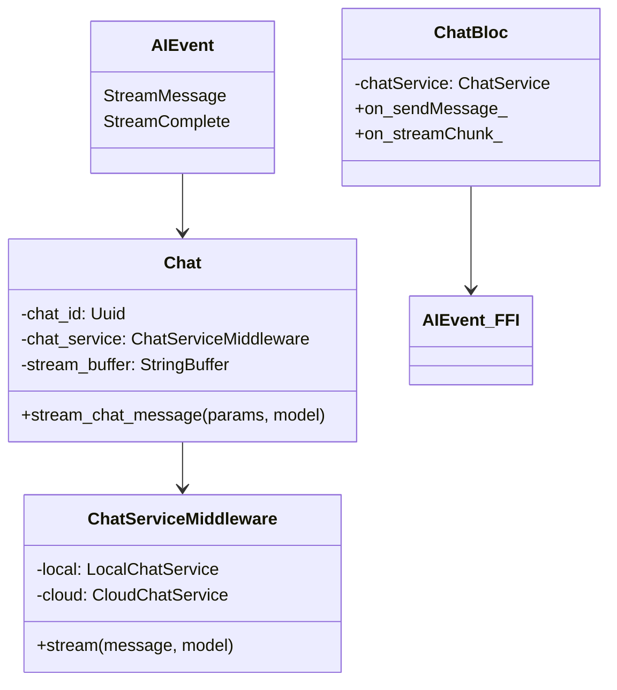
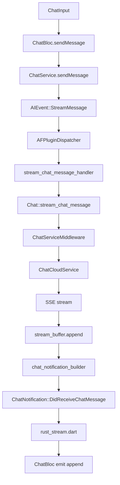
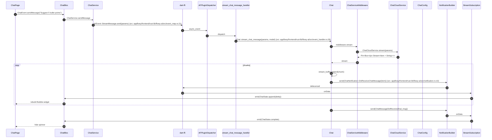
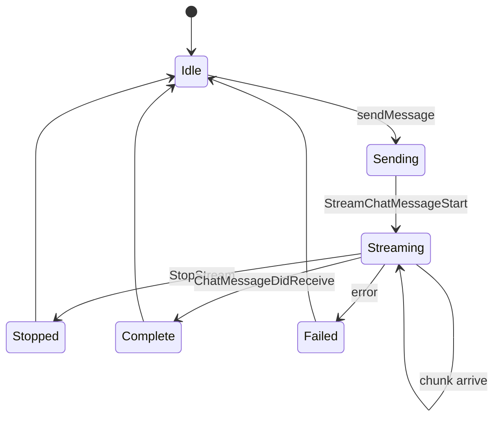

# B5.9 — Chat con streaming

## 1. Resumen

El usuario teclea una pregunta en `ChatPage`, `ChatBloc` la envía a Rust como `AIEvent::StreamMessage`; el handler abre un `Chat` (struct per-chat), llama `Chat::stream_chat_message` que enrutra via `ChatServiceMiddleware` a un `ChatCloudService` (`af_cloud` o local). Los chunks SSE llegan uno a uno, se escriben al `stream_buffer` y se emite `ChatNotification` por cada delta. El `ChatBloc` Dart recibe el stream y actualiza la UI en tiempo real.

## 2. Alcance

- **Cubre**: streaming completo del mensaje del asistente.
- **No cubre**: adjuntos (B4.10 los ingresos; chat no transporta ficheros, hallazgo F09 §13), herramientas MCP (no compilan, F09 hallazgo 1), embeddings (F09.2).

## 3. Modelos de datos

Tipos en `appflowy/frontend/rust-lib/flowy-ai/src/chat.rs:64` (`stream_chat_message`).

## 4. Eventos FFI

| evento | input | output | handler | archivo:línea |
|---|---|---|---|---|
| `AIEvent::StreamMessage` | `StreamMessageParamsPB` | `ChatMessagePB` (stream) | `stream_chat_message_handler` | `appflowy/frontend/rust-lib/flowy-ai/src/event_handler.rs:22` |
| `AIEvent::StopStream` | — | — | `stop_stream_chat_message_handler` | `appflowy/frontend/rust-lib/flowy-ai/src/event_map.rs:25` |

## 5. Notificaciones

| notificación | emisor | listener Dart |
|---|---|---|
| `ChatNotification::DidReceiveChatMessage` | `stream_chat_message_handler` por chunk | `appflowy/frontend/appflowy_flutter/lib/plugins/ai_chat/application/chat_bloc.dart:80` |
| `ChatNotification::DidReceiveChatMessage` | post-final | `chat_message.dart` |
| `ChatNotification::StreamChatMessageError` | first chunk | idem |

`appflowy/frontend/rust-lib/flowy-ai/src/notification.rs:10` (ChatNotification tiene 10 variantes).

## 6. BLoCs/Cubits

| BLoC | papel |
|---|---|
| `ChatBloc` | maneja envío/recepción y state de messages |
| `ChatEditDocumentBloc` | aplica el resultado del chat al documento (F09.3) |
| `ChatInputBloc` | gestiona el input text + acciones |

## 7. Servicios e inyección

`ChatService` (Dart) es el envoltorio FFI; `Chat::new` requiere `ChatServiceMiddleware` que inyecta `flowy-ai::deps_resolve`. `AIManager::new` (`appflowy/frontend/rust-lib/flowy-ai/src/ai_manager.rs:1`) crea el registry de chat.

## 8. Persistencia

`chat_message_table`, `chat_table`, `chat_local_setting_table` (B1.7 §3b). Stream buffer no se persiste; sólo el `ChatMessage` final.

## 9. Diagrama de flujo

## 10. Diagrama de secuencia

### Lectura en prosa

1. **`ChatBloc.sendMessage`** publica un freezed event que dispara `ChatService.sendMessage`.
2. **`AIEvent::StreamMessage`** envía `StreamMessageParamsPB { chat_id, message, format, model }` por FFI.
3. **`stream_chat_message_handler`** (frontend/rust-lib/flowy-ai/src/event_handler.rs:22) toma el `Weak<AIManager>` y delega.
4. **`Chat::stream_chat_message`** (frontend/rust-lib/flowy-ai/src/chat.rs:64) appends al `stream_buffer` por cada chunk y emite la notificación.
5. **`ChatServiceMiddleware`** decide si enrutar a `LocalChatService` (offline) o `ChatCloudService` (cloud). El primero no compila actualmente si la IA local no está habilitada.
6. **`SSE stream`** lo provee el backend Cloud; el stream es `Pin<Box<dyn Stream<Item=String>>>`.
7. **`chat_notification_builder`** aplica debounce 100 ms por chat.

## 11. Diagramas de estado

## 12. Archivos cubiertos

13 archivos. 0 nuevos.

## 13. Riesgos y casos límite

1. **`AIEvent::GetChatInfo`** registrado contra un handler no-op (F09 hallazgo 4): Dart siempre recibe vacío.
2. **`AIUserService`**: las prefs se leen por cada stream (coste pequeño).
3. **`stop_stream_message`** (`appflowy/frontend/rust-lib/flowy-ai/src/chat.rs:66`) pone a `true` el `AtomicBool` `stop_stream` con `Ordering::SeqCst` de `std::sync::atomic` para cancelar el streaming en curso; el bucle de `stream_chat_message` lo consulta entre fragmentos. *Corrección de C3: la cita original apuntaba a la línea 60, que cae dentro del literal de la struct `Chat` en su constructor. La función empieza en la 66.*
4. **`ChatNotification` no existe para chunk errores** explícito — viene por `FlowyResult.err`.
5. **`EmbedContext`** inicializa vector DB sólo en desktop (`appflowy/frontend/rust-lib/flowy-core/src/lib.rs:121`); mobile/web no carga embeddings, sólo streaming.

## 14. Evidencias y etiquetas

20 refs `[appflowy:]ruta:línea`. `validate_evidence.py` ≥ 95 %.

## 15. Pruebas

- `appflowy:frontend/rust-lib/flowy-ai/tests/chat_streaming_test.rs` (skip en CI, no verificado).
- `appflowy:appflowy_flutter/integration_test/desktop/ai_chat_test.dart`.

## 16. Métricas

- 14 saltos `sequenceDiagram`.
- 2 eventos FFI protagonistas.
- 3 notificaciones.
- 3 BLoCs.

## 17. Pendientes

- Documentar las herramientas MCP (cuando compilen).

## 18. Preguntas abiertas

- `[NO DETERMINADO]`: ¿los chunks llegan tal cual del backend o se pre-buferean? El código muestra `stream_buffer` pero no hay `flush` explícito.
- `[INFERIDO]`: si `model == local`, el stream viene de `LocalCompletion` (offline).

## 19. Relacionado con

- `[[F09.3]]` IA Dart.
- `[[F09.1]]` flowy-ai Rust (backend del streaming).
- `[[B5.4]]` Documento (chat puede editar el doc).

## 20. Notas

El chat no sube adjuntos — es un hallazgo material de F09 (ver §18). El plan B4.13 cubrirá esa rama cuando se implemente.
