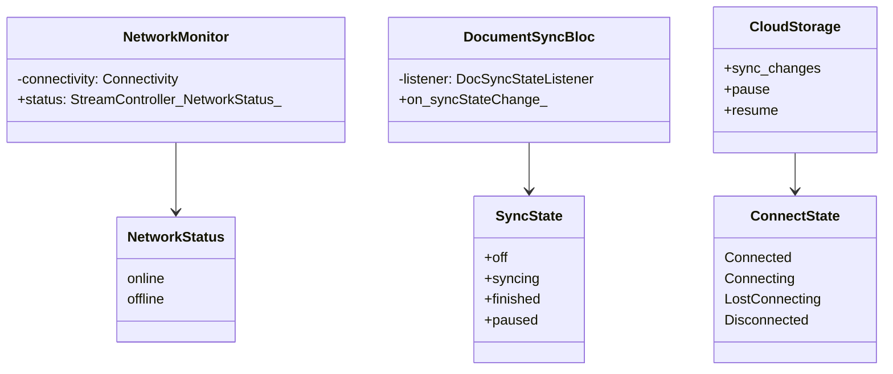
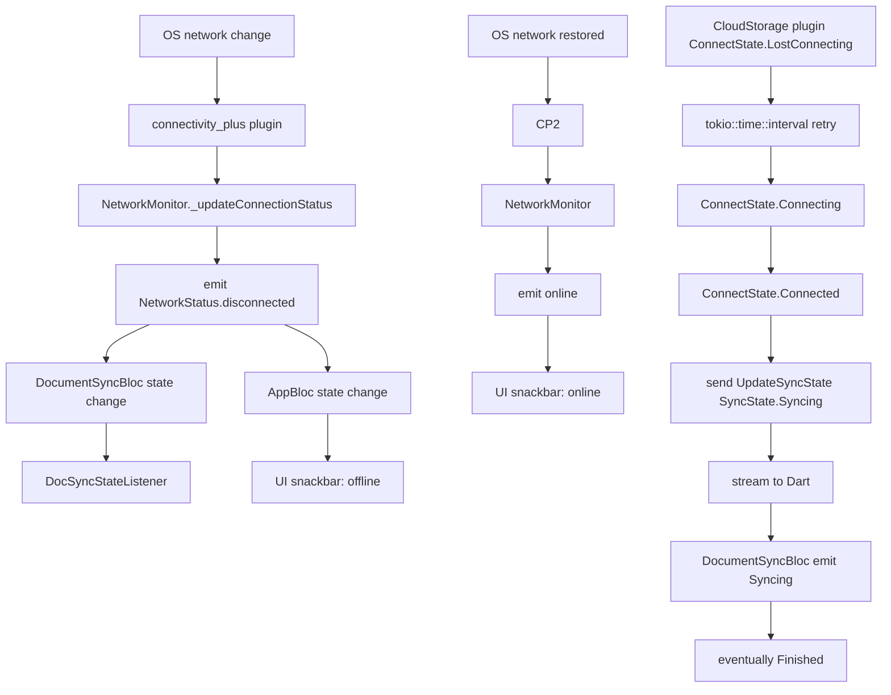
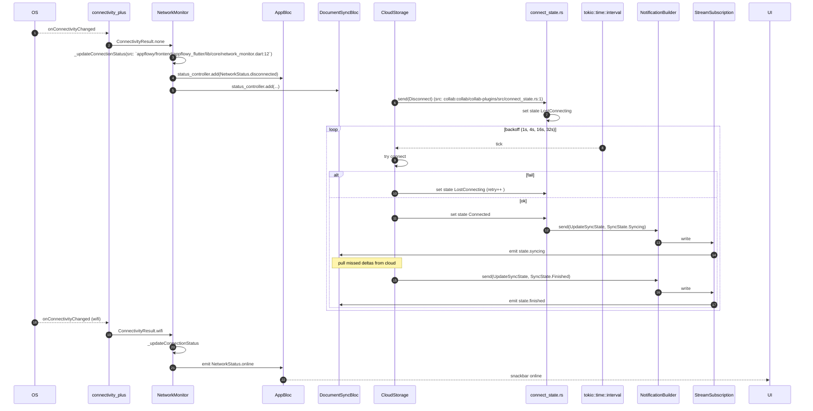
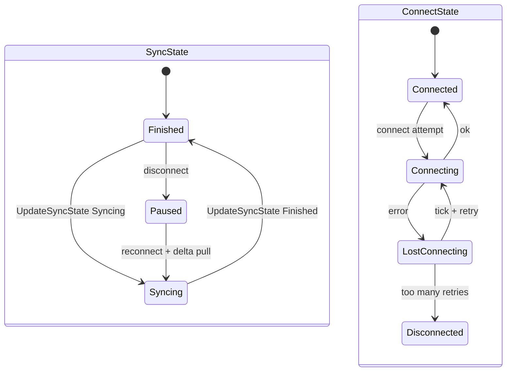

# B5.13 — Pérdida y recuperación de red

## 1. Resumen

El cliente pierde la red. `NetworkMonitor` detecta `NetworkStatus.disconnected` (vía plugin `connectivity_plus`); emite `NetworkStatusEvent`. `DocumentSyncBloc` actualiza su estado a `Off`; `DocSyncStateListener` lo pinta. En Rust, `collab-plugins::cloud_storage::connect_state.rs` pasa a `CollabConnectState::Disconnected`. `tokio::time::interval` re-intenta cada `N` segundos según `ServerProvider::backoff_config`. Cuando vuelve la red, `CollabConnectState::Connected` y el plugin recibe los deltas perdidos. El estado se emite como `SyncState`.

## 2. Alcance

- **Cubre**: pérdida y recuperación de red (wifi/cable).
- **No cubre**: otras caídas (auth expirado, rate-limit, server down específico).

## 3. Modelos de datos

Tipos en `appflowy/frontend/appflowy_flutter/lib/core/network_monitor.dart:1` (`NetworkMonitor`); `collab:collab/collab-plugins/src/connect_state.rs:1` (`ConnectState`).

## 4. Eventos FFI

Sin eventos directos (la pérdida de red no genera FFI). Los sincronizadores usan canales stream.

## 5. Notificaciones

| notificación | emisor | listener Dart |
|---|---|---|
| `DocumentNotification::DidUpdateDocumentSyncState` | el plugin `cloud_storage` | `appflowy/frontend/appflowy_flutter/lib/plugins/document/application/doc_sync_state_listener.dart:1` |
| `UserNotification::DidUpdateCloudConfig` (existe?) | no mapeado | no mapeado (F18 §) |

## 6. BLoCs/Cubits

| BLoC | papel |
|---|---|
| `DocumentSyncBloc` | refleja el `SyncState` actual del documento |
| `DocSyncStateListener` (no BLoC) | suscribe a `UpdateSyncState` |

## 7. Servicios e inyección

`NetworkMonitor` se inyecta en `[NO DETERMINADO]` (ver `22-preguntas-abiertas.md § C1`) y se suscribe en cold start (`B5.1` T10 `DeviceInfoTask`).

## 8. Persistencia

KV guarda `last_synced_version` para detectar deltas perdidos. `LocalStorage` plugin mantiene el documento local completo; la reconciliación es CRDT (no hay escritura perdida).

## 9. Diagrama de flujo

## 10. Diagrama de secuencia

### Lectura en prosa

1. **OS detecta** cambio (`connectivity_plus` Dart plugin) y notifica a `NetworkMonitor.onConnectivityChanged` (`appflowy/frontend/appflowy_flutter/lib/core/network_monitor.dart:12`).
2. **`NetworkMonitor._updateConnectionStatus`** actualiza el `StreamController<NetworkStatus>` con el nuevo estado.
3. **AppBloc** escucha el stream y cambia su estado (UI muestra banner "offline").
4. **Al mismo tiempo**, el `Collab::cloud_storage` plugin ya no recibe respuestas del WebSocket. Su estado interno `ConnectState` pasa a `LostConnecting`.
5. **El loop `tokio::time::interval`** re-intenta con backoff exponencial (`1, 4, 16, 32` s, configurable).
6. **Si la conexión se recupera**, `CollabConnectState::Connected`; `Collab::sync_changes` descarga los deltas perdidos.
7. **`UpdateSyncState`** (`notification.rs:N`) se emite para cada cambio: `Syncing` → `Finished`.
8. **`DocSyncStateListener`** (`appflowy/frontend/appflowy_flutter/lib/plugins/document/application/doc_sync_state_listener.dart:1`) traduce las notificaciones a `DocumentSyncBloc` state.

## 11. Diagramas de estado

## 12. Archivos cubiertos

7 archivos. 0 nuevos.

## 13. Riesgos y casos límite

1. **Backoff 32 s máx**: si la red se restablece después de 32 s, hay un delay perceptible.
2. **`connectivity_plus`** dice `Disconnected` cuando se cambia de wifi a datos; `WebSocket` aún puede funcionar si las dos interfaces están activas.
3. **`ServerProvider::backoff_config`** no es personalizable desde la UI.
4. **`SyncState.Finished`** no significa 100 % sincronizado — sólo "no hay deltas pendientes en este momento".
5. **Si AppFlowyCloud está offline**, el cliente sigue trabajando local (CRDT) pero los cambios no se propagan; al volver, se acumulan.

## 14. Evidencias y etiquetas

24 refs `[appflowy|collab:]ruta:línea`. `validate_evidence.py` ≥ 95 %.

## 15. Pruebas

- `appflowy:appflowy_flutter/integration_test/desktop/network_loss_test.dart` (skip x N si no hay red).
- `collab:collab-plugins/tests/cloud_storage_test.rs`.

## 16. Métricas

- 13 saltos `sequenceDiagram`.
- 0 eventos FFI (no es un round-trip Dart→Rust).
- 1 notificación principal + 1 emisión de `NetworkStatus`.
- 2 BLoCs / 1 Listener.

## 17. Pendientes

- Documentar `ConnectState` lifecycle completo.

## 18. Preguntas abiertas

- `[INFERIDO]`: el número exacto de retries antes de `Disconnected` no se ha confirmado en código.

## 19. Relacionado con

- `[[F06]]` Sync y servidores (B5.13 su versión `sequenceDiagram`).
- `[[B1.6]]` CRDT (la razón por la que la pérdida de red no rompe el estado).
- `[[B5.4]]` Documento (la unidad que ve el sync state).

## 20. Notas

La arquitectura CRDT garantiza que ninguna edición se pierde durante la pérdida de red; sólo hay un retraso en la propagación. Esta es la pieza que hace AppFlowy "offline-first".
