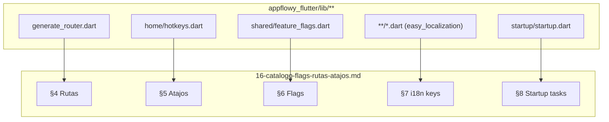

# 16 — Catálogo de feature flags, rutas, atajos, i18n y tareas de arranque

Este documento reúne las **5 tablas deterministas** extraídas por `SKILL/scripts/extract_misc.py` (Fase A2.6; validador `validate-A2.6.sh` 10/10 OK) desde `OUT/_ledger/extract/misc.json`. Suman **1709 entradas**: 35 rutas (`generate_router.dart`), 13 atajos (`hotkeys.dart`), 9 feature flags (enum `FeatureFlag`), 1637 claves i18n (`easy_localization`) y 15 tareas de arranque (`startup.dart`). La prueba del ROADMAP exige que el nº de filas del catálogo sea exactamente **1709** = suma de las 5 sub-tablas.

## 1. Cómo leer este catálogo

Cada § (4–8) tiene una tabla densa con su header. Las rutas (§4) muestran `path` (`XScreen.routeName`); los atajos (§5) muestran `nombre` + `comando` del hotkey; los feature flags (§6) muestran el nombre de variante del enum `FeatureFlag` + su `default` (null en este snapshot) y `decl_line`; las i18n keys (§7) muestran `key`, nº de `usages` y los 3 primeros `sources` (con `…+N` si hay más); las tareas de arranque (§8) muestran `idx`, `class`, `conditional` y la `condition` (p. ej. `!mode.isIntegrationTest`). Cada referencia `ruta:línea` se resuelve contra `inventario.json` y se valida con `validate_evidence`.

## 2. Arquitectura discovery

El siguiente diagrama muestra cómo cada una de las 5 categorías se descubre estáticamente en el código fuente Dart y converge hacia `appflowy_flutter` como punto único de entrada.



Lectura: cada categoría se extrae del código fuente por su propio extractor en A2.6 (`extract_misc.py`); este catálogo es una vista de consulta rápida con referencias `ruta:línea` validadas. La tabla §8 reproduce el orden de `addTasks([…])` que se ejecuta en `AppLauncher.launch()` (sub-doc `06-puente-flutter-rust` no, en `05-arranque-y-ciclo-de-vida.md`).

## 3. Resumen por categoría

| Categoría | Entradas | Archivo extractor |
| --- | --- | --- |
| Rutas (`go_router`) | 35 | `generate_router.dart` |
| Atajos / hotkeys | 13 | `hotkeys.dart` |
| Feature flags | 9 | `feature_flags.dart` |
| i18n keys (easy_localization) | 1637 | (indexadas en `**/*.dart`) |
| Tareas de arranque (LaunchTask) | 15 | `startup.dart` |

**Total**: 1709 entradas. Las claves i18n representan el 95.8% del catálogo; el resto son superficies navegables (rutas), interacciones físicas (hotkeys), configuración condicional (FeatureFlag) y tareas de ciclo de vida (LaunchTask).

## 4. Rutas (`go_router`)

Tabla con las **35 rutas** registradas en `appflowy/frontend/appflowy_flutter/lib/startup/tasks/generate_router.dart` (definidas como `static const routeName = "/..."` o via `GoRouter.routes`). Cada fila muestra el `path` canónico, `name` (si aplica) y la línea de declaración.

| Path | Name | Archivo |
| --- | --- | --- |
| `/` | — | `appflowy:frontend/appflowy_flutter/lib/startup/tasks/generate_router.dart:744` |
| `AddMembersScreen.routeName` | — | `appflowy:frontend/appflowy_flutter/lib/startup/tasks/generate_router.dart:258` |
| `AppFlowyCloudPage.routeName` | — | `appflowy:frontend/appflowy_flutter/lib/startup/tasks/generate_router.dart:271` |
| `DesktopHomeScreen.routeName` | — | `appflowy:frontend/appflowy_flutter/lib/startup/tasks/generate_router.dart:515` |
| `FeatureFlagScreen.routeName` | — | `appflowy:frontend/appflowy_flutter/lib/startup/tasks/generate_router.dart:297` |
| `FontPickerScreen.routeName` | — | `appflowy:frontend/appflowy_flutter/lib/startup/tasks/generate_router.dart:440` |
| `InviteMembersScreen.routeName` | — | `appflowy:frontend/appflowy_flutter/lib/startup/tasks/generate_router.dart:245` |
| `LanguagePickerScreen.routeName` | — | `appflowy:frontend/appflowy_flutter/lib/startup/tasks/generate_router.dart:427` |
| `MobileBlockSettingsScreen.routeName` | — | `appflowy:frontend/appflowy_flutter/lib/startup/tasks/generate_router.dart:323` |
| `MobileBoardScreen.routeName` | — | `appflowy:frontend/appflowy_flutter/lib/startup/tasks/generate_router.dart:652` |
| `MobileCalendarEventsScreen.routeName` | — | `appflowy:frontend/appflowy_flutter/lib/startup/tasks/generate_router.dart:494` |
| `MobileCalendarScreen.routeName` | — | `appflowy:frontend/appflowy_flutter/lib/startup/tasks/generate_router.dart:669` |
| `MobileChatScreen.routeName` | — | `appflowy:frontend/appflowy_flutter/lib/startup/tasks/generate_router.dart:617` |
| `MobileCodeLanguagePickerScreen.routeName` | — | `appflowy:frontend/appflowy_flutter/lib/startup/tasks/generate_router.dart:414` |
| `MobileColorPickerScreen.routeName` | — | `appflowy:frontend/appflowy_flutter/lib/startup/tasks/generate_router.dart:386` |
| `MobileDateCellEditScreen.routeName` | — | `appflowy:frontend/appflowy_flutter/lib/startup/tasks/generate_router.dart:721` |
| `MobileDocumentScreen.routeName` | — | `appflowy:frontend/appflowy_flutter/lib/startup/tasks/generate_router.dart:571` |
| `MobileEditPropertyScreen.routeName` | — | `appflowy:frontend/appflowy_flutter/lib/startup/tasks/generate_router.dart:476` |
| `MobileEmojiPickerScreen.routeName` | — | `appflowy:frontend/appflowy_flutter/lib/startup/tasks/generate_router.dart:344` |
| `MobileFavoriteScreen.routeName` | — | `appflowy:frontend/appflowy_flutter/lib/startup/tasks/generate_router.dart:192` |
| `MobileGridScreen.routeName` | — | `appflowy:frontend/appflowy_flutter/lib/startup/tasks/generate_router.dart:632` |
| `MobileHomeScreen.routeName` | — | `appflowy:frontend/appflowy_flutter/lib/startup/tasks/generate_router.dart:169` |
| `MobileHomeSettingPage.routeName` | — | `appflowy:frontend/appflowy_flutter/lib/startup/tasks/generate_router.dart:219` |
| `MobileHomeTrashPage.routeName` | — | `appflowy:frontend/appflowy_flutter/lib/startup/tasks/generate_router.dart:310` |
| `MobileImagePickerScreen.routeName` | — | `appflowy:frontend/appflowy_flutter/lib/startup/tasks/generate_router.dart:401` |
| `MobileLaunchSettingsPage.routeName` | — | `appflowy:frontend/appflowy_flutter/lib/startup/tasks/generate_router.dart:284` |
| `MobileNewPropertyScreen.routeName` | — | `appflowy:frontend/appflowy_flutter/lib/startup/tasks/generate_router.dart:453` |
| `MobileNotificationsMultiSelectScreen.routeName` | — | `appflowy:frontend/appflowy_flutter/lib/startup/tasks/generate_router.dart:232` |
| `MobileNotificationsScreenV2.routeName` | — | `appflowy:frontend/appflowy_flutter/lib/startup/tasks/generate_router.dart:204` |
| `MobileRowDetailPage.routeName` | — | `appflowy:frontend/appflowy_flutter/lib/startup/tasks/generate_router.dart:686` |
| `MobileSearchScreen.routeName` | — | `appflowy:frontend/appflowy_flutter/lib/startup/tasks/generate_router.dart:180` |
| `SignInScreen.routeName` | — | `appflowy:frontend/appflowy_flutter/lib/startup/tasks/generate_router.dart:558` |
| `SkipLogInScreen.routeName` | — | `appflowy:frontend/appflowy_flutter/lib/startup/tasks/generate_router.dart:545` |
| `WorkspaceErrorScreen.routeName` | — | `appflowy:frontend/appflowy_flutter/lib/startup/tasks/generate_router.dart:528` |
| `WorkspaceStartScreen.routeName` | — | `appflowy:frontend/appflowy_flutter/lib/startup/tasks/generate_router.dart:114` |

## 5. Atajos / hotkeys

Tabla con los **13 hotkeys** registrados en `appflowy/frontend/appflowy_flutter/lib/workspace/presentation/home/hotkeys.dart`. El extractor (`extract_misc.py::shortcuts`) también buscó el enum Dart `CommandShortcutEvent` (`hotkey_manager` package) pero **lo encuentra vacío** (0 variantes detectadas). Esto significa que AppFlowy no usa `CommandShortcutEvent` para definir atajos; todos pasan por `hotkeys.dart` con `HotKeyManager.register()` o `FlowyKeyboard`.

| # | Nombre | Comando | Archivo |
| --- | --- | --- | --- |
| 1 | `hotkey_1: (unnamed)` | — | `appflowy:frontend/appflowy_flutter/lib/workspace/presentation/home/hotkeys.dart:43` |
| 2 | `hotkey_2: Collapse sidebar menu (using slash)` | Collapse sidebar menu (using slash) | `appflowy:frontend/appflowy_flutter/lib/workspace/presentation/home/hotkeys.dart:74` |
| 3 | `hotkey_3: Collapse sidebar menu (using .)` | Collapse sidebar menu (using .) | `appflowy:frontend/appflowy_flutter/lib/workspace/presentation/home/hotkeys.dart:84` |
| 4 | `hotkey_4: Toggle theme mode light/dark` | Toggle theme mode light/dark | `appflowy:frontend/appflowy_flutter/lib/workspace/presentation/home/hotkeys.dart:94` |
| 5 | `hotkey_5: Close current tab` | Close current tab | `appflowy:frontend/appflowy_flutter/lib/workspace/presentation/home/hotkeys.dart:108` |
| 6 | `hotkey_6: Go to previous tab` | Go to previous tab | `appflowy:frontend/appflowy_flutter/lib/workspace/presentation/home/hotkeys.dart:119` |
| 7 | `hotkey_7: Go to next tab` | Go to next tab | `appflowy:frontend/appflowy_flutter/lib/workspace/presentation/home/hotkeys.dart:129` |
| 8 | `hotkey_8: Rename current view` | Rename current view | `appflowy:frontend/appflowy_flutter/lib/workspace/presentation/home/hotkeys.dart:139` |
| 9 | `hotkey_9: In some keyboards, the system returns equal as + keycode, while others may return add as + keycode, so add them both as zoom in key.` | In some keyboards, the system returns equal as + keycode, while others may return add as + keycode, so add them both as zoom in key. | `appflowy:frontend/appflowy_flutter/lib/workspace/presentation/home/hotkeys.dart:151` |
| 10 | `hotkey_10: (unnamed)` | — | `appflowy:frontend/appflowy_flutter/lib/workspace/presentation/home/hotkeys.dart:164` |
| 11 | `hotkey_11: Reset app scaling` | Reset app scaling | `appflowy:frontend/appflowy_flutter/lib/workspace/presentation/home/hotkeys.dart:178` |
| 12 | `hotkey_12: Switch to the next space` | Switch to the next space | `appflowy:frontend/appflowy_flutter/lib/workspace/presentation/home/hotkeys.dart:191` |
| 13 | `hotkey_13: Create a new page` | Create a new page | `appflowy:frontend/appflowy_flutter/lib/workspace/presentation/home/hotkeys.dart:201` |

### 5.2 `CommandShortcutEvent` (sin variantes detectadas)

El extractor buscó un enum llamado `CommandShortcutEvent` (paquete `hotkey_manager`) y encontró **{len(cmd_shortcut_variants)} variantes**. La ausencia confirma que AppFlowy no usa ese patrón; todos los atajos viven en `hotkeys.dart` (ver §5). Esto se documenta en `OUT/22-preguntas-abiertas.md` por si en un futuro commit se introduce el enum.

## 6. Feature flags

Tabla con las **9 variantes** del enum `FeatureFlag` declarado en `appflowy/frontend/appflowy_flutter/lib/shared/feature_flags.dart`. Cada fila muestra `default` (null en este snapshot — sin anotación `#[default]` explícita) y `decl_line`. La consulta de un flag en runtime se hace con `FeatureFlag.<name>.isOn` o vía `FeatureFlagTask` (paso `startup.dart:index=3`).

| # | Variante | Default | decl_line | Archivo |
| --- | --- | --- | --- | --- |
| 1 | `collaborativeWorkspace` | — | 18 | `appflowy:frontend/appflowy_flutter/lib/shared/feature_flags.dart:18` |
| 2 | `membersSettings` | — | 22 | `appflowy:frontend/appflowy_flutter/lib/shared/feature_flags.dart:22` |
| 3 | `syncDocument` | — | 26 | `appflowy:frontend/appflowy_flutter/lib/shared/feature_flags.dart:26` |
| 4 | `syncDatabase` | — | 30 | `appflowy:frontend/appflowy_flutter/lib/shared/feature_flags.dart:30` |
| 5 | `search` | — | 33 | `appflowy:frontend/appflowy_flutter/lib/shared/feature_flags.dart:33` |
| 6 | `planBilling` | — | 36 | `appflowy:frontend/appflowy_flutter/lib/shared/feature_flags.dart:36` |
| 7 | `spaceDesign` | — | 39 | `appflowy:frontend/appflowy_flutter/lib/shared/feature_flags.dart:39` |
| 8 | `inlineSubPageMention` | — | 42 | `appflowy:frontend/appflowy_flutter/lib/shared/feature_flags.dart:42` |
| 9 | `sharedSection` | — | 45 | `appflowy:frontend/appflowy_flutter/lib/shared/feature_flags.dart:45` |

## 7. i18n keys (easy_localization)

Tabla con las **1637 claves i18n únicas** extraídas de todos los `**/*.dart` por `extract_misc.py::i18n_keys`. El sistema `easy_localization_service.dart` carga las traducciones desde `assets/translations/<lang>.json` (no enumerados aquí). Cada fila muestra la `key`, el número de `usages` (sitios que la invocan vía `LocaleKeys.foo.tr()` o `tr(args:…)`) y los 3 primeros `sources` con truncado `…+N`.

| Key | Usages | Sources |
| --- | --- | --- |
| `ai_analyzing` | 1 | — |
| `ai_contentPolicyViolation` | 1 | — |
| `ai_continueWritingEmptyDocumentTitle` | 1 | — |
| `ai_customPrompt_all` | 1 | — |
| `ai_customPrompt_browsePrompts` | 3 | —<br/>— |
| `ai_customPrompt_category` | 1 | — |
| `ai_customPrompt_configureDatabase` | 1 | — |
| `ai_customPrompt_content` | 1 | — |
| `ai_customPrompt_custom` | 1 | — |
| `ai_customPrompt_customPrompt` | 1 | — |
| `ai_customPrompt_databasePrompts` | 1 | — |
| `ai_customPrompt_example` | 1 | — |
| `ai_customPrompt_featured` | 1 | — |
| `ai_customPrompt_invalidDatabase` | 2 | —<br/>— |
| `ai_customPrompt_invalidDatabaseHelp` | 2 | —<br/>— |
| `ai_customPrompt_noResults` | 1 | — |
| `ai_customPrompt_prompt` | 1 | — |
| `ai_customPrompt_promptDatabase` | 1 | — |
| `ai_customPrompt_promptExample` | 1 | — |
| `ai_customPrompt_selectDatabase` | 2 | —<br/>— |
| `ai_customPrompt_title` | 1 | — |
| `ai_customPrompt_usePrompt` | 2 | —<br/>— |
| `ai_editing` | 1 | — |
| `ai_imageLimitReachedDescription` | 1 | — |
| `ai_more` | 1 | — |
| `ai_textLimitReachedDescription` | 1 | — |
| `and` | 1 | — |
| `appName` | 2 | —<br/>— |
| `autoUpdate_bannerUpdateDescription` | 1 | — |
| `autoUpdate_bannerUpdateTitle` | 1 | — |
| `autoUpdate_criticalUpdateButton` | 1 | — |
| `autoUpdate_criticalUpdateTitle` | 1 | — |
| `autoUpdate_settingsUpdateButton` | 2 | —<br/>— |
| `autoUpdate_settingsUpdateWhatsNew` | 1 | — |
| `blankPageTitle` | 2 | — |
| `blockActions_addAboveCmd` | 1 | — |
| `blockActions_addAboveMacCmd` | 1 | — |
| `blockActions_addAboveTooltip` | 1 | — |
| `blockActions_addBelowTooltip` | 1 | — |
| `blockPlaceholders_bulletList` | 1 | — |
| `blockPlaceholders_numberList` | 1 | — |
| `blockPlaceholders_quote` | 1 | — |
| `blockPlaceholders_todoList` | 1 | — |
| `board_cardDeleted` | 1 | — |
| `board_cardDuplicated` | 1 | — |
| `board_column_addToColumnBottomTooltip` | 1 | — |
| `board_column_addToColumnTopTooltip` | 1 | — |
| `board_column_createNewCard` | 2 | —<br/>— |
| `board_column_createNewColumn` | 1 | — |
| `board_column_deleteColumn` | 1 | — |
| `board_column_deleteColumnConfirmation` | 1 | — |
| `board_column_hideColumn` | 2 | —<br/>— |
| `board_column_label` | 1 | — |
| `board_column_newGroup` | 1 | — |
| `board_column_renameColumn` | 2 | —<br/>— |
| `board_dateCondition_lastSevenDays` | 1 | — |
| `board_dateCondition_lastThirtyDays` | 1 | — |
| `board_dateCondition_nextSevenDays` | 1 | — |
| `board_dateCondition_nextThirtyDays` | 1 | — |
| `board_dateCondition_today` | 1 | — |
| `board_dateCondition_tomorrow` | 1 | — |
| `board_dateCondition_yesterday` | 1 | — |
| `board_groupBy` | 2 | —<br/>— |
| `board_groupCondition` | 1 | — |
| `board_hiddenGroupSection_collapseTooltip` | 1 | — |
| `board_hiddenGroupSection_expandTooltip` | 1 | — |
| `board_hiddenGroupSection_sectionTitle` | 1 | — |
| `board_menuName` | 3 | —<br/>—<br/>— |
| `board_mobile_showGroup` | 1 | — |
| `board_mobile_showGroupContent` | 1 | — |
| `board_notesTooltip` | 1 | — |
| `board_referencedBoardPrefix` | 1 | — |
| `board_showUngrouped` | 1 | — |
| `button_add` | 2 | —<br/>— |
| `button_addToFavorites` | 3 | —<br/>—<br/>— |
| `button_align` | 1 | — |
| `button_back` | 2 | —<br/>— |
| `button_cancel` | 29 | —<br/>—<br/>—<br/>… +25 |
| `button_change` | 1 | — |
| `button_clear` | 2 | —<br/>— |
| `button_close` | 1 | — |
| `button_confirm` | 14 | —<br/>—<br/>—<br/>… +11 |
| `button_copy` | 1 | — |
| `button_copyLink` | 2 | —<br/>— |
| `button_create` | 1 | — |
| `button_delete` | 23 | —<br/>—<br/>—<br/>… +19 |
| `button_deleteAccount` | 4 | —<br/>— |
| `button_discard` | 4 | — |
| `button_done` | 8 | —<br/>—<br/>—<br/>… +4 |
| `button_download` | 4 | —<br/>—<br/>—<br/>… +1 |
| `button_duplicate` | 8 | —<br/>—<br/>—<br/>… +5 |
| `button_duplicateSuccessfully` | 2 | —<br/>— |
| `button_edit` | 1 | — |
| `button_favoriteSuccessfully` | 3 | —<br/>—<br/>— |
| `button_insertAbove` | 2 | —<br/>— |
| `button_insertBelow` | 2 | —<br/>— |
| `button_logout` | 2 | —<br/>— |
| `button_more` | 1 | — |
| `button_next` | 1 | — |
| `button_ok` | 9 | —<br/>—<br/>—<br/>… +6 |
| `button_previous` | 1 | — |
| `button_remove` | 5 | —<br/>—<br/>—<br/>… +2 |
| `button_removeFromFavorites` | 3 | —<br/>—<br/>— |
| `button_removeFromRecent` | 1 | — |
| `button_rename` | 5 | —<br/>—<br/>—<br/>… +2 |
| `button_replace` | 1 | — |
| `button_save` | 15 | —<br/>—<br/>—<br/>… +10 |
| `button_share` | 1 | — |
| `button_submit` | 2 | —<br/>— |
| `button_unfavoriteSuccessfully` | 3 | —<br/>—<br/>— |
| `button_update` | 1 | — |
| `button_yes` | 5 | —<br/>—<br/>—<br/>… +2 |
| `calendar_defaultNewCalendarTitle` | 3 | —<br/>— |
| `calendar_duplicateEvent` | 1 | — |
| `calendar_menuName` | 3 | —<br/>—<br/>— |
| `calendar_mobileEventScreen_emptyBody` | 1 | — |
| `calendar_mobileEventScreen_emptyTitle` | 1 | — |
| `calendar_navigation_jumpToday` | 1 | — |
| `calendar_navigation_nextMonth` | 1 | — |
| `calendar_navigation_previousMonth` | 1 | — |
| `calendar_navigation_today` | 1 | — |
| `calendar_newEventButtonTooltip` | 1 | — |
| `calendar_quickJumpYear` | 1 | — |
| `calendar_referencedCalendarPrefix` | 1 | — |
| `calendar_settings_changeLayoutDateField` | 1 | — |
| `calendar_settings_clickToAdd` | 1 | — |
| `calendar_settings_firstDayOfWeek` | 2 | —<br/>— |
| `calendar_settings_layoutDateField` | 2 | —<br/>— |
| `calendar_settings_name` | 2 | —<br/>— |
| `calendar_settings_noDateTitle` | 1 | — |
| `calendar_settings_showWeekNumbers` | 1 | — |
| `calendar_settings_showWeekends` | 1 | — |
| `calendar_settings_unscheduledEventsTitle` | 1 | — |
| `cardDetails_notesPlaceholder` | 1 | — |
| `chat_addToNewPage` | 1 | — |
| `chat_addToNewPageSuccessToast` | 1 | — |
| `chat_addToPageButton` | 3 | —<br/>—<br/>— |
| `chat_addToPageTitle` | 1 | — |
| `chat_aiServerUnavailable` | 1 | — |
| `chat_changeFormat_actionButton` | 3 | —<br/>—<br/>— |
| `chat_changeFormat_blankDescription` | 1 | — |
| `chat_changeFormat_bullet` | 1 | — |
| `chat_changeFormat_confirmButton` | 1 | — |
| `chat_changeFormat_defaultDescription` | 1 | — |
| `chat_changeFormat_imageOnly` | 1 | — |
| `chat_changeFormat_number` | 1 | — |
| `chat_changeFormat_table` | 1 | — |
| `chat_changeFormat_text` | 1 | — |
| `chat_changeFormat_textAndImage` | 1 | — |
| `chat_changeFormat_textOnly` | 1 | — |
| `chat_clickToMention` | 1 | — |
| `chat_currentPage` | 2 | —<br/>— |
| `chat_generatingResponse` | 1 | — |
| `chat_inputActionNoPages` | 1 | — |
| `chat_inputMessageHint` | 2 | —<br/>— |
| `chat_newChat` | 1 | — |
| `chat_openPagePreviewFailedToast` | 1 | — |
| `chat_question1` | 2 | — |
| `chat_question2` | 2 | — |
| `chat_question3` | 2 | — |
| `chat_question4` | 2 | — |
| `chat_question5` | 1 | — |
| `chat_question6` | 1 | — |
| `chat_regenerate` | 2 | —<br/>— |
| `chat_relatedQuestion` | 1 | — |
| `chat_retry` | 2 | —<br/>— |
| `chat_selectBanner_allSelected` | 1 | — |
| `chat_selectBanner_saveButton` | 1 | — |
| `chat_selectBanner_selectMessages` | 1 | — |
| `chat_selectSources` | 1 | — |
| `chat_sourceUnsupported` | 1 | — |
| `chat_sourcesLimitReached` | 1 | — |
| `chat_stopTooltip` | 1 | — |
| `chat_switchModel_autoModel` | 1 | — |
| `chat_switchModel_cloudModel` | 1 | — |
| `chat_switchModel_label` | 4 | —<br/>—<br/>—<br/>… +1 |
| `chat_switchModel_localModel` | 1 | — |
| `chat_uploadFile` | 1 | — |
| `commandPalette_aiAskFollowUp` | 2 | —<br/>— |
| `commandPalette_aiOverview` | 2 | —<br/>— |
| `commandPalette_aiOverviewSource` | 2 | —<br/>— |
| `commandPalette_bestMatches` | 2 | —<br/>— |
| `commandPalette_clearSearchTooltip` | 1 | — |
| `commandPalette_created` | 1 | — |
| `commandPalette_edited` | 1 | — |
| `commandPalette_location` | 1 | — |
| `datePicker_clearDate` | 1 | — |
| `datePicker_dateFormat` | 1 | — |
| `datePicker_isRange` | 1 | — |
| `datePicker_reminderLabel` | 2 | —<br/>— |
| `datePicker_reminderOptions_atTimeOfEvent` | 1 | — |
| `datePicker_reminderOptions_custom` | 1 | — |
| `datePicker_reminderOptions_fifteenMinsBefore` | 1 | — |
| `datePicker_reminderOptions_fiveMinsBefore` | 1 | — |
| `datePicker_reminderOptions_none` | 1 | — |
| `datePicker_reminderOptions_onDayOfEvent` | 1 | — |
| `datePicker_reminderOptions_oneDayBefore` | 1 | — |
| `datePicker_reminderOptions_oneHourBefore` | 1 | — |
| `datePicker_reminderOptions_oneWeekBefore` | 1 | — |
| `datePicker_reminderOptions_tenMinsBefore` | 1 | — |
| `datePicker_reminderOptions_thirtyMinsBefore` | 1 | — |
| `datePicker_reminderOptions_twoDaysBefore` | 1 | — |
| `datePicker_reminderOptions_twoHoursBefore` | 1 | — |
| `datePicker_selectReminder` | 1 | — |
| `datePicker_timeFormat` | 1 | — |
| `defaultUsername` | 4 | —<br/>—<br/>—<br/>… +1 |
| `deletePagePrompt_deletePermanent` | 1 | — |
| `deletePagePrompt_deletePermanentDescription` | 1 | — |
| `deletePagePrompt_restore` | 1 | — |
| `deletePagePrompt_text` | 1 | — |
| `disclosureAction_changeIcon` | 3 | —<br/>—<br/>— |
| `disclosureAction_collapseAllPages` | 1 | — |
| `disclosureAction_copyLink` | 1 | — |
| `disclosureAction_delete` | 2 | —<br/>— |
| `disclosureAction_duplicate` | 1 | — |
| `disclosureAction_favorite` | 1 | — |
| `disclosureAction_lockPage` | 3 | —<br/>—<br/>— |
| `disclosureAction_moveTo` | 1 | — |
| `disclosureAction_openNewTab` | 1 | — |
| `disclosureAction_rename` | 5 | —<br/>—<br/>—<br/>… +2 |
| `disclosureAction_unfavorite` | 1 | — |
| `document_attachmentMenu_chooseFile` | 1 | — |
| `document_attachmentMenu_choosePhoto` | 1 | — |
| `document_attachmentMenu_takePicture` | 1 | — |
| `document_codeBlock_codeCopiedSnackbar` | 1 | — |
| `document_codeBlock_copyTooltip` | 1 | — |
| `document_codeBlock_language_auto` | 1 | — |
| `document_codeBlock_searchLanguageHint` | 1 | — |
| `document_errorBlock_blockContentHasBeenCopied` | 1 | — |
| `document_errorBlock_clickToCopyTheBlockContent` | 1 | — |
| `document_errorBlock_copyBlockContent` | 1 | — |
| `document_imageBlock_embedLink_label` | 2 | —<br/>— |
| `document_imageBlock_embedLink_placeholder` | 1 | — |
| `document_imageBlock_error_invalidImage` | 7 | —<br/>—<br/>—<br/>… +1 |
| `document_imageBlock_error_invalidImageFormat` | 1 | — |
| `document_imageBlock_error_multipleImagesFailed` | 2 | —<br/>— |
| `document_imageBlock_failedToAddImageToGallery` | 1 | — |
| `document_imageBlock_imageIsUploading` | 1 | — |
| `document_imageBlock_openFullScreen` | 3 | —<br/>—<br/>— |
| `document_imageBlock_saveImageToGallery` | 1 | — |
| `document_imageBlock_successToAddImageToGallery` | 1 | — |
| `document_imageBlock_unableToLoadImage` | 1 | — |
| `document_imageBlock_unsplash_label` | 1 | — |
| `document_imageBlock_upload_label` | 1 | — |
| `document_imageBlock_upload_placeholder` | 1 | — |
| `document_mention_deletedPage` | 1 | — |
| `document_mention_noAccess` | 1 | — |
| `document_mention_trashHint` | 1 | — |
| `document_menuName` | 3 | —<br/>—<br/>— |
| `document_mobilePageSelector_failedToLoad` | 2 | —<br/>— |
| `document_mobilePageSelector_noPagesFound` | 2 | —<br/>— |
| `document_mobilePageSelector_title` | 2 | —<br/>— |
| `document_outlineBlock_placeholder` | 1 | — |
| `document_plugins_action` | 1 | — |
| `document_plugins_aiWriter_continueWriting` | 2 | —<br/>— |
| `document_plugins_aiWriter_explain` | 1 | — |
| `document_plugins_aiWriter_fixSpelling` | 1 | — |
| `document_plugins_aiWriter_improveWriting` | 1 | — |
| `document_plugins_aiWriter_makeLonger` | 1 | — |
| `document_plugins_aiWriter_makeShorter` | 1 | — |
| `document_plugins_aiWriter_summarize` | 1 | — |
| `document_plugins_aiWriter_userQuestion` | 2 | —<br/>— |
| `document_plugins_appflowyAIEditDisabled` | 4 | — |
| `document_plugins_autoGeneratorLearnMore` | 1 | — |
| `document_plugins_callout` | 2 | —<br/>— |
| `document_plugins_cover_add` | 1 | — |
| `document_plugins_cover_addCover` | 2 | —<br/>— |
| `document_plugins_cover_addIcon` | 2 | —<br/>— |
| `document_plugins_cover_addLocalImage` | 1 | — |
| `document_plugins_cover_alertDialogConfirmation` | 1 | — |
| `document_plugins_cover_back` | 1 | — |
| `document_plugins_cover_changeCover` | 4 | —<br/>— |
| `document_plugins_cover_changeIcon` | 2 | —<br/>— |
| `document_plugins_cover_colors` | 1 | — |
| `document_plugins_cover_enterImageUrl` | 1 | — |
| `document_plugins_cover_invalidImageUrl` | 2 | —<br/>— |
| `document_plugins_cover_or` | 1 | — |
| `document_plugins_cover_pasteImageUrl` | 1 | — |
| `document_plugins_cover_pickFromFiles` | 1 | — |
| `document_plugins_cover_removeIcon` | 2 | —<br/>— |
| `document_plugins_cover_saveToGallery` | 1 | — |
| `document_plugins_createInlineMathEquation` | 2 | —<br/>— |
| `document_plugins_discardResponse` | 2 | — |
| `document_plugins_emoji` | 1 | — |
| `document_plugins_emptyToggleList` | 1 | — |
| `document_plugins_file_name` | 2 | —<br/>— |
| `document_plugins_file_networkAction` | 1 | — |
| `document_plugins_file_networkHint` | 2 | —<br/>— |
| `document_plugins_file_networkTab` | 2 | —<br/>— |
| `document_plugins_file_networkUrlInvalid` | 7 | —<br/>—<br/>—<br/>… +4 |
| `document_plugins_file_placeholderDragging` | 1 | — |
| `document_plugins_file_placeholderText` | 1 | — |
| `document_plugins_file_renameFile_description` | 3 | —<br/>—<br/>— |
| `document_plugins_file_renameFile_nameEmptyError` | 2 | —<br/>— |
| `document_plugins_file_renameFile_title` | 4 | —<br/>—<br/>— |
| `document_plugins_file_uploadMobile` | 2 | —<br/>— |
| `document_plugins_file_uploadMobileGallery` | 1 | — |
| `document_plugins_file_uploadTab` | 2 | —<br/>— |
| `document_plugins_image_addAnImageDesktop` | 1 | — |
| `document_plugins_image_addAnImageMobile` | 2 | —<br/>— |
| `document_plugins_image_copiedToPasteBoard` | 3 | —<br/>—<br/>— |
| `document_plugins_image_dropImageToInsert` | 1 | — |
| `document_plugins_image_imageDownloadFailed` | 3 | —<br/>— |
| `document_plugins_image_imageDownloadFailedToken` | 1 | — |
| `document_plugins_image_imageUploadFailed` | 2 | —<br/>— |
| `document_plugins_linkPreview_typeSelection_URL` | 1 | — |
| `document_plugins_linkPreview_typeSelection_embed` | 1 | — |
| `document_plugins_mathEquation_addMathEquation` | 1 | — |
| `document_plugins_mathEquation_editMathEquation` | 1 | — |
| `document_plugins_optionAction_align` | 4 | —<br/>—<br/>—<br/>… +1 |
| `document_plugins_optionAction_center` | 2 | —<br/>— |
| `document_plugins_optionAction_click` | 2 | —<br/>— |
| `document_plugins_optionAction_color` | 3 | —<br/>—<br/>— |
| `document_plugins_optionAction_copyLinkToBlock` | 2 | —<br/>— |
| `document_plugins_optionAction_defaultColor` | 4 | —<br/>—<br/>—<br/>… +1 |
| `document_plugins_optionAction_delete` | 1 | — |
| `document_plugins_optionAction_depth` | 2 | —<br/>— |
| `document_plugins_optionAction_drag` | 2 | —<br/>— |
| `document_plugins_optionAction_duplicate` | 1 | — |
| `document_plugins_optionAction_left` | 2 | —<br/>— |
| `document_plugins_optionAction_moveDown` | 1 | — |
| `document_plugins_optionAction_moveUp` | 1 | — |
| `document_plugins_optionAction_right` | 2 | —<br/>— |
| `document_plugins_optionAction_toMove` | 2 | —<br/>— |
| `document_plugins_optionAction_toOpenMenu` | 2 | —<br/>— |
| `document_plugins_optionAction_turnInto` | 2 | —<br/>— |
| `document_plugins_outline_addHeadingToCreateOutline` | 1 | — |
| `document_plugins_outline_noMatchHeadings` | 1 | — |
| `document_plugins_photoGallery_addImageTooltip` | 1 | — |
| `document_plugins_photoGallery_browserLayout` | 1 | — |
| `document_plugins_photoGallery_galleryKeyword` | 2 | —<br/>— |
| `document_plugins_photoGallery_gridLayout` | 1 | — |
| `document_plugins_photoGallery_imageGalleryKeyword` | 2 | —<br/>— |
| `document_plugins_photoGallery_imageKeyword` | 2 | —<br/>— |
| `document_plugins_photoGallery_name` | 2 | —<br/>— |
| `document_plugins_photoGallery_photoBrowserKeyword` | 2 | —<br/>— |
| `document_plugins_photoGallery_photoKeyword` | 2 | —<br/>— |
| `document_plugins_simpleTable_clickToAddNewColumn` | 1 | — |
| `document_plugins_simpleTable_clickToAddNewRow` | 1 | — |
| `document_plugins_simpleTable_headerName_table` | 2 | — |
| `document_plugins_simpleTable_moreActions_align` | 2 | —<br/>— |
| `document_plugins_simpleTable_moreActions_clearContents` | 1 | — |
| `document_plugins_simpleTable_moreActions_color` | 2 | —<br/>— |
| `document_plugins_simpleTable_moreActions_delete` | 1 | — |
| `document_plugins_simpleTable_moreActions_duplicate` | 1 | — |
| `document_plugins_simpleTable_moreActions_duplicateRow` | 1 | — |
| `document_plugins_simpleTable_moreActions_duplicateTable` | 1 | — |
| `document_plugins_simpleTable_moreActions_headerColumn` | 1 | — |
| `document_plugins_simpleTable_moreActions_headerRow` | 1 | — |
| `document_plugins_simpleTable_moreActions_insertAbove` | 1 | — |
| `document_plugins_simpleTable_moreActions_insertBelow` | 1 | — |
| `document_plugins_simpleTable_moreActions_insertLeft` | 1 | — |
| `document_plugins_simpleTable_moreActions_insertRight` | 1 | — |
| `document_plugins_simpleTable_moreActions_setToPageWidth` | 1 | — |
| `document_plugins_simpleTable_moreActions_textColor` | 1 | — |
| `document_plugins_smartEditImproveWriting` | 1 | — |
| `document_plugins_subPage_errors_failedCreatePage` | 2 | —<br/>— |
| `document_plugins_subPage_errors_failedDeletePage` | 2 | —<br/>— |
| `document_plugins_subPage_errors_failedDuplicatePage` | 1 | — |
| `document_plugins_subPage_errors_failedMovePage` | 2 | —<br/>— |
| `document_plugins_table_addAfter` | 1 | — |
| `document_plugins_table_addBefore` | 1 | — |
| `document_plugins_table_bgColor` | 1 | — |
| `document_plugins_table_clear` | 1 | — |
| `document_plugins_table_delete` | 1 | — |
| `document_plugins_table_duplicate` | 1 | — |
| `document_plugins_urlPreview_convertToLink` | 1 | — |
| `document_selectionMenu_codeBlock` | 1 | — |
| `document_slashMenu_name_aiWriter` | 1 | — |
| `document_slashMenu_name_bulletedList` | 1 | — |
| `document_slashMenu_name_calendar` | 1 | — |
| `document_slashMenu_name_code` | 1 | — |
| `document_slashMenu_name_dateOrReminder` | 1 | — |
| `document_slashMenu_name_divider` | 1 | — |
| `document_slashMenu_name_emoji` | 1 | — |
| `document_slashMenu_name_file` | 1 | — |
| `document_slashMenu_name_fourColumns` | 1 | — |
| `document_slashMenu_name_grid` | 1 | — |
| `document_slashMenu_name_heading1` | 1 | — |
| `document_slashMenu_name_heading2` | 1 | — |
| `document_slashMenu_name_heading3` | 1 | — |
| `document_slashMenu_name_image` | 1 | — |
| `document_slashMenu_name_kanban` | 1 | — |
| `document_slashMenu_name_linkedCalendar` | 1 | — |
| `document_slashMenu_name_linkedDoc` | 1 | — |
| `document_slashMenu_name_linkedGrid` | 1 | — |
| `document_slashMenu_name_linkedKanban` | 1 | — |
| `document_slashMenu_name_mathEquation` | 1 | — |
| `document_slashMenu_name_numberedList` | 1 | — |
| `document_slashMenu_name_photoGallery` | 1 | — |
| `document_slashMenu_name_quote` | 1 | — |
| `document_slashMenu_name_simpleTable` | 1 | — |
| `document_slashMenu_name_table` | 1 | — |
| `document_slashMenu_name_text` | 1 | — |
| `document_slashMenu_name_threeColumns` | 1 | — |
| `document_slashMenu_name_toggleHeading1` | 1 | — |
| `document_slashMenu_name_toggleHeading2` | 1 | — |
| `document_slashMenu_name_toggleHeading3` | 1 | — |
| `document_slashMenu_name_toggleList` | 1 | — |
| `document_slashMenu_name_twoColumns` | 1 | — |
| `document_slashMenu_subPage_keyword1` | 1 | — |
| `document_slashMenu_subPage_keyword2` | 1 | — |
| `document_slashMenu_subPage_keyword3` | 1 | — |
| `document_slashMenu_subPage_keyword4` | 1 | — |
| `document_slashMenu_subPage_keyword5` | 1 | — |
| `document_slashMenu_subPage_keyword6` | 1 | — |
| `document_slashMenu_subPage_keyword7` | 1 | — |
| `document_slashMenu_subPage_keyword8` | 1 | — |
| `document_slashMenu_subPage_name` | 1 | — |
| `document_title_placeholder` | 10 | —<br/>—<br/>—<br/>… +4 |
| `document_toolbar_alignCenter` | 1 | — |
| `document_toolbar_alignLeft` | 1 | — |
| `document_toolbar_alignRight` | 1 | — |
| `document_toolbar_equation` | 1 | — |
| `document_toolbar_font` | 1 | — |
| `document_toolbar_h1` | 2 | —<br/>— |
| `document_toolbar_h2` | 2 | —<br/>— |
| `document_toolbar_h3` | 2 | —<br/>— |
| `document_toolbar_inlineCode` | 1 | — |
| `document_toolbar_insert` | 1 | — |
| `document_toolbar_link` | 1 | — |
| `document_toolbar_linkInputHint` | 1 | — |
| `document_toolbar_linkName` | 1 | — |
| `document_toolbar_linkNameHint` | 2 | —<br/>— |
| `document_toolbar_moreOptions` | 2 | —<br/>— |
| `document_toolbar_pageOrURL` | 1 | — |
| `document_toolbar_suggestions` | 2 | —<br/>— |
| `document_toolbar_textAlign` | 1 | — |
| `document_toolbar_textColor` | 2 | — |
| `document_toolbar_textSize` | 1 | — |
| `document_toolbar_turnInto` | 3 | —<br/>—<br/>— |
| `editor_addYourLink` | 1 | — |
| `editor_auto` | 1 | — |
| `editor_backgroundColor` | 2 | —<br/>— |
| `editor_backgroundColorBlue` | 1 | — |
| `editor_backgroundColorBrown` | 1 | — |
| `editor_backgroundColorDefault` | 1 | — |
| `editor_backgroundColorGray` | 1 | — |
| `editor_backgroundColorGreen` | 1 | — |
| `editor_backgroundColorOrange` | 1 | — |
| `editor_backgroundColorPink` | 1 | — |
| `editor_backgroundColorPurple` | 1 | — |
| `editor_backgroundColorRed` | 1 | — |
| `editor_backgroundColorYellow` | 1 | — |
| `editor_bold` | 1 | — |
| `editor_bulletedList` | 1 | — |
| `editor_bulletedListShortForm` | 2 | —<br/>— |
| `editor_cancel` | 1 | — |
| `editor_caseSensitive` | 1 | — |
| `editor_checkbox` | 4 | —<br/>—<br/>—<br/>… +1 |
| `editor_chooseImage` | 1 | — |
| `editor_clearHighlightColor` | 1 | — |
| `editor_closeFind` | 1 | — |
| `editor_codeBlockShortForm` | 1 | — |
| `editor_colAddAfter` | 1 | — |
| `editor_colAddBefore` | 1 | — |
| `editor_colClear` | 1 | — |
| `editor_colDuplicate` | 1 | — |
| `editor_colRemove` | 1 | — |
| `editor_color` | 1 | — |
| `editor_convertTo` | 3 | —<br/>—<br/>— |
| `editor_copy` | 4 | —<br/>—<br/>—<br/>… +1 |
| `editor_copyLink` | 6 | —<br/>—<br/>—<br/>… +3 |
| `editor_customColor` | 1 | — |
| `editor_cut` | 2 | —<br/>— |
| `editor_date` | 1 | — |
| `editor_divider` | 2 | —<br/>— |
| `editor_done` | 1 | — |
| `editor_editLink` | 3 | —<br/>—<br/>— |
| `editor_embedCode` | 1 | — |
| `editor_find` | 1 | — |
| `editor_fontColorBlue` | 1 | — |
| `editor_fontColorBrown` | 1 | — |
| `editor_fontColorDefault` | 1 | — |
| `editor_fontColorGray` | 1 | — |
| `editor_fontColorGreen` | 1 | — |
| `editor_fontColorOrange` | 1 | — |
| `editor_fontColorPink` | 1 | — |
| `editor_fontColorPurple` | 1 | — |
| `editor_fontColorRed` | 1 | — |
| `editor_fontColorYellow` | 1 | — |
| `editor_heading1` | 3 | —<br/>—<br/>— |
| `editor_heading2` | 3 | —<br/>—<br/>— |
| `editor_heading3` | 3 | —<br/>—<br/>— |
| `editor_hexValue` | 2 | —<br/>— |
| `editor_highlight` | 1 | — |
| `editor_highlightColor` | 1 | — |
| `editor_image` | 4 | —<br/>—<br/>—<br/>… +1 |
| `editor_imageLoadFailed` | 1 | — |
| `editor_incorrectLink` | 1 | — |
| `editor_italic` | 1 | — |
| `editor_lightLightTint1` | 1 | — |
| `editor_lightLightTint2` | 1 | — |
| `editor_lightLightTint3` | 1 | — |
| `editor_lightLightTint4` | 1 | — |
| `editor_lightLightTint5` | 1 | — |
| `editor_lightLightTint6` | 1 | — |
| `editor_lightLightTint7` | 1 | — |
| `editor_lightLightTint8` | 1 | — |
| `editor_lightLightTint9` | 1 | — |
| `editor_link` | 1 | — |
| `editor_linkAddressHint` | 1 | — |
| `editor_linkText` | 1 | — |
| `editor_linkTextHint` | 1 | — |
| `editor_loading` | 1 | — |
| `editor_ltr` | 1 | — |
| `editor_mathEquationShortForm` | 1 | — |
| `editor_mobileHeading1` | 1 | — |
| `editor_mobileHeading2` | 1 | — |
| `editor_mobileHeading3` | 1 | — |
| `editor_nextMatch` | 1 | — |
| `editor_numberedList` | 1 | — |
| `editor_numberedListShortForm` | 2 | —<br/>— |
| `editor_opacity` | 2 | —<br/>— |
| `editor_openLink` | 2 | —<br/>— |
| `editor_page` | 2 | —<br/>— |
| `editor_paste` | 2 | —<br/>— |
| `editor_previousMatch` | 1 | — |
| `editor_quote` | 3 | —<br/>—<br/>— |
| `editor_regex` | 1 | — |
| `editor_removeLink` | 4 | —<br/>—<br/>—<br/>… +1 |
| `editor_replace` | 1 | — |
| `editor_replaceAll` | 1 | — |
| `editor_resetToDefaultColor` | 1 | — |
| `editor_rowAddAfter` | 1 | — |
| `editor_rowAddBefore` | 1 | — |
| `editor_rowClear` | 1 | — |
| `editor_rowDuplicate` | 1 | — |
| `editor_rowRemove` | 1 | — |
| `editor_rtl` | 1 | — |
| `editor_select` | 1 | — |
| `editor_selectAll` | 1 | — |
| `editor_slashPlaceHolder` | 3 | —<br/>—<br/>— |
| `editor_strikethrough` | 2 | —<br/>— |
| `editor_table` | 2 | —<br/>— |
| `editor_text` | 2 | —<br/>— |
| `editor_textColor` | 2 | —<br/>— |
| `editor_tint1` | 1 | — |
| `editor_tint2` | 1 | — |
| `editor_tint3` | 1 | — |
| `editor_tint4` | 1 | — |
| `editor_tint5` | 1 | — |
| `editor_tint6` | 1 | — |
| `editor_tint7` | 1 | — |
| `editor_tint8` | 1 | — |
| `editor_tint9` | 1 | — |
| `editor_toggleHeading1ShortForm` | 2 | —<br/>— |
| `editor_toggleHeading2ShortForm` | 2 | —<br/>— |
| `editor_toggleHeading3ShortForm` | 2 | —<br/>— |
| `editor_toggleListShortForm` | 2 | —<br/>— |
| `editor_underline` | 1 | — |
| `editor_upload` | 1 | — |
| `editor_uploadImage` | 1 | — |
| `editor_urlHint` | 3 | —<br/>— |
| `editor_urlImage` | 1 | — |
| `emojiIconPicker_iconUploader_change` | 1 | — |
| `emojiIconPicker_iconUploader_dropToUpload` | 1 | — |
| `emojiIconPicker_iconUploader_placeholderLeft` | 1 | — |
| `emojiIconPicker_iconUploader_placeholderRight` | 1 | — |
| `emoji_noEmojiFound` | 1 | — |
| `emoji_noRecent` | 1 | — |
| `emoji_openSourceIconsFrom` | 1 | — |
| `emoji_random` | 2 | —<br/>— |
| `emoji_search` | 1 | — |
| `emoji_selectSkinTone` | 1 | — |
| `errorDialog_howToFixFallback` | 1 | — |
| `errorDialog_howToFixFallbackHint1` | 1 | — |
| `errorDialog_howToFixFallbackHint2` | 1 | — |
| `error_clickToCopy` | 2 | — |
| `error_loadingViewError` | 2 | — |
| `error_syncError` | 1 | — |
| `error_syncErrorHint` | 1 | — |
| `error_weAreSorry` | 2 | — |
| `failedToOpenUrl` | 1 | — |
| `favorite_addToSidebar` | 1 | — |
| `favorite_noFavorite` | 1 | — |
| `favorite_noFavoriteHintText` | 1 | — |
| `favorite_removeFromSidebar` | 1 | — |
| `findAndReplace_caseSensitive` | 1 | — |
| `findAndReplace_close` | 1 | — |
| `findAndReplace_find` | 1 | — |
| `findAndReplace_nextMatch` | 1 | — |
| `findAndReplace_noResult` | 1 | — |
| `findAndReplace_previousMatch` | 1 | — |
| `findAndReplace_replace` | 2 | — |
| `findAndReplace_replaceAll` | 1 | — |
| `githubStarText` | 1 | — |
| `grid_calculate` | 1 | — |
| `grid_calculationTypeLabel_average` | 1 | — |
| `grid_calculationTypeLabel_count` | 1 | — |
| `grid_calculationTypeLabel_countEmpty` | 1 | — |
| `grid_calculationTypeLabel_countEmptyShort` | 1 | — |
| `grid_calculationTypeLabel_countNonEmpty` | 1 | — |
| `grid_calculationTypeLabel_countNonEmptyShort` | 1 | — |
| `grid_calculationTypeLabel_max` | 1 | — |
| `grid_calculationTypeLabel_median` | 1 | — |
| `grid_calculationTypeLabel_min` | 1 | — |
| `grid_calculationTypeLabel_none` | 1 | — |
| `grid_calculationTypeLabel_sum` | 1 | — |
| `grid_checkboxFilter_isChecked` | 1 | — |
| `grid_checkboxFilter_isUnchecked` | 1 | — |
| `grid_checklistFilter_isComplete` | 1 | — |
| `grid_checklistFilter_isIncomplted` | 1 | — |
| `grid_checklist_addNew` | 3 | —<br/>—<br/>— |
| `grid_checklist_hideComplete` | 1 | — |
| `grid_checklist_showComplete` | 1 | — |
| `grid_checklist_submitNewTask` | 1 | — |
| `grid_checklist_taskHint` | 2 | —<br/>— |
| `grid_createView` | 1 | — |
| `grid_dateFilter_after` | 1 | — |
| `grid_dateFilter_before` | 1 | — |
| `grid_dateFilter_between` | 1 | — |
| `grid_dateFilter_choicechipPrefix_after` | 1 | — |
| `grid_dateFilter_choicechipPrefix_before` | 1 | — |
| `grid_dateFilter_choicechipPrefix_between` | 1 | — |
| `grid_dateFilter_choicechipPrefix_isEmpty` | 1 | — |
| `grid_dateFilter_choicechipPrefix_isNotEmpty` | 1 | — |
| `grid_dateFilter_choicechipPrefix_onOrAfter` | 1 | — |
| `grid_dateFilter_choicechipPrefix_onOrBefore` | 1 | — |
| `grid_dateFilter_empty` | 1 | — |
| `grid_dateFilter_endDate` | 3 | —<br/>— |
| `grid_dateFilter_is` | 1 | — |
| `grid_dateFilter_notEmpty` | 1 | — |
| `grid_dateFilter_onOrAfter` | 1 | — |
| `grid_dateFilter_onOrBefore` | 1 | — |
| `grid_dateFilter_startDate` | 3 | —<br/>— |
| `grid_deleteView` | 1 | — |
| `grid_field_addOption` | 1 | — |
| `grid_field_addSelectOption` | 1 | — |
| `grid_field_checkboxFieldName` | 1 | — |
| `grid_field_checklistFieldName` | 2 | —<br/>— |
| `grid_field_clear` | 1 | — |
| `grid_field_clearDate` | 1 | — |
| `grid_field_clearFieldPromptMessage` | 1 | — |
| `grid_field_createdAtFieldName` | 1 | — |
| `grid_field_dateFieldName` | 2 | —<br/>— |
| `grid_field_dateFormat` | 2 | —<br/>— |
| `grid_field_dateFormatDayMonthYear` | 1 | — |
| `grid_field_dateFormatFriendly` | 2 | — |
| `grid_field_dateFormatISO` | 1 | — |
| `grid_field_dateFormatLocal` | 1 | — |
| `grid_field_dateFormatUS` | 1 | — |
| `grid_field_delete` | 1 | — |
| `grid_field_deleteFieldPromptMessage` | 1 | — |
| `grid_field_duplicate` | 1 | — |
| `grid_field_editProperty` | 5 | —<br/>—<br/>—<br/>… +2 |
| `grid_field_hide` | 3 | —<br/>—<br/>— |
| `grid_field_includeTime` | 3 | —<br/>—<br/>— |
| `grid_field_insertLeft` | 2 | —<br/>— |
| `grid_field_insertRight` | 2 | —<br/>— |
| `grid_field_invalidTimeFormat` | 2 | — |
| `grid_field_isRange` | 1 | — |
| `grid_field_label` | 2 | — |
| `grid_field_mediaFieldName` | 2 | —<br/>— |
| `grid_field_multiSelectFieldName` | 2 | —<br/>— |
| `grid_field_newProperty` | 7 | —<br/>—<br/>—<br/>… +4 |
| `grid_field_numberFieldName` | 1 | — |
| `grid_field_numberFormat` | 2 | —<br/>— |
| `grid_field_openRowDocument` | 1 | — |
| `grid_field_optionTitle` | 2 | —<br/>— |
| `grid_field_propertyType` | 1 | — |
| `grid_field_relationFieldName` | 1 | — |
| `grid_field_reminderOnDateTooltip` | 2 | —<br/>— |
| `grid_field_show` | 3 | —<br/>—<br/>— |
| `grid_field_singleSelectFieldName` | 2 | —<br/>— |
| `grid_field_summaryFieldName` | 1 | — |
| `grid_field_switchPrimaryFieldTooltip` | 1 | — |
| `grid_field_textFieldName` | 1 | — |
| `grid_field_timeFieldName` | 1 | — |
| `grid_field_timeFormat` | 2 | —<br/>— |
| `grid_field_timeFormatTwelveHour` | 1 | — |
| `grid_field_timeFormatTwentyFourHour` | 1 | — |
| `grid_field_translateFieldName` | 1 | — |
| `grid_field_translateTo` | 1 | — |
| `grid_field_typeANewOption` | 1 | — |
| `grid_field_updatedAtFieldName` | 1 | — |
| `grid_field_urlFieldName` | 1 | — |
| `grid_field_wrapCellContent` | 1 | — |
| `grid_filter_addFilter` | 1 | — |
| `grid_filter_cannotFindCreatableField` | 1 | — |
| `grid_filter_conditon` | 2 | — |
| `grid_filter_empty` | 1 | — |
| `grid_filter_where` | 1 | — |
| `grid_media_addFileMobile` | 3 | —<br/>—<br/>— |
| `grid_media_addFileOrImage` | 2 | —<br/>— |
| `grid_media_delete` | 1 | — |
| `grid_media_deleteFileDescription` | 2 | —<br/>— |
| `grid_media_downloadFailedToken` | 1 | — |
| `grid_media_downloadSuccess` | 2 | — |
| `grid_media_embedLink` | 1 | — |
| `grid_media_expand` | 3 | —<br/>—<br/>— |
| `grid_media_openInBrowser` | 3 | —<br/>—<br/>— |
| `grid_media_rename` | 3 | —<br/>—<br/>— |
| `grid_media_setAsCover` | 3 | —<br/>—<br/>— |
| `grid_media_showFileNames` | 1 | — |
| `grid_menuName` | 3 | —<br/>—<br/>— |
| `grid_numberFilter_equal` | 2 | —<br/>— |
| `grid_numberFilter_greaterThan` | 2 | —<br/>— |
| `grid_numberFilter_greaterThanOrEqualTo` | 2 | —<br/>— |
| `grid_numberFilter_isEmpty` | 3 | —<br/>— |
| `grid_numberFilter_isNotEmpty` | 3 | —<br/>— |
| `grid_numberFilter_lessThan` | 2 | —<br/>— |
| `grid_numberFilter_lessThanOrEqualTo` | 2 | —<br/>— |
| `grid_numberFilter_notEqual` | 2 | —<br/>— |
| `grid_referencedGridPrefix` | 1 | — |
| `grid_relation_emptySearchResult` | 1 | — |
| `grid_relation_inRelatedDatabase` | 1 | — |
| `grid_relation_noDatabaseSelected` | 1 | — |
| `grid_relation_relatedDatabasePlaceLabel` | 1 | — |
| `grid_relation_rowSearchTextFieldPlaceholder` | 1 | — |
| `grid_relation_unlinkedRowListLabel` | 1 | — |
| `grid_rowPage_fieldDragElementTooltip` | 1 | — |
| `grid_rowPage_moreRowActions` | 1 | — |
| `grid_rowPage_openAsFullPage` | 1 | — |
| `grid_rowPage_viewDatabase` | 1 | — |
| `grid_row_copyProperty` | 3 | —<br/>—<br/>— |
| `grid_row_createRowAboveDescription` | 1 | — |
| `grid_row_createRowBelowDescription` | 2 | —<br/>— |
| `grid_row_delete` | 2 | —<br/>— |
| `grid_row_deleteCardPrompt` | 1 | — |
| `grid_row_deleteRowPrompt` | 2 | —<br/>— |
| `grid_row_duplicate` | 2 | —<br/>— |
| `grid_row_insertRecordAbove` | 1 | — |
| `grid_row_insertRecordBelow` | 1 | — |
| `grid_row_label` | 2 | —<br/>— |
| `grid_row_loadMore` | 1 | — |
| `grid_row_newRow` | 2 | —<br/>— |
| `grid_row_reorderRowDescription` | 1 | — |
| `grid_row_textPlaceholder` | 17 | —<br/>—<br/>—<br/>… +14 |
| `grid_row_titlePlaceholder` | 8 | —<br/>—<br/>—<br/>… +4 |
| `grid_selectOptionFilter_contains` | 1 | — |
| `grid_selectOptionFilter_doesNotContain` | 1 | — |
| `grid_selectOptionFilter_is` | 1 | — |
| `grid_selectOptionFilter_isEmpty` | 1 | — |
| `grid_selectOptionFilter_isNot` | 1 | — |
| `grid_selectOptionFilter_isNotEmpty` | 1 | — |
| `grid_selectOption_aquaColor` | 1 | — |
| `grid_selectOption_blueColor` | 1 | — |
| `grid_selectOption_colorPanelTitle` | 4 | —<br/>—<br/>—<br/>… +1 |
| `grid_selectOption_create` | 2 | —<br/>— |
| `grid_selectOption_deleteTag` | 1 | — |
| `grid_selectOption_greenColor` | 1 | — |
| `grid_selectOption_lightPinkColor` | 1 | — |
| `grid_selectOption_limeColor` | 1 | — |
| `grid_selectOption_orangeColor` | 1 | — |
| `grid_selectOption_panelTitle` | 1 | — |
| `grid_selectOption_pinkColor` | 1 | — |
| `grid_selectOption_purpleColor` | 1 | — |
| `grid_selectOption_searchOption` | 1 | — |
| `grid_selectOption_searchOrCreateOption` | 1 | — |
| `grid_selectOption_yellowColor` | 1 | — |
| `grid_settings_addFilter` | 1 | — |
| `grid_settings_boardSettings` | 1 | — |
| `grid_settings_calendarSettings` | 1 | — |
| `grid_settings_compactMode` | 1 | — |
| `grid_settings_createView` | 2 | — |
| `grid_settings_databaseLayout` | 2 | —<br/>— |
| `grid_settings_deleteFilter` | 1 | — |
| `grid_settings_deleteView` | 1 | — |
| `grid_settings_duplicateView` | 1 | — |
| `grid_settings_editView` | 2 | — |
| `grid_settings_filter` | 3 | —<br/>—<br/>— |
| `grid_settings_filterBy` | 2 | —<br/>— |
| `grid_settings_group` | 1 | — |
| `grid_settings_layout` | 1 | — |
| `grid_settings_properties` | 4 | —<br/>—<br/>— |
| `grid_settings_sort` | 4 | —<br/>—<br/>—<br/>… +1 |
| `grid_settings_sortBy` | 2 | —<br/>— |
| `grid_settings_typeAValue` | 3 | —<br/>—<br/>— |
| `grid_sort_addSort` | 2 | —<br/>— |
| `grid_sort_ascending` | 2 | —<br/>— |
| `grid_sort_by` | 1 | — |
| `grid_sort_cannotFindCreatableField` | 1 | — |
| `grid_sort_deleteAllSorts` | 1 | — |
| `grid_sort_descending` | 2 | —<br/>— |
| `grid_sort_empty` | 1 | — |
| `grid_sort_fieldInUse` | 1 | — |
| `grid_sort_removeSorting` | 3 | —<br/>—<br/>— |
| `grid_textFilter_choicechipPrefix_endWith` | 1 | — |
| `grid_textFilter_choicechipPrefix_isEmpty` | 1 | — |
| `grid_textFilter_choicechipPrefix_isNot` | 2 | — |
| `grid_textFilter_choicechipPrefix_isNotEmpty` | 1 | — |
| `grid_textFilter_choicechipPrefix_startWith` | 1 | — |
| `grid_textFilter_contains` | 1 | — |
| `grid_textFilter_doesNotContain` | 1 | — |
| `grid_textFilter_endsWith` | 1 | — |
| `grid_textFilter_is` | 1 | — |
| `grid_textFilter_isEmpty` | 1 | — |
| `grid_textFilter_isNot` | 1 | — |
| `grid_textFilter_isNotEmpty` | 1 | — |
| `grid_textFilter_startWith` | 1 | — |
| `grid_title_placeholder` | 2 | —<br/>— |
| `grid_url_copy` | 2 | —<br/>— |
| `grid_url_launch` | 2 | —<br/>— |
| `grid_url_textFieldHint` | 1 | — |
| `importPanel_csv` | 1 | — |
| `importPanel_database` | 1 | — |
| `importPanel_databaseFromV010` | 1 | — |
| `importPanel_documentFromV010` | 1 | — |
| `importPanel_textAndMarkdown` | 1 | — |
| `inlineActions_boardReference` | 1 | — |
| `inlineActions_calReference` | 1 | — |
| `inlineActions_date` | 2 | — |
| `inlineActions_docReference` | 1 | — |
| `inlineActions_gridReference` | 1 | — |
| `inlineActions_noResults` | 4 | —<br/>—<br/>—<br/>… +1 |
| `inlineActions_pageReference` | 2 | —<br/>— |
| `inlineActions_recentPages` | 2 | —<br/>— |
| `inlineActions_reminder_groupTitle` | 3 | — |
| `inlineActions_reminder_shortKeyword` | 2 | — |
| `letsGoButtonText` | 1 | — |
| `lockPage_lockPage` | 1 | — |
| `lockPage_lockTooltip` | 1 | — |
| `lockPage_lockedOperationTooltip` | 1 | — |
| `lockPage_pageLockedToast` | 3 | —<br/>— |
| `lockPage_reLockPage` | 1 | — |
| `menuAppHeader_addPageTooltip` | 1 | — |
| `menuAppHeader_defaultNewPageName` | 25 | —<br/>—<br/>—<br/>… +17 |
| `menuAppHeader_moreButtonToolTip` | 2 | —<br/>— |
| `menuAppHeader_pageNameSuffix` | 1 | — |
| `menuAppHeader_renameDialog` | 1 | — |
| `message_copy_fail` | 1 | — |
| `message_copy_success` | 11 | —<br/>—<br/>—<br/>… +7 |
| `moreAction_fontSize` | 1 | — |
| `moreAction_import` | 2 | —<br/>— |
| `moreAction_moreOptions` | 1 | — |
| `moreAction_saveAsNewPage` | 1 | — |
| `moreAction_saveAsNewPageDisabled` | 1 | — |
| `newPageText` | 1 | — |
| `newSettings_myAccount_aboutAppFlowy` | 1 | — |
| `newSettings_myAccount_deleteAccount_confirmHint1` | 2 | —<br/>— |
| `newSettings_myAccount_deleteAccount_confirmHint2` | 1 | — |
| `newSettings_myAccount_deleteAccount_confirmHint3` | 2 | — |
| `newSettings_myAccount_deleteAccount_description` | 1 | — |
| `newSettings_myAccount_deleteAccount_title` | 2 | —<br/>— |
| `newSettings_myAccount_myAccount` | 1 | — |
| `newSettings_myAccount_myProfile` | 1 | — |
| `newSettings_myAccount_password_changePassword` | 2 | —<br/>— |
| `newSettings_myAccount_password_confirmNewPassword` | 1 | — |
| `newSettings_myAccount_password_confirmPassword` | 1 | — |
| `newSettings_myAccount_password_currentPassword` | 1 | — |
| `newSettings_myAccount_password_newPassword` | 1 | — |
| `newSettings_myAccount_password_setupPassword` | 2 | —<br/>— |
| `newSettings_myAccount_password_title` | 3 | —<br/>—<br/>— |
| `newSettings_myAccount_title` | 1 | — |
| `newSettings_syncState_noNetworkConnected` | 2 | — |
| `newSettings_syncState_synced` | 2 | — |
| `newSettings_syncState_syncing` | 2 | — |
| `noLogFiles` | 2 | — |
| `notificationHub_actions_markAllRead` | 1 | — |
| `notificationHub_actions_showAll` | 1 | — |
| `notificationHub_actions_showUnreads` | 1 | — |
| `notificationHub_archivedTooltip` | 1 | — |
| `notificationHub_closeNotification` | 1 | — |
| `notificationHub_emptyBody` | 1 | — |
| `notificationHub_emptyTitle` | 1 | — |
| `notificationHub_markAllAsReadSucceedToast` | 1 | — |
| `notificationHub_markAsReadSucceedToast` | 1 | — |
| `notificationHub_markAsReadTooltip` | 1 | — |
| `notificationHub_mentionedYou` | 2 | —<br/>— |
| `notificationHub_mobile_title` | 1 | — |
| `notificationHub_older` | 1 | — |
| `notificationHub_tabs_inbox` | 1 | — |
| `notificationHub_tabs_upcoming` | 1 | — |
| `notificationHub_title` | 3 | —<br/>—<br/>— |
| `notificationHub_today` | 1 | — |
| `notificationHub_unarchiveTooltip` | 1 | — |
| `openFileMessage_fileNotFound` | 1 | — |
| `openFileMessage_noAppToOpenFile` | 1 | — |
| `openFileMessage_permissionDenied` | 1 | — |
| `openFileMessage_success` | 1 | — |
| `pageStyle_backgroundImage` | 1 | — |
| `pageStyle_cameraPermissionDescription` | 1 | — |
| `pageStyle_cameraPermissionTitle` | 1 | — |
| `pageStyle_colors` | 1 | — |
| `pageStyle_coverImage` | 1 | — |
| `pageStyle_doNotAllow` | 2 | — |
| `pageStyle_gradient` | 1 | — |
| `pageStyle_image` | 1 | — |
| `pageStyle_layout` | 1 | — |
| `pageStyle_none` | 1 | — |
| `pageStyle_openSettings` | 2 | — |
| `pageStyle_pageIcon` | 1 | — |
| `pageStyle_photo` | 1 | — |
| `pageStyle_photoPermissionDescription` | 1 | — |
| `pageStyle_photoPermissionTitle` | 1 | — |
| `pageStyle_presets` | 2 | — |
| `pageStyle_title` | 1 | — |
| `pageStyle_unsplash` | 2 | — |
| `publish_containsPublishedPage` | 2 | —<br/>— |
| `publish_mustSelectPrimaryDatabase` | 1 | — |
| `publish_noDatabaseSelected` | 1 | — |
| `publish_publishFailed` | 2 | —<br/>— |
| `publish_publishSuccessfully` | 2 | —<br/>— |
| `publish_unableToDeselectPrimaryDatabase` | 1 | — |
| `publish_unpublishFailed` | 3 | —<br/>—<br/>— |
| `publish_unpublishSuccessfully` | 3 | —<br/>—<br/>— |
| `questionBubble_debug_name` | 1 | — |
| `questionBubble_debug_success` | 1 | — |
| `questionBubble_feedback` | 1 | — |
| `questionBubble_getSupport` | 2 | — |
| `questionBubble_helpAndDocumentation` | 1 | — |
| `questionBubble_markdown` | 1 | — |
| `questionBubble_shortcuts` | 1 | — |
| `questionBubble_whatsNew` | 1 | — |
| `relativeDates_oneWeek` | 1 | — |
| `relativeDates_today` | 1 | — |
| `relativeDates_tomorrow` | 2 | —<br/>— |
| `relativeDates_yesterday` | 1 | — |
| `reminderNotification_message` | 3 | —<br/>—<br/>— |
| `reminderNotification_title` | 3 | —<br/>—<br/>— |
| `reminderNotification_tooltipMarkRead` | 1 | — |
| `reminderNotification_tooltipMarkUnread` | 1 | — |
| `search_askAIAnything` | 2 | —<br/>— |
| `search_askAIFor` | 2 | —<br/>— |
| `search_label` | 8 | —<br/>—<br/>—<br/>… +5 |
| `search_noResultForSearching` | 2 | —<br/>— |
| `search_noResultForSearchingHint` | 1 | — |
| `search_noResultForSearchingHintWithoutTrash` | 1 | — |
| `search_pageNotExist` | 2 | —<br/>— |
| `search_searchOrAskAI` | 1 | — |
| `search_searching` | 2 | —<br/>— |
| `search_seeMore` | 2 | — |
| `search_showMore` | 1 | — |
| `search_sidebarSearchIcon` | 1 | — |
| `search_somethingWentWrong` | 2 | —<br/>— |
| `search_tryAgainOrLater` | 1 | — |
| `settings_accountPage_email_title` | 3 | —<br/>—<br/>— |
| `settings_accountPage_general_changeProfilePicture` | 1 | — |
| `settings_accountPage_isUpToDate` | 1 | — |
| `settings_accountPage_login_loginLabel` | 2 | — |
| `settings_accountPage_login_logoutLabel` | 2 | — |
| `settings_accountPage_login_title` | 2 | —<br/>— |
| `settings_accountPage_menuLabel` | 1 | — |
| `settings_accountPage_title` | 1 | — |
| `settings_aiPage_keys_aiSettingsDescription` | 1 | — |
| `settings_aiPage_keys_disableLocalAIDescription` | 1 | — |
| `settings_aiPage_keys_disableLocalAITitle` | 1 | — |
| `settings_aiPage_keys_downloadModel` | 1 | — |
| `settings_aiPage_keys_enableAISearchTitle` | 2 | —<br/>— |
| `settings_aiPage_keys_failToLoadLocalAI` | 1 | — |
| `settings_aiPage_keys_globalLLMModel` | 1 | — |
| `settings_aiPage_keys_installOllamaLai` | 1 | — |
| `settings_aiPage_keys_instructions` | 2 | — |
| `settings_aiPage_keys_laiNotReady` | 1 | — |
| `settings_aiPage_keys_llmModelType` | 3 | —<br/>— |
| `settings_aiPage_keys_localAIDisabled` | 1 | — |
| `settings_aiPage_keys_localAINotReadyRetryLater` | 1 | — |
| `settings_aiPage_keys_localAIRunning` | 1 | — |
| `settings_aiPage_keys_localAIToggleSubTitle` | 1 | — |
| `settings_aiPage_keys_localAIToggleTitle` | 1 | — |
| `settings_aiPage_keys_modelsMissing` | 1 | — |
| `settings_aiPage_keys_ollamaNotReady` | 1 | — |
| `settings_aiPage_keys_pleaseFollowThese` | 2 | — |
| `settings_aiPage_keys_readOnlyField` | 1 | — |
| `settings_aiPage_keys_restartLocalAI` | 1 | — |
| `settings_aiPage_menuLabel` | 1 | — |
| `settings_aiPage_title` | 3 | —<br/>—<br/>— |
| `settings_appearance_displaySize` | 2 | — |
| `settings_appearance_documentSettings_app` | 1 | — |
| `settings_appearance_documentSettings_apply` | 1 | — |
| `settings_appearance_documentSettings_colorShade` | 1 | — |
| `settings_appearance_documentSettings_cursorColor` | 1 | — |
| `settings_appearance_documentSettings_flowy` | 1 | — |
| `settings_appearance_documentSettings_hexEmptyError` | 1 | — |
| `settings_appearance_documentSettings_hexLengthError` | 1 | — |
| `settings_appearance_documentSettings_opacity` | 1 | — |
| `settings_appearance_documentSettings_pickColor` | 1 | — |
| `settings_appearance_documentSettings_selectionColor` | 1 | — |
| `settings_appearance_documentSettings_width` | 1 | — |
| `settings_appearance_fontFamily_defaultFont` | 1 | — |
| `settings_appearance_fontFamily_label` | 2 | —<br/>— |
| `settings_appearance_fontFamily_search` | 1 | — |
| `settings_appearance_members_addMemberSuccess` | 4 | —<br/>—<br/>—<br/>… +1 |
| `settings_appearance_members_adminPanel` | 1 | — |
| `settings_appearance_members_clickToCopyLink` | 2 | —<br/>— |
| `settings_appearance_members_copyLink` | 1 | — |
| `settings_appearance_members_emailInvalidError` | 3 | —<br/>—<br/>— |
| `settings_appearance_members_failedToAddMember` | 4 | —<br/>—<br/>—<br/>… +1 |
| `settings_appearance_members_generateANewLink` | 2 | —<br/>— |
| `settings_appearance_members_generatedLinkFailed` | 3 | —<br/>—<br/>— |
| `settings_appearance_members_guest` | 1 | — |
| `settings_appearance_members_inviteFailedDialogTitle` | 1 | — |
| `settings_appearance_members_inviteFailedMemberLimit` | 1 | — |
| `settings_appearance_members_inviteHint` | 3 | —<br/>—<br/>— |
| `settings_appearance_members_inviteLinkToAddMember` | 2 | —<br/>— |
| `settings_appearance_members_inviteMemberByEmail` | 1 | — |
| `settings_appearance_members_inviteMemberSuccess` | 4 | —<br/>—<br/>—<br/>… +1 |
| `settings_appearance_members_label` | 5 | —<br/>—<br/>—<br/>… +1 |
| `settings_appearance_members_member` | 1 | — |
| `settings_appearance_members_memberLimitExceeded` | 1 | — |
| `settings_appearance_members_memberPageDescription1` | 1 | — |
| `settings_appearance_members_memberPageDescription2` | 1 | — |
| `settings_appearance_members_noInviteLink` | 2 | —<br/>— |
| `settings_appearance_members_or` | 2 | —<br/>— |
| `settings_appearance_members_owner` | 1 | — |
| `settings_appearance_members_removeFromWorkspace` | 2 | —<br/>— |
| `settings_appearance_members_removeMember` | 1 | — |
| `settings_appearance_members_reset` | 4 | —<br/>— |
| `settings_appearance_members_resetInviteLink` | 2 | —<br/>— |
| `settings_appearance_members_resetLinkFailed` | 3 | —<br/>—<br/>— |
| `settings_appearance_members_role` | 1 | — |
| `settings_appearance_members_sendInvite` | 2 | —<br/>— |
| `settings_appearance_members_title` | 1 | — |
| `settings_appearance_members_user` | 1 | — |
| `settings_appearance_members_workspaceMembersError` | 3 | —<br/>—<br/>— |
| `settings_appearance_resetSetting` | 1 | — |
| `settings_appearance_textDirection_auto` | 2 | — |
| `settings_appearance_textDirection_label` | 2 | — |
| `settings_appearance_textDirection_ltr` | 2 | — |
| `settings_appearance_textDirection_rtl` | 2 | — |
| `settings_appearance_themeMode_dark` | 2 | —<br/>— |
| `settings_appearance_themeMode_label` | 2 | — |
| `settings_appearance_themeMode_light` | 2 | —<br/>— |
| `settings_appearance_themeMode_system` | 2 | —<br/>— |
| `settings_appearance_themeUpload_button` | 1 | — |
| `settings_appearance_themeUpload_description` | 1 | — |
| `settings_appearance_themeUpload_loading` | 1 | — |
| `settings_billingPage_addons_addLabel` | 1 | — |
| `settings_billingPage_addons_aiMax_label` | 1 | — |
| `settings_billingPage_addons_aiOnDevice_label` | 1 | — |
| `settings_billingPage_addons_removeLabel` | 1 | — |
| `settings_billingPage_addons_renewLabel` | 1 | — |
| `settings_billingPage_addons_title` | 1 | — |
| `settings_billingPage_annualInterval` | 1 | — |
| `settings_billingPage_annualPriceInfo` | 1 | — |
| `settings_billingPage_changePeriod` | 1 | — |
| `settings_billingPage_menuLabel` | 1 | — |
| `settings_billingPage_monthlyInterval` | 2 | — |
| `settings_billingPage_monthlyPriceInfo` | 2 | — |
| `settings_billingPage_plan_periodButtonLabel` | 1 | — |
| `settings_billingPage_plan_title` | 1 | — |
| `settings_billingPage_title` | 1 | — |
| `settings_cancelSurveyDialog_commonOther` | 3 | — |
| `settings_cancelSurveyDialog_description` | 1 | — |
| `settings_cancelSurveyDialog_otherHint` | 1 | — |
| `settings_cancelSurveyDialog_questionFour_answerFive` | 1 | — |
| `settings_cancelSurveyDialog_questionFour_answerFour` | 1 | — |
| `settings_cancelSurveyDialog_questionFour_answerOne` | 1 | — |
| `settings_cancelSurveyDialog_questionFour_answerThree` | 1 | — |
| `settings_cancelSurveyDialog_questionFour_answerTwo` | 1 | — |
| `settings_cancelSurveyDialog_questionFour_question` | 1 | — |
| `settings_cancelSurveyDialog_questionOne_answerFive` | 1 | — |
| `settings_cancelSurveyDialog_questionOne_answerFour` | 1 | — |
| `settings_cancelSurveyDialog_questionOne_answerOne` | 1 | — |
| `settings_cancelSurveyDialog_questionOne_answerThree` | 1 | — |
| `settings_cancelSurveyDialog_questionOne_answerTwo` | 1 | — |
| `settings_cancelSurveyDialog_questionOne_question` | 1 | — |
| `settings_cancelSurveyDialog_questionThree_answerFour` | 1 | — |
| `settings_cancelSurveyDialog_questionThree_answerOne` | 1 | — |
| `settings_cancelSurveyDialog_questionThree_answerThree` | 1 | — |
| `settings_cancelSurveyDialog_questionThree_answerTwo` | 1 | — |
| `settings_cancelSurveyDialog_questionThree_question` | 1 | — |
| `settings_cancelSurveyDialog_questionTwo_answerFive` | 1 | — |
| `settings_cancelSurveyDialog_questionTwo_answerFour` | 1 | — |
| `settings_cancelSurveyDialog_questionTwo_answerOne` | 1 | — |
| `settings_cancelSurveyDialog_questionTwo_answerThree` | 1 | — |
| `settings_cancelSurveyDialog_questionTwo_answerTwo` | 1 | — |
| `settings_cancelSurveyDialog_questionTwo_question` | 1 | — |
| `settings_cancelSurveyDialog_title` | 1 | — |
| `settings_common_reset` | 5 | —<br/>— |
| `settings_common_uploadNotionSuccess` | 1 | — |
| `settings_common_uploadingFile` | 1 | — |
| `settings_comparePlanDialog_actions_upgrade` | 2 | — |
| `settings_comparePlanDialog_current` | 1 | — |
| `settings_comparePlanDialog_freeLabels_intelligentSearch` | 1 | — |
| `settings_comparePlanDialog_freeLabels_itemFileUpload` | 1 | — |
| `settings_comparePlanDialog_freeLabels_itemFive` | 1 | — |
| `settings_comparePlanDialog_freeLabels_itemFour` | 1 | — |
| `settings_comparePlanDialog_freeLabels_itemOne` | 1 | — |
| `settings_comparePlanDialog_freeLabels_itemSeven` | 1 | — |
| `settings_comparePlanDialog_freeLabels_itemSix` | 1 | — |
| `settings_comparePlanDialog_freeLabels_itemThree` | 1 | — |
| `settings_comparePlanDialog_freeLabels_itemTwo` | 1 | — |
| `settings_comparePlanDialog_planLabels_customNamespace` | 1 | — |
| `settings_comparePlanDialog_planLabels_intelligentSearch` | 1 | — |
| `settings_comparePlanDialog_planLabels_itemFileUpload` | 1 | — |
| `settings_comparePlanDialog_planLabels_itemFive` | 1 | — |
| `settings_comparePlanDialog_planLabels_itemFour` | 1 | — |
| `settings_comparePlanDialog_planLabels_itemOne` | 1 | — |
| `settings_comparePlanDialog_planLabels_itemSeven` | 1 | — |
| `settings_comparePlanDialog_planLabels_itemSix` | 1 | — |
| `settings_comparePlanDialog_planLabels_itemThree` | 1 | — |
| `settings_comparePlanDialog_planLabels_itemTwo` | 1 | — |
| `settings_comparePlanDialog_planLabels_tooltipFive` | 1 | — |
| `settings_comparePlanDialog_planLabels_tooltipSix` | 2 | — |
| `settings_comparePlanDialog_proLabels_intelligentSearch` | 1 | — |
| `settings_comparePlanDialog_proLabels_itemFileUpload` | 1 | — |
| `settings_comparePlanDialog_proLabels_itemFive` | 1 | — |
| `settings_comparePlanDialog_proLabels_itemFour` | 1 | — |
| `settings_comparePlanDialog_proLabels_itemOne` | 1 | — |
| `settings_comparePlanDialog_proLabels_itemSeven` | 1 | — |
| `settings_comparePlanDialog_proLabels_itemSix` | 1 | — |
| `settings_comparePlanDialog_proLabels_itemThree` | 1 | — |
| `settings_comparePlanDialog_proLabels_itemTwo` | 1 | — |
| `settings_comparePlanDialog_title` | 1 | — |
| `settings_files_areYouSureToClearCache` | 1 | — |
| `settings_files_browser` | 1 | — |
| `settings_files_clearCache` | 2 | —<br/>— |
| `settings_files_clearCacheDesc` | 1 | — |
| `settings_files_clearCacheSuccess` | 1 | — |
| `settings_files_create` | 1 | — |
| `settings_files_defineWhereYourDataIsStored` | 1 | — |
| `settings_files_deselectAll` | 1 | — |
| `settings_files_export` | 3 | —<br/>—<br/>— |
| `settings_files_exportData` | 2 | —<br/>— |
| `settings_files_exportFileFail` | 4 | —<br/>—<br/>— |
| `settings_files_exportFileSuccess` | 3 | —<br/>—<br/>— |
| `settings_files_folderHintText` | 1 | — |
| `settings_files_folderPath` | 1 | — |
| `settings_files_location` | 1 | — |
| `settings_files_locationCannotBeEmpty` | 1 | — |
| `settings_files_locationDesc` | 1 | — |
| `settings_files_open` | 1 | — |
| `settings_files_selectAll` | 1 | — |
| `settings_files_selectFiles` | 1 | — |
| `settings_files_set` | 1 | — |
| `settings_manageDataPage_cache_title` | 2 | — |
| `settings_manageDataPage_dataStorage_actions_change` | 1 | — |
| `settings_manageDataPage_dataStorage_title` | 1 | — |
| `settings_manageDataPage_dataStorage_tooltip` | 1 | — |
| `settings_manageDataPage_data_fixButton` | 1 | — |
| `settings_manageDataPage_data_fixYourData` | 1 | — |
| `settings_manageDataPage_description` | 1 | — |
| `settings_manageDataPage_encryption_action` | 1 | — |
| `settings_manageDataPage_importData_action` | 1 | — |
| `settings_manageDataPage_importData_description` | 1 | — |
| `settings_manageDataPage_importData_title` | 1 | — |
| `settings_manageDataPage_importData_tooltip` | 1 | — |
| `settings_manageDataPage_menuLabel` | 1 | — |
| `settings_manageDataPage_title` | 1 | — |
| `settings_menu_appFlowyCloudUrlCanNotBeEmpty` | 1 | — |
| `settings_menu_appearance` | 1 | — |
| `settings_menu_changeServerTip` | 2 | — |
| `settings_menu_clickToCopy` | 3 | —<br/>—<br/>— |
| `settings_menu_cloudAppFlowy` | 4 | —<br/>—<br/>— |
| `settings_menu_cloudAppFlowySelfHost` | 2 | —<br/>— |
| `settings_menu_cloudLocal` | 1 | — |
| `settings_menu_cloudServerType` | 4 | —<br/>— |
| `settings_menu_cloudSettings` | 4 | —<br/>—<br/>— |
| `settings_menu_cloudURL` | 3 | —<br/>—<br/>— |
| `settings_menu_cloudURLHint` | 2 | —<br/>— |
| `settings_menu_customPathPrompt` | 1 | — |
| `settings_menu_enableSync` | 1 | — |
| `settings_menu_enableSyncLog` | 2 | — |
| `settings_menu_enableSyncLogWarning` | 1 | — |
| `settings_menu_historicalUserListTooltip` | 1 | — |
| `settings_menu_importFailed` | 1 | — |
| `settings_menu_importSuccess` | 1 | — |
| `settings_menu_invalidCloudURLScheme` | 3 | —<br/>—<br/>— |
| `settings_menu_language` | 2 | — |
| `settings_menu_logout` | 2 | —<br/>— |
| `settings_menu_logoutPrompt` | 2 | —<br/>— |
| `settings_menu_notifications` | 2 | —<br/>— |
| `settings_menu_open` | 1 | — |
| `settings_menu_pleaseInputValidURL` | 2 | — |
| `settings_menu_restartApp` | 4 | —<br/>— |
| `settings_menu_restartAppTip` | 4 | —<br/>—<br/>— |
| `settings_menu_selfHostContent` | 1 | — |
| `settings_menu_selfHostEnd` | 1 | — |
| `settings_menu_selfHostStart` | 1 | — |
| `settings_menu_webURL` | 3 | —<br/>—<br/>— |
| `settings_menu_webURLHint` | 2 | —<br/>— |
| `settings_mobile_about` | 1 | — |
| `settings_mobile_joinDiscord` | 1 | — |
| `settings_mobile_privacyPolicy` | 1 | — |
| `settings_mobile_pushNotifications` | 1 | — |
| `settings_mobile_support` | 2 | —<br/>— |
| `settings_mobile_termsAndConditions` | 1 | — |
| `settings_mobile_username` | 1 | — |
| `settings_mobile_usernameEmptyError` | 1 | — |
| `settings_mobile_userprofileError` | 1 | — |
| `settings_mobile_userprofileErrorDescription` | 1 | — |
| `settings_mobile_version` | 1 | — |
| `settings_notifications_action_archive` | 2 | —<br/>— |
| `settings_notifications_action_markAsRead` | 2 | —<br/>— |
| `settings_notifications_action_multipleChoice` | 1 | — |
| `settings_notifications_emptyArchived_description` | 1 | — |
| `settings_notifications_emptyArchived_title` | 1 | — |
| `settings_notifications_emptyInbox_description` | 1 | — |
| `settings_notifications_emptyInbox_title` | 1 | — |
| `settings_notifications_emptyUnread_description` | 1 | — |
| `settings_notifications_emptyUnread_title` | 1 | — |
| `settings_notifications_refreshSuccess` | 2 | —<br/>— |
| `settings_notifications_settings_archiveAll` | 2 | —<br/>— |
| `settings_notifications_settings_markAllAsRead` | 2 | —<br/>— |
| `settings_notifications_settings_settings` | 1 | — |
| `settings_notifications_tabs_archived` | 1 | — |
| `settings_notifications_tabs_inbox` | 1 | — |
| `settings_notifications_tabs_unread` | 1 | — |
| `settings_notifications_titles_notifications` | 1 | — |
| `settings_notifications_titles_reminder` | 2 | —<br/>— |
| `settings_planPage_menuLabel` | 1 | — |
| `settings_planPage_planUsage_addons_title` | 1 | — |
| `settings_planPage_planUsage_aiCredit_title` | 1 | — |
| `settings_planPage_planUsage_aiMaxToggle` | 1 | — |
| `settings_planPage_planUsage_aiResponseLabel` | 1 | — |
| `settings_planPage_planUsage_currentPlan_freeInfo` | 1 | — |
| `settings_planPage_planUsage_currentPlan_freeTitle` | 2 | — |
| `settings_planPage_planUsage_currentPlan_proInfo` | 1 | — |
| `settings_planPage_planUsage_currentPlan_proTitle` | 2 | — |
| `settings_planPage_planUsage_currentPlan_teamInfo` | 1 | — |
| `settings_planPage_planUsage_currentPlan_teamTitle` | 2 | — |
| `settings_planPage_planUsage_deal_bannerLabel` | 1 | — |
| `settings_planPage_planUsage_deal_info` | 1 | — |
| `settings_planPage_planUsage_deal_title` | 1 | — |
| `settings_planPage_planUsage_memberProToggle` | 1 | — |
| `settings_planPage_planUsage_proBadge` | 2 | — |
| `settings_planPage_planUsage_storageLabel` | 1 | — |
| `settings_planPage_planUsage_title` | 1 | — |
| `settings_planPage_title` | 1 | — |
| `settings_popupMenuItem_getSupport` | 1 | — |
| `settings_popupMenuItem_helpAndDocumentation` | 1 | — |
| `settings_popupMenuItem_members` | 1 | — |
| `settings_popupMenuItem_settings` | 2 | —<br/>— |
| `settings_popupMenuItem_trash` | 1 | — |
| `settings_shortcutsPage_actions_resetDefault` | 1 | — |
| `settings_shortcutsPage_commands_codeBlockAddTwoSpaces` | 1 | — |
| `settings_shortcutsPage_commands_codeBlockIndentLines` | 1 | — |
| `settings_shortcutsPage_commands_codeBlockNewParagraph` | 1 | — |
| `settings_shortcutsPage_commands_codeBlockOutdentLines` | 1 | — |
| `settings_shortcutsPage_commands_codeBlockPasteText` | 1 | — |
| `settings_shortcutsPage_commands_codeBlockSelectAll` | 1 | — |
| `settings_shortcutsPage_couldNotLoadErrorMsg` | 1 | — |
| `settings_shortcutsPage_couldNotSaveErrorMsg` | 2 | — |
| `settings_shortcutsPage_editBindingHint` | 1 | — |
| `settings_shortcutsPage_editTooltip` | 1 | — |
| `settings_shortcutsPage_keybindings_alignCenter` | 1 | — |
| `settings_shortcutsPage_keybindings_alignLeft` | 1 | — |
| `settings_shortcutsPage_keybindings_alignRight` | 1 | — |
| `settings_shortcutsPage_keybindings_backspace` | 1 | — |
| `settings_shortcutsPage_keybindings_convertToParagraph` | 1 | — |
| `settings_shortcutsPage_keybindings_copy` | 1 | — |
| `settings_shortcutsPage_keybindings_cut` | 1 | — |
| `settings_shortcutsPage_keybindings_delete` | 1 | — |
| `settings_shortcutsPage_keybindings_deleteLeftSentence` | 1 | — |
| `settings_shortcutsPage_keybindings_deleteLeftWord` | 1 | — |
| `settings_shortcutsPage_keybindings_deleteMacOS` | 1 | — |
| `settings_shortcutsPage_keybindings_deleteRightWord` | 1 | — |
| `settings_shortcutsPage_keybindings_downInTableCell` | 1 | — |
| `settings_shortcutsPage_keybindings_end` | 1 | — |
| `settings_shortcutsPage_keybindings_enterInTableCell` | 1 | — |
| `settings_shortcutsPage_keybindings_exit` | 1 | — |
| `settings_shortcutsPage_keybindings_home` | 1 | — |
| `settings_shortcutsPage_keybindings_indent` | 1 | — |
| `settings_shortcutsPage_keybindings_leftInTableCell` | 1 | — |
| `settings_shortcutsPage_keybindings_moveCursorBottom` | 1 | — |
| `settings_shortcutsPage_keybindings_moveCursorDown` | 1 | — |
| `settings_shortcutsPage_keybindings_moveCursorEnd` | 1 | — |
| `settings_shortcutsPage_keybindings_moveCursorLeft` | 1 | — |
| `settings_shortcutsPage_keybindings_moveCursorLeftWord` | 1 | — |
| `settings_shortcutsPage_keybindings_moveCursorRight` | 1 | — |
| `settings_shortcutsPage_keybindings_moveCursorTop` | 1 | — |
| `settings_shortcutsPage_keybindings_moveCursorUp` | 1 | — |
| `settings_shortcutsPage_keybindings_moveCursorUpSelect` | 1 | — |
| `settings_shortcutsPage_keybindings_openInlineLink` | 1 | — |
| `settings_shortcutsPage_keybindings_openLinks` | 1 | — |
| `settings_shortcutsPage_keybindings_outdent` | 1 | — |
| `settings_shortcutsPage_keybindings_pageDown` | 1 | — |
| `settings_shortcutsPage_keybindings_pageUp` | 1 | — |
| `settings_shortcutsPage_keybindings_paste` | 1 | — |
| `settings_shortcutsPage_keybindings_pasteInCodeblock` | 1 | — |
| `settings_shortcutsPage_keybindings_redo` | 1 | — |
| `settings_shortcutsPage_keybindings_rightInTableCell` | 1 | — |
| `settings_shortcutsPage_keybindings_selectAll` | 1 | — |
| `settings_shortcutsPage_keybindings_selectAllCodeblock` | 1 | — |
| `settings_shortcutsPage_keybindings_showEmojiPicker` | 1 | — |
| `settings_shortcutsPage_keybindings_showLinkMenu` | 1 | — |
| `settings_shortcutsPage_keybindings_tabInTableCell` | 1 | — |
| `settings_shortcutsPage_keybindings_toggleBold` | 1 | — |
| `settings_shortcutsPage_keybindings_toggleCode` | 1 | — |
| `settings_shortcutsPage_keybindings_toggleHighlight` | 1 | — |
| `settings_shortcutsPage_keybindings_toggleItalic` | 1 | — |
| `settings_shortcutsPage_keybindings_toggleToDoList` | 1 | — |
| `settings_shortcutsPage_keybindings_toggleUnderline` | 1 | — |
| `settings_shortcutsPage_keybindings_undo` | 1 | — |
| `settings_shortcutsPage_keybindings_upInTableCell` | 1 | — |
| `settings_shortcutsPage_menuLabel` | 1 | — |
| `settings_shortcutsPage_searchHint` | 1 | — |
| `settings_shortcutsPage_title` | 1 | — |
| `settings_sites_clearHomePage` | 1 | — |
| `settings_sites_customUrl` | 1 | — |
| `settings_sites_error_failedToGeneratePaymentLink` | 1 | — |
| `settings_sites_error_failedToUpdateNamespace` | 1 | — |
| `settings_sites_error_invalidNamespace` | 1 | — |
| `settings_sites_error_namespaceAlreadyInUse` | 1 | — |
| `settings_sites_error_namespaceContainsInvalidCharacters` | 1 | — |
| `settings_sites_error_namespaceIsReserved` | 1 | — |
| `settings_sites_error_namespaceTooLong` | 1 | — |
| `settings_sites_error_namespaceTooShort` | 1 | — |
| `settings_sites_error_proPlanLimitation` | 1 | — |
| `settings_sites_error_publishNameAlreadyInUse` | 1 | — |
| `settings_sites_error_publishNameCannotBeEmpty` | 1 | — |
| `settings_sites_error_publishNameTooLong` | 1 | — |
| `settings_sites_error_publishPermissionDenied` | 1 | — |
| `settings_sites_error_removeHomePageFailed` | 1 | — |
| `settings_sites_error_setHomepageFailed` | 1 | — |
| `settings_sites_error_updatePathNameFailed` | 2 | —<br/>— |
| `settings_sites_homePage_upgradeToPro` | 1 | — |
| `settings_sites_homepageHeader` | 1 | — |
| `settings_sites_namespaceDescription` | 1 | — |
| `settings_sites_namespaceHeader` | 2 | —<br/>— |
| `settings_sites_namespace_description` | 1 | — |
| `settings_sites_namespace_redirectToPayment` | 1 | — |
| `settings_sites_namespace_tooltip` | 1 | — |
| `settings_sites_namespace_updateExistingNamespace` | 1 | — |
| `settings_sites_namespace_upgradeToPro` | 1 | — |
| `settings_sites_publishedPage_clickToOpenPageInApp` | 1 | — |
| `settings_sites_publishedPage_clickToOpenPageInBrowser` | 1 | — |
| `settings_sites_publishedPage_date` | 1 | — |
| `settings_sites_publishedPage_description` | 1 | — |
| `settings_sites_publishedPage_emptyHinText` | 1 | — |
| `settings_sites_publishedPage_noPublishedPages` | 1 | — |
| `settings_sites_publishedPage_page` | 1 | — |
| `settings_sites_publishedPage_pathName` | 2 | —<br/>— |
| `settings_sites_publishedPage_settings` | 1 | — |
| `settings_sites_publishedPage_title` | 1 | — |
| `settings_sites_removeHomepage` | 1 | — |
| `settings_sites_selectHomePage` | 1 | — |
| `settings_sites_success_namespaceUpdated` | 1 | — |
| `settings_sites_success_removeHomePageSuccess` | 1 | — |
| `settings_sites_success_setHomepageSuccess` | 1 | — |
| `settings_sites_success_updatePathNameSuccess` | 3 | —<br/>—<br/>— |
| `settings_sites_title` | 2 | —<br/>— |
| `settings_sites_updateNamespace` | 1 | — |
| `settings_title` | 3 | —<br/>—<br/>— |
| `settings_workspacePage_appearance_options_dark` | 1 | — |
| `settings_workspacePage_appearance_options_light` | 1 | — |
| `settings_workspacePage_appearance_options_system` | 1 | — |
| `settings_workspacePage_appearance_title` | 1 | — |
| `settings_workspacePage_dateTime_24HourTime` | 1 | — |
| `settings_workspacePage_dateTime_dateFormat_dmy` | 1 | — |
| `settings_workspacePage_dateTime_dateFormat_friendly` | 1 | — |
| `settings_workspacePage_dateTime_dateFormat_iso` | 1 | — |
| `settings_workspacePage_dateTime_dateFormat_local` | 1 | — |
| `settings_workspacePage_dateTime_dateFormat_us` | 1 | — |
| `settings_workspacePage_dateTime_title` | 1 | — |
| `settings_workspacePage_description` | 1 | — |
| `settings_workspacePage_language_title` | 2 | —<br/>— |
| `settings_workspacePage_leaveWorkspacePrompt_content` | 1 | — |
| `settings_workspacePage_leaveWorkspacePrompt_fail` | 1 | — |
| `settings_workspacePage_leaveWorkspacePrompt_title` | 1 | — |
| `settings_workspacePage_menuLabel` | 1 | — |
| `settings_workspacePage_resetCursorColor_title` | 1 | — |
| `settings_workspacePage_textDirection_auto` | 1 | — |
| `settings_workspacePage_textDirection_enableRTLItems` | 1 | — |
| `settings_workspacePage_theme_description` | 1 | — |
| `settings_workspacePage_theme_failedToLoadThemes` | 1 | — |
| `settings_workspacePage_theme_title` | 1 | — |
| `settings_workspacePage_title` | 1 | — |
| `settings_workspacePage_workspaceFont_noFontHint` | 1 | — |
| `settings_workspacePage_workspaceFont_title` | 1 | — |
| `settings_workspacePage_workspaceIcon_title` | 1 | — |
| `shareAction_buttonText` | 2 | —<br/>— |
| `shareAction_clipboard` | 1 | — |
| `shareAction_copyLink` | 2 | —<br/>— |
| `shareAction_copyLinkSuccess` | 10 | —<br/>—<br/>—<br/>… +4 |
| `shareAction_copyLinkToBlockFailed` | 1 | — |
| `shareAction_csv` | 2 | —<br/>— |
| `shareAction_exportAsTab` | 1 | — |
| `shareAction_html` | 1 | — |
| `shareAction_markdown` | 1 | — |
| `shareAction_publish` | 2 | —<br/>— |
| `shareAction_publishTab` | 1 | — |
| `shareAction_publishToTheWeb` | 1 | — |
| `shareAction_publishToTheWebHint` | 1 | — |
| `shareAction_shareTab` | 1 | — |
| `shareAction_shareTabDescription` | 1 | — |
| `shareAction_shareTabTitle` | 1 | — |
| `shareAction_unPublish` | 4 | —<br/>—<br/>—<br/>… +1 |
| `shareAction_updatePathName` | 2 | —<br/>— |
| `shareAction_visitSite` | 5 | —<br/>—<br/>—<br/>… +2 |
| `shareSection_shared` | 2 | —<br/>— |
| `shareTab_accessLevel_comment` | 1 | — |
| `shareTab_accessLevel_edit` | 1 | — |
| `shareTab_accessLevel_fullAccess` | 1 | — |
| `shareTab_accessLevel_view` | 1 | — |
| `shareTab_anyoneInGroupWithLinkCanEdit` | 1 | — |
| `shareTab_canMakeAnyChanges` | 3 | — |
| `shareTab_cantMakeChanges` | 1 | — |
| `shareTab_copiedLinkToClipboard` | 1 | — |
| `shareTab_copyLink` | 1 | — |
| `shareTab_emailAlreadyInList` | 1 | — |
| `shareTab_generalAccess` | 1 | — |
| `shareTab_guest` | 1 | — |
| `shareTab_invitationSent` | 1 | — |
| `shareTab_invite` | 1 | — |
| `shareTab_inviteByEmail` | 1 | — |
| `shareTab_maxGuestsReached` | 1 | — |
| `shareTab_onlyFullAccessCanInvite` | 1 | — |
| `shareTab_peopleAboveCanAccessWithTheLink` | 1 | — |
| `shareTab_removeAccess` | 1 | — |
| `shareTab_removedGuestSuccessfully` | 1 | — |
| `shareTab_toProPlanToInviteGuests` | 1 | — |
| `shareTab_turnIntoMember` | 2 | —<br/>— |
| `shareTab_turnedIntoMemberSuccessfully` | 1 | — |
| `shareTab_updatedAccessLevelSuccessfully` | 1 | — |
| `shareTab_upgrade` | 2 | —<br/>— |
| `shareTab_upgradeToInviteGuest_description_guest` | 1 | — |
| `shareTab_upgradeToInviteGuest_description_member` | 1 | — |
| `shareTab_upgradeToInviteGuest_description_owner` | 1 | — |
| `shareTab_upgradeToInviteGuest_title_guest` | 1 | — |
| `shareTab_upgradeToInviteGuest_title_member` | 1 | — |
| `shareTab_upgradeToInviteGuest_title_owner` | 1 | — |
| `shareTab_upgradeToProToInviteGuests` | 1 | — |
| `shareTab_you` | 1 | — |
| `sideBar_RecentSpace` | 1 | — |
| `sideBar_Spaces` | 1 | — |
| `sideBar_addAPage` | 2 | —<br/>— |
| `sideBar_addAPageToPrivate` | 1 | — |
| `sideBar_addAPageToWorkspace` | 1 | — |
| `sideBar_aiResponseLimitDialogTitle` | 2 | —<br/>— |
| `sideBar_aiResponseLimitTitle` | 1 | — |
| `sideBar_askOwnerToUpgradeToAIMax` | 2 | —<br/>— |
| `sideBar_askOwnerToUpgradeToAIMaxIOS` | 1 | — |
| `sideBar_askOwnerToUpgradeToPro` | 1 | — |
| `sideBar_askOwnerToUpgradeToProIOS` | 1 | — |
| `sideBar_clickToHidePersonal` | 1 | — |
| `sideBar_clickToHidePrivate` | 1 | — |
| `sideBar_clickToHideWorkspace` | 1 | — |
| `sideBar_closeSidebar` | 2 | —<br/>— |
| `sideBar_emptyFavorite` | 1 | — |
| `sideBar_emptyFavoriteDescription` | 1 | — |
| `sideBar_emptyRecent` | 1 | — |
| `sideBar_emptyRecentDescription` | 1 | — |
| `sideBar_expandSidebar` | 1 | — |
| `sideBar_favoriteAt` | 1 | — |
| `sideBar_favoriteSpace` | 1 | — |
| `sideBar_favorites` | 2 | —<br/>— |
| `sideBar_justNow` | 3 | —<br/>—<br/>— |
| `sideBar_lastViewed` | 1 | — |
| `sideBar_openSidebar` | 2 | —<br/>— |
| `sideBar_others` | 2 | — |
| `sideBar_personal` | 2 | —<br/>— |
| `sideBar_private` | 2 | —<br/>— |
| `sideBar_purchaseAIMax` | 1 | — |
| `sideBar_purchaseStorageSpace` | 1 | — |
| `sideBar_recent` | 3 | —<br/>—<br/>— |
| `sideBar_removePageFromRecent` | 1 | — |
| `sideBar_removeSuccess` | 1 | — |
| `sideBar_singleFileProPlanLimitationDescription` | 1 | — |
| `sideBar_storageLimitDialogTitle` | 4 | —<br/>—<br/>— |
| `sideBar_storageLimitDialogTitleIOS` | 2 | —<br/>— |
| `sideBar_thisWeek` | 1 | — |
| `sideBar_today` | 1 | — |
| `sideBar_upgradeToAIMax` | 1 | — |
| `sideBar_upgradeToPro` | 2 | — |
| `sideBar_workspace` | 2 | —<br/>— |
| `signIn_alreadyHaveAnAccount` | 1 | — |
| `signIn_anonymousMode` | 1 | — |
| `signIn_backToLogin` | 1 | — |
| `signIn_checkYourEmail` | 2 | —<br/>— |
| `signIn_confirmNewPassword` | 1 | — |
| `signIn_confirmPassword` | 1 | — |
| `signIn_confirmPasswordCannotBeEmpty` | 1 | — |
| `signIn_continueAnonymousUser` | 1 | — |
| `signIn_continueToResetPassword` | 1 | — |
| `signIn_continueWithEmail` | 1 | — |
| `signIn_continueWithLocalModel` | 1 | — |
| `signIn_continueWithLoginCode` | 1 | — |
| `signIn_continueWithPassword` | 1 | — |
| `signIn_createAccount` | 1 | — |
| `signIn_dontHaveAnAccount` | 1 | — |
| `signIn_enterCode` | 3 | —<br/>— |
| `signIn_enterCodeManually` | 1 | — |
| `signIn_enterNewPassword` | 1 | — |
| `signIn_enterNewPasswordFor` | 1 | — |
| `signIn_enterPassword` | 3 | —<br/>— |
| `signIn_forgotPassword` | 1 | — |
| `signIn_generalError` | 2 | — |
| `signIn_invalidEmail` | 4 | —<br/>—<br/>— |
| `signIn_invalidLoginCredentials` | 5 | —<br/>—<br/>— |
| `signIn_invalidVerificationCode` | 5 | —<br/>— |
| `signIn_logIn` | 1 | — |
| `signIn_loginAs` | 1 | — |
| `signIn_loginToAppFlowyCloud` | 1 | — |
| `signIn_magicLinkSent` | 1 | — |
| `signIn_magicLinkSentDescription` | 1 | — |
| `signIn_newPassword` | 1 | — |
| `signIn_newPasswordCannotBeEmpty` | 1 | — |
| `signIn_or` | 3 | —<br/>—<br/>— |
| `signIn_passwordMustContain` | 3 | —<br/>—<br/>— |
| `signIn_passwordsDoNotMatch` | 1 | — |
| `signIn_pleaseInputYourEmail` | 2 | —<br/>— |
| `signIn_resetPassword` | 3 | —<br/>— |
| `signIn_resetPasswordDescription` | 1 | — |
| `signIn_resetPasswordFailed` | 1 | — |
| `signIn_resetPasswordSuccess` | 1 | — |
| `signIn_settings` | 3 | —<br/>—<br/>— |
| `signIn_signInWithApple` | 1 | — |
| `signIn_signInWithDiscord` | 1 | — |
| `signIn_signInWithGithub` | 1 | — |
| `signIn_signInWithGoogle` | 1 | — |
| `signIn_signInWithMagicLink` | 1 | — |
| `signIn_signUpWithMagicLink` | 1 | — |
| `signIn_signingInText` | 1 | — |
| `signIn_switchToAppFlowyCloud` | 1 | — |
| `signIn_syncPromptMessage` | 1 | — |
| `signIn_temporaryVerificationCodeSent` | 1 | — |
| `signIn_temporaryVerificationLinkSent` | 2 | —<br/>— |
| `signIn_tokenHasExpiredOrInvalid` | 2 | —<br/>— |
| `signIn_tooFrequentVerificationCodeRequest` | 1 | — |
| `signIn_verifying` | 1 | — |
| `signIn_youAreInLocalMode` | 1 | — |
| `signUp_emptyPasswordError` | 1 | — |
| `signUp_getStartedText` | 1 | — |
| `signUp_repeatPasswordEmptyError` | 1 | — |
| `signUp_unmatchedPasswordError` | 1 | — |
| `space_addNewSpace` | 1 | — |
| `space_cannotMovePageToDatabase` | 1 | — |
| `space_changeIcon` | 1 | — |
| `space_collapseAllSubPages` | 1 | — |
| `space_createNewSpace` | 3 | —<br/>—<br/>— |
| `space_createSpace` | 1 | — |
| `space_createSpaceDescription` | 1 | — |
| `space_defaultSpaceName` | 3 | —<br/>— |
| `space_delete` | 4 | —<br/>—<br/>—<br/>… +1 |
| `space_deleteConfirmation` | 1 | — |
| `space_deleteConfirmationDescription` | 2 | —<br/>— |
| `space_duplicate` | 1 | — |
| `space_mSpaceIcon` | 1 | — |
| `space_mSpaceIconColor` | 1 | — |
| `space_manage` | 4 | —<br/>—<br/>—<br/>… +1 |
| `space_manageSpace` | 1 | — |
| `space_movePageToSpace` | 1 | — |
| `space_permission` | 3 | —<br/>— |
| `space_privatePermission` | 3 | —<br/>—<br/>— |
| `space_privatePermissionDescription` | 2 | —<br/>— |
| `space_publicPermission` | 3 | —<br/>—<br/>— |
| `space_publicPermissionDescription` | 1 | — |
| `space_quicklySwitch` | 1 | — |
| `space_rename` | 3 | —<br/>—<br/>— |
| `space_renameSpace` | 1 | — |
| `space_spaceIcon` | 1 | — |
| `space_spaceIconBackground` | 1 | — |
| `space_spaceName` | 4 | —<br/>—<br/>—<br/>… +1 |
| `space_spaceNamePlaceholder` | 3 | —<br/>—<br/>— |
| `space_success_deleteSpace` | 1 | — |
| `space_success_duplicateSpace` | 1 | — |
| `space_success_renameSpace` | 1 | — |
| `space_success_updateSpace` | 1 | — |
| `space_switchSpace` | 1 | — |
| `space_title` | 1 | — |
| `space_unableToDeleteLastSpace` | 1 | — |
| `space_unableToDeleteSpaceNotCreatedByYou` | 1 | — |
| `space_upgrade` | 1 | — |
| `space_upgradeSpaceDescription` | 1 | — |
| `space_upgradeSpaceTitle` | 1 | — |
| `space_upgradeYourSpace` | 1 | — |
| `subscribeNewsletterText` | 1 | — |
| `suggestion_accept` | 1 | — |
| `suggestion_close` | 1 | — |
| `suggestion_discard` | 1 | — |
| `suggestion_insertBelow` | 1 | — |
| `suggestion_keep` | 1 | — |
| `suggestion_rewrite` | 1 | — |
| `suggestion_tryAgain` | 1 | — |
| `tabMenu_close` | 1 | — |
| `tabMenu_closeDisabledHint` | 1 | — |
| `tabMenu_closeOthers` | 1 | — |
| `tabMenu_closeOthersDisabledHint` | 1 | — |
| `tabMenu_closeOthersHint` | 1 | — |
| `tabMenu_pinTab` | 1 | — |
| `tabMenu_unpinTab` | 1 | — |
| `template_label` | 1 | — |
| `title` | 1 | — |
| `titleBar_actions` | 1 | — |
| `titleBar_date` | 1 | — |
| `titleBar_font` | 3 | —<br/>— |
| `titleBar_language` | 2 | —<br/>— |
| `titleBar_pageIcon` | 6 | —<br/>—<br/>—<br/>… +3 |
| `titleBar_userIcon` | 1 | — |
| `toolbar_addLink` | 1 | — |
| `toolbar_bold` | 2 | —<br/>— |
| `toolbar_inlineCode` | 1 | — |
| `toolbar_italic` | 2 | —<br/>— |
| `toolbar_strike` | 1 | — |
| `toolbar_underline` | 2 | —<br/>— |
| `tooltip_addNewRow` | 1 | — |
| `tooltip_aiGenerate` | 2 | —<br/>— |
| `tooltip_dragRow` | 1 | — |
| `tooltip_openAsPage` | 1 | — |
| `tooltip_openMenu` | 1 | — |
| `trash_confirmDeleteAll_caption` | 2 | —<br/>— |
| `trash_confirmDeleteAll_title` | 2 | —<br/>— |
| `trash_confirmRestoreAll_caption` | 2 | —<br/>— |
| `trash_confirmRestoreAll_title` | 1 | — |
| `trash_deleteAll` | 3 | —<br/>— |
| `trash_mobile_actions` | 1 | — |
| `trash_mobile_empty` | 2 | — |
| `trash_mobile_emptyDescription` | 1 | — |
| `trash_mobile_isDeleted` | 1 | — |
| `trash_mobile_isRestored` | 1 | — |
| `trash_pageHeader_created` | 1 | — |
| `trash_pageHeader_fileName` | 1 | — |
| `trash_pageHeader_lastModified` | 1 | — |
| `trash_restore` | 2 | — |
| `trash_restoreAll` | 4 | —<br/>— |
| `trash_restorePage_caption` | 1 | — |
| `trash_text` | 7 | —<br/>—<br/>—<br/>… +3 |
| `upgradePlanModal_actionButton` | 2 | — |
| `web_and` | 1 | — |
| `web_continue` | 1 | — |
| `web_privacyPolicy` | 1 | — |
| `web_signInAgreement` | 1 | — |
| `web_termOfUse` | 1 | — |
| `welcomeText` | 3 | —<br/>—<br/>— |
| `workspace_cannotDeleteTheOnlyWorkspace` | 1 | — |
| `workspace_chooseWorkspace` | 1 | — |
| `workspace_create` | 8 | —<br/>—<br/>—<br/>… +2 |
| `workspace_createFailed` | 1 | — |
| `workspace_createLimitExceeded` | 1 | — |
| `workspace_createSuccess` | 1 | — |
| `workspace_defaultName` | 2 | —<br/>— |
| `workspace_deleteFailed` | 2 | —<br/>— |
| `workspace_deleteSuccess` | 2 | —<br/>— |
| `workspace_deleteWorkspaceHintText` | 2 | —<br/>— |
| `workspace_errorActions_exportLogFiles` | 4 | —<br/>—<br/>— |
| `workspace_errorActions_reachOut` | 2 | —<br/>— |
| `workspace_errorActions_reportIssue` | 4 | —<br/>—<br/>— |
| `workspace_errorActions_reportIssueOnGithub` | 1 | — |
| `workspace_failedToLoad` | 1 | — |
| `workspace_hint` | 2 | —<br/>— |
| `workspace_importFromNotion` | 1 | — |
| `workspace_learnMore` | 3 | —<br/>—<br/>— |
| `workspace_leaveCurrentWorkspace` | 6 | —<br/>—<br/>—<br/>… +2 |
| `workspace_leaveCurrentWorkspacePrompt` | 4 | —<br/>—<br/>—<br/>… +1 |
| `workspace_menuTitle` | 1 | — |
| `workspace_openFailed` | 2 | —<br/>— |
| `workspace_openSuccess` | 1 | — |
| `workspace_renameFailed` | 2 | —<br/>— |
| `workspace_renameSuccess` | 2 | —<br/>— |
| `workspace_renameWorkspace` | 3 | —<br/>—<br/>— |
| `workspace_updateIconFailed` | 1 | — |
| `workspace_updateIconSuccess` | 1 | — |
| `workspace_workspaceNameCannotBeEmpty` | 1 | — |
| `youCanAlso` | 1 | — |

## 8. Tareas de arranque (LaunchTask)

Tabla con las **15 tareas** que `AppLauncher.addTasks([...])` ejecuta en orden. La columna `Conditional` indica si la tarea está protegida por una condición (`mode.isIntegrationTest`, `isAppFlowyCloudEnabled`, etc.). El número `idx` es la posición en `addTasks([…])` y coincide con la ejecución secuencial durante el cold start (sub-doc `05-arranque-y-ciclo-de-vida.md`).

| # | Class | Conditional | Condition |
| --- | --- | --- | --- |
| 0 | `PlatformErrorCatcherTask` | no | — |
| 1 | `MemoryLeakDetectorTask` | no | — |
| 2 | `DebugTask` | no | — |
| 3 | `FeatureFlagTask` | no | — |
| 4 | `InitLocalizationTask` | no | — |
| 5 | `InitAppWindowTask` | no | — |
| 6 | `PluginLoadTask` | no | — |
| 7 | `FileStorageTask` | no | — |
| 8 | `ApplicationInfoTask` | no | — |
| 9 | `AutoUpdateTask` | sí | `!mode.isIntegrationTest` |
| 10 | `HotKeyTask` | no | — |
| 11 | `InitAppFlowyCloudTask` | sí | `isAppFlowyCloudEnabled` |
| 12 | `InitAppWidgetTask` | no | — |
| 13 | `InitPlatformServiceTask` | no | — |
| 14 | `RecentServiceTask` | no | — |

## 9. Conteo de filas y prueba literal

La prueba del ROADMAP exige que el número total de filas del catálogo sea exactamente **1709** (= `summary.total_routes + total_shortcuts + total_feature_flags + total_i18n_keys + total_startup_tasks = 35 + 13 + 9 + 1637 + 15`). El script `OUT/_ledger/pruebas/B2.6/count_rows_misc.py` cuenta las filas de §4–§8 y exige coincidencia. El comando canónico externo:

```bash
jq '.summary | (.total_routes + .total_shortcuts + .total_feature_flags + .total_i18n_keys + .total_startup_tasks)' \
  OUT/_ledger/extract/misc.json   # esperado: 1709
```

## 10. Relacionado con

- `05-arranque-y-ciclo-de-vida.md` — detalle de las LaunchTask (§8) y el orden real en `addTasks([...])`.
- `04-arquitectura-global.md` §9 capas — `go_router` (§4) como navegación de la capa UI.
- `B0.1` — `misc.json` con `validate-A2.6.sh` 10/10 OK.
- `B3.F17` — feature flags + hotkeys + i18n keys como configuración cross-cutting.

