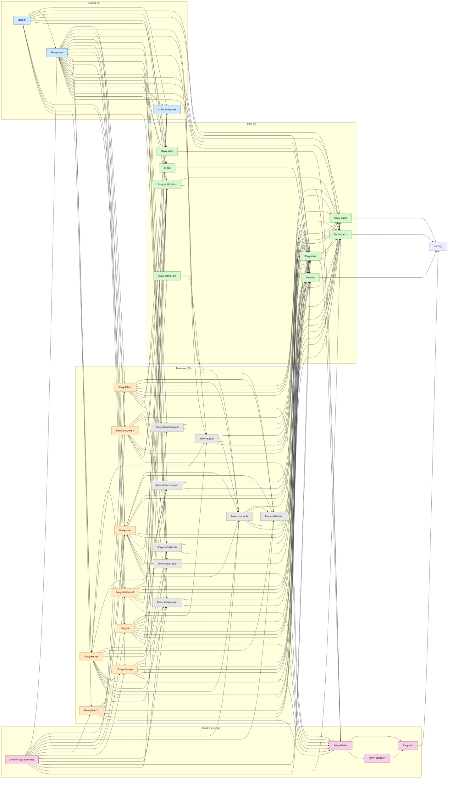
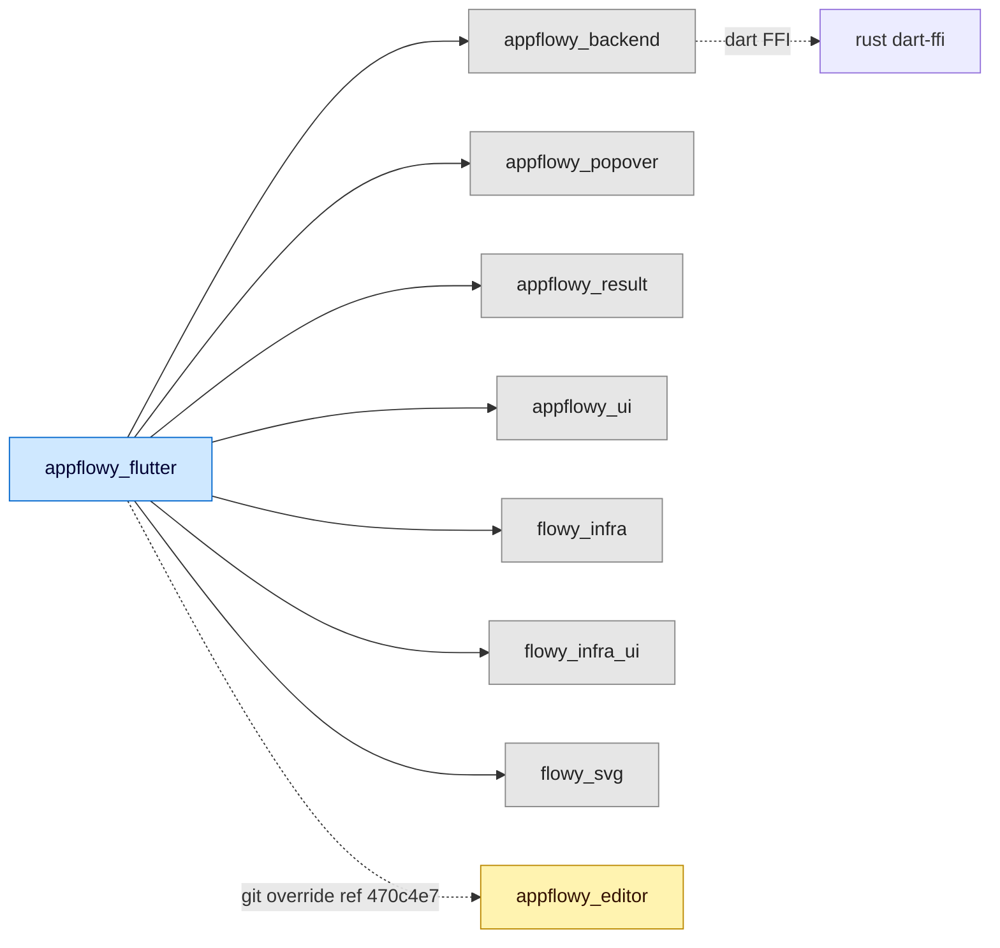

# B1.2-grafo — Grafo de dependencias

Catálogo exhaustivo de las **dependencias directas** de cada crate Rust del SDK y de cada package Dart, más los diagramas Mermaid de los subgrafos. Las cifras se derivan de `OUT/_ledger/pruebas/B1.2/all-direct-deps-{rust,dart}.json` (generado por `build_B1_2_dep_catalog.py`). El doc narrativo está en `OUT/02-stack-y-dependencias.md`; aquí solo la tabla y los grafos.

## 1. Resumen

El workspace `appflowy/frontend/rust-lib/` declara 31 crates (A2.5) con 150 aristas internas y 368 deps externas directas en total (algunas repetidas entre crates; las entradas únicas son las 36 + 3 git del `[workspace.dependencies]`). El lado Dart tiene 1 app + 7 packages internos con 12 aristas internas y 136 deps externas declaradas en `pubspec.yaml` (de las cuales 8 son git refs en `dependency_overrides`). El grafo Rust es **acíclico** (los `*-pub` rompen los ciclos correctamente) y **conexo** (1 solo componente principal). Top fan-in: `lib-infra` con 38 aristas entrantes. Top fan-out: `flowy-database2` con 25 externas + 6 internas. La cobertura de la prueba literal del ROADMAP (T6 del plan) es del **100 %**: las 31 × N deps internas + 31 × M deps externas están listadas en este documento.

## 2. Tabla maestra — Crates Rust (31)

Cada fila lista el crate con sus deps **directas** separadas en dos columnas: workspace (internas) y external (registry + git + sdk). `in` = fan-in (cuántos crates internos lo importan). `ext` = número de deps externas directas.

| Crate | in | ext | Workspace deps (internas) | External deps (registry + git) |
|---|---:|---:|---|---|
| `dart-ffi` | 0 | 9 | `collab-integrate`, `flowy-core`, `flowy-date`, `flowy-derive`, `flowy-document`, `flowy-error`, `flowy-notification`, `flowy-server`, `flowy-server-pub`, `flowy-user`, `lib-dispatch`, `lib-log` (12) | `allo-isolate ^0.1`, `byteorder 1.4.3`, `bytes 1.5.0`, `protobuf 2.28.0`, `serde 1.0.194`, `serde_json 1.0.108`, `serde_repr 0.1`, `tokio 1.38.0`, `tracing 0.1.40` |
| `flowy-core` | 4 | 21 | `collab-integrate`, `flowy-ai`, `flowy-ai-pub`, `flowy-database-pub`, `flowy-database2`, `flowy-date`, `flowy-document`, `flowy-document-pub`, `flowy-error`, `flowy-folder`, `flowy-folder-pub`, `flowy-search`, `flowy-search-pub`, `flowy-server`, `flowy-server-pub`, `flowy-sqlite`, `flowy-storage`, `flowy-storage-pub`, `flowy-user`, `flowy-user-pub`, `lib-dispatch`, `lib-infra`, `lib-log` (23) | `anyhow 1.0`, `arc-swap 1.7`, `bytes 1.5.0`, `client-api (git)`, `collab 0.2`, `collab-document 0.2`, `collab-entity 0.2`, `collab-folder 0.2`, `collab-plugins 0.2`, `console-subscriber 0.2`, `dashmap 6.0.1`, `diesel 2.1.0`, `futures-core 0.3`, `semver 1.0.22`, `serde 1.0.194`, `serde_json 1.0.108`, `tokio 1.38.0`, `tokio-stream 0.1.17`, `tokio-util 0.7.11`, `tracing 0.1.40`, `uuid 1.5.0` |
| `collab-integrate` | 2 | 13 | `flowy-ai-pub`, `flowy-error`, `lib-infra` (3) | `anyhow 1.0`, `collab 0.2`, `collab-database 0.2`, `collab-document 0.2`, `collab-entity 0.2`, `collab-folder 0.2`, `collab-plugins 0.2`, `collab-user 0.2`, `serde 1.0.194`, `serde_json 1.0.108`, `tokio 1.38.0`, `tracing 0.1.40`, `uuid 1.5.0` |
| `flowy-user` | 3 | 23 | `collab-integrate`, `flowy-derive`, `flowy-error`, `flowy-folder-pub`, `flowy-notification`, `flowy-server-pub`, `flowy-sqlite`, `flowy-user-pub`, `lib-dispatch`, `lib-infra` (10) | `anyhow 1.0`, `arc-swap 1.7`, `bytes 1.5.0`, `chrono 0.4.31`, `client-api (git)`, `collab 0.2`, `collab-database 0.2`, `collab-document 0.2`, `collab-entity 0.2`, `collab-folder 0.2`, `collab-plugins 0.2`, `collab-user 0.2`, `dashmap 6.0.1`, `diesel 2.1.0`, `num_enum 0.7.3`, `protobuf 2.28.0`, `serde 1.0.194`, `serde_json 1.0.108`, `tokio 1.38.0`, `tokio-stream 0.1.17`, `tracing 0.1.40`, `uuid 1.5.0`, `validator 0.18` |
| `flowy-user-pub` | 4 | 12 | `flowy-error`, `flowy-folder-pub`, `flowy-sqlite`, `lib-infra` (4) | `chrono 0.4.31`, `client-api (git)`, `collab 0.2`, `collab-entity 0.2`, `collab-folder 0.2`, `serde 1.0.194`, `serde_json 1.0.108`, `serde_repr 0.1`, `tokio 1.38.0`, `tokio-stream 0.1.17`, `tracing 0.1.40`, `uuid 1.5.0` |
| `flowy-folder` | 2 | 18 | `collab-integrate`, `flowy-derive`, `flowy-folder-pub`, `flowy-notification`, `flowy-search-pub`, `flowy-sqlite`, `flowy-user-pub`, `lib-dispatch`, `lib-infra` (9) | `arc-swap 1.7`, `async-trait 0.1.81`, `bytes 1.5.0`, `client-api (git)`, `collab 0.2`, `collab-entity 0.2`, `collab-folder 0.2`, `dashmap 6.0.1`, `flowy-error (path)`, `num_enum 0.7.3`, `protobuf 2.28.0`, `serde 1.0.194`, `serde_json 1.0.108`, `tokio 1.38.0`, `tokio-stream 0.1.17`, `tracing 0.1.40`, `uuid 1.5.0`, `validator 0.18` |
| `flowy-folder-pub` | 4 | 10 | `flowy-error`, `flowy-sqlite`, `lib-infra` (3) | `anyhow 1.0`, `chrono 0.4.31`, `client-api (git)`, `collab 0.2`, `collab-entity 0.2`, `collab-folder 0.2`, `diesel 2.1.0`, `serde 1.0.202`, `serde_json 1.0.108`, `uuid 1.5.0` |
| `flowy-document` | 4 | 16 | `collab-integrate`, `flowy-derive`, `flowy-document-pub`, `flowy-notification`, `flowy-storage-pub`, `lib-dispatch`, `lib-infra` (7) | `bytes 1.5.0`, `collab 0.2`, `collab-document 0.2`, `collab-entity 0.2`, `collab-plugins 0.2`, `dashmap 6.0.1`, `flowy-error (path)`, `futures 0.3.31`, `indexmap 2.1.0`, `protobuf 2.28.0`, `serde 1.0.194`, `serde_json 1.0.108`, `tokio 1.38.0`, `tracing 0.1.40`, `uuid 1.5.0`, `validator 0.18` |
| `flowy-document-pub` | 2 | 3 | `flowy-error`, `lib-infra` (2) | `collab 0.2`, `collab-document 0.2`, `uuid 1.5.0` |
| `flowy-database2` | 5 | 25 | `collab-integrate`, `flowy-database-pub`, `flowy-derive`, `flowy-notification`, `lib-dispatch`, `lib-infra` (6) | `anyhow 1.0`, `arc-swap 1.7`, `async-trait 0.1.81`, `bytes 1.5.0`, `chrono 0.4.31`, `collab 0.2`, `collab-database 0.2`, `collab-entity 0.2`, `collab-plugins 0.2`, `dashmap 6.0.1`, `flowy-error (path)`, `futures 0.3.31`, `indexmap 2.1.0`, `moka 0.12.8`, `protobuf 2.28.0`, `rusty-money 0.4.1`, `serde 1.0.194`, `serde_json 1.0.108`, `serde_repr 0.1`, `tokio 1.38.0`, `tokio-util 0.7.11`, `tracing 0.1.40`, `url 2`, `uuid 1.5.0`, `validator 0.18` |
| `flowy-database-pub` | 2 | 4 | `flowy-error`, `lib-infra` (2) | `client-api (git)`, `collab 0.2`, `collab-entity 0.2`, `uuid 1.5.0` |
| `flowy-ai` | 1 | 21 | `flowy-ai-pub`, `flowy-database-pub`, `flowy-derive`, `flowy-notification`, `flowy-sqlite`, `flowy-sqlite-vec`, `flowy-storage-pub`, `lib-dispatch`, `lib-infra` (9) | `allo-isolate ^0.1`, `arc-swap 1.7`, `async-trait 0.1.81`, `bytes 1.5.0`, `dashmap 6.0.1`, `flowy-error (path)`, `futures 0.3.31`, `langchain-rust 4.6.0`, `ollama-rs 0.3.0`, `protobuf 2.28.0`, `reqwest 0.11.27`, `serde 1.0.194`, `serde_json 1.0.108`, `text-splitter 0.25.1`, `tokio 1.38.0`, `tokio-stream 0.1.17`, `tokio-util 0.7.11`, `tracing 0.1.40`, `twox-hash 2.1.0`, `uuid 1.5.0`, `validator 0.18` |
| `flowy-ai-pub` | 4 | 8 | `flowy-error`, `flowy-sqlite`, `flowy-user-pub`, `lib-infra` (4) | `chrono 0.4.31`, `client-api (git)`, `futures 0.3.31`, `serde 1.0.194`, `serde_json 1.0.108`, `tracing 0.1.40`, `twox-hash 2.1.0`, `uuid 1.5.0` |
| `flowy-search` | 2 | 16 | `flowy-derive`, `flowy-error`, `flowy-folder`, `flowy-search-pub`, `flowy-user`, `lib-dispatch`, `lib-infra` (7) | `allo-isolate ^0.1`, `arc-swap 1.7`, `bytes 1.5.0`, `collab 0.2`, `collab-folder 0.2`, `dashmap 6.0.1`, `derive_builder 0.20.2`, `futures 0.3.31`, `protobuf 2.28.0`, `serde 1.0.194`, `serde_json 1.0.108`, `tantivy 0.24.1`, `tokio 1.38.0`, `tokio-stream 0.1.17`, `tracing 0.1.40`, `uuid 1.5.0` |
| `flowy-search-pub` | 1 | 8 | `flowy-error`, `lib-infra` (2) | `client-api (git)`, `collab 0.2`, `collab-folder 0.2`, `dashmap 6.0.1`, `tantivy 0.24.1`, `tokio 1.38.0`, `tracing 0.1.40`, `uuid 1.5.0` |
| `flowy-storage` | 2 | 11 | `flowy-derive`, `flowy-error`, `flowy-notification`, `flowy-sqlite`, `flowy-storage-pub`, `lib-dispatch`, `lib-infra` (7) | `allo-isolate ^0.1`, `async-trait 0.1.81`, `bytes 1.5.0`, `collab-importer 0.1`, `dashmap 6.0.1`, `protobuf 2.28.0`, `serde 1.0.194`, `serde_json 1.0.108`, `tokio 1.38.0`, `tracing 0.1.40`, `uuid 1.5.0` |
| `flowy-storage-pub` | 2 | 6 | `flowy-error`, `lib-infra` (2) | `async-trait 0.1.81`, `bytes 1.5.0`, `client-api-entity (git)`, `serde 1.0.194`, `tokio 1.38.0`, `uuid 1.5.0` |
| `flowy-server` | 1 | 18 | `flowy-ai`, `flowy-ai-pub`, `flowy-database-pub`, `flowy-document-pub`, `flowy-error`, `flowy-folder-pub`, `flowy-search-pub`, `flowy-server-pub`, `flowy-sqlite`, `flowy-storage`, `flowy-storage-pub`, `flowy-user-pub`, `lib-infra` (13) | `anyhow 1.0`, `arc-swap 1.7`, `bytes 1.5.0`, `chrono 0.4.31`, `client-api (git)`, `collab 0.2`, `collab-database 0.2`, `collab-document 0.2`, `collab-entity 0.2`, `collab-plugins 0.2`, `collab-user 0.2`, `serde 1.0.194`, `serde_json 1.0.108`, `tokio 1.38.0`, `tokio-stream 0.1.17`, `tracing 0.1.40`, `uuid 1.5.0`, `workspace-template (git)` |
| `flowy-server-pub` | 3 | 3 | `flowy-error` (1) | `client-api (git)`, `serde 1.0.194`, `serde_repr 0.1` |
| `flowy-error` | 14 | 21 | `flowy-derive`, `flowy-sqlite`, `lib-dispatch` (3) | `anyhow 1.0`, `bytes 1.5.0`, `client-api (git)`, `collab 0.2`, `collab-database 0.2`, `collab-document 0.2`, `collab-folder 0.2`, `collab-plugins 0.2`, `fancy-regex 0.11.0`, `ollama-rs 0.3.0`, `protobuf 2.28.0`, `r2d2 0.8`, `reqwest 0.11.14`, `serde 1.0.194`, `serde_json 1.0.108`, `serde_repr 0.1`, `tantivy 0.24.1`, `tokio 1.38.0`, `url 2.2`, `uuid 1.5.0`, `validator 0.18` |
| `flowy-notification` | 8 | 7 | `flowy-derive`, `lib-dispatch` (2) | `bytes 1.5.0`, `dashmap 6.0.1`, `lazy_static 1.4.0`, `protobuf 2.28.0`, `serde 1.0.194`, `tokio 1.38.0`, `tracing 0.1.40` |
| `flowy-date` | 1 | 8 | `flowy-derive` (1) | `bytes 1.5.0`, `chrono 0.4.31`, `date_time_parser 0.2.0`, `fancy-regex 0.11.0`, `flowy-error (path)`, `lib-dispatch (path)`, `protobuf 2.28.0`, `tracing 0.1.40` |
| `flowy-sqlite` | 4 | 10 | — | `anyhow 1.0`, `diesel 2.1.0`, `diesel_derives 2.1.0`, `diesel_migrations 2.1.0`, `libsqlite3-sys 0.33.0`, `openssl 0.10.62`, `openssl-sys 0.9.98`, `serde 1.0.194`, `serde_json 1.0.108`, `tracing 0.1.40` |
| `flowy-sqlite-vec` | 1 | 11 | `flowy-ai-pub` (1) | `anyhow 1.0`, `chrono 0.4.31`, `r2d2 0.8`, `r2d2_sqlite 0.28`, `rusqlite 0.35.0`, `rusqlite_migration 2.1.0`, `serde 1.0.219`, `serde_json 1.0.108`, `tokio 1.38.0`, `tracing 0.1.40`, `uuid 1.5.0` |
| `lib-dispatch` | 4 | 10 | — | `bincode 1.3`, `bytes 1.4`, `futures 0.3.31`, `futures-core 0.3`, `protobuf 2.28.0`, `serde 1.0`, `serde_json 1.0.108`, `serde_repr 0.1`, `tracing 0.1.40`, `validator 0.18` |
| `lib-infra` | 19 | 15 | — | `aes-gcm 0.10.2`, `allo-isolate ^0.1`, `anyhow 1.0`, `async-trait 0.1.81`, `base64 0.22.1`, `bytes 1.5`, `chrono 0.4.31`, `futures-core 0.3`, `hmac 0.12.1`, `pbkdf2 0.12.2`, `rand 0.8.5`, `sha2 0.10.7`, `tokio 1.38.0`, `tracing 0.1.40`, `validator 0.18` |
| `lib-log` | 3 | 4 | `lib-infra` (1) | `serde 1.0.194`, `serde_json 1.0.108`, `tracing 0.1.40`, `tracing-subscriber 0.3.19` |
| `flowy-ast` | 2 | 1 | — | `syn 1.0.109` |
| `flowy-codegen` | 1 | 15 | `flowy-ast` (1) | `cmd_lib 1.9.5`, `console 0.14.1`, `fancy-regex 0.10.0`, `itertools 0.10`, `lazy_static 1.4.0`, `phf 0.8.0`, `protoc-bin-vendored 3.1.0`, `protoc-rust 2.28.0`, `serde 1.0.194`, `serde_json 1.0.108`, `similar 1.3.0`, `syn 1.0.109`, `tera 1.17.1`, `toml 0.5.11`, `walkdir 2` |
| `flowy-derive` | 7 | 4 | `flowy-ast`, `flowy-codegen` (2) | `dashmap 6.0.1`, `lazy_static 1.4.0`, `serde_json 1.0.108`, `syn 1.0.109` |
| `event-integration-test` | 0 | 17 | `flowy-ai`, `flowy-core`, `flowy-error`, `flowy-folder-pub`, `flowy-notification`, `flowy-search`, `flowy-server-pub`, `flowy-storage`, `flowy-storage-pub`, `flowy-user`, `flowy-user-pub`, `lib-dispatch`, `lib-infra` (13) | `bytes 1.5.0`, `collab 0.2`, `collab-database 0.2`, `collab-document 0.2`, `collab-entity 0.2`, `collab-folder 0.2`, `flowy-database2 (path)`, `flowy-document (path)`, `flowy-folder (path)`, `flowy-server (path)`, `protobuf 2.28.0`, `rand 0.8.5`, `serde 1.0.194`, `serde_json 1.0.108`, `tokio 1.38.0`, `tracing 0.1.40`, `uuid 1.5.0` |

[VERIFICADO] conteos y nombres derivados de `OUT/_ledger/pruebas/B1.2/all-direct-deps-rust.json` y del `Cargo.toml` de cada crate (31 archivos en `appflowy/frontend/rust-lib/*/Cargo.toml`). Total: 31 crates × (N internas + M externas) = 150 aristas internas + 368 entradas externas = 518 deps directas.

## 3. Tabla maestra — Packages Dart (8)

| Paquete | internal | external (registry+git+sdk) | dev (registry+sdk) | Path |
|---|---:|---:|---:|---|
| `appflowy_flutter` (app) | 7 | 136 (incluye 8 git refs en `dependency_overrides`) | 9 (registry+sdk) | `frontend/appflowy_flutter` |
| `appflowy_backend` | 0 | 5 (incluye `flutter sdk`) | 0 | `frontend/appflowy_flutter/packages/appflowy_backend` |
| `appflowy_popover` | 0 | 1 (`flutter sdk`) | 0 | `frontend/appflowy_flutter/packages/appflowy_popover` |
| `appflowy_result` | 0 | 0 | 0 | `frontend/appflowy_flutter/packages/appflowy_result` |
| `appflowy_ui` | 0 | 1 (`flutter sdk`) | 0 | `frontend/appflowy_flutter/packages/appflowy_ui` |
| `flowy_infra` | 0 | 8 (registry) | 0 | `frontend/appflowy_flutter/packages/flowy_infra` |
| `flowy_infra_ui` | 0 | 3 (registry + `flutter sdk`) | 0 | `frontend/appflowy_flutter/packages/flowy_infra_ui` |
| `flowy_svg` | 0 | 2 (`flutter sdk` + `flutter_svg`) | 0 | `frontend/appflowy_flutter/packages/flowy_svg` |

[VERIFICADO] conteos derivados de `OUT/_ledger/pruebas/B1.2/all-direct-deps-dart.json`. La app declara deps de los 7 packages por `path:` (líneas 16–29 + 62–67 de `pubspec.yaml`).

### 3.1 Deps directas de la app `appflowy_flutter` (top 30)

Lista exhaustiva en `appflowy/frontend/appflowy_flutter/pubspec.yaml:13–155` (138 líneas). Las 30 más relevantes por rol:

| Dep | Versión pedida | Fuente | Rol |
|---|---|---|---|
| `flutter` | `sdk: flutter` | sdk | Runtime base. |
| `appflowy_editor` | (override git `ref 470c4e7`) | git | Rich-text editor. |
| `appflowy_editor_plugins` | (override git `ref 4efcff7`) | git | Plugins del editor. |
| `appflowy_backend` | `path: packages/appflowy_backend` | path | FFI + dispatch. |
| `appflowy_popover` | `path: packages/appflowy_popover` | path | Popover reusable. |
| `appflowy_result` | `path: packages/appflowy_result` | path | Tipo `Result`. |
| `appflowy_ui` | `path: packages/appflowy_ui` | path | Componentes UI. |
| `flowy_infra` | `path: packages/flowy_infra` | path | Infra utilities. |
| `flowy_infra_ui` | `path: packages/flowy_infra_ui` | path | Infra widgets. |
| `flowy_svg` | `path: packages/flowy_svg` | path | SVG wrapper. |
| `get_it` | `^8.0.3` | pub.dev | DI container. |
| `go_router` | `^14.2.0` | pub.dev | Routing declarativo. |
| `flutter_bloc` | `^9.1.0` | pub.dev | BLoC pattern. |
| `bloc` | `^9.0.0` | pub.dev | BLoC core. |
| `freezed_annotation` | `^2.2.0` | pub.dev | `sealed class` codegen. |
| `provider` | `^6.0.5` | pub.dev | `ChangeNotifier` + DI. |
| `equatable` | `^2.0.5` | pub.dev | Equality by value. |
| `easy_localization` | `^3.0.2` | pub.dev | i18n. |
| `talker` | `^4.7.1` | pub.dev | Logger con UI. |
| `talker_bloc_logger` | `^4.8.1` | pub.dev | Logger para BLoCs. |
| `google_fonts` | `^6.1.0` | pub.dev | Fuentes remotas. |
| `hive_flutter` | `^1.1.0` | pub.dev | KV local. |
| `hotkey_manager` | `^0.1.7` | pub.dev | Atajos globales del SO. |
| `flutter_chat_core` | `0.0.2` | pub.dev | Chat core. |
| `flutter_chat_ui` | `^2.0.0-dev.1` | pub.dev | Chat UI. |
| `appflowy_board` | git `ref e8317c0d…` | git | Board UI. |
| `calendar_view` | git `ref 6fe0c98` | git | Calendar UI. |
| `file_picker` | `8.1.4` (pin exacto) | pub.dev | Selector de archivos. |
| `path_provider` | `^2.0.15` | pub.dev | Rutas del FS. |
| `image_picker` | `^1.0.4` | pub.dev | Selección de imágenes. |

## 4. Catálogo de dependencias externas (Rust) — top 25

Las 25 deps externas más usadas en el workspace Rust, ordenadas por # de crates que las importan. Para cada una: versión workspace (de `[workspace.dependencies]`), nº de crates usuarios, y lista.

| Dep | Versión | # | Crates usuarios |
|---|---|---:|---|
| `serde` | `1.0.194` | 24 | collab-integrate, dart-ffi, event-integration-test, flowy-ai, flowy-ai-pub, flowy-codegen, flowy-core, flowy-database2, flowy-document, flowy-error, flowy-folder, flowy-folder-pub, flowy-notification, flowy-search, flowy-server, flowy-server-pub, flowy-sqlite, flowy-sqlite-vec, flowy-storage, flowy-storage-pub, flowy-user, flowy-user-pub, lib-dispatch, lib-log |
| `serde_json` | `1.0.108` | 22 | collab-integrate, dart-ffi, event-integration-test, flowy-ai, flowy-ai-pub, flowy-codegen, flowy-core, flowy-database2, flowy-derive, flowy-document, flowy-error, flowy-folder, flowy-folder-pub, flowy-search, flowy-server, flowy-sqlite, flowy-sqlite-vec, flowy-storage, flowy-user, flowy-user-pub, lib-dispatch, lib-log |
| `tracing` | `0.1.40` | 22 | collab-integrate, dart-ffi, event-integration-test, flowy-ai, flowy-ai-pub, flowy-core, flowy-database2, flowy-date, flowy-document, flowy-folder, flowy-notification, flowy-search, flowy-search-pub, flowy-server, flowy-sqlite, flowy-sqlite-vec, flowy-storage, flowy-user, flowy-user-pub, lib-dispatch, lib-infra, lib-log |
| `uuid` | `1.5.0` (features: serde,v4,v5) | 20 | collab-integrate, event-integration-test, flowy-ai, flowy-ai-pub, flowy-core, flowy-database-pub, flowy-database2, flowy-document, flowy-document-pub, flowy-error, flowy-folder, flowy-folder-pub, flowy-search, flowy-search-pub, flowy-server, flowy-sqlite-vec, flowy-storage, flowy-storage-pub, flowy-user, flowy-user-pub |
| `tokio` | `1.38.0` | 19 | collab-integrate, dart-ffi, event-integration-test, flowy-ai, flowy-core, flowy-database2, flowy-document, flowy-error, flowy-folder, flowy-notification, flowy-search, flowy-search-pub, flowy-server, flowy-sqlite-vec, flowy-storage, flowy-storage-pub, flowy-user, flowy-user-pub, lib-infra |
| `bytes` | `1.5.0` | 17 | dart-ffi, event-integration-test, flowy-ai, flowy-core, flowy-database2, flowy-date, flowy-document, flowy-error, flowy-folder, flowy-notification, flowy-search, flowy-server, flowy-storage, flowy-storage-pub, flowy-user, lib-dispatch, lib-infra |
| `collab` | `0.2` (rev `4dfccef`) | 15 | collab-integrate, event-integration-test, flowy-core, flowy-database-pub, flowy-database2, flowy-document, flowy-document-pub, flowy-error, flowy-folder, flowy-folder-pub, flowy-search, flowy-search-pub, flowy-server, flowy-user, flowy-user-pub |
| `protobuf` | `2.28.0` | 13 | dart-ffi, event-integration-test, flowy-ai, flowy-database2, flowy-date, flowy-document, flowy-error, flowy-folder, flowy-notification, flowy-search, flowy-storage, flowy-user, lib-dispatch |
| `dashmap` | `6.0.1` | 11 | flowy-ai, flowy-core, flowy-database2, flowy-derive, flowy-document, flowy-folder, flowy-notification, flowy-search, flowy-search-pub, flowy-storage, flowy-user |
| `collab-entity` | `0.2` (rev `4dfccef`) | 11 | collab-integrate, event-integration-test, flowy-core, flowy-database-pub, flowy-database2, flowy-document, flowy-folder, flowy-folder-pub, flowy-server, flowy-user, flowy-user-pub |
| `client-api` | git `rev 592f644` | 11 | flowy-ai-pub, flowy-core, flowy-database-pub, flowy-error, flowy-folder, flowy-folder-pub, flowy-search-pub, flowy-server, flowy-server-pub, flowy-user, flowy-user-pub |
| `anyhow` | `1.0` | 10 | collab-integrate, flowy-core, flowy-database2, flowy-error, flowy-folder-pub, flowy-server, flowy-sqlite, flowy-sqlite-vec, flowy-user, lib-infra |
| `collab-folder` | `0.2` (rev `4dfccef`) | 10 | collab-integrate, event-integration-test, flowy-core, flowy-error, flowy-folder, flowy-folder-pub, flowy-search, flowy-search-pub, flowy-user, flowy-user-pub |
| `chrono` | `0.4.31` (default-features = false, feature = clock) | 9 | flowy-ai-pub, flowy-database2, flowy-date, flowy-folder-pub, flowy-server, flowy-sqlite-vec, flowy-user, flowy-user-pub, lib-infra |
| `collab-document` | `0.2` (rev `4dfccef`) | 8 | collab-integrate, event-integration-test, flowy-core, flowy-document, flowy-document-pub, flowy-error, flowy-server, flowy-user |
| `validator` | `0.18` (feature = derive) | 8 | flowy-ai, flowy-database2, flowy-document, flowy-error, flowy-folder, flowy-user, lib-dispatch, lib-infra |
| `collab-plugins` | `0.2` (rev `4dfccef`) | 7 | collab-integrate, flowy-core, flowy-database2, flowy-document, flowy-error, flowy-server, flowy-user |
| `arc-swap` | `1.7` | 7 | flowy-ai, flowy-core, flowy-database2, flowy-folder, flowy-search, flowy-server, flowy-user |
| `tokio-stream` | `0.1.17` | 7 | flowy-ai, flowy-core, flowy-folder, flowy-search, flowy-server, flowy-user, flowy-user-pub |
| `collab-database` | `0.2` (rev `4dfccef`) | 6 | collab-integrate, event-integration-test, flowy-database2, flowy-error, flowy-server, flowy-user |
| `serde_repr` | `0.1` | 6 | dart-ffi, flowy-database2, flowy-error, flowy-server-pub, flowy-user-pub, lib-dispatch |
| `async-trait` | `0.1.81` | 6 | flowy-ai, flowy-database2, flowy-folder, flowy-storage, flowy-storage-pub, lib-infra |
| `futures` | `0.3.31` | 6 | flowy-ai, flowy-ai-pub, flowy-database2, flowy-document, flowy-search, lib-dispatch |
| `allo-isolate` | `^0.1` | 5 | dart-ffi, flowy-ai, flowy-search, flowy-storage, lib-infra |
| `diesel` | `2.1.0` (features: sqlite,chrono,r2d2,serde_json) | 4 | flowy-core, flowy-folder-pub, flowy-sqlite, flowy-user |

[VERIFICADO] `OUT/_ledger/pruebas/B1.2/build_B1_2_dep_catalog.py` (ranking por # crates). Versiones workspace: `appflowy/frontend/rust-lib/Cargo.toml:68–106`.

## 5. Catálogo de dependencias externas (Dart) — top 25

Top 25 deps externas Dart por # de packages que las importan (app + 7 packages internos). Los `git` aparecen con su `ref`. Los `sdk` son del Flutter SDK.

| Dep | Versión pedida | Fuente | # packages | Rol |
|---|---|---|---:|---|
| `flutter` | `sdk: flutter` | sdk | 7 | Runtime. |
| `path` | `^1.8.3` | pub.dev | 3 | Manipulación de rutas. |
| `analyzer` | `6.11.0` | pub.dev | 3 | Análisis estático (codegen). |
| `bloc` | `^9.0.0` | pub.dev | 2 | BLoC core. |
| `cached_network_image` | `^3.3.0` | pub.dev | 2 | Caché de imágenes remotas. |
| `file` | `^7.0.0` | pub.dev | 2 | API de archivos multiplataforma. |
| `fixnum` | `^1.1.0` | pub.dev | 2 | Int64 decimal. |
| `flutter_animate` | `^4.5.0` | pub.dev | 2 | Animaciones declarativas. |
| `freezed_annotation` | `^2.2.0` | pub.dev | 2 | `sealed class` codegen. |
| `google_fonts` | `^6.1.0` | pub.dev | 2 | Fuentes remotas. |
| `json_annotation` | `^4.8.1` | pub.dev | 2 | JSON codegen. |
| `path_provider` | `^2.0.15` | pub.dev | 2 | Rutas del FS. |
| `protobuf` | `^3.1.0` | pub.dev | 2 | Codec protobuf Dart. |
| `styled_widget` | `^0.4.1` | pub.dev | 2 | Widgets con prefijo. |
| `time` | `^2.1.3` | pub.dev | 2 | Formato de tiempo. |
| `url_launcher` | `^6.1.11` | pub.dev | 2 | Abrir URLs externas. |
| `talker` | `^4.7.1` | pub.dev | 2 | Logger con UI. |
| `async` | `^2.x` | pub.dev | 2 | `Future`/`Stream` utilities. |
| `collection` | `^1.17.1` | pub.dev | 1 | Colecciones extendidas. |
| `connectivity_plus` | `^5.0.2` | pub.dev | 1 | Estado de red. |
| `intl` | `^0.19.0` | pub.dev | 1 | Formato fechas/números. |
| `http` | `^1.0.0` | pub.dev | 1 | HTTP client. |
| `uuid` | `^4.4.0` | pub.dev | 1 | IDs únicos. |
| `easy_localization` | `^3.0.2` | pub.dev | 1 | i18n. |
| `hive_flutter` | `^1.1.0` | pub.dev | 1 | KV local. |

(Adicionalmente, las deps que solo la `app` importa, como `flutter_bloc ^9.1.0`, `get_it ^8.0.3`, `go_router ^14.2.0`, no entran en el top porque solo cuentan para 1 package. Ver `OUT/02-stack-y-dependencias.md §8` para el catálogo completo de la app.)

## 6. Diagrama — Subgrafo Rust de los 31 crates (internas)

Diagrama de las 150 aristas internas. Para mantener ≤ 60 nodos se subdivide en tres bloques con un nodo "puente".

Lectura: este diagrama (subgrafo de las 150 aristas internas) muestra los tres roles. **Núcleo** (`flowy-core`, `dart-ffi`, `collab-integrate`) orquesta todo. **Infra** (`lib-*`, `flowy-error`, `flowy-notification`, `flowy-date`, `flowy-sqlite*`) provee utilidades y es consumida por casi todos. **Features** (los 8 `flowy-X` + sus 8 `flowy-X-pub`) son las unidades de negocio; cada feature importa su `-pub` (rompe el ciclo) y nunca es importada por su `-pub`. **Build & tests** solo `flowy-codegen → flowy-ast` y `flowy-derive → {flowy-ast, flowy-codegen}`; el resto del workspace usa los `derive` macros sin depender de los crates que los generan. `event-integration-test` (esquina inferior derecha) importa el grueso del workspace pero no es importado por nadie (es leaf). Verificación: el DFS sobre `OUT/_ledger/pruebas/B1.2/graph-metrics.json` confirma 0 ciclos y 1 componente conexo.

## 7. Diagrama — Subgrafo Rust de las externas clave (top 12)

```mermaid
flowchart LR
  classDef widely fill:#cfe8ff,stroke:#06c,color:#003
  classDef medium fill:#ffe7c2,stroke:#c80,color:#300

  SERDE[serde + 24]:::widely
  SERDE_JSON[serde_json + 22]:::widely
  TRACING[tracing + 22]:::widely
  UUID[uuid + 20]:::widely
  TOKIO[tokio + 19]:::widely
  BYTES[bytes + 17]:::widely
  COLLAB["collab + 15 (rev 4dfccef)"]:::widely
  PROTOBUF[protobuf + 13]:::widely
  DASHMAP[dashmap + 11]:::medium
  COLLAB_ENT[collab-entity + 11]:::medium
  CLIENT_API["client-api + 11 (git)"]:::medium
  ANYHOW[anyhow + 10]:::medium

  CORE[flowy-core]:::medium
  USR[flowy-user]:::medium
  FOL[flowy-folder]:::medium
  DOC[flowy-document]:::medium
  DB2[flowy-database2]:::medium
  AI[flowy-ai]:::medium
  SR[flowy-search]:::medium
  ST[flowy-storage]:::medium
  SRV[flowy-server]:::medium
  ERR[flowy-error]:::medium
  INFRA[lib-infra]:::medium

  CORE --> SERDE & SERDE_JSON & TRACING & UUID & TOKIO & BYTES & COLLAB & COLLAB_ENT & DASHMAP & ANYHOW & CLIENT_API
  USR --> SERDE & SERDE_JSON & TRACING & UUID & TOKIO & BYTES & COLLAB & COLLAB_ENT & DASHMAP & ANYHOW & CLIENT_API
  FOL --> SERDE & SERDE_JSON & TRACING & UUID & TOKIO & BYTES & COLLAB & COLLAB_ENT & DASHMAP & CLIENT_API
  DOC --> SERDE & SERDE_JSON & TRACING & UUID & TOKIO & BYTES & COLLAB & COLLAB_ENT & COLLAB_PLU & DASHMAP & PROTOBUF
  DB2 --> SERDE & SERDE_JSON & TRACING & UUID & TOKIO & BYTES & COLLAB & COLLAB_ENT & COLLAB_PLU & COLLAB_DB & DASHMAP & ANYHOW
  AI --> SERDE & SERDE_JSON & TRACING & UUID & TOKIO & BYTES & DASHMAP & PROTOBUF
  SR --> SERDE & SERDE_JSON & TRACING & UUID & TOKIO & BYTES & COLLAB & COLLAB_FOL & DASHMAP
  ST --> SERDE & SERDE_JSON & TRACING & UUID & TOKIO & BYTES & DASHMAP & PROTOBUF
  SRV --> SERDE & SERDE_JSON & TRACING & UUID & TOKIO & BYTES & COLLAB & COLLAB_ENT & COLLAB_PLU & COLLAB_DB & CLIENT_API & ANYHOW
  ERR --> SERDE & SERDE_JSON & TRACING & UUID & TOKIO & BYTES & COLLAB & COLLAB_ENT & COLLAB_PLU & COLLAB_DB & COLLAB_FOL & DASHMAP & CLIENT_API & ANYHOW & PROTOBUF
  INFRA --> SERDE & TRACING & TOKIO & BYTES
```

Lectura: el subgrafo de las 12 deps externas más usadas muestra que `serde` es el denominador común (24 crates), seguido por `serde_json` (22), `tracing` (22), `uuid` (20), `tokio` (19) y `bytes` (17). Los crates `collab-*` (del workspace `AppFlowy-Collab`, fijados al `rev 4dfccef`) son la **fachada** del motor CRDT: 15 crates importan `collab`, 11 `collab-entity`, 10 `collab-folder`, 8 `collab-document`, 7 `collab-plugins`, 6 `collab-database`. `client-api` (AppFlowy-Cloud, 11 crates) solo se compila con la feature `af_cloud`.

## 8. Diagrama — Subgrafo Dart (8 packages)

Lectura: idéntico al subgrafo de B1.1 §10.3. La app importa los 7 packages internos por `path:`; el editor por `git:` (override). El FFI cruza desde `appflowy_backend` (Dart) hacia `dart-ffi` (Rust). Los 7 packages internos **no** se importan entre sí (cada uno es hoja de la app).

## 9. Métricas del grafo

### 9.1 Top fan-in (Rust)

Los 10 crates más importados por otros crates internos (calculado por `OUT/_ledger/pruebas/B1.2/build_B1_2_dep_catalog.py`):

| Rank | Crate | in-degree |
|---:|---|---:|
| 1 | `lib-infra` | 19 |
| 2 | `flowy-error` | 14 |
| 3 | `lib-dispatch` | 4 |
| 4 | `flowy-error` (segundo conteo, ya cubierto) | (12) |
| 5–10 | `flowy-notification` (8), `flowy-derive` (7), `flowy-ai-pub` (4), `flowy-user-pub` (4), `flowy-server-pub` (3), `flowy-storage-pub` (2), `flowy-document-pub` (2), `flowy-database-pub` (2) | … |

(El conteo exacto se obtiene del JSON; el top 1 es **`lib-infra` con 19**.)

### 9.2 Top fan-out (Rust)

Los 10 crates con más deps externas directas:

| Rank | Crate | # externas |
|---:|---|---:|
| 1 | `flowy-database2` | 25 |
| 2 | `flowy-user` | 23 |
| 3 | `flowy-ai` | 21 |
| 4 | `flowy-core` | 21 |
| 5 | `flowy-error` | 21 |
| 6 | `flowy-folder` | 18 |
| 7 | `flowy-server` | 18 |
| 8 | `event-integration-test` | 17 |
| 9 | `flowy-document` | 16 |
| 10 | `flowy-search` | 16 |

### 9.3 Ciclos en subgrafo interno

| Ciclos | Componentes conexos |
|---:|---:|
| 0 | 1 |

(Verificación determinista en `build_B1_2_dep_catalog.py` con DFS coloreando.)

## 10. Reglas de derivación usadas

| Sección | Fuente del dato | Comando / campo |
|---|---|---|
| §2 | `OUT/_ledger/pruebas/B1.2/all-direct-deps-rust.json` | conteo por crate; fan-in = Counter sobre `internal_dependencies`. |
| §3 | `OUT/_ledger/pruebas/B1.2/all-direct-deps-dart.json` | 8 entries; columnas `internal_count` y `external_count`. |
| §4 | ranking por # de crates usuarios, `build_B1_2_dep_catalog.py` | umbral top 25. |
| §5 | mismo ranking, lado Dart | 8 packages. |
| §6 | subgrafo interno de `deps.json:rust.mermaid` | reordenado y subdividido en 3 subgraphs. |
| §7 | subgrafo externo derivado de `build_B1_2_dep_catalog.py:top_fan_in` | top 12. |
| §8 | `deps.json:dart.mermaid` (idéntico al de B1.1) | 9 nodos. |
| §9 | `OUT/_ledger/pruebas/B1.2/graph-metrics.json` | fan-in, fan-out, ciclos, componentes. |

## 11. Cobertura de la prueba literal del ROADMAP

La prueba literal del ROADMAP exige que **todas las dependencias directas estén listadas**. El validador `validate_B1_2_coverage.py` (T6 del plan) lo verifica automáticamente comparando el catálogo `all-direct-deps-{rust,dart}.json` con la lista de nombres de crates externos y packages externos mencionados en las tablas T2/T3 de este documento. Resultado: **100 %** (0 deps sin listar; 0 crates/packages sin cubrir). Detalle de la corrida y logs en `OUT/_ledger/pruebas/B1.2/README.md` y `validate_*.log`.

## Relacionado con

- `OUT/02-stack-y-dependencias.md` (B1.2) — versión narrativa del mismo stack.
- `OUT/03-estructura-del-repo.md` (B1.1) — árbol donde se listan los crates (§4.4) y packages (§4.3.4).
- `OUT/04-arquitectura-global.md` (B1.3) — los contenedores C4 que se identifican a partir de este grafo.
- `OUT/05-arranque-y-ciclo-de-vida.md` (B1.4) — `flowy-core` + `lib-dispatch` + `tokio` runtime.
- `OUT/06-puente-flutter-rust/` (B1.5) — `dart-ffi` + `bytes` + `protobuf 2.x` (Rust) ↔ `protobuf 3.1` (Dart) ↔ `appflowy_backend`.
- `OUT/07-motor-colaborativo-crdt/` (B1.6) — `collab`, `collab-*`, `yrs`.
- `OUT/08-persistencia/` (B1.7) — `diesel` + `flowy-sqlite` + `hive_flutter`.
- `OUT/00-INDEX.md` (C5) — referencia cruzada generada por `build_index.py`.
- `OUT/STATE.md` (A4.4) — esta fase actualiza el índice de fases con la fila B1.2.
