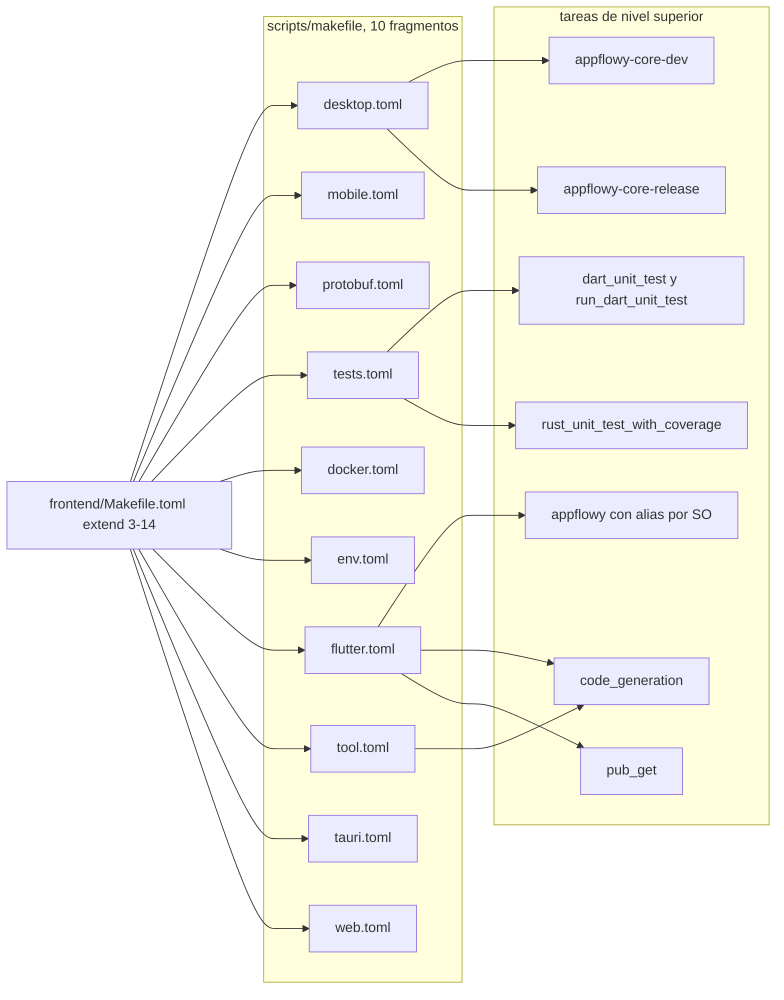
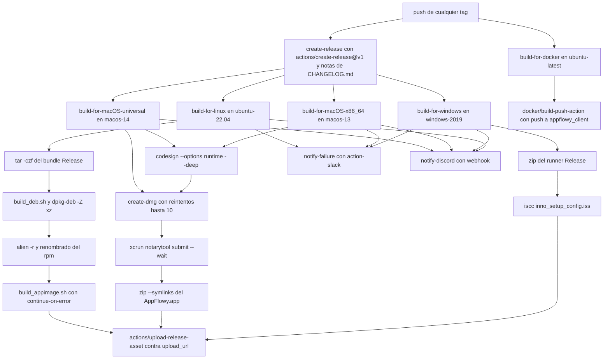
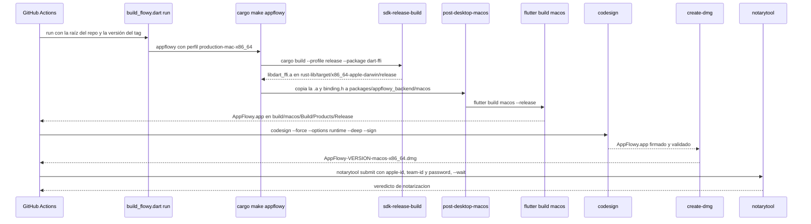
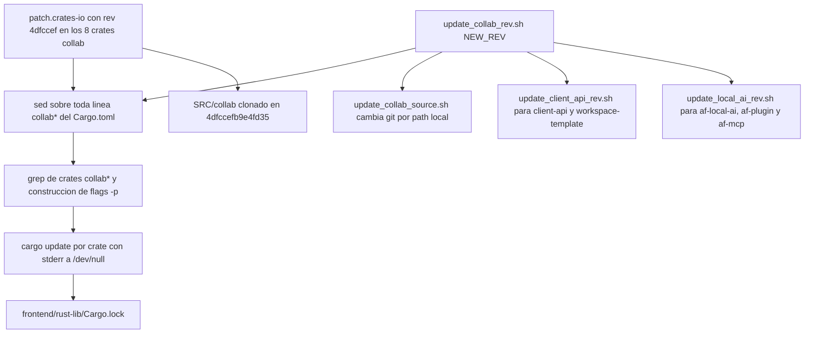

# B6.1 — Build, CI y distribución

## 1. Resumen

AppFlowy no tiene un único «botón de build»: tiene un **orquestador declarativo de 11 ficheros TOML** (`frontend/Makefile.toml` más los 10 fragmentos de `frontend/scripts/makefile/`) que compila el SDK Rust, genera el código Dart y Flutter, y produce el artefacto por plataforma. Encima de él se articulan tres capas de automatización: los **12 workflows de GitHub Actions**, la **integración con Codemagic** para móvil, y un **conjunto de scripts de packaging** (deb, rpm vía `alien`, AppImage, Inno Setup, DMG universal, flatpak). Este documento re-presenta los **81 ficheros** de esa maquinaria como un sistema: qué se fija (toolchain, versiones, perfiles Cargo), qué se muta durante el build (`crate-type` de `dart-ffi`), qué se empaqueta y con qué nombre, y qué rutas están rotas en este snapshot (`android_ci.yaml.bak`, `shared-lib` inexistente, flatpak clavado en 0.0.2).

## 2. Alcance

**Entra** en este documento la maquinaria de construcción y entrega tal y como está declarada en el código: los 12 ficheros de `appflowy/.github/workflows/`, la cadena `cargo make` completa (`frontend/Makefile.toml` + 10 fragmentos), los 5 scripts de `frontend/scripts/code_generation/`, los 3 de `frontend/scripts/flutter_release_build/`, los 18 de `frontend/scripts/linux_distribution/` (11), `windows_installer/` (1), `flatpack-buildfiles/` (2) y `linux_installer/` (3), los 4 de `frontend/scripts/tool/` que fijan revisiones externas, los 4 de `install_dev_env/`, los 6 de `white_label/`, más `codemagic.yaml`, `commitlint.config.js`, `install.sh`, `project.inlang.json`, `rust-toolchain.toml` y los seis `Cargo.toml`/`*.yaml`/`*.toml` de configuración del cliente Flutter y del workspace Rust.

**Qué NO se re-documenta aquí (se cruza, no se repite):**

1. **`[[F00.7.0]]`** ya posee, fichero a fichero, los 12 workflows de `.github/workflows/`, `codemagic.yaml`, `commitlint.config.js`, `install.sh`, los hooks de `.githooks/` y las acciones compuestas `flutter_build` / `flutter_integration_test`. Su §9.1 dibuja el DAG de `Flutter-CI`, su §9.2 el pipeline de release por tag y su §13.1–13.6 la lista de riesgos. **Aquí no se reproduce esa análise**: se documenta **qué artefacto produce cada job y a qué script de `cargo make` delega**, la incoherencia entre versiones de toolchain *entre workflows* y el impacto de packaging que esos workflows dejan al descubierto.
2. **`[[F00.7.1]]`** ya posee los 64 ficheros de `frontend/scripts/` (los 10 fragmentos de `makefile/`, los de packaging, los de codegen, los de white-label, los de `install_dev_env` y los 36 bundles i18n). Su valor añadido es el **contenido** de los 36 JSON. **Aquí se aporta el grafo entre ellos**: qué fragmento declara qué tarea, quién consume la tarea de otro fragmento y qué rutas apuntan a árboles que ya no existen en el repo.
3. **`[[B1.2]]`** (`02-stack-y-dependencias.md` + `17-grafo-dependencias.md`) tiene el catálogo de las 38 `[workspace.dependencies]` Rust y las 136 dependencias Dart externas, incluida la lectura de `dependency_overrides.appflowy_editor.git.ref`. **Aquí sólo se citan `pubspec.yaml` y los `Cargo.toml`** del workspace, y sólo para tres cosas: conectar el pin del editor (`470c4e7`) y el de Collab (`4dfccef`) con el proceso de clonación documentado en `OUT/_ledger/sources.json` y en `AGENTS.md` §3; mostrar que `version: 0.11.4` del cliente y `APPFLOWY_VERSION = "0.11.4"` del orquestador son el mismo número por dos caminos distintos; y leer los `[profile.*]` de release. El catálogo de versiones, grafo de dependencias y métricas de fan-in/fan-out **no se repite**.
4. **`[[F17]]`** posee el runtime de plataforma: ventanas, deeplinks, `auto_updater`, hotkeys y feature flags. **Aquí se toca `Runner.rc`, `CMakeLists.txt` y `main.cpp` únicamente como *objetivos de mutación* del script de white-label Windows**, porque el mecanismo de build es lo que reescribe esos ficheros antes de compilar.
5. **`[[F20]]`** es la raíz del repo **`AppFlowy-Collab`** (13 ficheros: `collab/.github/workflows/{audit,ci,commitlint}.yml`, `collab/Cargo.toml`, `collab/Makefile.toml`, `collab/rust-toolchain.toml`…). Su §2 de `[[F00.7.1]]` remite «CI/CD → `[[F20]]`», lo cual es impreciso: los workflows del cliente están ya cubiertos por `[[F00.7.0]]`. Se señala aquí la corrección y se usa `[[F20]]` para lo que sí le corresponde: el `crate-type`, el perfil y el `rust-toolchain.toml` del repo Collab, comparados con los del cliente en §5.2 (toolchain) y §5.6 (`crate-type`).
6. **AppFlowy-Cloud** queda fuera de alcance (`AGENTS.md` §11). Se cita el *contrato de versión* que la CI impone (`CLOUD_VERSION`, `APPFLOWY_CLOUD_VERSION`) pero no su implementación.

## 3. Mapa de fuentes

### 3.1 Workflows de GitHub Actions (12 ficheros)

| Fichero | Ancla | Qué decide |
|---|---|---|
| `appflowy/.github/workflows/build_command.yml` | `:1`, `:3–5`, `:9`, `:19–23`, `:39`, `:41` | `repository_dispatch` tipo `build-command`; job único `build` en `ubuntu-latest`; traduce un slash-command en un `workflow_dispatch` a `AppFlowy-IO/AppFlowy-Builder` usando `secrets.TOKEN` |
| `appflowy/.github/workflows/flutter_ci.yaml` | `:1`, `:26–31`, `:33–35`, `:38–48`, `:62–70`, `:80–81`, `:125–126`, `:193–216`, `:219–229`, `:232–236`, `:251–253`, `:332–340`, `:342–365` | `Flutter-CI`; fija `FLUTTER_VERSION`, `RUST_TOOLCHAIN`, `CARGO_MAKE_VERSION`, `CLOUD_VERSION`; 6 jobs (`prepare-linux`, `prepare-windows`, `prepare-macos`, `unit_test`, `cloud_integration_test`, `integration_test`), este ultimo con `matrix.test_number: [1, 2, 3, 4, 5, 6, 7, 8, 9]` (`:349`), es decir 9 combinaciones |
| `appflowy/.github/workflows/rust_ci.yaml` | `:1`, `:19–22`, `:44–50`, `:100–109`, `:111–117` | `Rust-CI`; `cargo test --no-default-features --features="dart"`, `cargo fmt --check`, `cargo clippy --all-targets -- -D warnings` |
| `appflowy/.github/workflows/rust_coverage.yml` | `:1`, `:16–18`, `:23–30`, `:46–48`, `:50–57`, `:59–61` | `Rust code coverage`; instala `grcov` + `llvm-tools-preview` y lanza `cargo make rust_unit_test_with_coverage` |
| `appflowy/.github/workflows/mobile_ci.yml` | `:1`, `:3–17`, `:19–21`, `:27–42`, `:44–69`, `:71–83` | `Mobile-CI`; **solo** `workflow_dispatch`; dispara Codemagic con `secrets.CODEMAGIC_API_TOKEN` y sondea el estado cada 60 s |
| `appflowy/.github/workflows/ios_ci.yaml` | `:1`, `:28–30`, `:36–42`, `:57–59`, `:61–74`, `:76–98` | `iOS CI`; job `integration-tests` en `macos-latest`; todo el bloque de tests de integración está comentado |
| `appflowy/.github/workflows/android_ci.yaml.bak` | `:1`, `:19–24`, `:31–37`, `:120–123`, `:144–146`, `:148–169`, `:171–196` | `Android CI` **desactivado por extensión `.bak`**: GitHub Actions solo lee `.yml`/`.yaml` |
| `appflowy/.github/workflows/docker_ci.yml` | `:1`, `:14–17`, `:22–23`, `:35–42` | `Docker-CI`; `docker/build-push-action@v5` con `push: false` y la caché de capas comentada |
| `appflowy/.github/workflows/release.yml` | `:3–6`, `:12–18`, `:23–26`, `:28–36`, `:40–52`, `:79–86`, `:99–102`, `:126–138`, `:170–178`, `:180–203`, `:229–245`, `:269–273`, `:327–351`, `:391–418`, `:431–462`, `:464–488`, `:490–520` | `release`; se dispara con **cualquier tag**; 8 jobs: `create-release`, Windows, macOS x86_64, macOS universal, Linux, Docker, Slack y Discord |
| `appflowy/.github/workflows/commit_lint.yml` | `:1–2`, `:4–11` | `Commit messages lint`; `on: [pull_request, push]`, `fetch-depth: 0`, `wagoid/commitlint-github-action@v4` |
| `appflowy/.github/workflows/ninja_i18n.yml` | `:3–8`, `:20–24` | `Ninja i18n action`; `pull_request_target` con `permissions: pull-requests: write` y acción fijada a `@main` |
| `appflowy/.github/workflows/translation_notify.yml` | `:2–6`, `:12–18` | `Translation Notify`; filtra `assets/translations/en.json` y avisa a Discord |

### 3.2 Orquestador `cargo make` (11 ficheros)

| Fichero | Ancla | Qué decide |
|---|---|---|
| `appflowy/frontend/Makefile.toml` | `:3–14`, `:16–20`, `:22–58`, `:60–217`, `:235–257`, `:259–302` | `extend` de los 10 fragmentos; `on_error_task = "catch"`; bloque `[env]` raíz (310 líneas) con los perfiles de plataforma; mutación de `crate-type` |
| `appflowy/frontend/scripts/makefile/desktop.toml` | `:1–10`, `:17–45`, `:48–58`, `:85–106`, `:120–178`, `:180–188` | `appflowy-core-dev` / `appflowy-core-release`, `sdk-*-build`, `post-desktop-{macos,windows,linux}`, `set-app-version` |
| `appflowy/frontend/scripts/makefile/mobile.toml` | `:13–21`, `:23–55`, `:57–76`, `:78–107`, `:109–148` | `appflowy-core-dev-ios` / `-android` (+ variante `-ci`), `cargo lipo` y `cargo ndk`, `post-mobile-{ios,android}` |
| `appflowy/frontend/scripts/makefile/flutter.toml` | `:1–4`, `:6–61`, `:121–209`, `:215–238`, `:240–281`, `:283–299`, `:301–311`, `:313–331` | Tareas `appflowy`, `appflowy-macos/windows/linux/ios/android`, `copy-to-product*`, `flutter-build*`, `pub_get`, `code_generation` |
| `appflowy/frontend/scripts/makefile/tests.toml` | `:11–36`, `:38–61`, `:63–98`, `:118–143`, `:198–207`, `:229–269`, `:271–347` | Tests Dart y Rust, `grcov`, instrumentación de cobertura y copia de la `.so`/`.dylib` a `.sandbox/` |
| `appflowy/frontend/scripts/makefile/env.toml` | `:1–5`, `:7–8`, `:10–37`, `:39–77`, `:79–101`, `:103–127`, `:129–174` | Prerrequisitos por SO: Visual Studio ≥ 16.11.0, vcpkg+sqlite3, `diesel_cli`, `protoc_plugin`, targets de Rust, cocoapods, `go-gitlint` |
| `appflowy/frontend/scripts/makefile/protobuf.toml` | `:20–23`, `:25–35`, `:37–55`, `:58–70` | `protoc_plugin 21.1.2`; `install_web_protobuf` para `protoc-gen-ts`/`typescript@4.9.5` |
| `appflowy/frontend/scripts/makefile/tool.toml` | `:1–7`, `:9–17`, `:20–27`, `:30–44`, `:48–84`, `:87–111` | Limpieza: `flutter_clean` → `rust_lib_clean`, caché de macros, `.proto`/`.dart` generados |
| `appflowy/frontend/scripts/makefile/tauri.toml` | `:2–8`, `:10–18`, `:20–46` | `tauri_dev`, `tauri_clean`, borrado de protobuf/eventos generados de Tauri |
| `appflowy/frontend/scripts/makefile/web.toml` | `:1–17`, `:20–29`, `:31–59` | `wasm_build` de 7 crates con `wasm-pack`; `web_clean` |
| `appflowy/frontend/scripts/makefile/docker.toml` | `:1–6` | `show_usage`: `docker system df -v` + `docker volume prune` |

### 3.3 Codegen y release build (8 ficheros)

| Fichero | Ancla | Qué decide |
|---|---|---|
| `appflowy/frontend/scripts/code_generation/language_files/generate_language_files.sh` | `:14–36`, `:50–52`, `:57–78` | Copia `resources/translations/*.json` a `assets/translations/` y ejecuta `easy_localization:generate` (variante `-f keys`) |
| `appflowy/frontend/scripts/code_generation/flowy_icons/generate_flowy_icons.sh` | `:47–49`, `:67–71` | `rsync` de `resources/flowy_icons/` + `dart run flowy_svg` |
| `appflowy/frontend/scripts/code_generation/flowy_icons/generate_flowy_icons.cmd` | `:11–21` | Equivalente Windows con `xcopy /E /Y /I` |
| `appflowy/frontend/scripts/code_generation/freezed/generate_freezed.sh` | `:51–81`, `:110–128` | `build_runner` en cada `packages/*` que declare `build_runner` y en la app, con spinner opcional |
| `appflowy/frontend/scripts/code_generation/freezed/generate_freezed.cmd` | `:10–39` | Equivalente Windows: `build_runner clean` + `build -d` por paquete |
| `appflowy/frontend/scripts/flutter_release_build/build_flowy.dart` | `:5–6`, `:12–16`, `:23–25`, `:44–59` | CLI con 4 subcomandos (`run`, `build`, `include-directives`, `exclude-directives`) y 3 argumentos obligatorios |
| `appflowy/frontend/scripts/flutter_release_build/tool.dart` | `:33–59`, `:61–86`, `:97–109`, `:115–121` | Traduce SO+arquitectura al comando `cargo make --profile … appflowy`; comenta/descomenta las líneas entre `BEGIN/END: EXCLUDE_IN_RELEASE` |
| `appflowy/frontend/scripts/flutter_release_build/build_universal_package_for_macos.sh` | `:5–16`, `:22–23`, `:27` | Compila x86_64 y arm64, fusiona con `lipo -create` y relanza el build Flutter universal |

### 3.4 Packaging por plataforma (18 ficheros)

| Fichero | Ancla | Qué decide |
|---|---|---|
| `appflowy/frontend/scripts/windows_installer/inno_setup_config.iss` | `:1–14`, `:16–19`, `:21–23`, `:25–29` | Inno Setup: `Compression=lzma2`, `{autopf}\AppFlowy\`, icono, y el protocolo de URL `AppFlowy` en `HKCR` |
| `appflowy/frontend/scripts/linux_distribution/deb/build_deb.sh` | `:3–5`, `:8–13`, `:23–31`, `:34` | Ensambla `$PACKAGE/{usr/lib,usr/share/…}` y cierra con `dpkg-deb --build --root-owner-group -Z xz` |
| `appflowy/frontend/scripts/linux_distribution/deb/DEBIAN/control` | `:1–8` | `Version: [CHANGE_THIS]`, `Depends: libkeybinder-3.0-0`, `Architecture: amd64` |
| `appflowy/frontend/scripts/linux_distribution/deb/DEBIAN/postinst` | `:2–7` | Crea dos symlinks en `/usr/bin`: `AppFlowy` y `AppFlowyLauncher.sh` |
| `appflowy/frontend/scripts/linux_distribution/deb/DEBIAN/postrm` | `:2–4` | Borra ambos symlinks |
| `appflowy/frontend/scripts/linux_distribution/deb/AppFlowy.desktop` | `:1–9` | `Exec=/usr/bin/AppFlowy %U`, `MimeType=x-scheme-handler/appflowy-flutter;` |
| `appflowy/frontend/scripts/linux_distribution/appimage/build_appimage.sh` | `:6–12`, `:16`, `:18` | Descarga `appimage-builder` 1.1.0 a `/usr/local/bin` y ejecuta la receta con `--skip-tests` |
| `appflowy/frontend/scripts/linux_distribution/appimage/AppImageBuilder.yml` | `:2–19`, `:55–61`, `:70–88` | Receta: `io.appflowy.AppFlowy`, Ubuntu Jammy, 6 paquetes `include`, 5 imágenes de prueba, `update-information: guess` |
| `appflowy/frontend/scripts/linux_distribution/appimage/io.appflowy.AppFlowy.desktop` | (0 bytes) | **Fichero vacío**: la receta no lo referencia; el `.desktop` lo genera `app_info` |
| `appflowy/frontend/scripts/linux_distribution/packaging/launcher.sh` | `:2–4` | `gdbus call` a `io.appflowy.AppFlowy.Open` sobre `/io/appflowy/AppFlowy/Object` |
| `appflowy/frontend/scripts/linux_distribution/packaging/io.appflowy.AppFlowy.service` | `:1–3` | Servicio D-Bus `Name=io.appflowy.AppFlowy`, `Exec=AppFlowy` |
| `appflowy/frontend/scripts/linux_distribution/packaging/io.appflowy.AppFlowy.metainfo.xml` | `:2–9`, `:32–37` | Metainfo AppStream: `project_license AGPL-3.0-only`, `launchable` al `.desktop`, screenshot remoto |
| `appflowy/frontend/scripts/linux_distribution/packaging/io.appflowy.AppFlowy.launcher.desktop` | `:1–6` | Lanzador oculto (`NoDisplay=true`) que registra el mismo `MimeType` contra `AppFlowyLauncher.sh` |
| `appflowy/frontend/scripts/flatpack-buildfiles/io.appflowy.AppFlowy.yml` | `:1–6`, `:7–14`, `:18–25`, `:26–34` | Manifest flatpak: runtime `21.08`, `finish-args` de sockets, tarball **`0.0.2`** con `sha256` fijo |
| `appflowy/frontend/scripts/flatpack-buildfiles/dbus-interface.xml` | `:1–16` | Interfaz D-Bus con `Activate`, `Open` y `ActivateAction` |
| `appflowy/frontend/scripts/linux_installer/control` | `:1–8` | Réplica del `control` de deb con las mismas dependencias |
| `appflowy/frontend/scripts/linux_installer/postinst` | `:2–6` | Symlink en `/usr/local/bin/AppFlowy` → `/opt/AppFlowy/AppFlowy` |
| `appflowy/frontend/scripts/linux_installer/postrm` | `:2–3` | Borra `/usr/local/bin/appflowy` (**minúsculas**, no coincide con lo que creó `postinst`) |

### 3.5 Fijado de revisiones, entorno de desarrollo y white-label (14 ficheros)

| Fichero | Ancla | Qué decide |
|---|---|---|
| `appflowy/frontend/scripts/tool/update_collab_source.sh` | `:4–6`, `:12–27`, `:31–34` | Alterna entre dependencia `git` y `path = "../AppFlowy-Collab/<crate>"` para 10 crates |
| `appflowy/frontend/scripts/tool/update_collab_rev.sh` | `:11`, `:17`, `:20–21`, `:24–31` | `sed` de `rev = "…"` en toda línea `collab*` y `cargo update -p …` por crate detectado |
| `appflowy/frontend/scripts/tool/update_client_api_rev.sh` | `:17–18`, `:21–27` | Actualiza `client-api*` y `workspace-template` (AppFlowy-Cloud) |
| `appflowy/frontend/scripts/tool/update_local_ai_rev.sh` | `:18`, `:21`, `:31–34` | Actualiza `af-local-ai`, `af-plugin`, `af-mcp` |
| `appflowy/frontend/scripts/install_dev_env/install_linux.sh` | `:26–36`, `:40–58`, `:61–64`, `:66–92`, `:95–118` | Pregunta antes de instalar Rust; fuerza Flutter `3.27.4` con `git checkout`; instala `keybinder-3.0`, `libnotify-dev`, `libmpv-dev` |
| `appflowy/frontend/scripts/install_dev_env/install_macos.sh` | `:26–38`, `:45–67`, `:75–93` | `rustup-init`, `brew install sqlite3`, Flutter `3.27.4`, `cargo-lipo` no (solo iOS) |
| `appflowy/frontend/scripts/install_dev_env/install_windows.sh` | `:23–46`, `:71–72`, `:75–92`, `:99–112` | `rustup-init.exe` descargado, `PATH` de Pub/Cargo vía PowerShell, `vcpkg integrate install` |
| `appflowy/frontend/scripts/install_dev_env/install_ios.sh` | `:36–37`, `:41`, `:48–64`, `:94–100` | Targets `aarch64-apple-ios` y `-sim`, `cargo-lipo` |
| `appflowy/frontend/scripts/white_label/white_label.sh` | `:4–12`, `:87–101`, `:103–119`, `:121–140` | Orquestador de white-label: 5 plataformas por defecto, valida icono `.ico`, delega en 5 scripts |
| `appflowy/frontend/scripts/white_label/code_white_label.sh` | `:14`, `:47–70` | Sustituye `const _localNotifierAppName = 'AppFlowy'` en `notification_service.dart` |
| `appflowy/frontend/scripts/white_label/icon_white_label.sh` | `:14–15`, `:78–95` | Reemplaza 4 SVG por nombre en `resources/flowy_icons/**` |
| `appflowy/frontend/scripts/white_label/font_white_label.sh` | `:16–18`, `:88–119`, `:123–168`, `:170–193` | Copia `.ttf`/`.otf`, infiere `weight` por nombre, inyecta bloque `# BEGIN: WHITE_LABEL_FONT` en `pubspec.yaml` y cambia `defaultFontFamily` |
| `appflowy/frontend/scripts/white_label/i18n_white_label.sh` | `:14`, `:54–101` | Sustituye `AppFlowy` por el nombre de empresa en los valores de los 36 JSON (vía `jq walk`, con *fallback* `sed`) |
| `appflowy/frontend/scripts/white_label/windows_white_label.sh` | `:96–110`, `:112–130`, `:132–143` | Reescribe `Runner.rc`, `app_icon.ico`, `BINARY_NAME` en `CMakeLists.txt` y 4 literales en `main.cpp` |

### 3.6 Raíz del repo y configuración del cliente (14 ficheros)

| Fichero | Ancla | Qué decide |
|---|---|---|
| `appflowy/codemagic.yaml` | `:1–9`, `:11–28`, `:30–34`, `:36–39`, `:41–47` | Único workflow `ios-workflow` sobre `mac_mini_m2`, `max_build_duration: 30`, artefactos `build/ios/ipa/*.ipa`, publicación por email |
| `appflowy/commitlint.config.js` | `:4–22` | `header-max-length: 100`, 10 tipos de commit, `body-max-line-length: 200`, `subject-case` desactivado (`0`) |
| `appflowy/install.sh` | `:5–17`, `:38–48`, `:50–63`, `:317–335`, `:363–372`, `:379–401` | Instalador POSIX estilo `shlib`; `FORMAT=tar.gz` fijo; tabla de plataformas soportadas; verificación sha-256 |
| `appflowy/project.inlang.json` | `:2–3`, `:4–33`, `:34–40`, `:41–46` | `sourceLanguageTag: en-US`, 28 `languageTags`, 5 plugins de inlang, `pathPattern` a `frontend/resources/translations/{languageTag}.json` |
| `appflowy/frontend/rust-toolchain.toml` | `:1–3` | `channel = "1.85"`, `components = ["clippy", "rustfmt"]` |
| `appflowy/frontend/appflowy_flutter/Makefile` | `:1–7` | Atajos `freeze_build` (`build_runner build -d`) y `watch` |
| `appflowy/frontend/appflowy_flutter/build.yaml` | (0 bytes) | **Fichero vacío**: no declara nada |
| `appflowy/frontend/appflowy_flutter/cargokit_options.yaml` | `:1` | Única opción: `use_precompiled_binaries: true` |
| `appflowy/frontend/appflowy_flutter/distribute_options.yaml` | `:1–12` | `output: dist/`; release `dev` con jobs `release-dev-linux-deb` y `release-dev-linux-rpm` |
| `appflowy/frontend/appflowy_flutter/pubspec.yaml` | `:7–11`, `:176–255`, `:257–259`, `:287–289`, `:309–316` | `version: 0.11.4`, SDK `>=3.3.0 <4.0.0`, 12 `dependency_overrides` git, anclas del bloque de fuentes y del bloque `EXCLUDE_IN_RELEASE` |
| `appflowy/frontend/appflowy_flutter/analysis_options.yaml` | `:1–7`, `:9–35` | `flutter_lints`, exclusión de `*.g.dart`/`*.freezed.dart`/`packages/**`, 16 reglas extra en `linter.rules` (`:11–32`), `invalid_annotation_target: ignore` |
| `appflowy/frontend/appflowy_flutter/dart_dependency_validator.yaml` | `:1–12` | `allow_pins: true`, `include: lib/**`, `exclude: packages/**`, `ignore: analyzer` |
| `appflowy/frontend/rust-lib/Cargo.toml` | `:1–36`, `:108–115`, `:117–135`, `:137–159` | Workspace de 31 miembros, `resolver = "2"`, `client-api*` en `rev = "592f644"`, perfiles `dev`/`release`/`profiling`, `[patch.crates-io]` con `collab*` en `rev = "4dfccef"` |
| `appflowy/frontend/rust-lib/dart-ffi/Cargo.toml` | `:7–11`, `:49–54`, `:56–57` | `[lib] name = "dart_ffi"`, `crate-type = ["staticlib"]`, features `dart`/`http_sync`/`openssl_vendored`/`verbose_log`, `build-dependencies` de `flowy-codegen` |

## 4. Diagramas

### 4.1 Cadena de composición de `cargo make`

El diagrama muestra cómo `frontend/Makefile.toml` extiende los 10 fragmentos y qué tareas agregadas salen de esa unión: ninguna tarea vive en el fichero raíz salvo tres auxiliares, y las tareas de alto nivel se chain en un solo archivo.

**Lectura.** `extend` (`appflowy/frontend/Makefile.toml:3–14`) es una lista literal de 10 rutas, sin globs ni condiciones: la unidad de composición es el fichero, y el orden importa sólo porque `cargo-make` fusiona los `[tasks.*]` por nombre y las claves repetidas se sobrescriben. `desktop.toml` aporta el grueso de las tareas de nivel superior (`appflowy-core-dev`, `appflowy-core-release`) mientras `flutter.toml` aporta las de empaquetado Flutter (`appflowy`, `copy-to-product*`, `flutter-build*`). `tool.toml` no define tareas de primer nivel pero aporta las piezas de limpieza `rust_lib_clean` (`appflowy/frontend/scripts/makefile/tool.toml:9`), `rm_macro_build_cache` (`appflowy/frontend/scripts/makefile/tool.toml:20`) y `remove_files_with_pattern` (`appflowy/frontend/scripts/makefile/tool.toml:87`), que **`tauri.toml` (`appflowy/frontend/scripts/makefile/tauri.toml:13–14`) y `web.toml` (`appflowy/frontend/scripts/makefile/web.toml:23–24`) invocan** desde `tauri_clean` y `web_clean`; `remove_files_with_pattern`, en cambio, sólo se consume dentro del propio `tool.toml` (`appflowy/frontend/scripts/makefile/tool.toml:39`, `appflowy/frontend/scripts/makefile/tool.toml:44`), por `rm_rust_lib_generated_protobuf_files` y `rm_shared_lib_generated_protobuf_files`. Nótese que **`flutter.toml` no define ninguna tarea de limpieza**: sus 36 `[tasks.*]` no incluyen ninguna `clean`, de modo que `appflowy` y sus variantes no pueden invocar `tool.toml`. El único fichero que define `[tasks.*]` en la raíz es `Makefile.toml`, y son siete: `catch` (`appflowy/frontend/Makefile.toml:19`), `echo_env` (`appflowy/frontend/Makefile.toml:219`), `setup-crate-type` (`appflowy/frontend/Makefile.toml:235`), `restore-crate-type` (`appflowy/frontend/Makefile.toml:247`), `setup-test-crate-type` (`appflowy/frontend/Makefile.toml:280`), `restore-test-crate-type` (`appflowy/frontend/Makefile.toml:292`) y `test-build` (`appflowy/frontend/Makefile.toml:304`) — todas auxiliares, porque el trabajo real del fichero está en los 310 líneas de `[env]`.

### 4.2 Grafo del pipeline `release.yml`

El diagrama muestra qué jobs dependen de `create-release`, qué artefacto produce cada uno y qué rama es tolerante a fallos.

**Lectura.** `create-release` es el único job con `outputs.upload_url` (`appflowy/.github/workflows/release.yml:17–18`) y es la raíz de la que cuelgan las cuatro plataformas de escritorio; cada una sube sus assets con `actions/upload-release-asset@v1` consumiendo ese `upload_url`. Dos asimetrías se leen directamente en el grafo. La primera: `build-for-docker` **no** declara `needs: create-release` (`appflowy/.github/workflows/release.yml:464–466`), de modo que empieza a construir en paralelo a la creación del release y puede publicar una imagen Docker de un tag cuya release aún no existe. La segunda: `notify-failure` depende solo de Windows, macOS x86_64 y Linux (`appflowy/.github/workflows/release.yml:492–495`), excluyendo el universal, mientras que `notify-discord` sí incluye el universal pero excluye Docker (`appflowy/.github/workflows/release.yml:510–516`); ningún job notifica el fallo de `build-for-docker`. Y una tercera: la rama del AppImage lleva `continue-on-error: true` (`appflowy/.github/workflows/release.yml:414`), de modo que el `.AppImage` puede faltar del release sin que la run quede roja, mientras que el `.deb` y el `.rpm` sí son bloqueantes.

### 4.3 Secuencia de un release de macOS x86_64

El diagrama muestra la secuencia real que ejecuta el job `build-for-macOS-x86_64`, desde el script Dart que decide el `cargo make` hasta el veredicto de notarización de Apple.

**Lectura.** El script Dart `build_flowy.dart` no invoca `flutter` directamente: decide el `cargo make` según el SO y la arquitectura (`appflowy/frontend/scripts/flutter_release_build/tool.dart:33–59`) y es invocado con `run`, que primero comenta las líneas entre `BEGIN/END: EXCLUDE_IN_RELEASE` del `pubspec.yaml`, luego construye y finalmente las descomenta (`appflowy/frontend/scripts/flutter_release_build/tool.dart:115–121`). Ese orden es la razón por la que `release.yml` usa `exclude-directives`/`include-directives` en Windows en lugar de `run` (`appflowy/.github/workflows/release.yml:84–86`): en Windows el `cargo make` debe ir en un `run` aparte por *file locking* — así lo dice el comentario en `appflowy/.github/workflows/release.yml:81`. La firma ocurre **fuera** de `cargo make`, en el runner, sobre `frontend/appflowy_flutter/product/<tag>/macos/Release`, y la notarización se pide **sobre el `.dmg`**, no sobre el `.app` (`appflowy/.github/workflows/release.yml:203`, `appflowy/.github/workflows/release.yml:301`); el `.app` firmado nunca se sube como asset, solo dentro del zip y del dmg.

### 4.4 Cadena de fijado de fuentes externas

El diagrama muestra el recorrido de un `rev` nuevo desde el script de `scripts/tool/` hasta el `Cargo.lock`, y cómo se relaciona con el materializado de `OUT/_ledger/sources.json`.

**Lectura.** El `rev` es la única fuente de verdad de las dependencias externas del SDK: `frontend/rust-lib/Cargo.toml:150–157` fija los ocho crates `collab*` a `rev = "4dfccef"` mediante `[patch.crates-io]`, y `OUT/_ledger/sources.json` registra que ese commit se corresponde con `4dfccefb9e4fd35240107b93fb4b5966295b452e` en `AppFlowy-Collab`, que es exactamente el mismo mecanismo que usa `AGENTS.md` §3 para clonar la fuente correcta. El cambio de `rev` no es un `sed` ciego: `update_collab_rev.sh` detecta primero qué crates `collab*` existen en el manifiesto (`appflowy/frontend/scripts/tool/update_collab_rev.sh:20`) y lanza un `cargo update -p …` por crate (`appflowy/frontend/scripts/tool/update_collab_rev.sh:24–31`), silenciando `stderr`, lo que hace que un fallo de red se manifieste como un `Cargo.lock` sin actualizar en lugar de como un error visible. `update_collab_source.sh` es la variante para desarrollo local: alterna entre dependencia `git` y `path` hacia un clon en `../AppFlowy-Collab` (`appflowy/frontend/scripts/tool/update_collab_source.sh:12–27`) y deja un `.bak` que se restaura al re-ejecutarlo, de modo que el estado alterna en lugar de ser idempotente.

## 5. Hallazgos clave

### 5.1 El workflow Android está desactivado por extensión, no por configuración

El fichero se llama `android_ci.yaml.bak`. GitHub Actions solo descubre ficheros con extensión `.yml` o `.yaml`, por lo que **ninguno de los jobs que define se ha ejecutado jamás desde este nombre**. El contenido por sí mismo es coherente y completo — un único job `build` (`appflowy/.github/workflows/android_ci.yaml.bak:31`) que levanta AppFlowy-Cloud con `CLOUD_VERSION: 0.6.54-amd64` (`appflowy/.github/workflows/android_ci.yaml.bak:24`), instala Temurin 11 (`appflowy/.github/workflows/android_ci.yaml.bak:120–123`), `gradle-version: 8.10` (`appflowy/.github/workflows/android_ci.yaml.bak:140–142`), `cargo-make` vía `davidB/rust-cargo-make@v1` (`appflowy/.github/workflows/android_ci.yaml.bak:144–146`), compila con `cargo make --profile development-android appflowy-core-dev-android` (`appflowy/.github/workflows/android_ci.yaml.bak:174`) y lanza el emulador con `api-level: 33` (`appflowy/.github/workflows/android_ci.yaml.bak:185–196`) — lo que confirma que la desactivación es deliberada y no un fichero roto. `[VERIFICADO]` La consecuencia operativa es que **no hay cobertura de integración Android en `main`**: `mobile_ci.yml` sólo ofrece Codemagic como camino alternativo (§5.5).

### 5.2 Las versiones de toolchain están fijadas en tres sitios que no coinciden

| Parámetro | `flutter_ci.yaml` | `rust_ci.yaml` | `ios_ci.yaml` | `release.yml` | Fichero de repo |
|---|---|---|---|---|---|
| Flutter | `"3.27.4"` (`appflowy/.github/workflows/flutter_ci.yaml:28`) | — | `"3.27.4"` (`appflowy/.github/workflows/ios_ci.yaml:21`) | `"3.27.4"` (`appflowy/.github/workflows/release.yml:9`) | `"3.27.4"` (`appflowy/frontend/scripts/install_dev_env/install_linux.sh:42`) |
| Rust | `"1.85.0"` (`appflowy/.github/workflows/flutter_ci.yaml:29`) | `"1.85.0"` (`appflowy/.github/workflows/rust_ci.yaml:22`) | `"1.85.0"` (`appflowy/.github/workflows/ios_ci.yaml:22`) | `"1.85.0"` (`appflowy/.github/workflows/release.yml:10`) | `channel = "1.85"` (`appflowy/frontend/rust-toolchain.toml:2`) |
| cargo-make | `"0.37.18"` (`appflowy/.github/workflows/flutter_ci.yaml:30`) | — | `"0.37.15"` (`appflowy/.github/workflows/ios_ci.yaml:59`) | **sin fijar** (`cargo install --force --locked cargo-make`, `appflowy/.github/workflows/release.yml:76`, `appflowy/.github/workflows/release.yml:161`, `appflowy/.github/workflows/release.yml:266`, `appflowy/.github/workflows/release.yml:381`) | — |
| AppFlowy-Cloud | `0.9.49-amd64` (`appflowy/.github/workflows/flutter_ci.yaml:31`) | `0.9.49-amd64` (`appflowy/.github/workflows/rust_ci.yaml:21`) | — | — | `0.6.54-amd64` (`appflowy/.github/workflows/android_ci.yaml.bak:24`) |

`flutter` y `rust` están coherentes en los tres sitios donde se declaran (`appflowy/frontend/rust-toolchain.toml:1–3` fija `1.85` con `clippy` y `rustfmt`, y el repo Collab fija el mismo `channel = "1.85"` en `collab:rust-toolchain.toml:2`). Las tres divergencias reales son: `cargo-make` está **sin fijar** en los cuatro jobs de `release.yml`, lo que hace que un release dependa de la versión de `cargo-make` que resuelva `cargo install` ese día; `ios_ci.yaml` pide `0.37.15` mientras `flutter_ci.yaml` pide `0.37.18`; y el `.bak` de Android pide un AppFlowy-Cloud tres minors por detrás. `[VERIFICADO]`

### 5.3 El build muta el manifiesto Rust en disco y restaura con `catch`

`frontend/Makefile.toml` declara `on_error_task = "catch"` (`appflowy/frontend/Makefile.toml:17`) y `catch` ejecuta `restore-crate-type` (`appflowy/frontend/Makefile.toml:19–20`). El mecanismo es un `sed` disfrazado de duckscript: `setup-crate-type` lee `rust-lib/dart-ffi/Cargo.toml`, sustituye la cadena literal `staticlib` por `${CRATE_TYPE}` y lo reescribe (`appflowy/frontend/Makefile.toml:235–245`), y `restore-crate-type` hace la operación inversa (`appflowy/frontend/Makefile.toml:247–257`). Como el valor por defecto de `CRATE_TYPE` es `staticlib` (`appflowy/frontend/Makefile.toml:47`), el ciclo es normalmente un no-op, pero en Windows, Linux, Android y en todos los perfiles de test `CRATE_TYPE` es `cdylib` (`appflowy/frontend/Makefile.toml:121`, `appflowy/frontend/Makefile.toml:140`, `appflowy/frontend/Makefile.toml:205`, `appflowy/frontend/Makefile.toml:260`) y el fichero se modifica de verdad. Existe un segundo par de tareas, `setup-test-crate-type` / `restore-test-crate-type` (`appflowy/frontend/Makefile.toml:280–302`), que fuerza `cdylib` durante los tests aunque el perfil sea de producción. El comentario de `appflowy/frontend/Makefile.toml:33–46` advierte de que cambiar `CRATE_TYPE` en macOS obliga a actualizar `appflowy_backend.podspec` y `ffi.dart`, porque el nombre de la librería cambia entre `libdart_ffi.a` y `libdart_ffi.dylib`. `[VERIFICADO]` El riesgo es que una interrupción dura (Ctrl-C, caída del runner) deje `dart-ffi/Cargo.toml` con `crate-type = ["cdylib"]` y el siguiente build de macOS produzca un `.dylib` donde Flutter espera una `.a`.

### 5.4 El perfil de build es una matriz de 16 perfiles de plataforma (más 4 de test), no un flag

`appflowy/frontend/Makefile.toml` define **dieciséis** bloques `[env.<perfil>]` entre `appflowy/frontend/Makefile.toml:60` y `appflowy/frontend/Makefile.toml:217`, más cuatro bloques `[env.test-*]` en `appflowy/frontend/Makefile.toml:259`, `appflowy/frontend/Makefile.toml:265`, `appflowy/frontend/Makefile.toml:270` y `appflowy/frontend/Makefile.toml:275`. Cada bloque de plataforma fija entre **seis y diez** variables que gobiernan a la vez Cargo, Flutter y la copia del artefacto: seis en `development-ios-arm64-sim` (`appflowy/frontend/Makefile.toml:178`), `development-ios-arm64` (`appflowy/frontend/Makefile.toml:186`), `production-ios-arm64` (`appflowy/frontend/Makefile.toml:194`) y `production-android` (`appflowy/frontend/Makefile.toml:211`); diez en `production-mac-arm64` (`appflowy/frontend/Makefile.toml:82`), `production-mac-x86_64` (`appflowy/frontend/Makefile.toml:94`), `production-windows-x86` (`appflowy/frontend/Makefile.toml:124`) y `production-linux-aarch64` (`appflowy/frontend/Makefile.toml:166`). Los ejes son `BUILD_FLAG` (`debug`/`release`), `RUST_COMPILE_TARGET`, `CRATE_TYPE`, `LIB_EXT`, `FLUTTER_OUTPUT_DIR` (`Debug`/`Release`), `PRODUCT_EXT` (`app`/`exe`/`apk`), `BUILD_ARCHS` y `APP_ENVIRONMENT` (`local`/`production`). El perfil `production-mac-universal` (`appflowy/frontend/Makefile.toml:106–113`) es el único que **no** fija `RUST_COMPILE_TARGET` ni `BUILD_ARCHS`, porque su `libdart_ffi.a` ya viene fusionada por `lipo` antes de que se invoque el build Flutter (`appflowy/frontend/scripts/flutter_release_build/build_universal_package_for_macos.sh:13–16`). `sdk-release-build` consume `CARGO_PROFILE` en lugar de `BUILD_FLAG` (`appflowy/frontend/scripts/makefile/desktop.toml:102`), y `CARGO_PROFILE` vale `release` en **seis** de los dieciséis perfiles —los seis de escritorio: `appflowy/frontend/Makefile.toml:83`, `appflowy/frontend/Makefile.toml:95`, `appflowy/frontend/Makefile.toml:107`, `appflowy/frontend/Makefile.toml:125`, `appflowy/frontend/Makefile.toml:146` y `appflowy/frontend/Makefile.toml:167`—, pero **`production-ios-arm64` (`appflowy/frontend/Makefile.toml:194–200`) y `production-android` (`appflowy/frontend/Makefile.toml:211–217`) no lo fijan** y heredan `dev` de `appflowy/frontend/Makefile.toml:24`; en `appflowy/frontend/Makefile.toml:195` y `appflowy/frontend/Makefile.toml:212` lo que hay es `BUILD_FLAG = "release"`. El resultado es que **el perfil es la única palanca**: `cargo make --profile X task Y` fija simultáneamente target, tipo de librería, directorio de salida y nombre del producto. `[VERIFICADO]`

### 5.5 Codemagic declara un workflow y el dispatcher ofrece dos

`codemagic.yaml` define **un único** workflow, `ios-workflow` (`appflowy/codemagic.yaml:2`), sobre `instance_type: mac_mini_m2` con `max_build_duration: 30` y `environment.flutter: 3.27.4`. `mobile_ci.yml` ofrece al operador una elección de tipo `choice` con **dos** opciones: `ios-workflow` y `android-workflow` (`appflowy/.github/workflows/mobile_ci.yml:14–17`). La opción `android-workflow` por tanto apunta a un workflow inexistente en este repo: la llamada a `https://api.codemagic.io/builds` se haría con un `workflowId` desconocido. Combinado con §5.1, **la cobertura Android real es doblemente huérfana**: ni el workflow de GitHub (`.bak`) ni el de Codemagic existe. `[VERIFICADO]`

Además, `codemagic.yaml` declara como artefacto `build/ios/ipa/*.ipa` (`appflowy/codemagic.yaml:37`) pero su único script de build compila para el **simulador** (`cargo make --profile development-ios-arm64-sim appflowy-core-dev-ios`, `appflowy/codemagic.yaml:27`) y su segundo script lanza los tests en el emulador (`appflowy/codemagic.yaml:30–34`); ningún paso produce un `.ipa`, luego ese patrón de artefacto nunca casa con nada. Y la sección `publishing.email` notifica a una dirección personal (`lucas.xu@appflowy.io`, `appflowy/codemagic.yaml:44`).

### 5.6 El `crate-type` de macOS es `staticlib` y el de Windows/Linux es `cdylib`

En `dart-ffi/Cargo.toml` el valor declarado en el repo es `crate-type = ["staticlib"]` (`appflowy/frontend/rust-lib/dart-ffi/Cargo.toml:11`) con `[lib] name = "dart_ffi"` (`appflowy/frontend/rust-lib/dart-ffi/Cargo.toml:8`). Eso no es lo que se compila en la mayoría de plataformas: `Makefile.toml` lo sustituye en tiempo de build según el perfil, como se explicó en §5.3. Además `lib-dispatch` —el crate que `dart-ffi` usa con `features = ["local_set"]` (`appflowy/frontend/rust-lib/dart-ffi/Cargo.toml:30`)— declara `crate-type = ["cdylib", "rlib"]` (`appflowy/frontend/rust-lib/lib-dispatch/Cargo.toml:8`), de modo que **la frontera FFI produce artefactos de dos tipos según el destino**: `.a` estática en macOS e iOS, `cdylib` en Windows (`dll`), Linux (`so`) y Android (`so`), tal y como codifican los perfiles en `appflowy/frontend/Makefile.toml:47–48`, `appflowy/frontend/Makefile.toml:121–122`, `appflowy/frontend/Makefile.toml:140–142` y `appflowy/frontend/Makefile.toml:205–207`. Para la variante wasm, `lib-dispatch` mantiene un `target.'cfg(target_arch = "wasm32")'` con `getrandom` y `wasm-bindgen` (`appflowy/frontend/rust-lib/lib-dispatch/Cargo.toml:33–37`) y `flowy-core` mete `flowy-sqlite-vec` solo en objetivos de escritorio (`appflowy/frontend/rust-lib/flowy-core/Cargo.toml:65–67`), lo que explica por qué `web.toml` solo compila siete crates con `wasm-pack` y no el workspace completo (`appflowy/frontend/scripts/makefile/web.toml:7`). `[VERIFICADO]`

### 5.7 Los perfiles Cargo de release optimizan para tamaño/tiempo, no para reproducibilidad

`frontend/rust-lib/Cargo.toml` declara tres perfiles (`appflowy/frontend/rust-lib/Cargo.toml:117–135`). `[profile.dev]` lleva `opt-level = 0`, `codegen-units = 16` y `debug = true`. `[profile.release]` lleva `lto = true`, `opt-level = 3` y `codegen-units = 1` — es decir, LTO completo y un único unit de codegen, la configuración más lenta y más optimizada del workspace. `[profile.profiling]` hereda de `release` pero baja `codegen-units` a 16 y desactiva LTO, con `incremental = true`; la línea `#strip = "debuginfo"` está **comentada** (`appflowy/frontend/rust-lib/Cargo.toml:134`), de modo que el perfil `profiling` —y por extensión cualquier perfil custom que lo herede— conserva los símbolos de depuración. `debug = true` en `profiling` significa que el binario conserva la información de depuración si ese perfil se usara para un release. `[VERIFICADO]` Los `.profraw`, en cambio, **no** se embeben: `LLVM_PROFILE_FILE='prof-%p-%m.profraw'` (`appflowy/frontend/scripts/makefile/tests.toml:127`) los escribe en disco durante la ejecución y `clean_profraw_files` los borra después (`appflowy/frontend/scripts/makefile/tests.toml:100–116`). `[VERIFICADO]`

El primero de los dos `patch.crates-io` del workspace que no son `collab*` fija `rocksdb` a un commit concreto con el motivo explícito del *memory alignment fix* (`appflowy/frontend/rust-lib/Cargo.toml:137–140`), y el último `patch` apunta a un fork propio, `appflowy/langchain-rust` en la rama `af` (`appflowy/frontend/rust-lib/Cargo.toml:159`) — una dependencia que se resuelve por **rama**, no por commit, por lo que su contenido puede cambiar sin que cambie ningún `rev` del repo.

### 5.8 `cargokit_options.yaml` y `distribute_options.yaml` no gobiernan el empaquetado nativo

Expectación rebutada por el código. `cargokit_options.yaml` tiene **una** línea, `use_precompiled_binaries: true` (`appflowy/frontend/appflowy_flutter/cargokit_options.yaml:1`), y `distribute_options.yaml` tiene doce: `output: dist/` y una release llamada `dev` con dos jobs de paquete, `release-dev-linux-deb` (`appflowy/frontend/appflowy_flutter/distribute_options.yaml:5–8`) y `release-dev-linux-rpm` (`appflowy/frontend/appflowy_flutter/distribute_options.yaml:9–12`). Ninguno de los dos declara nombre de artefacto, flags de release ni targets triples. La búsqueda en todo el repo de una declaración de hook de build (`hooks:`, `native_assets`, `cargokit:`) en `appflowy_flutter/pubspec.yaml` y en los `pubspec.yaml` de `packages/` **no devuelve nada** `[VERIFICADO]`. `appflowy_flutter/build.yaml` tiene **0 bytes** `[VERIFICADO]`. Por tanto, en este snapshot **el empaquetado real del binario Rust dentro del bundle Flutter no pasa por cargokit ni por `distribute`**: lo hace el orquestador `cargo make`, que compila `dart-ffi` y copia la librería y el `binding.h` a la ruta nativa de cada plataforma (`appflowy/frontend/scripts/makefile/desktop.toml:130–137` para macOS, `appflowy/frontend/scripts/makefile/desktop.toml:147–156` para Windows, `appflowy/frontend/scripts/makefile/desktop.toml:166–175` para Linux, `appflowy/frontend/scripts/makefile/mobile.toml:114–125` para iOS, `appflowy/frontend/scripts/makefile/mobile.toml:134–145` para Android). Lo que hacen `cargokit_options.yaml` y `distribute_options.yaml` es, en el mejor de los casos, configuración para herramientas de terceros cuyo hook no está declarado en el repo — lo que deja su efecto real **[NO DETERMINADO]** (ver §6).

### 5.9 `build_flowy.dart` es el único punto donde se decide qué se empaqueta

El mecanismo de exclusión de assets para release funciona con dos marcadores de texto, `BEGIN: EXCLUDE_IN_RELEASE` y `END: EXCLUDE_IN_RELEASE` (`appflowy/frontend/scripts/flutter_release_build/build_flowy.dart:5–6`), que en el `pubspec.yaml` encompassan cinco rutas de test y plantilla (`appflowy/frontend/appflowy_flutter/pubspec.yaml:309–316`). `process_directives` recorre las líneas y las comenta con `#` o las descomenta según el modo (`appflowy/frontend/scripts/flutter_release_build/tool.dart:61–95`). El comando real se decide por SO y arquitectura en `_commandForOS` (`appflowy/frontend/scripts/flutter_release_build/tool.dart:33–59`), con un `throw` duro si la arquitectura macOS no es `x86_64` ni `arm64`. El script exige exactamente 3 argumentos (`appflowy/frontend/scripts/flutter_release_build/build_flowy.dart:23–25`) y `run` es la composición `exclude → build → include` (`appflowy/frontend/scripts/flutter_release_build/tool.dart:115–121`): si el build falla entre medias, **el `pubspec.yaml` queda comentado y no se revierte**, porque no hay `try/finally`. `[VERIFICADO]` El mismo patrón de «comentar y olvidar» se repite en el white-label de fuentes, donde el `sed` inserta el bloque `WHITE_LABEL_FONT` tras la línea `# White-label font configuration will be added here` (`appflowy/frontend/scripts/white_label/font_white_label.sh:154`), que es exactamente el ancla declarada en `appflowy/frontend/appflowy_flutter/pubspec.yaml:287–289`.

### 5.10 La cadena de packaging de Linux produce un symlink colgante en el `.deb`

`build_deb.sh` copia el bundle de producción a `$PACKAGE/usr/lib` (`appflowy/frontend/scripts/linux_distribution/deb/build_deb.sh:28`), el `.desktop` a `usr/share/applications` (`appflowy/frontend/scripts/linux_distribution/deb/build_deb.sh:29`), el metainfo (`appflowy/frontend/scripts/linux_distribution/deb/build_deb.sh:30`) y el icono (`appflowy/frontend/scripts/linux_distribution/deb/build_deb.sh:31`), y cierra con `dpkg-deb --build --root-owner-group -Z xz` (`appflowy/frontend/scripts/linux_distribution/deb/build_deb.sh:34`). El `postinst` crea dos symlinks: `/usr/bin/AppFlowy` y `/usr/bin/AppFlowyLauncher.sh`, este último apuntando a `/usr/lib/AppFlowy/launcher.sh` (`appflowy/frontend/scripts/linux_distribution/deb/DEBIAN/postinst:6–7`). Pero **`build_deb.sh` nunca copia `launcher.sh` ni el fichero `io.appflowy.AppFlowy.launcher.desktop`** al paquete: el primero vive en `scripts/linux_distribution/packaging/launcher.sh` y el segundo, que es el que registra `x-scheme-handler/appflowy-flutter` con `NoDisplay=true` (`appflowy/frontend/scripts/linux_distribution/packaging/io.appflowy.AppFlowy.launcher.desktop:1–6`), tampoco se instala. Resultado: el segundo symlink queda apuntando a un fichero inexistente, y el único `.desktop` instalado (`appflowy/frontend/scripts/linux_distribution/deb/AppFlowy.desktop:5–9`) enruta los deeplinks al binario principal, no al lanzador D-Bus. `[VERIFICADO]`

El Flatpak, en cambio, sí es coherente consigo mismo: el launcher D-Bus (`appflowy/frontend/scripts/linux_distribution/packaging/launcher.sh:2–4`) llama al método `Open` con la firma `as uris` + `a{sv} platform_data` que declara `appflowy/frontend/scripts/flatpack-buildfiles/dbus-interface.xml:6–9`, y el `.service` publica el nombre `io.appflowy.AppFlowy` que ambos comparten. Lo que **no** es coherente es el manifest: `io.appflowy.AppFlowy.yml` descarga `AppFlowy-linux-x86.tar.gz` de la release **`0.0.2`** con un `sha256` fijo (`appflowy/frontend/scripts/flatpack-buildfiles/io.appflowy.AppFlowy.yml:26–30`), un nombre de artefacto que `release.yml` ya no produce (produce `AppFlowy-<tag>-linux-x86_64.tar.gz`, `appflowy/.github/workflows/release.yml:339`).

### 5.11 `install.sh` no encuentra ningún artefacto que `release.yml` publique

El instalador construye el nombre del tarball como `${SHORTHAND_PROJECT_NAME}_${ARCH}-${OS}_${DISTRO}.tar.gz` (`appflowy/install.sh:392–399`), que en Linux da `AppFlowy_x86_64-unknown-linux-gnu_ubuntu-20.04.tar.gz`, y luego lo descarga de `${GITHUB_DOWNLOAD}/${TAG}/${TARBALL}`. Los nombres que `release.yml` sube como asset son `AppFlowy-<tag>-linux-x86_64.tar.gz` (`appflowy/.github/workflows/release.yml:339`, `appflowy/.github/workflows/release.yml:428`) y `AppFlowy-<target>-x86_64.tar.gz` (`appflowy/.github/workflows/release.yml:333`). Ninguno coincide con el que compone `install.sh`, de modo que el instalador fallaría con un 404 en el `curl` y `set -e` (`appflowy/install.sh:3`) abortaría antes de instalar nada. `[VERIFICADO]` Además el script tiene tres defectos internos heredados de `shlib`: `hash_sha256` usa como *fallback* de openssl `openssl -dst openssl dgst -sha256` con un `-dst` inexistente y corta con `cut -d ' ' -f a`, un campo no numérico (`appflowy/install.sh:328–330`); el `if` de `execute` conserva el comentario de depuración `execute # line: 38` (`appflowy/install.sh:403`); y `adjust_format`, `adjust_os` y `adjust_arch` son funciones vacías con `true` (`appflowy/install.sh:91–104`), lo que deja `FORMAT=tar.gz` (`appflowy/install.sh:368`) como único formato posible, sin soporte para el `.zip` que sí publica Windows (`appflowy/.github/workflows/release.yml:45`).

### 5.12 El pipeline de cobertura de Rust apunta a un directorio que no existe

`rust_coverage.yml` termina en un único paso: `cargo make rust_unit_test_with_coverage` (`appflowy/.github/workflows/rust_coverage.yml:59–61`). Esa tarea (`appflowy/frontend/scripts/makefile/tests.toml:198–207`) encadena `check_grcov`, `appflowy-flutter-deps-tools`, `run_rustlib_coverage_tests`, **`run_sharedlib_coverage_tests`**, `get_lcov_report` y `clean_profraw_files`. Los dos pasos de test usan exactamente el mismo instrumentador (`RUSTFLAGS='-C instrument-coverage'` y `LLVM_PROFILE_FILE='prof-%p-%m.profraw'`), pero `run_sharedlib_coverage_tests` hace `cd ../shared-lib` (`appflowy/frontend/scripts/makefile/tests.toml:136`) y **`frontend/shared-lib/` no existe** en el repo. `[VERIFICADO]` Además el job **no define `matrix`** y sin embargo dos pasos interpolan `${{ matrix.job.target }` (`appflowy/.github/workflows/rust_coverage.yml:28`) y `${{ matrix.job.os }` (`appflowy/.github/workflows/rust_coverage.yml:48`), que se resuelven a cadena vacía: el toolchain se instala sin target y `Swatinem/rust-cache@v2` recibe un `prefix-key` vacío. La cobertura que produce este workflow es, por tanto, la de `rust-lib` más un `cd` fallido; el repo Collab tiene su propia cadena equivalente (`collab:Makefile.toml:1–7`) que sí funciona, aunque **su CI no la invoca**: `collab:collab/.github/workflows/ci.yml` ejecuta `cargo test` directamente (`collab:collab/.github/workflows/ci.yml:62–63`), por lo que `run_coverage` queda disponible para uso local y no como paso de CI.

### 5.13 `tool.toml` y `web.toml` apuntan a rutas que ya no están

`rm_macro_build_cache` canonicaliza `../frontend/rust-lib/flowy-codegen/.cache` (`appflowy/frontend/scripts/makefile/tool.toml:22`), pero el crate vive en `rust-lib/build-tool/flowy-codegen`; la ruta del script no corresponde a ningún directorio del repo, de modo que la comprobación `is_path_exists` siempre da falso y la limpieza de la caché de macros nunca ocurre. `web.toml` declara `web_clean` invocando `rm_pkg` (`appflowy/frontend/scripts/makefile/web.toml:28`) y **no existe ninguna tarea `[tasks.rm_pkg]`** en ninguno de los 10 fragmentos. Además `TAURI_BACKEND_SERVICE_PATH`, `WEB_BACKEND_SERVICE_PATH` y `TAURI_APP_BACKEND_SERVICE_PATH` apuntan a `appflowy_tauri/`, `appflowy_web/` y `appflowy_web_app/` (`appflowy/frontend/Makefile.toml:51–53`), y **ninguno de esos tres directorios existe bajo `frontend/`**: `tauri.toml` y `web.toml` son código muerto que quedaría de una arquitectura web/Tauri retirada. `[VERIFICADO]`

Conviven con esto rutas vivas y correctas en el mismo archivo: `rm_rust_lib_generated_protobuf_files` usa los patrones `./rust-lib/**/resources/proto` y `./rust-lib/**/protobuf` (`appflowy/frontend/scripts/makefile/tool.toml:38`), que sí corresponden a lo que genera `flowy-codegen` con la feature `dart` (`appflowy/frontend/rust-lib/build-tool/flowy-codegen/Cargo.toml:48–50`).

### 5.14 El white-label está preparado para cinco plataformas pero solo existe el script de Windows

`white_label.sh` declara `PLATFORMS=("windows" "linux" "macos" "ios" "android")` por defecto (`appflowy/frontend/scripts/white_label/white_label.sh:12`) y `run_platform_script` busca `scripts/white_label/<platform>_white_label.sh`; si no existe, imprime un warning en rojo y hace `return` sin error (`appflowy/frontend/scripts/white_label/white_label.sh:107–110`). El directorio `frontend/scripts/white_label/` contiene exactamente seis ficheros `.sh` en total —este orquestador más `code_white_label.sh`, `font_white_label.sh`, `i18n_white_label.sh`, `icon_white_label.sh` y `windows_white_label.sh`— más un subdirectorio `resources/`, y **sólo `windows_white_label.sh` sigue el patrón `<platform>_white_label.sh`**: faltan `linux_`, `macos_`, `ios_` y `android_`. `[VERIFICADO]` Es decir, el recorrido por defecto ejecuta con éxito cuatro avisos y ningún rebranding de plataforma, y devuelve 0. Además el orquestador pasa `$WINDOWS_ICON_PATH` como `--icon-path` a todos los scripts de plataforma (`appflowy/frontend/scripts/white_label/white_label.sh:118`), lo que sólo tiene sentido para Windows; y exige que la variable esté informada porque valida `[ ! -f "$WINDOWS_ICON_PATH" ]` (`appflowy/frontend/scripts/white_label/white_label.sh:98–101`), de modo que ni siquiera el caso «sin icono» es alcanzable.

Lo que sí está implementado y es completo es el rebranding de Windows: seis `VALUE` del `.rc` (`CompanyName`, `FileDescription`, `InternalName`, `OriginalFilename`, `LegalCopyright`, `ProductName`, `appflowy/frontend/scripts/white_label/windows_white_label.sh:100–105`), el `BINARY_NAME` de CMake (`appflowy/frontend/scripts/white_label/windows_white_label.sh:125`) y cuatro literales de `main.cpp` —el mutex, el `FindWindowA`, el `SendAppLinkToInstance` y el `window.Create` (`appflowy/frontend/scripts/white_label/windows_white_label.sh:135–138`). Los dos últimos no están verificados por mí como literales exactos del fichero destino, porque `appflowy_flutter/windows/runner/main.cpp` **no está en el inventario de esta unidad**; lo afirmo sólo como lo que el script *intenta* reescribir `[INFERIDO]`.

### 5.15 `project.inlang.json` es el contrato de los bundles, y no coincide con la lista real

El fichero declara `sourceLanguageTag: "en-US"` (`appflowy/project.inlang.json:3`) y **28** `languageTags` (`appflowy/project.inlang.json:4–33`). La ruta que consume es `./frontend/resources/translations/{languageTag}.json` (`appflowy/project.inlang.json:42`), con `@:` como sintaxis de interpolación (`appflowy/project.inlang.json:43–45`). Los cinco plugins de `modules` (`appflowy/project.inlang.json:34–40`) son reglas de calidad: patrón vacío, patrón idéntico, traducción sin fuente y traducción ausente. La correspondencia con el directorio real de 36 bundles que documenta `[[F00.7.1]]` no es de uno a uno: la lista de inlang incluye `fa` y `vi` pero no `am-ET`, `ga-IE`, `he`, `hin`, `mr-IN`, `th-TH`, `uk-UA` ni `ur`, que sí existen como fichero. Es decir, **el linter de inlang no vigila ocho de los bundles que se empaquetan**, y viceversa. `[VERIFICADO]`

### 5.16 Supply chain: tres acciones fijadas a referencias mutables

`ninja_i18n.yml` usa `opral/ninja-i18n-action@main` (`appflowy/.github/workflows/ninja_i18n.yml:22`) — una rama, no un SHA — y lo hace desde `pull_request_target` con `permissions: pull-requests: write` (`appflowy/.github/workflows/ninja_i18n.yml:4`, `appflowy/.github/workflows/ninja_i18n.yml:7–8`), que es la combinación de máximo privilegio para código de terceros. `translation_notify.yml` usa `Ilshidur/action-discord@master` (`appflowy/.github/workflows/translation_notify.yml:12`), también una rama. `commit_lint.yml` sí fija por versión mayor (`wagoid/commitlint-github-action@v4`, `appflowy/.github/workflows/commit_lint.yml:11`). Dentro de las dependencias del cliente, `pubspec.yaml` fija 12 paquetes por `git` en `dependency_overrides` (`appflowy/frontend/appflowy_flutter/pubspec.yaml:176–255`), casi todos en forks personales bajo `github.com/LucasXu0/*`; y en Rust, `langchain-rust` se resuelve por **rama** `af` desde un fork propio (`appflowy/frontend/rust-lib/Cargo.toml:159`). `[VERIFICADO]`

## 6. Riesgos, huecos y decisiones de diseño pendientes

### 6.1 `[NO DETERMINADO]` — El efecto real de `cargokit_options.yaml` y `distribute_options.yaml`

Ambos ficheros existen y son válidos, pero **no se ha encontrado en el repo ninguna declaración de build hook que los active**: no hay sección `hooks:`, ni `native_assets`, ni referencia a `cargokit` en `appflowy_flutter/pubspec.yaml` ni en los `pubspec.yaml` de `packages/`, y `appflowy_flutter/build.yaml` tiene 0 bytes. La búsqueda ha sido textual sobre todo el árbol con los términos `cargokit`, `hooks:` y `native_assets`, sin resultados. **[NO DETERMINADO]** ¿Quién lee `cargokit_options.yaml` en este snapshot, y con qué criterio decide usar binarios precompilados en lugar de compilar `dart-ffi`? ¿Está `distribute_options.yaml` conectado a `flutter_distribute`, o es andamiaje heredado de una versión anterior? Pregunta para `22-preguntas-abiertas.md`.

### 6.2 `[NO DETERMINADO]` — Los secretos de CI no son verificables desde el código

Se citan por nombre, nunca por valor: `secrets.TOKEN` (`appflowy/.github/workflows/build_command.yml:39`), `secrets.CODEMAGIC_API_TOKEN` (`appflowy/.github/workflows/mobile_ci.yml:20`), `secrets.RELEASE_SLACK_WEBHOOK` (`appflowy/.github/workflows/mobile_ci.yml:83`, `appflowy/.github/workflows/release.yml:505`), `secrets.DISCORD` (`appflowy/.github/workflows/release.yml:520`), `secrets.DISCORD_WEBHOOK` (`appflowy/.github/workflows/translation_notify.yml:14`), `secrets.DOCKER_HUB_USERNAME` y `secrets.DOCKER_HUB_ACCESS_TOKEN` (`appflowy/.github/workflows/release.yml:473–474`), y los seis de firma de macOS: `MACOS_CERTIFICATE`, `MACOS_CERTIFICATE_PWD`, `MACOS_CODESIGN_ID`, `MACOS_NOTARY_USER`, `MACOS_TEAM_ID`, `MACOS_NOTARY_PWD` (`appflowy/.github/workflows/release.yml:172–203`, repetidos en `appflowy/.github/workflows/release.yml:277–301`). **[NO DETERMINADO]** Cuáles existen realmente, con qué ámbito y con qué rotación. No es deducible del repositorio.

### 6.3 `[NO DETERMINADO]` — Firma y notarización de iOS

A diferencia de macOS, **no existe ningún paso de firma, provisioning profile ni notarización de iOS en el repositorio**. `codemagic.yaml` compila para el simulador (`aarch64-apple-ios-sim`), `ios_ci.yaml` también, y `flutter.toml` define `flutter build ipa --split-debug-info=./ --obfuscate` (`appflowy/frontend/scripts/makefile/flutter.toml:249–255`) como única ruta de empaquetado iOS, pero ningún workflow del repo la invoca. **[NO DETERMINADO]** Dónde se firma el `.ipa` y con qué certificados; si ocurre dentro de Codemagic bajo un workflow no declarado en este `codemagic.yaml`, o en el repositorio externo `AppFlowy-Builder`. El hecho de que `codemagic.yaml` declare `build/ios/ipa/*.ipa` como artefacto (`appflowy/codemagic.yaml:37`) sugiere que la expectativa es que Codemagic lo produzca, pero ningún paso visible lo hace.

### 6.4 `[NO DETERMINADO]` — El destino de `build_command.yml`

El workflow reenvía a `https://api.github.com/repos/AppFlowy-IO/AppFlowy-Builder/actions/workflows/$platform.yaml/dispatches` (`appflowy/.github/workflows/build_command.yml:41`) con `ref: "main"` y `repo: "LucasXu0/AppFlowy"` hardcodeados (`appflowy/.github/workflows/build_command.yml:26–27`). `AppFlowy-Builder` no está entre las tres fuentes clonadas (`OUT/_ledger/sources.json` sólo contiene `appflowy`, `collab` y `editor`). **[NO DETERMINADO]** Qué workflows contiene ese repositorio, qué artefactos produce y qué relación tiene con `release.yml`. Nótese además que el `ref` que se envía es siempre `main`, mientras que `$branch` se manda como input `branch` — el dispatch apunta al workflow de `main` con una rama distinta como parámetro, combinación que no se puede validar desde aquí.

### 6.5 Riesgos de diseño (verificados, sin `[NO DETERMINADO]`)

1. **Reversión no garantizada del `pubspec.yaml`.** `run` en `build_flowy.dart` comenta, construye y descomenta sin `try/finally` (`appflowy/frontend/scripts/flutter_release_build/tool.dart:115–121`); un fallo de build deja los assets de test declarados como comentados y el árbol sucio. El mismo patrón aparece en `set-app-version` y en el white-label de fuentes.
2. **Mutación de manifiesto Rust sin transacción.** `setup-crate-type`/`restore-crate-type` dependen de que `on_error_task = "catch"` se ejecute (`appflowy/frontend/Makefile.toml:16–20`); una interrupción abrupta no lo ejecuta.
3. **Un release puede salir sin AppImage.** `continue-on-error: true` en el paso del AppImage (`appflowy/.github/workflows/release.yml:414`) y, además, el job `build-for-linux` sube el asset del AppImage aunque el fichero no exista.
4. **`build-for-docker` corre fuera del grafo del release** (`appflowy/.github/workflows/release.yml:464–466`) y no lo notifica ni `notify-failure` ni `notify-discord`.
5. **Versiones de `cargo-make` divergentes o ausentes** (§5.2), con el release como el caso más expuesto.
6. **Dos scripts `postrm` con lógica de borrado desalineada**: `linux_installer/postrm` comprueba `/usr/local/bin/appflowy` en minúsculas (`appflowy/frontend/scripts/linux_installer/postrm:2`) mientras su `postinst` creó `/usr/local/bin/AppFlowy` en CamelCase (`appflowy/frontend/scripts/linux_installer/postinst:6`), así que el symlink sobrevive a la desinstalación.
7. **`install.sh` inservible contra los artefactos actuales** (§5.11) y con un *fallback* de sha-256 roto (`install.sh:328–330`).
8. **Dos actions fijadas a ramas mutables con privilegio elevado** (§5.16) y `langchain-rust` resuelto por rama en Rust (`appflowy/frontend/rust-lib/Cargo.toml:159`).
9. **Cobertura de Rust parcialmente ficticia** (§5.12): `cd ../shared-lib` a un directorio inexistente y dos interpolaciones de `matrix` sin `matrix` definida.
10. **Filtro de `translation_notify.yml` sobre una ruta que el build sustituye**: el workflow vigila `frontend/appflowy_flutter/assets/translations/en.json` (`appflowy/.github/workflows/translation_notify.yml:6`), un directorio **generado** y borrado en cada build (`appflowy/frontend/scripts/code_generation/language_files/generate_language_files.sh:50–52`), mientras la fuente de verdad es `frontend/resources/translations/en-US.json` (`project.inlang.json:42`). La notificación sólo puede dispararse si alguien commitea artefactos generados.
11. **Dos workflows filtran `mobile_ci.yaml` cuando el fichero se llama `mobile_ci.yml`** (`appflowy/.github/workflows/ios_ci.yaml:8`, `appflowy/.github/workflows/ios_ci.yaml:16`; `appflowy/.github/workflows/android_ci.yaml.bak:8`, `appflowy/.github/workflows/android_ci.yaml.bak:15`), lo que además interactúa con el hecho de que Android esté en `.bak`: si alguien restaurase el fichero con nombre correcto, sus filtros seguirían apuntando al nombre equivocado.

### 6.6 Decisiones de diseño pendientes de bloquear

- **¿Debe `cargokit` recuperar el empaquetado nativo, o la decisión fue mover todo el build a `cargo make` y dejar `cargokit_options.yaml` como residuo?** De la respuesta depende si `cargokit_options.yaml` es un bug o un interruptor pendiente de conectar (§6.1).
- **¿Se unifica `scripts/linux_installer/` con `scripts/linux_distribution/deb/DEBIAN/`?** Son dos juegos de `control`/`postinst`/`postrm` con rutas distintas (`/opt`+`/usr/local/bin` frente a `/usr/lib`+`/usr/bin`) y ninguno de los dos es invocado por `build_deb.sh` ni por `release.yml`. La existencia de `scripts/linux_installer/` no está justificada por ningún consumidor en el repo.
- **¿Se reparan o se eliminan `tauri.toml`, `web.toml` y los `dependency_overrides` de Tauri/web?** Los tres directorios destino no existen (§5.13), pero `android_ci.yaml.bak` y `ios_ci.yaml` aún filtran rutas de `appflowy_tauri/` y `appflowy_web_app/`.
- **¿Se restaura Android?** Requiere una decisión de producto (Codemagic ya ofrece el workflow inexistente, §5.5) más una de infraestructura (borrar el `.bak` y renombrar a `.yaml`, lo que activa de golpe un job que hoy no se ejecuta).

## 7. Relacionado con

- `[[F00.7.0]]` — propietario de los 12 workflows, `codemagic.yaml`, `commitlint.config.js`, `install.sh` y los hooks; aporta el DAG del CI, el pipeline de release y su lista de riesgos, que aquí **no** se reproduce.
- `[[F00.7.1]]` — propietario de los 64 ficheros de `frontend/scripts/` y de los 36 bundles i18n; aporta el contenido de los JSON, aquí sólo la **topología entre scripts**.
- `[[B1.2]]` — stack y grafo de dependencias: las 38 `[workspace.dependencies]` Rust y las 136 deps Dart, y el mecanismo de clonación por `rev` que aquí se aplica al proceso de fijado (§4.4).
- `[[F17]]` — runtime de plataforma. Sus ficheros `Runner.rc`, `CMakeLists.txt` y `main.cpp` son los **objetivos de mutación** del white-label Windows (§5.14) y los consumidores de las rutas que `desktop.toml`/`mobile.toml` rellenan con la librería nativa (§5.6).
- `[[F20]]` — raíz de `AppFlowy-Collab`: aporta el `crate-type`, los perfiles y el `rust-toolchain.toml` del repo Collab, usados aquí como término de comparación (§5.2, §5.12).
- `[[F00.3]]` — build nativo, codegen y tests de integración Rust: el nivel inferior del cual `frontend/rust-lib/dart-ffi/Cargo.toml` es la raíz de la biblioteca enlazable.
- `[[F14]]` — internacionalización: el consumidor final de `project.inlang.json` y de `locale_keys.g.dart`, que genera `generate_language_files.sh`.
- `[[B6.2]]` — `19-testing.md`: los consumidores de las tareas de `tests.toml` y de `rust_coverage.yml` que aquí sólo se describen desde el lado del build.
- `[[B6.3]]` — `20-seguridad-y-privacidad`: destino natural de los riesgos de supply chain (§5.16), de los secretos (§6.2) y del uso de `--deep` en `codesign` (§4.3).
- `[[B6.5]]` — `21-glosario.md`, y `22-preguntas-abiertas.md`: reciben las cuatro preguntas `[NO DETERMINADO]` de §6.1–§6.4.
- `OUT/_ledger/sources.json` — materializa los tres commits que este documento da por buenos: `appflowy` `5cf3a36`, `collab` `4dfccef` (el mismo `rev` que parchea `appflowy/frontend/rust-lib/Cargo.toml:150–157`) y `editor` `470c4e7` (el mismo `ref` que fija `appflowy/frontend/appflowy_flutter/pubspec.yaml:185–188`).

## 8. Evidencias y etiquetas

Todas las afirmaciones técnicas de este documento llevan referencia `ruta:línea` verbatim dentro de `appflowy/`, con prefijo de fuente `collab:` en las únicas citas fuera del repo principal (§5.2, §5.12 y esta §8; §4.4 no cita ningún fichero de `collab:`). Los nombres de workflow, de job, de paso (`name:`), de tarea `cargo make`, de variable de entorno, de flag de compilador, de nombre de artefacto y de nombre de secreto se han copiado literalmente de los ficheros; donde la fuente no alcanzaba, la afirmación está etiquetada `[NO DETERMINADO]` y recapitulada en §6 y en `preguntas_abiertas`.

| Etiqueta | Ocurrencias en §2–§7 | Dónde se usa |
|---|---|---|
| `[VERIFICADO]` | 18 | Cierre explícito de cada hallazgo de §5.1 a §5.13 y §5.15–§5.16 (17 párrafos; §5.7 y §5.8 lo usan dos veces cada uno, por las dos medias verdades separadas tras la corrección) |
| `[INFERIDO]` | 1 | §5.14, sobre los literales de `main.cpp` que el script intenta reescribir (fichero fuera del inventario de la unidad) |
| `[NO DETERMINADO]` | 11 marcadores sobre **4 preguntas** | §5.8 (remisión a §6.1), §6.1 cargokit/distribute, §6.2 secretos, §6.3 firma iOS, §6.4 `AppFlowy-Builder` (cada uno con título y cuerpo); §6.5 y §7 sólo mencionan la etiqueta al enumerar |

Además del recuento explícito, el documento emite **223 referencias `ruta:línea` verbatim**, todas validadas por `validate_evidence.py` contra `OUT/_ledger/inventario.json` (`refs=223 ok=223 errors=0`). De ellas, **217** son a ficheros de `appflowy/` y **6** a `collab:` (`collab:rust-toolchain.toml:2` en §5.2; `collab:Makefile.toml:1–7` y `collab:collab/.github/workflows/ci.yml:62–63` en §5.12; y las tres menciones de esta §8). Aparte de esas 222, las tablas de §3.1–§3.6 añaden **263 anclas `:N` sin ruta**, que el validador no puede comprobar porque la ruta va en la columna contigua de la misma fila: su validez se resolvió a mano durante la redacción, y son la razón por la que las tablas de §3 no deben leerse como evidencia automatizada.

**Cobertura de la unidad.** Los 81 ficheros listados en el frontmatter están presentes en `OUT/_ledger/inventario.json` y todos han sido leídos íntegros en este snapshot. Esta unidad es transversal y **no ancla filas** en `cobertura.csv`: los mismos ficheros pertenecen ya a `[[F00.7.0]]` (los 12 workflows, `codemagic.yaml`, `commitlint.config.js`, `install.sh`) y a `[[F00.7.1]]` (los 64 scripts de `frontend/scripts/`), con `estado: verificado`. Los **16 ficheros restantes** no aparecen en el `archivos_cubiertos` de ninguna otra unidad y son la aportación neta de este documento: `project.inlang.json`; `frontend/Makefile.toml`; `frontend/rust-toolchain.toml`; los **siete** ficheros de configuración de `frontend/appflowy_flutter/` (`Makefile`, `build.yaml`, `cargokit_options.yaml`, `distribute_options.yaml`, `pubspec.yaml`, `analysis_options.yaml` y `dart_dependency_validator.yaml`); y los **seis** `Cargo.toml` (`rust-lib/Cargo.toml`, `rust-lib/dart-ffi/`, `rust-lib/flowy-core/`, `rust-lib/lib-dispatch/`, `rust-lib/build-tool/flowy-codegen/` y `rust-lib/event-integration-test/`). 16 + 12 workflows + 4 ficheros de raíz de `codemagic.yaml`/`commitlint.config.js`/`install.sh` + 49 de `frontend/scripts/` = 81.

**Ficheros no cubiertos por esta unidad, mencionados en prosa.** Se separan en dos grupos según su presencia en `OUT/_ledger/inventario.json`, verificada con `rg` sobre el fichero:

- **Sí inventariados, pero fuera de los 81 de esta unidad** (pertenecen a `[[F00.7.0]]`, `[[F00.7.1]]`, `[[F17]]` o `[[F00.6]]`): `frontend/scripts/code_generation/generate.sh` y `generate.cmd` (invocados por la tarea `code_generation` en `appflowy/frontend/scripts/makefile/flutter.toml:304` y `appflowy/frontend/scripts/makefile/flutter.toml:310`); `frontend/scripts/docker-buildfiles/Dockerfile` (usado por `appflowy/.github/workflows/docker_ci.yml:39` y `appflowy/.github/workflows/release.yml:483`); y `frontend/appflowy_flutter/windows/runner/Runner.rc`, `frontend/appflowy_flutter/windows/CMakeLists.txt` y `frontend/appflowy_flutter/windows/runner/main.cpp` (objetivos del white-label Windows). Los tres últimos son la razón de la única afirmación `[INFERIDO]` del documento (§5.14).
- **No inventariados en absoluto**: `frontend/appflowy_flutter/packages/appflowy_backend/macos/` (destino de la `.a` universal), `frontend/scripts/linux_distribution/packaging/appflowy.svg` y `frontend/scripts/flatpack-buildfiles/logo.svg` (iconos que el packaging copia), `frontend/scripts/dmg_assets/AppFlowyInstallerBackground.jpg` (`appflowy/.github/workflows/release.yml:188`) y `frontend/rust-lib/Cargo.lock`. Ninguno puede citarse como evidencia, por lo que ninguno se ha usado como tal.

Todos quedan declarados aquí para que el orquestador decida reasignarlos o abrir una unidad propia.
