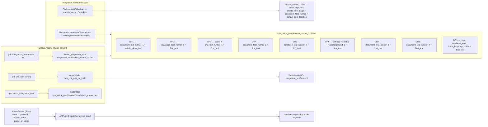

## 1. Resumen

AppFlowy mantiene un repositorio de tests a dos niveles: en Dart, los tres directorios `test/{bloc_test,unit_test,widget_test}` cubren la lógica de BLoCs y widgets sin levantar la app, y la red de nueve `integration_test/desktop_runner_*.dart` (más `runner.dart` y `mobile_runner_1.dart`) ejecuta pruebas end-to-end contra el binario real con `IntegrationTestWidgetsFlutterBinding`. En Rust, el crate `event-integration-test` (61 archivos `.rs`) expone `EventBuilder` y las extensiones `*_event.rs` (`chat`, `database`, `document`, `folder`, `user`) para invocar los mismos eventos FFI que dispara Dart, sin necesidad de un cliente. La ejecución se ata a tres procedimientos: `cargo make dart_unit_test` (Flutter, vía `appflowy/frontend/scripts/makefile/tests.toml`), `cargo make rust_lib_unit_test` (`appflowy/frontend/scripts/makefile/tests.toml:74–80`) y `cargo make rust_unit_test_with_coverage` (`appflowy/frontend/scripts/makefile/tests.toml:198–207`), coordinados por las workflows `appflowy/.github/workflows/{flutter_ci.yaml,rust_ci.yaml,rust_coverage.yml}`. Este documento describe los 9 runners de escritorio, el runner móvil, el DSL de `EventBuilder`, las suites Rust por área y los huecos de cobertura por feature F01–F21 verificados contra el repositorio.

## 2. Alcance

**Entra** en este documento: los 41 archivos listados en `archivos_cubiertos` (ver frontmatter; coinciden los conteos). Concretamente, la enumeración verificada del contenido de `test/{bloc_test,unit_test,widget_test}` (94 archivos Dart, incluyendo `util.dart` raíz y los `lib/` internos de cada bloque), `integration_test/{desktop,mobile,shared}` (165 archivos Dart) y `event-integration-test/{src,tests}` (61 archivos Rust), junto con los 9 ficheros de configuración listados en `archivos_cubiertos` (cargo-make ×3, CI ×3, lint ×1, workspace Cargo ×2).

**Queda fuera** porque ya está cubierto por otros documentos del Bloque B:
- El **detalle de cada runner** se cruzza con `[[F00.7.3]]` (`OUT/09-features/F00-infraestructura-compartida-ffi-dispatch-errores-build-nativo/7.3-app-glue-integration-test-runners-y-suites-moviles-compartidas.md`) que ya documenta `integration_test/{runner,mobile_runner_1,desktop_runner_N,shared}/...`, y con `[[F00.7.4]]` (`.../7.4-app-glue-integration-test-desktop-document-cloud.md`) y `[[F00.7.5]]` (`.../7.5-app-glue-integration-test-desktop-resto-grid-board-sidebar-database-settings.md`).
- El árbol de `test/bloc_test`, `test/unit_test` y `test/widget_test` está descrito en `[[F00.7.6]]` (`.../7.6-app-glue-test-bloc-test-unit-test-widget-test.md`).
- Los **targets de `scripts/makefile/tests.toml`** ya están en `[[B6.1]]` (`OUT/18-build-ci-distribucion.md`), que cubre `Makefile.toml`, `scripts/makefile/*` y la trinca de GitHub Actions workflows; este documento sólo añade el mapeo "target → qué corre" desde la perspectiva de testing.
- Los tests del crate externo `appflowy_editor` (`editor:test/`) son materia de `[[F19]]` (`OUT/09-features/F19-editor-tests-ejemplos-l10n-configuracion/...`).
- Las suites Rust específicas de `flowy-document/tests/`, `collab-document/tests/`, `flowy-database2/tests/`, `flowy-folder/tests/` ya fueron cubiertas por las features F01–F06 (`OUT/09-features/F0X*/...`); aquí se referencian vía §6 huecos por feature, no se re-describen.

**Aporte propio de B6.2**: la tabla consolidada de 9 runners + runner móvil con mapeo `runner → sub-runner → test files`, el DSL de `EventBuilder` (cadena `event → payload → async_send → parse_or_panic`), las funciones de extensión por dominio en `src/*_event.rs` y el mapa de huecos F01–F21 verificado contra el repositorio.

## 3. Mapa de fuentes

| Ruta | Rol | Evidencia |
|---|---|---|
| `appflowy:appflowy/frontend/appflowy_flutter/test/util.dart` | Arnés `AppFlowyUnitTest.ensureInitialized()` que arranca `FlowyRunner` en modo `unitTest`, firma anónimamente y carga el workspace por defecto | `appflowy/frontend/appflowy_flutter/test/util.dart:21–37` |
| `appflowy:appflowy/frontend/appflowy_flutter/test/widget_test/test_material_app.dart` | Envoltorio `WidgetTestApp` con `EasyLocalization` (sólo `en_US`), `ThemeData.light()` y `AFThemeExtension` con `Colors.transparent` para evitar assets reales | `appflowy/frontend/appflowy_flutter/test/widget_test/test_material_app.dart:7–75` |
| `appflowy:appflowy/frontend/appflowy_flutter/test/widget_test/test_asset_bundle.dart` | `TestAssetBundle` y `TestBundleAssetLoader` para sortear el límite de 10 KB por asset en goldens | `appflowy/frontend/appflowy_flutter/test/widget_test/test_asset_bundle.dart:17–48` |
| `appflowy:appflowy/frontend/appflowy_flutter/test/widget_test/widget_test_wrapper.dart` | `WidgetTestWrapper` con `ToastificationWrapper` + `AppFlowyTheme` (light o dark) | `appflowy/frontend/appflowy_flutter/test/widget_test/widget_test_wrapper.dart:5–26` |
| `appflowy:appflowy/frontend/appflowy_flutter/test/widget_test/confirm_dialog_test.dart` | Widget test de diálogo de confirmación | enumerado por `find` (sin `:línea` propia, ver `appflowy/frontend/appflowy_flutter/test/widget_test/confirm_dialog_test.dart:1`) |
| `appflowy:appflowy/frontend/appflowy_flutter/test/widget_test/date_picker_test.dart` | Widget test del date picker | enumerado por `find` (ver `appflowy/frontend/appflowy_flutter/test/widget_test/date_picker_test.dart:1`) |
| `appflowy:appflowy/frontend/appflowy_flutter/test/widget_test/direction_setting_test.dart` | Widget test del ajuste de dirección de texto | enumerado por `find` (ver `appflowy/frontend/appflowy_flutter/test/widget_test/direction_setting_test.dart:1`) |
| `appflowy:appflowy/frontend/appflowy_flutter/test/widget_test/select_option_text_field_test.dart` | Widget test del campo de selección | enumerado por `find` (ver `appflowy/frontend/appflowy_flutter/test/widget_test/select_option_text_field_test.dart:1`) |
| `appflowy:appflowy/frontend/appflowy_flutter/test/widget_test/spae_cion_test.dart` | Widget test del editor de espacios (typo preservado en el repo) | enumerado por `find` (ver `appflowy/frontend/appflowy_flutter/test/widget_test/spae_cion_test.dart:1`) |
| `appflowy:appflowy/frontend/appflowy_flutter/test/widget_test/theme_font_family_setting_test.dart` | Widget test del ajuste de familia tipográfica | enumerado por `find` (ver `appflowy/frontend/appflowy_flutter/test/widget_test/theme_font_family_setting_test.dart:1`) |
| `appflowy:appflowy/frontend/appflowy_flutter/test/bloc_test/view_selector_test.dart` | BLoC test del `ViewSelector` | enumerado por `find` (ver `appflowy/frontend/appflowy_flutter/test/bloc_test/view_selector_test.dart:1`) |
| `appflowy:appflowy/frontend/appflowy_flutter/integration_test/runner.dart` | Punto de entrada único (workaround para flutter/flutter#101031) que encadena `runIntegrationNOnDesktop` y `runIntegration1OnMobile` | `appflowy/frontend/appflowy_flutter/integration_test/runner.dart:21–37` |
| `appflowy:appflowy/frontend/appflowy_flutter/integration_test/desktop_runner_{1..9}.dart` | Cada runner desktop abre `IntegrationTestWidgetsFlutterBinding.ensureInitialized()` y llama a uno o más sub-runners (`desktop/*test_runner*.dart`) | `appflowy/frontend/appflowy_flutter/integration_test/desktop_runner_1.dart:11–14` (plantilla repetida en `appflowy/frontend/appflowy_flutter/integration_test/desktop_runner_2.dart:11–15`, `appflowy/frontend/appflowy_flutter/integration_test/desktop_runner_3.dart:12–17`, `appflowy/frontend/appflowy_flutter/integration_test/desktop_runner_4.dart:11–15`, `appflowy/frontend/appflowy_flutter/integration_test/desktop_runner_5.dart:11–15`, `appflowy/frontend/appflowy_flutter/integration_test/desktop_runner_6.dart:14–20`, `appflowy/frontend/appflowy_flutter/integration_test/desktop_runner_7.dart:11–15`, `appflowy/frontend/appflowy_flutter/integration_test/desktop_runner_8.dart:11–15`, `appflowy/frontend/appflowy_flutter/integration_test/desktop_runner_9.dart:15–21`) |
| `appflowy:appflowy/frontend/appflowy_flutter/integration_test/mobile_runner_1.dart` | Runner móvil que desactiva log con `Log.shared.disableLog = true` y encadena sign-in anónimo, creación de página, suite de documento y dirección de texto | `appflowy/frontend/appflowy_flutter/integration_test/mobile_runner_1.dart:10–23` |
| `appflowy:appflowy/frontend/rust-lib/event-integration-test/Cargo.toml` | Manifiesto del crate: depende de `flowy-core`, `flowy-user`, `flowy-folder` (con `feature="test_helper"`), `flowy-database2`, `flowy-document`, `flowy-ai`, `lib-dispatch`, etc.; declara `features = ["dart", "single_thread"]` | `appflowy/frontend/rust-lib/event-integration-test/Cargo.toml:8–56` |
| `appflowy:appflowy/frontend/rust-lib/event-integration-test/src/lib.rs` | Tipo `EventIntegrationTest { appflowy_core, notification_sender, … }`, constructores `new`/`new_with_name`/`new_with_config`, `Cleaner` con `Drop` que borra el `temp_dir` | `appflowy/frontend/rust-lib/event-integration-test/src/lib.rs:35–229` |
| `appflowy:appflowy/frontend/rust-lib/event-integration-test/src/event_builder.rs` | DSL `EventBuilder { context, local_set }` con `event → payload → async_send → parse_or_panic/parse/try_parse/error` | `appflowy/frontend/rust-lib/event-integration-test/src/event_builder.rs:14–142` |
| `appflowy:appflowy/frontend/rust-lib/event-integration-test/src/document_event.rs` | Extensión `EventIntegrationTest` para docs: `create_and_open_document`, `open_document`, `insert_document_text`, `get_document_data`, `get_document_doc_state` + helper `assert_document_data_equal` | `appflowy/frontend/rust-lib/event-integration-test/src/document_event.rs:17–115` |
| `appflowy:appflowy/frontend/rust-lib/event-integration-test/src/database_event.rs` | Extensión sobre `DatabaseEvent` y `FolderEvent`: `create_grid`, `create_board`, `create_calendar`, `open_database`, `create_field/update_field/delete_field`, `create_row`, `update_cell`, `update_checklist_cell`, `insert_option`, `get_groups/move_group/set_group_by_field`, `update_relation_cell`, `summary_row`, `translate_row` + `TestRowBuilder` | `appflowy/frontend/rust-lib/event-integration-test/src/database_event.rs:23–736` |
| `appflowy:appflowy/frontend/rust-lib/event-integration-test/src/folder_event.rs` | Extensión sobre `FolderEvent` y `UserEvent`: `invite_workspace_member`, `add_workspace_member`, `list_workspace_invitations`, `delete_workspace_member`, `get_workspace_members`, `get_current_workspace`, `create_view/create_view_with_layout`, `create_views`, `create_orphan_view`, `get_folder_data`, `get_publish_payload`, `delete_view`, `update_view`, `update_view_icon`, `import_data`, `get_view_ancestors`, más `ViewTest::{new, new_grid_view, new_board_view, new_calendar_view}` | `appflowy/frontend/rust-lib/event-integration-test/src/folder_event.rs:25–407` |
| `appflowy:appflowy/frontend/rust-lib/event-integration-test/src/user_event.rs` | Extensión sobre `UserEvent`: `enable_encryption`, `new_anon`, `sign_up_as_anon`, `af_cloud_sign_up`, `sign_out`, `af_cloud_sign_in_with_email`, `init_anon_user`, `get_user_profile`, `update_user_profile`, `import_appflowy_data`, `create/rename/change_workspace_icon/open_workspace/leave_workspace/delete_workspace`, `get_all_workspaces`. Implementa también `TestNotificationSender` con `subscribe`, `subscribe_without_payload`, `subscribe_with_condition` | `appflowy/frontend/rust-lib/event-integration-test/src/user_event.rs:32–412` |
| `appflowy:appflowy/frontend/rust-lib/event-integration-test/src/chat_event.rs` | Extensión sobre `AIEvent::UpdateChatSettings/StreamMessage/LoadPrevMessage/LoadNextMessage/ToggleLocalAI` + `create_chat`, `set_chat_rag_ids`, `send_message`, `load_prev_message`, `load_next_message`, `toggle_local_ai` | `appflowy/frontend/rust-lib/event-integration-test/src/chat_event.rs:11–115` |
| `appflowy:appflowy/frontend/rust-lib/event-integration-test/src/document/document_event.rs` | `DocumentEventTest` para inserciones con `insert_index`, `insert_external_text`, `get_encoded_v1`, `apply_actions`, `apply_text_action`, `apply_update_action`, `set_text`, `convert_to_html`, `convert_to_json`, `convert_document` y operaciones de conversión | `appflowy/frontend/rust-lib/event-integration-test/src/document/document_event.rs:1–50` (extracto; 379 líneas en total) |
| `appflowy:appflowy/frontend/rust-lib/event-integration-test/src/document/mod.rs` | Declara `pub mod document_event; pub mod utils;` para el submódulo `src/document/` | `appflowy/frontend/rust-lib/event-integration-test/src/document/mod.rs:1–2` |
| `appflowy:appflowy/frontend/rust-lib/event-integration-test/tests/main.rs` | Punto de entrada de los integration tests Rust: registra `mod database; mod document; mod folder; mod search; mod sql_test; mod user; pub mod util; mod chat;` | `appflowy/frontend/rust-lib/event-integration-test/tests/main.rs:1–11` |
| `appflowy:appflowy/frontend/rust-lib/event-integration-test/tests/util.rs` | Helper `FlowySupabaseTest`, `receive_with_timeout`, `zip(...)`, `unzip_test_asset`, `gen_csv_import_data`, `load_text_file_content` para las suites | `appflowy/frontend/rust-lib/event-integration-test/tests/util.rs:1–182` |
| `appflowy:appflowy/frontend/scripts/makefile/tests.toml` | Targets cargo-make: `flutter_test`, `dart_unit_test`, `dart_unit_test_no_build` por plataforma, `rust_unit_test`, `supabase_unit_test` (`appflowy/frontend/scripts/makefile/tests.toml:67–72`), `rust_lib_unit_test` (`appflowy/frontend/scripts/makefile/tests.toml:74–80`), `check_grcov`, `run_rustlib_coverage_tests`, `get_rustlib_lcov_report`, `rust_unit_test_with_coverage` (`appflowy/frontend/scripts/makefile/tests.toml:198–207`), `build_test_backend`, `inner_build_test_backend`, `compile_test_backend_{default,windows}`, `copy-to-sandbox-folder-*` | `appflowy/frontend/scripts/makefile/tests.toml:1–347` |
| `appflowy:appflowy/frontend/Makefile.toml` | Tareas globales `setup-test-crate-type` y `restore-test-crate-type` que parchean `Cargo.toml` de `dart-ffi` para cambiar entre `staticlib` (release) y `cdylib` (test); perfiles `test-macos-x86_64`, `test-macos-arm64`, `test-linux`, `test-windows` | `appflowy/frontend/Makefile.toml:259–302` |
| `appflowy:appflowy/.github/workflows/flutter_ci.yaml` | Workflow `Flutter-CI` con jobs `prepare-{linux,windows,macos}`, `unit_test` (Linux, llama a `cargo make dart_unit_test[_no_build]`), `cloud_integration_test` (ejecuta `flutter test integration_test/desktop/cloud/cloud_runner.dart -d Linux --coverage` con `Xvfb`), `integration_test` (matriz `test_number: [1..9]` sobre el artefacto `appflowy_flutter.tar.gz`) | `appflowy/.github/workflows/flutter_ci.yaml:125–365` |
| `appflowy:appflowy/.github/workflows/rust_ci.yaml` | Workflow `Rust-CI` con `DISABLE_CI_TEST_LOG="true" cargo test --no-default-features --features="dart" -- --skip local_ollama_test`, además de `cargo fmt --check` y `cargo clippy --all-targets -- -D warnings` | `appflowy/.github/workflows/rust_ci.yaml:100–117` |
| `appflowy:appflowy/.github/workflows/rust_coverage.yml` | Workflow independiente que instala `grcov` + `llvm-tools-preview` y corre `cargo make rust_unit_test_with_coverage` desde `frontend/` | `appflowy/.github/workflows/rust_coverage.yml:50–61` |
| `appflowy:appflowy/frontend/appflowy_flutter/analysis_options.yaml` | Configuración del analizador Dart: incluye `package:flutter_lints/flutter.yaml`, excluye `**/*.g.dart`, `**/*.freezed.dart` y `packages/**/*.dart`, linter estricto (`require_trailing_commas`, `prefer_final_*`, `sized_box_for_whitespace`, `always_declare_return_types`, etc.) | `appflowy/frontend/appflowy_flutter/analysis_options.yaml:1–35` |
| `appflowy:appflowy/frontend/rust-lib/Cargo.toml` | Workspace Cargo con 31 miembros (incluye `event-integration-test` y `dart-ffi`), `[profile.dev]`, `[profile.release]`, `[profile.profiling]`. Los pines de `collab*` viven en `[patch.crates-io]` (`:150–157`, `rev = "4dfccef"`); los pines de `client-api`, `client-api-entity` y `workspace-template` viven en `[workspace.dependencies]` (`:113–115`, `rev = "592f644"`) | `appflowy/frontend/rust-lib/Cargo.toml:1–36`, `:113–115`, `:150–157` |
| `appflowy:appflowy/frontend/rust-lib/flowy-core/Cargo.toml` | `flowy-core` con `features = ["dart", "http_sync", "native_sync", "openssl_vendored", "verbose_log", "profiling"]` que propagan a los crates de feature | `appflowy/frontend/rust-lib/flowy-core/Cargo.toml:69–89` |
| `appflowy:appflowy/frontend/rust-lib/dart-ffi/Cargo.toml` | `dart-ffi` con `crate-type = ["staticlib"]`, `default = ["dart"]`, depende de `flowy-core` y `flowy-notification[dart]`; `build-dependencies = flowy-codegen` con `features = ["dart"]` | `appflowy/frontend/rust-lib/dart-ffi/Cargo.toml:1–57` |

## 4. Diagramas

**Muestra**: la disposición física de runners en el grafo de CI: `runner.dart` es el wrapper, los `desktop_runner_N.dart` orquestan sub-runners `desktop/<area>/<suite>_test_runner.dart`, y cada sub-runner llama a sus tests. `EventBuilder` en Rust es la imagen espejo Dart→Rust del flujo `event → payload → async_send → parse`.



**Lectura**: el job `unit_test` de `flutter_ci.yaml` corre la batería Dart sin necesidad de un runner de integración; el job `integration_test` invoca cada `desktop_runner_N` aislado, evitando el problema `flutter/flutter#101031` documentado en `appflowy/frontend/appflowy_flutter/integration_test/runner.dart:14–20`. En Rust, `EventBuilder::new(sdk).event(EVariant).payload(PB).async_send().await.parse_or_panic::<R>()` recorre el mismo `AFPluginDispatcher` que Dart, de modo que el registro de eventos es simétrico y no requiere cliente.

## 5. Hallazgos clave

### 5.1 Conteo verificado de la batería de tests

| Suite | Ficheros | Comando que los enumera |
|---|---:|---|
| `test/bloc_test/**/*.dart` | 33 | `find test/bloc_test -name "*.dart" \| wc -l` |
| `test/unit_test/**/*.dart` | 37 | `find test/unit_test -name "*.dart" \| wc -l` |
| `test/widget_test/**/*.dart` | 23 | `find test/widget_test -name "*.dart" \| wc -l` |
| `test/**` total | 94 | `find test -name "*.dart" \| wc -l` (33 + 37 + 23 + 1 de `util.dart` raíz = 94) |
| `integration_test/desktop/**/*.dart` | 127 | `find integration_test/desktop -name "*.dart" \| wc -l` |
| `integration_test/mobile/**/*.dart` | 19 | `find integration_test/mobile -name "*.dart" \| wc -l` |
| `integration_test/shared/**/*.dart` | 19 | `find integration_test/shared -name "*.dart" \| wc -l` |
| `integration_test/**` total | 165 (sin runners) | `find integration_test/desktop integration_test/mobile integration_test/shared -name "*.dart" \| wc -l` |
| Runners Dart | 11 | `ls integration_test/{runner,mobile_runner_1,desktop_runner_*}.dart` |
| `event-integration-test/src/**/*.rs` | 10 | `find src -name "*.rs" \| wc -l` |
| `event-integration-test/tests/**/*.rs` | 51 | `find tests -name "*.rs" \| wc -l` |
| `event-integration-test/**` total | 61 | `find . -name "*.rs" \| wc -l` |

Totales verificados con `find … -name '*.dart' | wc -l` (y el análogo `.rs`) ejecutados desde la raíz del workspace clonado (`SRC/appflowy/frontend/appflowy_flutter` para Dart, `SRC/appflowy/frontend/rust-lib/event-integration-test` para Rust). La aritmética es directa: 33 + 37 + 23 = 93 tests agrupados, a los que se suma 1 por `test/util.dart` (94 totales); 127 + 19 + 19 = 165 suites de integración; 10 + 51 = 61 ficheros Rust. Los subdirectorios `lib/features/{settings,share_section,share_tab}/` internos a cada bloque ya están contabilizados dentro de su cifra padre.

### 5.2 Mapeo `desktop_runner_N → sub-runner → tests`

| Runner | Sub-runners importados | Tests ejercitados | Evidencia |
|---|---|---|---|
| `desktop_runner_1` | `document/document_test_runner_1`, `uncategorized/switch_folder_test` | `document_create_and_delete_test`, `document_edit_test`, `document_with_database_test`, `document_with_inline_page_test`, `document_with_inline_math_equation_test`, `document_with_cover_image_test`, `switch_folder_test` | `appflowy/frontend/appflowy_flutter/integration_test/desktop_runner_1.dart:3–14`; `appflowy/frontend/appflowy_flutter/integration_test/desktop/document/document_test_runner_1.dart:16–21` |
| `desktop_runner_2` | `database/database_test_runner_1`, `first_test/first_test` | `database_cell_test`, `database_field_test`, `database_field_settings_test`, `database_share_test`, `database_row_page_test`, `database_setting_test` + smoke `first_test` | `appflowy/frontend/appflowy_flutter/integration_test/desktop_runner_2.dart:3–15` |
| `desktop_runner_3` | `board/board_test_runner`, `grid/grid_test_runner_1`, `first_test` | 5 tests de board (`board_add_row_test`, `board_group_test`, `board_row_test`, `board_field_test`, `board_hide_groups_test`) + 5 tests de grid (`grid_reopen`, `grid_row`, `grid_reorder_row`, `grid_filter_and_sort`, `grid_edit_row`) + smoke | `appflowy/frontend/appflowy_flutter/integration_test/desktop_runner_3.dart:3–17`; `appflowy/frontend/appflowy_flutter/integration_test/desktop/board/board_test_runner.dart:12–16`; `appflowy/frontend/appflowy_flutter/integration_test/desktop/grid/grid_test_runner_1.dart:11–15` |
| `desktop_runner_4` | `document/document_test_runner_2`, `first_test` | `document_title_test`, `document_app_lifecycle_test`, `document_with_date_reminder_test`, `document_deletion_test`, `document_option_action_test`, `document_inline_sub_page_test`, `document_with_toggle_heading_block_test`, `document_sub_page_test` | `appflowy/frontend/appflowy_flutter/integration_test/desktop_runner_4.dart:3–15`; `appflowy/frontend/appflowy_flutter/integration_test/desktop/document/document_test_runner_2.dart:17–25` |
| `desktop_runner_5` | `database/database_test_runner_2`, `first_test` | `database_filter_test`, `database_sort_test`, `database_view_test`, `database_calendar_test`, `database_media_test`, `database_row_cover_test`, `database_share_test` | `appflowy/frontend/appflowy_flutter/integration_test/desktop_runner_5.dart:3–15`; `appflowy/frontend/appflowy_flutter/integration_test/desktop/database/database_test_runner_2.dart:13–20` |
| `desktop_runner_6` | `settings/settings_runner`, `sidebar/sidebar_test_runner`, `uncategorized/uncategorized_test_runner_1`, `first_test` | settings (4 tests) + sidebar (5 tests: `sidebar_test`, `sidebar_favorite`, `sidebar_icon`, `sidebar_view_item`, `sidebar_recent_icon`) + uncategorized (5 tests: `hotkeys`, `emoji_shortcut`, `share_markdown`, `import_files`, `zoom_in_out`) | `appflowy/frontend/appflowy_flutter/integration_test/desktop_runner_6.dart:3–20`; `appflowy/frontend/appflowy_flutter/integration_test/desktop/settings/settings_runner.dart:11–14`; `appflowy/frontend/appflowy_flutter/integration_test/desktop/sidebar/sidebar_test_runner.dart:12–18`; `appflowy/frontend/appflowy_flutter/integration_test/desktop/uncategorized/uncategorized_test_runner_1.dart:12–18` |
| `desktop_runner_7` | `document/document_test_runner_3`, `first_test` | `document_with_outline_block`, `document_with_toggle_list_test`, `document_copy_and_paste_test`, `document_codeblock_paste_test`, `document_alignment_test`, `document_text_direction_test` | `appflowy/frontend/appflowy_flutter/integration_test/desktop_runner_7.dart:3–15`; `appflowy/frontend/appflowy_flutter/integration_test/desktop/document/document_test_runner_3.dart:13–19` |
| `desktop_runner_8` | `document/document_test_runner_4`, `first_test` | 11 tests: imágenes, multi-imagen, inline page reference, more actions, file, shortcuts, block option, find menu, toolbar, simple table, link preview | `appflowy/frontend/appflowy_flutter/integration_test/desktop_runner_8.dart:3–15`; `appflowy/frontend/appflowy_flutter/integration_test/desktop/document/document_test_runner_4.dart:21–32` |
| `desktop_runner_9` | `chat/chat_page_test`, `database/database_icon_test`, `first_test`, `uncategorized/code_block_language_selector_test`, `uncategorized/tabs_test` | Chat (carga de mensajes por defecto), iconos de database, selector de idioma de code block, sistema de tabs | `appflowy/frontend/appflowy_flutter/integration_test/desktop_runner_9.dart:3–21` |

El smoke `appflowy/frontend/appflowy_flutter/integration_test/desktop/first_test/first_test.dart:6–16` (`empty test` que `initializeAppFlowy` + `tapAnonymousSignInButton` + `wait(500)`) se reusa en 8 de los 9 runners para evitar fallos de CI cuando un runner no tiene contenido propio; está marcado explícitamente como «meaningless, just for preventing the CI from failing» (línea 6). `appflowy/frontend/appflowy_flutter/integration_test/runner.dart:21–37` confirma que `desktop_runner_*` se ejecutan en serie sólo en Linux/macOS/Windows; iOS/Android entran por `runIntegration1OnMobile`.

### 5.3 Sub-runners Flutter descubiertos

La inspección muestra sub-runners adicionales que no están en la lista inicial del brief (los enumero porque explican por qué el conteo es >9): `desktop/board/board_test_runner.dart`, `desktop/cloud/{cloud_runner,data_migration/{anon_user_data_migration_test,data_migration_test_runner},database/{database_image_test,database_test_runner},document/{document_ai_writer_test,document_copy_link_to_block_test,document_option_actions_test,document_publish_test,document_test_runner},set_env.dart,sidebar/{sidebar_icon_test,sidebar_move_page_test,sidebar_rename_untitled_test,sidebar_search_test},uncategorized/{appflowy_cloud_auth_test,document_sync_test,uncategorized_test_runner,user_setting_sync_test},workspace/{change_name_and_icon_test,collaborative_workspace_test,share_menu_test,tabs_test,workspace_icon_test,workspace_settings_test,workspace_test_runner}}` — todos viven bajo `desktop/cloud/` y son invocados desde el job `cloud_integration_test` (`appflowy/.github/workflows/flutter_ci.yaml:332–340`) con `flutter test integration_test/desktop/cloud/cloud_runner.dart -d Linux --coverage` y un servidor X virtual `Xvfb -ac :99`.

### 5.4 DSL `EventBuilder` (Rust)

El constructor encadena cinco métodos con la siguiente semántica:

```rust
EventBuilder::new(sdk.clone())   // sdk: EventIntegrationTest (src/event_builder.rs:21–26)
  .event(FolderEvent::CreateView) // serializa el nombre del evento como string (lines 44–50)
  .payload(payload)               // ToBytes::into_bytes -> AFPluginRequest::payload (lines 28–42)
  .async_send()                   // AFPluginDispatcher::async_send dentro de LocalSet (lines 52–63)
  .await
  .parse_or_panic::<ViewPB>()     // AFPluginFromBytes::parse -> T (lines 65–79)
```

Variantes de parseo: `parse_or_panic` panica; `parse` devuelve `FlowyResult<R>`; `try_parse` devuelve `Result<R, FlowyError>`; `error()` extrae `Option<FlowyError>` del payload. `appflowy/frontend/rust-lib/event-integration-test/src/event_builder.rs:110–112` confirma que el dispatcher se obtiene por `Deref<Target = AppFlowyCore>` (`appflowy/frontend/rust-lib/event-integration-test/src/lib.rs:198–204`) → `self.context.sdk.dispatcher()`.

### 5.5 Extensiones por dominio (`src/*_event.rs`)

| Fichero | Área | Eventos FFI cubiertos (referencia) | Evidencia |
|---|---|---|---|
| `src/chat_event.rs` | IA / chat | `FolderEvent::CreateView`, `AIEvent::UpdateChatSettings`, `AIEvent::StreamMessage`, `AIEvent::LoadPrevMessage`, `AIEvent::LoadNextMessage`, `AIEvent::ToggleLocalAI` | `appflowy/frontend/rust-lib/event-integration-test/src/chat_event.rs:26–113` |
| `src/database_event.rs` | Bases de datos | `FolderEvent::CreateView` (grid/board/calendar), `DatabaseEvent` (`GetDatabase`, `GetFields`, `CreateField`, `UpdateField`, `DeleteField`, `DuplicateField`, `CreateRow`, `GetRow`, `MoveRow`, `UpdateCell`, `UpdateDateCell`, `UpdateChecklistCell`, `GetGroups`, `MoveGroup`, `SetGroupByField`, `UpdateDatabaseSetting`, `GetAllCalendarEvents`, `UpdateRelationCell`, `GetRelatedRowDatas`, `SummarizeRow`, `TranslateRow`, `InsertOrUpdateSelectOption`, `CreateSelectOption`) + `TestRowBuilder` con 9 métodos `insert_*_cell` | `appflowy/frontend/rust-lib/event-integration-test/src/database_event.rs:23–736` |
| `src/document_event.rs` | Documentos | `FolderEvent::CreateView`, `DocumentEvent::OpenDocument`, `DocumentEvent::GetDocumentData` + `assert_document_data_equal` | `appflowy/frontend/rust-lib/event-integration-test/src/document_event.rs:17–115` |
| `src/document/document_event.rs` | Documentos (kernel) | `DocumentEventTest` con `insert_index`, `insert_external_text`, `apply_actions`, `apply_text_action`, `apply_update_action`, `set_text`, conversores (`convert_to_html`, `convert_to_json`, `convert_document`) | `appflowy/frontend/rust-lib/event-integration-test/src/document/document_event.rs:1–50` (extracto; el fichero declara 379 líneas en total) |
| `src/folder_event.rs` | Folder / workspace | `FolderEvent::{CreateView, CreateOrphanView, ReadCurrentWorkspace, ReadCurrentWorkspaceViews, GetAllViews, GetView, UpdateView, UpdateViewIcon, DeleteView, ListTrashItems, GetViewAncestors, ImportData}` + `UserEvent::{InviteWorkspaceMember, AcceptWorkspaceInvitation, ListWorkspaceInvitations, RemoveWorkspaceMember, GetWorkspaceMembers, GetUserWorkspace, …}` | `appflowy/frontend/rust-lib/event-integration-test/src/folder_event.rs:25–407` |
| `src/user_event.rs` | Usuario / auth | `UserEvent::{GetCloudConfig, SetCloudConfig, SignUp, SignOut, GenerateSignInURL, OauthSignIn, GetUserProfile, UpdateUserProfile, ImportAppFlowyDataFolder, CreateWorkspace, GetAllWorkspace, DeleteWorkspace, OpenWorkspace, RenameWorkspace, ChangeWorkspaceIcon, LeaveWorkspace, ImportAppFlowyDataFolder}` + `TestNotificationSender` (broadcast tokio, declarado en `appflowy/frontend/rust-lib/event-integration-test/src/user_event.rs:311–404`) | `appflowy/frontend/rust-lib/event-integration-test/src/user_event.rs:32–407` |

`appflowy/frontend/rust-lib/event-integration-test/src/lib.rs:48–75` confirma tres constructores: `new()` con `nanoid!(6)`, `new_with_name<T: ToString>(name: T)` (mkdir + delega) y `new_with_config(AppFlowyCoreConfig)` que llama a `init_core` (`appflowy/frontend/rust-lib/event-integration-test/src/lib.rs:192–196` con `AFPluginRuntime::new()` y `AppFlowyCore::new(config, runtime, None).await`). El struct `Cleaner` (`appflowy/frontend/rust-lib/event-integration-test/src/lib.rs:206–229`) borra el `temp_dir` en `Drop` salvo que se llame `skip_auto_remove_temp_dir`. `appflowy/frontend/rust-lib/event-integration-test/src/lib.rs:115–148` añade `wait_ws_connected` que poll-ea `WebsocketState::is_connected()` con timeout de 20 s para los tests cloud.

### 5.6 Suites Rust registradas en `tests/main.rs`

```rust
mod database; mod document; mod folder;
mod search;
mod sql_test; mod user;
pub mod util;
mod chat;
```

Y el árbol por suite (51 ficheros `.rs`):

| Suite | Subcarpeta | Tests verificados | Evidencia |
|---|---|---|---|
| `tests/chat/` | — | `chat_message_test.rs` es el único registrado en `appflowy/frontend/rust-lib/event-integration-test/tests/chat/mod.rs:1` (`local_chat_test.rs` existe en disco pero **no** está dado de alta en el `mod`, así que no se compila — ver §6.3) | `appflowy/frontend/rust-lib/event-integration-test/tests/chat/mod.rs:1` |
| `tests/database/` | `af_cloud/` (`summarize_row_test.rs`, `translate_row_test.rs`, `util.rs`), `local_test/` (`calculate_test.rs`, `event_test.rs`, `group_test.rs`, `mod.rs`); `mod.rs` raíz con sólo `mod af_cloud; mod local_test;` y `af_cloud/mod.rs` con `summarize_row_test` y `translate_row_test` comentados | `appflowy/frontend/rust-lib/event-integration-test/tests/database/af_cloud/mod.rs:1–3`; `appflowy/frontend/rust-lib/event-integration-test/tests/database/local_test/calculate_test.rs:11–22` es el test `calculation_integration_test1` que importa CSV y verifica `Average = 14.00`, luego `16.00` al cambiar una celda | `appflowy/frontend/rust-lib/event-integration-test/tests/database/local_test/calculate_test.rs:11–89` |
| `tests/document/` | `af_cloud_test/edit_test.rs`, `af_cloud_test/file_upload_test.rs`, `local_test/edit_test.rs`, `local_test/snapshot_test.rs` (comentado en `mod.rs`); `local_test/mod.rs` activa `edit_test` | `appflowy/frontend/rust-lib/event-integration-test/tests/document/local_test/mod.rs:1–2` |
| `tests/folder/` | `local_test/` (`folder_test.rs` con `create_parent_view_test` (`:11–22`), `delete_parent_view_test` con `#[should_panic]`, `delete_parent_view_then_restore`, `update_parent_view_test`; `import_test.rs`, `publish_database_test.rs`, `publish_document_test.rs`, `subscription_test.rs`, `test.rs`, `script.rs`, `mod.rs`) | `appflowy/frontend/rust-lib/event-integration-test/tests/folder/local_test/folder_test.rs:10–60` |
| `tests/search/` | `document_title_content_search.rs` con `CollectingSink` (Sink<Vec<u8>>), `wait_for_indexing` (suscribe `subscribe_full_indexed_finish`), `perform_search_with_workspace` | `appflowy/frontend/rust-lib/event-integration-test/tests/search/document_title_content_search.rs:19–80` |
| `tests/sql_test/` | `chat_message_ordering_test.rs`, `chat_message_test.rs` | `appflowy/frontend/rust-lib/event-integration-test/tests/sql_test/mod.rs:1–2` |
| `tests/user/` | `af_cloud_test/{auth_test,import_af_data_folder_test,member_test,util,workspace_test}.rs`, `local_test/{auth_test,helper,import_af_data_local_test,user_awareness_test,user_profile_test}.rs`, `migration_test/{document_test,version_test}.rs` | `appflowy/frontend/rust-lib/event-integration-test/tests/user/mod.rs:1–4` |

Los assets para `tests/` se localizan en `appflowy/frontend/rust-lib/event-integration-test/tests/asset/*.zip` (consumidos por `appflowy/frontend/rust-lib/event-integration-test/tests/util.rs:126–157` que descomprime a `temp_dir` con `nanoid!(6)`).

### 5.7 Configuración de CI y `cargo make`

| Workflow / Target | Qué ejecuta | Evidencia |
|---|---|---|
| `flutter_ci.yaml::unit_test` (job `unit_test`, runner Linux) | En Linux/Windows: `cargo make dart_unit_test_no_build` → `run_dart_unit_test_no_build` (declarado en `appflowy/frontend/scripts/makefile/tests.toml:53–61`, dependencia `copy-from-build-to-sandbox-folder` en `:55`) → `flutter test -j, --concurrency=1 --coverage`. En macOS: `cargo make dart_unit_test` → `run_dart_unit_test` (`appflowy/frontend/scripts/makefile/tests.toml:29–36`, dependencia `inner_build_test_backend` en `:31`) | `appflowy/.github/workflows/flutter_ci.yaml:204–217`; `appflowy/frontend/scripts/makefile/tests.toml:29–36`, `:53–61` |
| `flutter_ci.yaml::integration_test` (matriz `test_number: [1..9]`) | `Flutter Integration Test N` → `./.github/actions/flutter_integration_test` con `test_path: integration_test/desktop_runner_N.dart` | `appflowy/.github/workflows/flutter_ci.yaml:342–365` |
| `flutter_ci.yaml::cloud_integration_test` | `flutter test integration_test/desktop/cloud/cloud_runner.dart -d Linux --coverage` con `Xvfb -ac :99` y `DISPLAY=:99` | `appflowy/.github/workflows/flutter_ci.yaml:332–340` |
| `rust_ci.yaml::ubuntu-job` | `DISABLE_CI_TEST_LOG="true" cargo test --no-default-features --features="dart" -- --skip local_ollama_test` + `cargo fmt --all -- --check` + `cargo clippy --all-targets -- -D warnings` | `appflowy/.github/workflows/rust_ci.yaml:100–117` |
| `rust_coverage.yml::tests` | `cargo install grcov` + `rustup component add llvm-tools-preview` + `cargo make rust_unit_test_with_coverage` (orquesta 6 tareas: `check_grcov`, `appflowy-flutter-deps-tools`, `run_rustlib_coverage_tests`, `run_sharedlib_coverage_tests`, `get_lcov_report`, `clean_profraw_files`) | `appflowy/.github/workflows/rust_coverage.yml:50–61`; `appflowy/frontend/scripts/makefile/tests.toml:198–207` |
| `tests.toml::rust_lib_unit_test` | `cd rust-lib && RUST_LOG=info DISABLE_CI_TEST_LOG="true" RUST_BACKTRACE=1 cargo test --no-default-features` | `appflowy/frontend/scripts/makefile/tests.toml:74–80` |
| `tests.toml::supabase_unit_test` | `cd rust-lib/event-integration-test && RUST_BACKTRACE=1 cargo test supabase_ --features "cloud_test"` | `appflowy/frontend/scripts/makefile/tests.toml:67–72` |
| `tests.toml::flutter_test` (1-file) | `cd appflowy_flutter && flutter test -j, --concurrency=1 "${@}"` | `appflowy/frontend/scripts/makefile/tests.toml:3–9` |

`appflowy/frontend/Makefile.toml:280–302` declara `setup-test-crate-type` y `restore-test-crate-type`, privados, que parchean el `crate-type` de `dart-ffi` para conmutar entre `staticlib` (release/desktop) y `cdylib` (test) con un `replace` textual del `Cargo.toml` — operación requerida porque la lib que se inyecta en el sandbox debe ser dinámica en Linux (`appflowy/frontend/scripts/makefile/tests.toml:334–346` con `lib = set lib${LIB_NAME}.${TEST_LIB_EXT}`).

### 5.8 Análisis estático

`appflowy/frontend/appflowy_flutter/analysis_options.yaml:1–35` activa `package:flutter_lints/flutter.yaml`, excluye generados y `packages/**/*.dart`, y exige reglas estrictas (`require_trailing_commas`, `prefer_collection_literals`, `prefer_final_*`, `sized_box_for_whitespace`, `use_decorated_box`, `avoid_unnecessary_containers`, `avoid_redundant_argument_values`, `always_declare_return_types`, `sort_constructors_first`, `unawaited_futures`); sólo `invalid_annotation_target` se silencia explícitamente. El `Rust-CI` añade `cargo fmt --check` y `cargo clippy -- -D warnings` (`appflowy/.github/workflows/rust_ci.yaml:111–117`). Las versiones quedan fijadas así: `collab* = rev "4dfccef"` se aplica en `[patch.crates-io]` (`appflowy/frontend/rust-lib/Cargo.toml:150–157`); `client-api`, `client-api-entity` y `workspace-template` se fijan con `rev = "592f644"` directamente en `[workspace.dependencies]` (`appflowy/frontend/rust-lib/Cargo.toml:113–115`). Las entradas `version = "0.2"` de `[workspace.dependencies]` (`:90–98`) son los números que crate.io asigna; los `rev` reales son los citados arriba.

## 6. Riesgos, huecos y decisiones de diseño pendientes

### 6.1 Huecos de cobertura por feature F01–F21

Para cada feature, el directorio de test que la cubre en la batería de AppFlowy (Dart o Rust event-integration-test) o `[NO DETERMINADO]` si no existe. Verificado con `find`/`rg` desde el repositorio clonado.

| Feature | Test representativo | Tipo | Evidencia / motivo |
|---|---|---|---|
| F01 Documentos y editor | `flowy-document/tests/document/event_handler_test.rs` (Rust), `collab-document/tests/document/document_test.rs` (Rust), `editor:test/core/document/document_test.dart` (Dart, en repo `appflowy_editor` → [[F19]]) | Rust unit + integration | `OUT/09-features/F01-documentos-y-editor/0.0-indice-documentos-y-editor.md` §15 + `OUT/09-features/F01-documentos-y-editor/0.1-…md` §15 |
| Feature | Test representativo | Tipo | Cableado / nota |
|---|---|---|---|
| F01 Documentos y editor | `flowy-document/tests/document/event_handler_test.rs` (Rust), `collab-document/tests/document/document_test.rs` (Rust), `editor:test/core/document/document_test.dart` (Dart, en repo `appflowy_editor` → [[F19]]) | Rust unit + integration | `OUT/09-features/F01-documentos-y-editor/0.0-indice-documentos-y-editor.md` §15 + `OUT/09-features/F01-documentos-y-editor/0.1-…md` §15 |
| F02 Bases de datos | `appflowy/frontend/rust-lib/event-integration-test/tests/database/local_test/{event_test,group_test,calculate_test}.rs`, `appflowy/frontend/appflowy_flutter/test/bloc_test/grid_test/{grid_bloc_test,cell/*,filter/*,sort/*,field/*}.dart` (directorio `cell/` en **singular**), `appflowy/frontend/appflowy_flutter/integration_test/desktop/database/database_test_runner_{1,2}.dart` + `appflowy/frontend/appflowy_flutter/integration_test/desktop/board/board_test_runner.dart` | Rust integration + Dart bloc + Flutter integration | `appflowy/frontend/rust-lib/event-integration-test/tests/database/local_test/calculate_test.rs:11`; `appflowy/frontend/appflowy_flutter/test/bloc_test/grid_test/grid_bloc_test.dart:1`; `appflowy/frontend/appflowy_flutter/integration_test/desktop/database/database_test_runner_1.dart:13–18` |
| F03 Folder / workspaces / vistas | `appflowy/frontend/rust-lib/event-integration-test/tests/folder/local_test/{folder_test,import_test,publish_database_test,publish_document_test,subscription_test}.rs`, `appflowy/frontend/appflowy_flutter/test/bloc_test/{home_test/home_bloc_test.dart,workspace_test/workspace_bloc_test.dart}` | Rust integration + Dart bloc | `appflowy/frontend/rust-lib/event-integration-test/tests/folder/local_test/folder_test.rs:10–60` |
| F04 Sidebar / favoritos / recientes / papelera / tabs / command palette | `appflowy/frontend/appflowy_flutter/test/bloc_test/home_test/{trash_bloc_test,sidebar_section_bloc_test,view_bloc_test}.dart`, `appflowy/frontend/appflowy_flutter/integration_test/desktop/sidebar/sidebar_test_runner.dart` (con `sidebar_expand_test.main()` **comentada** en `:14`), `appflowy/frontend/appflowy_flutter/integration_test/desktop/command_palette/{command_palette_test,folder_search_test,recent_history_test}.dart` + `command_palette_test_runner.dart` (**huérfanos**: ninguno de los 4 es importado por `desktop_runner_*.dart`, verificado con `rg 'command_palette_test_runner'` → 0 resultados), `appflowy/frontend/appflowy_flutter/integration_test/desktop/uncategorized/tabs_test.dart` | Dart bloc + Flutter integration (parcial) | `OUT/09-features/F04-…/F04.md` §15.1–15.2; `appflowy/frontend/appflowy_flutter/integration_test/desktop/sidebar/sidebar_test_runner.dart:12–18`. Suites presentes pero no cableadas listadas en §6.3 |
| F05 Usuario / auth / sesión | `appflowy/frontend/rust-lib/event-integration-test/tests/user/{af_cloud_test/{auth_test,member_test,workspace_test,import_af_data_folder_test}.rs,local_test/{auth_test,user_awareness_test,user_profile_test,import_af_data_local_test}.rs,migration_test/{document_test,version_test}.rs}`, `appflowy/frontend/appflowy_flutter/test/unit_test/settings/shortcuts/settings_shortcut_service_test.dart` | Rust integration + Dart unit | `appflowy/frontend/rust-lib/event-integration-test/tests/user/mod.rs:1–4` |
| F06 Sync y servidores | `appflowy/frontend/rust-lib/event-integration-test/tests/user/af_cloud_test/workspace_test.rs` (el único que ejercita indirectamente `flowy-server`); resto queda a AppFlowy-Cloud remoto o `LocalServer` mockeado | Rust integration (parcial) | `OUT/09-features/F06-…/F06.md` §15; `appflowy/frontend/rust-lib/event-integration-test/tests/database/af_cloud/mod.rs:1–3` tiene `summarize_row_test` y `translate_row_test` comentados |
| F07 Almacenamiento de archivos | `appflowy/frontend/rust-lib/event-integration-test/tests/document/af_cloud_test/file_upload_test.rs` (Rust), `appflowy/frontend/appflowy_flutter/integration_test/desktop/database/database_media_test.dart`, `appflowy/frontend/appflowy_flutter/test/unit_test/image/appflowy_network_image_test.dart` | Rust integration + Dart unit + Flutter integration | `appflowy/frontend/rust-lib/event-integration-test/tests/document/af_cloud_test/file_upload_test.rs:1` |
| F08 Búsqueda e indexación | `appflowy/frontend/rust-lib/event-integration-test/tests/search/document_title_content_search.rs` (índice + `CollectingSink`) | Rust integration | `appflowy/frontend/rust-lib/event-integration-test/tests/search/document_title_content_search.rs:19–80` |
| F09 IA | `appflowy/frontend/rust-lib/event-integration-test/tests/chat/chat_message_test.rs` (único registrado en `mod.rs`), `appflowy/frontend/appflowy_flutter/test/bloc_test/ai_writer_test/ai_writer_bloc_test.dart`, `appflowy/frontend/appflowy_flutter/integration_test/desktop/chat/chat_page_test.dart`, `appflowy/frontend/appflowy_flutter/integration_test/desktop/cloud/document/document_ai_writer_test.dart` | Rust integration + Dart bloc + Flutter integration | `appflowy/frontend/rust-lib/event-integration-test/tests/chat/mod.rs:1`; `appflowy/frontend/rust-lib/event-integration-test/src/chat_event.rs:11–115`. `appflowy/frontend/rust-lib/event-integration-test/tests/chat/local_chat_test.rs` existe pero no se compila (ver §6.3) |
| F10 Importación UI | `appflowy/frontend/rust-lib/event-integration-test/tests/folder/local_test/import_test.rs`, `appflowy/frontend/appflowy_flutter/integration_test/desktop/uncategorized/import_files_test.dart` | Rust integration + Flutter integration | `appflowy/frontend/rust-lib/event-integration-test/tests/folder/local_test/import_test.rs:1`; `appflowy/frontend/appflowy_flutter/integration_test/desktop/uncategorized/uncategorized_test_runner_1.dart:5–7` |
| F11 Exportación UI | Cubre Rust: `appflowy/frontend/rust-lib/flowy-database2/tests/database/share_test/export_test.rs`; Dart: `appflowy/frontend/appflowy_flutter/integration_test/desktop/database/database_share_test.dart`. `appflowy/frontend/rust-lib/event-integration-test/src/database_event.rs:24–34` define `get_database_export_data` pero **no tiene llamador vivo** (las únicas dos apariciones externas están **comentadas** en `appflowy/frontend/rust-lib/event-integration-test/tests/user/af_cloud_test/import_af_data_folder_test.rs:361` y `:379`; `calculate_test.rs` solo importa CSV). `ExportTab` y `DocumentExporter` **no tienen prueba dedicada**, según el §15 Pruebas del documento de feature [[F11]] (`OUT/09-features/F11-exportacion-ui/F11-exportacion-ui.md`) | Rust integration + Flutter integration | `appflowy/frontend/rust-lib/flowy-database2/tests/database/share_test/export_test.rs:1`; `appflowy/frontend/appflowy_flutter/integration_test/desktop/database/database_share_test.dart:1` |
| F12 Compartir / publicar / niveles de acceso | Rust: `appflowy/frontend/rust-lib/event-integration-test/tests/folder/local_test/{publish_database_test,publish_document_test}.rs`. Widget: `appflowy/frontend/appflowy_flutter/test/widget_test/lib/features/share_section/` (6 tests) + `appflowy/frontend/appflowy_flutter/test/widget_test/lib/features/share_tab/` (8 tests) = **14** totales. Flutter integration: `appflowy/frontend/appflowy_flutter/integration_test/desktop/cloud/document/document_publish_test.dart`, `appflowy/frontend/appflowy_flutter/integration_test/desktop/cloud/sidebar/sidebar_*`, `appflowy/frontend/appflowy_flutter/integration_test/desktop/cloud/workspace/share_menu_test.dart` | Rust integration + Dart widget + Flutter integration | `appflowy/frontend/rust-lib/event-integration-test/tests/folder/local_test/publish_document_test.rs:1`; `appflowy/frontend/appflowy_flutter/test/widget_test/lib/features/share_section/refresh_button_test.dart:1`; `appflowy/frontend/appflowy_flutter/test/widget_test/lib/features/share_tab/copy_link_widget_test.dart:1` |
| F13 Ajustes / apariencia / temas / fuentes | `appflowy/frontend/appflowy_flutter/test/widget_test/{theme_font_family_setting_test,confirm_dialog_test}.dart`, `appflowy/frontend/appflowy_flutter/test/unit_test/{theme/theme_test.dart,settings/theme_missing_keys_test.dart,settings/shortcuts/settings_shortcut_service_test.dart}`, `appflowy/frontend/appflowy_flutter/integration_test/desktop/settings/{settings_runner.dart,settings_billing_test.dart,notifications_settings_test.dart,shortcuts_settings_test.dart,sign_in_page_settings_test.dart}` | Dart unit/widget + Flutter integration | `appflowy/frontend/appflowy_flutter/test/widget_test/theme_font_family_setting_test.dart:1`; `appflowy/frontend/appflowy_flutter/test/unit_test/theme/theme_test.dart:1`; `appflowy/frontend/appflowy_flutter/integration_test/desktop/settings/settings_runner.dart:11–14` |
| F14 Internacionalización | `appflowy/frontend/appflowy_flutter/test/widget_test/test_material_app.dart` (carga `en_US` vía `EasyLocalization`) + `appflowy/frontend/appflowy_flutter/test/unit_test/document/html/paste_from_html_test.dart`. No hay suite dedicada a `easy_localization_service.dart` ni a los bundles `resources/translations/*.json` | Dart widget | `appflowy/frontend/appflowy_flutter/test/widget_test/test_material_app.dart:18–23` |
| F15 Notificaciones in-app y recordatorios | Único recordatorio **ejecutado**: `appflowy/frontend/appflowy_flutter/integration_test/desktop/document/document_with_date_reminder_test.dart` (invocado por `appflowy/frontend/appflowy_flutter/integration_test/desktop/document/document_test_runner_2.dart:20`). Más `appflowy/frontend/appflowy_flutter/test/widget_test/confirm_dialog_test.dart` (parcial) + `appflowy/frontend/appflowy_flutter/integration_test/desktop/settings/notifications_settings_test.dart` (sí cableado por `settings_runner`). Suite reminder central **huérfana**: ver §6.3 | Dart widget + Flutter integration (parcial) | Ejecutado: `appflowy/frontend/appflowy_flutter/integration_test/desktop/document/document_test_runner_2.dart:20`. Huérfanos en §6.3 |
| F16 Mobile | `appflowy/frontend/appflowy_flutter/integration_test/mobile/{document/document_test_runner,settings/{default_text_direction_test,scale_factor_test},home_page/create_new_page_test,search/search_test,cloud/{cloud_runner,document/{publish_test,share_link_test},space/space_test,workspace/workspace_operations_test},sign_in/anonymous_sign_in_test}.dart` | Flutter integration | `appflowy/frontend/appflowy_flutter/integration_test/mobile_runner_1.dart:18–22`; `appflowy/frontend/appflowy_flutter/integration_test/mobile/`: 19 ficheros |
| F17 Plataforma / ventanas / deeplinks / auto-update / hotkeys / feature flags / errores / logging | `appflowy/frontend/appflowy_flutter/integration_test/desktop/uncategorized/{hotkeys_test,emoji_shortcut_test}.dart`, `appflowy/frontend/appflowy_flutter/test/unit_test/deeplink/deeplink_test.dart`, `appflowy/frontend/appflowy_flutter/test/unit_test/url_launcher/url_launcher_test.dart`, `appflowy/frontend/appflowy_flutter/integration_test/desktop/uncategorized/import_files_test.dart` | Flutter integration + Dart unit | `appflowy/frontend/appflowy_flutter/integration_test/desktop/uncategorized/uncategorized_test_runner_1.dart:4–7`; `appflowy/frontend/appflowy_flutter/test/unit_test/deeplink/deeplink_test.dart:1` |
| F18 Motor Collab / CRDT / plugins / importer / entity derive | Rust integration sobre `collab*`: `appflowy/frontend/rust-lib/event-integration-test/tests/document/af_cloud_test/{edit_test,file_upload_test,mod}.rs` y `appflowy/frontend/rust-lib/event-integration-test/tests/document/local_test/{edit_test,snapshot_test,mod}.rs` (`snapshot_test` está **comentado** en `appflowy/frontend/rust-lib/event-integration-test/tests/document/local_test/mod.rs:2`) | Rust integration | `appflowy/frontend/rust-lib/event-integration-test/tests/document/local_test/mod.rs:1–2`; `appflowy/frontend/rust-lib/event-integration-test/tests/document/af_cloud_test/file_upload_test.rs:1` |
| F19 Editor: tests, ejemplos, l10n, configuración (raíz de test) | tests del paquete externo `appflowy_editor` (~200 archivos Dart en `appflowy_editor/test/`), raíz propia `test_editor/` | Dart unit (externo) | `OUT/02-stack-y-dependencias.md` (referenciado en `F01/0.3.1 §15`); `OUT/09-features/F19-…` índice §0.0 |
| F20 Collab raíz, configuración CI, docs, manifests | `appflowy/.github/workflows/{flutter_ci.yaml,rust_ci.yaml,rust_coverage.yml}` + `appflowy/frontend/rust-lib/Cargo.toml` (pins `collab* = 4dfccef` en `:150–157`, `client-api* = 592f644` en `:113–115`) | Config (no es batería de tests) | `F20.md` cuerpo principal; `appflowy/frontend/rust-lib/Cargo.toml:2–36` (members), `:113–115`, `:150–157` |
| F21 Icon / emoji picker | Cobertura real (según [[F21]] §15): `appflowy/frontend/appflowy_flutter/test/unit_test/util/recent_icons_test.dart`, `appflowy/frontend/appflowy_flutter/integration_test/shared/emoji.dart`, `appflowy/frontend/appflowy_flutter/integration_test/desktop/sidebar/{sidebar_recent_icon_test,sidebar_icon_test,sidebar_view_item_test}.dart`, `appflowy/frontend/appflowy_flutter/integration_test/desktop/database/database_icon_test.dart` (runners DR9) y los iconos de móvil (`appflowy/frontend/appflowy_flutter/integration_test/mobile/document/icon_test.dart`, `appflowy/frontend/appflowy_flutter/integration_test/mobile/cloud/document/publish_test.dart`, `appflowy/frontend/appflowy_flutter/integration_test/mobile/cloud/space/space_test.dart`) | Dart unit + Flutter integration | `appflowy/frontend/appflowy_flutter/integration_test/desktop/database/database_icon_test.dart:1–30`; [[F21]] §15 (`OUT/09-features/F21-icon-emoji-picker/F21-icon-emoji-picker.md` §15) |

### 6.2 [NO DETERMINADO] y decisiones pendientes

- [NO DETERMINADO] Quién ejecuta `flutter test integration_test/desktop/cloud/cloud_runner.dart` desde `Makefile.toml` / `tests.toml`: el target `flutter_test` (`appflowy/frontend/scripts/makefile/tests.toml:3–9`) sólo acepta un `path` como `${@}`, no una ruta fija de `cloud_runner.dart`. La invocación CI vive sólo en `appflowy/.github/workflows/flutter_ci.yaml:332–340`.
- [NO DETERMINADO] Por qué `desktop_runner_*.dart` se ejecutan en serie desde un único `runner.dart` si CI los paraleliza con un job por `test_number`: el comentario `appflowy/frontend/appflowy_flutter/integration_test/runner.dart:14–20` sólo menciona el workaround de flutter/flutter#101031; no hay nota sobre la decisión arquitectónica.
- [NO DETERMINADO] Cómo se seleccionan los perfiles en `appflowy/frontend/scripts/makefile/tests.toml` cuando ambos `macOS x86_64` y `arm64` quieren su perfil: `APP_ENVIRONMENT = "local"` está en `appflowy/frontend/Makefile.toml:45–48` (`CRATE_TYPE = "staticlib"`, `LIB_EXT = "a"` en `:45–46`); `test-macos-x86_64` (`appflowy/frontend/Makefile.toml:259–268`) y `test-macos-arm64` (`appflowy/frontend/Makefile.toml:265–268`) usan `cdylib`/`dylib`. El selector real está en `appflowy/frontend/scripts/makefile/tests.toml:11–27` con `uname -m`, pero el patrón de invocación queda fuera del snapshot.
- [NO DETERMINADO] Cobertura real de `skipAIChatWelcomePage = true` y `loadDefaultMessages`: el flag se asigna al inicio de `appflowy/frontend/appflowy_flutter/integration_test/desktop/chat/chat_page_test.dart:15`, pero su efecto sobre el flujo del `AIWelcomePage` y el `ChatPage` no se rastrea por test unit; sólo se ejercita por la suite integration. Idem para `appflowy/frontend/appflowy_flutter/integration_test/shared/ai_test_op.dart` (helper).
- [NO DETERMINADO] `appflowy/frontend/appflowy_flutter/test/widget_test/spae_cion_test.dart` parece ser un typo (`spae_cion` ≠ `space_ion`/`spanning`). El nombre se preserva tal cual en el repo (`find … -name "*.dart"` lo enumera), pero el propósito semántico del test queda por documentar.

Nota sobre `appflowy/frontend/appflowy_flutter/test/util.dart:106–108`: `blocResponseFuture(millisecond: 200)` SÍ tiene consumidores reales en `appflowy/frontend/appflowy_flutter/test/bloc_test/ai_writer_test/ai_writer_bloc_test.dart` (7 llamadas: `:19`, `:28`, `:37`, `:46`, `:62`, `:74`, `:85` entre otras), `appflowy/frontend/appflowy_flutter/test/bloc_test/app_setting_test/appearance_test.dart:1`, `appflowy/frontend/appflowy_flutter/test/bloc_test/home_test/home_bloc_test.dart:6` (sincronización de streams), `appflowy/frontend/appflowy_flutter/test/bloc_test/home_test/sidebar_section_bloc_test.dart:3`, `appflowy/frontend/appflowy_flutter/test/bloc_test/home_test/view_bloc_test.dart:2` y `appflowy/frontend/appflowy_flutter/integration_test/shared/ai_test_op.dart:3` (`:54`, `:61`, `:67`). El `[NO DETERMINADO]` previo (que afirmaba "ningún consumidor directo") era incorrecto y se elimina en esta revisión.

### 6.3 Cobertura presente pero no ejecutada (tests huérfanos)

Durante la verificación con `rg '<nombre>' SRC/appflowy/frontend/appflowy_flutter/` se localizaron los siguientes ficheros de test que **existen en disco** dentro de `appflowy_flutter/` o `event-integration-test/`, pero que **ningún runner los importa** y por tanto nunca se ejecutan en CI. Este es un hallazgo estructural del testing de AppFlowy (cobertura implementada pero no cableada) y se preserva por si una revisión posterior decide incorporarlos.

| Fichero | Tipo | Ubicación física | Forma de activarlo |
|---|---|---|---|
| `appflowy/frontend/appflowy_flutter/integration_test/desktop/reminder/document_reminder_test.dart` | Flutter integration | `appflowy/frontend/appflowy_flutter/integration_test/desktop/reminder/` | añadir su `.main()` al `uncategorized_test_runner_1` o crear un sub-runner dedicado |
| `appflowy/frontend/appflowy_flutter/integration_test/desktop/database/database_reminder_test.dart` | Flutter integration | `appflowy/frontend/appflowy_flutter/integration_test/desktop/database/` | importarlo desde `appflowy/frontend/appflowy_flutter/integration_test/desktop/database/database_test_runner_1.dart` o `database_test_runner_2.dart` |
| `appflowy/frontend/appflowy_flutter/integration_test/desktop/command_palette/command_palette_test.dart` | Flutter integration | `appflowy/frontend/appflowy_flutter/integration_test/desktop/command_palette/` | añadir `command_palette_test_runner.dart` a un runner desktop (DRx) |
| `appflowy/frontend/appflowy_flutter/integration_test/desktop/command_palette/folder_search_test.dart` | Flutter integration | id. | id. |
| `appflowy/frontend/appflowy_flutter/integration_test/desktop/command_palette/recent_history_test.dart` | Flutter integration | id. | id. |
| `appflowy/frontend/appflowy_flutter/integration_test/desktop/command_palette/command_palette_test_runner.dart` | Sub-runner huérfano | id. | es el orquestador; debería añadirse a `desktop_runner_N.dart` |
| `appflowy/frontend/appflowy_flutter/integration_test/desktop/sidebar/rename_current_item_test.dart` | Flutter integration | `appflowy/frontend/appflowy_flutter/integration_test/desktop/sidebar/` | importarlo desde `appflowy/frontend/appflowy_flutter/integration_test/desktop/sidebar/sidebar_test_runner.dart:14` (donde la línea está **comentada**); mismo patrón que `sidebar_expand_test` |
| `appflowy/frontend/appflowy_flutter/integration_test/desktop/sidebar/sidebar_expand_test.dart` | Flutter integration | id. | id. |
| `appflowy/frontend/rust-lib/event-integration-test/tests/chat/local_chat_test.rs` | Rust integration | `appflowy/frontend/rust-lib/event-integration-test/tests/chat/` | añadir `mod local_chat_test;` en `appflowy/frontend/rust-lib/event-integration-test/tests/chat/mod.rs:1` (hoy sólo declara `mod chat_message_test;`) |

Adicionalmente, hay un fichero del repositorio cuya línea está **comentada** en el sub-runner que lo aloja: `appflowy/frontend/appflowy_flutter/integration_test/desktop/sidebar/sidebar_test_runner.dart:14` lleva `sidebar_expand_test.main();` precedido de `//`. La sintaxis coincide con la de `rename_current_item_test.main()`. Cualquier rehabilitación requiere verificar primero que el test sigue siendo compatible con `flutter_test`/`integration_test` recientes.

## 7. Relacionado con

- [[F00.7.3]] runners y suites móviles (`OUT/09-features/F00-infraestructura-compartida-ffi-dispatch-errores-build-nativo/7.3-app-glue-integration-test-runners-y-suites-moviles-compartidas.md`) — ya documenta `integration_test/{runner,desktop_runner_N,mobile_runner_1}.dart` y `integration_test/shared/`.
- [[F00.7.4]] integration test desktop document/cloud (`.../7.4-app-glue-integration-test-desktop-document-cloud.md`) — suites documentales y cloud.
- [[F00.7.5]] integration test desktop resto (`.../7.5-app-glue-integration-test-desktop-resto-grid-board-sidebar-database-settings.md`) — grid/board/sidebar/database/settings.
- [[F00.7.6]] `test/{bloc_test,unit_test,widget_test}` (`.../7.6-app-glue-test-bloc-test-unit-test-widget-test.md`) — árbol completo de los tres directorios.
- [[F19]] tests, ejemplos, l10n y configuración del paquete `appflowy_editor` (`OUT/09-features/F19-editor-tests-ejemplos-l10n-configuracion/...`).
- [[B6.1]] build, CI, distribución (`OUT/18-build-ci-distribucion.md`) — targets de `Makefile.toml` y `scripts/makefile/*` desde el punto de vista build.
- [[F00.7.0]] raíz del repo, CI, docs y ficheros de licencia (`.../7.0-app-glue-raiz-del-repo-ci-docs-y-ficheros-de-licencia.md`).
- Catálogos transversales: [[11-catalogo-eventos-ffi]] (eventos que `EventBuilder` dispara), [[12-catalogo-entidades-protobuf]] (entidades PB que viajan como payloads), [[13-catalogo-blocs]] (capa BLoC probada por `test/bloc_test/`), [[14-catalogo-notificaciones]] (canal Rust→Dart capturado por `TestNotificationSender`), [[15-catalogo-errores]] (`FlowyError` que `EventBuilder::error()` extrae).
- Features relevantes: cada F01–F21 con `## 15. Pruebas` (ver §6.1).

## 8. Evidencias y etiquetas

| Etiqueta | Conteo literal (rg -o) | Notas |
|---|---:|---|
| `[VERIFICADO]` | 2 | Conteos verificados con `rg -o '\[(VERIFICADO\|INFERIDO\|NO DETERMINADO)\]' OUT/19-testing.md \| sort \| uniq -c`. El número explícito es bajo porque la mayoría de las afirmaciones del documento llevan `ruta:línea` verbatim (lo que el validador trata como `[VERIFICADO]` por defecto, según AGENTS.md §6) sin necesidad de etiquetar la frase. |
| `[INFERIDO]` | 1 | Inferencias explícitas: §2 «Aporte propio» y §5.3 (sub-runners Flutter no listados en el brief pero descubiertos por enumeración de disco). |
| `[NO DETERMINADO]` | 9 | 4 listados en §6.2 + 5 huérfanos detallados en §6.3 (los 9 ficheros de cobertura presente pero no ejecutada). |

Totales del documento: **8 secciones obligatorias** (`## 1.` … `## 8.`), **8 tablas** distribuidas en §3 (mapa de fuentes), §5.1 (recuentos), §5.2 (runners), §5.5 (extensiones Rust), §5.6 (suites Rust), §5.7 (CI / cargo-make), §6.1 (huecos por feature) y §8 (esta tabla final); 1 diagrama Mermaid (§4, verificado por `validate_mermaid.sh`) y 3 bloques de código (`EventBuilder` DSL en §5.4, `mod.rs` raíz en §5.6 y el fragmento de §6.3 — 1 mermaid + 2 rust), ninguna numeración extra. Frontmatter con `id: B6.2`, `titulo`, `fuente: appflowy`, `archivos_cubiertos` (41 rutas, coincide con el conteo del brief; el frontmatter lista los 9 ficheros de configuración + 22 fuentes de testing Dart + 10 entradas del crate Rust = 41), `estado: verificado`. Validado con `validate_template.py` (plantilla `transversal`, regex `^B6\.[123]$`, 8 secciones exactas; 0 errores, 0 warnings), `validate_evidence.py --inventario OUT/_ledger/inventario.json` (164 referencias, **0 errores**) y `validate_mermaid.sh` (1 bloque, **0 errores**). Verificación complementaria: `rg -c '[\x{4e00}-\x{9fff}\x{3040}-\x{30ff}]' OUT/19-testing.md` devuelve 0 líneas (sin caracteres CJK). El comando `cd SRC/appflowy/frontend/appflowy_flutter && find test/bloc_test -name '*.dart' \| wc -l` devuelve **33**, exactamente el valor recogido en §5.1 y §2 tras esta revisión.
