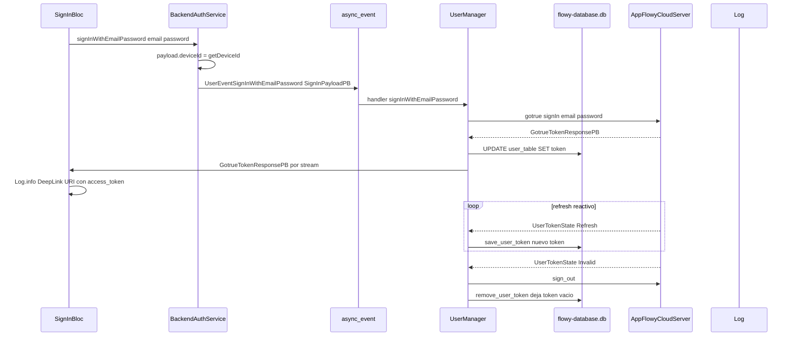
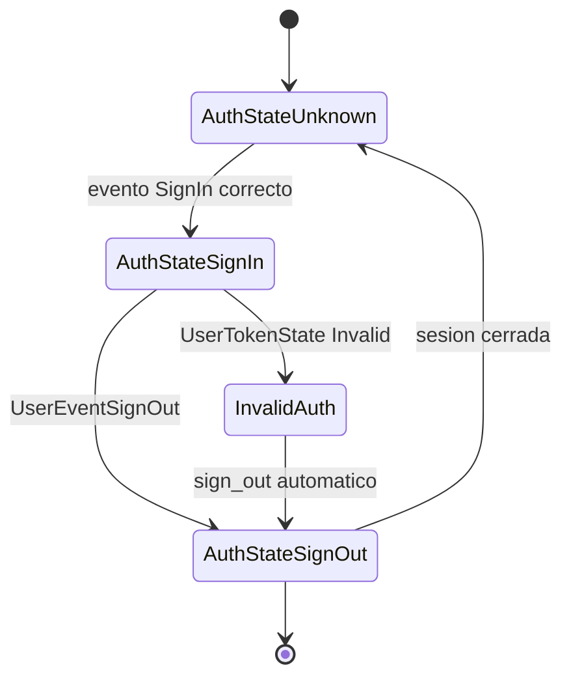
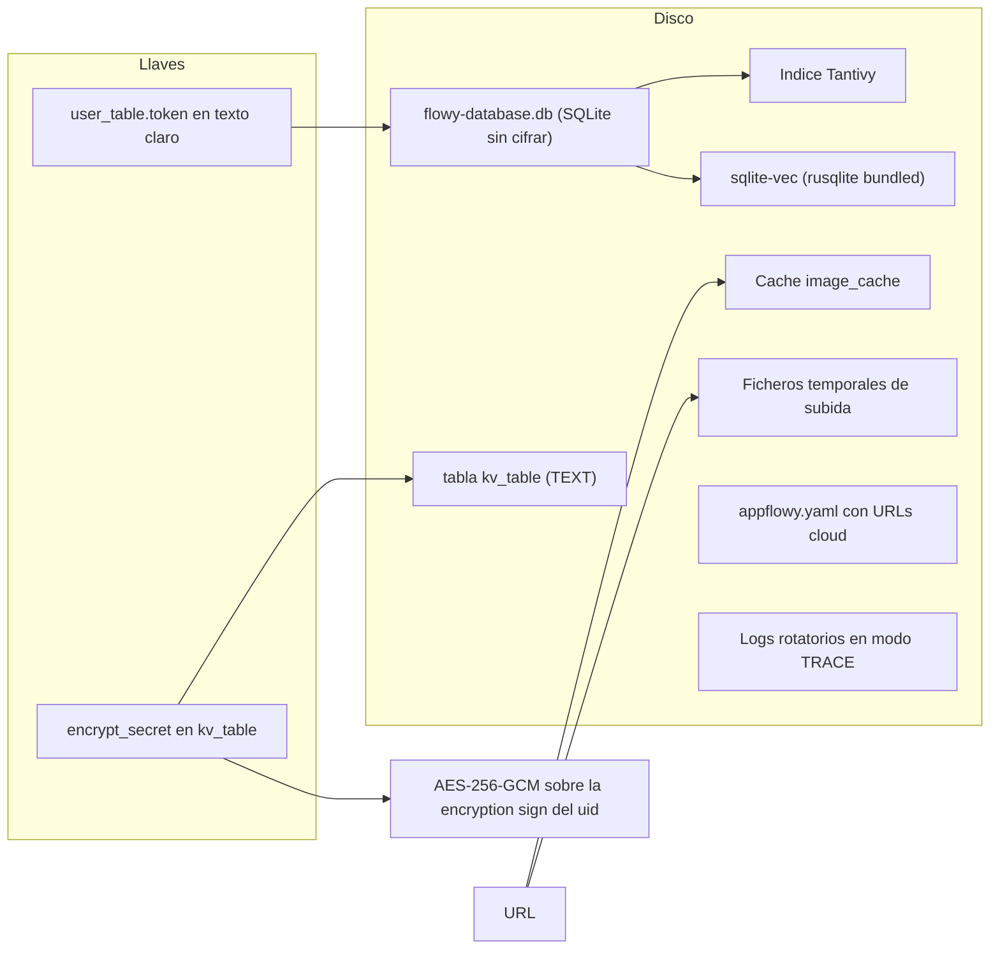
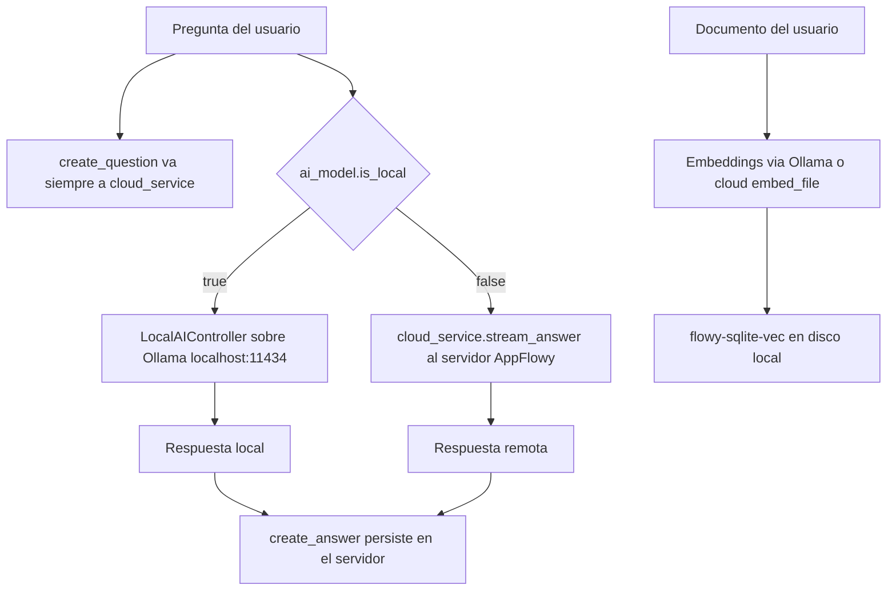

# B6.3 — Seguridad y privacidad

## 1. Resumen

AppFlowy separa la autenticación en dos capas: una capa Dart de estrategia (`AuthService` y sus tres implementaciones) que compone el payload y habla con el BLoC, y una capa Rust que es la única que habla con el servidor de identidad. El token de sesión (`GotrueTokenResponsePB`, con `access_token`, `refresh_token`, `expires_at` y tokens del proveedor OAuth) se obtiene en Rust, viaja de vuelta a Dart por el canal de notificaciones y se persiste **en texto claro** en la columna `user_table.token` de un SQLite sin cifrar. No hay cifrado en reposo en el cliente: ni SQLCipher, ni `PRAGMA key`, ni cifrado de la base, del índice Tantivy ni de la caché de imágenes; el único cifrado presente (AES-256-GCM) protege la "encryption sign" del identificador de usuario y su secreto vive en la misma tabla `kv_table` sin proteger. La frontera de privacidad de la IA se decide en un único `if ai_model.is_local` dentro de `ChatServiceMiddleware`, pero la pregunta del usuario se sigue enviando al servidor aunque la respuesta se genere en local. No hay telemetría activa: `SENTRY_DSN` está declarado en la configuración de entorno pero no hay SDK de Sentry ni ningún consumidor del valor.

## 2. Alcance

Este documento es **transversal**: no ancla filas nuevas en `cobertura.csv` porque los 38 archivos de la unidad ya están verificados al 100 % por las features que los poseen. Su aportación es la **lecta transversal**: sigue un mismo dato (el token de sesión, el contenido de un documento, un texto de chat) a través de las capas de UI, BLoC, servicio, FFI, motor Rust y almacenamiento, y dice en cada salto qué sale del dispositivo y con qué encabezado. Para poder cerrar esas cadenas citar además **20 ficheros de apoyo** que pertenecen a otras features (el algoritmo de cifrado, el esquema del KV, los `PRAGMA` del pool, la frontera `ai_model.is_local`, los clientes HTTP de Dart, la caché de imágenes y el logger); se declaran aparte en el frontmatter bajo `archivos_apoyo` y se detallan con su feature propietaria en §3.2. En total el documento cita **58 ficheros distintos**: los 38 de la unidad más esos 20 de apoyo.

**Qué entra.** La capa Dart de autenticación (`lib/user/application/auth/`, `sign_in_bloc.dart`, `sign_up_bloc.dart`, `anon_user_bloc.dart`, `password/`), la frontera FFI (`dart-ffi/src/lib.rs`, `c.rs`), el núcleo Rust de usuario (`flowy-user`, `flowy-core`, `flowy-server/src/af_cloud`, `local_server`), las capas de persistencia (`flowy-sqlite`, `flowy-sqlite-vec`, `flowy-storage`, `flowy-search`), la capa de IA (`flowy-ai`) y las utilidades transversales de permisos, red y feature flags.

**Qué queda fuera y con quién se cruza.**

| Materia | Documento que ya la cubre | Qué añade este documento |
|---|---|---|
| Auth en profundidad (BLoCs, pantallas, `UserProfilePB`, migraciones) | `[[F05.1]]` (Dart) y `[[F05.2]]` (Rust + `collab-user`) | El **ciclo de vida del token**: de dónde sale, cómo llega al FFI, cómo se refresca y cómo se invalida. |
| Transporte, `WSClient`, `ClientConfiguration`, reconexión, `collab` plugins | `[[F06]]` | Solo el **contrato cliente** hacia AppFlowy Cloud (base, ws, gotrue) y qué significa `set_token` en cada servidor. |
| Cachés de archivos, subidas multipart, cuota de almacenamiento | `[[F07]]` | Que la caché en disco **no está cifrada** y que `file_storage` es `None` en modo local. |
| Índice Tantivy, embeddings, cola de indexación | `[[F08]]` | El corte entre búsqueda local ( Tantivy) y búsqueda cloud, y qué texto sale en cada caso. |
| Chat, completion, MCP, herramientas de IA | `[[F09.1]]`, `[[F09.2]]`, `[[F09.3]]`, `[[F09.4]]` | El `if ai_model.is_local` como frontera de privacidad y qué dato viaja pese a estar en modo local. |
| Compartir, publicar, niveles de acceso | `[[F12.1]]`, `[[F12.2]]` | Que la imagen de un documento compartido se descarga con `Authorization: Bearer` y queda en caché local en claro. |
| Errores de autenticación y sus códigos | `[[15-catalogo-errores]]` | `AuthError` y el *sniffing* de mensajes de error del servidor en `SignInBloc`. |

**Fuera de alcance por decisión de proyecto** (`AGENTS.md` §11): AppFlowy-Cloud no se documenta por dentro. Solo se describe el contrato cliente tal y como lo consume `flowy-server/src/af_cloud`. Las credenciales literales que se hayan encontrado se sustituyen por `<REDACTED>` y se registran como pregunta abierta `SEC-n` en la sección 6.

## 3. Mapa de fuentes

El mapa separa los **38 ficheros de la unidad `B6.3`** (los que declara `OUT/_ledger/units/B6.3.json`, `archivos_total: 38`, y que son los que figuran en `archivos_cubiertos` del frontmatter) de los **20 ficheros de apoyo** que esta unidad cita como evidencia transversal pero que pertenecen a otras features.

### 3.1 Ficheros de la unidad (38)

| Archivo | Rol en seguridad/privacidad | Evidencia ancla |
|---|---|---|
| `appflowy/frontend/appflowy_flutter/lib/user/application/auth/auth_service.dart` | Contrato abstracto de auth y claves del mapa OAuth | `appflowy/frontend/appflowy_flutter/lib/user/application/auth/auth_service.dart:5–11`, `:17–97` |
| `appflowy/frontend/appflowy_flutter/lib/user/application/auth/af_cloud_auth_service.dart` | Implementación cloud; delega a `BackendAuthService` | `appflowy/frontend/appflowy_flutter/lib/user/application/auth/af_cloud_auth_service.dart:17–22`, `:41–45` |
| `appflowy/frontend/appflowy_flutter/lib/user/application/auth/af_cloud_mock_auth_service.dart` | Implementación de pruebas; inyecta `deviceId` | `appflowy/frontend/appflowy_flutter/lib/user/application/auth/af_cloud_mock_auth_service.dart:16`, `:55–66` |
| `appflowy/frontend/appflowy_flutter/lib/user/application/auth/backend_auth_service.dart` | **Única** clase que cruza al FFI; construye los payloads de auth | `appflowy/frontend/appflowy_flutter/lib/user/application/auth/backend_auth_service.dart:28–33`, `:67–68` |
| `appflowy/frontend/appflowy_flutter/lib/user/application/auth/device_id.dart` | Identificador de hardware por plataforma | `appflowy/frontend/appflowy_flutter/lib/user/application/auth/device_id.dart:10–36` |
| `appflowy/frontend/appflowy_flutter/lib/user/application/auth/auth_error.dart` | Errores de auth para deep link | `appflowy/frontend/appflowy_flutter/lib/user/application/auth/auth_error.dart:4–19` |
| `appflowy/frontend/appflowy_flutter/lib/user/application/sign_in_bloc.dart` | Orquestación de sign-in; **registra secretos en log** | `appflowy/frontend/appflowy_flutter/lib/user/application/sign_in_bloc.dart:260`, `:382` |
| `appflowy/frontend/appflowy_flutter/lib/user/application/sign_up_bloc.dart` | Registro con email y contraseña (validación local mínima) | `appflowy/frontend/appflowy_flutter/lib/user/application/sign_up_bloc.dart:68–98` |
| `appflowy/frontend/appflowy_flutter/lib/user/application/anon_user_bloc.dart` | Usuario anónimo histórico | `appflowy/frontend/appflowy_flutter/lib/user/application/anon_user_bloc.dart:28–40` |
| `appflowy/frontend/appflowy_flutter/lib/user/application/password/password_bloc.dart` | Extrae `access_token` del perfil para llamar a gotrue | `appflowy/frontend/appflowy_flutter/lib/user/application/password/password_bloc.dart:56–60` |
| `appflowy/frontend/appflowy_flutter/lib/user/application/password/password_http_service.dart` | **Cliente HTTP directo** a gotrue con `Authorization: Bearer` | `appflowy/frontend/appflowy_flutter/lib/user/application/password/password_http_service.dart:16–29`, `:58–61` |
| `appflowy/frontend/appflowy_flutter/lib/user/application/user_service.dart` | Fachada de usuario; URLs de suscripción de pago | `appflowy/frontend/appflowy_flutter/lib/user/application/user_service.dart:24–25`, `:271–272` |
| `appflowy/frontend/rust-lib/dart-ffi/src/lib.rs` | Frontera C/FFI; `init_sdk`, `async_event`, `sync_event` | `appflowy/frontend/rust-lib/dart-ffi/src/lib.rs:113–171`, `:175–186`, `:230–237` |
| `appflowy/frontend/rust-lib/dart-ffi/src/c.rs` | Framing de 4 bytes big-endian y*-leak* del buffer | `appflowy/frontend/rust-lib/dart-ffi/src/c.rs:4–8`, `:19–26` |
| `appflowy/frontend/rust-lib/flowy-user/src/lib.rs` | Módulos del crate de usuario (no lógica de token) | `appflowy/frontend/rust-lib/flowy-user/src/lib.rs:4–11` |
| `appflowy/frontend/rust-lib/flowy-core/src/config.rs` | Aislamiento de datos por dominio de servidor | `appflowy/frontend/rust-lib/flowy-core/src/config.rs:109–142` |
| `appflowy/frontend/rust-lib/flowy-core/src/app_life_cycle.rs` | Interruptor `enable_encrypt` y reacción a token expirado | `appflowy/frontend/rust-lib/flowy-core/src/app_life_cycle.rs:151–160`, `:386–389` |
| `appflowy/frontend/rust-lib/flowy-sqlite/src/lib.rs` | Ruta y nombre de la base (`flowy-database.db`) | `appflowy/frontend/rust-lib/flowy-sqlite/src/lib.rs:30`, `:32–45` |
| `appflowy/frontend/rust-lib/flowy-sqlite/src/schema.rs` | Tablas; **`user_table.token` en texto claro** | `appflowy/frontend/rust-lib/flowy-sqlite/src/schema.rs:103–113`, `:20–43` |
| `appflowy/frontend/rust-lib/flowy-sqlite-vec/Cargo.toml` | Vectores: `sqlite-vec` + `rusqlite` sin cifrar | `appflowy/frontend/rust-lib/flowy-sqlite-vec/Cargo.toml:7–8` |
| `appflowy/frontend/rust-lib/flowy-storage/src/file_cache.rs` | Ficheros temporales de subida en claro | `appflowy/frontend/rust-lib/flowy-storage/src/file_cache.rs:8–22`, `:56–65` |
| `appflowy/frontend/rust-lib/flowy-search/src/services/manager.rs` | Registro de handlers local vs cloud | `appflowy/frontend/rust-lib/flowy-search/src/services/manager.rs:66–76` |
| `appflowy/frontend/rust-lib/flowy-search/src/document/cloud_search_handler.rs` | **El texto de la consulta y del documento sale al servidor** | `appflowy/frontend/rust-lib/flowy-search/src/document/cloud_search_handler.rs:70`, `:127` |
| `appflowy/frontend/rust-lib/flowy-search/src/document/local_search_handler.rs` | Búsqueda Tantivy, 100 % local | `appflowy/frontend/rust-lib/flowy-search/src/document/local_search_handler.rs:53` |
| `appflowy/frontend/rust-lib/flowy-ai/src/model_select.rs` | Fuentes de modelos `"server"` y `"local"` | `appflowy/frontend/rust-lib/flowy-ai/src/model_select.rs:15`, `:97–99` |
| `appflowy/frontend/rust-lib/flowy-ai/src/ai_manager.rs` | Orquestación local/IA | `appflowy/frontend/rust-lib/flowy-ai/src/ai_manager.rs:63`, `:156–168` |
| `appflowy/frontend/rust-lib/lib-dispatch/src/runtime.rs` | Runtime Tokio del que cuelga la sincronía de tokens | `appflowy/frontend/rust-lib/lib-dispatch/src/runtime.rs:24–27`, `:56–76` |
| `appflowy/frontend/appflowy_flutter/lib/startup/tasks/appflowy_cloud_task.dart` | **Deep link con el token en el fragmento** | `appflowy/frontend/appflowy_flutter/lib/startup/tasks/appflowy_cloud_task.dart:37`, `:176–225` |
| `appflowy/frontend/appflowy_flutter/lib/core/network_monitor.dart` | Solo tipo de red; no telemetría | `appflowy/frontend/appflowy_flutter/lib/core/network_monitor.dart:34–56` |
| `appflowy/frontend/appflowy_flutter/lib/shared/feature_flags.dart` | Flags locales en `SharedPreferences` | `appflowy/frontend/appflowy_flutter/lib/shared/feature_flags.dart:82–91` |
| `appflowy/frontend/appflowy_flutter/lib/shared/permission/permission_checker.dart` | Permisos de cámara y fotos | `appflowy/frontend/appflowy_flutter/lib/shared/permission/permission_checker.dart:17–19`, `:65–67` |
| `appflowy/frontend/appflowy_flutter/pubspec.yaml` | Sin `flutter_secure_storage` ni cifrado Dart | `appflowy/frontend/appflowy_flutter/pubspec.yaml:90`, `:93` |
| `appflowy/frontend/rust-lib/flowy-server/src/af_cloud/mod.rs` | Reexports del cliente cloud | `appflowy/frontend/rust-lib/flowy-server/src/af_cloud/mod.rs:1–5` |
| `appflowy/frontend/rust-lib/flowy-server/src/af_cloud/server.rs` | Construcción del cliente, `set_token`, `subscribe_token_state` | `appflowy/frontend/rust-lib/flowy-server/src/af_cloud/server.rs:77–86`, `:125–130`, `:137–164` |
| `appflowy/frontend/rust-lib/flowy-server/src/af_cloud/define.rs` | `LoggedUser` y claves `USER_*` del mapa OAuth | `appflowy/frontend/rust-lib/flowy-server/src/af_cloud/define.rs:11–14`, `:18–31` |
| `appflowy/frontend/rust-lib/flowy-server/src/local_server/mod.rs` | Módulos del servidor local | `appflowy/frontend/rust-lib/flowy-server/src/local_server/mod.rs:1–7` |
| `appflowy/frontend/rust-lib/flowy-server/src/local_server/server.rs` | `set_token` no-op y `file_storage` deshabilitado | `appflowy/frontend/rust-lib/flowy-server/src/local_server/server.rs:55–57`, `:106–108` |
| `appflowy/frontend/rust-lib/event-integration-test/src/user_event.rs` | Test que activa el cifrado end-to-end | `appflowy/frontend/rust-lib/event-integration-test/src/user_event.rs:33–50` |

### 3.2 Ficheros de apoyo, propiedad de otras features (20)

Ninguno de estos 20 ficheros pertenece a la unidad `B6.3`; se declaran en el frontmatter bajo `archivos_apoyo` y se citan aquí solo como **evidencia transversal**, sin reclamar su propiedad. La columna «Feature propietaria» enlaza al documento que ya los documenta con detalle.

| Archivo | Rol en seguridad/privacidad | Evidencia ancla | Feature propietaria |
|---|---|---|---|
| `appflowy/frontend/rust-lib/lib-infra/src/encryption/mod.rs` | Algoritmo: AES-256-GCM, PBKDF2-HMAC-SHA256, nonce de 12 bytes | `appflowy/frontend/rust-lib/lib-infra/src/encryption/mod.rs:14–26`, `:40–55`, `:145–149`` | [[F00]] |
| `appflowy/frontend/rust-lib/flowy-user/src/user_manager/manager.rs` | Ciclo real del token: `subscribe_token_state`, `save_user_token`, `remove_user_token` | `appflowy/frontend/rust-lib/flowy-user/src/user_manager/manager.rs:176–177`, `:200–217`, `:835–849`` | [[F05]] |
| `appflowy/frontend/rust-lib/flowy-user/src/user_manager/manager_user_encryption.rs` | Único consumidor de `lib_infra::encryption`; delimita el alcance del cifrado | `appflowy/frontend/rust-lib/flowy-user/src/user_manager/manager_user_encryption.rs:7–10`, `:29–42`` | [[F05]] |
| `appflowy/frontend/rust-lib/flowy-user/src/services/cloud_config.rs` | Dónde vive el `encrypt_secret` (en `kv_table`, sin cifrar) | `appflowy/frontend/rust-lib/flowy-user/src/services/cloud_config.rs:10–15`, `:50–55`` | [[F05]] |
| `appflowy/frontend/rust-lib/flowy-user/src/entities/auth.rs` | Forma exacta de `GotrueTokenResponsePB` y `AuthStatePB` | `appflowy/frontend/rust-lib/flowy-user/src/entities/auth.rs:98–120`, `:246–253`` | [[F05]] |
| `appflowy/frontend/rust-lib/flowy-sqlite/src/kv/schema.rs` | Esquema de `kv_table` (clave y valor `Text`) | `appflowy/frontend/rust-lib/flowy-sqlite/src/kv/schema.rs:2–7`` | [[F00]] |
| `appflowy/frontend/rust-lib/flowy-sqlite/src/sqlite_impl/pool.rs` | Únicos `PRAGMA` aplicados: evidencia de la ausencia de cifrado en reposo | `appflowy/frontend/rust-lib/flowy-sqlite/src/sqlite_impl/pool.rs:146–152`` | [[F00]] |
| `appflowy/frontend/rust-lib/lib-log/src/lib.rs` | Logs a ficheros rotatorios en nivel `TRACE` | `appflowy/frontend/rust-lib/lib-log/src/lib.rs:50–58`, `:93`` | [[F17]] |
| `appflowy/frontend/rust-lib/flowy-ai/src/middleware/chat_service_mw.rs` | Frontera `ai_model.is_local` y sus tres asimetrías | `appflowy/frontend/rust-lib/flowy-ai/src/middleware/chat_service_mw.rs:108–123`, `:218–229`` | [[F09]] |
| `appflowy/frontend/rust-lib/flowy-ai/src/local_ai/controller.rs` | Destino real de la IA local: Ollama en `localhost:11434` | `appflowy/frontend/rust-lib/flowy-ai/src/local_ai/controller.rs:39–47`` | [[F09]] |
| `appflowy/frontend/rust-lib/flowy-ai/src/local_ai/resource.rs` | Lista de modelos locales vía `/api/tags` | `appflowy/frontend/rust-lib/flowy-ai/src/local_ai/resource.rs:130`` | [[F09]] |
| `appflowy/frontend/rust-lib/dart-ffi/src/appflowy_yaml.rs` | `appflowy.yaml` persiste las URLs del servidor en claro | `appflowy/frontend/rust-lib/dart-ffi/src/appflowy_yaml.rs:14–30`` | [[F00]] |
| `appflowy/frontend/rust-lib/Cargo.toml` | `client-api` es dependencia git externa de AppFlowy-Cloud (`rev = "592f644"`) | `appflowy/frontend/rust-lib/Cargo.toml:113–114`` | [[F00]] |
| `appflowy/frontend/appflowy_flutter/lib/core/config/kv.dart` | Almacén Dart sobre `SharedPreferences`, sin cifrar | `appflowy/frontend/appflowy_flutter/lib/core/config/kv.dart:14–16`, `:49–53`` | [[F00]] |
| `appflowy/frontend/appflowy_flutter/lib/env/env.dart` | `SENTRY_DSN` declarado; sostiene la ausencia de telemetría | `appflowy/frontend/appflowy_flutter/lib/env/env.dart:41–46`` | [[F00]] |
| `appflowy/frontend/appflowy_flutter/lib/shared/custom_image_cache_manager.dart` | Directorio `image_cache` en disco, sin cifrar | `appflowy/frontend/appflowy_flutter/lib/shared/custom_image_cache_manager.dart:23`, `:32–33`` | [[F17]] |
| `appflowy/frontend/appflowy_flutter/lib/shared/appflowy_network_image.dart` | Descarga de imágenes con `Authorization: Bearer` y caché en disco | `appflowy/frontend/appflowy_flutter/lib/shared/appflowy_network_image.dart:188–192`` | [[F17]] |
| `appflowy/frontend/appflowy_flutter/lib/workspace/presentation/settings/widgets/members/invitation/member_http_service.dart` | Invitación de miembros con `Authorization: Bearer` | `appflowy/frontend/appflowy_flutter/lib/workspace/presentation/settings/widgets/members/invitation/member_http_service.dart:54`` | [[F13]] |
| `appflowy/frontend/appflowy_flutter/lib/workspace/presentation/widgets/image_viewer/interactive_image_toolbar.dart` | Descarga de imagen compartida con `Authorization: Bearer` | `appflowy/frontend/appflowy_flutter/lib/workspace/presentation/widgets/image_viewer/interactive_image_toolbar.dart:248`` | [[F07]] |
| `appflowy/frontend/appflowy_flutter/lib/plugins/document/presentation/editor_plugins/file/file_util.dart` | Descarga de adjuntos con `Authorization: Bearer` | `appflowy/frontend/appflowy_flutter/lib/plugins/document/presentation/editor_plugins/file/file_util.dart:120`, `:152`` | [[F07]] |

## 4. Diagramas

### 4.1 Ciclo de vida del token de sesión

Muestra el recorrido completo de un token desde que la UI pide autenticarse hasta que se invalida, incluyendo los dos puntos en los que se persiste y los dos en los que se filtra a los logs.

**Lectura.** La UI nunca habla con el servidor: compone un `SignInPayloadPB` con email, contraseña, `auth_type` y el identificador de dispositivo, y lo entrega al FFI como bytes. El token lo emite Rust, se persiste en la columna `user_table.token` en texto claro (`appflowy/frontend/rust-lib/flowy-sqlite/src/schema.rs:103–113`) y vuelve a Dart por el canal de notificaciones. A partir de ahí hay tres rutas de fuga local independientes: la columna del SQLite, el log con la URI del deep link y el disco de logs en modo `TRACE`.

### 4.2 Estado de autenticación

Muestra los cuatro estados que Rust modela en `AuthStatePB` y cómo se traducen a la sesión del cliente.

**Lectura.** `AuthStatePB` declara cuatro valores (`AuthStateUnknown`, `AuthStateSignIn`, `AuthStateSignOut`, `InvalidAuth`) en `appflowy/frontend/rust-lib/flowy-user/src/entities/auth.rs:246–253`. La transición a `InvalidAuth` no la decide el cliente: la dispara el `watch` de `client_api`, que AppFlowy traduce a `UserTokenState:Invalid` (`appflowy/frontend/rust-lib/flowy-server/src/af_cloud/server.rs:155–157`), y que `UserManager` traduce a un `sign_out` completo (`appflowy/frontend/rust-lib/flowy-user/src/user_manager/manager.rs:218–258`). El handler de ciclo de vida se limita a limpiar el folder (`appflowy/frontend/rust-lib/flowy-core/src/app_life_cycle.rs:386–389`).

### 4.3 Mapa de almacenamiento en reposo

Muestra qué se escribe en disco, con qué tecnología y si el contenido está cifrado.

**Lectura.** Todo el almacenamiento en reposo es local y en claro. La base `flowy-database.db` se crea sin clave (`appflowy/frontend/rust-lib/flowy-sqlite/src/lib.rs:30–38`) y el único cifrado aplicado —AES-256-GCM sobre el `uid` para la *encryption sign* (`appflowy/frontend/rust-lib/flowy-user/src/user_manager/manager_user_encryption.rs:7–10`)— usa como clave un `encrypt_secret` guardado en la propia tabla `kv_table` (`appflowy/frontend/rust-lib/flowy-user/src/services/cloud_config.rs:50–55`). Es decir: el cifrado protege contraCurious observers del tráfico de red, no contra quien tenga el disco.

### 4.4 Frontera de privacidad de la IA

Muestra qué decide el middleware entre ejecutar el modelo en el dispositivo y delegarlo en el servidor, y qué dato cruza igualmente.

**Lectura.** La decisión es un único campo, `ai_model.is_local`, comprobado en `stream_answer` y `stream_complete` (`appflowy/frontend/rust-lib/flowy-ai/src/middleware/chat_service_mw.rs:108–123`, `:218–229`). Pero `create_question` **no** consulta ese campo y siempre escribe en el servidor (`appflowy/frontend/rust-lib/flowy-ai/src/middleware/chat_service_mw.rs:71–83`): elegir un modelo local cambia dónde se calcula la respuesta, no si el texto de la pregunta sale del dispositivo.

## 5. Hallazgos clave

### 5.1 Modelo de identidades y ciclo del token

La capa Dart define un único contrato, `AuthService`, con seis operaciones (`signInWithEmailPassword`, `signUp`, `signUpWithOAuth`, `signUpAsGuest`, `signInWithMagicLink`, `signInWithPasscode`, más `signOut` y `getUser`) y tres claves de mapa OAuth (`email`, `device_id`, `sign_in_url`) en `appflowy/frontend/appflowy_flutter/lib/user/application/auth/auth_service.dart:5–11` y `:17–97`. Hay tres implementaciones: `AppFlowyCloudAuthService` (`appflowy/frontend/appflowy_flutter/lib/user/application/auth/af_cloud_auth_service.dart:17`), `AppFlowyCloudMockAuthService`, marcada «Only used for testing» (`appflowy/frontend/appflowy_flutter/lib/user/application/auth/af_cloud_mock_auth_service.dart:15–16`) y `BackendAuthService` (`appflowy/frontend/appflowy_flutter/lib/user/application/auth/backend_auth_service.dart:16`). **Solo `BackendAuthService` cruza al FFI**: compone `SignInPayloadPB` con `email`, `password`, `authType` y `deviceId` y lo envía como `UserEventSignInWithEmailPassword` (`appflowy/frontend/appflowy_flutter/lib/user/application/auth/backend_auth_service.dart:28–33`). Las dos implementaciones cloud solo decoran: crean un `BackendAuthService(AuthTypePB.Server)` y delegan (`appflowy/frontend/appflowy_flutter/lib/user/application/auth/af_cloud_auth_service.dart:20–22`, `:41–45`).

El tipo del token es `GotrueTokenResponsePB`, con siete campos: `access_token`, `token_type`, `expires_in`, `expires_at`, `refresh_token` y, como `one_of`, `provider_access_token` y `provider_refresh_token` (`appflowy/frontend/rust-lib/flowy-user/src/entities/auth.rs:98–120`). El discriminante de identidad es `AuthTypePB`: el usuario invitado se crea siempre como `AuthTypePB.Local` con una credencial fija (`appflowy/frontend/appflowy_flutter/lib/user/application/auth/backend_auth_service.dart:70–76`), mientras que cloud usa `AuthTypePB.Server`.

**El identificador de dispositivo es un identificador de hardware, no un UUID aleatorio.** `getDeviceId()` devuelve `androidInfo.device` en Android, `identifierForVendor` en iOS, `systemGUID` en macOS, `deviceId` en Windows y `machineId` en Linux (`appflowy/frontend/appflowy_flutter/lib/user/application/auth/device_id.dart:17–32`); si la plataforma lanza `PlatformException` devuelve cadena vacía (`:33–36`), y en modo de test fuerza el literal `"test_device_id"` (`:11–13`). Este valor viaja en cada payload de alta (`appflowy/frontend/appflowy_flutter/lib/user/application/auth/backend_auth_service.dart:32`, `:48`) y en el mapa OAuth (`appflowy/frontend/appflowy_flutter/lib/user/application/auth/af_cloud_mock_auth_service.dart:62–65`). En el lado Rust, `AppFlowyCloudServer:new` lo pasa al cliente HTTP y, si llega vacío, genera un UUID v4 (`appflowy/frontend/rust-lib/flowy-server/src/af_cloud/server.rs:72–86`).

El token viaja al FFI exclusivamente por el canal asíncrono: `async_event` desempaqueta el `AFPluginRequest` y lo encola (`appflowy/frontend/rust-lib/dart-ffi/src/lib.rs:175–186`), mientras que `sync_event` está sin implementar y solo registra un error (`:230–237`). Las respuestas vuelven por `post_to_flutter` sobre un isolate (`:256–275`). En el lado servidor, `set_token` llama a `client.restore_token(token)` (`appflowy/frontend/rust-lib/flowy-server/src/af_cloud/server.rs:125–130`); en el servidor local el mismo método es un no-op (`appflowy/frontend/rust-lib/flowy-server/src/local_server/server.rs:55–57`).

El refresco es reactivo y persistente. `UserManager` se suscribe a `cloud_service.subscribe_token_state()` y, en un `tokio:spawn`, guarda el token nuevo solo si difiere del actual (`appflowy/frontend/rust-lib/flowy-user/src/user_manager/manager.rs:200–217`). La escritura real la hace `save_user_token`, que construye un `UpdateUserProfileParams:new(uid).with_token(token)` (`:835–843`), y la invalidación la hace `remove_user_token`, que **no borra la fila sino que la deja en cadena vacía** con `.set(user_table:token.eq(""))` (`:847–849`).

**Punto de fuga 1 — el token viaja por un esquema URI propio.** Tras un sign-in correcto, `SignInBloc` entrega el `GotrueTokenResponsePB` a `AppFlowyCloudDeepLink.passGotrueTokenResponse` (`appflowy/frontend/appflowy_flutter/lib/user/application/sign_in_bloc.dart:180–183`), que construye un fragmento con `access_token`, `expires_at`, `expires_in`, `provider_refresh_token`, `provider_token`, `refresh_token` y `token_type` y lo devuelve como `appflowy-flutter://login-callback#$fragment` (`appflowy/frontend/appflowy_flutter/lib/startup/tasks/appflowy_cloud_task.dart:176–225`). Ese URI es el que el sistema operativo entrega de vuelta a la aplicación por el registro `appflowy-flutter` (`:24`, `:45–48`).

**Punto de fuga 2 — el log registra ese URI completo.** El listener de deep link escribe `Log.info('onDeepLink: ${uri.toString()}')` antes de procesar nada (`appflowy/frontend/appflowy_flutter/lib/startup/tasks/appflowy_cloud_task.dart:37`), es decir, escribe en el log el `access_token` y el `refresh_token` en claro.

**Punto de fuga 3 — secretos escritos a log desde los BLoCs.** `SignInBloc` registra el código de acceso (`appflowy/frontend/appflowy_flutter/lib/user/application/sign_in_bloc.dart:260`), el token de recuperación (`:365`) y, de forma explícita, el token de sesión devuelto por la verificación: `Log.info('Validate reset password token success: $authToken')` (`appflowy/frontend/appflowy_flutter/lib/user/application/sign_in_bloc.dart:382`). El único valor sensible que sí se trata con cuidado es la contraseña nueva, que se registra como `${newPassword.hashCode}` y no en claro (`:416`). Estos logs no se quedan en memoria: el logger escribe en ficheros rotatorios diarios y por hora (`appflowy/frontend/rust-lib/lib-log/src/lib.rs:50–58`) con `with_max_level(tracing:Level:TRACE)` (`:93`).

### 5.2 Almacenamiento en reposo: no hay cifrado

Esta es una conclusión **verificada por ausencia**, no una laguna de búsqueda. Los únicos `PRAGMA` que el pool aplica al abrir cada conexión son `busy_timeout`, `journal_mode` y `synchronous` (`appflowy/frontend/rust-lib/flowy-sqlite/src/sqlite_impl/pool.rs:146–152`); no hay ninguna llamada a `PRAGMA key`, ni dependencia de SQLCipher en el workspace Cargo, ni código de cifrado de página. La base es un `flowy-database.db` plano creado en el directorio de almacenamiento del usuario (`appflowy/frontend/rust-lib/flowy-sqlite/src/lib.rs:30`, `:32–38`).

Lo que se guarda, tabla por tabla, con la columna exacta:

| Dato | Ubicación | Cifrado | Evidencia |
|---|---|---|---|
| Token de sesión | `user_table.token` (`Text`) | **No** | `appflowy/frontend/rust-lib/flowy-sqlite/src/schema.rs:103–113` |
| Email y tipo de auth | `user_table.email`, `user_table.auth_type` | **No** | `appflowy/frontend/rust-lib/flowy-sqlite/src/schema.rs:104–112` |
| Historial de chat | `chat_message_table.content` (`Text`) | **No** | `appflowy/frontend/rust-lib/flowy-sqlite/src/schema.rs:20–32` |
| Resúmenes de chat | `chat_table.summary` (`Text`) | **No** | `appflowy/frontend/rust-lib/flowy-sqlite/src/schema.rs:34–43` |
| Configuración de IA | `chat_local_setting_table`, `local_ai_model_table` | **No** | `appflowy/frontend/rust-lib/flowy-sqlite/src/schema.rs:12–18`, `:65–70` |
| Miembros y roles | `workspace_members_table.email`, `role` | **No** | `appflowy/frontend/rust-lib/flowy-sqlite/src/schema.rs:129–140` |
| Vista compartida | `workspace_shared_user.access_level`, `role` | **No** | `appflowy/frontend/rust-lib/flowy-sqlite/src/schema.rs:150–161` |
| Secreto de cifrado | `kv_table.value` (`Text`) | **No** | `appflowy/frontend/rust-lib/flowy-sqlite/src/kv/schema.rs:2–7` |
| Configuración local de IA | `kv_table` (`GLOBAL_ACTIVE_MODEL_KEY`) | **No** | `appflowy/frontend/rust-lib/flowy-ai/src/model_select.rs:15` |
| Vectores de embeddings | `sqlite-vec` sobre `rusqlite` `bundled` | **No** | `appflowy/frontend/rust-lib/flowy-sqlite-vec/Cargo.toml:7–8` |
| Caché de imágenes | directorio `image_cache` | **No** | `appflowy/frontend/appflowy_flutter/lib/shared/custom_image_cache_manager.dart:23` |
| Ficheros de subida | `FileTempStorage.storage_dir` | **No** | `appflowy/frontend/rust-lib/flowy-storage/src/file_cache.rs:8–22`, `:56–65` |
| URLs del servidor | `appflowy.yaml` | **No** | `appflowy/frontend/rust-lib/dart-ffi/src/appflowy_yaml.rs:14–30` |
| Flags de feature | `SharedPreferences` | **No** | `appflowy/frontend/appflowy_flutter/lib/core/config/kv.dart:14–16`, `:49–53` |

El lado Dart tampoco cifra: el almacén de clave-valor es `SharedPreferences` (`appflowy/frontend/appflowy_flutter/lib/core/config/kv.dart:1`, `:14–16`), y los `FeatureFlag` se serializan ahí como JSON plano (`appflowy/frontend/appflowy_flutter/lib/shared/feature_flags.dart:82–91`). En `pubspec.yaml` no aparece `flutter_secure_storage` ni ningún paquete Dart de cifrado; sí aparece `hive_flutter: ^1.1.0` (`appflowy/frontend/appflowy_flutter/pubspec.yaml:90`) pero una búsqueda de `openBox`, `Box<` y `Hive` sobre `lib/` y `packages/` no devuelve ninguna coincidencia, de modo que la dependencia está declarada y sin usar en este snapshot.

**Lo que sí está cifrado, y por qué no protege el disco.** `lib-infra/src/encryption/mod.rs` implementa un cifrado real: AES-256-GCM con passphrase de 30 caracteres aleatorios y salt de 16 bytes (`appflowy/frontend/rust-lib/lib-infra/src/encryption/mod.rs:14–26`, `:111–128`), clave derivada con PBKDF2-HMAC-SHA256 en 1000 iteraciones (`:145–149`) y nonce aleatorio de 12 bytes (`:44`, `:49–53`). Ese módulo se usa para la *encryption sign*, que es el `uid` cifrado que el cliente presenta al servidor como prueba de que la sesión está sincronizada (`appflowy/frontend/rust-lib/flowy-user/src/user_manager/manager_user_encryption.rs:7–10`, `:29–42`). El problema es que su clave —`encrypt_secret`— se genera con `generate_encryption_secret()` y se guarda con `set_object` en el mismo almacén de preferencias (`appflowy/frontend/rust-lib/flowy-user/src/services/cloud_config.rs:10–15`) que se lee con `get_encrypt_secret` (`:50–55`). Clave y dato en el mismo SQLite sin cifrar: el control protege el `uid` frente a un observador de red, no frente a quien lea `kv_table`. `[INFERIDO]` — el razonamiento combina la escritura (`appflowy/frontend/rust-lib/flowy-user/src/services/cloud_config.rs:10–15`), la lectura (`appflowy/frontend/rust-lib/flowy-user/src/services/cloud_config.rs:50–55`) y la ausencia de cifrado de la base (`appflowy/frontend/rust-lib/flowy-sqlite/src/sqlite_impl/pool.rs:146–152`); ninguna de las tres piezas lo declara explícitamente.

El interruptor que lo activa es `cloud_config.enable_encrypt`, comprobado al autenticar (`appflowy/frontend/rust-lib/flowy-core/src/app_life_cycle.rs:151–160`); el test de integración lo activa con `UpdateCloudConfigPB { enable_encrypt: Some(true) }` (`appflowy/frontend/rust-lib/event-integration-test/src/user_event.rs:33–50`). El contenido de los documentos y de las bases de datos **no** pasa por este módulo: lo que se cifra es la identidad, no el documento.

Un detalle de aislamiento que sí tiene efecto prático: la carpeta de datos se separa por dominio del servidor, con el nombre de host como sufijo desde la versión 0.8.9, y una copia recursiva desde la raíz histórica (`appflowy/frontend/rust-lib/flowy-core/src/config.rs:109–142`). Eso evita mezclar datos de instancias distintas en el mismo disco, no protegerlos.

### 5.3 Qué datos salen del cliente

| Feature | Datos que salen | Destino | Mecanismo y encabezado |
|---|---|---|---|
| **F05** Auth | Email, contraseña, `device_id`, `auth_type`; OAuth vía navegador externo | AppFlowy Cloud (gotrue) | `SignInPayloadPB` por FFI `async_event` (`appflowy/frontend/appflowy_flutter/lib/user/application/auth/backend_auth_service.dart:28–33`); en la vuelta, `appflowy-flutter://login-callback` (`appflowy/frontend/appflowy_flutter/lib/startup/tasks/appflowy_cloud_task.dart:224`) |
| **F05** Contraseña | Contraseña actual y nueva, email, código de recuperación | AppFlowy Cloud (`/gotrue/*`) | `http.Client` de Dart con `Authorization: Bearer <authToken>` (`appflowy/frontend/appflowy_flutter/lib/user/application/password/password_http_service.dart:56–61`) |
| **F05** Membresía | Email, rol, `workspaceId` | AppFlowy Cloud | `Authorization: Bearer <authToken>` (`appflowy/frontend/appflowy_flutter/lib/workspace/presentation/settings/widgets/members/invitation/member_http_service.dart:54`) |
| **F06** Sync | Documentos y bases de datos completos (collab) | AppFlowy Cloud | `Client` de `client_api` vía WS y HTTP (`appflowy/frontend/rust-lib/flowy-server/src/af_cloud/server.rs:77–86`) |
| **F07** Archivos | Binarios subidos por partes | AppFlowy Cloud | `upload_file_table` + `StorageCloudService`; `None` en modo local (`appflowy/frontend/rust-lib/flowy-server/src/local_server/server.rs:106–108`) |
| **F07/F12** Imágenes | Bytes de imagen de documento compartido | AppFlowy Cloud | `Authorization: Bearer <access_token>` (`appflowy/frontend/appflowy_flutter/lib/shared/appflowy_network_image.dart:188–192`); también en `appflowy/frontend/appflowy_flutter/lib/plugins/document/presentation/editor_plugins/file/file_util.dart:120`, `:152` e `appflowy/frontend/appflowy_flutter/lib/workspace/presentation/widgets/image_viewer/interactive_image_toolbar.dart:248` |
| **F08** Búsqueda cloud | **Consulta y contenido de los documentos que casan** | AppFlowy Cloud | `document_search` y `generate_search_summary` (`appflowy/frontend/rust-lib/flowy-search/src/document/cloud_search_handler.rs:70`, `:127`) |
| **F08** Búsqueda local | Nada | Ninguno | Tantivy en proceso (`appflowy/frontend/rust-lib/flowy-search/src/document/local_search_handler.rs:53`) |
| **F09** IA cloud | Pregunta, historial de chat, embeddings de documentos | AppFlowy Cloud | `cloud_service.create_question` (`appflowy/frontend/rust-lib/flowy-ai/src/middleware/chat_service_mw.rs:71–83`) |
| **F09** IA local | Pregunta al Ollama del propio dispositivo | `localhost:11434` | `ollama_rs` (`appflowy/frontend/rust-lib/flowy-ai/src/local_ai/controller.rs:42`, `:120`) |
| **F09** Embeddings | Texto del documento a vectorizar | Ollama local o cloud | `embed_file` bifurcado por `local_ai.is_ready()` (`appflowy/frontend/rust-lib/flowy-ai/src/middleware/chat_service_mw.rs:232–251`) |
| **F12** Publicar | Vista publicada | Servidor de publicación | Detalle en `[[F12.2]]` |
| **F13** Apariencia | Nada | Ninguno | Local |
| **F14** i18n | Nada | Ninguno | Recursos locales |
| **F15** Recordatorios | Nada | Ninguno | Locales |
| **F16** Móvil | Nada adicional por permisos | Ninguno | `appflowy/frontend/appflowy_flutter/lib/shared/permission/permission_checker.dart:17–19` |
| **F17** Ventanas/deep links | URI con token de sesión | Registro del SO | `appflowy/frontend/appflowy_flutter/lib/startup/tasks/appflowy_cloud_task.dart:37`, `:224` |
| **F19** l10n | Nada | Ninguno | Local |
| **F21** Emoji | Nada | Ninguno | Local |

Los **nombres literales de encabezado** que sí están en el inventario son, en todos los casos, `Authorization` con el esquema `Bearer`: `'Authorization': 'Bearer $authToken'` en `appflowy/frontend/appflowy_flutter/lib/user/application/password/password_http_service.dart:60` y `appflowy/frontend/appflowy_flutter/lib/workspace/presentation/settings/widgets/members/invitation/member_http_service.dart:54`, `header['Authorization'] = 'Bearer ${decodedToken['access_token']}'` en `appflowy/frontend/appflowy_flutter/lib/shared/appflowy_network_image.dart:192`, y `headers: {'Authorization': 'Bearer $token'}` en `appflowy/frontend/appflowy_flutter/lib/plugins/document/presentation/editor_plugins/file/file_util.dart:120`, `:152` e `appflowy/frontend/appflowy_flutter/lib/workspace/presentation/widgets/image_viewer/interactive_image_toolbar.dart:248`. El cliente HTTP que usa `package:http` añade `Content-Type: application/json` (`appflowy/frontend/appflowy_flutter/lib/user/application/password/password_http_service.dart:58–61`). Los cuatro endpoints de contraseña son literales en el enum `PasswordEndpoint`: `/gotrue/user/change-password`, `/gotrue/recover`, `/gotrue/user/auth-info` y `/gotrue/verify` (`appflowy/frontend/appflowy_flutter/lib/user/application/password/password_http_service.dart:16–29`), todos `POST` salvo `auth-info`, que es `GET` (`:31–41`). Los headers que usa el cliente **Rust** no son determinables desde este repositorio: viven en `client-api`, una dependencia git externa de AppFlowy-Cloud fijada en `rev = "592f644"` (`appflowy/frontend/rust-lib/Cargo.toml:113–114`), que no está vendorizada. Queda como `[NO DETERMINADO]`.

El único tráfico saliente en modo puramente local es el del tipo de red: `NetworkListener` traduce el resultado de `connectivity_plus` a `NetworkTypePB` y lo envía por `UserEventUpdateNetworkState` (`appflowy/frontend/appflowy_flutter/lib/core/network_monitor.dart:34–56`); no contiene dirección IP ni identidad, solo el tipo de interfaz (`Wifi`, `Ethernet`, `Cell`, `Bluetooth`, `VPN`, `NetworkUnknown`).

### 5.4 IA local frente a IA cloud

El corte es un único campo, `is_local`, que pertenece a `AIModel` y se transporta en cada petición. `ChatServiceMiddleware` lo consulta en `stream_answer` (`appflowy/frontend/rust-lib/flowy-ai/src/middleware/chat_service_mw.rs:108–123`), en `get_related_message` (`:181–202`) y en `stream_complete` (`:218–229`): si es `true` y `local_ai.is_ready()`, responde `LocalAIController`; si no, delega en `cloud_service`. El destino local es un servidor Ollama del propio equipo, por defecto `http://localhost:11434` con los modelos `llama3.1:latest` y `nomic-embed-text:latest` (`appflowy/frontend/rust-lib/flowy-ai/src/local_ai/controller.rs:39–47`), y su configuración se guarda bajo la clave `appflowy_local_ai_setting:v1` (`appflowy/frontend/rust-lib/flowy-ai/src/local_ai/controller.rs:49`).

**Tres matices que cambian lo que el usuario cree que ocurre.** El primero: `create_question` no comprueba `is_local` y siempre escribe la pregunta en el servicio cloud (`appflowy/frontend/rust-lib/flowy-ai/src/middleware/chat_service_mw.rs:71–83`); `[INFERIDO]` que el propósito es conservar la persistencia e historial del chat, pero el efecto observable es que el texto de la pregunta sale del dispositivo aunque la respuesta se calcule en local. El segundo: `get_answer` decide **solo** por `local_ai.is_ready()` (`appflowy/frontend/rust-lib/flowy-ai/src/middleware/chat_service_mw.rs:126–147`), sin mirar `ai_model.is_local`, a diferencia de sus dos hermanos; si Ollama está levantado, esa ruta se desvía a local aunque el modelo seleccionado sea remoto. El tercero: incluso en la ruta local, la respuesta se persiste en el servidor porque el `save` se hace con `cloud_service.create_answer` (`appflowy/frontend/rust-lib/flowy-ai/src/middleware/chat_service_mw.rs:136–139`).

El interruptor que activa el modo local es por workspace: `prepare_local_ai` recarga el cliente Ollama y registra o retira la fuente de modelos `"local"` (`appflowy/frontend/rust-lib/flowy-ai/src/ai_manager.rs:156–168`), y `ModelSelectionControl` mantiene separadas la fuente `"server"` y la `"local"` (`appflowy/frontend/rust-lib/flowy-ai/src/model_select.rs:97–99`, `:122–129`). El modelo activo se persiste bajo `GLOBAL_ACTIVE_MODEL_KEY = "global_active_model"` (`appflowy/frontend/rust-lib/flowy-ai/src/model_select.rs:15`). El backend local no expone servicio de base de datos para IA (`appflowy/frontend/rust-lib/flowy-server/src/local_server/server.rs:82–84`).

**No hay claves de API de terceros en el cliente.** La búsqueda de `api_key`, `apiKey`, `OPENAI`, `ANTHROPIC` y `base_url` sobre `flowy-ai/src/local_ai/` y `flowy-ai/src/middleware/` no devuelve ninguna coincidencia de credencial; el único comentario que nombra un endpoint es la consulta de la lista de modelos locales en `/api/tags` (`appflowy/frontend/rust-lib/flowy-ai/src/local_ai/resource.rs:130`). El cliente Rust habla con `client_api`, luego la clave del proveedor de LLM vive del lado del servidor. Queda como `[NO DETERMINADO]`.

### 5.5 Modelo de amenazas mínimo

| Activo | Amenaza | Control actual | Evidencia | Veredicto |
|---|---|---|---|---|
| Token de sesión | Robo desde el disco | Ninguno; `user_table.token` es `Text` | `appflowy/frontend/rust-lib/flowy-sqlite/src/schema.rs:103–113`; `appflowy/frontend/rust-lib/flowy-sqlite/src/sqlite_impl/pool.rs:146–152` | **Ausente** |
| Token de sesión | Filtración por logs | Ninguno; URI con token registrado en claro | `appflowy/frontend/appflowy_flutter/lib/startup/tasks/appflowy_cloud_task.dart:37`, `:224` | **Ausente** |
| Token de sesión | Filtración por logs del BLoC | Parcial; solo la contraseña nueva se abstrae | `appflowy/frontend/appflowy_flutter/lib/user/application/sign_in_bloc.dart:382`, `:260` vs `:416` | **Insuff iciente** |
| Token de sesión | Uso tras expiración | Refresco reactivo; invalidación dispara `sign_out` | `appflowy/frontend/rust-lib/flowy-user/src/user_manager/manager.rs:200–217`, `:218–258`; `appflowy/frontend/rust-lib/flowy-server/src/af_cloud/server.rs:137–164` | **Adecuado** |
| Token de sesión | Persistencia residual | `remove_user_token` deja `""` en vez de borrar | `appflowy/frontend/rust-lib/flowy-user/src/user_manager/manager.rs:847–849` | **Débil** |
| Contraseña de usuario | Almacenamiento local | No se almacena; el cliente solo la envía | `appflowy/frontend/appflowy_flutter/lib/user/application/auth/backend_auth_service.dart:28–33`; `appflowy/frontend/appflowy_flutter/lib/user/application/password/password_bloc.dart:56–60` | **Adecuado** |
| Contraseña de usuario | Credencial de invitado fija en el código | Ninguno | `appflowy/frontend/appflowy_flutter/lib/user/application/auth/backend_auth_service.dart:67–68` | **Ausente** (`SEC-1`) |
| Contraseña de usuario | Transporte en claro si el servidor no usa TLS | Ninguno en el cliente; depende del `baseUrl` | `appflowy/frontend/appflowy_flutter/lib/user/application/password/password_http_service.dart:43`, `:56` | `[NO DETERMINADO]` |
| Contenido de documentos | Lectura del disco | Solo la *encryption sign* se cifra; el contenido no | `appflowy/frontend/rust-lib/flowy-core/src/app_life_cycle.rs:151–160`; `appflowy/frontend/rust-lib/flowy-sqlite/src/schema.rs:20–32` | **Ausente** |
| Bases de datos | Lectura del disco | Misma base que el resto, sin cifrar | `appflowy/frontend/rust-lib/flowy-sqlite/src/lib.rs:30–38` | **Ausente** |
| Caché de imágenes | Lectura del disco y fusión entre instancias | Se puede limpiar; no se cifra | `appflowy/frontend/appflowy_flutter/lib/shared/custom_image_cache_manager.dart:23`, `:32–33` | **Débil** |
| Claves de API de terceros | Extracción del cliente | No hay claves de terceros en el cliente | búsqueda en `local_ai/` y `middleware/` | **Adecuado** |
| Identificador de dispositivo | Seguimiento entre instalaciones | Es un identificador de hardware estable enviado en cada alta | `appflowy/frontend/appflowy_flutter/lib/user/application/auth/device_id.dart:17–32` | **Riesgo de privacidad** |
| Logs | Volcado de secretos a disco | `TRACE` a ficheros rotatorios | `appflowy/frontend/rust-lib/lib-log/src/lib.rs:50–58`, `:93` | **Ausente** |

## 6. Riesgos, huecos y decisiones de diseño pendientes

### 6.1 Preguntas `SEC-n` (credenciales literales encontradas)

- **SEC-1** — `BackendAuthService.signUpAsGuest` crea el usuario invitado con una **contraseña fija escrita en el código fuente** y un correo también fijo: `const password = <REDACTED>` y `userEmail = "anon@appflowy.io"` (`appflowy/frontend/appflowy_flutter/lib/user/application/auth/backend_auth_service.dart:67–68`). **[NO DETERMINADO]** Si esos mismos valores coinciden con una cuenta real del servidor AppFlowy Cloud y si, por tanto, cualquiera que firmara con ellos obtendría acceso a los datos del usuario anónimo. Impacto potencial alto; la comprobación requiere acceso al servidor, que queda fuera de alcance.

  **Alcance de la redacción.** El control es **documental, no de código**, y la redacción es global en `OUT/`, no local a este documento. La revisión de gate-100 detectó que el literal aparecía además **sin redactar** en dos puntos del documento de la feature de autenticación: la fila de la tabla de eventos de `UserEventSignUp` y la fila descriptiva de `BackendAuthService` en `OUT/09-features/F05-usuario-auth-sesion/1-usuario-appflowy-flutter-lib-user-dart.md`; ambas han sido corregidas a `<REDACTED>` con remisión a `[[B6.3]] §6.1` y a `SEC-1`. El mismo literal no aparece en ningún otro documento de `OUT/`. Conviene no obstante explicitar el límite del control: **cualquier relectura del código fuente por un tercero con acceso al repositorio obtiene el valor igualmente**, porque la credencial está incrustada en el binario y en el texto compilado. Redactar la documentación evita que el secreto se propague a copias, extractos e índices de búsqueda, pero **no lo retira del repositorio**; la remediación real exige cambiar la constante en `backend_auth_service.dart` y revisar si el valor llegó a publicarse en algún historial de versiones.

### 6.2 `[NO DETERMINADO]` — huecos reales de información

1. **Cifrado en reposo del lado servidor.** El repositorio solo contiene el cliente. No hay forma de determinar desde estas fuentes si AppFlowy-Cloud cifra la base de datos en reposo ni con qué clave.
2. **Rotación y revocación de tokens en el servidor.** Se observa el contrato (`TokenState:Refresh`, `TokenState:Invalid`), pero la política de vida máxima del `refresh_token`, la revocación al cerrar sesión y el comportamiento ante `sign_out` local son externos.
3. **Literales de encabezado del cliente Rust.** `client-api` se resuelve desde el repositorio externo `AppFlowy-IO/AppFlowy-Cloud` en `rev = "592f644"` (`appflowy/frontend/rust-lib/Cargo.toml:113–114`) y no está vendorizado. Los nombres de encabezado que Rust envía en cada petición no son determinables; solo se documentan los de la capa Dart.
4. **Clave del proveedor de LLM.** El cliente IA no contiene claves; dónde reside y cómo se rota la del proveedor es información del servidor.
5. **Contenido de los secretos de CI.** Los pipelines y la configuración de firma se analizan en `[[B6.1]]`; si algún secreto se inyecta como variable de entorno de build no es determinable desde el código de aplicación.
6. **Permisos del sistema de ficheros sobre los datos en reposo.** El cliente crea los directorios con `create_dir_all` (`appflowy/frontend/rust-lib/flowy-core/src/config.rs:75–91`) sin fijar permisos restrictivos; `[INFERIDO]` que heredan el `umask` del proceso, pero el modo final depende del sistema y no se comprueba en el código.
7. **Alcance real del cifrado `enable_encrypt`.** El interruptor se propaga al servidor (`appflowy/frontend/rust-lib/flowy-core/src/app_life_cycle.rs:151–160`) y la firma cubre el `uid`, pero qué objetos cifra el backend no es determinable desde el cliente.

### 6.3 Riesgos y decisiones de diseño pendientes

| # | Riesgo o decisión | Evidencia | Lectura |
|---|---|---|---|
| R-1 | Sin cifrado en reposo para token, contenido y caché | `appflowy/frontend/rust-lib/flowy-sqlite/src/schema.rs:103–113`, `appflowy/frontend/rust-lib/flowy-sqlite/src/sqlite_impl/pool.rs:146–152`, `appflowy/frontend/rust-lib/flowy-sqlite/src/kv/schema.rs:2–7` | anyone con lectura del directorio de la aplicación obtiene sesiones y documentos. Es la decisión de diseño de mayor impacto del snapshot. |
| R-2 | `encrypt_secret` junto al dato que protege | `appflowy/frontend/rust-lib/flowy-user/src/services/cloud_config.rs:10–15`, `:50–55` | El módulo AES es correcto, pero anclar la clave en el mismo almacén sin cifrar deja el control sin valor frente a acceso al disco. |
| R-3 | **Tokens en logs** | `appflowy/frontend/appflowy_flutter/lib/startup/tasks/appflowy_cloud_task.dart:37`, `appflowy/frontend/appflowy_flutter/lib/user/application/sign_in_bloc.dart:382`, `:260`; `appflowy/frontend/rust-lib/lib-log/src/lib.rs:93` | Los logs son un segundo almacén de credenciales, con rotación diaria y nivel `TRACE`. |
| R-4 | El token viaja por un esquema URI registrado en el SO | `appflowy/frontend/appflowy_flutter/lib/startup/tasks/appflowy_cloud_task.dart:24`, `:224` | Cualquier aplicación puede registrar el mismo esquema y capturar el token en el fragmento. |
| R-5 | El modo IA local no evita la salida de la pregunta | `appflowy/frontend/rust-lib/flowy-ai/src/middleware/chat_service_mw.rs:71–83` | La expectativa del usuario y el comportamiento real divergen; conviene que la UI lo explique. |
| R-6 | `get_answer` no consulta `is_local` | `appflowy/frontend/rust-lib/flowy-ai/src/middleware/chat_service_mw.rs:126–147` | Asimetría con `stream_answer` (`:108`) y `stream_complete` (`:218`); parece una inconsistencia, no una decisión. |
| R-7 | Identificador de hardware como `deviceId` | `appflowy/frontend/appflowy_flutter/lib/user/application/auth/device_id.dart:17–32` | Es estable y difícil de rotar por el usuario; usarlo como identidad de dispositivo tiene implicaciones de privacidad. |
| R-8 | `remove_user_token` vacía en vez de borrar | `appflowy/frontend/rust-lib/flowy-user/src/user_manager/manager.rs:847–849` | Deja la columna con `""`; irrelevante para el atacante con acceso al disco, pero ensucia el esquema. |
| R-9 | `SENTRY_DSN` declarado y muerto | `appflowy/frontend/appflowy_flutter/lib/env/env.dart:41–46`; sin paquete `sentry` en `pubspec.yaml` | Hoy no hay telemetría, pero la variable está preparada: activarla cambiaría el análisis de privacidad. |
| R-10 | `hive_flutter` declarado y sin usar | `appflowy/frontend/appflowy_flutter/pubspec.yaml:90`; sin coincidencias de `openBox`/`Box<`/`Hive` | Sugiere una migración de almacenamiento a medias que podría reubicar datos sensibles. |

## 7. Relacionado con

- `[[F05]]` — usuario, autenticación y sesión (Dart y Rust): el detalle de BLoCs, payloads y migraciones que aquí solo se sigue desde el punto de vista del token.
- `[[F05.1]]` — `lib/user` en Dart, donde viven `AuthService` y los cuatro BLoCs de auth analizados aquí.
- `[[F05.2]]` — `flowy-user` y `collab-user` en Rust, origen de `GotrueTokenResponsePB` y de la persistencia del token.
- `[[F06]]` — sync y servidores: el `WSClient`, los plugins de colab y la política de reconexión que consume el estado de token.
- `[[F07]]` — almacenamiento de archivos: cuotas, subidas multipart y el `FileTempStorage` citado en el mapa de almacenamiento.
- `[[F08]]` — búsqueda e indexación: el índice Tantivy local y la clouded que envía consulta y contenido.
- `[[F09]]` — IA: chat, completion, embeddings, MCP y herramientas; `[[F09.1]]` es donde se detalla `ChatServiceMiddleware`.
- `[[F09.2]]` — `flowy-sqlite-vec`, el almacén de vectores citado en la tabla de almacenamiento.
- `[[F12]]` — compartir y publicar; `[[F12.2]]` cubre el contrato de publicación, otra salida de datos.
- `[[B1.4]]` — arranque y ciclo de vida, donde se instancia el SDK con `init_sdk` y se decide la configuración cloud.
- `[[B6.1]]` — build, CI y distribución, donde viven los secretos de compilación y firma.
- `[[12-catalogo-entidades-protobuf]]` — forma exacta de `GotrueTokenResponsePB`, `SignInPayloadPB`, `SignUpPayloadPB` y `UserProfilePB`.
- `[[15-catalogo-errores]]` — `AuthError` y los códigos `ErrorCode` que la autenticación puede devolver.

## 8. Evidencias y etiquetas

**Conteo de etiquetas.** Siguiendo `R-003` §2, `[VERIFICADO]` es la etiqueta por defecto: se aplica a toda afirmación respaldada por una referencia `ruta:línea` y por eso no aparece impresa de forma masiva. El documento contiene **193 referencias de evidencia, todas válidas** contra `OUT/_ledger/inventario.json` (`validate_evidence.py`: 193 OK / 0 errores). Las etiquetas explícitas son:

| Etiqueta | Ocurrencias impresas | Dónde |
|---|---|---|
| `[VERIFICADO]` | 0 impresas (por defecto sobre las 193 referencias) | Todo el documento salvo los puntos listados abajo |
| `[INFERIDO]` | 3 | §5.2 (clave de cifrado anclada junto al dato que protege), §5.4 (motivo de que `create_question` vaya siempre a la nube), §6.2 punto 6 (permisos del sistema de ficheros) |
| `[NO DETERMINADO]` | 5 impresas + 7 listados | §5.3 (headers del cliente Rust), §5.4 (clave del proveedor de LLM), §5.5 (transporte dependiente de TLS), §6.1 (`SEC-1`) y el encabezado de §6.2; más los 7 huecos numerados de §6.2 |

Los siete `[NO DETERMINADO]` de §6.2 son: cifrado en reposo del servidor (1), rotación y revocación de tokens (2), literales de encabezado del cliente Rust (3), clave del proveedor de LLM (4), secretos de CI (5), permisos de los datos en reposo (6) y alcance del cifrado `enable_encrypt` (7). Todos están redactados para que `harvest_open_questions.py` los vuelque en `22-preguntas-abiertas.md`.

**Cobertura de archivos.** El documento cita **58 ficheros distintos**, todos verificados contra `OUT/_ledger/inventario.json`: los **38 de la unidad `B6.3`** (los que declara `OUT/_ledger/units/B6.3.json`, `archivos_total: 38`), recogidos en `archivos_cubiertos` y detallados en §3.1, más **20 ficheros de apoyo** que pertenecen a otras features, declarados en `archivos_apoyo` y detallados en §3.2 con su enlace a la feature propietaria. Los 38 de la unidad aparecen además en `cobertura.csv` con `estado: verificado` y son propiedad de `[[F05]]`, `[[F06]]`, `[[F07]]`, `[[F08]]`, `[[F09]]` y `[[F00]]`; este documento no los reclama, solo los sigue. Los 20 de apoyo pertenecen a `[[F00]]`, `[[F05]]`, `[[F07]]`, `[[F09]]`, `[[F13]]` y `[[F17]]`. No se cita ningún archivo fuera del inventario.

**Verificación de la afirmación principal.** La conclusión «no hay cifrado en reposo» no es una ausencia de búsqueda sino un resultado: (a) los únicos `PRAGMA` aplicados al abrir conexión son `busy_timeout`, `journal_mode` y `synchronous` (`appflowy/frontend/rust-lib/flowy-sqlite/src/sqlite_impl/pool.rs:146–152`); (b) una búsqueda de `pragma key`, `sqlcipher`, `sqlite3_key` y `cipher_page` sobre todo el workspace Cargo no devuelve coincidencias; (c) la tabla de tokens y el KV son columnas `Text` (`appflowy/frontend/rust-lib/flowy-sqlite/src/schema.rs:103–113`, `appflowy/frontend/rust-lib/flowy-sqlite/src/kv/schema.rs:2–7`); (d) el único módulo criptográfico del cliente se usa exclusivamente sobre el `uid` (`appflowy/frontend/rust-lib/flowy-user/src/user_manager/manager_user_encryption.rs:7–10`).

**Tratamiento de credenciales.** Se localizó una credencial literal (la contraseña fija del usuario invitado). No se reproduce en ninguna parte de `OUT/`: aparece como `<REDACTED>` en este documento (§6.1, `SEC-1`) y también en los dos puntos del documento de `[[F05.1]]` donde la revisión de gate-100 la había encontrado sin redactar (tabla de eventos de `UserEventSignUp` y fila de `BackendAuthService`), ambos ya corregidos con remisión a `[[B6.3]] §6.1`. El control es **documental**: evita la propagación a copias, extractos e índices, pero no retira el valor del repositorio ni del binario, que sigue legible por cualquiera con acceso al código fuente. La remediación en código —cambiar la constante y revisar el historial de versiones— queda fuera del alcance de esta skill.
