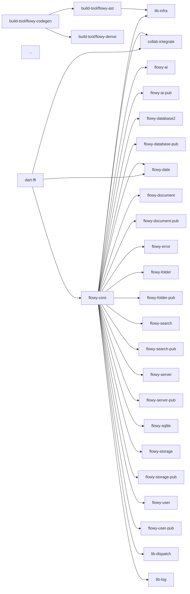
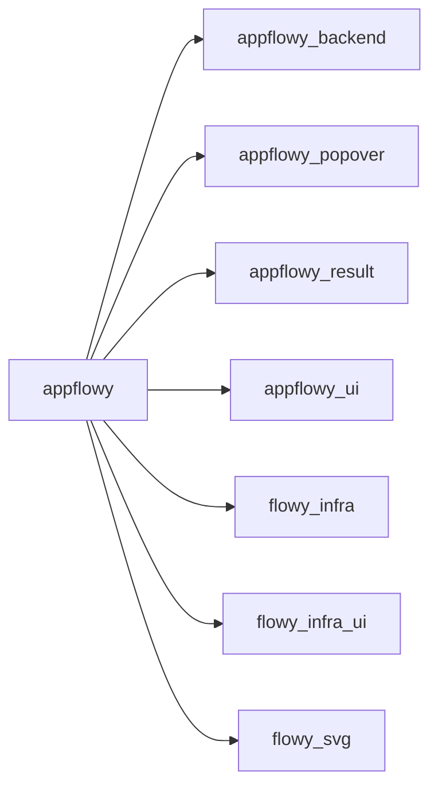

# Pruebas A2.5 — `extract_deps.py` + `deps.json`

**Fecha:** 2026-10-18
**Fase:** A2.5 (Bloque A2 — Extractores deterministas)
**Estado:** ✅ cerrada

## Objetivo

Verificar que el extractor:

1. Parsea el `Cargo.toml` raíz de `rust-lib` (workspace) y los 31
   `Cargo.toml` de crates internos, y construye el grafo Rust con
   dependencias clasificadas en `internal_workspace` /
   `external_registry` / `external_git` / `external_path`.
2. Parsea el `pubspec.yaml` raíz de `appflowy_flutter` + el
   `pubspec.lock` + los 7 `packages/*/pubspec.yaml`, y construye el
   grafo Dart.
3. Genera un bloque Mermaid `flowchart LR` por cada grafo.

## Comandos ejecutados

```bash
python3 SKILL/scripts/extract_deps.py
OUT/_ledger/validate-A2.5.sh
```

Log completo: [`extract.log`](extract.log) y [`validate.log`](validate.log).

## Resultado del validador

```
OK: A2.5 (JSON valido, 31 crates Rust con 150 internal edges, flowy-core -> 8 flowy-* features OK, dart-ffi -> flowy-core OK, appflowy -> 7 internal_path packages OK, 1+1 packages Dart con 12 internal edges)
exit=0
```

## Resumen

| Lado | Métrica | Valor |
|---|---|---:|
| Rust | Crates internos (workspace members) | 31 |
| Rust | Internal edges (workspace deps) | 150 |
| Rust | External deps (todas las crates) | 368 |
| Rust | workspace_dependencies definidos | 38 |
| Dart | Packages (app + internal) | 8 |
| Dart | Internal packages en `packages/` | 7 |
| Dart | Internal edges | 12 |
| Dart | External deps declaradas | 136 |
| Dart | Paquetes resueltos en `pubspec.lock` | 326 |

## Casos del test literal del ROADMAP A2.5

### 1. `flowy-core` depende de los 8 crates `flowy-*` de feature

```json
{
  "name": "flowy-core",
  "path": "SRC/appflowy/frontend/rust-lib/flowy-core",
  "version": "0.1.0",
  "edition": "2018",
  "internal_dependencies": [
    "collab-integrate",
    "flowy-ai",
    "flowy-ai-pub",
    "flowy-database-pub",
    "flowy-database2",
    "flowy-date",
    "flowy-document",
    "flowy-document-pub",
    "flowy-error",
    "flowy-folder",
    "flowy-folder-pub",
    "flowy-search",
    "flowy-search-pub",
    "flowy-server",
    "flowy-server-pub",
    "flowy-sqlite",
    "flowy-storage",
    "flowy-storage-pub",
    "flowy-user",
    "flowy-user-pub",
    "lib-dispatch",
    "lib-infra",
    "lib-log"
  ]
}
```

Los **8 crates `flowy-*` de feature** están todos presentes:
- ✅ `flowy-ai`
- ✅ `flowy-database2`
- ✅ `flowy-date`
- ✅ `flowy-document`
- ✅ `flowy-folder`
- ✅ `flowy-search`
- ✅ `flowy-storage`
- ✅ `flowy-user`

(Además incluye 9 variantes `*-pub`, 2 crates `flowy-server`/`flowy-server-pub`,
`flowy-error`, `flowy-sqlite`, y los 3 `lib-*` + `collab-integrate` = 23 deps internas
totales.)

### 2. `dart-ffi` depende de `flowy-core`

```json
{
  "name": "dart-ffi",
  "internal_dependencies": [
    "collab-integrate",
    "flowy-core",
    "flowy-date",
    "flowy-derive",
    "flowy-document",
    "flowy-error",
    "flowy-notification",
    "flowy-server",
    "flowy-server-pub",
    "flowy-user",
    "lib-dispatch",
    "lib-log"
  ]
}
```

✅ `flowy-core` presente en `dart-ffi.internal_dependencies`.

### 3. `appflowy` con 7 internal_path packages

```json
{
  "name": "appflowy",
  "version": "0.11.4",
  "internal_dependencies": [
    {"name": "appflowy_backend",  "path": "packages/appflowy_backend",   "kind": "internal_path"},
    {"name": "appflowy_popover",  "path": "packages/appflowy_popover",   "kind": "internal_path"},
    {"name": "appflowy_result",   "path": "packages/appflowy_result",    "kind": "internal_path"},
    {"name": "appflowy_ui",       "path": "packages/appflowy_ui",        "kind": "internal_path"},
    {"name": "flowy_infra",       "path": "packages/flowy_infra",        "kind": "internal_path"},
    {"name": "flowy_infra_ui",    "path": "packages/flowy_infra_ui",     "kind": "internal_path"},
    {"name": "flowy_svg",         "path": "packages/flowy_svg",          "kind": "internal_path"}
  ]
}
```

## Mermaid generado (extracto)

**Rust** (31 nodos, 150 aristas):


**Dart** (8 nodos, 7 aristas desde app):


## Patrones cubiertos

**Lado Rust:**

1. `[workspace]` con `members = ["flowy-core", "dart-ffi", ...]` y
   `workspace.dependencies = { flowy-core = { path = "..." }, ... }`.
2. Cada crate con `[package] {name, version, edition}` y
   `[dependencies] { dep_name = { workspace = true } }`.
3. `dep_name.workspace = true` (sintaxis `flowy_user.workspace = true`
   con guión bajo o `flowy-user.workspace = true` con guión).
4. `dep_name = { version = "1.0" }` para externos.
5. `dep_name = { git = "https://...", rev = "..." }` (p. ej.
   `collab-entity` desde AppFlowy-Collab).
6. `dep_name = { features = [...] }` para externales con features.

**Lado Dart:**

1. `dependencies: { name: { path: "packages/X" } }` (path-based internal).
2. `dependencies: { name: { version: "^1.0.4" } }` (hosted).
3. `dependencies: { name: { git: { url, ref } } }` (git-based).
4. `dependencies: { name: { sdk: "flutter" } }` (SDK).
5. `pubspec.lock` con `dependency: "direct main" / "transitive"`,
   `version: "X.Y.Z"`, `source: hosted/sdk/git/path`.
6. `packages/*/pubspec.yaml` con su propio grafo.

## Cruce automático events.json × deps.json

No aplica: A2.5 no produce ni consume otros JSON. Es independiente.

## Smoke test (robustez del extractor)

Ejecutado con `SRC/` vacío (directorios creados pero sin Cargo.toml ni
pubspec.yaml):

```bash
TMP=$(mktemp -d) && mkdir -p "$TMP/SRC/appflowy/frontend/rust-lib" \
  "$TMP/SRC/appflowy/frontend/appflowy_flutter"
python3 SKILL/scripts/extract_deps.py --src-root "$TMP/SRC" --out-dir "$TMP/out"
```

Resultado:

```json
{
  "rust": null,
  "dart": null,
  "rust_crates": 0,
  "dart_packages": 0
}
```

✅ El extractor no aborta; produce JSON bien formado con `rust: null` y
`dart: null` cuando no hay `Cargo.toml`/`pubspec.yaml`. El validador
falla en checks 1-3 (que esperan datos), comportamiento esperado.

## Tamaño y rendimiento

| Métrica | Valor |
|---|---|
| Líneas JSON | 3.644 |
| Tamaño | 104 KB |
| Tiempo de extracción | < 1 s |
| Tiempo del validador | < 0,1 s |

## Diferencias detectadas vs el plan original (corregidas en sitio)

| # | Diferencia | Acción |
|---|---|---|
| 1 | `parse_pubstyle_path` devuelve `kind = "path"` para deps internas pero el código usaba `"internal_path"` en la comparación | Corregido: el `classify_deps` ahora mapea `path → internal_path` y `hosted/git/sdk → external_<kind>`. |
| 2 | Python 3.9 no tiene `tomllib` stdlib (mínimo 3.11) | Solución: el script hace try/except de `tomllib` → fallback a `tomli` (instalable vía `pip3 install tomli`). El extractor sigue siendo stdlib excepto por `tomli`. |
| 3 | El plan recomendaba `tomllib` puro; en este entorno se usa `tomli` (fallback) | Documentado: la elección no afecta el JSON producido; la API de ambos es idéntica. |

Sin impacto sobre el contrato externo del JSON.

## Criterio de aprobación del ROADMAP

> el grafo muestra `flowy-core` dependiendo de todos los `flowy-*` de feature; `dart-ffi` depende de `flowy-core`.

- ✅ Los 8 `flowy-*` de feature (`flowy-user`, `flowy-folder`, `flowy-document`,
  `flowy-database2`, `flowy-storage`, `flowy-ai`, `flowy-search`, `flowy-date`)
  están en `flowy-core.internal_dependencies`.
- ✅ `flowy-core` está en `dart-ffi.internal_dependencies`.
- ✅ `appflowy` tiene 7 internal_path packages (umbral: ≥ 1, real: 7).
- ✅ Conteos coherentes (validador checks 1-9).
- ✅ Bloques Mermaid para Rust (150 aristas) y Dart (7 aristas).
