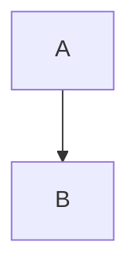
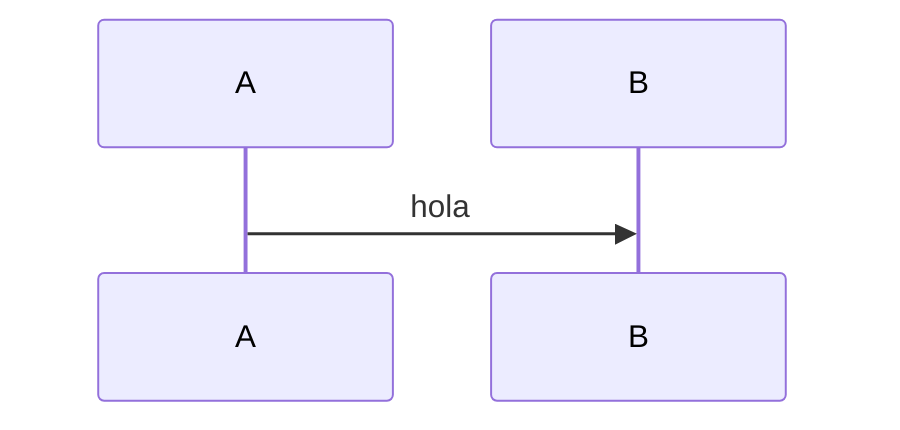

# F00.1 — Fixture sin sección 13 (feature)

Igual que `valid_feature.md` pero omitiendo `## 13. Riesgos y casos límite`. Debe FALLAR con `E_MISSING_SECTION: [13]`.

## 1. Resumen (3–6 líneas)
Texto de la sección 1.

## 2. Alcance
Texto de la sección 2.

## 3. Modelos de datos
Texto.

## 4. Eventos FFI
Texto.

## 5. Notificaciones
Texto.

## 6. BLoCs / Cubits
Texto.

## 7. Servicios e inyección de dependencias
Texto.

## 8. Persistencia
Texto.

## 9. Diagramas de flujo

## 10. Diagramas de secuencia

## 11. Diagramas de estado
Texto.

## 12. Archivos cubiertos (del ledger)
Texto.

## 14. Evidencias y etiquetas
Texto (salta de 12 a 14, falta 13).

## 15. Pruebas
Texto.

## 16. Métricas
Texto.

## 17. Pendientes
Texto.

## 18. Preguntas abiertas
Texto.

## 19. Relacionado con
Texto.
