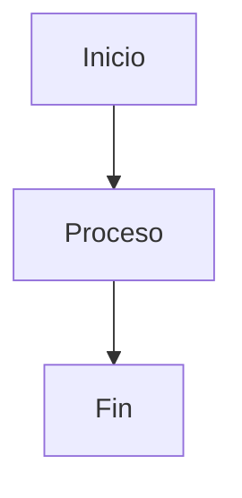
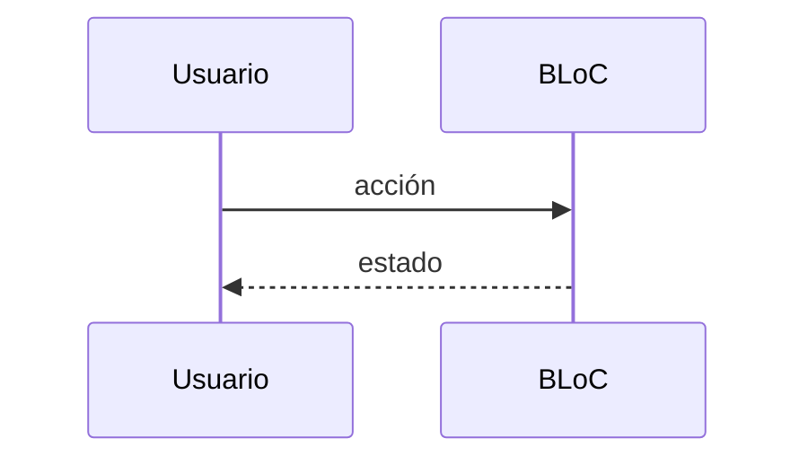

# F00.0 — Fixture válido (feature)

Documento de prueba con las 19 secciones obligatorias de la plantilla feature, en orden, con contenido real. Debe pasar validate_template.

## 1. Resumen (3–6 líneas)
Texto de la sección 1 con al menos una línea de contenido real.

## 2. Alcance
Texto de la sección 2 con detalle de qué entra y qué no.

## 3. Modelos de datos
Texto describiendo el modelo de datos de la feature, con referencias al código.

## 4. Eventos FFI
Tabla de eventos FFI que dispara la feature (vacía si no aplica).

## 5. Notificaciones
Tabla de notificaciones Rust→Dart que recibe la feature.

## 6. BLoCs / Cubits
Lista de BLoCs y Cubits asociados a la feature.

## 7. Servicios e inyección de dependencias
Servicios Dart (get_it) y Rust (flowy-core/deps_resolve) que consume la feature.

## 8. Persistencia
Tablas SQLite, KV y archivo de collab en disco asociados a la feature.

## 9. Diagramas de flujo

## 10. Diagramas de secuencia

## 11. Diagramas de estado
stateDiagram no aplica para esta feature: omitido intencionalmente.

## 12. Archivos cubiertos (del ledger)
Lista tabular de archivos del ledger asignados a esta feature.

## 13. Riesgos y casos límite
- Riesgo 1 y mitigación.
- Riesgo 2 y mitigación.

## 14. Evidencias y etiquetas
- 3 afirmaciones [VERIFICADO].
- 1 afirmación [INFERIDO].
- 0 afirmaciones [NO DETERMINADO].

## 15. Pruebas
Tests unitarios, de BLoC, widget e integration que cubren esta feature.

## 16. Métricas
- LOC: 100.
- Nº de eventos FFI: 5.
- Nº de BLoCs: 2.

## 17. Pendientes
Tareas descubiertas durante la documentación que requieren seguimiento.

## 18. Preguntas abiertas
Lo marcado como [NO DETERMINADO] que va a 22-preguntas-abiertas.md.

## 19. Relacionado con
Enlaces cruzados [[F00.1]], [[F01.0]], [[B1.5]].
