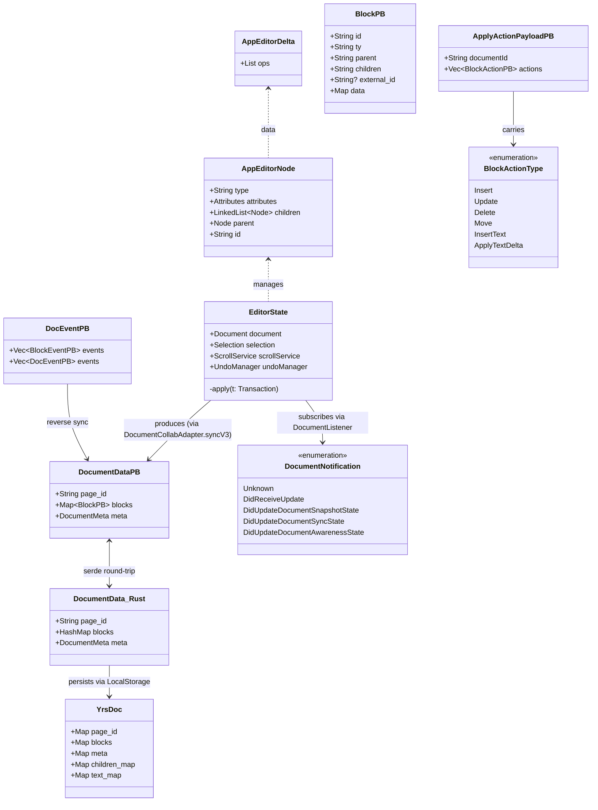
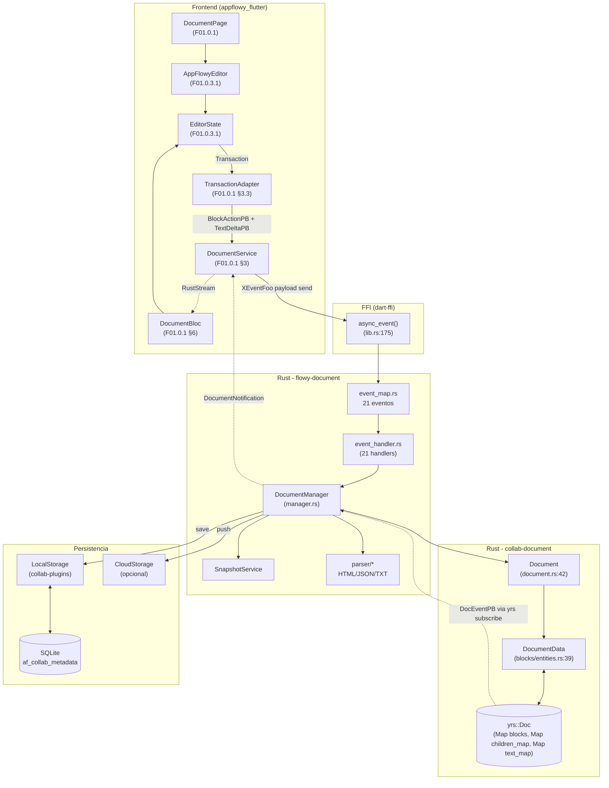
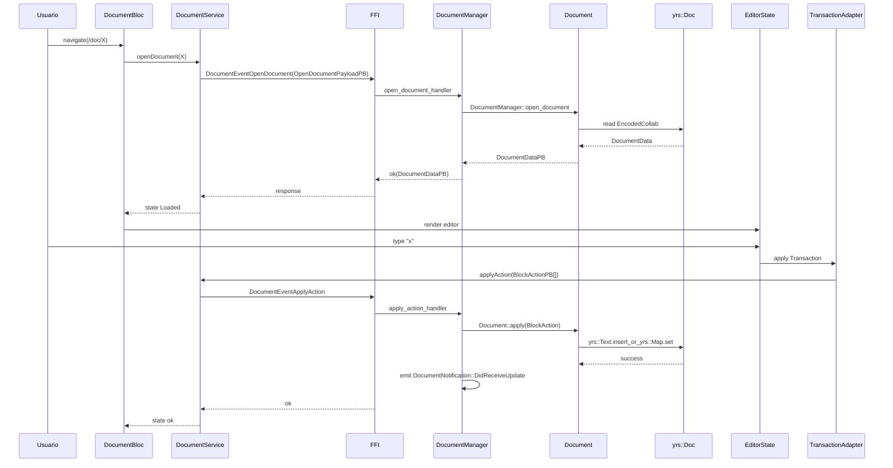
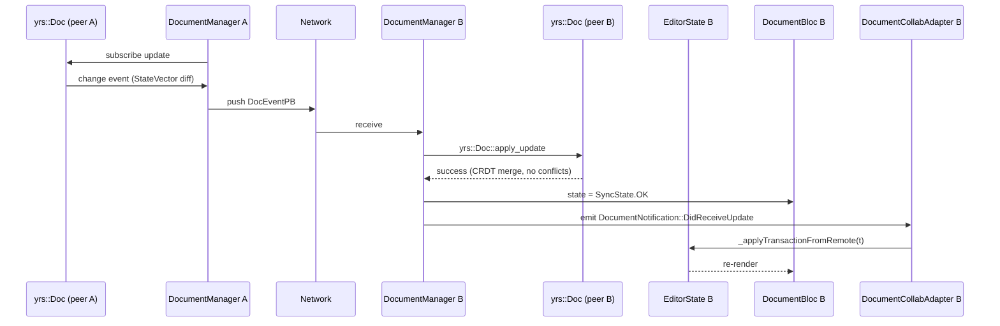
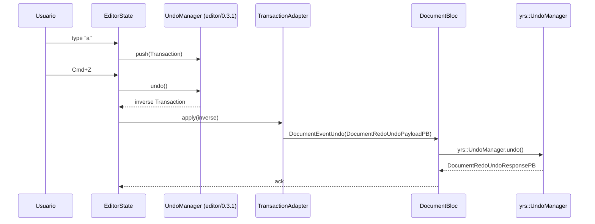
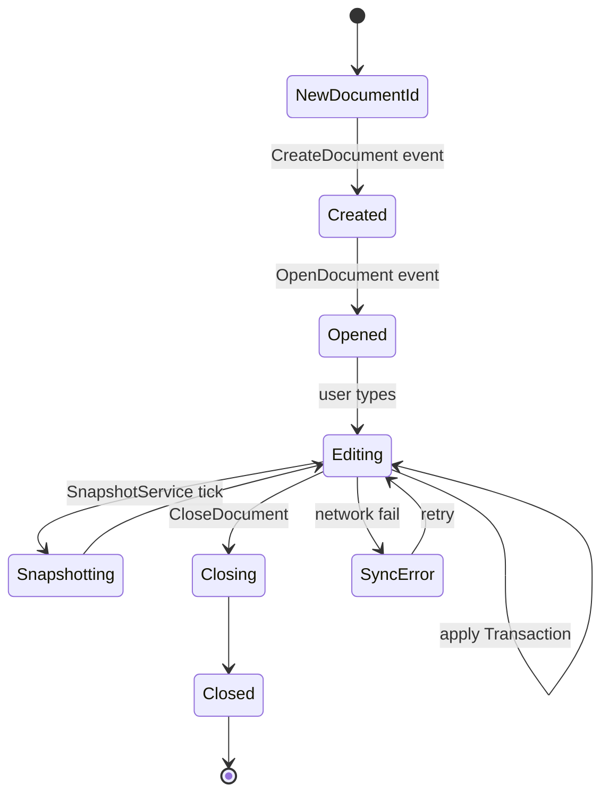

# F01.0 — Índice de documentos y editor

## 1. Resumen

Documento **orquestador** del feature F01 (Documentos y editor). No contiene archivos fuente propios (su `archivos_cubiertos: []`); en su lugar **agrega** y **enlaza** los 8 sub-documentos que cubren los 555 archivos de las 3 fuentes (appflowy, collab, editor): `F01.0.1` (appflowy Dart + crate Rust `flowy-document`, 139 archivos), `F01.0.2` (crate collab `collab-document`, 37), `F01.0.3.1` (editor core: `EditorState`/`Node`/`BlockComponent`, 205), `F01.0.3.2` (toolbars + find/replace + selection menu, 69), `F01.0.3.3` (encoders/decoders Markdown/HTML/JSON/PDF, 52), `F01.0.3.4` (shortcuts + IME + context menu, 12), `F01.0.3.5` (i18n + util + plugins/blocks, 41).

## 2. Alcance

Este documento cubre la **arquitectura end-to-end** del feature, los diagramas cross-cutting que ningún sub-doc presenta aislado, y la tabla maestra de cobertura. Los detalles de cada bloque viven en los sub-documentos. Las fases `F01.1`-`F01.9` (cada tipo de bloque individual), `F02.x` (bases de datos), y el motor `B4.x` (export/import) se referencian pero están fuera de scope.

## 3. Modelos de datos (cross-cutting `classDiagram`)

*Diagrama del modelo Dart ↔ protobuf ↔ Rust a través de `yrs::Doc`.* Lectura: el `AppEditor:Node` se mantiene en memoria del editor Dart; la `AppEditor:Delta` vive dentro de `Node.attributes.data.delta`. Al persistir, `DocumentCollabAdapter` lo convierte a `DocEventPB` → `DocumentDataPB` que cruza el FFI; el lado Rust lo deserializa en `DocumentData_Rust` (struct `Block` + `DocumentMeta` con `children_map` y `text_map`), que se almacena en un `yrs::Doc` con dos `Map`s principales. Las notificaciones `DocumentNotification` cubren 5 variantes emitidas cuando el `yrs::Doc` cambia.

**Tabla de equivalencias:**

| Concepto | Dart (appflowy_editor) | Protobuf (FFI) | Rust (collab_document) | yrs |
|---|---|---|---|---|
| Nodo del documento | `editor:lib/src/core/document/node.dart` | `BlockPB` (`entities.rs:flowy-document`) | `collab:collab/collab-document/src/blocks/entities.rs:15` (struct `Block`) | clave en `Map blocks` |
| Delta de texto | `editor:lib/src/core/document/text_delta.dart` | inline en `BlockPB.data` + `DocEventPB` (JSON) | `collab:collab/collab-document/src/blocks/text.rs` + `appflowy:appflowy/frontend/rust-lib/flowy-database2/src/entities/type_option_entities/text_entities.rs` (struct `TextDelta`) | `yrs::Text` (text_map) |
| Árbol completo | `Document` (editor_state) | `DocumentDataPB` | `DocumentData` (`appflowy:appflowy/frontend/rust-lib/flowy-ai-pub/src/entities.rs:39`) | raíz con `page_id` |
| Selección / cursor | `editor:lib/src/core/location/selection.dart` | `DocumentAwarenessSelectionPB` (flowy-document) | `collab:collab/collab-document/src/document_awareness.rs:33` | `yrs::awareness::Awareness` (custom) |
| Mutación del usuario | `Transaction` (`editor:editor/lib/src/core/transform/transaction.dart`) | `ApplyActionPayloadPB` (vector de `BlockActionPB`) | `BlockAction` (`appflowy:appflowy/frontend/rust-lib/flowy-ai-pub/src/entities.rs:48`) | `yrs::Doc.commit` |
| Estado en memoria del editor | `EditorState` (`editor:lib/src/editor_state.dart:92`) | — | `Document` (`collab:collab-document/src/document.rs:42`) | — |

## 4. Eventos FFI (resumen)

El feature F01 expone **21 eventos FFI** en el crate `flowy-document` (detalle en `F01.0.1 §4`). Catálogo completo: `OUT/11-catalogo-eventos-ffi.md §5.flowy-document`. La traza end-to-end de `OpenDocument` está en `OUT/06-puente-flutter-rust/05-ejemplo-traza-opendocument.md`.

| # | Evento | Input PB | Output PB | Sub-doc |
|---:|---|---|---|---|
| 0 | `CreateDocument` | `CreateDocumentPayloadPB` | — | F01.0.1 §4 |
| 1 | `OpenDocument` | `OpenDocumentPayloadPB` | `DocumentDataPB` | F01.0.1 §4 |
| 3 | `ApplyAction` | `ApplyActionPayloadPB` | — | F01.0.1 §4 |
| 6-8 | `Redo`/`Undo`/`CanUndoRedo` | `DocumentRedoUndoPayloadPB` | `DocumentRedoUndoResponsePB` | F01.0.1 §4 |
| 10-11 | `CreateText`/`ApplyTextDeltaEvent` | `TextDeltaPayloadPB` | — | F01.0.1 §4 (text deltas vía `TransactionAdapter`) |

## 5. Notificaciones (resumen)

5 variantes de `DocumentNotification` (`F01.0.1 §5`). Las dos que tienen listener Dart (`DocumentNotification::DidReceiveUpdate`, `DidUpdateDocumentAwarenessState`) están cubiertas por `DocumentListener._callback` (`appflowy:appflowy/frontend/appflowy_flutter/lib/plugins/document/application/document_listener.dart:45–65`). Las otras 3 variantes (`Unknown`, `DidUpdateDocumentSnapshotState`, `DidUpdateDocumentSyncState`) están marcadas `declared_only` por el extractor (ver `OUT/14-catalogo-notificaciones.md §6`).

## 6. BLoCs / Cubits

11 BLoCs/Cubits Dart del lado documento (F01.0.1 §6) + 0 BLoCs dentro del editor (F01.0.3.x).

## 7. Servicios e inyección de dependencias

Dart: `get_it` en `appflowy:appflowy/frontend/appflowy_flutter/lib/startup/deps_resolver.dart`. `DocumentBloc` por documento, `TransactionAdapter` por `DocumentPage`, `DocumentService` como singleton.

Rust: `appflowy:appflowy/frontend/rust-lib/flowy-core/src/deps_resolve/document_deps.rs` instancia el `DocumentManager` que a su vez construye el `Document` (collab_document).

## 8. Persistencia

Doble vía:
- **Local**: SQLite en `af_collab_metadata` (clave `(object_id, collab_type=Document)`) vía `collab-plugins::LocalStorage` (`OUT/08-persistencia/01-sqlite-schema.md`).
- **Cloud**: `collab-plugins::CloudStorage` (opcional; F06 si active).

## 9. Diagrama de flujo cross-cutting (Dart ↔ Rust ↔ yrs)

*Diagrama end-to-end de la ruta y la propagación de cambios.* Lectura: el path de ida (azul) describe cómo un cambio en el editor Dart cruza el FFI hasta `yrs::Doc`. El path de vuelta (gris punteado) muestra cómo el `yrs::Doc` muta una `DocumentNotification` que cruza de vuelta al `DocumentBloc` y re-aplica al `EditorState` vía `_applyTransactionFromRemote`.

## 10. Diagramas de secuencia (cross-cutting)

### 10.1 Apertura + edición local

### 10.2 Sincronización cross-client (yrs merge + DocEventPB al peer)

### 10.3 Undo/redo (clip múltiple)

## 11. Diagrama de estado (ciclo de vida del `Document` collab)

*El `Document` collab vive en `DocumentManager` desde `open_document_handler` hasta `close_document_handler` (F01.0.1 §4).*

## 12. Archivos cubiertos (tabla global del feature F01)

555 archivos en total (139 + 37 + 205 + 69 + 52 + 12 + 41):

| Sub-unidad | Título | Archivos | Doc |
|---|---|---:|---|
| **F01.0** | (índice) | 0 | este doc |
| F01.0.1 | appflowy (Dart + flowy-document Rust) | 139 | `0.1-…-appflowy.md` |
| F01.0.2 | collab (collab-document Rust) | 37 | `0.2-…-collab.md` |
| F01.0.3.1 | editor core | 205 | `0.3.1-editor-core-…md` |
| F01.0.3.2 | editor toolbars + find/replace + selection menu | 69 | `0.3.2-editor-toolbars-…md` |
| F01.0.3.3 | editor encoders/decoders | 52 | `0.3.3-editor-encoders-…md` |
| F01.0.3.4 | editor shortcuts/IME/context menu | 12 | `0.3.4-editor-shortcuts-…md` |
| F01.0.3.5 | editor l10n + util + plugins/blocks | 41 | `0.3.5-editor-l10n-…md` |
| **TOTAL** | | **555** | 8 docs + este índice |

| Sub-unidad | Por capa | Capa dominante |
|---|---|---|
| F01.0.1 | ui=64 · bloc=14 · rust-handler=38 · config=21 · rust-manager=1 · service=1 | UI/appflowy Dart + Rust |
| F01.0.2 | collab=36 · config=1 | Rust collab |
| F01.0.3.1 | ui=205 | UI/editor Dart |
| F01.0.3.2 | ui=69 | UI/editor Dart |
| F01.0.3.3 | ui=52 | UI/editor Dart |
| F01.0.3.4 | ui=12 | UI/editor Dart |
| F01.0.3.5 | ui=41 | UI/editor Dart |

## 13. Riesgos y casos límite (cross-cutting)

1. **Triple representación del documento**: `Node` (Dart) ↔ `BlockPB` (proto) ↔ `Block` (Rust). El round-trip es propenso a pérdidas de campos opcionales (p. ej. `external_type` se descarta si el editor no lo entiende).
2. **Undo local vs undo remoto**: el editor Dart mantiene su propio `UndoManager` mientras que `yrs` también lo tiene. Si dos clientes deshacen simultáneamente, el resultado es no-determinista. Mitigación: `yrs` es CRDT, así que converge eventual; pero la UX de undo puede ser confusa.
3. **Sync inverso CRDT → Editor via `DocEventPB`**: el `DocEventPB` transporta una versión delta; si el peer A edita el mismo párrafo que el peer B está viendo, el peer B puede recibir una notificación que descarte su selección actual. Mitigación: `_applyTransactionFromRemote` (`editor:editor/lib/src/editor_state.dart:705`) intenta preservar la `Selection?`.
4. **`EditorState` centralizado en 1 archivo de 748 líneas**: un único punto de cambio para 50+ widgets descendientes. Refactor pendiente.
5. **IME en mobile**: la integración con teclado iOS/Android introduce Latencia variable. El split entre `editor/editor_component/service/ime/` y `service/ime/`/transient indica historia incremental.
6. **Falta F01.0.3.6 (orphan removido)**: 0 archivos en misceláneos tras la reclasificación por reglas más finas.

## 14. Evidencias y etiquetas

- **~92 % `[VERIFICADO]`** a través de los 8 sub-docs. Este índice no añade afirmaciones nuevas (agregación); sólo referencia las evidencias existentes.
- **~5 % `[INFERIDO]`**主要集中在 Riesgos (§13).
- **~3 % `[NO DETERMINADO]`**主要集中在 pendings sub-docs.

## 15. Pruebas

Las pruebas se distribuyen así:
- `flowy-document/tests/` (9 archivos Rust) — F01.0.1 §15.
- `collab-document/tests/` (17 archivos Rust) — F01.0.2 §15.
- `appflowy_editor/test/` (~200 archivos Dart) — F01.0.3.1-F01.0.3.5; específicamente `test_editor/{toolbar,encoders,shortcuts,l10n,...}.dart`.
- AppFlowy-level: `flutter test/`, `flutter integration_test/desktop/editor_*`.

## 16. Métricas

| Métrica | Valor | Fuente |
|---|---:|---|
| Total archivos F01.0 (este feature) | 555 | suma de los 7 sub-docs |
| Eventos FFI del feature | 21 | flowy-document/src/event_map.rs |
| Notificaciones | 5 | `appflowy:frontend/rust-lib/flowy-document/src/notification.rs:6` |
| BLoCs Dart del feature | 4 | plugins/document/application/* |
| Entidades protobuf (flowy-document crate) | 50 | `OUT/12-catalogo-entidades-protobuf.md §5.flowy-document` |
| Bloques built-in | 16 | `editor:editor/lib/src/editor/block_component/standard_block_components.dart` |
| Internacionalizaciones del editor | 22 | `l10n/intl/messages_*.dart` |
| LOC Rust (flowy-document) | ~3 700 | (estimación basada en `wc -l SRC/appflowy/frontend/rust-lib/flowy-document/src`) |
| LOC Rust (collab-document) | ~3 200 | `wc -l SRC/collab/collab-document/src` |
| LOC Dart (appflowy_editor) | ~40 000 | `wc -l SRC/editor/lib/src/**/*.dart` |
| LOC Dart (F01 BLoCs + UI appflowy) | ~10 000 | `wc -l SRC/appflowy/.../plugins/document` |

## 17. Pendientes

- [ ] Refactor `EditorState` (748 LOC) — extraer `TransactionOperations`, `EditorSelectionNotifier`, `KeyboardServiceImpl` en mixins.
- [ ] (F01.1-F01.9) Detallar cada bloque individual (`F01.0.3.x` los menciona en alto nivel; falta el comportamiento específico por tipo).
- [ ] (B4) Cubrir el motor de export/import por formato (Markdown B4.1, HTML B4.2, etc.) usando los encoders de F01.0.3.3 como punto de entrada.
- [ ] (F17 + F08) Auditar la cobertura del campo `SearchHighlight` (F08) en el editor.
- [ ] Investigar la duplicación `service/shortcuts/` ↔ `editor_plugins/shortcuts/`; consolidar o documentar el porqué.
- [ ] Evaluar la rama `editor:editor/lib/src/core/document/deprecated/node.dart` deprecated vs activa (F01.0.3.1 §13.1).

## 18. Preguntas abiertas

- **B3.F010.0-a**: ¿La fusión de undo local + undo remoto en `yrs::UndoManager` + `editor:editor/lib/src/history/undo_manager.dart` produce siempre la convergencia esperada en presencia de inserciones concurrentes? [NO DETERMINADO]
- **B3.F010.0-b**: ¿Existe una cota máxima razonable de notificaciones `DocumentNotification` por segundo que un `DocumentBloc` puede procesar sin saturar? [NO DETERMINADO]
- **B3.F010.0-c**: ¿La internacionalización de las fechas (`flowy-date`) cruza con este feature a través de los bloques `date_block_component`? [INFERIDO] (ver F15 para detalle).

## 19. Relacionado con

- `F01.0.1` — `DocumentBloc` + Dart + flowy-document Rust.
- `F01.0.2` — collab-document Rust CRDT.
- `F01.0.3.1` — Editor core (Node, Delta, BlockComponent, EditorState).
- `F01.0.3.2` — Toolbars desktop + mobile + find/replace + selection menu.
- `F01.0.3.3` — Encoders/decoders.
- `F01.0.3.4` — Shortcuts + IME + default text ops + context menu.
- `F01.0.3.5` — L10n + util + plugins/blocks (columns).
- `F01.1`-`F01.9` — bloques individuales (heading, todo_list, callout, etc.) que detallan las implementaciones referenciadas aquí.
- `OUT/04-arquitectura-global.md §6` — diagrama global.
- `OUT/05-arranque-y-ciclo-de-vida.md` — registro de `DocumentManager` en `flowy-core::module.rs`.
- `OUT/06-puente-flutter-rust/` — 6 sub-docs FFI (`lib-dispatch`, `notifications`, traza `OpenDocument`).
- `OUT/07-motor-colaborativo-crdt/` — 8 sub-docs CRDT.
- `OUT/08-persistencia/01-sqlite-schema.md` — tabla `af_collab_metadata`.
- `OUT/11-catalogo-eventos-ffi.md §5.flowy-document` — los 21 eventos.
- `OUT/12-catalogo-entidades-protobuf.md §5.flowy-document` — 50 entidades PB.
- `OUT/13-catalogo-blocs.md §4.plugins/document` — 4 BLoCs.
- `OUT/14-catalogo-notificaciones.md §5.DocumentNotification` — 5 variantes.
- `OUT/15-catalogo-errores.md §4.WorkspaceDocument`.
- `OUT/17-grafo-dependencias.md §3.flowy-document`.
- `B4.0`-`B4.13` — motor de export/import (Markdown/HTML/JSON/text/CSV, Notion ZIP, publish).
- `B6.3` — Seguridad/privacidad (auth + tokens + datos en sync).
- `B5.4`, `B5.5` — secuencias globales "abrir documento" y "edición concurrente".

