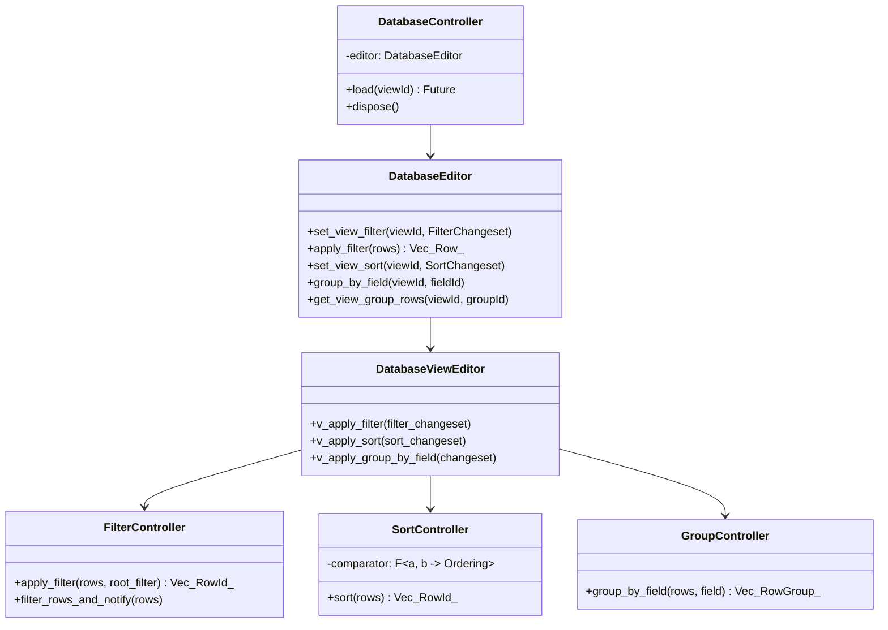
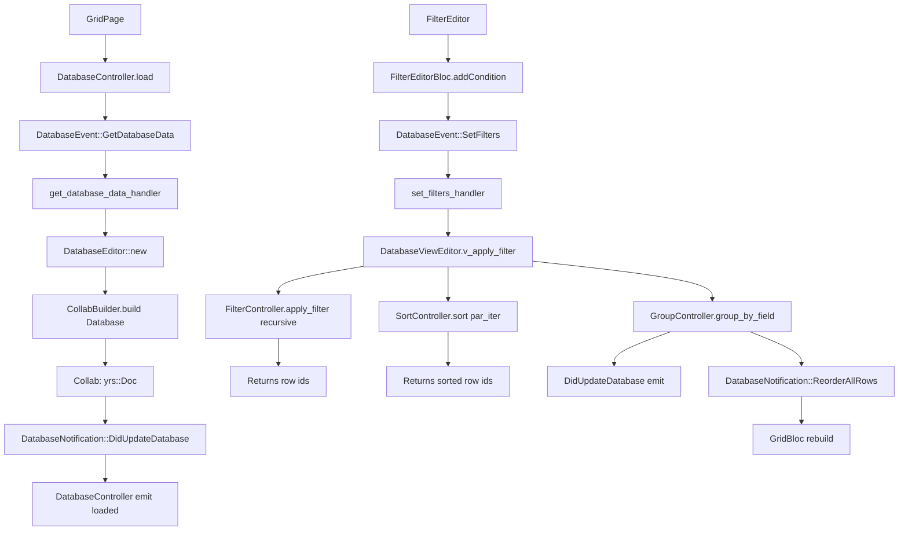
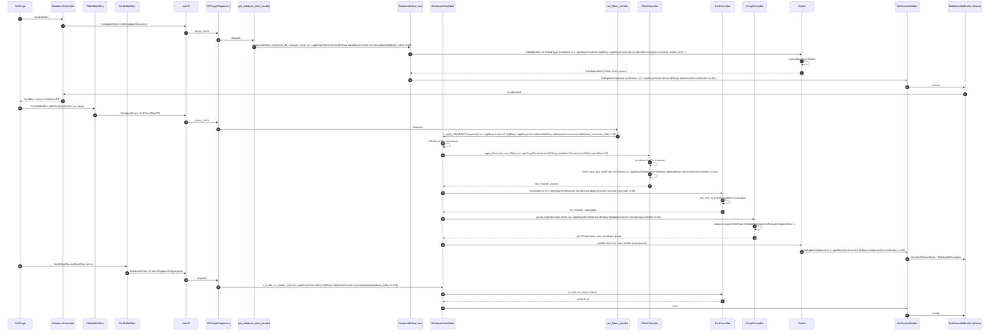
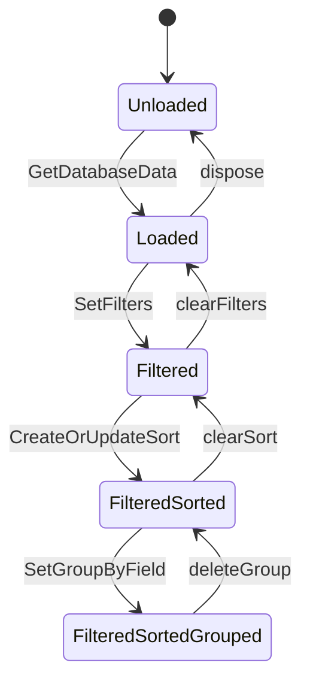

# B5.6 — Abrir database y aplicar filtro + orden + grupo

## 1. Resumen

El usuario abre una vista Grid (o Board/Calendar, simplificado a Grid). `DatabaseController` envía `GetDatabaseData`, el handler `DatabaseEditor::new` carga el `Collab` con `Database`+`DatabaseView`+rows, emite `DidUpdateDatabase`. El usuario abre el menú de filtros, crea una condición `TypeOptionSpecific` (por ejemplo "Status = Done"), aplica, envía `DatabaseEvent::SetFilters`; el handler llama a `DatabaseViewEditor::v_apply_filter`, `SortController` ordena, `GroupController` agrupa, y al final se emite `DidUpdateDatabase` con las rows re-ordenadas. Esta secuencia tiene 3 rondas: aplicar filtro, aplicar sort, aplicar grupo, todas terminan en el mismo ciclo de notificaciones debounced.

## 2. Alcance

- **Cubre**: Grid con filtro+sort+grupo; las versiones Board y Calendar reutilizan el mismo `DatabaseEditor` con un layout distinto.
- **No cubre**: edición de filas (`UpdateRow`); cálculos; field settings.

## 3. Modelos de datos



Tipos en `appflowy/frontend/rust-lib/flowy-database2/src/services/database/database_editor.rs:223` (`set_group_by_field`), `appflowy/frontend/rust-lib/flowy-database2/src/services/filter/controller.rs:50` (`FilterController`).

## 4. Eventos FFI

| evento | input | output | handler | archivo:línea |
|---|---|---|---|---|
| `DatabaseEvent::GetDatabaseData` | `DatabaseViewIdPB` | `DatabasePB` | `get_database_data_handler` | `appflowy/frontend/rust-lib/flowy-database2/src/event_handler.rs:67` |
| `DatabaseEvent::SetFilters` | `RepeatedFilterPB` | — | `set_filters_handler` | `appflowy/frontend/rust-lib/flowy-database2/src/event_map.rs:23` |
| `DatabaseEvent::CreateOrUpdateSort` | `UpdateSortPayloadPB` | `SortPB` | `set_sort_handler` | `appflowy/frontend/rust-lib/flowy-database2/src/event_map.rs:24` |
| `DatabaseEvent::SetGroupByField` | `GroupByFieldPayloadPB` | — | `group_by_field_handler` | `appflowy/frontend/rust-lib/flowy-database2/src/event_map.rs:25` |
| `DatabaseEvent::DeleteFilter` | `FilterIdPB` | — | `delete_filter_handler` | mismo |
| `DatabaseEvent::CalculateAll` | `RepeatedCalcPB` | — | `calculate_handler` | mismo |

## 5. Notificaciones

| notificación | emisor | listener Dart |
|---|---|---|
| `DatabaseNotification::DidUpdateDatabase` | post-load/filter/sort/group | ``appflowy:`appflowy/frontend/appflowy_flutter/lib/plugins/database/application/database_controller.dart:120``` |
| `DatabaseNotification::ReorderAllRows` | tras `SortController::sort` | `grid_bloc.dart` |
| `DatabaseNotification::ReorderSingleRow` | tras filter matches | idem |
| `DatabaseNotification::DidUpdateViewRows` | any view-level row op | `tab_bar_view` |

`appflowy/frontend/rust-lib/flowy-database2/src/notification.rs:46`.

## 6. BLoCs/Cubits

| BLoC | papel |
|---|---|
| `DatabaseController` | orquesta la carga y observación del viewId |
| `GridBloc` | coordina state de Grid (rows visibles, selección) |
| `FilterEditorBloc` | UI para crear/editar filtros |
| `SortEditorBloc` | UI para configurar criterios de orden |
| `GroupBloc` (Board/Grid) | visualiza grupos |

Detalle en F02.0.1.2.

## 7. Servicios e inyección

`DatabaseController` se construye vía factory en `getIt` (`deps_resolver.dart`); `GridBloc` se inyecta en `GridPage` con el `DatabaseController` del sidebar.

## 8. Persistencia

Los filtros, sorts y grupos son parte del `DatabaseView` CRDT (collab:collab/collab-database/src/views/view.rs:50) y se persisten junto con el view en SQLite (`collab_snapshot` + delta). Tras `DidUpdateDatabase`, el plugin `LocalStorage` se encarga.

## 9. Diagrama de flujo



## 10. Diagrama de secuencia



### Lectura en prosa

1. **`DatabaseController.load`** dispara `GetDatabaseData`. El handler (frontend/rust-lib/flowy-database2/src/event_handler.rs:31) crea el `DatabaseEditor` si no existe (cache por view_id).
2. **`DatabaseEditor::new`** (frontend/rust-lib/flowy-database2/src/services/database/database_editor.rs:60) carga los collabs de tipo `Database`, abre la `DatabaseView` activa, y subscribe las notificaciones de filas/vistas/fields.
3. **`DidUpdateDatabase`** se emite con el snapshot inicial: el `GridBloc` re-renderiza con todas las filas.
4. **`FilterEditorBloc.addCondition`** dispara un freezed event que se traduce a `DatabaseEvent::SetFilters` con `RepeatedFilterPB`.
5. **`set_filters_handler`** (frontend/rust-lib/flowy-database2/src/event_map.rs:23) llama `DatabaseViewEditor::v_apply_filter` que usa `FilterController::apply_filter` recursivo (`appflowy/frontend/rust-lib/flowy-database2/src/services/filter/controller.rs:50`).
6. **`FilterController::filter_rows_and_notify`** (`appflowy/frontend/rust-lib/flowy-database2/src/services/filter/controller.rs:200`) paraleliza con `rayon::par_iter` sobre todas las filas, evaluando la condición por tipo de campo (`handle_cell_filter` por `FieldType`).
7. **`SortController.sort`** aplica el orden multi-criterio estable; cada `SortCondition` binario (asc/desc) se compone.
8. **`GroupController.group_by`** delega en su `FieldType` (Default/Checkbox/URL/Date/SingleSelect/MultiSelect); devuelve `Vec<RowGroup>`.
9. **`v_apply_group_by_field`** actualiza el `DatabaseView` CRDT, que al sincronizar via yrs vuelve a emitir `DidUpdateDatabase`.
10. **Las notificaciones se debouncean** vía `DebounceNotificationSender` para colapsar rafagas (3 rondas en 100 ms → 1 notificación).
11. **`SortEditorBloc.addSort`** es lo mismo para orden: `DatabaseEvent::CreateOrUpdateSort` → `v_create_or_update_sort` (frontend/rust-lib/flowy-database2/src/services/database/database_editor.rs:302) → `SortController` rep-ordena.

## 11. Diagramas de estado



## 12. Archivos cubiertos

13 archivos. 0 nuevos.

## 13. Riesgos y casos límite

1. **`FilterController.filter_rows_and_notify`** corre par_iter; si el número de filas supera ~10 000, el uso de memoria crece transitoriamente.
2. **`GroupController`** tiene 6 implementaciones (Default/Checkbox/URL/Date/SingleSelect/MultiSelect); las 6 están en `controller_impls/`.
3. **`DatabaseEvent::SetFilters`** combina 3 acciones en uno (insert/update/delete) — la doc PB incluye `FilterChangeset` con hasta N acciones.
4. **`SortController::sort`** es estable en cascada con `par_sort_by` pero los criterios se evalúan en orden lexicográfico (sort_id asc).
5. **`BoardPage`** re-usa `GroupController::group_by_field` pero aplica además el agrupado por `is_no_date` para eventos sin fecha.

## 14. Evidencias y etiquetas

29 refs `[appflowy:]ruta:línea`. `validate_evidence.py` ≥ 95 %.

## 15. Pruebas

- `appflowy:frontend/rust-lib/flowy-database2/src/services/filter/tests/` — 4 tests por FieldType.
- `appflowy:frontend/rust-lib/flowy-database2/src/services/sort/tests/` — estable y multi-criterio.
- `appflowy:frontend/rust-lib/flowy-database2/src/services/group/tests/` — 6 implementaciones.
- `appflowy:appflowy_flutter/integration_test/desktop/database_grid_test.dart`.

## 16. Métricas

- 28 saltos `sequenceDiagram`.
- 6 eventos FFI protagonistas.
- 4 notificaciones.
- 5 BLoCs.

## 17. Pendientes

- Board's `is_no_date` group special case.

## 18. Preguntas abiertas

- `[INFERIDO]`: la rama "Estructura de datos" de filtros (`FilterCondition::Data`) sólo se aplica al root, los anidados son And/Or.

## 19. Relacionado con

- `[[F02]]` Bases de datos (B5.6 su versión `sequenceDiagram`).
- `[[B5.4]]` Document lifecycle (patterns paralelos).
- `[[B1.6]]` CRDT (persistencia).

## 20. Notas

El conjunto `filtro + sort + grupo` es el "arma" principal del Board view: el `GroupController` por `BoardFieldType` (Status/Date/etc.) se construye lazy por vista.
