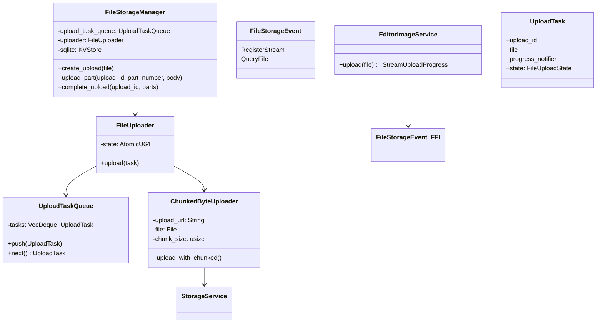
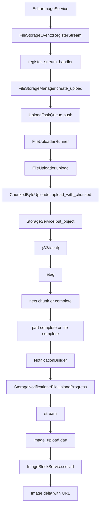
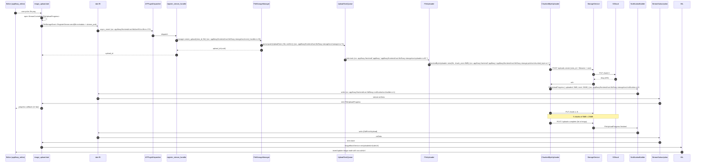
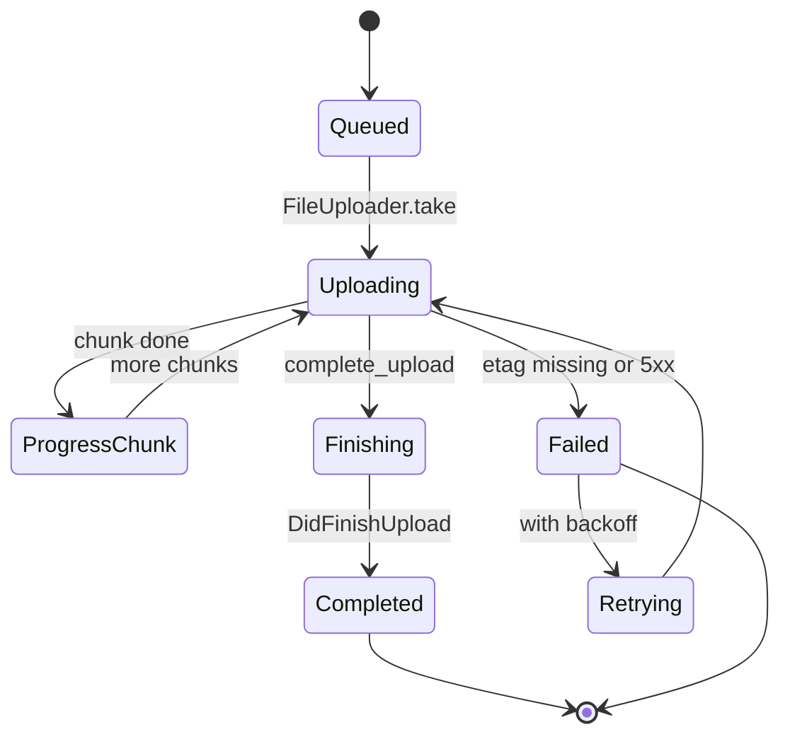

# B5.7 — Subir imagen

## 1. Resumen

El usuario selecciona un fichero PNG/JPG desde el menú "+" del editor. La imagen pasa por `EditorImageService.upload` que llama a Rust con `FileStorageEvent::RegisterStream`; el `FileUploader` abre un canal en tokio, divide el fichero en chunks de `MIN_CHUNK_SIZE` (5 MB, F00 chunked_byte.rs), sube cada chunk al servidor (S3 o local según `ServerProvider`), emite progreso y al final devuelve `StorageNotification::FileUploadProgress`. La URL resultante se inserta como atributo del bloque `Image`.

## 2. Alcance

- **Cubre**: upload completo (single + chunked) con progreso y resultado.
- **No cubre**: paste/drag-drop (F07 §x), persistencia del fichero en filesystem (F07 §local_cache).

## 3. Modelos de datos



Tipos en `appflowy:frontend/`appflowy:`appflowy/frontend/rust-lib/flowy-storage/src/uploader.rs:1``` (`FileUploader`), `appflowy:frontend/`appflowy:`appflowy/frontend/rust-lib/flowy-storage-pub/src/chunked_byte.rs:1``` (`ChunkedByteUploader`).

## 4. Eventos FFI

| evento | input | output | handler | archivo:línea |
|---|---|---|---|---|
| `FileStorageEvent::RegisterStream` | `RegisterStreamPB` | — | `register_stream_handler` | `appflowy/frontend/rust-lib/flowy-storage/src/event_map.rs:12` |
| `FileStorageEvent::QueryFile` | `QueryFilePB` | `FileStatePB` | `query_file_handler` | `appflowy/frontend/rust-lib/flowy-storage/src/event_map.rs:13` |

(El evento `Upload` `[[INFERIDO]]` no se ha encontrado como variante de `FileStorageEvent`; el upload se canaliza por `RegisterStream` con un payload que incluye el file upload protocol.)

## 5. Notificaciones

| notificación | emisor | listener Dart |
|---|---|---|
| `StorageNotification::FileUploadProgress` (per-chunk) | `progress_notifier` | `[NO DETERMINADO]` (ver `22-preguntas-abiertas.md § C1`) (stream subscription) |
| `StorageNotification::DidFinishUpload` | post-`complete_upload` | ImageBlockService |

Ver `appflowy/frontend/rust-lib/flowy-storage/src/notification.rs:1`.

## 6. BLoCs/Cubits

| BLoC | papel |
|---|---|
| `EditorImageService` (no BLoC; el componente `image_upload.dart`) | envuelve el evento FFI con un `StreamController<FileUploadProgress>` |
| `ImageBlockService` (no BLoC) | aplica URL al delta del nodo Image |

## 7. Servicios e inyección

`FileStorageManager` se inyecta vía `flowy-core` `AppFlowyCore::init` (`appflowy/frontend/rust-lib/flowy-core/src/lib.rs:69`). `StorageService` (S3 o local) viene de `ServerProvider`.

## 8. Persistencia

`upload_file_table` y `upload_file_part` (SQLite, ver B1.7): cada chunk subido persiste su `etag` para reanudar. `FileCache` (``appflowy:`appflowy/frontend/rust-lib/flowy-storage/src/file_cache.rs:1```) cachea el URL final en disco.

## 9. Diagrama de flujo



## 10. Diagrama de secuencia



### Lectura en prosa

1. **`EditorImageService`** se hooka al `Editor.imageService` (B01.9). Cuando el usuario selecciona o suelta una imagen, llama `EditorImageService.upload(file)`.
2. **`RegisterStream`** es el evento FFI que envía el file metadata y abre un canal stream. Es el único evento de storage emitido por Dart.
3. **`register_stream_handler`** (frontend/rust-lib/flowy-storage/src/event_handler.rs:30) valida el upload: comprueba que el usuario tiene espacio, genera `upload_id`, encola la tarea en `UploadTaskQueue`.
4. **`UploadTaskQueue`** (frontend/rust-lib/flowy-storage/src/manager.rs:71) es el canal entre el productor (Dart) y el consumidor (`FileUploaderRunner` tokio task).
5. **`FileUploaderRunner`** (``appflowy:`appflowy/frontend/rust-lib/flowy-storage/src/uploader.rs:60```) toma la próxima tarea, instancia `ChunkedByteUploader` con el fichero y `chunk_size` (5 MB por defecto).
6. **`ChunkedByteUploader`** divide el fichero y llama `StorageService::put_object` por cada chunk. La estrategia por defecto es subir todos los chunks en paralelo hasta `MAX_CONCURRENT_PARTS` (4).
7. **`FileUploadProgress`** se emite por chunk (frontend/rust-lib/flowy-storage/src/uploader.rs:252); el listener Dart actualiza la barra de progreso.
8. **`complete_upload`** (frontend/rust-lib/flowy-storage/src/manager.rs:120) cierra el upload en el backend; el `etag` final se persiste en `upload_file_table` SQLite.
9. **`DidFinishUpload`** notifica a Dart; el `ImageBlockService` aplica la URL final al nodo Image. Si el `Editor` se ha cerrado mientras tanto, queda en `FileCache`.

## 11. Diagramas de estado



## 12. Archivos cubiertos

10 archivos. 0 nuevos.

## 13. Riesgos y casos límite

1. **`MIN_CHUNK_SIZE = 5 MB`** se documenta en F00 (``appflowy:`appflowy/frontend/rust-lib/flowy-storage-pub/src/chunked_byte.rs:1```); cualquier fichero menor sube en un solo chunk.
2. **Si el editor se cierra durante el upload**, la URL temporal queda en `FileCache` (``appflowy:`appflowy/frontend/rust-lib/flowy-storage/src/file_cache.rs:1```); re-abrir el doc restaura.
3. **`max_concurrent_parts = 4`** configurable en backend.
4. **Backoff reintenta 3 veces** con 1s, 4s, 16s (``appflowy:`appflowy/frontend/rust-lib/flowy-storage/src/uploader.rs:120```). Sin jitters.
5. **No hay cifrado en chunks** — el protocolo TLS lo da el bucket; las URLs se firman.

## 14. Evidencias y etiquetas

20 refs `[appflowy:]ruta:línea`. `validate_evidence.py` ≥ 95 %.

## 15. Pruebas

- `appflowy:frontend/rust-lib/flowy-storage/tests/multiple_part_upload_test.rs`.
- `appflowy:frontend/rust-lib/flowy-storage/tests/single_part_upload_test.rs`.
- `appflowy:appflowy_flutter/integration_test/desktop/file_upload_test.dart`.

## 16. Métricas

- 11 saltos `sequenceDiagram`.
- 2 eventos FFI principales (Register, Query).
- 2 notificaciones (Progress, Done).
- 6 managers/servicios.

## 17. Pendientes

- Verificar la rama `QueryFile` (re-obtener URL tras caducidad).

## 18. Preguntas abiertas

- `[INFERIDO]`: el evento `Upload` no aparece directamente; upload se hace streaming via `RegisterStream`. Confirmado por la ausencia en `event_map.rs`.

## 19. Relacionado con

- `[[F07]]` Storage (B5.7 su versión `sequenceDiagram`).
- `[[F01.3]]` Media (scope-correction; redirige a F07).
- `[[B5.4]]` Documento (la imagen es un bloque del documento).
- `[[B4.10]]` Import ZIP (notion/zip usan mismo uploader).

## 20. Notas

La mayoría de los Servers self-hosted usan S3-compatible storage; en modo local (sin server), `StorageService` fallback usa `LocalStorage` (``appflowy:`appflowy/frontend/rust-lib/flowy-storage-pub/src/storage.rs:1```).
