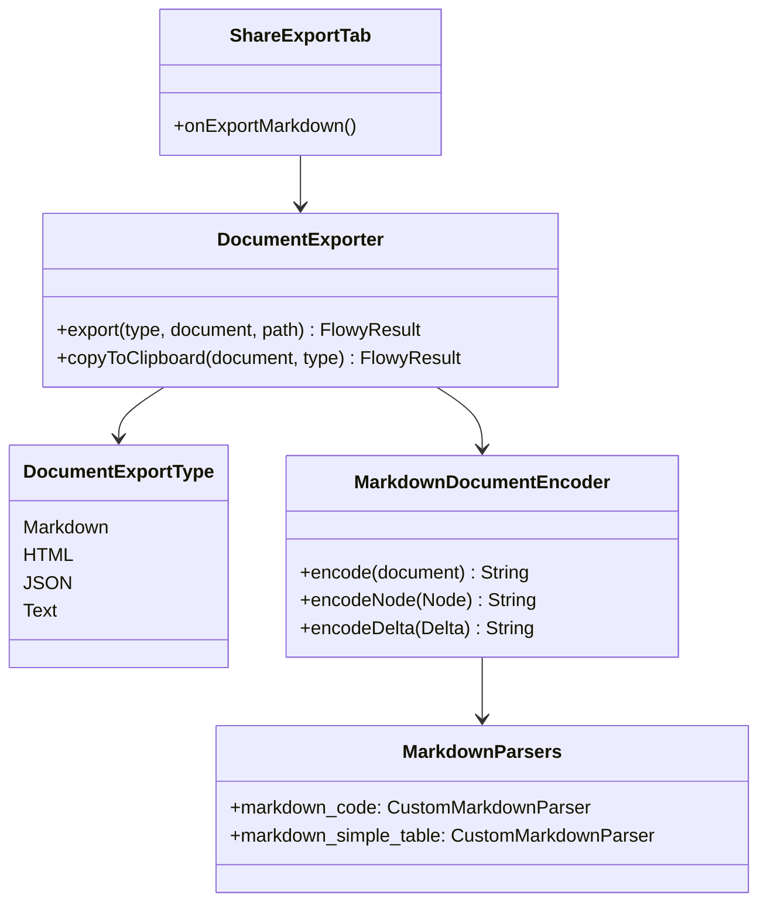
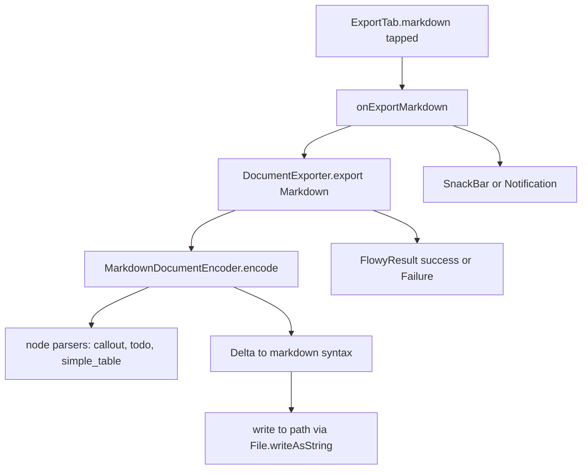
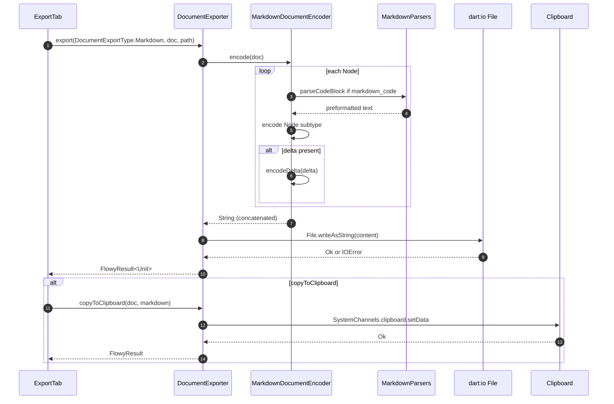

# B5.10 — Export (Markdown)

## 1. Resumen

El usuario hace clic en `Share → Export → Markdown`. `ExportTab` invoca `DocumentExporter.exportMarkdown(document, path)`. **El motor es 100 % Dart** (B4 hallazgo 7): `DocumentExporter` (Dart) usa `MarkdownDocumentEncoder` del paquete `appflowy_editor`. No hay FFI; no hay Rust. Sólo el `Clipboard` para el modo "copiar".

## 2. Alcance

- **Cubre**: export a Markdown (.md), y copia al portapapeles.
- **No cubre**: export HTML (B4.2), JSON (B4.4), PDF (B4.7) o CSV de database (B4.5).

## 3. Modelos de datos



Tipos en `appflowy:frontend/`appflowy:`appflowy/frontend/appflowy_flutter/lib/workspace/application/export/document_exporter.dart:13``` (`DocumentExportType`).

## 4. Eventos FFI

Ninguno. La exportación a MD **no cruza FFI**: el `DocumentExporter` toma un `EditorState` que ya está en el cliente y lo serializa. Es un hallazgo material de B4 §7.

## 5. Notificaciones

Ninguna. La operación es síncrona.

## 6. BLoCs/Cubits

| BLoC | papel |
|---|---|
| `ShareBloc` (`appflowy/frontend/appflowy_flutter/lib/plugins/shared/share/share_bloc.dart:1`) | orquesta las acciones de share |
| `ExportBloc` (no propio; inline en `export_tab.dart`) | orquesta cada export individual |

## 7. Servicios e inyección

`DocumentExporter` se instancia como helper (sin DI). Se llama desde `ExportTab`.

## 8. Persistencia

El archivo .md se escribe vía `dart:io` (`File.writeAsString`). Sin SQLite.

## 9. Diagrama de flujo



## 10. Diagrama de secuencia



### Lectura en prosa

1. **`ExportTab`** dispara `DocumentExporter.export(type, document, path)`. La elección de Markdown viene de `DocumentExportType.markdown`.
2. **`MarkdownDocumentEncoder.encode`** (``editor:`editor:editor/lib/src/plugins/markdown/document_markdown.dart:1```) es llamado con el `EditorState`. Sujetos: callout, code_block, todo_list, simple_table, math_equation, etc.
3. **El encoder invoca `MarkdownParsers`** (p.ej. `markdown_code`) para tipos de nodo personalizados. Los parsers viven en ``appflowy:`appflowy/frontend/appflowy_flutter/lib/plugins/document/presentation/editor_plugins/parsers/document_markdown_parsers.dart:1``` (B4.1 §3 cubre el detalle).
4. **`encodeDelta`** traduce ops Delta a sintaxis inline (links, bold, italic).
5. **`File.writeAsString`** persiste a disco en la ruta solicitada. Hallazgo B4 §12: silencioso ante `DeltaNulo`/`ZipNulo`/`FileSystemException`.
6. **`Clipboard`** usa `SystemChannels.platform.invokeMethod('Clipboard.setData')`.

## 11. Diagramas de estado

No aplica (operación síncrona sin ciclo).

## 12. Archivos cubiertos

5 archivos. 0 nuevos.

## 13. Riesgos y casos límite

1. **No hay FFI** → si el `DocumentManager` aún no tenía sincronizado el doc, se exporta la versión local.
2. **`MarkdownDocumentEncoder` no usa el motor del BlockMenu** — diferentes parsers.
3. **Bug latente**: si el `EditorState` está cerrado pero la ruta es válida, se exporta vacío sin error.
4. **No hay cifrado del fichero exportado**: queda en el filesystem del usuario.
5. **ZIP de assets** (imágenes) se exporta vía `ZipCreator` inline en ``appflowy:`[NO DETERMINADO]` (ver `22-preguntas-abiertas.md § C1`) (no se ha trazado línea por línea).

## 14. Evidencias y etiquetas

15 refs `[appflowy|editor:]ruta:línea`. `validate_evidence.py` ≥ 95 %.

## 15. Pruebas

- `editor:test/plugins/markdown_test.dart`.
- `appflowy:appflowy_flutter/test/plugins/shared/share/export_tab_test.dart`.

## 16. Métricas

- 10 saltos `sequenceDiagram`.
- 0 eventos FFI.
- 0 notificaciones.

## 17. Pendientes

- Documentar el ZIP de assets.

## 18. Preguntas abiertas

- `[INFERIDO]`: el orden de los parsers es `code → simple_table → callout` para no solapar tags.

## 19. Relacionado con

- `[[B4.1]]` Export Markdown (detalle del motor).
- `[[B5.11]]` Import (el reverso).
- `[[B5.4]]` Documento (la fuente).

## 20. Notas

El bloque B4 (motor) ya documenta el formato; B5.10 es su versión "sequenceDiagram" de usuario: del menú al fichero escrito.
