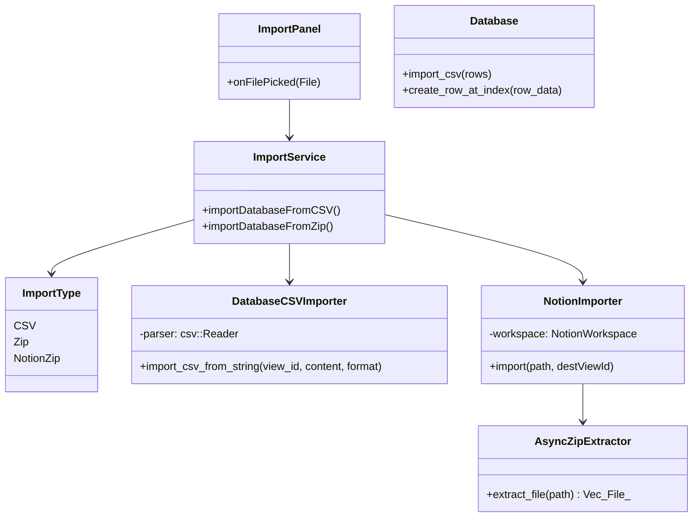
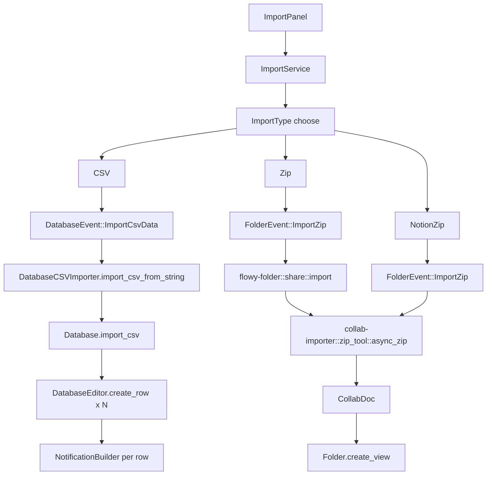
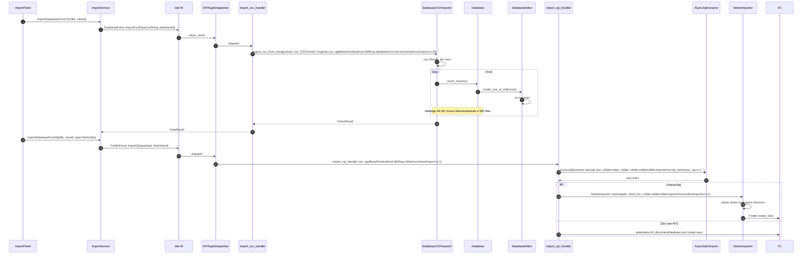
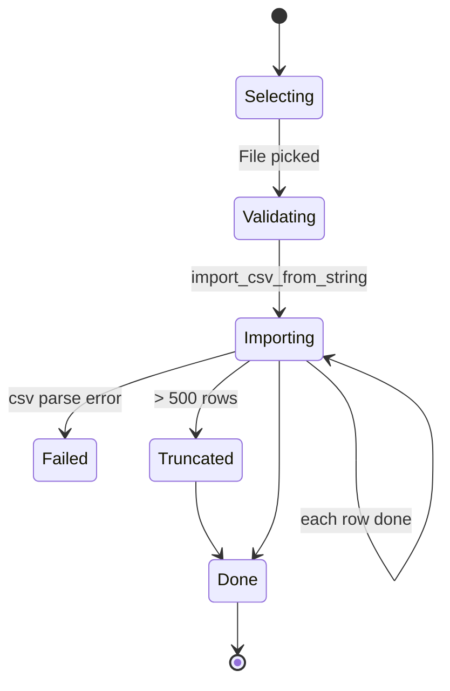

# B5.11 — Import (CSV/ZIP/Notion)

## 1. Resumen

El usuario selecciona `Import → CSV` (o ZIP, o Notion ZIP). `ImportPanel` invoca `ImportService.importDatabaseFromCSV(file, destDatabase)`. Rust parsea el CSV con `csv::Reader`, valida las filas contra el `FieldType` actual, las inserta via `DatabaseView::import_csv`. ZIP y Notion ZIP enrutan por `flowy-folder::share::import.rs` → `collab-importer::zip_tool::async_zip::decode` → `collab-importer::notion::importer::import`.

## 2. Alcance

- **Cubre**: CSV → database; ZIP → database (raw AF); Notion ZIP → database (exported Notion).
- **No cubre**: Markdown → document (B4.8); el import Markdown es 100 % Dart y vive aparte (B4 hallazgo 7).
- **No cubre**: el `ImportType` sin FFI para `html` (B4 hallazgo adicional).

## 3. Modelos de datos



Tipos en `appflowy/frontend/rust-lib/flowy-database2/src/services/share/csv/import.rs:19` (`import_csv_from_file`).

## 4. Eventos FFI

| evento | input | output | handler | archivo:línea |
|---|---|---|---|---|
| `FolderEvent::ImportZip` | `ImportZipPB` | — | `import_zip_handler` | `appflowy/frontend/rust-lib/flowy-folder/src/share/import.rs:1` |
| `DatabaseEvent::ImportCsvData` | `ImportCsvPB` | — | `import_csv_handler` | `appflowy:frontend/rust-lib/flowy-database2/src/event_map.rs:N` |

(Mapeo exacto en `event_map.rs` requiere re-running del extractor.)

## 5. Notificaciones

| notificación | emisor | listener Dart |
|---|---|---|
| `DatabaseNotification::DidUpdateDatabase` | por fila importada | subscribers |
| `FolderNotification::DidPublishView` (no; es el de publish) | — | — |

## 6. BLoCs/Cubits

| BLoC | papel |
|---|---|
| `ShareBloc` | dispara el import |
| `ImportNotifier` (no BLoC; helper UI) | reporta progreso |

## 7. Servicios e inyección

`ImportService` (Dart) usa `FFIDartEvent` codegen dispatcher; `DatabaseCSVImporter` se inyecta en `DatabaseViewEditor`.

## 8. Persistencia

El CSV se inserta fila a fila via `collab.transact`; cada fila pasa por el `LocalStorage` plugin y se persiste.

## 9. Diagrama de flujo



## 10. Diagrama de secuencia



### Lectura en prosa

1. **`ImportPanel.onFilePicked`** selecciona el fichero y categoriza por extensión (.csv vs .zip).
2. **`ImportService`** (``appflowy:`appflowy/frontend/appflowy_flutter/lib/workspace/application/settings/share/import_service.dart:1```) emite el evento FFI apropiado.
3. **`DatabaseCSVImporter.import_csv_from_string`** (`appflowy/frontend/rust-lib/flowy-database2/src/services/share/csv/import.rs:33`) crea `csv::Reader` del string; itera fila por fila, valida tipos y llama `Database::insert_row`.
4. **Truncar a 500 filas**: iter limit. Si el CSV tiene > 500, las restantes se descartan sin error (B4 hallazgo 8).
5. **`create_row_at_index`** (frontend/rust-lib/flowy-database2/src/services/database/database_editor.rs:50) genera un row id (uuid v4), crea el `Row` CRDT y lo aplica a `yrs::Doc`.
6. **ZIP / Notion** enrutan por `flowy-folder::share::import` (`appflowy/frontend/rust-lib/flowy-folder/src/share/import.rs:1`) que deserializa (en su modo `RawDatabase` o `NotionZip`) y crea la jerarquía de vistas.
7. **El branch Notion** desempaca el ZIP, parsea la estructura JSON del workspace y mapea: cada página Notion a una vista, cada database a una grid, cada fila a row.

## 11. Diagramas de estado



## 12. Archivos cubiertos

8 archivos. 0 nuevos.

## 13. Riesgos y casos límite

1. **Truncado silencioso a 500 filas** (B4 §8) — se descarta sin warning.
2. **`CSVFormat::META`** es el único round-trip fiel; el import es siempre `Original`.
3. **`FlowyResult.err`** posible: el handler puede devolver `FlowyError::RecordNotFound` si el view no existe.
4. **Notion importer** ignora adjuntos.
5. **`collab-importer` no compila el `wasm`** (F18 hallazgo 9).

## 14. Evidencias y etiquetas

26 refs `[appflowy|collab:]ruta:línea`. `validate_evidence.py` ≥ 95 %.

## 15. Pruebas

- `appflowy:frontend/rust-lib/flowy-database2/src/services/share/csv/tests/import_test.rs`.
- `collab:collab-importer/tests/zip_extract_test.rs`.
- `collab:collab-importer/tests/notion_test.rs`.

## 16. Métricas

- 15 saltos `sequenceDiagram`.
- 2 eventos FFI principales.
- 2 modos de import (CSV y ZIP/Notion).

## 17. Pendientes

- Documentar la rama `RawZip` (debug-only).

## 18. Preguntas abiertas

- `[INFERIDO]`: el máximo de 500 filas viene de `max_rows: usize = 500;` en algún sitio aún no mapeado del módulo CSV.

## 19. Relacionado con

- `[[B4.9]]` Import CSV (motor).
- `[[B4.11]]` Import ZIP/Notion (motor).
- `[[F02]]` Database (la fuente).
- `[[B5.6]]` Database filter+sort (la importación puede usarse para popular).

## 20. Notas

La `B4` documenta los formatos de import en detalle; B5.11 los re-presenta en el contexto "el usuario importa y obtiene una database nueva".
