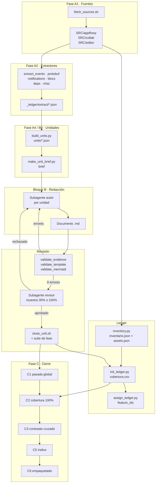
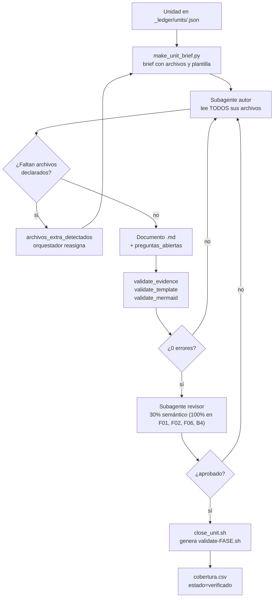
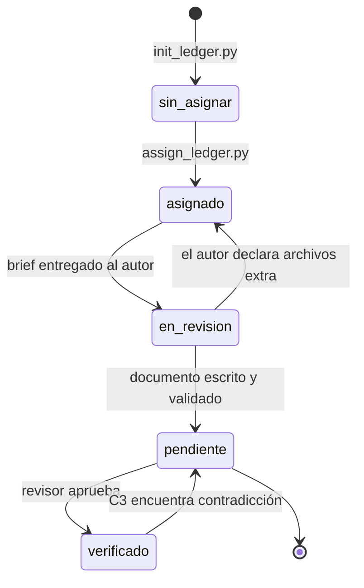

# `notemartin-appflowy-review` — flow.md

El flujo de la skill, fase por fase, con los puntos donde se decide, los gates
que bloquean y los sitios donde el trabajo se puede reanudar. Para qué sirve
cada pieza y qué contiene, ver [`README.md`](./README.md); para las reglas que
lo gobiernan, [`SKILL.md`](./SKILL.md) y [`AGENTS.md`](./AGENTS.md); para las
fases con su prueba de salida, [`../ROADMAP.md`](../ROADMAP.md).

La idea que resume todo el flujo: **nada avanza porque alguien lo decidió, todo
avanza porque un script devolvió 0**. Cada fase termina en una prueba ejecutable,
cada puerta se abre con un validador, y cada archivo del repo analizado tiene
una fila en el ledger que dice quién lo verificó y cuándo. La consecuencia
práctica es que el análisis se puede interrumpir, retomar en otra herramienta y
auditar sin confiar en la memoria de nadie.

---

## §1 · El flujo global

El diagrama muestra las tres grandes etapas (construir la skill, ejecutar el
análisis, verificar y cerrar) y, dentro de la ejecución, el recorrido de un
archivo desde que se clona su repositorio hasta que queda documentado y
verificado.

**Lectura.** El recorrido de un archivo tiene tres bifurcaciones, y las tres
vuelven hacia atrás en lugar de avanzar a la fuerza: si un validador falla, el
documento vuelve al autor; si el revisor lo rechaza, también; y si el autor
necesita un archivo que no le dieron, lo declara y el orquestador reasigna. El
ledger (`L2`) es el nodo al que todo vuelve: cada cierre de unidad lo actualiza,
y al final C2 exige que sus 4 603 filas estén en `verificado`. Sin ese nodo de
retroalimentación, el flujo sería una tubería lineal que se puede perder sin
quedar rastro.

---

## §2 · Fase A · Construir la skill

Las fases A0–A5 no analizan AppFlowy: construyen la maquinaria que lo analiza.
Es la fase que se puede portar tal cual a otro repo, y por eso tiene la
suficiente documentación propia (`CHANGELOG.md`, suites por fase).

| Fase | Qué hace | Prueba de salida |
|---|---|---|
| **A0** Esqueleto | `SKILL.md`, `AGENTS.md`, `references/`, `scripts/`, `templates/output-skeleton/` | el árbol coincide con `AGENTS.md §2` |
| **A1** Adquisición 🔒 | clonar los tres repos en sus rev exactos e inventariar | `sources.json` con 3 entradas y sus commits; `inventario.json` con conteos coincidentes; `cobertura.csv` con 4 603 filas en `sin_asignar` |
| **A2** Extractores | los seis `extract_*.py` + `extract_codegen.sh` | cada `input`/`output` de evento existe como entidad protobuf |
| **A3** Validadores 🔒 | los cuatro validadores + `build_index.py` | smoke test de los cuatro sobre fixtures |
| **A4** Orquestación | `assign_ledger.py`, briefs, prompts de autor y revisor, `STATE.md` | ≥ 90 % del inventario asignado automáticamente; reanudación cross-herramienta |
| **A5** Piloto 🔒 | una feature completa (F08, búsqueda) de extremo a extremo | revisor aprueba con 100 % de archivos cubiertos |

Tres detalles que no se ven en la tabla y que explican por qué A1 es la fase más
delicada. La primera es que **el commit de cada dependencia no se elige**: se
lee del propio AppFlowy, del `rev` de `[patch.crates-io]` en
`frontend/rust-lib/Cargo.toml` y del `dependency_overrides.appflowy_editor.git.ref`
en `frontend/appflowy_flutter/pubspec.yaml`. Documentar AppFlowy con un editor
distinto documentaría otro producto. La segunda es que **el repo no contiene los
`.proto` ni el Dart de eventos**: se generan en build a partir de los derives
`ProtoBuf`/`Flowy_Event`, y por eso `extract_codegen.sh` existe y trabaja en un
directorio aparte. La tercera es que **A4 es la fase que hace escalable el
resto**: sin `assign_ledger.py`, las 4 603 filas habría que repartirlas a mano.

---

## §3 · Bloque B · Ejecutar el análisis

Aquí es donde la skill produce su entregable: 272 documentos en `OUT/` (193 de
ellos entran en el paquete portable de C6) repartidos en arquitectura, features,
motor, catálogos y transversales. La estructura del bloque no es arbitraria:
**B1 va primero porque alimenta a todo lo demás**, y **B2 va antes que B3 porque
los catálogos son la fuente de verdad contra la que se revisan las features**.

| Bloque | Contenido | Notas de orden |
|---|---|---|
| **B0** Preparación | asignación completa del ledger | 🔒 `B0.2`: 0 archivos `sin_asignar` |
| **B1** Fundamentos | estructura del repo, stack, arquitectura global, arranque, puente Flutter↔Rust | secuencial: alimenta a todo |
| **B2** Catálogos 🔀 | eventos FFI, entidades protobuf, BLoCs, notificaciones, códigos de error, flags/rutas/atajos | 🔀 paralelizable; son la verdad contra la que se juzga B3 |
| **B3** Features 🔀 | F00–F21, una unidad por feature o sub-feature | 🔀 por unidad, con puerta propia |
| **B4** Export/import | 13 documentos: Markdown, HTML, CSV, JSON, texto plano, Notion, publicación web, round-trip | hereda el patrón autor/revisor de B3 |
| **B5** Secuencias globales | 14 documentos de `sequenceDiagram` a través de capas | ⚠︎ fue donde aparecieron los símbolos inventados: se revisa contra B2 con `contrast_B5_B2.py` |
| **B6** Transversales | build/CI, testing, seguridad, resumen, glosario | cierra el entregable |

El detalle de la subdivisión interna (las 165 unidades, cómo se dividen las
features grandes, qué subagente escribe y cuál juzga) está en `AGENTS.md §8` y
en `references/subagent-autor-prompt.md` / `references/subagent-revisor-prompt.md`.

---

## §4 · Fase C · Verificar y cerrar

Las fases C son las que hacen la promesa del README verificable. Cada una tiene
una prueba distinta y ninguna se puede declarar cerrada por consenso.

| Fase | Qué mide | Resultado registrado |
|---|---|---|
| **C1** Pasada global 🔒 | los tres validadores de documento sobre todo `OUT/` | 5/5 en verde · 17 990/17 990 citas válidas · 791/791 diagramas |
| **C2** Cobertura 🔒 | `validate_coverage.py --threshold 100` | 4 603/4 603 archivos en `verificado` · las 15 capas al 100 % |
| **C3** Consistencia 🔀 | contraste cruzado entre documentos que comparten símbolos | 36 símbolos inexistentes llevados a 0 · `contrast_B5_B2.py --check` sale 0 en 257 referencias |
| **C4** Utilidad | 30 preguntas técnicas respondidas con solo `OUT/` | **90,0 % — no cerrada** (umbral: 95 %) |
| **C5** Índice | `build_index.py` y resolución de enlaces | 272 documentos · 3 483 enlaces · 0 sin resolver en entregables |
| **C6** Empaquetado | `dist/`, `dist-obsidian/`, tar.gz importable | 6/6 verificaciones · 2,3 MiB |
| **C7** Retroalimentación | el perfil genérico corre sobre otro repo sin cambios | **bloqueada**: `notemartin-extension-reviews` no existe en disco |

C1 merece una nota, porque cambió la skill: el resultado no fue "0 errores" sin
más. La primera pasada dio **288 errores sobre 18 298 citas**, de los cuales solo
48 afectaban a entregables —los otros 240 eran meta-ficheros y bitácoras, que a
partir de entonces los validadores excluyen por defecto—. Y debajo de esos
errores había daño que ningún validador veía: 98 spans de código inline rotos
por un reparador que no era idempotente. De ahí salieron `repair_markdown_damage.py`
y `fix_line_offsets.py`. La lección operativa es que **el validador y el
reparador se corrigen mutuamente**: en C6, tres de los cuatro fallos iniciales
del empaquetador eran bugs del propio validador, no de la documentación.

---

## §5 · El ciclo de una unidad de trabajo

El diagrama muestra el recorrido de una unidad desde que existe en el ledger
hasta que su puerta se cierra, incluidas las dos vías de vuelta.

**Lectura.** La unidad no se cierra por agotamiento del autor, sino por
concordancia de tres verificadores independientes: los validadores automáticos
comprueban que el documento está bien formado, el revisor comprueba que lo que
dice es cierto, y la puerta de fase comprueba que la suite completa sigue verde.
El autor declara además lo que no pudo cubrir (`preguntas_abiertas`) y los
archivos que necesitó y no tenía (`archivos_extra_detectados`): las dos salidas
existen para que la calidad se mida en el ledger y no en la confianza.

---

## §6 · Estados de una fila del ledger

El estado de cada archivo es lo que convierte el trabajo en algo auditable. El
diagrama muestra las transiciones y quién las provoca.

**Lectura.** Un archivo solo llega a `verificado` por dos caminos, y ambos
exigen una comprobación externa: el revisor, o el contraste cruzado de C3. Un
documento puede degradarse de `verificado` a `pendiente` porque otro documento
contradiga lo que afirma: es la razón por la que la columna `verificado_por`
guarda el nombre del subagente y la hora, y no solo un booleano.

---

## §7 · Dónde falla el flujo y qué se hace

Los fallos reales de este proyecto ocurrieron en puntos concretos, y cada uno
tiene un procedimiento. Esta tabla es el parte de incidentes:

| Punto de fallo | Síntoma | Procedimiento |
|---|---|---|
| Commit equivocado en `SRC/` | el código documentado no existe en esa versión | gate A1.1; volver a `fetch_sources.sh` y regenerar el ledger |
| Cita que no cuadra tras un cambio de líneas | `E_LINE_OUT_OF_RANGE` | `fix_line_offsets.py` con `path_migrations.json`; 10 citas de C1 se retiraron con `para: null` en vez de reapuntarlas |
| Cita rota de markdown | comillas desbalanceadas, prefijos duplicados | `repair_markdown_damage.py`; `fix_evidence_prefix.py` es idempotente y salta bloques fenced |
| Símbolo que el validador no puede ver | la ruta y la línea existen, pero el símbolo no está en ellas | `contrast_B5_B2.py` contra los catálogos; 53 casos en B5 |
| Documento que excede el presupuesto | más de ~120 archivos en una unidad | `split_F*.py` y `make_b4_units.py` / `build_b5_units.py` / `make_b6_units.py` |
| Subagente autor que se adelanta | inventa clases o escribe sin el catálogo delante | el revisor lo rechaza; si persiste, `make_unit_brief.py` incluye el catálogo como entrada obligatoria |
| Uniones o diques rotos en `00-INDEX.md` | enlaces a documentos inexistentes | `build_index.py --check-links`, que separa enlaces reales de marcadores de plantilla |
| Sesión interrumpida | no se sabe dónde se quedó | `OUT/STATE.md` + `resume.py` + `coverage_report.py` |

---

## §8 · Reanudar

`SKILL.md §5` fija los seis pasos y `AGENTS.md §8` explica por qué el estado
vive en `_ledger/` y en `STATE.md`: para que la reanudación sea válida en otra
sesión **y en otra herramienta** (Hermes ↔ Cline ↔ Kilo Code). En orden:

1. Leer `OUT/STATE.md` y localizar la última fase con `estado: completada`.
2. Cargar `OUT/_ledger/cobertura.csv` para ver qué está en `verificado`, `pendiente` o `sin_asignar`.
3. Cargar los extractos de la fase actual (`_ledger/extract/*.json`).
4. `resume.py` reconstruye el plan de reanudación; `coverage_report.py` dice dónde están los holes.
5. Saltar a la siguiente fase del `ROADMAP.md` cuya puerta esté en verde.
6. Actualizar `STATE.md` antes de devolver el control.

Sin el paso 6, la reanudación es inválida: el siguiente agente no tiene forma de
saber qué se acaba de hacer, y repite trabajo en lugar de continuar.

---

## §9 · Los siete documentos que definen el entregable

Estructura de `OUT/` que la skill produce y `templates/output-skeleton/` fija de
antemano. Los bloques 06 a 10 son los que llevan los diagramas más densos, y
09/10 son los que pasan por la plantilla obligatoria de 19 y 11 secciones
respectivamente.

| Bloque | Qué contiene |
|---|---|
| `00-INDEX.md` | índice con estado, cobertura y commits |
| `01`–`05` | resumen ejecutivo, stack, estructura del repo, arquitectura global, arranque y ciclo de vida |
| `06-puente-flutter-rust/` | FFI, `lib-dispatch`, codegen, notificaciones, traza OpenDocument |
| `07-motor-colaborativo-crdt/` | modelo de collab, folder, documento, database, awareness, plugins, snapshots |
| `08-persistencia/` | esquema SQLite, KV, collab DB, caché de ficheros, sqlite-vec, migraciones, rutas por plataforma |
| `09-features/` | F00–F21, una carpeta por feature |
| `10-motor-export-import/` | un documento por formato, más matriz de round-trip y publicación web |
| `11`–`17` | catálogos: eventos, protobuf, BLoCs, notificaciones, errores, flags/rutas/atajos, grafo de dependencias |
| `18`–`22` | build/CI, testing, seguridad, glosario, preguntas abiertas |
| `STATE.md` + `_ledger/` | estado y memoria del proceso |

---

## Relacionado con

- [`README.md`](./README.md) — qué es la skill, requisitos, instalación y estado.
- [`SKILL.md`](./SKILL.md) — el router que el agente lee al dispararse.
- [`AGENTS.md`](./AGENTS.md) — reglas, patrones y protocolo de subagentes.
- `../ROADMAP.md` — cada fase con su prueba y su bitácora.
- `../PROMPT.md` — el encargo original.
- `../OUT/STATE.md` — el estado real de la ejecución.