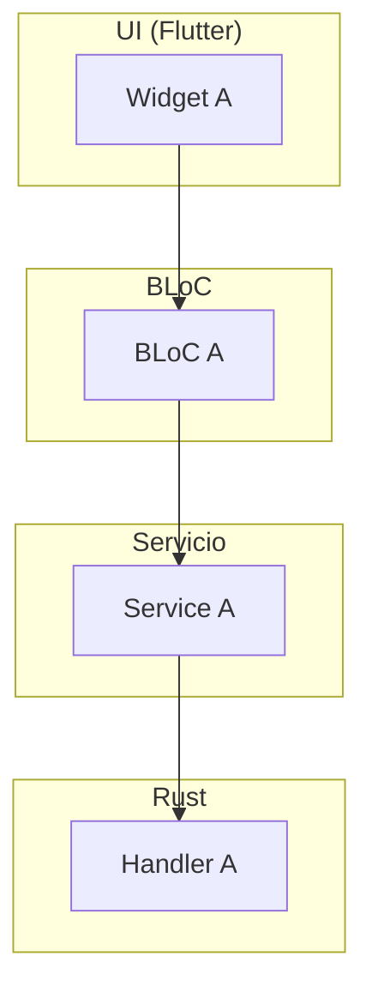
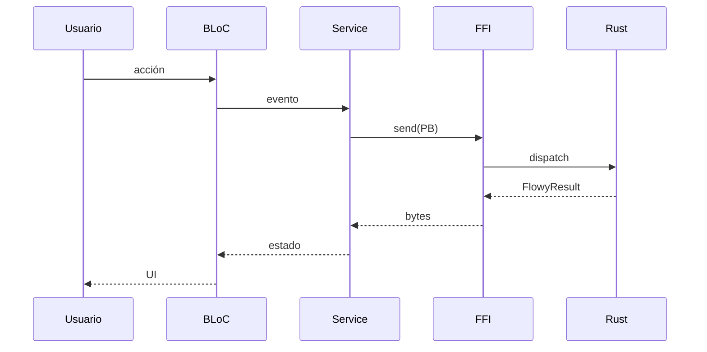
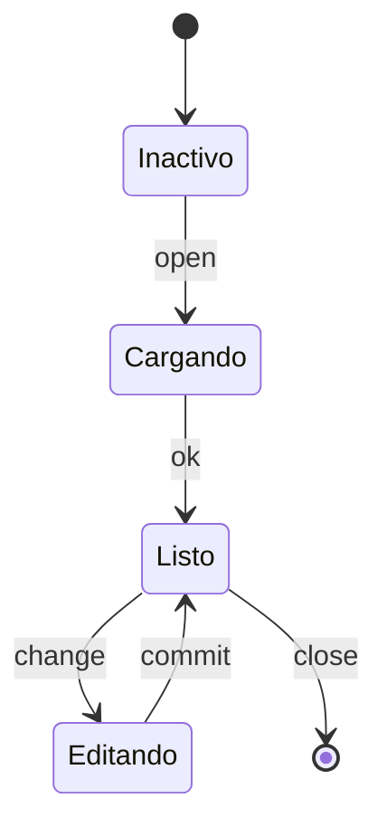
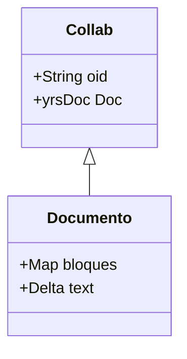
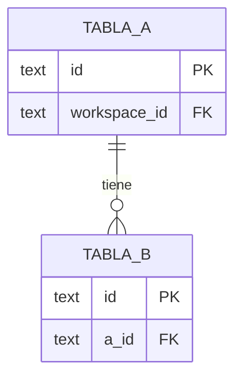
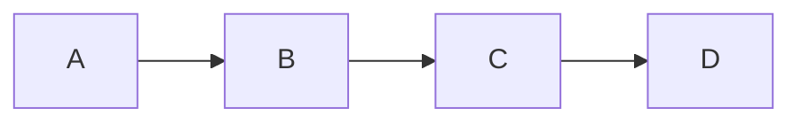
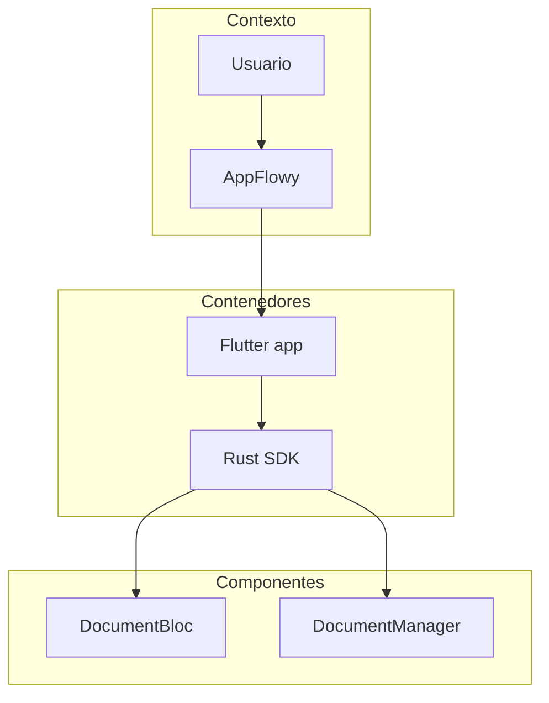

# R-004 — Convenciones de diagramas Mermaid

> La salida de la skill incluye diagramas Mermaid. Seis tipos cubren todos los casos del proyecto. Regla de oro: **≤ 60 nodos por diagrama**; si crece, fragmentar y enlazar. Todo diagrama pasa `validate_mermaid.sh` (A3.1) antes de cerrar la unidad.

## Tabla de tipos

| Uso | Tipo Mermaid |
|---|---|
| Flujo global / por feature | `flowchart TD` con `subgraph` por capa (UI, BLoC, Servicio, FFI, Rust, Collab, Persistencia, Cloud) |
| Interacciones extremo a extremo | `sequenceDiagram` con participantes nombrados como la clase real |
| Ciclos de vida | `stateDiagram-v2` |
| Modelo de datos | `classDiagram`, `erDiagram` (SQLite) |
| Arquitectura | `flowchart` estilo C4 (contexto → contenedores → componentes) |
| Dependencias | `flowchart LR` |

## Reglas de redacción

- **IDs de nodo sin espacios.** Usar `CamelCase` o `snake_case` y, si la etiqueta lleva símbolos (`<`, `>`, `(`, `)`, espacios), envolverla entre comillas: `L["flowy-core (Composición)"]`.
- **Sin caracteres problemáticos** en IDs (`-`, `.`): guion bajo o camelCase.
- **Cada diagrama** va precedido de una frase de una línea que diga qué muestra y seguido de su lectura en prosa (3–6 líneas). Sin prosa, el diagrama es ambiguo.
- **Un diagrama no supera ~60 nodos.** Si excede, dividir y enlazar con un índice al inicio del documento.
- **Evidencias en los nodos.** Cuando el nodo representa código real, añadir al pie del diagrama la lista de `ruta:línea` que respaldan los nodos clave.
- **Validación obligatoria.** `validate_mermaid.sh` (A3.1) renderiza con `mmdc` y falla con `archivo:bloque_nº` si algún bloque no parsea. El orquestador no marca una unidad como `verificado` hasta que el validador devuelva 0.

## Esqueletos mínimos (referencia, sin datos reales)

### `flowchart TD` (flujo por capas)

### `sequenceDiagram` (interacción extremo a extremo)

### `stateDiagram-v2` (ciclo de vida)

**Importante (A5.2, H2)**: los labels de las transiciones (lo que va después de `:`) son **texto plano**. Restricciones descubiertas en el piloto F08:

- ❌ ` ` no se renderiza (Mermaid lo trata como literal).
- ❌ Varios `:` en el mismo label rompen el parseo (p. ej. `manager.rs:42-46`).
- ❌ Paréntesis que encierran otro `:` también rompen (p. ej. `full_index_unindexed_documents Ok (full_indexed_data_provider.rs:213)`).
- ✅ Para referencias `ruta:línea` o rutas largas, escríbelas **sin** `:` extra: `manager.rs line 42`, o muévelas a la prosa posterior.
- ✅ Para separar datos largos, usa guiones o comas: `emite SearchStatePB por IsolateSink`, no `emite SearchStatePB (manager.rs:182)`.

### `classDiagram` (modelo de datos)

**Importante (A5.2, H1)**: los nombres de campo en `classDiagram` **no admiten genéricos con `<>`**. Mermaid los confunde con HTML y rompe el parseo. Reglas:

- ❌ `+Option~SearchResponsePB~ response` — rompe.
- ✅ `+Option response` — válido, con la nota del tipo en la prosa.
- ❌ `+Vec~SearchResponseItemPB~ items` — rompe.
- ✅ `+Vec items` — válido.
- Para tipos complejos, usa un nombre compuesto sin `<>` (p. ej. `+SearchResponseItemPBList items`) o céntrate en la cardinalidad y mueve el tipo exacto a la prosa posterior.

Lo mismo aplica a los nombres de clase con genéricos: prefiera `class ResultItemList` a `class ResultItem<T>`.

### `erDiagram` (SQLite)

### `flowchart LR` (dependencias)

### `flowchart` C4 (arquitectura)

## Errores comunes

| Error | Cómo evitarlo |
|---|---|
| `subgraph X["foo bar"]` con espacios en el ID | ID sin comillas si no tiene símbolos; con comillas solo la etiqueta: `subgraph X["foo bar"]`. |
| Nodos con `.` (rompe el parser) | Usar guion bajo: `L_42` en vez de `L.42`. |
| `participant Foo.Bar` | Renombrar a `participant FooBar` o usar alias `participant FB as Foo.Bar`. |
| `classDiagram` con genéricos en campos: `+Option~T~ x` o `+Vec~T~ x` | Quitar el `<T>` y dejar `Option`/`Vec` (o un nombre compuesto). Ver §"classDiagram" arriba. |
| `stateDiagram-v2` con ` ` o con `:` extra en el label | Texto plano sin HTML, sin `:` anidados, mover la cita `ruta:línea` a la prosa. Ver §"stateDiagram-v2" arriba. |
| Diagrama > 60 nodos | Dividir. Mejor dos diagramas claros que uno ilegible. |
| Sin prosa alrededor | El validador no atrapa esto, pero el revisor sí. |

## Relacionado con

- `R-002 patterns.md` — los 7 patrones a diagramar.
- `R-005 feature-template.md` §9–11 — dónde van los diagramas en cada feature.
- `R-006 export-template.md` §3 — diagrama de pipeline por formato.
- `SKILL/SKILL.md §2` R6 — regla compacta del router.
