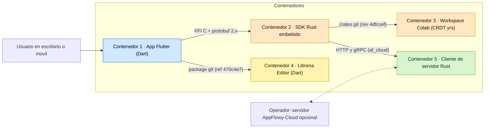
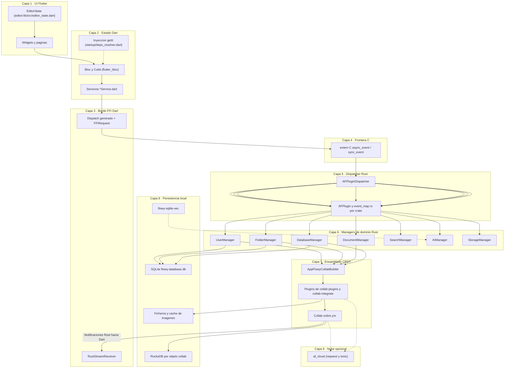
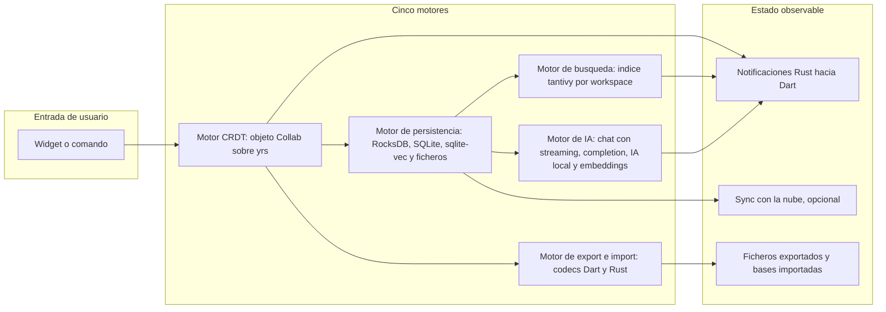
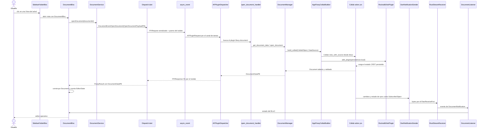

# B6.4 — Resumen ejecutivo

## 1. Resumen ejecutivo

AppFlowy es un espacio de trabajo colaborativo *offline-first*, escrito en Flutter (Dart) y Rust, que funciona sin cuenta y sin nube: todo el estado vive en CRDT locales y la nube es un add-on opcional. Este documento es la primera página del entregable: explica qué es la aplicación, dibuja sus nueve capas, recorre las 22 features (F00–F21) y los cinco motores, y cierra con la secuencia de una acción de extremo a extremo, las métricas reales del corpus y una guía de navegación. No sustituye al índice técnico `00-INDEX.md` (regenerable con `SKILL/scripts/build_index.py`), que es el lugar donde vive la tabla de cobertura: aquí vive el relato. La revisión se hizo sobre tres repos fijados en el commit `5cf3a36` de `AppFlowy-IO/AppFlowy`, `4dfccef` de `AppFlowy-IO/AppFlowy-Collab` y `470c4e7` de `AppFlowy-IO/appflowy-editor`.

## 2. Qué es AppFlowy y qué resuelve

AppFlowy es un editor de conocimiento colaborativo que sustituye a un wiki/Notion de equipo manteniendo el control del dato: el propio repositorio se describe como «the AI workspace where you achieve more without losing control of your data» `[VERIFICADO]` (`appflowy/README.md:9`), y el manifiesto de la app lo formula como espacio de trabajo colaborativo con IA donde no se pierde el control de los datos (`appflowy/frontend/appflowy_flutter/pubspec.yaml:2–4`). El problema que resuelve tiene tres caras, y las tres se resuelven **sin servidor obligatorio**:

- **Autonomía de datos.** El binario arranca, crea su usuario local y abre el workspace sin ninguna llamada de red. El arranque entero es una secuencia de 15 `LaunchTask` que se ejecutan en el proceso Dart antes de montar el primer widget (`appflowy/frontend/appflowy_flutter/lib/startup/startup.dart:119–156`), y el SDK Rust se inicializa in-process con `init_sdk` (`appflowy/frontend/rust-lib/dart-ffi/src/lib.rs:114`), que construye `AppFlowyCore` en el hilo propio del SDK (`appflowy/frontend/rust-lib/flowy-core/src/lib.rs:86–117`). No hay red obligatoria en ninguna de las dos puntas.
- **Colaboración sin bloqueo.** Todo objeto editable (documento, base de datos, fila, árbol de vistas, presencia) es un CRDT sobre `yrs 0.21.0` (`appflowy/frontend/rust-lib/Cargo.toml:98`), con siete variantes de tipo (`collab:collab/collab-entity/src/collab_object.rs:18–31`). La convergencia la resuelve la biblioteca, no el servidor.
- **Portabilidad del contenido.** Exportación e importación cubren Markdown, HTML, JSON, texto y CSV en ambos sentidos (`appflowy/frontend/appflowy_flutter/lib/workspace/application/export/document_exporter.dart:13–18`), y la publicación web expone una vista como sitio estático. El detalle formato por formato está en el bloque de export/import.

**Offline-first** significa, en el código, algo muy concreto: la ruta de escritura por defecto termina en un plugin de disco local y la de nube es un plugin más que se puede no instalar. `AppFlowyCollabBuilder::build_collab` siempre añade el plugin de persistencia local antes de consultar los proveedores de nube (`appflowy/frontend/rust-lib/collab-integrate/src/collab_builder.rs:274–297`), y el estado del workspace se abre desde `DataSource::Disk` cuando el objeto ya existe en esa máquina (`collab:collab/collab/src/core/collab.rs:255–262`). La consecuencia práctica es que **todas las operaciones de la aplicación están disponibles sin red con la misma latencia y el mismo código**: no hay una rama «offline» del producto, hay una rama opcional del transporte.

La aplicación es **una sola base de código para escritorio y móvil**: el mismo entrypoint Flutter sirve para Windows, macOS y Linux (`appflowy/README.md:44–45`) y para iOS y Android (`appflowy/README.md:47–49`), con bifurcación explícita de apariencia y de router según plataforma (`appflowy/frontend/appflowy_flutter/lib/startup/deps_resolver.dart:92–94`). El punto de entrada es deliberadamente mínimo —once líneas que inicializan el binding escalable y llaman a `runAppFlowy` (`appflowy/frontend/appflowy_flutter/lib/main.dart:5–11`)— porque toda la orquestación real vive en `startup/startup.dart` y en el SDK Rust.

AppFlowy tiene tres modos de despliegue, y la diferencia entre ellos se decide **una sola vez, en el arranque**. El selector `currentCloudType()` devuelve `AuthenticatorType.local`, `appflowyCloud`, `appflowyCloudSelfHost` o `appflowyCloudDevelop`, y de ahí sale el `AuthService` que se inyecta: `BackendAuthService(AuthTypePB.Local)` en local, `AppFlowyCloudAuthService` en los tres modos de nube (`appflowy/frontend/appflowy_flutter/lib/startup/deps_resolver.dart:106–120`). Esa única decisión explica por qué el resto de la aplicación —los BLoCs, los widgets, los managers Rust— nunca bifurca por modo: siempre habla con el mismo contrato, y es Rust quien resuelve si la operación va a disco o a la red. El mismo patrón se repite para el SDK: `runAppFlowy` acepta un flag `isAnon` que arranca la aplicación sin sesión y solo con almacenamiento local (`appflowy/frontend/appflowy_flutter/lib/startup/startup.dart:37–45`, `appflowy/frontend/appflowy_flutter/lib/startup/startup.dart:99–106`).

Conviene decir desde el principio **qué queda fuera** de este corpus. AppFlowy-Cloud, el servidor, no se documenta por dentro: la regla operativa del proyecto lo prohíbe expresamente porque es un servicio aparte, desplegable y versionado por su cuenta. Lo que sí se documenta es el **contrato cliente**, es decir, el `trait AppFlowyServer` y las implementaciones que consumen los managers (`appflowy/frontend/rust-lib/flowy-server/src/server.rs:62`). También quedan fuera los `.proto` y el código Dart de eventos: ninguno de los tres repos los contiene, se generan en build a partir de los derives `ProtoBuf` y `Flowy_Event`, de modo que el inventario cuenta los derives y no su salida. En consecuencia, cuando este resumen habla de «229 eventos» habla de las **variantes de enum** declaradas en los `event_map.rs`, no de clases Dart generadas.

La consecuencia de que sean tres repos y no uno es que **cambiar la versión del editor o del motor CRDT es un acto consciente**: ninguno se resuelve por rango de versiones, los dos se fijan por hash de commit (`appflowy/frontend/appflowy_flutter/pubspec.yaml:185–188`, `appflowy/frontend/rust-lib/Cargo.toml:150–157`). Una actualización del editor exige cambiar el `ref` del git y re-resolver el lockfile; un upgrade del CRDT exige cambiar ocho líneas del patch a la vez. Esa fricción es deliberada y es la razón de que este corpus fije los tres commits en `OUT/_ledger/sources.json` antes de empezar.

| Repositorio | Aporta | Ficheros inventariados | Se fija en |
|---|---|---:|---|
| `AppFlowy-IO/AppFlowy` | La app Flutter, el SDK Rust y el cliente de nube | 3 557 | `5cf3a36` |
| `AppFlowy-IO/AppFlowy-Collab` | El motor CRDT y sus plugins, en nueve crates | 313 | `4dfccef`, en `[patch.crates-io]` |
| `AppFlowy-IO/appflowy-editor` | El editor de texto enriquecido, como paquete Dart | 733 | `470c4e7`, en `dependency_overrides` |

El corpus que da soporte a este resumen es un inventario cerrado: **4 603 ficheros** de los tres repos (`OUT/_ledger/inventario.json`, campo `counts.files`), **671 876 líneas** de código (`counts.total_loc`) repartidas en 2 581 ficheros Dart, 1 025 Rust y el resto configuración, recursos y tests (`counts.by_lenguaje`). AppFlowy está en su versión `0.11.4` (`appflowy/frontend/appflowy_flutter/pubspec.yaml:6`), con Dart `>=3.3.0 <4.0.0` y Flutter `>=3.27.4` (`appflowy/frontend/appflowy_flutter/pubspec.yaml:9–11`); el editor se fija por git a la revisión `470c4e7` (`appflowy/frontend/appflowy_flutter/pubspec.yaml:185–188`) y los ocho crates `collab*` se fijan a `4dfccef` desde `[patch.crates-io]` (`appflowy/frontend/rust-lib/Cargo.toml:150–157`). Los commits exactos de los tres repos están en `OUT/_ledger/sources.json` (`5cf3a365dec0d59f64bad1ee4bb1050471a39b93`, `4dfccefb9e4fd35240107b93fb4b5966295b452e`, `470c4e77c71b63f693ce0923a927afcd667d6f3b`).

## 3. Arquitectura en una página

### 3.1 Vista de contenedores (C4 nivel 1)

Muestra los cinco contenedores del sistema y los protocolos que los unen; el detalle por componente está en `[[04-arquitectura-global.md]]`.

Lectura: la app Flutter (contenedor 1) es el único contenedor que ve al usuario; habla con el SDK Rust (contenedor 2) por FFI en ambos sentidos, consume el editor (contenedor 4) como paquete Dart fijado por git, y el SDK Rust (contenedor 2) apoya su modelo de datos en el workspace Collab (contenedor 3) fijado por `rev` y, opcionalmente, habla con la nube (contenedor 5) por HTTP/gRPC. El contenedor 5 es **cliente**, no servidor: el backend no se documenta por dentro (`AGENTS.md §11`).

### 3.2 Las nueve capas, de arriba abajo

Muestra el recorrido de una acción desde el widget hasta el disco y de vuelta; es el diagrama que hay que tener en la cabeza para leer cualquier otro documento del corpus.

Lectura: la columna vertebral es **widget → BLoC → servicio → FFI → dispatcher → manager → `Collab` → almacenamiento local**, y el camino de vuelta son las notificaciones Rust→Dart que `AFPluginDispatcher` entrega por el callback de `async_event` y que Dart recibe en `RustStreamReceiver`. La capa 9 es una rama aparte: se puede arrancar, usar y cerrar la aplicación entera sin cruzarla. La búsqueda (capa 6, `SearchManager`) y la IA (`AIManager`) no pasan por `Collab` como fuente de verdad; leen índices y servicios paralelos, y por eso están dibujadas con aristas sueltas.

Lo que el diagrama **no** muestra, y conviene tener presente, es que la columna no es estrictamente lineal. La capa 8 (persistencia) se consulta directamente desde la capa 6 cuando un manager necesita leer metadatos que no están en ningún `Collab`: el nombre de una vista, el estado de un workspace o la lista de miembros se leen de SQLite sin pasar por el CRDT. Y la capa 3 tiene un camino de vuelta propio —el `RustStreamReceiver`— que no es el de la capa 4: las respuestas viajan por el puerto de la petición y las notificaciones por el puerto global, y confundirlos es el error de lectura más común de este sistema.

### 3.3 Las quince capas del ledger y cómo encajan en las nueve

El ledger clasifica cada fichero en una de quince capas (`OUT/_ledger/cobertura.csv`, columna `capa`). La tabla las ordena según la arquitectura de §3.2, que es la vista narrativa; los conteos salen del mismo CSV y suman 4 603.

| Capa del ledger | Ficheros | Capa arquitectónica de §3.2 | Lectura |
|---|---:|---|---|
| `ui` | 2 287 | 1 | Widgets, páginas y componentes de las dos apps (escritorio y móvil) |
| `bloc` | 325 | 2 | `Bloc` y `Cubit`, más sus eventos `freezed` y estados |
| `service` | 162 | 2 | Servicios Dart que traducen intención de UI a evento FFI |
| `config` | 306 | 2 | Inyección `get_it`, ajustes, variables de entorno y manifiestos |
| `ffi` | 10 | 3–4 | Las ocho funciones `extern "C"` y su binding Dart |
| `codegen` | 35 | 3 | Derives `ProtoBuf`, `ProtoBuf_Enum`, `Flowy_Event` y el generador `.proto` |
| `dispatch` | 27 | 5 | `AFPlugin`, mapa de plugins, request/response y runtime |
| `rust-handler` | 508 | 5–6 | Los `event_handler.rs` y `event_map.rs` de los ocho crates de dominio |
| `rust-manager` | 12 | 6 | Los managers: usuario, folder, documento, database, búsqueda, IA, storage |
| `collab` | 280 | 7 | Workspace Collab y `collab-integrate`: `Collab`, plugins y entidades |
| `persistence` | 16 | 8 | SQLite, KV, `sqlite-vec`, file cache y rutas por plataforma |
| `server` | 32 | 9 | `flowy-server`: cliente de nube y servidor local |
| `build` | 43 | transversal | `Makefile.toml`, cargokit, CI y scripts de release |
| `i18n` | 23 | transversal | Bundles de traducción y configuración inlang |
| `test` | 537 | transversal | Tests unitarios, de widget, de integración y de integración de eventos |

El ledger distingue además cuatro estados por fichero —`sin_asignar`, `pendiente` y `verificado` son los que se usan, más el campo `verificado_por` que nombra la unidad que lo cerró— y una columna `documento` que apunta al `.md` donde se explica. En esta revisión las 4 603 filas están en `verificado` y ninguna en `sin_asignar`, que es el estado que `validate_coverage.py` trata como fallo duro. La columna `documento` es la que permite el camino inverso al de este resumen: desde un fichero, saber en qué página está explicado.

La proporción es informativa por sí sola: **casi la mitad del repositorio es UI** (`ui` = 2 287 de 4 603) y el Rust de dominio (`rust-handler` + `rust-manager` + `collab` + `persistence` + `server`) suma 848 ficheros. El peso real de la lógica está en `rust-handler`, que es donde vive el grueso del comportamiento de negocio, y en `collab`, que es el CRDT. Los tests (537) superan a cualquier capa salvo `ui`, lo que indica una cultura de cobertura razonable pero no completa: los tests de integración end-to-end son un subconjunto pequeño.

### 3.4 Cada capa con su evidencia

**Capa 1 — UI Flutter.** El punto de entrada es `main()` en `appflowy/frontend/appflowy_flutter/lib/main.dart:5`, que inicializa `ScaledWidgetsFlutterBinding` con factor fijo 1.0 y delega en `runAppFlowy` (`appflowy/frontend/appflowy_flutter/lib/main.dart:6–10`). `runAppFlowy` decide entre `FlowyRunner.run` con el modo de integración detectado o con el modo actual (`appflowy/frontend/appflowy_flutter/lib/startup/startup.dart:37–57`). La pantalla que se monta la elige el `EntryPoint` registrado, y en esta revisión es `SplashScreen` (`appflowy/frontend/appflowy_flutter/lib/startup/entry_point.dart:7–11`). El editor no es un widget propio de la app sino el paquete `appflowy_editor`: su objeto central es `EditorState`, que envuelve un `Document`, gestiona selección, deshacer/rehacer y es el punto de entrada de toda mutación (`editor:lib/src/editor_state.dart:92–100`, `editor:lib/src/editor_state.dart:398–406`).

**Capa 2 — Estado Dart.** AppFlowy usa `flutter_bloc` de forma masiva (142 `Bloc`/`Cubit` en total, según `OUT/_ledger/extract/blocs.json`, campo `summary.total_blocs` = 125 y `summary.total_cubits` = 17) y `get_it` para inyección. `initGetIt` registra el `EntryPoint`, el `FlowySDK` como singleton perezoso, el `AppLauncher` y cinco servicios transversales, y delega el resto en `DependencyResolver.resolve` (`appflowy/frontend/appflowy_flutter/lib/startup/startup.dart:165–201`). `DependencyResolver.resolve` encadena cinco grupos: cloud, usuario, home, folder y servicios comunes (`appflowy/frontend/appflowy_flutter/lib/startup/deps_resolver.dart:45–58`). El punto importante es que la elección de `AuthService` —local o `AppFlowyCloudAuthService`— se decide en tiempo de arranque según `currentCloudType()` (`appflowy/frontend/appflowy_flutter/lib/startup/deps_resolver.dart:106–120`), lo que explica por qué el resto de la app no distingue nunca entre modo local y modo nube.

**Capa 3 — Borde FFI Dart.** El paquete `appflowy_backend` traduce el evento Dart a bytes y de vuelta. `Dispatch.asyncRequest` serializa un `FFIRequest`, espera el `Completer` del isolate y clasifica la respuesta en `Ok`, `Err` o `Internal` (`appflowy/frontend/appflowy_flutter/packages/appflowy_backend/lib/dispatch/dispatch.dart:50–101`). `_sendToRust` copia el buffer a memoria alocada con `calloc`, llama a `ffi.async_event` pasando el puerto nativo del isolate y libera la memoria (`appflowy/frontend/appflowy_flutter/packages/appflowy_backend/lib/dispatch/dispatch.dart:117–132`). La declaración del símbolo C se hace con `lookupFunction` sobre la biblioteca dinámica (`appflowy/frontend/appflowy_flutter/packages/appflowy_backend/lib/ffi.dart:47–48`), y el receptor de notificaciones es un `RawReceivePort` compartido, singleton, que deserializa cada mensaje como `SubscribeObject` (`appflowy/frontend/appflowy_flutter/packages/appflowy_backend/lib/rust_stream.dart:11–46`).

**Capa 4 — Frontera C.** `dart-ffi` expone ocho funciones `extern "C"`. La de arranque es `init_sdk`, que parsea la configuración Dart, escribe las variables de entorno, crea el runtime `AFPluginRuntime`, lanza un hilo con su `LocalSet` y bloquea hasta que `AppFlowyCore::new` termina (`appflowy/frontend/rust-lib/dart-ffi/src/lib.rs:113–171`). La de trabajo es `async_event`, que convierte los bytes en `AFPluginRequest` y lo encola (`appflowy/frontend/rust-lib/dart-ffi/src/lib.rs:173–186`). `sync_event` existe pero **está sin implementar**: registra `error!("unimplemented sync_event")` y devuelve un buffer vacío (`appflowy/frontend/rust-lib/dart-ffi/src/lib.rs:230–237`), lo que significa que toda llamada Dart→Rust es asíncrona. `set_stream_port` registra el `DartNotificationSender` global (`appflowy/frontend/rust-lib/dart-ffi/src/lib.rs:239–244`), que no hace más que serializar el `SubscribeObject` y postearlo al isolate (`appflowy/frontend/rust-lib/dart-ffi/src/notification/sender.rs:19–24`).

**Capa 5 — Dispatcher Rust.** `AFPluginDispatcher` se construye con el vector de plugins y convierte el vector en mapa, con pánico si hay colisión (`appflowy/frontend/rust-lib/lib-dispatch/src/dispatcher.rs:69–76`, `appflowy/frontend/rust-lib/lib-dispatch/src/module/module.rs:64–75`). `boxed_async_send_with_callback` construye un `DispatchService` y lanza la llamada en una tarea local; el callback es lo que devuelve los bytes al isolate de Dart (`appflowy/frontend/rust-lib/lib-dispatch/src/dispatcher.rs:98–131`). `DispatchService::call` busca el plugin dueño del evento en el mapa, instancia su factory y ejecuta el handler; si no existe, devuelve `InternalError::HandleNotFound` (`appflowy/frontend/rust-lib/lib-dispatch/src/dispatcher.rs:246–291`). El registro lo hace cada crate en su `event_map.rs`: `flowy-core` los agrega todos con `make_plugins`, que llama al `init` de los ocho crates de dominio (`appflowy/frontend/rust-lib/flowy-core/src/module.rs:12–39`). En total hay **229 variantes de evento en 8 crates**, de las cuales 224 quedan registradas (`OUT/_ledger/extract/events.json`, `summary.total_variants` y `summary.total_registered`).

**Capa 6 — Managers de dominio Rust.** `AppFlowyCore` es elaggregate root: tiene un campo por manager, más el dispatcher, el proveedor de servidor, el planificador de tareas, las preferencias KV y el constructor de collabs (`appflowy/frontend/rust-lib/flowy-core/src/lib.rs:60–77`). `AppFlowyCore::init` los resuelve uno a uno mediante `*DepsResolver` y, al final, construye el `AFPluginDispatcher` con `make_plugins` (`appflowy/frontend/rust-lib/flowy-core/src/lib.rs:229–314`). Cada manager tiene el mismo molde: un mapa de objetos vivos (`DashMap<Uuid, Arc<RwLock<T>>>`) y un servicio de nube inyectado. `FolderManager` mantiene el árbol de vistas (`appflowy/frontend/rust-lib/flowy-folder/src/manager.rs:74–82`), `DocumentManager` los documentos abiertos (`appflowy/frontend/rust-lib/flowy-document/src/manager.rs:54–62`), `DatabaseManager` los editores y el workspace database (`appflowy/frontend/rust-lib/flowy-database2/src/manager.rs:56–65`), `SearchManager` los handlers de búsqueda indexados por `SearchType` (`appflowy/frontend/rust-lib/flowy-search/src/services/manager.rs:42–46`) y `AIManager` los chats más el controlador de IA local (`appflowy/frontend/rust-lib/flowy-ai/src/ai_manager.rs:58–66`).

**Capa 7 — Ensamblado CRDT.** `Collab` envuelve el `Doc` de `yrs` más un `Awareness`, expone `data`/`meta`/`context` públicos y una lista de plugins (`collab:collab/collab/src/core/collab.rs:53–75`); se puede crear vacío o desde un `DataSource` (disco o estado serializado) (`collab:collab/collab/src/core/collab.rs:248–262`). `AppFlowyCollabBuilder::build_collab` es el ensamblador real: crea el `Collab` en un `spawn_blocking`, le añade un `RocksdbDiskPlugin` y devuelve el objeto (`appflowy/frontend/rust-lib/collab-integrate/src/collab_builder.rs:274–297`). Sobre ese `Collab` se apilan los plugins de nube y de indexación a través del trait `CollabCloudPluginProvider`, que expone `provider_type`, `get_plugins` e `is_sync_enabled` (`appflowy/frontend/rust-lib/collab-integrate/src/plugin_provider.rs:5–11`). El modelo de dominio que consume el editor es `Document`, que valida los datos requeridos al abrirse (`collab:collab/collab-document/src/document.rs:50–54`) y mantiene cinco claves raíz en el mapa de `yrs`: `page_id`, `blocks`, `meta`, `meta.children_map` y `meta.text_map` (`collab:collab/collab-document/src/document.rs:30–40`).

**Capa 8 — Persistencia local.** Hay tres almacenes con nombres distintos y responsabilidades distintas. SQLite (diesel `2.1.0`) guarda metadatos, usuarios, workspaces, chats, subidas y snapshots: la base se llama `flowy-database.db` y las migraciones van embebidas en el binario con `embed_migrations!` (`appflowy/frontend/rust-lib/flowy-sqlite/src/lib.rs:29–30`), y `init` crea el directorio, abre el pool y ejecuta las migraciones pendientes (`appflowy/frontend/rust-lib/flowy-sqlite/src/lib.rs:32–45`). RocksDB, un directorio por objeto collab, guarda el estado CRDT completo; el plugin que lo escribe es `RocksdbDiskPlugin`, cuyo `receive_update` se invoca en cada transacción (`collab:collab/collab-plugins/src/local_storage/rocksdb/rocksdb_plugin.rs:25`, `collab:collab/collab-plugins/src/local_storage/rocksdb/rocksdb_plugin.rs:123–129`). `flowy-sqlite-vec` añade la extensión de vectores para los embeddings de IA (`appflowy/frontend/rust-lib/flowy-sqlite-vec/src/lib.rs:4–9`).

**Capa 9 — Nube opcional.** `AppFlowyCore::init` inyecta un `ServerProvider` en todos los managers mediante `ServerUserImpl`, que resuelve usuario, workspace, conexión SQLite y directorio raíz desde un `Weak<AuthenticateUser>` (`appflowy/frontend/rust-lib/flowy-core/src/lib.rs:159–164`, `appflowy/frontend/rust-lib/flowy-core/src/lib.rs:340–383`). Esa indirección por `Weak` es la razón por la que todos los managers se pueden construir con referencias débiles y ninguno forma ciclos de propiedad. El detalle del contrato cliente está en `[[09-features/F06-sync-y-servidores/F06-sync-y-servidores.md]]`.

## 4. Mapa de features: qué hace cada parte del sistema

El inventario asigna cada uno de los 4 603 ficheros a exactamente una feature (`OUT/_ledger/cobertura.csv`, columna `feature_ids`), de modo que esta lista es una partición completa del código, no una selección: los 22 números de la tabla siguiente suman exactamente 4 603. Las columnas «ficheros» y «documentos» salen del ledger y del recuento de `OUT/**/*.md` por prefijo de id respectivamente. Los enlaces que abren cada subsection llevan al **documento índice maestro** de esa feature, y usan siempre el `id` real que ese documento declara en su frontmatter. Hay dos casos: en las once features de un solo documento, el `id` coincide con el nombre de la feature (`F04`, `F06`, `F07`, `F08`, `F10`, `F11`, `F14`, `F17`, `F18`, `F20`, `F21`); en las once features multi-documento, el índice declara un id jerárquico propio —`F00.0`, `F01.0`, `F02.0.1.0`, `F03.0`, `F05.0`, `F09.0`, `F12.1`, `F13.1`, `F15.1`, `F16.0`, `F19.0`— y no existe ningún `id` que sea simplemente `F00`, `F01` o `F02`. Por eso este mapa enlaza al id real y no al nombre de la feature; desde el índice se baja al sub-documento concreto.

| Feature | Ficheros | Documentos | Superficie |
|---|---:|---:|---|
| F00 | 1 556 | 25 | Infraestructura compartida: FFI, dispatch, errores, build, paquetes Dart |
| F01 | 798 | 23 | Documentos y editor, en las tres fuentes |
| F02 | 651 | 25 | Bases de datos: modelo CRDT, manager y cinco layouts |
| F03 | 116 | 4 | Folder, workspaces y vistas, por capas |
| F04 | 66 | 1 | Sidebar, favoritos, recientes, papelera, tabs y command palette |
| F05 | 131 | 3 | Usuario, autenticación y sesión, por capas |
| F06 | 35 | 1 | Clientes de servidor y sincronización |
| F07 | 58 | 1 | Almacenamiento de archivos |
| F08 | 32 | 1 | Búsqueda e indexación |
| F09 | 166 | 5 | IA: `flowy-ai`, vectores, Dart y plugins del editor |
| F10 | 3 | 1 | Importación, solo UI |
| F11 | 2 | 1 | Exportación, solo UI |
| F12 | 72 | 2 | Compartir, publicar y niveles de acceso |
| F13 | 127 | 3 | Ajustes, apariencia, temas y fuentes |
| F14 | 6 | 1 | Internacionalización |
| F15 | 53 | 2 | Notificaciones in-app y recordatorios |
| F16 | 184 | 6 | Mobile |
| F17 | 56 | 1 | Plataforma: ventanas, deeplinks, flags, logging |
| F18 | 113 | 1 | Motor Collab: plugins, importer, entity y derive |
| F19 | 354 | 15 | Tests, ejemplos y configuración del editor |
| F20 | 13 | 1 | Raíz de AppFlowy-Collab, CI y manifiestos |
| F21 | 11 | 1 | Selector de icono y emoji |
| **Total** | **4 603** | **124** | de los 191 documentos de contenido; los 67 restantes son bloques transversales |

El reparto es revelador por sí solo. **F00, F01 y F02 concentran 3 005 ficheros, el 65 % del corpus**, y las tres son, por orden, infraestructura, editor y bases de datos: el producto es, en esencia, un editor de documentos con bases de datos encima. F10 y F11 son las dos features más pequeñas del corpus porque su motor vive en otro bloque; leerlas sin leer `[[10-motor-export-import/00-indice-motor-export-import.md]]` da una impresión falsa de su complejidad.

### F00 — Infraestructura compartida

La feature más grande del corpus con **1 556 ficheros** (`OUT/_ledger/cobertura.csv`, recuento por `feature_ids`): la trinchera FFI y el dispatcher (`dart-ffi`, `lib-dispatch`, `lib-infra`), los errores tipados (`flowy-error`) y la capa SQLite, el build y el codegen, los contratos `collab-integrate` y los ocho crates `-pub`, los siete paquetes Dart internos entre ellos `appflowy_backend` con su FFI, sus notificaciones y su dispatch generado, las carcasas nativas de las seis plataformas y el pegamento de la raíz del repo. El arranque de esa trinchera es el catálogo de errores tipados, con 133 `ErrorCode` ordenados en 22 categorías (`appflowy/frontend/rust-lib/flowy-error/src/code.rs:1`). Ver `[[09-features/F00-infraestructura-compartida-ffi-dispatch-errores-build-nativo/0-indice-infraestructura-compartida-ffi-dispatch-errores-build-paquetes-nativo-tes.md]]` y el detalle del puente en `[[06-puente-flutter-rust/00-indice.md]]`.

### F01 — Documentos y editor

**798 ficheros**: el núcleo funcional de la aplicación. Cubre el lado Dart (`DocumentBloc`, `DocumentService`, adaptadores de collab, la página del editor y sus 64 ficheros de UI en `plugins/document/presentation/`), el crate Rust `flowy-document` con sus 21 eventos FFI, el crate `collab-document` del workspace Collab y los cinco sub-módulos del paquete `appflowy_editor` (core, toolbars, encoders/decoders, atajos e i18n), más 82 fixtures y tests. El objeto Dart que gobierna el ciclo de vida del lado cliente es `DocumentBloc` (`appflowy/frontend/appflowy_flutter/lib/plugins/document/application/document_bloc.dart:47`) y el objeto que gobierna el lado del editor es `EditorState`; la traducción de transacciones del editor a acciones de bloque es lo que hace que editar sea colaborativo por CRDT y no por guardado de fichero. Índice en `[[09-features/F01-documentos-y-editor/0.0-indice-documentos-y-editor.md]]`; el desglose por bloques está en F01.1 (texto), F01.2 (ricos), F01.3 (media), F01.5 (bases embebidas) y F01.6 (interacción).

### F02 — Bases de datos

**651 ficheros**, la segunda feature más grande. El modelo CRDT (`collab-database`: campos, tipos, bloques, filas, celdas, vistas y el workspace database) más el crate `flowy-database2` (manager, 72 variantes de evento, servicios de filtro, orden, agrupación, cálculos, ajustes de vista y el importador/exportador CSV). El BLoC raíz del lado Dart es `DatabaseController`, que se instancia por vista (`appflowy/frontend/appflowy_flutter/lib/plugins/database/application/database_controller.dart:72–73`). Se organiza en quince documentos: el índice Dart, el índice Rust del modelo, y luego una unidad por concepto (campos, celdas, filas, filtros, orden, agrupación, cálculos, ajustes de vista, grid, board, calendar, tab bar) más el cierre de raíz. Índice en `[[09-features/F02-bases-de-datos/0.1.0-indice-appflowy-side-database-controller-services-widgets.md]]`.

### F03 — Folder, workspaces y vistas

**116 ficheros**: el árbol que sostiene todo lo demás. El lado Dart (`lib/workspace/application/` con `WorkspaceBloc`, `ViewBloc`, `SidebarFolderBloc` y los widgets de vista), el crate Rust `flowy-folder` con su `FolderManager` y 51 eventos FFI. El `FolderManager` expone el árbol completo y delega las operaciones en `FolderOperationHandlers` (`appflowy/frontend/rust-lib/flowy-folder/src/manager.rs:74–82`). Se divide por capa y no por sub-tema porque la cohesión Dart/Rust/CRDT es mayor que la de los conceptos. Índice en `[[09-features/F03-folder-workspaces-vistas/0.0-indice-folder-workspaces-vistas.md]]`.

### F04 — Sidebar, favoritos, recientes, papelera, tabs y command palette

**66 ficheros**: el cromo de navegación de la pantalla principal de escritorio (`appflowy/frontend/appflowy_flutter/lib/workspace/presentation/home/desktop_home_screen.dart:47`), y sus BLoCs son el único punto de contacto con `flowy-folder`, a través de seis servicios Dart muy pequeños y tres listeners que traducen `FolderNotification` a eventos de BLoC. Es la feature con mejor relación líneas-complejidad del corpus: casi todo es presentación y la lógica vive enteramente en `flowy-folder`, que es donde se documenta el por qué de cada operación de árbol. La command palette aparece aquí pero su motor de búsqueda está en F08. Documento único en `[[09-features/F04-sidebar-favoritos-recientes-papelera-tabs-command-palette/F04-sidebar-favoritos-recientes-papelera-tabs-command-palette.md]]`.

### F05 — Usuario, autenticación y sesión

**131 ficheros** en dos mitades separadas por el puente FFI: la cara Flutter (`lib/user/**` con `SignInBloc`, `SignUpBloc`, `UserProfileBloc` y la resolución de `AuthService`) y la cara Rust (`flowy-user` más `collab-user`, con 56 variantes de `UserEvent` y las migraciones de datos locales). La selección de `AuthService` que decide entre modo local y nube está en `appflowy/frontend/appflowy_flutter/lib/startup/deps_resolver.dart:106–120`. El índice fija el vocabulario común —los 56 eventos, las 10 notificaciones y los 9 BLoCs— para que el resto del corpus enlace contra un único sitio. Índice en `[[09-features/F05-usuario-auth-sesion/0.0-indice-usuario-auth-sesion.md]]`, detalle en `[[09-features/F05-usuario-auth-sesion/1-usuario-appflowy-flutter-lib-user-dart.md]]` (Dart) y `[[09-features/F05-usuario-auth-sesion/2-usuario-flowy-user-collab-user-rust-collab.md]]` (Rust y CRDT).

### F06 — Sincronización y servidores

**35 ficheros**: la capa de clientes de servidor. `flowy-server` expone el trait `AppFlowyServer` con dos implementaciones —`AppFlowyCloudServer` contra la nube SaaS y `LocalServer` para el modo offline con SQLite local. El trait raíz es `AppFlowyServer`, que cualquier implementación debe cumplir (`appflowy/frontend/rust-lib/flowy-server/src/server.rs:62`). En Dart, la capa complementaria es el monitor de red y el listener de estado de sync del documento. Esta feature no registra eventos propios: solo implementa contratos que los managers consumen. Documento único en `[[09-features/F06-sync-y-servidores/F06-sync-y-servidores.md]]`.

### F07 — Almacenamiento de archivos

**58 ficheros**: `flowy-storage` centraliza subida, descarga, progreso y notificación de archivos sobre el árbol `(workspace_id, parent_dir, file_id)`, troceando en partes de 5 MB y persistiendo el estado en dos tablas SQLite. Sobre ese motor, la capa Flutter expone 44 widgets de las familias imagen, multi-imagen, fichero, vídeo, cover, link preview y link embed, todos consumo de `DocumentService.uploadFile`. El `StorageManager` es el noveno manager de `AppFlowyCore` (`appflowy/frontend/rust-lib/flowy-storage/src/manager.rs:43`). Documento único en `[[09-features/F07-almacenamiento-de-archivos/F07-almacenamiento-de-archivos.md]]`.

### F08 — Búsqueda e indexación

**32 ficheros**: el crate `flowy-search` (evento FFI, `SearchManager`, handlers y entidades protobuf), los tres ficheros de `flowy-core` que dirigen la indexación (runner, proveedor de datos completos y consumidor de datos incrementales) y los 11 widgets Dart de la command palette. La búsqueda no usa notificaciones: los resultados viajan como una secuencia de `SearchStatePB` por un `IsolateSink` abierto sobre el `stream_port` que el propio Dart incluye en la petición (`appflowy/frontend/rust-lib/flowy-search/src/services/manager.rs:114–117`). Documento único en `[[09-features/F08-busqueda-e-indexacion/F08-busqueda-e-indexacion.md]]`.

### F09 — Inteligencia artificial

**166 ficheros**, la única feature que cruza las tres fuentes. Se reparte en cinco documentos: el índice, el crate Rust `flowy-ai` (chat con streaming, completion, IA local, MCP, embeddings, middleware y herramientas), la extensión `flowy-sqlite-vec` para vectores, la capa Dart (`lib/ai/` y `plugins/ai_chat/`). `AIManager` es el agregador: mantiene los chats, el middleware de nube, el controlador local y el selector de modelo (`appflowy/frontend/rust-lib/flowy-ai/src/ai_manager.rs:58–66`). `AIManager` es el agregador: mantiene los chats en un `DashMap`, el controlador de IA local, el middleware de servicio cloud y el control de selección de modelo (`appflowy/frontend/rust-lib/flowy-ai/src/ai_manager.rs:58–66`). Índice en `[[09-features/F09-ia/0-indice-ia-chat-completion-ia-local-mcp-embeddings-middleware.md]]`.

### F10 — Importación (UI)

**3 ficheros**: solo la capa de presentación y orquestación Dart. El diálogo `ImportPanel` con sus cinco tarjetas de formato, el enumerado `ImportType` y el widget `NotionImporter` que sube un ZIP de Notion. Toda la conversión real vive en Rust: `FolderManager::import`, `import_single_file` e `import_zip_file` (`appflowy/frontend/rust-lib/flowy-folder/src/manager.rs:2049`, `appflowy/frontend/rust-lib/flowy-folder/src/manager.rs:2104`, `appflowy/frontend/rust-lib/flowy-folder/src/manager.rs:2110`) y el crate `collab-importer`. En Dart, la capa de presentación solo arma la carga útil y despacha el evento (`appflowy/frontend/appflowy_flutter/lib/workspace/application/settings/share/import_service.dart:19–29`). (`appflowy/frontend/rust-lib/flowy-folder/src/manager.rs:2049`, `appflowy/frontend/rust-lib/flowy-folder/src/manager.rs:2104`, `appflowy/frontend/rust-lib/flowy-folder/src/manager.rs:2110`) y el crate `collab-importer`. Documento único en `[[09-features/F10-importacion-ui/F10-importacion-ui.md]]`.

### F11 — Exportación (UI)

**2 ficheros**: la pestaña `ExportTab` del popover de compartir, que decide qué formatos ofrecer según el `ViewLayoutPB` de la vista, pide ruta con `FilePickerService` y despacha al `ShareBloc`; y `DocumentExporter` (`appflowy/frontend/appflowy_flutter/lib/workspace/application/export/document_exporter.dart:20`) El enum `DocumentExportType` tiene cuatro variantes —json, markdown, text, html— pero la de texto plano lanza `UnimplementedError` (`appflowy/frontend/appflowy_flutter/lib/workspace/application/export/document_exporter.dart:13–18`, `appflowy/frontend/appflowy_flutter/lib/workspace/application/export/document_exporter.dart:55–56`). Los encoders de Markdown y HTML viven en el paquete del editor (`editor:lib/src/plugins/markdown/document_markdown.dart:38`, `editor:lib/src/plugins/html/html_document.dart:18`). Documento único en `[[09-features/F11-exportacion-ui/F11-exportacion-ui.md]]`.

### F12 — Compartir, publicar y niveles de acceso

**72 ficheros** en dos documentos: la pestaña de compartir con la matriz de niveles de acceso (read, write, admin) y los roles de miembro, y la sección de compartidos con los sitios publicados más el `publish_util` y el importador del lado Rust. El `ShareBloc` Dart es el punto de entrada de la UI de compartir (`appflowy/frontend/appflowy_flutter/lib/plugins/shared/share/share_bloc.dart:22`). Ver `[[09-features/F12-compartir-publicar-niveles-de-acceso/1-compartir-share-tab-niveles-de-acceso-y-plugins-shared-share.md]]` y `[[09-features/F12-compartir-publicar-niveles-de-acceso/2-shared-section-sitios-publicados-y-publish-util-import-en-rust.md]]`.

### F13 — Ajustes, apariencia, temas y fuentes

**127 ficheros** en tres documentos: la lógica de ajustes con cuenta, billing, plan, nube y workspace; la apariencia, la configuración de IA, los miembros del workspace, los feature flags y la subida de temas; y los widgets compartidos de ajustes y el selector de emoji. Los nueve flags se declaran en un único enum (`appflowy/frontend/appflowy_flutter/lib/shared/feature_flags.dart:14`). Es la feature con más dispersión: cada sub-documento mezcla widgets, BLoCs y endpoints FFI. Ver `[[09-features/F13-ajustes-apariencia-temas-fuentes/1-ajustes-logica-de-aplicacion-cuenta-billing-plan-nube-y-workspace.md]]`, `[[09-features/F13-ajustes-apariencia-temas-fuentes/2-apariencia-ia-miembros-feature-flags-y-theme-upload.md]]` y `[[09-features/F13-ajustes-apariencia-temas-fuentes/3-widgets-compartidos-de-ajustes-emoji-picker-y-data-layer-de-settings.md]]`.

### F14 — Internacionalización

**6 ficheros**: exactamente el pegamento entre tres piezas que conviven —`easy_localization` en la app, `package:intl` dentro del editor y el tooling inlang para autoría y lint. El servicio global que permite leer traducciones fuera del árbol de widgets es `EasyLocalizationService` (`appflowy/frontend/appflowy_flutter/lib/shared/easy_localiation_service.dart:6`). Los bundles de traducción (26 JSON en `frontend/resources/translations/`) no pertenecen a esta feature: están en F00 junto al resto del pegamento de build. Seis ficheros para un producto con seis idiomas son el recordatorio de que en AppFlowy la traducción es un problema de tooling, no de arquitectura. Documento único en `[[09-features/F14-internacionalizacion/F14-internacionalizacion.md]]`.

### F15 — Notificaciones in-app y recordatorios

**53 ficheros** en dos documentos: los listeners Dart, el panel de notificaciones y el date picker por un lado; `flowy-date`, `reminder.rs` y el crate `flowy-notification` por otro. Es la feature donde se ve mejor el patrón de notificación: el crate `flowy-notification` tiene un `NotificationBuilder` con `send` (`appflowy/frontend/rust-lib/flowy-notification/src/builder.rs:6`, `appflowy/frontend/rust-lib/flowy-notification/src/builder.rs:6`, `appflowy/frontend/rust-lib/flowy-notification/src/builder.rs:67`). Ver `[[09-features/F15-notificaciones-in-app-y-recordatorios/1-notificaciones-y-recordatorios-dart-listeners-panel-date-picker.md]]` y `[[09-features/F15-notificaciones-in-app-y-recordatorios/2-flowy-date-reminder-rs-y-flowy-notification-rust.md]]`.

### F16 — Mobile

**184 ficheros**: el shell móvil (`lib/mobile/` con su router, sus tabs y sus páginas) y las capas de presentación de documento, editor, selection menu, database, chat, búsqueda y notificaciones. El router móvil es una extensión sobre `BuildContext` que empuja vistas, no un `go_router` propio (`appflowy/frontend/appflowy_flutter/lib/mobile/application/mobile_router.dart:17`). La sub-unidad `F16.2` documenta los plugins `editor_plugins/mobile_*`, que el triage reasignó formalmente a F01.6.4 porque no viven bajo `lib/mobile/`. Índice en `[[09-features/F16-mobile/0-indice-mobile-shell-de-la-app-editor-movil-y-capas-de-presentacion.md]]`.

### F17 — Plataforma: ventanas, deeplinks, auto-update, hotkeys, flags y logging

**56 ficheros**: todo lo que condiciona cómo arranca, se muestra y se mantiene la app sin pertenecer a un dominio concreto. Los `LaunchTask` de `startup/tasks/` (ventana, hotkeys, auto-update, captura de errores de plataforma, detector de fugas, feature flags), el módulo `core/` con `frameless_window.dart` y `network_monitor.dart`. El filtro centralizado se inicializa antes que cualquier otra cosa del SDK (`appflowy/frontend/rust-lib/flowy-core/src/log_filter.rs:9`). Documento único en `[[09-features/F17-plataforma-ventanas-deeplinks-auto-update-hotkeys-feature-flags-errores-logging/F17-plataforma-ventanas-deeplinks-auto-update-hotkeys-feature-flags-errores-logging.md]]`.

### F18 — Motor Collab: plugins, importer, entity y derive

**113 ficheros**: cinco crates del workspace Collab que no pertenecen a ninguna feature de dominio. La raíz de `collab` con el objeto `Collab` y sus estados, `collab-plugins` con la persistencia KV local (RocksDB en disco, IndexedDB en web), el núcleo de sincronización en `cloud_storage/**` y la máquina de conectividad, `collab-importer` con el importador de Notion y el descompresor ZIP, `collab-entity` con los tipos y constantes de clave. La máquina de conectividad que decide si el collab sube o baja es un enum de dos estados (`collab:collab/collab-plugins/src/connect_state.rs:6–10`). Es la capa sobre la que se construyen documentos, bases de datos, folder y usuario. Documento único en `[[09-features/F18-motor-colab-crdt-plugins-importer-entity-derive/F18-motor-colab-crdt-plugins-importer-entity-derive.md]]`.

### F19 — Tests, ejemplos, l10n y configuración del editor

**354 ficheros**, todos en el repositorio `appflowy-editor`: la raíz de `test/`, las trece familias de tests de plugins, los 31 ficheros de `example/` y la configuración del paquete. Vive en un repo independiente del workspace de la app y de Rust, así que describe el contrato que la app respeta o rompe al integrarlo. La infraestructura compartida de tests es un único fichero que monta un editor de pruebas (`editor:test/new/infra/testable_editor.dart:1`). Índice en `[[09-features/F19-editor-tests-ejemplos-l10n-configuracion/0-indice-tests-ejemplos-l10n-configuracion-raiz-de-test.md]]`.

### F20 — Raíz de AppFlowy-Collab, configuración, CI y manifiestos

**13 ficheros**: el `Cargo.toml` del workspace que agrupa los ocho crates, los flujos de CI de `.github/workflows/`, las tareas de `cargo make`, el pin del toolchain, la licencia AGPL-3 y los diagramas PlantUML de arquitectura. El manifiesto del workspace es el único punto donde se declaran los ocho crates `collab*` (`collab:Cargo.toml:1`). Este conjunto es el contrato que la app cliente respeta al fijar el `rev` en `[patch.crates-io]`: si el workspace cambia una clave de su manifiesto, la app rompe en build y no en runtime, que es exactamente el modo de fallo que evita el pin. Documento único en `[[09-features/F20-colab-raiz-configuracion-ci-docs-manifests/F20-colab-raiz-configuracion-ci-docs-manifests.md]]`.

### F21 — Selector de icono y emoji

**11 ficheros**: un popover con pestañas (Emojis, Icons, Upload), buscador con debounce, tonos de piel, paleta de color para iconos SVG y un grupo sintético de recientes. Es el único código que traduce entre el modelo de dominio (`ViewIconPB` con `ty: Emoji | Icon | Url`) y la UI, y es cross-cutting. La subida de un icono personalizado sale de `IconUploader`, que decide entre copia local y subida a la nube (`appflowy/frontend/appflowy_flutter/lib/shared/icon_emoji_picker/icon_uploader.dart:31`). Documento único en `[[09-features/F21-icon-emoji-picker/F21-icon-emoji-picker.md]]`.

Cerrando el mapa: las features no son todas del mismo tipo. **F00 es un hub** —todo lo demás depende de ella y ella no depende de nada—; **F01, F02, F03 y F05 son el producto** y son las que un usuario toca; **F18 y F20 son la frontera con AppFlowy-Collab** y se leen junto al workspace; **F06, F08 y F09 son servicios** que se pueden quitar sin romper el editor; y **F10, F11, F12 y F21 son hojas**, con una o dos feature de soporte como máximo. F04, F07, F13, F14, F15, F16 y F17 son *presentación y plataforma*: no introducen modelo de dominio, pero son las que más superficie de UI tienen. Esta taxonomía no está escrita en el código, pero explica por qué ciertos documentos son índices y otros son capítulos.

## 5. Los motores

AppFlowy no se puede entender feature por feature: hay cinco subsistemas transversales que atraviesan todas ellas y que son, de hecho, los únicos lugares donde se concentra la complejidad no trivial. Se agrupan aquí aparte precisamente porque son ortogonales a la organización por features: un motor no es una feature, es una función que la mayoría de las features consumen. Los cinco son el CRDT que sostiene el estado, la persistencia que lo conserva, la búsqueda que lo indexa, la IA que lo consulta y el motor de exportación que lo serializa. La siguiente tabla los sitúa; cada párrafo posterior los abre.

Muestra los cinco motores y qué estado leen o escriben; el detalle de cada uno está en los documentos enlazados.

Lectura: el motor CRDT es el único que no depende de los demás; persistencia, búsqueda, IA y export/import son consumidores o productores sobre lo que el CRDT guarda. Búsqueda e IA **leen** del almacenamiento sin escribir en el CRDT (el índice tantivy y la base de vectores son proyecciones), y el motor de export/import **lee** el CRDT y produce ficheros o bases nuevas.

La tabla siguiente fija, para cada motor, dónde vive el código, qué estado mantiene y de qué documento conviene partir. Las cinco filas se leen de izquierda a derecha como una cascada: lo que el CRDT guarda es lo que la persistencia conserva, lo que la persistencia conserva es lo que búsqueda e IA indexan, y lo que el CRDT guarda es lo que el motor de exportación serializa.

| Motor | Código principal | Estado que mantiene | Relación con los demás | Documento |
|---|---|---|---|---|
| CRDT | `collab/collab/src/core/collab.rs` + los siete crates del workspace | Estado completo de cada objeto, en memoria y en disco | Es la fuente de verdad; los demás son proyecciones o consumidores | `[[07-motor-colaborativo-crdt/00-indice.md]]` |
| Persistencia | `flowy-sqlite`, `collab-plugins/src/local_storage/rocksdb`, `flowy-sqlite-vec` | RocksDB por objeto, SQLite global, vectores | Escribe lo que el CRDT produce y lo que los managers necesitan recuperar | `[[08-persistencia/00-indice.md]]` |
| Búsqueda | `flowy-search`, `flowy-search-pub/src/tantivy_state.rs` | Índice tantivy por workspace | Proyección de solo lectura; se reconstruye desde el CRDT | `[[09-features/F08-busqueda-e-indexacion/F08-busqueda-e-indexacion.md]]` |
| IA | `flowy-ai`, `flowy-sqlite-vec` | Chats y preferencias en SQLite, embeddings en vectores, contexto RAG | Consume documentos vía el servicio externo y escribe en SQLite, nunca en el CRDT | `[[09-features/F09-ia/0-indice-ia-chat-completion-ia-local-mcp-embeddings-middleware.md]]` |
| Export/import | `flowy-database2/src/services/share/csv/`, `collab-importer`, encoders Dart del editor | Nada: produce ficheros y bases nuevas | Serializa el CRDT y, en importación, crea objetos nuevos | `[[10-motor-export-import/00-indice-motor-export-import.md]]` |

Vale la pena insistir en una asimetría que no se deduce de la tabla: **el motor de exportación es el único cuya salida es irreversible**. Los otros cuatro guardan estado que se puede tirar y reconstruir —el índice de búsqueda, la base de vectores y la caché se regeneran solos—, pero un fichero exportado o una base importada son el resultado de una transformación que nadie va a repetir por ti. Por eso el bloque que lo documenta es el más largo del corpus y el único que incluye una matriz de round-trip: el riesgo de un motor de exportación no es que falle, es que funcione y pierda información en silencio.

Un detalle de diseño que aparece en las cinco filas y que conviene interiorizar: **ningún motor, salvo el CRDT, escribe en el estado colaborativo**. Búsqueda e IA mantienen sus propias proyecciones en almacenes separados, y la importación no muta documentos existentes sino que crea vistas nuevas. Esa restricción es la que permite que borrar el índice de búsqueda, la base de vectores o la caché de archivos sea una operación segura y sin pérdida.

### 5.1 Motor colaborativo / CRDT

Cada objeto colaborativo es un `Collab`: un `Doc` de `yrs` más `Awareness`, con `data`, `meta` y `context` públicos y una lista de plugins (`collab:collab/collab/src/core/collab.rs:53–75`). El wrapper de dominio del documento, `Document`, valida los datos requeridos al abrir y expone `subscribe_block_changed`, que observa en profundidad la raíz del documento y entrega un `Vec<BlockEvent>` junto con un booleano `is_remote` calculado comparando el origen de la transacción (`collab:collab/collab-document/src/document.rs:50–54`, `collab:collab/collab-document/src/document.rs:99–115`). El modelo de datos son cinco claves: `page_id` apunta al primer bloque y por él se reconstruye el árbol, `blocks` es el mapa de todos los bloques, `meta` guarda los metadatos, `meta.children_map` la relación padre-hijo y `meta.text_map` los `yText` de cada bloque de texto (`collab:collab/collab-document/src/document.rs:30–40`). La serialización para snapshot es `encode_collab_v1`, que valida antes de codificar y devuelve un `EncodedCollab` con versión de codificador (`collab:collab/collab/src/core/collab.rs:516`). El ensamblado de plugins y la persistencia se describen en `[[07-motor-colaborativo-crdt/00-indice.md]]`, y el contrato de los plugins de nube en `[[09-features/F18-motor-colab-crdt-plugins-importer-entity-derive/F18-motor-colab-crdt-plugins-importer-entity-derive.md]]`.

### 5.2 Motor de persistencia

Son tres almacenes con nombres distintos, no uno. **SQLite** (diesel `2.1.0`) guarda metadatos, usuarios, workspaces, chats, subidas, snapshots y el registro de indexación; la base se llama `flowy-database.db`, las migraciones van embebidas en el binario con `embed_migrations!` y `init` las ejecuta automáticamente al abrir (`appflowy/frontend/rust-lib/flowy-sqlite/src/lib.rs:29–45`). **RocksDB**, un directorio por objeto collab, guarda el estado CRDT completo y es lo que hace que abrir un documento sea rápido sin hablar con la nube; el plugin que lo mantiene es `RocksdbDiskPlugin` (`collab:collab/collab-plugins/src/local_storage/rocksdb/rocksdb_plugin.rs:25`). **Ficheros**, a través del `FileCache` y del gestor de almacenamiento, para imágenes, vídeos y adjuntos. Aparte, `flowy-sqlite-vec` extiende SQLite con la tabla de vectores para los embeddings (`appflowy/frontend/rust-lib/flowy-sqlite-vec/src/lib.rs:4–9`). Encima de SQLite hay una capa de preferencias clave-valor que **no** usa el pool de conexiones sino un almacén propio, con operaciones tipadas `set_str` y `get_str` (`appflowy/frontend/rust-lib/flowy-sqlite/src/kv/kv.rs:17–20`, `appflowy/frontend/rust-lib/flowy-sqlite/src/kv/kv.rs:39`, `appflowy/frontend/rust-lib/flowy-sqlite/src/kv/kv.rs:61`); ahí viven el tema, el idioma, el modo de autenticación y la selección de modelo. Esquema, rutas por plataforma y migraciones: `[[08-persistencia/00-indice.md]]`.

### 5.3 Motor de búsqueda e indexación

`SearchManager` no busca: **reparte**. Mantiene un `DashMap<SearchType, Arc<dyn SearchHandler>>` con tres variantes (`Folder`, `DocumentCloud`, `DocumentLocal`) y delega en todos los handlers a la vez (`appflowy/frontend/rust-lib/flowy-search/src/services/manager.rs:18–46`). Cada handler devuelve un `Stream` de resultados y el manager los entrelaza, emitiendo `SearchStatePB` por el sink hasta que cada handler manda su mensaje de fin (`appflowy/frontend/rust-lib/flowy-search/src/services/manager.rs:172–205`). El control de concurrencia es por `search_id`: una búsqueda con identificador menor que el actual se cancela en cada paso del bucle (`appflowy/frontend/rust-lib/flowy-search/src/services/manager.rs:132–139`, `appflowy/frontend/rust-lib/flowy-search/src/services/manager.rs:220–229`), lo que evita que una consulta lenta pise a una nueva. Debajo hay un índice tantivy por workspace (`DocumentTantivyState`, `appflowy/frontend/rust-lib/flowy-search-pub/src/tantivy_state.rs:15`), alimentado por dos consumidores en `flowy-core`: uno *full*, `FullIndexedDataWriter`, que recorre lo no indexado y se puede cancelar a mitad (`appflowy/frontend/rust-lib/flowy-core/src/full_indexed_data_provider.rs:32`, `appflowy/frontend/rust-lib/flowy-core/src/full_indexed_data_provider.rs:71`), y otro *instant*, `InstantIndexedDataWriter`, que solo se crea en escritorio (`appflowy/frontend/rust-lib/collab-integrate/src/instant_indexed_data_provider.rs:25–37`) e indexa cada cambio de collab en el momento. El manager reparte la consulta entre varios handlers y solo uno de ellos es local (`appflowy/frontend/rust-lib/flowy-search/src/services/manager.rs:42–46`). Detalle completo en `[[09-features/F08-busqueda-e-indexacion/F08-busqueda-e-indexacion.md]]`.

### 5.4 Motor de IA

`AIManager` es un agregador de cuatro piezas: el middleware de servicio de chat (que decide entre nube e IA local), el servicio de usuario, el servicio externo de RAG y el controlador de IA local, más un `DashMap` de chats y un `ModelSelectionControl` bajo `Mutex` (`appflowy/frontend/rust-lib/flowy-ai/src/ai_manager.rs:58–104`). El recorrido de una pregunta es `Chat::stream_chat_message` (`appflowy/frontend/rust-lib/flowy-ai/src/chat.rs:73`), que devuelve un flujo de fragmentos y no un resultado final — por eso el cliente Dart necesita su propio enrutado por isolate. Cada `Chat` mantiene su propio estado de streaming —id del último mensaje, bandera de parada y buffer de texto acumulado bajo `Mutex` (`appflowy/frontend/rust-lib/flowy-ai/src/chat.rs:34–43`)—, lo que permite detener una generación a mitad sin afectar a los demás chats. La IA local se controla por workspace (`appflowy/frontend/rust-lib/flowy-ai/src/local_ai/controller.rs:168`) y los embeddings se inicializan solo en escritorio (la condición `target_os` en `appflowy/frontend/rust-lib/flowy-core/src/lib.rs:131–133`). Hay dos hallazgos materiales ya registrados: el módulo MCP está comentado y no compila, y la carpeta `ai_tool/` quedó sin consumidores tras la feature. Detalle en `[[09-features/F09-ia/0-indice-ia-chat-completion-ia-local-mcp-embeddings-middleware.md]]`.

### 5.5 Motor de export / import / publicación

Es el único motor **descendente**: en vez de mantener estado, produce ficheros o bases nuevas, y por eso es el que más superficie de casos límite tiene. La exportación de documento se resuelve en dos tiempos: `DocumentExporter` abre el documento por FFI, lo convierte a `Document` y llama al codec (`appflowy/frontend/appflowy_flutter/lib/workspace/application/export/document_exporter.dart:27–66`); los codecs son funciones puras del paquete del editor —`documentToMarkdown` con diez parsers de codificación (`editor:lib/src/plugins/markdown/document_markdown.dart:38–56`) y `documentToHTML` con ocho (`editor:lib/src/plugins/html/html_document.dart:18–34`)—. La exportación de base de datos tiene dos estilos declarados en `CSVFormat`: `Original`, que pierde la información de tipo, y `META`, que serializa cada campo como JSON y es el único que permite restaurar la base completa (`appflowy/frontend/rust-lib/flowy-database2/src/services/share/csv/export.rs:14–22`). La importación es simétrica pero con una asimetría importante: `CSVImporter` expone entrada por fichero y por cadena, siempre contra un `CSVFormat` (`appflowy/frontend/rust-lib/flowy-database2/src/services/share/csv/import.rs:18–42`), mientras que la importación Markdown y de Notion es **100 % Dart**, no Rust. La publicación web es un cuarto destino del mismo motor, con su propia ruta: compone un nombre público a partir del id y el nombre de la vista (`appflowy/frontend/rust-lib/flowy-folder/src/publish_util.rs:11`) y convierte el `ViewPB` en la estructura de metadatos del sitio (`appflowy/frontend/rust-lib/flowy-folder/src/publish_util.rs:24`). Envía el `EncodedCollab` binario, no HTML, y no tiene camino de vuelta. Los catorce documentos del bloque cubren cada formato con su matriz de round-trip: índice en `[[10-motor-export-import/00-indice-motor-export-import.md]]`.

## 6. Una acción de extremo a extremo, métricas y navegación

### 6.1 Abrir un documento: la secuencia completa

Muestra el recorrido de "el usuario hace clic en una página del sidebar" hasta que el editor pinta contenido; es la secuencia que resume mejor el sistema porque cruza las nueve capas.

Lectura: la llamada de ida (líneas 3–7 del diagrama) es una sola función FFI y un `Completer`; la de vuelta son dos caminos distintos que no se deben confundir —la **respuesta** al `DocumentEventOpenDocument`, que viaja por el puerto que Dart pasó en la petición, y las **notificaciones**, que Rust emite asíncronamente por el puerto global registrado con `set_stream_port` (`appflowy/frontend/rust-lib/dart-ffi/src/lib.rs:239–244`). La apertura no escribe nada en la nube: `build_collab` lee de `DataSource::Disk` (`collab:collab/collab/src/core/collab.rs:255–262`) y el estado que se acaba de pintar es el que ya estaba en disco. El recorrido completo con las 17 líneas de evidencia por salto está en `[[15-secuencias-globales/04-crear-abrir-editar-cerrar-documento.md]]`; la variante con dos editores concurrentes, en `[[15-secuencias-globales/05-edicion-concurrente-y-merge.md]]`.

La tabla siguiente ancla cada salto del diagrama en el fichero que lo implementa. Es la versión compacta de `[[15-secuencias-globales/04-crear-abrir-editar-cerrar-documento.md]]` y sirve de referencia rápida para leer el sistema sin abrir los trece documentos de secuencias.

| # | Salto | Dónde ocurre | Evidencia |
|---:|---|---|---|
| 1 | El sidebar pide abrir una vista | BLoC de folder, no de documento | `appflowy/frontend/rust-lib/flowy-folder/src/manager.rs:74–82` |
| 2 | Se crea el `DocumentBloc` de la vista | Capa Dart | `appflowy/frontend/appflowy_flutter/lib/plugins/document/application/document_bloc.dart:47` |
| 3 | `DocumentService` arma el evento y su carga útil | Capa Dart | `appflowy/frontend/appflowy_flutter/packages/appflowy_backend/lib/dispatch/dispatch.dart:117–132` |
| 4 | Se llama a `async_event` con el puerto del isolate | Capa Dart → C | `appflowy/frontend/appflowy_flutter/packages/appflowy_backend/lib/ffi.dart:42–48` |
| 5 | `async_event` convierte los bytes en `AFPluginRequest` y encola | Capa C | `appflowy/frontend/rust-lib/dart-ffi/src/lib.rs:173–186` |
| 6 | El dispatcher busca el plugin y lanza el handler | Capa 5 | `appflowy/frontend/rust-lib/lib-dispatch/src/dispatcher.rs:246–291` |
| 7 | `open_document_handler` pide el documento al manager | Capa 5–6 | `appflowy/frontend/rust-lib/flowy-document/src/event_map.rs:12–17` |
| 8 | `DocumentManager` resuelve el `CollabObject` y el `DataSource` | Capa 6 | `appflowy/frontend/rust-lib/flowy-document/src/manager.rs:97–112` |
| 9 | `build_collab` crea el `Collab` y le añade el plugin de disco | Capa 7 | `appflowy/frontend/rust-lib/collab-integrate/src/collab_builder.rs:274–297` |
| 10 | El `Collab` carga su estado persistido | Capa 7–8 | `collab:collab/collab/src/core/collab.rs:255–262` |
| 11 | `Document::open` valida las cinco claves requeridas | Capa 7 | `collab:collab/collab-document/src/document.rs:50–54` |
| 12 | La respuesta vuelve como `FFIResponse::Ok` por el isolate | Capa C → Dart | `appflowy/frontend/rust-lib/dart-ffi/src/lib.rs:208–223` |
| 13 | `Dispatch` la clasifica y la devuelve como `FlowyResult` | Capa Dart | `appflowy/frontend/appflowy_flutter/packages/appflowy_backend/lib/dispatch/dispatch.dart:75–101` |
| 14 | El `DocumentBloc` monta el `EditorState` | Capa 1–2 | `editor:lib/src/editor_state.dart:92–100` |
| 15 | Rust emite la notificación de estado de sync | Capa 5 → Dart | `appflowy/frontend/rust-lib/dart-ffi/src/notification/sender.rs:19–24` |
| 16 | `RustStreamReceiver` la deserializa como `SubscribeObject` | Capa 3 | `appflowy/frontend/appflowy_flutter/packages/appflowy_backend/lib/rust_stream.dart:39–46` |
| 17 | El listener de Dart la traduce a estado de BLoC | Capa 2 | `appflowy/frontend/appflowy_flutter/packages/appflowy_backend/lib/rust_stream.dart:34–36` |

### 6.2 Métricas reales del corpus

Todas las cifras de esta tabla salen de ficheros del ledger; la columna «fuente» indica de cuál se ha leído o contado, para que cualquiera pueda repetirlo.

| Métrica | Valor | Fichero de origen |
|---|---:|---|
| Ficheros inventariados | 4 603 | `OUT/_ledger/inventario.json` → `counts.files` |
| Líneas de código inventariadas | 671 876 | `OUT/_ledger/inventario.json` → `counts.total_loc` |
| Ficheros por fuente | appflowy 3 557 · collab 313 · editor 733 | `OUT/_ledger/inventario.json` → `counts.by_fuente` |
| Lenguaje dominante | Dart 2 581 · Rust 1 025 | `OUT/_ledger/inventario.json` → `counts.by_lenguaje` |
| Binarios y assets | 1 186 | `OUT/_ledger/inventario.json` → `counts.assets` |
| Filas del ledger | 4 603, todas en `verificado` | `OUT/_ledger/cobertura.csv`, recuento de `estado` |
| Cobertura global | 4 603 / 4 603 = 100 % | `OUT/_ledger/cobertura.csv` + `validate_coverage.py` |
| Capas del ledger | 15, todas al 100 % | `OUT/_ledger/cobertura.csv`, columna `capa` |
| Variantes de evento FFI | 229 en 8 crates; 224 registradas; 5 `sin_handler` | `OUT/_ledger/extract/events.json` → `summary` |
| Entidades protobuf | 439 (389 structs + 50 enums), 1 030 campos | `OUT/_ledger/extract/protobuf.json` → `summary` |
| Notificaciones | 6 enums Rust, 70 variantes, 16 emisores | `OUT/_ledger/extract/notifications.json` → `summary` |
| BloCs y Cubits | 142 (125 Bloc + 17 Cubit) | `OUT/_ledger/extract/blocs.json` → `summary` |
| Códigos de error | 133 | `OUT/_ledger/extract/misc.json` → `summary.total_error_codes` |
| Claves de i18n | 1 637 | `OUT/_ledger/extract/misc.json` → `summary.total_i18n_keys` |
| Rutas, atajos y flags | 35 rutas · 13 atajos · 9 feature flags | `OUT/_ledger/extract/misc.json` → `summary` |
| Documentos de contenido en `OUT/` | 191 (más `00-INDEX.md` regenerable y `STATE.md`) | recuento de `OUT/**/*.md` excluyendo `_ledger/` |
| Líneas de los documentos de contenido | 90 142 | suma de líneas de esos 191 ficheros |
| Diagramas Mermaid en `OUT/` | 791 bloques | recuento de aperturas de bloque Mermaid en los mismos 191 documentos, **excluyendo `OUT/_ledger/pruebas/`** |
| Commits de las tres fuentes | `5cf3a36` · `4dfccef` · `470c4e7` | `OUT/_ledger/sources.json` → `sources[].commit_short` |

Las dos últimas filas de documentos y diagramas son **recuentos propios** hechos al escribir este resumen, no salidas de un script del ledger. El universo es exactamente el mismo en todas las cifras de esta tabla: los ficheros `.md` de `OUT/` excluyendo `_ledger/`, `00-INDEX.md` y `STATE.md`, que son 191 documentos y 90 142 líneas. El recuento de Mermaid se acota a ese mismo universo y **excluye `OUT/_ledger/pruebas/`** de forma deliberada: si se incluyera, saldría 882 bloques, porque los artefactos de prueba guardan bloques Mermaid de reserva que no forman parte del corpus documental y que no volverían a aparecer en una regeneración. La cifra de documentos y de líneas crecerá conforme se cierren las unidades restantes del bloque B6; lo que no crecerá es el denominador de ficheros de código, que está cerrado en 4 603 desde la fase A1.

El reparto de esos 191 documentos por bloque, que es lo que de verdad dice cómo está construido el corpus:

| Bloque | Documentos | Líneas | Qué contiene |
|---|---:|---:|---|
| Features (F00–F21) | 124 | 62 527 | Un índice maestro por feature más un documento por sub-unidad |
| Motor de export/import (B4) | 14 | 6 907 | Un documento por formato, más la matriz de round-trip |
| Secuencias globales (B5) | 14 | 3 411 | Un documento por recorrido end-to-end, con `sequenceDiagram` |
| Fundamentos (B1) | 5 | 2 493 | Estructura, stack, grafo de dependencias, arquitectura y arranque |
| Catálogos (B2) | 6 | 5 883 | Eventos, protobuf, BLoCs, notificaciones, errores, flags y rutas |
| Puente Flutter↔Rust (06) | 6 | 1 166 | FFI, dispatcher, codegen, notificaciones y una traza completa |
| Motor CRDT (07) | 8 | 2 061 | Modelo `Collab` y los cuatro dominios |
| Persistencia (08) | 8 | 1 553 | Esquema, KV, collab DB, caché, vectores, migraciones y rutas |
| Transversales B6 (`01`, `18`–`21`) | 5 | 2 672 | Este resumen, build/CI, testing, seguridad y el glosario |
| Preguntas abiertas (22) | 1 | 1 535 | El acumulado de hallazgos sin determinar de todo el corpus |

Dos lecturas se siguen de esta tabla. La primera: **las features se llevan el 69 % de las líneas**, porque una feature se documenta por capas reales (Dart, Rust, CRDT) y por conceptos, no por fichero. La segunda: **el bloque B5, que no añade ni un solo fichero al inventario**, ocupa 3 411 líneas y es la mejor inversión del corpus para entender el sistema, porque convierte 4 603 ficheros dispersos en trece recorridos legibles.

### 6.3 Guía de navegación: qué leer y en qué orden

No todos llegan al corpus con la misma pregunta. Estos cinco itinerarios cubren el 95 % de los casos y empiezan siempre por este mismo documento.

- **Si vienes por producto y no por código.** Lee §2 de aquí, luego el mapa de features de §4 para saber qué parte del producto es qué, y después `[[09-features/F01-documentos-y-editor/0.0-indice-documentos-y-editor.md]]` (documentos) y `[[09-features/F02-bases-de-datos/0.1.0-indice-appflowy-side-database-controller-services-widgets.md]]` (bases de datos) que son las dos features que un usuario de a pie va a tocar. Si lo que te interesa es la propuesta de valor de la IA, ve directo a `[[09-features/F09-ia/0-indice-ia-chat-completion-ia-local-mcp-embeddings-middleware.md]]`.
- **Si vienes por arquitectura.** `[[04-arquitectura-global.md]]` primero (la vista C4 con contenedores, componentes y el flujo global), luego `[[05-arranque-y-ciclo-de-vida.md]]` para el arranque y el ciclo de vida, después `[[06-puente-flutter-rust/00-indice.md]]` para el puente FFI y `[[07-motor-colaborativo-crdt/00-indice.md]]` para el modelo CRDT. Con esos cuatro tienes el esqueleto completo; el §3 de este documento es el índice de los cuatro.
- **Si vienes por un módulo concreto.** El protocolo es siempre el mismo y cabe en tres pasos: (1) localiza la carpeta en §4 y abre su índice de feature para saber en qué sub-documento vive el fichero; (2) usa el catálogo que corresponda —`[[11-catalogo-eventos-ffi.md]]` para saber qué eventos existen y quién los atiende, `[[13-catalogo-blocs.md]]` para el estado Dart, `[[14-catalogo-notificaciones.md]]` para el camino de vuelta, `[[15-catalogo-errores.md]]` para el código de error; (3) baja al sub-documento y sigue sus referencias `ruta:línea`, que están verificadas contra el inventario. Para un error concreto, empieza siempre por `[[15-catalogo-errores.md]]`.
- **Si vienes por un bug o una incidencia.** El camino más corto son los números de error: búscalo en `[[15-catalogo-errores.md]]` para obtener su `ErrorCode`, luego localiza el evento FFI en `[[11-catalogo-eventos-ffi.md]]`, y de ahí al crate y al `event_handler.rs`. Si el síntoma es "la UI no se actualiza", el culpable habitual es una notificación sin listener Dart; `[[14-catalogo-notificaciones.md]]` tiene la tabla de las 49 variantes marcadas sin uso efectivo y el trabajo de campo que las reduce a 15 reales. Si el síntoma es "el contenido no se guarda", mira primero la ruta de escritura en `[[08-persistencia/00-indice.md]]` y luego `[[15-secuencias-globales/13-perdida-y-recuperacion-de-red.md]]` para el caso de pérdida y recuperación de red.
- **Si vienes a portar, reimplementar o extraer un motor.** Cada motor tiene su bloque y su cliente: el CRDT en `[[07-motor-colaborativo-crdt/00-indice.md]]` y `[[09-features/F18-motor-colab-crdt-plugins-importer-entity-derive/F18-motor-colab-crdt-plugins-importer-entity-derive.md]]`, la persistencia en `[[08-persistencia/00-indice.md]]`, el export/import en `[[10-motor-export-import/00-indice-motor-export-import.md]]` con su matriz de round-trip, la búsqueda en `[[09-features/F08-busqueda-e-indexacion/F08-busqueda-e-indexacion.md]]` y la IA en `[[09-features/F09-ia/0-indice-ia-chat-completion-ia-local-mcp-embeddings-middleware.md]]`. Para el editor, la referencia es `[[09-features/F19-editor-tests-ejemplos-l10n-configuracion/0-indice-tests-ejemplos-l10n-configuracion-raiz-de-test.md]]` porque `appflowy-editor` es un repositorio independiente con sus propios tests.

La tabla siguiente es la versión "¿qué abro?" del corpus: quince documentos de entrada, cada uno con la pregunta que responde mejor y su primer dato útil. Si solo vas a leer dos, que sean `[[04-arquitectura-global.md]]` y `[[15-secuencias-globales/00-indice-secuencias-globales.md]]`.

| Documento | Pregunta que responde mejor | Primer dato útil que encontrarás |
|---|---|---|
| `[[04-arquitectura-global.md]]` | ¿Cómo está repartido el sistema por contenedores y capas? | Cinco contenedores C4 y el flujo global de la app |
| `[[05-arranque-y-ciclo-de-vida.md]]` | ¿Qué pasa entre que arranca el proceso y que aparece la ventana? | Los 15 `LaunchTask` en su orden canónico |
| `[[06-puente-flutter-rust/00-indice.md]]` | ¿Cómo cruza una llamada la frontera Dart↔Rust? | Las ocho funciones `extern "C"` y su binding Dart |
| `[[07-motor-colaborativo-crdt/00-indice.md]]` | ¿Qué es exactamente un `Collab`? | Las siete variantes de `CollabType` y su contrato |
| `[[08-persistencia/00-indice.md]]` | ¿Dónde se guarda cada cosa? | 16 tablas SQLite y las rutas por plataforma |
| `[[10-motor-export-import/00-indice-motor-export-import.md]]` | ¿Qué formatos entran y salen y con qué fidelidad? | 29 bloques × 9 formatos en la matriz de round-trip |
| `[[15-secuencias-globales/00-indice-secuencias-globales.md]]` | ¿Qué pasa cuando el usuario hace una cosa concreta? | Trece `sequenceDiagram` con participantes reales |
| `[[11-catalogo-eventos-ffi.md]]` | ¿Qué eventos existen y quién los atiende? | 229 variantes con su input y su output protobuf |
| `[[12-catalogo-entidades-protobuf.md]]` | ¿Qué campos tiene cada entidad? | 439 entidades con sus 1 030 campos |
| `[[13-catalogo-blocs.md]]` | ¿Qué estado Dart existe y quién lo produce? | 142 `Bloc`/`Cubit` con sus eventos y carpetas |
| `[[14-catalogo-notificaciones.md]]` | ¿Qué vuelve de Rust a Dart y quién lo escucha? | 70 variantes y los 29 listeners Dart |
| `[[15-catalogo-errores.md]]` | ¿Qué código de error corresponde a este fallo? | 133 `ErrorCode` en 22 categorías |
| `[[16-catalogo-flags-rutas-atajos.md]]` | ¿Qué rutas, atajos y flags existen? | 35 rutas, 13 atajos, 9 flags y 1 637 claves de i18n |
| `[[18-build-ci-distribucion.md]]` | ¿Cómo se compila y se distribuye? | Las tareas de `cargo make` y los canales de release |
| `[[19-testing.md]]` | ¿Qué se prueba y con qué granularity? | Las suites de unit, widget, bloc e integración |

**Una advertencia práctica** antes de empezar a leer: los documentos no están ordenados por dificultad sino por capa, así que un documento de F02 (bases de datos) puede asumir que ya sabes cómo funcionan el FFI y el CRDT. Si te saltas `[[06-puente-flutter-rust/00-indice.md]]` y `[[07-motor-colaborativo-crdt/00-indice.md]]`, vas a encontrarte con `AFPlugin`, `SubscribeObject`, `CollabType` y `DataSource` sin definición. Empieza por ahí siempre que tu pregunta no sea puramente de producto.

### 6.4 Cuatro trampas del corpus que conviene conocer antes de leer

La documentación es precisa, pero el código tiene cuatro trampas que hacen que un lector que sospeche de «pérdida» o de «inconsistencia» cuando en realidad son convenciones. Ninguna está documentada en el código con un comentario; se deducen al cruzarlo.

Antes de entrar en las cuatro, una advertencia de método que afecta a todas: **el nombre de una carpeta no describe lo que hay dentro**. El caso más extremo es `editor_plugins/`, que dentro de la app contiene todo lo que tiene que ver con bloques (imagen, vídeo, tablas, menciones, IA) y nada que ver con «plugins» en el sentido de módulos instalables, porque no hay tal cosa: `PluginLoadTask` solo registra constructores de plugin —blank, papelera, documento, grid, board, calendar, database embebida y chat de IA— compilados dentro del propio binario (`appflowy/frontend/appflowy_flutter/lib/startup/tasks/load_plugin.dart:12–41`); no carga ni una línea de código en tiempo de ejecución. `FlowyRunner` lleva un parámetro llamado `mode` que distingue `develop`, `release`, `unitTest` e `integrationTest` (`appflowy/frontend/appflowy_flutter/lib/startup/startup.dart:291–309`), y esa distinción afecta a qué `LaunchTask` se registran: en modo test se saltan la captura de errores, el auto-update y el montaje del widget de aplicación (`appflowy/frontend/appflowy_flutter/lib/startup/startup.dart:121–154`). Un comportamiento que «solo pasa en test» suele ser una de esas ramas.

- **El código generado no está en el repo.** Los `.proto`, los mensajes Dart y las clases de evento se generan en build. Buscar `DocumentOpenDocumentPayloadPB` con `rg` en `SRC/` no devuelve nada aunque exista en tiempo de ejecución; lo que sí está son los derives y los `event_map.rs`. Si buscas un tipo protobuf y no lo encuentras, no es que no exista: se genera.
- **Hay dos arquitecturas Dart conviviendo.** La legada organiza por capa técnica (`workspace/application/`, `plugins/`, `features/`) y la nueva organiza por feature (`features/<x>/{data,logic,presentation}`). Ambas están vivas y el mismo concepto puede vivir en las dos. No hay regla escrita que decida cuál gana; la autoridad real es el grafo de imports, no la estructura de carpetas.
- **`collab` aparece como tres cosas distintas.** El workspace `AppFlowy-Collab` contiene un crate llamado `collab`; el crate `collab-integrate` que ensambla los plugins vive en el repositorio `appflowy`, no en el workspace; y el prefijo de fuente `collab:` de nuestras citas apunta al workspace entero, no a un crate concreto. Confundirlos lleva a buscar plugins de nube en el repositorio equivocado.
- **Las features no coinciden con las carpetas.** El ejemplo canónico es `editor_plugins/mobile_*`, que el triage asignó a F01.6.4 (interacción del editor) y no a F16 (mobile), pese a estar plugins móviles del editor. Lo mismo ocurre con los miembros de workspace, que son F13.2 y no F12, y con los 26 bundles de i18n, que son F00 y no F14. Cuando una carpeta «no encaje» en su feature, el error suele estar en la feature.

## 7. Relacionado con

- `OUT/00-INDEX.md` — índice técnico regenerable con `SKILL/scripts/build_index.py`: tabla de cobertura, commits, árbol y mapa de enlaces. **No duplica este documento**, lo acompaña.
- `OUT/STATE.md` — bitácora de la skill: fases cerradas, adaptaciones al pipeline y hallazgos materiales por bloque.

- `OUT/_ledger/` — la fuente de verdad numérica: `inventario.json` (los 4 603 ficheros con su `ruta_rel`, líneas y capa), `cobertura.csv` (la asignación fichero→feature y su estado), `sources.json` (los tres commits) y `extract/` (los seis catálogos derivados). Cualquier cifra de este resumen que venga del corpus es rastreable hasta uno de esos cinco ficheros.
- `SKILL/scripts/` — los validadores que mantienen honesto el corpus. `build_index.py` regenera `00-INDEX.md`; `validate_evidence.py` comprueba que cada `ruta:línea` exista de verdad; `validate_template.py` comprueba la forma; `validate_mermaid.sh` renderiza los diagramas. Si una afirmación de este resumen dejara de ser cierta, estos scripts son los que lo dirían primero.
- `[[04-arquitectura-global.md]]` — arquitectura global en C4 (contenedores, componentes, flujo global de la app).
- `[[05-arranque-y-ciclo-de-vida.md]]` — arranque en frío y ciclo de vida: los 15 `LaunchTask` en su orden real.
- `[[06-puente-flutter-rust/00-indice.md]]` — el puente Flutter↔Rust: FFI, `lib-dispatch`, codegen y notificaciones.
- `[[07-motor-colaborativo-crdt/00-indice.md]]` — el motor CRDT: modelo `Collab`, folder, documento, database, awareness, plugins y snapshots.
- `[[08-persistencia/00-indice.md]]` — el motor de persistencia: esquema SQLite, KV, collab DB, file cache, vectores y rutas.
- `[[10-motor-export-import/00-indice-motor-export-import.md]]` — el motor de export/import/publicación, formato por formato.
- `[[15-secuencias-globales/00-indice-secuencias-globales.md]]` — las trece secuencias globales extremo a extremo.
- `[[21-glosario.md]]` — glosario de términos (`Collab`, `View`, `Space`, `AFPlugin`, `PB`, `Awareness`, `Snapshot`, `Publish`).
- `OUT/22-preguntas-abiertas.md` — acumulado de `[NO DETERMINADO]` de todo el corpus; es el documento al que apuntan todas las preguntas que quedan sin respuesta verificada.

### Estado de validación de esta unidad

Este documento está cerrado con los tres validadores en verde y sin ninguna pregunta abierta propia. Las comprobaciones ejecutadas sobre `OUT/01-resumen-ejecutivo.md` al escribirlo fueron: `validate_template.py` con la plantilla `resumen` (siete secciones obligatorias más la octava opcional, todas presentes y en orden), `validate_evidence.py` contra `OUT/_ledger/inventario.json` (todas las referencias `ruta:línea` resuelven a un fichero real dentro del rango de líneas correcto) y `validate_mermaid.sh` (los cuatro bloques Mermaid renderizan con `mmdc`). El recuento de referencias y de diagramas que aparece en §6.2 es el resultado de esa misma pasada, de modo que un lector puede reproducirlo ejecutando los tres comandos sobre el fichero.

### Cómo citar este documento

Las afirmaciones de este resumen llevan la referencia `ruta:línea` con el formato que exige `AGENTS.md §6`: ruta completa desde la raíz del repositorio de origen, con prefijo de fuente (`appflowy:`, `collab:`, `editor:`) cuando el fichero no pertenece al repositorio principal. Ejemplos válidos: `appflowy/frontend/rust-lib/flowy-document/src/manager.rs:54`, `collab:collab/collab-document/src/document.rs:50`, `editor:lib/src/editor_state.dart:92`. Los enlaces entre documentos usan la forma `doble corchete más identificador`, y el identificador **debe ser literalmente** el declarado en el campo `id` del frontmatter del documento destino. En el caso de las features eso significa algo que no es evidente a primera vista: `rg '^id: F01$'` sobre `OUT/**/*.md` no devuelve nada, porque no existe ningún documento con ese id; el índice maestro de documentos y editor, que vive en `OUT/09-features/F01-documentos-y-editor/` con el nombre de fichero `0.0-indice-documentos-y-editor.md`, declara `id: F01.0` en su frontmatter. Lo mismo ocurre con F00, F02, F03, F05, F09, F12, F13, F15, F16 y F19. La tabla `ID_ALIASES` de `SKILL/scripts/build_index.py` intenta tapar esa distancia con alias de fase, pero este documento no depende de ella: todos sus enlaces apuntan a ids reales. Cuando el mismo dato aparece en varios documentos, este resumen elige el `ruta:línea` más cercano al consumidor Dart, porque es el punto desde el que un lector llega al dato.

### Preguntas abiertas

Ninguna de las afirmaciones de este resumen es `[NO DETERMINADO]`: todo lo que aquí se afirma está anclado en un fichero de `SRC/` que el validador de evidencia resuelve contra el inventario. Las preguntas abiertas que sí existen pertenecen a documentos concretos y están acumuladas en `OUT/22-preguntas-abiertas.md`; las que afectan al alcance de este resumen son cuatro:

- **Clasificación de `flowy-core/src/module.rs`.** `make_plugins` aparece en la feature F00 por el triage, pero es el punto donde se ensamblan los ocho plugins de dominio que sostienen F02, F03, F05, F07, F08, F09 y F01. Un lector que busque "dónde se registran los eventos" tiene que saltar entre dos features. No se ha propuesto cambio de scope porque F00 también contiene `dart-ffi`, `lib-dispatch` y `flowy-error`, que comparten el mismo rol de infraestructura.
- **El papel de `flowy-sqlite-vec` en el arranque.** `AppFlowyCore::init` solo inicializa la base de vectores en escritorio (`appflowy/frontend/rust-lib/flowy-core/src/lib.rs:131–133`), mientras que `flowy-sqlite-vec` es un crate completo con su propio `db.rs`, `entities.rs` y `migration.rs`. No se ha determinado si el esquema se crea igualmente en móvil y simplemente no se usa, o si la inicialización se difiere al primer embedding.
- **Discrepancia entre `ID_ALIASES` y los ids reales de las features.** No existe ningún `id: F01` ni `id: F02` en `OUT/**/*.md`: los índices maestros de las once features multi-documento declaran ids jerárquicos (`F00.0`, `F01.0`, `F02.0.1.0`, `F03.0`, `F05.0`, `F09.0`, `F12.1`, `F13.1`, `F15.1`, `F16.0`, `F19.0`). Para que los enlaces escritos con el nombre corto de la feature resuelvan, `SKILL/scripts/build_index.py` mantiene una tabla `ID_ALIASES` que mapea cada nombre de feature a su índice. Esa tabla es un parche manual del generador de índice, no un contrato declarado en los documentos: en el estado actual del repositorio cubre tanto las fases de bloque (`B1.5`–`B1.7`, `B2.1`–`B2.6`, `B4`) como los nombres de feature, y `build_index.py --check-links` no reporta ningún enlace no resuelto atribuible a este documento. Aun así, la dependencia es frágil: si una feature se reescribe y cambia su id de índice, el alias queda apuntando a un id inexistente y `build_index` emite el aviso `alias 'F01' -> 'F01.0' no encontrado entre los ids` sin romper la ejecución. Por eso este documento ha sustituido todos sus enlaces de feature por el **id real**, y la corrección de fondo —generar los alias desde `OUT/_ledger/units/_index.json` en vez de mantenerlos a mano en el script, o declarar un `id:` de feature canónico en cada índice maestro— queda como discrepancia abierta entre la skill y el corpus.
- **Alcance de `collab-integrate`.** El crate vive en el repositorio `appflowy` (`appflowy/frontend/rust-lib/collab-integrate/`) pero implementa el ensamblado de los plugins de los crates de `AppFlowy-Collab`, de modo que es simultáneamente infraestructura de F00 y parte del motor que documenta F18. La frontera está limpia en el código (el crate es de la app, los plugins son del workspace Colab) pero el triage los reparte entre dos features sin una nota que lo explique.
