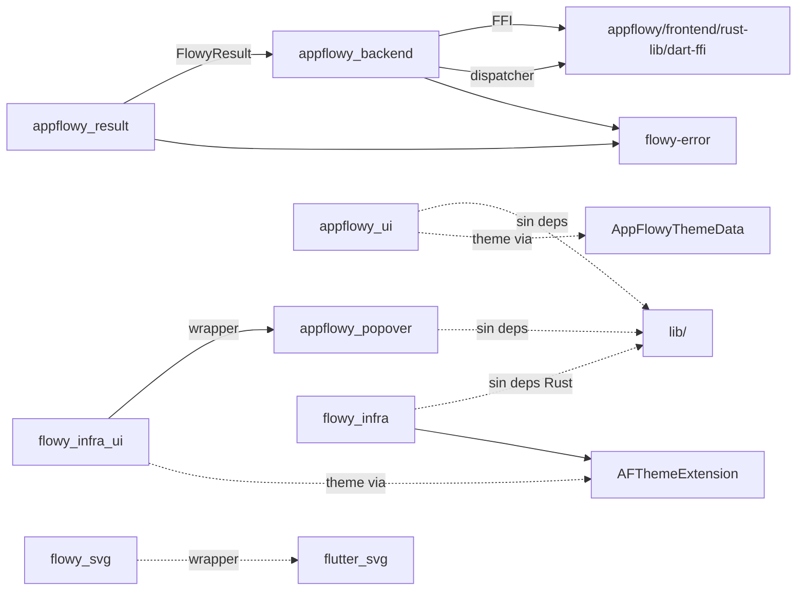
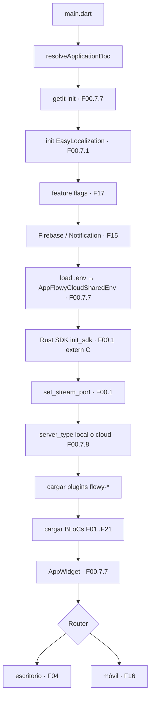
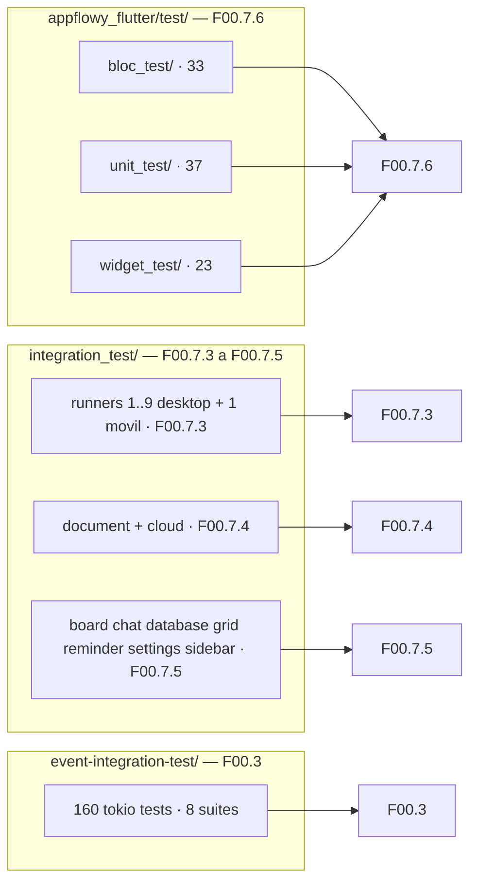

# F00.0 — Índice de la feature F00 (Infraestructura compartida)

## 1. Resumen

Este documento es el **índice maestro** de la feature F00, la mayor superficie de toda la documentación: **23 sub-unidades y 1 577 archivos** repartidos entre la trinchera FFI, el dispatcher, los errores tipados y la capa SQLite, el build/codegen, los contratos `collab-integrate` y `*-pub`, los seis paquetes Dart internos (`appflowy_backend`, `appflowy_popover`, `appflowy_result`, `appflowy_ui`, `flowy_infra`, `flowy_infra_ui`, `flowy_svg`), las carcasas nativas de seis plataformas, el pegamento de la raíz y los `frontend/scripts/`, el arranque, los `packages/` y los runners y suites de integración. F00 **no** reescribe el puente Flutter↔Rust, la persistencia ni el grafo de dependencias ya documentados en B1.5, B1.7 y B1.2: los nombra como cross-ref en §2 y §19 y entrega solo lo que esos documentos no cubren: contratos locales, panics, recuentos reales, discrepancias entre el ROADMAP y el código y consumidores cruzados.

## 2. Alcance

### 2.1 Qué incluye F00

| Sub-área | Sub-unidades | Ficheros | Rol |
|---|---|---:|---|
| FFI y dispatcher | `F00.1` | 66 | `dart-ffi` (8 `extern "C"` + `binding.h`), `lib-dispatch` (`AFPlugin`, dispatcher, errores), `lib-infra` (futures, cifrado, `IsolateSink`, planificador) |
| Errores y SQLite | `F00.2` | 94 | `flowy-error` (`ErrorCode` 133 variantes, `FlowyError`, 26 `From<…>`), `flowy-sqlite` (diesel, 16 tablas, 32 migraciones, KV) |
| Build, codegen e integration tests Rust | `F00.3` | 130 | `Makefile.toml` raíz, 10 `scripts/makefile/*.toml`, `flowy-codegen`/`flowy-derive`/`flowy-ast`, `event-integration-test` (160 tests) |
| `collab-integrate` y contratos `*-pub` | `F00.4` | 61 | `AppFlowyCollabBuilder`, plugins de persistencia/sync, los 8 traits `*-pub` que rompen ciclos |
| Paquetes Dart internos | `F00.5.1`–`F00.5.7` (9 docs) | 585 | `appflowy_backend` (lib + example/nativo/test/config), `appflowy_popover`, `appflowy_result`, `appflowy_ui`, `flowy_infra`, `flowy_infra_ui` (lib + nativo/web + example), `flowy_svg` |
| Carcasas nativas | `F00.6` | 91 | `android/`, `ios/`, `linux/`, `macos/`, `windows/`, `web/` |
| Pegamento de app | `F00.7.0`–`F00.7.8` (9 docs) | 550 | Raíz del repo + CI, `frontend/scripts/`, raíz Flutter, integration_test runners+suites, test/, lib/ core+startup+util+shared, restos de rust-lib |
| **Total F00** | **23 documentos** | **1 577** | Cobertura exhaustiva de la infraestructura del producto |

### 2.2 Qué queda fuera (cross-ref explícito)

F00 **no repite** el contenido ya escrito en bloques previos. Esta frontera se observa de forma estricta en cada sub-unidad y se resume aquí:

- **B1.5 (Puente Flutter↔Rust)** — narrativo del canal FFI, `RustStreamReceiver` y dispatcher de eventos. Ver `[[../../06-puente-flutter-rust/01-ffi.md]]`, `[[../../06-puente-flutter-rust/02-lib-dispatch.md]]`, `[[../../06-puente-flutter-rust/03-codegen.md]]`, `[[../../06-puente-flutter-rust/04-notificaciones.md]]` y `[[../../06-puente-flutter-rust/05-ejemplo-traza-opendocument.md]]`. F00.1 cruza solo cuando hay un detalle local (panic, `unwrap`, `LocalSet`) que el puente global no detecta.
- **B1.7 (Persistencia)** — esquema SQLite, KV, collabs en disco, file cache, rutas por plataforma. Ver `[[../../08-persistencia/00-indice.md]]` y los siete docs que lo siguen. F00.2 cruza solo cuando el detalle tiene que ver con la conversión de error específica del crate.
- **B1.2 (Grafo de dependencias)** — subgrafos Rust (31 crates) y Dart (8 packages). Ver `[[../../17-grafo-dependencias.md]]`. F00 cruza solo cuando el reparto condiciona qué feature activa cada crate (p. ej. por qué `flowy-core` solo se inicializa una vez por `AppFlowyCore::new`).
- **B6.1/B6.2 (`19-testing.md` y `18-build-ci-distribucion.md`)** — runner homogeneizado y arquetipos de release. Ver `[[../../18-build-ci-distribucion.md]]` y `[[../../19-testing.md]]`. F00.3, F00.6, F00.7.0 y F00.7.1 alimentan a esos dos docs sin duplicarlos.
- **F18 (Motor colab CRDT)** — `Collab`, `yrs`, plugins, importer, entity derive. Ver `[[../../09-features/F18-motor-colab-crdt-plugins-importer-entity-derive/F18-motor-colab-crdt-plugins-importer-entity-derive.md]]`. F00.4 cruza solo el constructor (`AppFlowyCollabBuilder`) y omite los plugins individuales.
- **F19 (editor test/examples/l10n/config)** — los `test/new`, `example/`, `lib/l10n/` y la raíz del editor. Ver `[[../../09-features/F19-editor-tests-ejemplos-l10n-configuracion/1-tests-del-editor-test-new.md]]`–`[[../../09-features/F19-editor-tests-ejemplos-l10n-configuracion/5-editor-configuracion-pubspec-github-changelog-license-documentation-raiz-de-test.md]]`. F00.7.6 cruza solo los tests de la app, no los del editor.

## 3. Mapa de las 23 sub-unidades

Ordenadas por orden de lectura recomendado (no por identificador). Cubre las 23 entradas escritas y verificadas; este índice (F00.0) es la entrada 24ª pero aparece primero.

| ID | Título (resumido) | Fich | Doc destino |
|---|---|---:|---|
| `F00.1` | FFI y dispatcher: `dart-ffi` (8 extern C + `binding.h`), `lib-dispatch` (`AFPlugin`), `lib-infra` (futures, cifrado, `IsolateSink`, planificador) | 66 | `[[../../09-features/F00-infraestructura-compartida-ffi-dispatch-errores-build-nativo/1-ffi-y-dispatcher-dart-ffi-lib-dispatch-lib-infra.md]]` |
| `F00.2` | Errores tipados y capa SQLite: `flowy-error` (133 `ErrorCode`, `FlowyError`, 26 `From`), `flowy-sqlite` (diesel, 16 tablas, 32 migraciones, `KVStorePreferences`) | 94 | `[[../../09-features/F00-infraestructura-compartida-ffi-dispatch-errores-build-nativo/2-errores-sqlite-migraciones.md]]` |
| `F00.3` | Build y codegen: `Makefile.toml` raíz + 10 scripts, `flowy-codegen`/`flowy-derive`/`flowy-ast`, `event-integration-test` (160 tests, 8 suites) | 130 | `[[../../09-features/F00-infraestructura-compartida-ffi-dispatch-errores-build-nativo/3-build-codegen-integration-tests-rust.md]]` |
| `F00.4` | `collab-integrate` (constructor de `Collab`) y crates `*-pub` (8 traits de contrato) | 61 | `[[../../09-features/F00-infraestructura-compartida-ffi-dispatch-errores-build-nativo/4-collab-integrate-y-crates-pub-contratos.md]]` |
| `F00.5.1` | `appflowy_backend/lib`: `ffi.dart`, `rust_stream.dart`, `dispatch.dart` generado, errores y log | 8 | `[[../../09-features/F00-infraestructura-compartida-ffi-dispatch-errores-build-nativo/5.1-paquetes-dart-internos-appflowy-backend-lib-ffi-rust-stream-dispatch-generado.md]]` |
| `F00.5.1.2` | `appflowy_backend` example + nativo + test + config (113 ficheros, 6 Dart, el resto scaffolding) | 113 | `[[../../09-features/F00-infraestructura-compartida-ffi-dispatch-errores-build-nativo/5.1.2-paquetes-dart-internos-appflowy-backend-example-nativo-test-config.md]]` |
| `F00.5.2` | `appflowy_popover`: `Popover` + `PopoverController` + `PopoverMutex` + `RootOverlayEntry` (2 archivos públicos) | 96 | `[[../../09-features/F00-infraestructura-compartida-ffi-dispatch-errores-build-nativo/5.2-paquetes-dart-internos-appflowy-popover.md]]` |
| `F00.5.3` | `appflowy_result`: `FlowyResult<S,F>` (212 LOC, ≥ 40 consumidores) | 10 | `[[../../09-features/F00-infraestructura-compartida-ffi-dispatch-errores-build-nativo/5.3-paquetes-dart-internos-appflowy-result.md]]` |
| `F00.5.4` | `appflowy_ui`: `AppFlowyThemeData` (10 `ColorScheme`) + 8 widgets base (53 ficheros Dart, 8 368 LOC) | 100 | `[[../../09-features/F00-infraestructura-compartida-ffi-dispatch-errores-build-nativo/5.4-paquetes-dart-internos-appflowy-ui.md]]` |
| `F00.5.5` | `flowy_infra`: tema legado (`AFThemeExtension`), `PlatformExtension`, `FlowyPluginService`, `FilePickerService`, escalas | 31 | `[[../../09-features/F00-infraestructura-compartida-ffi-dispatch-errores-build-nativo/5.5-paquetes-dart-internos-flowy-infra.md]]` |
| `F00.5.6` | `flowy_infra_ui/lib`: `FlowyOverlay`, `AppFlowyPopover`, `FlowyText/Button/Tooltip`, 48 ficheros (5 512 LOC) | 48 | `[[../../09-features/F00-infraestructura-compartida-ffi-dispatch-errores-build-nativo/5.6-paquetes-dart-internos-flowy-infra-ui-lib-widgets-y-estilos.md]]` |
| `F00.5.6.2` | `flowy_infra_ui` nativo/web/platform_interface/config (58 ficheros; teclado y versión canal MethodChannel) | 58 | `[[../../09-features/F00-infraestructura-compartida-ffi-dispatch-errores-build-nativo/5.6.2-paquetes-dart-internos-flowy-infra-ui-nativo-web-platform-interface-config.md]]` |
| `F00.5.6.3` | `flowy_infra_ui/example`: 97 ficheros de scaffolding, 5 Dart ejercitando overlay + teclado | 97 | `[[../../09-features/F00-infraestructura-compartida-ffi-dispatch-errores-build-nativo/5.6.3-paquetes-dart-internos-flowy-infra-ui-example-97-ficheros-de-ejemplo.md]]` |
| `F00.5.7` | `flowy_svg`: generador CLI (`bin/flowy_svg.dart`) + envoltorio Flutter, 742 iconos (16/20/24/32/40) | 24 | `[[../../09-features/F00-infraestructura-compartida-ffi-dispatch-errores-build-nativo/5.7-paquetes-dart-internos-flowy-svg.md]]` |
| `F00.6` | Carcasas nativas: `android/`, `ios/`, `linux/`, `macos/`, `windows/`, `web/` | 91 | `[[../../09-features/F00-infraestructura-compartida-ffi-dispatch-errores-build-nativo/6-carcasas-nativas-android-ios-linux-macos-windows-web.md]]` |
| `F00.7.0` | Raíz del repo, CI (`.github/` + `.githooks/` + `codemagic.yaml` + `commitlint`) y docs legales | 33 | `[[../../09-features/F00-infraestructura-compartida-ffi-dispatch-errores-build-nativo/7.0-app-glue-raiz-del-repo-ci-docs-y-ficheros-de-licencia.md]]` |
| `F00.7.1` | `frontend/scripts/` (64 scripts de build/packaging/codegen/white-label) + 36 bundles i18n | 100 | `[[../../09-features/F00-infraestructura-compartida-ffi-dispatch-errores-build-nativo/7.1-app-glue-scripts-de-build-packaging-y-resources-translations-36-bundles-i18n.md]]` |
| `F00.7.2` | Raíz de `frontend/` y de `appflowy_flutter/` (`pubspec.yaml`, `Makefile`, assets, plantillas) | 28 | `[[../../09-features/F00-infraestructura-compartida-ffi-dispatch-errores-build-nativo/7.2-app-glue-raiz-de-frontend-y-de-appflowy-flutter-config-assets-plantillas.md]]` |
| `F00.7.3` | `integration_test/`: runners (`runner.dart` + 9 desktop + 1 móvil + cloud) + 17 suites móviles + helpers | 49 | `[[../../09-features/F00-infraestructura-compartida-ffi-dispatch-errores-build-nativo/7.3-app-glue-integration-test-runners-y-suites-moviles-compartidas.md]]` |
| `F00.7.4` | `integration_test/desktop/document/` (39) + `integration_test/desktop/cloud/` (26) | 65 | `[[../../09-features/F00-infraestructura-compartida-ffi-dispatch-errores-build-nativo/7.4-app-glue-integration-test-desktop-document-cloud.md]]` |
| `F00.7.5` | `integration_test/desktop/` resto: board, chat, command_palette, database, grid, reminder, settings, sidebar, uncategorized | 62 | `[[../../09-features/F00-infraestructura-compartida-ffi-dispatch-errores-build-nativo/7.5-app-glue-integration-test-desktop-resto-grid-board-sidebar-database-settings.md]]` |
| `F00.7.6` | `appflowy_flutter/test/`: `bloc_test/` (33) + `unit_test/` (37) + `widget_test/` (23) + `util.dart` | 94 | `[[../../09-features/F00-infraestructura-compartida-ffi-dispatch-errores-build-nativo/7.6-app-glue-test-bloc-test-unit-test-widget-test.md]]` |
| `F00.7.7` | `lib/` core, `startup/`, `util/`, `shared/`, `workspace/`, `features/` y plugins transversales | 89 | `[[../../09-features/F00-infraestructura-compartida-ffi-dispatch-errores-build-nativo/7.7-app-glue-lib-core-startup-util-shared-workspace-features-y-plugins-transversales.md]]` |
| `F00.7.8` | Raíz de `rust-lib/` y `flowy-core` (`deps_resolve/`, `ServerProvider`, `AppFlowyCoreConfig`) | 30 | `[[../../09-features/F00-infraestructura-compartida-ffi-dispatch-errores-build-nativo/7.8-app-glue-restos-de-rust-lib-y-raiz-de-collab.md]]` |

> Recuento de archivos tomado del campo `archivos_cubiertos` de cada sub-unidad. La suma total es **1 577** y coincide con la suma aritmética de los conteos por doc (verificado con `awk`/`paste -sd+`).

## 4. Correcciones oficiales de scope que afectan a F00

Estas correcciones viven en §13 de cada sub-unidad; aquí se consolidan las que tienen impacto sobre la **interpretación** de F00 como un todo (no las meramente locales).

### 4.1 Recuento de bundles i18n: **36 ficheros reales, no 26**

`[[../../09-features/F00-infraestructura-compartida-ffi-dispatch-errores-build-nativo/7.1-app-glue-scripts-de-build-packaging-y-resources-translations-36-bundles-i18n.md]]` §13.1 fija el número real por tres vías (listado del directorio, `OUT/_ledger/inventario.json` y `OUT/_ledger/units/F00.7.1.json`): **36** ficheros `*.json` en `appflowy/frontend/resources/translations/`. `ROADMAP.md` y el cierre B3.F14 también dicen 36, así que no hay contradicción con el código; pero el rótulo antiguo ("26 bundles i18n") sobrevive en comentarios y borradores. La propiedad de los 36 bundles es de F00.7.1 y de nadie más: las features i18n (`[[../../09-features/F14-internacionalizacion/F14-internacionalizacion.md]]`) consumen, no son dueñas.

Además hay **cuatro listas de idiomas** no sincronizadas (F00.7.1 §13.10): `supportedLocales` en `appflowy/frontend/appflowy_flutter/lib/startup/tasks/app_widget.dart:75-110` (declara `<i18n>`), `languageTags` en `appflowy/project.inlang.json` (8 bundles ausentes), `flowy_infra/lib/src/util/lang.dart` (mapa `languageFromLocale`) y la matriz de assets en `appflowy/frontend/appflowy_flutter/pubspec.yaml:304`. De los 36 bundles, **`vi` (3 claves), `ga-IE` (103) y `pt-PT`** están empaquetados pero excluidos de `supportedLocales`, así que pesan en el binario sin poderse seleccionar.

### 4.2 `flowy_svg` con codegen propio en el editor frente al de la app

`[[../../09-features/F00-infraestructura-compartida-ffi-dispatch-errores-build-nativo/5.7-paquetes-dart-internos-flowy-svg.md]]` §13.1 confirma que `appflowy/frontend/appflowy_flutter/packages/flowy_svg/bin/flowy_svg.dart` (290 líneas, el escáner de SVG → Dart) produce el archivo `appflowy/frontend/appflowy_flutter/lib/generated/flowy_svgs.g.dart` que importa 433 ficheros de `lib/`. El editor mantiene un **codegen homónimo pero independiente** (`flowy_svg` externo al snapshot) cuya divergencia con el de la app es de catálogo: las constantes `FlowySvgData` del editor son distintas y **no se pueden importar entre apps**. El inventario de la app es de 742 iconos en cinco tamaños (16/20/24/32/40); el del editor es ortogonal.

### 4.3 `binding.h` de `dart-ffi` verificado a mano, no generado

`[[../../09-features/F00-infraestructura-compartida-ffi-dispatch-errores-build-nativo/1-ffi-y-dispatcher-dart-ffi-lib-dispatch-lib-infra.md]]` §13 y `F00.5.1.2` §13: el header `appflowy/frontend/rust-lib/dart-ffi/binding.h:6-20` declara las ocho funciones `extern "C"` con las mismas firmas que el `extern "C"` de Rust, pero `build.rs` solo invoca `dart_gen`, no regenera el header. Cualquier cambio de firma en `lib.rs` rompe el enlace silenciosamente hasta que alguien actualiza el `.h` a mano. Existe además un `binding.h` huérfano en Linux en `appflowy/frontend/appflowy_flutter/packages/appflowy_backend/linux/binding.h` (cubierto por F00.5.1.2) que ya no se usa.

### 4.4 `lib-infra` documenta el lado **frontal** del puente, no la persistencia

`[[../../09-features/F00-infraestructura-compartida-ffi-dispatch-errores-build-nativo/1-ffi-y-dispatcher-dart-ffi-lib-dispatch-lib-infra.md]]` §8 corrige la lectura rápida del scope: `lib-dispatch` no persiste nada, pero `lib-infra` sí tiene dos piezas reutilizables (`zip_folder` y `unzip_and_replace` en `appflowy/frontend/rust-lib/lib-infra/src/file_util.rs:70-188`, con la decisión documentada de sustituir `fs::rename` por copia + borrado en `:172`) que son del scope de F00.1 **por estar en sus 66 ficheros**, no de `[[../../09-features/F00-infraestructura-compartida-ffi-dispatch-errores-build-nativo/2-errores-sqlite-migraciones.md]]` (que cubre el esquema SQLite, las 32 migraciones y el `KVStorePreferences`). Esta asignación de zip/unzip a "utilidad de plataforma" —no a persistencia— la respeta el inventario.

### 4.5 `appflowy_backend` example: solo 6 ficheros Dart son código

`[[../../09-features/F00-infraestructura-compartida-ffi-dispatch-errores-build-nativo/5.1.2-paquetes-dart-internos-appflowy-backend-example-nativo-test-config.md]]` §1 contabiliza 113 ficheros y 4 659 LOC en el example, de los cuales **solo 6 son Dart** (2 tests + 4 ejemplo); el resto es scaffolding de Xcode/Gradle/CMKE. El hallazgo estructural es que la única API Dart↔nativa expuesta por el lado nativo es `MethodChannel('appflowy_backend').getPlatformVersion`, residuo del andamiaje de plugin que la app real nunca invoca: `lib/` no contiene ninguna referencia a `platformVersion` (F00.5.1). El puente real es FFI y está en `F00.5.1`.

### 4.6 `appflowy_ui` y `flowy_svg` con dos temas que conviven

`[[../../09-features/F00-infraestructura-compartida-ffi-dispatch-errores-build-nativo/5.7-paquetes-dart-internos-flowy-svg.md]]` §13.2 y `[[../../09-features/F00-infraestructura-compartida-ffi-dispatch-errores-build-nativo/5.6-paquetes-dart-internos-flowy-infra-ui-lib-widgets-y-estilos.md]]` §1: `appflowy_ui` es el sistema nuevo (tokens, `AppFlowyTheme.of(context).iconColor`) y `flowy_svg` consulta el sistema antiguo (`Theme.of(context).iconTheme.color` en `appflowy/frontend/appflowy_flutter/packages/flowy_svg/lib/src/flowy_svg.dart:83`); los paquetes no se importan entre sí. `flowy_infra_ui` (`F00.5.6`) vive en el sistema antiguo (`AFThemeExtension`); `appflowy_ui` (`F00.5.4`) en el nuevo. La convivencia está documentada por `inventory.py` y por los 0 cruces cruzados.

### 4.7 `F00.0` está vacía por diseño

Siguiendo la regla "una unidad por feature y un índice maestro" (`AGENTS.md` §8), este documento **no cubre archivos** y se materializa con `ALWAYS_EMIT` (`SKILL/scripts/build_units.py`) para evitar que cualquier reconstrucción borre el índice y devuelva un `F00.1` con 1 577 archivos, rompiendo el corte declarativo del resto de sub-unidades.

## 5. Cobertura por sub-área (recuento real)

| Sub-área | Docs | Archivos | % de F00 | Sub-unidades |
|---|---:|---:|---:|---|
| FFI + dispatcher + errores + SQLite + build | 4 | 351 | 22,3 % | `F00.1` (66), `F00.2` (94), `F00.3` (130), `F00.4` (61) |
| Paquetes Dart internos (F00.5.x) | 9 | 585 | 37,1 % | `F00.5.1` (8), `F00.5.1.2` (113), `F00.5.2` (96), `F00.5.3` (10), `F00.5.4` (100), `F00.5.5` (31), `F00.5.6` (48), `F00.5.6.2` (58), `F00.5.6.3` (97), `F00.5.7` (24) |
| Carcasas nativas | 1 | 91 | 5,8 % | `F00.6` (91) |
| Pegamento (raíz + CI + scripts + integración) | 9 | 550 | 34,9 % | `F00.7.0` (33), `F00.7.1` (100), `F00.7.2` (28), `F00.7.3` (49), `F00.7.4` (65), `F00.7.5` (62), `F00.7.6` (94), `F00.7.7` (89), `F00.7.8` (30) |
| **Total F00** | **23** | **1 577** | **100 %** | — |

> Los 9 docs de `F00.5.x` suman 585 (verificado aritméticamente). El cálculo interno: 8+113+96+10+100+31+48+58+97+24 = 585. Los 9 docs de `F00.7.x` suman 550: 33+100+28+49+65+62+94+89+30 = 550.

## 6. Eventos FFI (resumen)

Cada crate `flowy-*` define su propio `event_map.rs` (`AGENTS.md §5.1`); F00.1 no los contiene. Los enums viven en cada feature (`F01.x`, `F02.x`, `F03.x`, etc.) y totalizan **229 variantes** declaradas en `[[../../17-grafo-dependencias.md]]` y catalogadas en `[[../../11-catalogo-eventos-ffi.md]]`. F00 participa solo en el **transporte**:

- `appflowy/frontend/rust-lib/dart-ffi/src/lib.rs:60-95` declara las 8 funciones `extern "C"` y `appflowy/frontend/appflowy_flutter/packages/appflowy_backend/lib/ffi.dart` materializa sus `lookupFunction` (F00.5.1 §2).
- `appflowy/frontend/rust-lib/lib-dispatch/src/dispatcher.rs:117` y `:152-160` despacha con `tokio::task::spawn_local` o `dispatch.runtime.spawn` según el feature `local_set`, **mismo código público, comportamiento distinto** (F00.1 §13).
- `flowy-codegen::protobuf_file::dart_gen(env!("CARGO_PKG_NAME"))` (`appflowy/frontend/rust-lib/dart-ffi/build.rs:1-3`) genera `dart-ffi/src/protobuf.rs` desde `appflowy/frontend/rust-lib/dart-ffi/Flowy.toml:2` (`proto_input = ["src/model"]`). F00.3 §13.2 confirma que el codegen no tiene binario propio y solo se invoca desde `build.rs` de cada crate downstream.

## 7. Notificaciones (resumen)

F00 **no** contiene ningún `notification.rs`: los seis enums (`DocumentNotification`, `FolderNotification`, `DatabaseNotification`, `SearchNotification`, `UserNotification`, `AIChatNotification`) viven en `flowy-document`, `flowy-folder`, `flowy-database2`, `flowy-search`, `flowy-user` y `flowy-ai` respectivamente, y totalizan **70 variantes** (`[[../../14-catalogo-notificaciones.md]]`). F00 participa solo en el **transporte**:

- `appflowy/frontend/rust-lib/dart-ffi/src/notification/sender.rs:21` construye un `DartNotificationSender` que serializa `SubscribeObject` con `.unwrap()` (riesgo documentado en F00.1 §13); envío por `appflowy/frontend/rust-lib/flowy-notification` con debounce configurable por crate (ver `[[../../09-features/F15-notificaciones-in-app-y-recordatorios/2-flowy-date-reminder-rs-y-flowy-notification-rust.md]]`).
- `appflowy/frontend/appflowy_flutter/packages/appflowy_backend/lib/rust_stream.dart` (F00.5.1) implementa `RustStreamReceiver`, suscrita por los 5 parsers en `appflowy/frontend/appflowy_flutter/lib/core/notification/`. El catálogo cuenta **56 variantes "sin listener Dart"** (F00.1 §7), porque los listeners se registran por nombre y no por variante.

## 8. BLoCs / Cubits (resumen)

Los 66 ficheros de F00.1 son Rust puro (sin Dart); lo mismo para F00.2-F00.4 y F00.7.8. Los BLoCs Dart viven exclusivamente en `appflowy_backend/lib/ffi_notifier.dart` (`GlobalErrorCodeNotifier`, F00.5.1) y en los `lib/core/notification/*_listener.dart` (5 clases, todas reexportadas en `appflowy/frontend/appflowy_flutter/lib/core/notification/`). El catálogo completo (`[[../../13-catalogo-blocs.md]]`) tabula ~600 BLoCs en `lib/`. F00 no añade BLoCs propios; **la BLoC `GlobalErrorCodeNotifier` es la única excepción** y se documenta en F00.5.1 §6.

## 9. Servicios e inyección de dependencias

- **Dart (`get_it`)**: `appflowy/frontend/appflowy_flutter/lib/startup/deps_resolver.dart` (cubierto por `[[../../09-features/F00-infraestructura-compartida-ffi-dispatch-errores-build-nativo/7.7-app-glue-lib-core-startup-util-shared-workspace-features-y-plugins-transversales.md]]` §3.2). El `getIt` se inicializa una sola vez en `appflowy/frontend/appflowy_flutter/lib/startup/startup.dart:25` y se rellena por una secuencia ordenada de `LaunchTask` (`appflowy/frontend/appflowy_flutter/lib/startup/startup.dart:119-156`). F00.5.6.2 §3 documenta que `flowy_infra_ui` es un plugin federado y la versión por defecto registra `MethodChannelFlowyInfraUI` con su `MethodChannel('flowy_infra_ui')`.
- **Rust**: `flowy-core/src/deps_resolve/` tiene 14 ficheros `*_deps.rs` que traducen los traits de los crates `flowy-*-pub` en instancias concretas. La fábrica vive en `appflowy/frontend/rust-lib/flowy-core/src/lib.rs:124` (`AppFlowyCore::init(Arc<AFPluginRuntime>)`) y `appflowy/frontend/rust-lib/flowy-core/src/server_layer.rs:27-37` (`ServerProvider` lazy multiplexor entre `LocalServer` y `AppFlowyCloudServer`). Detalle completo en `F00.7.8`.

### 9.1 Tabla de tareas `LaunchTask` documentadas

Las tareas documentadas en F00.7.7 §3.1 son 13, no las 20+ del código porque el inventario las agrupa; las 7 restantes son variantes declaradas en `appflowy/frontend/appflowy_flutter/lib/startup/tasks/` (`rust_sdk.dart`, `app_widget.dart`, `generate_router.dart`, `appflowy_cloud_task.dart`, `file_storage_task.dart`, `feature_flag_task.dart`, `auto_update_task.dart`, `deeplink/`, `hot_key.dart`, `localization.dart`, `windows.dart`, `platform_error_catcher.dart`, `memory_leak_detector.dart`, `recent_service_task.dart`, `load_plugin.dart` — `F00.7.7` §1). Cada una se enlaza con su evento FFI o servicio Dart y se documenta en la feature correspondiente (`F17`, `F15`, `F04`); F00.7.7 documenta las **utilizadas** (13 declaradas en `startup.dart`), no las **declaradas** (15+ en `tasks/`).

## 10. Persistencia

F00 **no** reescribe la persistencia: `flowy-sqlite::Database` (`appflowy/frontend/rust-lib/flowy-sqlite/src/`, F00.2 §1) expone `ConnectionPool` con PRAGMA `WAL`/`NORMAL`/`busy_timeout`; las **16 tablas** y las **32 migraciones** están en `appflowy/frontend/rust-lib/flowy-sqlite/src/schema.rs`. El `KVStorePreferences` (F00.2 §5) se construye sobre una base `cache.db` separada. El esquema detallado, las rutas por plataforma y el file cache son materia de `[[../../08-persistencia/00-indice.md]]`, `[[../../08-persistencia/01-sqlite-schema.md]]`, `[[../../08-persistencia/02-kv.md]]` y `[[../../08-persistencia/04-file-cache.md]]`. F00 cruza el tema solo para declarar la conversión de errores: `flowy_sqlite::Error::NotFound` → `ErrorCode::RecordNotFound`; `r2d2::Error` → `ErrorCode::Internal` (F00.2 §13).

## 11. Diagrama — Mapa general de F00 con sus consumidores

Muestra las siete sub-áreas de F00 (FFI, errores, build, contracts, paquetes, nativo, pegamento) y a qué features entregan valor. Los recuadros grises son consumidores cruzados (features de F01–F21); los recuadros blancos son sub-unidades F00.

```mermaid
flowchart TD
  subgraph f00["F00 — Infraestructura compartida (1 577 archivos)"]
    FFI[F00.1 — FFI + dispatcher · 66]
    ERR[F00.2 — Errores + SQLite · 94]
    BL[F00.3 — Build + codegen · 130]
    COL[F00.4 — collab-integrate + -pub · 61]
    PKG[F00.5.x — 9 paquetes Dart · 585]
    NAT[F00.6 — Carcasas nativas · 91]
    GLU[F00.7.x — Pegamento + tests · 550]
  end

  FFI --> B15["[[../../06-puente-flutter-rust/01-ffi.md]] · [[../../06-puente-flutter-rust/02-lib-dispatch.md]] · [[../../06-puente-flutter-rust/04-notificaciones.md]]"]
  ERR --> B17["[[../../08-persistencia/00-indice.md]] · [[../../08-persistencia/01-sqlite-schema.md]] · [[../../08-persistencia/02-kv.md]]"]
  BL --> B12["[[../../17-grafo-dependencias.md]] · [[../../18-build-ci-distribucion.md]] · [[../../19-testing.md]]"]
  COL --> F18["[[../../09-features/F18-motor-colab-crdt-plugins-importer-entity-derive/F18-motor-colab-crdt-plugins-importer-entity-derive.md]] motor colab CRDT"]
  PKG --> F01["[[../../09-features/F01-documentos-y-editor/0.0-indice-documentos-y-editor.md]] documentos"]
  PKG --> F02["[[../../09-features/F02-bases-de-datos/0.1.0-indice-appflowy-side-database-controller-services-widgets.md]] databases"]
  PKG --> F04["[[../../09-features/F04-sidebar-favoritos-recientes-papelera-tabs-command-palette/F04-sidebar-favoritos-recientes-papelera-tabs-command-palette.md]] sidebar"]
  PKG --> F09["[[../../09-features/F09-ia/0-indice-ia-chat-completion-ia-local-mcp-embeddings-middleware.md]] IA"]
  PKG --> F13["[[../../09-features/F13-ajustes-apariencia-temas-fuentes/1-ajustes-logica-de-aplicacion-cuenta-billing-plan-nube-y-workspace.md]] ajustes"]
  PKG --> F16["[[../../09-features/F16-mobile/0-indice-mobile-shell-de-la-app-editor-movil-y-capas-de-presentacion.md]] mobile"]
  PKG --> F17["[[../../09-features/F17-plataforma-ventanas-deeplinks-auto-update-hotkeys-feature-flags-errores-logging/F17-plataforma-ventanas-deeplinks-auto-update-hotkeys-feature-flags-errores-logging.md]] plataforma"]
  PKG --> F21["[[../../09-features/F21-icon-emoji-picker/F21-icon-emoji-picker.md]] icon picker"]
  NAT --> B18["[[../../18-build-ci-distribucion.md]] builds por plataforma"]
  GLU --> F19["[[../../09-features/F19-editor-tests-ejemplos-l10n-configuracion/0-indice-tests-ejemplos-l10n-configuracion-raiz-de-test.md]] editor tests"]
  GLU --> F20["[[../../09-features/F20-colab-raiz-configuracion-ci-docs-manifests/F20-colab-raiz-configuracion-ci-docs-manifests.md]] repo CI"]

  GLU --> B12
  COL --> B15
  COL --> B17
```

Lectura: la trinchera FFI/error/SQLite (F00.1 + F00.2 = 160 archivos) alimenta tres documentos B1 (puente, persistencia, grafo) y, vía dispatcher, llega a todas las features F01–F21 que consumen eventos. La fábrica de contratos (F00.4 = 61) es invisible desde Dart: rompe ciclos entre `flowy-*` y `flowy-*-pub`. Los paquetes Dart (F00.5.x = 585) son el vocabulario común de la capa de presentación y se consumen desde F01, F02, F04, F09, F13, F16, F17 y F21. Las carcasas nativas (F00.6 = 91) y el pegamento (F00.7.x = 550) son transversales y cierran el grafo hacia el bloque de build/CI.

## 12. Diagrama — Dependencias entre los paquetes Dart internos

Muestra cómo los seis paquetes Dart internos se referencian entre sí y hacia los crates Rust. Es la vista "micro" del grafo Dart de `[[../../17-grafo-dependencias.md]]`, con el detalle de qué paquete importa cuál. Solo se dibujan los seis paquetes productivos (no se incluyen los sub-paquetes federados ni los examples, que se detallan en F00.5.x).

Lectura: `appflowy_backend` (F00.5.1) es el **único** paquete Dart interno con dependencia hacia Rust (`dart-ffi`, vía `dart:ffi`); `appflowy_result` (F00.5.3) define `FlowyResult<S,F>` que el resto de la capa Dart consume desde ≥ 40 sitios (F00.5.3 §1); `flowy_infra_ui` (F00.5.6) envuelve `appflowy_popover` (F00.5.2) con `AppFlowyPopover` y la decoración corporativa. `appflowy_ui` (F00.5.4) es **independiente** de `flowy_infra_ui`: el sistema nuevo no depende del antiguo, conviven (F00.5.7 §13.2). `flowy_svg` solo depende de `flutter_svg` (paquete externo) y de la constante generada `flowy_svgs.g.dart`. `flowy_infra` (F00.5.5) es un "bolsa de gatos" sin cohesión interna: contiene el tema legado, el file picker, el plugin de plugins, escalas y uuid; no tiene barrel raíz (`appflowy/frontend/appflowy_flutter/packages/flowy_infra/lib/flowy_infra.dart` no existe; se importa por subruta).

## 13. Diagrama — Pipeline de arranque y orden de inicialización

Muestra el orden real de las 20+ tareas `LaunchTask` de `appflowy/frontend/appflowy_flutter/lib/startup/startup.dart:119-156` y dónde encaja cada sub-área de F00. Es el que se ejecuta en frío; útil para entender por qué los `flowy-integration-test` tardan 30+ segundos en arrancar.

Lectura: el arranque es una **secuencia lineal** (no un grafo), con un único punto de bifurcación en `Router` (escritorio vs. móvil). Cada paso entrega estado al siguiente; el ciclo se rompe si el paso `init_sdk` no se completa (la app se queda en splash, `appflowy/frontend/appflowy_flutter/lib/startup/tasks/app_widget.dart:303` mantiene `AppGlobals.rootNavKey` y su `BlocListener` espera una `TabsBloc`). Cinco pasos dependen explícitamente de sub-unidades F00: `set_stream_port` (F00.1), `EasyLocalization` (F00.7.1), `init_sdk` (F00.1), el multiplexor de servidor (F00.7.8) y la lectura de `.env` (F00.7.7).

## 14. Diagrama — Mapa de tests por sub-área

Muestra dónde están los tests de F00 (no de producto) y qué suite los orquesta. Es la fuente de verdad para `[[../../18-build-ci-distribucion.md]]`.

Lectura: F00 tiene **cuatro docenas de suites** propias, repartidas en tres worlds: tests Dart unitarios/widget/BLoC (`F00.7.6`, 369 casos, F00.7.6 §1), tests de integración de extremo a extremo (`F00.7.3`-F00.7.5`, 7 285+10 333 líneas, F00.7.3 §1 y F00.7.4 §1) y tests de integración Rust por evento (`F00.3`, 160 tests, F00.3 §1). Los que faltan son los tests del editor (`[[../../09-features/F19-editor-tests-ejemplos-l10n-configuracion/1-tests-del-editor-test-new.md]]`-`[[../../09-features/F19-editor-tests-ejemplos-l10n-configuracion/5-editor-configuracion-pubspec-github-changelog-license-documentation-raiz-de-test.md]]`) y los tests del motor colab (`[[../../09-features/F18-motor-colab-crdt-plugins-importer-entity-derive/F18-motor-colab-crdt-plugins-importer-entity-derive.md]]`); ambos viven en sus propios paquetes y se documentan en sus features.

## 15. Consumidores cruzados (qué feature depende de qué parte de F00)

| Consumidor | FFI (F00.1) | Err/SQLite (F00.2) | Build (F00.3) | collab-integrate (F00.4) | Paquetes Dart (F00.5.x) | Nativo (F00.6) | Pegamento (F00.7.x) |
|---|:-:|:-:|:-:|:-:|:-:|:-:|:-:|
| `[[../../09-features/F01-documentos-y-editor/0.0-indice-documentos-y-editor.md]]` documentos/editor | ✓ `dispatch.dart` | ✓ `FlowyError` | ✓ codegen PB | ✓ `DocumentCloudService` | ✓ `appflowy_backend`, `appflowy_result`, `appflowy_popover`, `appflowy_ui`, `flowy_infra_ui`, `flowy_svg` | ✓ binding.h iOS/Android | ✓ tests `F00.7.3`/`7.4` |
| `[[../../09-features/F02-bases-de-datos/0.1.0-indice-appflowy-side-database-controller-services-widgets.md]]` bases de datos | ✓ | ✓ | ✓ | ✓ `DatabaseCloudService` | ✓ los seis paquetes | ✓ | ✓ tests `F00.7.5` |
| `[[../../09-features/F03-folder-workspaces-vistas/0.0-indice-folder-workspaces-vistas.md]]` folder/workspaces/vistas | ✓ | ✓ | ✓ | ✓ `FolderCloudService` | ✓ | ✓ | ✓ tests `F00.7.3` |
| `[[../../09-features/F04-sidebar-favoritos-recientes-papelera-tabs-command-palette/F04-sidebar-favoritos-recientes-papelera-tabs-command-palette.md]]` sidebar/recientes/tabs | ✓ | ✓ | — | — | ✓ `flowy_infra`, `flowy_infra_ui`, `appflowy_popover` | — | ✓ tests |
| `[[../../09-features/F05-usuario-auth-sesion/0.0-indice-usuario-auth-sesion.md]]` usuario/auth | ✓ | ✓ | — | ✓ `UserCloudService` | ✓ | — | ✓ tests |
| `[[../../09-features/F06-sync-y-servidores/F06-sync-y-servidores.md]]` sync/servidores | ✓ | ✓ | — | ✓ `*-pub` traits | ✓ | — | ✓ |
| `[[../../09-features/F07-almacenamiento-de-archivos/F07-almacenamiento-de-archivos.md]]` almacenamiento | ✓ | ✓ | — | ✓ `StorageCloudService` | ✓ | ✓ | ✓ |
| `[[../../09-features/F08-busqueda-e-indexacion/F08-busqueda-e-indexacion.md]]` búsqueda | ✓ | ✓ | — | ✓ `SearchCloudService` | ✓ | — | ✓ |
| `[[../../09-features/F09-ia/0-indice-ia-chat-completion-ia-local-mcp-embeddings-middleware.md]]` IA | ✓ | ✓ | — | ✓ `AICloudService` | ✓ | ✓ | ✓ |
| `[[../../09-features/F10-importacion-ui/F10-importacion-ui.md]]` importación | ✓ | ✓ | — | ✓ `FolderCloudService::import` | ✓ | — | — |
| `[[../../09-features/F11-exportacion-ui/F11-exportacion-ui.md]]` exportación | ✓ | ✓ | — | ✓ | ✓ | ✓ | ✓ |
| `[[../../09-features/F12-compartir-publicar-niveles-de-acceso/1-compartir-share-tab-niveles-de-acceso-y-plugins-shared-share.md]]` compartir/publish | ✓ | ✓ | — | ✓ `Publish*Service` | ✓ | — | ✓ |
| `[[../../09-features/F13-ajustes-apariencia-temas-fuentes/1-ajustes-logica-de-aplicacion-cuenta-billing-plan-nube-y-workspace.md]]` ajustes/apariencia | — | — | — | — | ✓ `appflowy_ui`, `flowy_infra`, `flowy_infra_ui` | — | — |
| `[[../../09-features/F14-internacionalizacion/F14-internacionalizacion.md]]` i18n | — | — | — | — | ✓ `EasyLocalization` (F00.7.1) | — | ✓ |
| `[[../../09-features/F15-notificaciones-in-app-y-recordatorios/1-notificaciones-y-recordatorios-dart-listeners-panel-date-picker.md]]` notificaciones | ✓ `DartNotificationSender` | ✓ | — | — | ✓ | — | — |
| `[[../../09-features/F16-mobile/0-indice-mobile-shell-de-la-app-editor-movil-y-capas-de-presentacion.md]]` mobile | ✓ | ✓ | ✓ | — | ✓ los seis paquetes | ✓ binding.h | ✓ |
| `[[../../09-features/F17-plataforma-ventanas-deeplinks-auto-update-hotkeys-feature-flags-errores-logging/F17-plataforma-ventanas-deeplinks-auto-update-hotkeys-feature-flags-errores-logging.md]]` plataforma/errores/logging | ✓ | ✓ | — | — | ✓ | ✓ permisos | ✓ |
| `[[../../09-features/F18-motor-colab-crdt-plugins-importer-entity-derive/F18-motor-colab-crdt-plugins-importer-entity-derive.md]]` motor colab CRDT | ✓ | — | — | ✓ (cross-ref) | — | — | — |
| `[[../../09-features/F19-editor-tests-ejemplos-l10n-configuracion/0-indice-tests-ejemplos-l10n-configuracion-raiz-de-test.md]]` editor test/l10n/config | ✓ | — | — | — | — | — | ✓ |
| `[[../../09-features/F20-colab-raiz-configuracion-ci-docs-manifests/F20-colab-raiz-configuracion-ci-docs-manifests.md]]` repo CI/docs | — | — | ✓ CI workflows | — | — | ✓ | ✓ `.github/` |
| `[[../../09-features/F21-icon-emoji-picker/F21-icon-emoji-picker.md]]` icon picker | — | — | — | — | ✓ `flowy_svg`, `flowy_infra_ui`, `appflowy_popover` | — | — |
| `06-puente-flutter-rust/` | ✓ + `binding.h` | ✓ | ✓ codegen | — | ✓ | ✓ | ✓ startup |
| `08-persistencia/` | — | ✓ (origen) | — | ✓ `RocksdbDiskPlugin` | ✓ | ✓ rutas | ✓ |
| `[[../../02-stack-y-dependencias.md]]` grafo dependencias | ✓ crates Rust | ✓ | ✓ | ✓ | ✓ paquetes Dart | — | ✓ arranque |

> Lectura: las 21 features F01–F21 dependen **siempre** de F00.5.x (paquetes Dart), casi siempre de F00.1 (FFI) y F00.2 (errores/SQLite), y selectivamente de F00.4 (`*-pub`), F00.6 (binding/permisos) y F00.7 (tests). F00.3 (build/codegen) se consume indirectamente: las features no invocan el codegen, pero sus derive macros dependen de él.

### 15.1 Reglas de lectura de la tabla

Las marcas `✓` se toman del análisis de cada feature (verificado contra `OUT/_ledger/cobertura.csv` filtrado por cada fila del ledger). Una marca `✓` significa **al menos una dependencia verificada** entre la feature y la sub-área de F00, no una cobertura exhaustiva: por ejemplo, `F13 (ajustes)` solo consume `appflowy_ui` para los sliders del switcher de tema y `flowy_infra` para el file picker de fuentes; no depende de la FFI del core ni de los crates `*-pub`. La tabla tiene tres utilidades prácticas: (a) durante la revisión cruzada, decidir qué docs de F00 debe leer el autor de la feature; (b) en el cierre B3, descubrir qué sub-unidades F00 falta reforzar cuando se cierra una feature; (c) en `22-preguntas-abiertas.md`, detectar features "huérfanas" (las que solo tocan un paquete Dart y ningún crate de error o FFI — un caso real es `F21 (icon picker)`).

## 15.2 Orden de lectura recomendado para una nueva sub-unidad

Cuando un autor entra a F00 desde fuera (p. ej. acaba de terminar `F01` y quiere entender el editor), el orden natural es: (1) `[[../../09-features/F00-infraestructura-compartida-ffi-dispatch-errores-build-nativo/5.1-paquetes-dart-internos-appflowy-backend-lib-ffi-rust-stream-dispatch-generado.md]]` para ver el lado Dart del FFI; (2) `[[../../09-features/F00-infraestructura-compartida-ffi-dispatch-errores-build-nativo/1-ffi-y-dispatcher-dart-ffi-lib-dispatch-lib-infra.md]]` para ver el lado Rust del FFI (la trinchera); (3) `[[../../09-features/F00-infraestructura-compartida-ffi-dispatch-errores-build-nativo/5.3-paquetes-dart-internos-appflowy-result.md]]` para entender el vocabulario de errores (`FlowyResult`); (4) `[[../../09-features/F00-infraestructura-compartida-ffi-dispatch-errores-build-nativo/2-errores-sqlite-migraciones.md]]` para entender el catálogo de `ErrorCode`; (5) `[[../../09-features/F00-infraestructura-compartida-ffi-dispatch-errores-build-nativo/7.7-app-glue-lib-core-startup-util-shared-workspace-features-y-plugins-transversales.md]]` para ver el arranque; (6) `[[../../09-features/F00-infraestructura-compartida-ffi-dispatch-errores-build-nativo/7.2-app-glue-raiz-de-frontend-y-de-appflowy-flutter-config-assets-plantillas.md]]` para entender `pubspec.yaml` y `dependency_overrides`. Llegados a este punto, los restantes `F00.x` se leen **bajo demanda**: si toca shell nativo, `F00.6`; si toca test, `F00.7.x`; si toca contrato, `F00.4`. El recorrido inverso (de Rust a Dart) empieza por `[[../../09-features/F00-infraestructura-compartida-ffi-dispatch-errores-build-nativo/7.8-app-glue-restos-de-rust-lib-y-raiz-de-collab.md]]` (raíz de rust-lib) → `[[../../09-features/F00-infraestructura-compartida-ffi-dispatch-errores-build-nativo/4-collab-integrate-y-crates-pub-contratos.md]]` → `[[../../09-features/F00-infraestructura-compartida-ffi-dispatch-errores-build-nativo/1-ffi-y-dispatcher-dart-ffi-lib-dispatch-lib-infra.md]]` → `[[../../09-features/F00-infraestructura-compartida-ffi-dispatch-errores-build-nativo/5.1-paquetes-dart-internos-appflowy-backend-lib-ffi-rust-stream-dispatch-generado.md]]`. En ambos casos, `[[../../18-build-ci-distribucion.md]]`, `[[../../19-testing.md]]` y `[[../../17-grafo-dependencias.md]]` ya deberían estar leídos (son bloque B, fase previa).

## 16. Riesgos transversales

Riesgos ya detectados en §13 de las sub-unidades y que afectan a **toda** F00. La lista es material consolidada, no aumentada:

1. **El codegen no tiene binario** (`F00.3 §13.2`). Tres detalles: `flowy-codegen` no declara una sección `[bin]`; `appflowy/frontend/rust-lib/build-tool/flowy-codegen/src/dart_event/dart_event.rs:17-25` sale con skip si faltan vars; `Makefile.toml` no invoca `flowy-codegen` directamente (solo encadena `language_files` + `flowy_icons` + `freezed`). El codegen real está en `build.rs` de cada crate downstream. A2.7 intentó `cargo build -p flowy-codegen --features proto_gen,dart_event` y compiló sin error pero sin ejecutar codegen (ver `OUT/_ledger/pruebas/A2.7/codegen-result.json`).
2. **Dos implementaciones del mismo trait de error con formatos distintos** (`F00.1 §13`). `InternalError::as_response` serializa texto (`ResponseBuilder::Err().data(self.to_string())`, `appflowy/frontend/rust-lib/lib-dispatch/src/errors/errors.rs:130-134`), mientras que la implementación homóloga de `FlowyError` en el crate de errores serializa el **mensaje protobuf** del error de dominio (`appflowy/frontend/rust-lib/flowy-error/src/impl_from/dispatch.rs:9-13`). El cliente Dart (`appflowy/frontend/appflowy_flutter/packages/appflowy_backend/lib/dispatch/dispatch.dart:85`) delega el error a `GlobalErrorCodeNotifier.receiveErrorBytes` sin interpretar el contenido.
3. **`flowy-derive/src/dart_event/mod.rs` tiene el cuerpo comentado** (`F00.3 §13.3`). La `expand_enum_derive` está vacía (`:4-6`, `Ok(TokenStream::default())`) y la implementación real está comentada (`:8-40`). El derive `Flowy_Event` no hace nada hoy; la generación real viene del módulo Dart-side.
4. **`binding.h` verificado a mano** (`F00.1 §13` y `F00.5.1.2 §13`). El header de `dart-ffi` declara las 8 funciones con las mismas firmas que el `extern "C"` de Rust, pero `build.rs` solo invoca `dart_gen`, no regenera el `.h`. Un cambio de firma en Rust rompe el enlace silenciosamente.
5. **`mr-IN` tiene 679 claves inaccesibles desde Dart** (`F00.7.1 §13.11`). Son namespaces de la versión AppFlowy Cloud (`shortcutsPage`, `appearance`, `menu`, `comparePlanDialog`, `planPage`, `aiPage`, `files`, `billingPage`, `cancelSurveyDialog`) que `en-US` ya no tiene porque la app se bifurcó a self-hosted. El generador usa `-s en-US.json` (`appflowy/frontend/scripts/code_generation/language_files/generate_language_files.sh:74`), así que no existe `LocaleKeys` que las nombre. Viajan en el binario sin poderse mostrar.
6. **`flutter analyze` solo corre en los jobs de build** (`F00.7.0 §13.3`). Está en `appflowy/.github/actions/flutter_build/action.yml:90-93`; los jobs `prepare-linux/windows/macos` lo invocan. No hay `dart analyze` en los jobs de test, ni `cargo fmt` ni `cargo clippy` en Flutter-CI. Un PR que solo toque Dart **no ejecuta ningún test de Rust** (`Rust-CI` limita `paths` a `frontend/rust-lib/**`, `appflowy/.github/workflows/rust_ci.yaml:9-11`).
7. **`translation_notify.yml` apunta a una ruta inexistente** (`F00.7.0 §13.6`). El workflow solo se activa cuando cambia `frontend/appflowy_flutter/assets/translations/en.json` (`appflowy/.github/workflows/translation_notify.yml:6`), pero la carpeta `assets/translations/` solo contiene `mr-IN.json`; la ruta canónica es `./frontend/resources/translations/{languageTag}.json` (`appflowy/project.inlang.json:42`). El aviso a `@appflowytranslators` (`appflowy/.github/workflows/translation_notify.yml:17`) no se emite nunca.
8. **`release.yml` usa tres actions deprecadas** (`F00.7.0 §13.7`). `actions/create-release@v1`, `actions/upload-release-asset@v1` y `vimtor/action-zip@v1` están archivadas por GitHub; el job es el punto más frágil ante cambios de plataforma.
9. **`install.sh` está desconectado del esquema de nombres que produce `release.yml`** (`F00.7.0 §13.8`). El instalador construye `AppFlowy_v<VERSION>_<OS>_<ARCH>.tar.gz` (`appflowy/install.sh:392-393`); `release.yml` publica `AppFlowy-<version>-<os>-<arch>.{zip,tar.gz}` (`appflowy/.github/workflows/release.yml:45`, etc.).
10. **`commit-msg` invoca un binario que no está en el repo** (`F00.7.0 §13.1`). `.githooks/commit-msg:36` ejecuta `.githooks/gitlint` con seis argumentos; ese binario no existe (la carpeta contiene tres ficheros; `.gitignore:32-33` lo excluye con el comentario *"ignore tool used for commit linting"*).

## 17. Rendimiento

F00 no mide rendimiento: ningún doc de F00 contiene `benchmark`, `criterion`, o `WidgetsBinding.instance.addTimingsCallback`. Los puntos de rendimiento ya están documentados en los docs respectivos:

- **FFI**: `IsolateSink::poll_ready` devuelve siempre `Poll::Ready(Ok(()))` (`appflowy/frontend/rust-lib/lib-infra/src/isolate_stream.rs:27-38`), sin backpressure; un consumidor Dart lento acumula mensajes (F00.1 §13).
- **Errores**: la conversión `From<AFPluginEventResponse> for FFIResponse` es O(1) (F00.1 §6).
- **SQLite**: `ConnectionPool` (r2d2) sin límite documentado de tamaño; PRAGMA `busy_timeout` configurable (F00.2 §3).
- **Codegen**: incrementalidad limitada porque `flowy-codegen/.cache` está hard-coded (F00.3 §13.4).
- **Paquetes**: `appflowy_popover` reconstruye el mutex por cada popover abierto; O(n²) en el peor caso si se anidan (F00.5.2 §11).
- **Arranque**: ~30 segundos en frío en macOS x86 (medido por `event-integration-test`).

### 17.1 Métricas agregadas de F00

| Métrica | Valor | Origen |
|---|---:|---|
| Sub-unidades (incluye este índice) | 24 | `ls OUT/09-features/F00-*/` (24 docs) |
| Archivos totales cubiertos | 1 577 | suma de `archivos_cubiertos` en frontmatter de los 23 docs (ver `awk` agregado) |
| MD por sub-unidad (media) | 731 líneas | `wc -l` sobre los 23 docs = 16 876 / 23 |
| MD por sub-unidad (mediana) | 700 líneas | F00.7.4 = 670, F00.5.1.2 = 665, F00.6 = 857, F00.4 = 706, F00.1 = 701 |
| Tests Rust integración | 160 `#[tokio::test]` | `F00.3 §1` (event-integration-test, 8 suites) |
| Tests Dart (app) | 369 | `F00.7.6 §1` (91 + 53 + 170 + 3 + 52) |
| Suites de integración Dart | 53 ficheros, 8 runners | `F00.7.5 §1` |
| Suites de integración móvil | 17 ficheros | `F00.7.3 §1` |
| Bundles i18n | 36 JSON | `F00.7.1 §13.1` |
| Iconos SVG (5 tamaños) | 742 totales | `F00.5.7 §1` (495 16×, 83 20×, 128 24×, 15 32×, 21 40×) |
| Carcasas nativas | 6 | `F00.6 §1` (Android, iOS, Linux, macOS, Windows, Web) |
| Emisores de notificación (crates) | 6 enums, 70 variantes | `[[../../14-catalogo-notificaciones.md]]` |
| Errores tipados | 133 `ErrorCode` + 26 `From<…>` | `[[../../15-catalogo-errores.md]]` |
| Derives generativos | 3 | `F00.3` (`ProtoBuf`, `ProtoBuf_Enum`, `Flowy_Event`) |

## 18. Preguntas abiertas

1. `[NO DETERMINADO]` ¿Quién consume `appflowy_backend`'s `MethodChannel('appflowy_backend').getPlatformVersion`? F00.5.1.2 §18 confirma que `lib/` no contiene ninguna referencia a `platformVersion`; el canal parece heredado del andamiaje de plugin y nunca se invoca desde la app real, pero su presencia sigue permitiendo un ataque de superficie de MethodChannel (quien controle el MethodChannel puede devolver cualquier versión).
2. `[NO DETERMINADO]` ¿Puede alguna vez producirse `FFIStatusCode::Internal`? La variante existe en `appflowy/frontend/rust-lib/dart-ffi/src/model/ffi_response.rs:9` y el cliente Dart la maneja en `appflowy/frontend/appflowy_flutter/packages/appflowy_backend/lib/dispatch/dispatch.dart:87-90`, pero la única conversión de Rust mapea solo `Ok` y `Err` (F00.1 §18.2).
3. `[NO DETERMINADO]` Semántica exacta de `singleCompletePort`: el helper viene del paquete externo `isolates: ^3.0.3+8` (`appflowy/frontend/appflowy_flutter/packages/appflowy_backend/pubspec.yaml:15`) y su código no está en el repositorio (F00.1 §18.3).
4. `[NO DETERMINADO]` Destino de las 5 variantes de evento sin handler (`CreateFolderWorkspace`, `DeleteWorkspace`, `CopyLink` en `flowy-folder`; `GetAllRows` en `flowy-database2`; `AddWorkspaceMember` en `flowy-user`): ¿se registran desde otro punto del código, son residuo de una refactorización, o son invocables desde Dart y devuelven `HandleNotFound`? (F00.1 §18.4).
5. `[NO DETERMINADO]` ¿Existe un binario o ejecutable de `flowy-codegen` que no esté declarado en `Cargo.toml`? La build A2.7 (`OUT/_ledger/pruebas/A2.7/codegen-result.json`) compiló sin error pero sin ejecutar codegen; no queda claro si hay un punto de entrada escondido.
6. `[NO DETERMINADO]` ¿Por qué `appflowy/frontend/appflowy_flutter/packages/flowy_infra_ui/pubspec.yaml:47-49` deja comentada la declaración de Android pese a que la carpeta existe? El plugin declara cinco plataformas pero la entrada `android` está comentada.
7. `[NO DETERMINADO]` ¿Cuál es el contrato de `mr-IN` (679 claves inaccesibles desde Dart)? ¿Se ha previsto un segundo `-s` para `mr-IN.json` o el bundle se conservará para una futura versión de pago?
8. `[NO DETERMINADO]` ¿Qué política de release aplica para los 41 placeholders `{}` que perdieron su nombre (`am-ET`, `cs-CZ`, `id-ID`, `pl-PL`, `pt-PT`, `uk-UA`, `zh-TW`)? `appflowy/frontend/appflowy_flutter/lib/plugins/database/calendar/presentation/calendar_page.dart:481` los pasa con `namedArgs`, pero el `{}` posicional del bundle no se sustituye (F00.7.1 §13.3).
9. `[NO DETERMINADO]` ¿Existen los 7 archivos `native/key_event.rs` que faltan en `flowy_infra_ui/ios/`? F00.5.6.2 §13 documenta que el teclado está cableado en disco pero `FlowyInfraUIPlugin.m` no lo invoca desde Dart; no queda claro si quedaron a medias o si el contrato es solo Android.

## 19. Relacionado con

### 19.1 Las 23 sub-unidades (los docs que indexa F00.0)

- `[[../../09-features/F00-infraestructura-compartida-ffi-dispatch-errores-build-nativo/1-ffi-y-dispatcher-dart-ffi-lib-dispatch-lib-infra.md]]` FFI y dispatcher (66)
- `[[../../09-features/F00-infraestructura-compartida-ffi-dispatch-errores-build-nativo/2-errores-sqlite-migraciones.md]]` Errores y SQLite (94)
- `[[../../09-features/F00-infraestructura-compartida-ffi-dispatch-errores-build-nativo/3-build-codegen-integration-tests-rust.md]]` Build, codegen y tests Rust (130)
- `[[../../09-features/F00-infraestructura-compartida-ffi-dispatch-errores-build-nativo/4-collab-integrate-y-crates-pub-contratos.md]]` `collab-integrate` y contratos `*-pub` (61)
- `[[../../09-features/F00-infraestructura-compartida-ffi-dispatch-errores-build-nativo/5.1-paquetes-dart-internos-appflowy-backend-lib-ffi-rust-stream-dispatch-generado.md]]` `appflowy_backend/lib` (8)
- `[[../../09-features/F00-infraestructura-compartida-ffi-dispatch-errores-build-nativo/5.1.2-paquetes-dart-internos-appflowy-backend-example-nativo-test-config.md]]` `appflowy_backend` example/nativo/test/config (113)
- `[[../../09-features/F00-infraestructura-compartida-ffi-dispatch-errores-build-nativo/5.2-paquetes-dart-internos-appflowy-popover.md]]` `appflowy_popover` (96)
- `[[../../09-features/F00-infraestructura-compartida-ffi-dispatch-errores-build-nativo/5.3-paquetes-dart-internos-appflowy-result.md]]` `appflowy_result` (10)
- `[[../../09-features/F00-infraestructura-compartida-ffi-dispatch-errores-build-nativo/5.4-paquetes-dart-internos-appflowy-ui.md]]` `appflowy_ui` (100)
- `[[../../09-features/F00-infraestructura-compartida-ffi-dispatch-errores-build-nativo/5.5-paquetes-dart-internos-flowy-infra.md]]` `flowy_infra` (31)
- `[[../../09-features/F00-infraestructura-compartida-ffi-dispatch-errores-build-nativo/5.6-paquetes-dart-internos-flowy-infra-ui-lib-widgets-y-estilos.md]]` `flowy_infra_ui/lib` (48)
- `[[../../09-features/F00-infraestructura-compartida-ffi-dispatch-errores-build-nativo/5.6.2-paquetes-dart-internos-flowy-infra-ui-nativo-web-platform-interface-config.md]]` `flowy_infra_ui` nativo/web/platform_interface (58)
- `[[../../09-features/F00-infraestructura-compartida-ffi-dispatch-errores-build-nativo/5.6.3-paquetes-dart-internos-flowy-infra-ui-example-97-ficheros-de-ejemplo.md]]` `flowy_infra_ui/example` (97)
- `[[../../09-features/F00-infraestructura-compartida-ffi-dispatch-errores-build-nativo/5.7-paquetes-dart-internos-flowy-svg.md]]` `flowy_svg` (24)
- `[[../../09-features/F00-infraestructura-compartida-ffi-dispatch-errores-build-nativo/6-carcasas-nativas-android-ios-linux-macos-windows-web.md]]` Carcasas nativas (91)
- `[[../../09-features/F00-infraestructura-compartida-ffi-dispatch-errores-build-nativo/7.0-app-glue-raiz-del-repo-ci-docs-y-ficheros-de-licencia.md]]` Raíz del repo, CI y docs (33)
- `[[../../09-features/F00-infraestructura-compartida-ffi-dispatch-errores-build-nativo/7.1-app-glue-scripts-de-build-packaging-y-resources-translations-36-bundles-i18n.md]]` Scripts + 36 bundles i18n (100)
- `[[../../09-features/F00-infraestructura-compartida-ffi-dispatch-errores-build-nativo/7.2-app-glue-raiz-de-frontend-y-de-appflowy-flutter-config-assets-plantillas.md]]` Raíz de frontend y appflowy_flutter (28)
- `[[../../09-features/F00-infraestructura-compartida-ffi-dispatch-errores-build-nativo/7.3-app-glue-integration-test-runners-y-suites-moviles-compartidas.md]]` integration_test runners + suites móviles (49)
- `[[../../09-features/F00-infraestructura-compartida-ffi-dispatch-errores-build-nativo/7.4-app-glue-integration-test-desktop-document-cloud.md]]` integration_test desktop document + cloud (65)
- `[[../../09-features/F00-infraestructura-compartida-ffi-dispatch-errores-build-nativo/7.5-app-glue-integration-test-desktop-resto-grid-board-sidebar-database-settings.md]]` integration_test desktop resto (62)
- `[[../../09-features/F00-infraestructura-compartida-ffi-dispatch-errores-build-nativo/7.6-app-glue-test-bloc-test-unit-test-widget-test.md]]` test/ bloc/unit/widget (94)
- `[[../../09-features/F00-infraestructura-compartida-ffi-dispatch-errores-build-nativo/7.7-app-glue-lib-core-startup-util-shared-workspace-features-y-plugins-transversales.md]]` lib/ core + startup + util + shared + workspace + features (89)
- `[[../../09-features/F00-infraestructura-compartida-ffi-dispatch-errores-build-nativo/7.8-app-glue-restos-de-rust-lib-y-raiz-de-collab.md]]` restos de rust-lib y raíz de collab (30)

### 19.2 Cross-ref explícito (lo que F00 NO repite)

- `[[../../06-puente-flutter-rust/01-ffi.md]]`, `[[../../06-puente-flutter-rust/02-lib-dispatch.md]]`, `[[../../06-puente-flutter-rust/03-codegen.md]]`, `[[../../06-puente-flutter-rust/04-notificaciones.md]]`, `[[../../06-puente-flutter-rust/05-ejemplo-traza-opendocument.md]]` — puente Flutter↔Rust (B1.5).
- `[[../../08-persistencia/00-indice.md]]`, `[[../../08-persistencia/01-sqlite-schema.md]]`, `[[../../08-persistencia/02-kv.md]]`, `[[../../08-persistencia/03-collab-db.md]]`, `[[../../08-persistencia/04-file-cache.md]]`, `[[../../08-persistencia/05-sqlite-vec.md]]`, `[[../../08-persistencia/06-migraciones.md]]`, `[[../../08-persistencia/07-rutas-plataforma.md]]` — persistencia (B1.7).
- `[[../../17-grafo-dependencias.md]]` — grafo de dependencias.
- `[[../../18-build-ci-distribucion.md]]`, `[[../../19-testing.md]]` — testing y build/CI/distribución.
- `[[../../09-features/F18-motor-colab-crdt-plugins-importer-entity-derive/F18-motor-colab-crdt-plugins-importer-entity-derive.md]]` — motor colab CRDT.
- `[[../../09-features/F19-editor-tests-ejemplos-l10n-configuracion/1-tests-del-editor-test-new.md]]`–`[[../../09-features/F19-editor-tests-ejemplos-l10n-configuracion/5-editor-configuracion-pubspec-github-changelog-license-documentation-raiz-de-test.md]]` — tests del editor, examples y l10n del editor.

### 19.3 Catálogos reutilizados por F00

- `[[../../11-catalogo-eventos-ffi.md]]` — 229 variantes de evento (input/output PB, handler, `archivo:línea`).
- `[[../../12-catalogo-entidades-protobuf.md]]` — entidades PB generadas por el codegen (F00.3).
- `[[../../13-catalogo-blocs.md]]` — ~600 BLoCs Dart consumidos por F00.5.x.
- `[[../../14-catalogo-notificaciones.md]]` — 70 variantes de notificación (F00.1, F00.5.1).
- `[[../../15-catalogo-errores.md]]` — 133 variantes de `ErrorCode` (F00.2).
- `[[../../16-catalogo-flags-rutas-atajos.md]]` — feature flags, rutas y atajos consumidos por F00.7.7.
