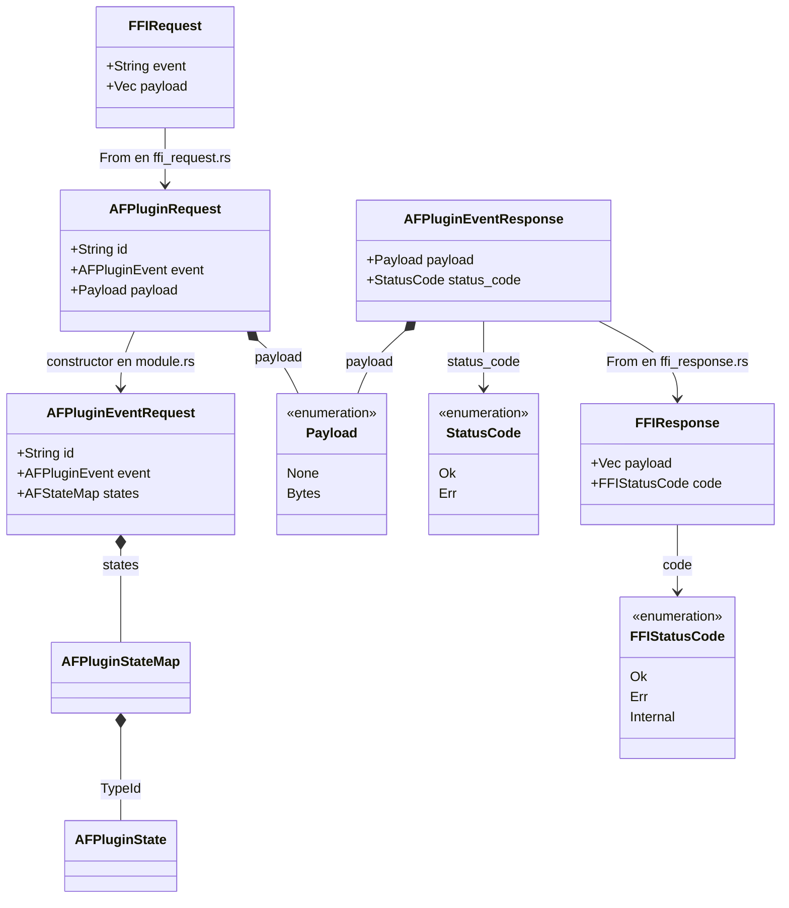
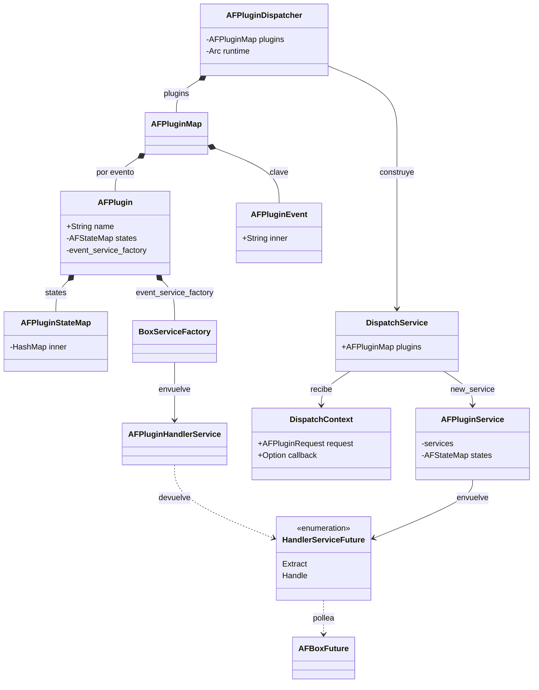
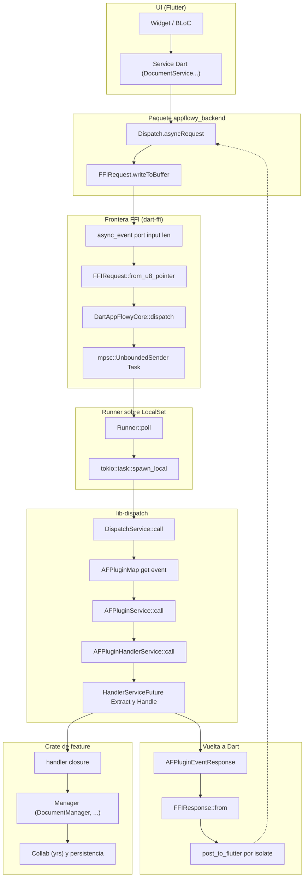
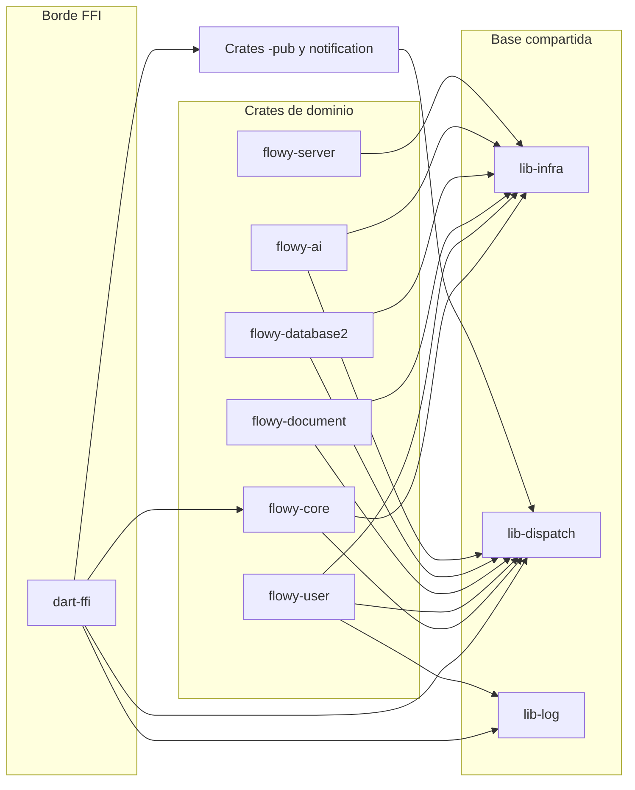
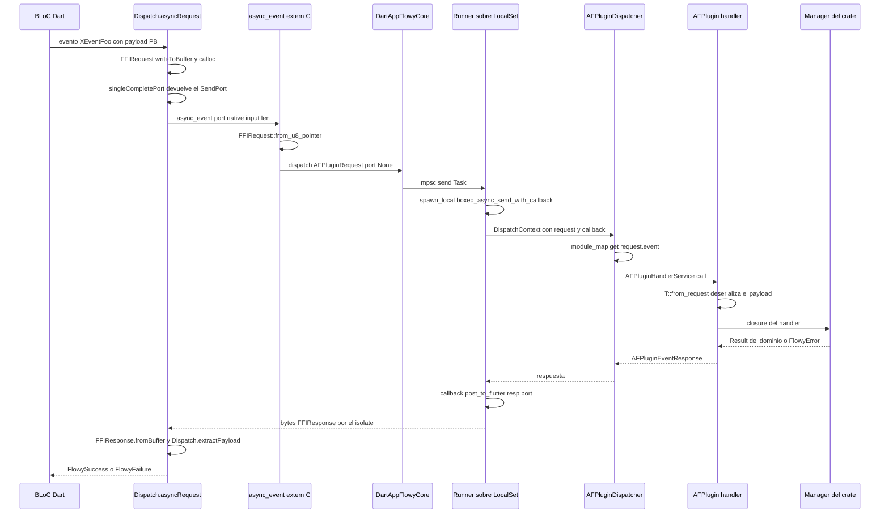
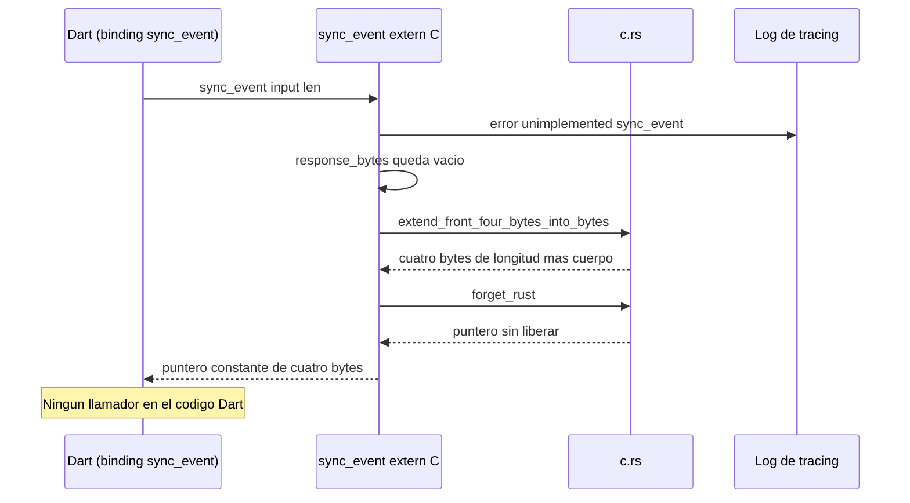
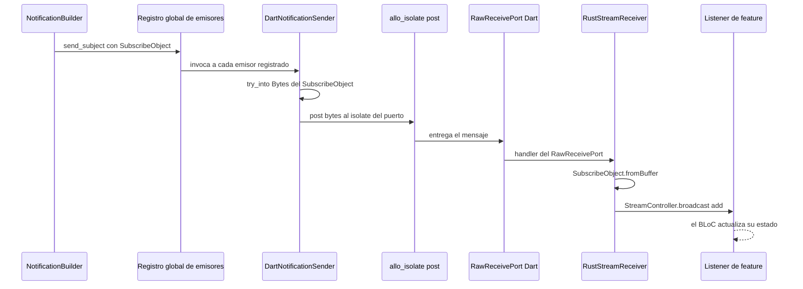
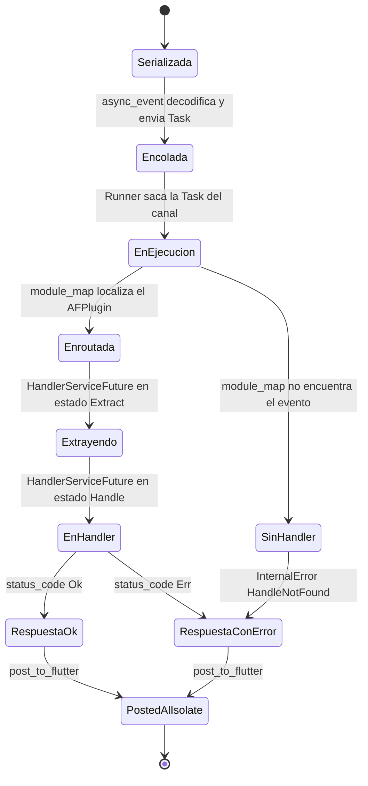
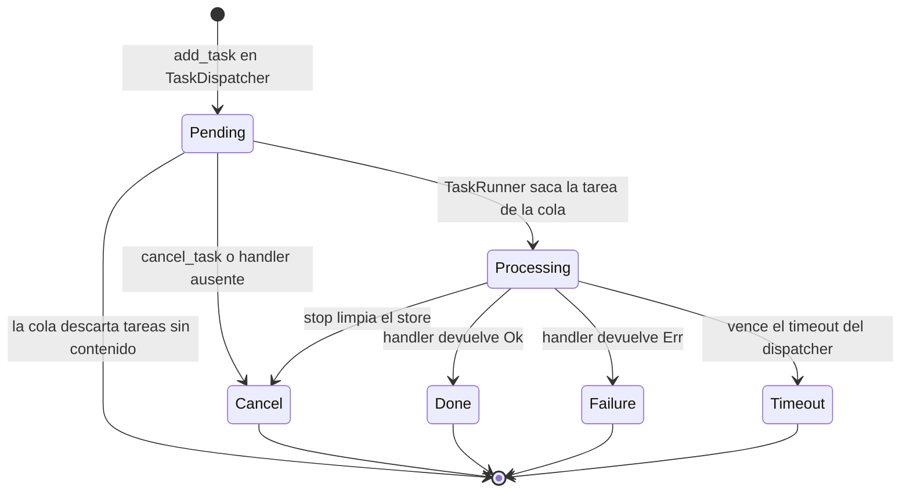

# F00.1 — FFI y dispatcher (dart-ffi, lib-dispatch, lib-infra)

## 1. Resumen

Este documento describe la trinchera inferior del SDK Rust: el crate `dart-ffi`, que expone las ocho funciones `extern "C"` que Dart invoca a través de `dart:ffi`; el crate `lib-dispatch`, que enruta cada petición a uno de los ocho `AFPlugin` registrados por los crates de feature; y el crate `lib-infra`, la biblioteca de utilidades transversales (futures nativos y wasm, mapas por referencia de recuento, planificador de tareas con prioridad, cifrado AES-GCM, compresión brotli y `IsolateSink`). El dato vertebral es la estructura de cuatro capas que se repite en todas las llamadas: `FFIRequest` → `AFPluginRequest` → `AFPluginEventRequest`/`Payload` → `AFPluginEventResponse` → `FFIResponse`. En la frontera, `async_event` encola una `Task` en un canal `mpsc` sin cota que consume un `Runner` dentro de un `LocalSet` de tokio; la respuesta vuelve por el mismo puerto nativo que originó la request. Se documentan además los puntos de panic (`plugin_map_or_crash`, `HandlerServiceFuture::poll`), los `unwrap` en la deserialización FFI y el `sync_event` no implementado que hoy devuelve un vector vacío.

## 2. Alcance

Esta unidad cubre los 66 ficheros de `frontend/rust-lib/dart-ffi` (13), `frontend/rust-lib/lib-dispatch` (28) y `frontend/rust-lib/lib-infra` (25). Queda fuera del documento, y se referencia por enlace en vez de repetirse: la narrativa del puente ya escrita en `[[../../06-puente-flutter-rust/01-ffi.md]]` (las ocho funciones vistas desde el binding Dart y el `RustStreamReceiver`) y `[[../../06-puente-flutter-rust/02-lib-dispatch.md]]` (`AFPlugin` y dispatcher vistos desde el grafo de eventos); la persistencia en disco, SQLite y rutas de plataforma de `[[../../08-persistencia/00-indice.md]]`; el grafo de dependencias entre crates en `[[../../17-grafo-dependencias.md]]`; la generación de `.proto` y de código Dart, que pertenece a `[[../../09-features/F00-infraestructura-compartida-ffi-dispatch-errores-build-nativo/3-build-codegen-integration-tests-rust.md]]` y a `[[../../06-puente-flutter-rust/03-codegen.md]]`; el lado Dart de `appflowy_backend` (`ffi.dart`, `dispatch.dart`, `rust_stream.dart`), que es de `[[../../09-features/F00-infraestructura-compartida-ffi-dispatch-errores-build-nativo/5.1-paquetes-dart-internos-appflowy-backend-lib-ffi-rust-stream-dispatch-generado.md]]`; y los errores de dominio (`FlowyError`, `ErrorCode`, SQLite), que son de `[[../../09-features/F00-infraestructura-compartida-ffi-dispatch-errores-build-nativo/2-errores-sqlite-migraciones.md]]`.

Lo que este documento **añade** respecto de los anteriores es el detalle fichero a fichero que hace falta para razonar sobre el puente sin salir del crate: la tabla completa de las ocho funciones `extern "C"` con su firma exacta, su línea, su declaración `#[no_mangle]` y el invocador Dart real (incluido el hecho de que `link_me_please` no se llama desde Dart sino desde Swift); la tabla evento → crate → handler construida sobre el catálogo `events.json` (229 variantes, 224 registradas, 5 sin handler) y cómo los ocho `AFPlugin` se ensamblan en `make_plugins`; los modelos `AFPluginEventRequest`/`AFPluginEventResponse`/`Payload`/`StatusCode`; el runtime de tokio y sus dos variantes según el feature `local_set`; y el planificador de tareas con QoS de `lib-infra`, que es el componente que fija la latencia mínima de las operaciones en segundo plano.

## 3. Modelos de datos

La frontera FFI habla dos lenguajes distintos de serialización. Hacia dentro, `FFIRequest` es un mensaje protobuf con dos campos —`event` en el índice 1 y `payload` en el 2— y `FFIResponse` tiene `payload` en el índice 1 y `code` (`FFIStatusCode`) en el 2. Hacia el dispatcher, esos dos mensajes se convierten en tipos planos de `lib-dispatch`: `FFIRequest` se traduce a un `AFPluginRequest` con `id` generado por `nanoid!(6)` y `payload: Payload`, y de ahí a un `AFPluginEventRequest` que ya no lleva bytes sino el `AFStateMap` del plugin. La respuesta hace el camino inverso: el handler produce un `AFPluginEventResponse { payload, status_code }`, el `FFIResponse::from` lo aplana a `{ payload: Vec<u8>, code: FFIStatusCode }`, y `post_to_flutter` lo entrega al isolate Dart.

Muestra el modelo de datos de la frontera: el mensaje protobuf que cruza el puntero crudo, los dos envoltorios de `lib-dispatch` con su estado inyectado, y la respuesta con su enum de estado.



Lectura: la columna vertebral es `Payload`, un enum de dos variantes (`None` y `Bytes`) que actúa como enum discriminante sin boxing entre «evento sin payload» y «evento con payload protobuf» (`appflowy/frontend/rust-lib/lib-dispatch/src/request/payload.rs:5–10`). Los tipos exactos de `AFPluginState<T>` son genéricos y por eso aparecen sin parametrizar en el diagrama; la definición real es `pub struct AFPluginState<T: ?Sized + AFConcurrent>(Arc<T>)` en `appflowy/frontend/rust-lib/lib-dispatch/src/module/data.rs:10`. Conviene fijar dos asimetrías: `AFPluginEventResponse` solo tiene dos variantes de estado (`Ok = 0`, `Err = 1`, en `appflowy/frontend/rust-lib/lib-dispatch/src/response/response.rs:11–17`), mientras que `FFIStatusCode` tiene tres (`Ok`, `Err`, `Internal`, en `appflowy/frontend/rust-lib/dart-ffi/src/model/ffi_response.rs:4–10`); y la conversión `From<AFPluginEventResponse> for FFIResponse` solo mapea `Ok` y `Err` (`appflowy/frontend/rust-lib/dart-ffi/src/model/ffi_response.rs:28–31`), por lo que `Internal` no se produce en ese camino. `StatusCode` es un `#[repr(u8)]` con `serde_repr` opcional bajo el feature `use_serde`, lo que hace que su serialización sea un entero plano y no un nombre.

Muestra el grafo de tipos completo del `AFPlugin` y del dispatcher, con sus factories y sus tipos boxeados bajo la variante `local_set` que usa `dart-ffi`.



Lectura: `AFPlugin` es un registro inmutable que se ensambla con un builder encadenado (`name`, `state`, `event`) y se convierte en `AFPluginMap`, un `Arc<HashMap<AFPluginEvent, Arc<AFPlugin>>>` donde **el mismo plugin aparece una vez por cada evento registrado** (`appflowy/frontend/rust-lib/lib-dispatch/src/module/module.rs:27–47`). `AFPluginHandlerService` es el adaptador que convierte una closure `Fn(T) -> R` en un `Service<ServiceRequest>`; su futuro `HandlerServiceFuture` es un enum de dos estados (`Extract` deserializando el payload, `Handle` esperando al handler) definido en `appflowy/frontend/rust-lib/lib-dispatch/src/service/handler.rs:106–116`. `DispatchService` es el único punto que sabe traducir «nombre de evento → plugin»: consulta `module_map.get(&request.event)` en `appflowy/frontend/rust-lib/lib-dispatch/src/dispatcher.rs:253` y, si no encuentra, devuelve `InternalError::HandleNotFound`.

## 4. Eventos FFI

### 4.1 Las ocho funciones `extern "C"` de la frontera

Antes del catálogo de eventos conviene fijar la frontera exacta: ocho funciones `#[no_mangle] pub extern "C"` en `appflowy/frontend/rust-lib/dart-ffi/src/lib.rs`, todas replicadas una a una en el header C `appflowy/frontend/rust-lib/dart-ffi/binding.h:6–20` y en los bindings `lookupFunction` de `appflowy/frontend/appflowy_flutter/packages/appflowy_backend/lib/ffi.dart`. La tabla distingue tres cosas que suelen confundirse: la línea del atributo `#[no_mangle]`, la línea de la firma, y **quién la invoca de verdad**.

| # | Función | Firma Rust | `#[no_mangle]` | Línea de firma | Binding Dart | Invocador real |
|---|---|---|---|---:|---|---|
| 1 | `init_sdk` | `pub extern "C" fn init_sdk(_port: i64, data: *mut c_char) -> i64` | `appflowy/frontend/rust-lib/dart-ffi/src/lib.rs:113` | 114 | `appflowy/frontend/appflowy_flutter/packages/appflowy_backend/lib/ffi.dart:87` | `FlowySDK.init` en `appflowy/frontend/appflowy_flutter/packages/appflowy_backend/lib/appflowy_backend.dart:51` |
| 2 | `async_event` | `pub extern "C" fn async_event(port: i64, input: *const u8, len: usize)` | `appflowy/frontend/rust-lib/dart-ffi/src/lib.rs:173` | 175 | `appflowy/frontend/appflowy_flutter/packages/appflowy_backend/lib/ffi.dart:47` | `Dispatch._sendToRust` en `appflowy/frontend/appflowy_flutter/packages/appflowy_backend/lib/dispatch/dispatch.dart:130` |
| 3 | `sync_event` | `pub extern "C" fn sync_event(_input: *const u8, _len: usize) -> *const u8` | `appflowy/frontend/rust-lib/dart-ffi/src/lib.rs:230` | 231 | `appflowy/frontend/appflowy_flutter/packages/appflowy_backend/lib/ffi.dart:68` | **ninguno**: la función registra `error!("unimplemented sync_event")` en `appflowy/frontend/rust-lib/dart-ffi/src/lib.rs:232` |
| 4 | `set_stream_port` | `pub extern "C" fn set_stream_port(notification_port: i64) -> i32` | `appflowy/frontend/rust-lib/dart-ffi/src/lib.rs:239` | 240 | `appflowy/frontend/appflowy_flutter/packages/appflowy_backend/lib/ffi.dart:103` | `FlowySDK.init` en `appflowy/frontend/appflowy_flutter/packages/appflowy_backend/lib/appflowy_backend.dart:38` |
| 5 | `set_log_stream_port` | `pub extern "C" fn set_log_stream_port(port: i64) -> i32` | `appflowy/frontend/rust-lib/dart-ffi/src/lib.rs:246` | 247 | `appflowy/frontend/appflowy_flutter/packages/appflowy_backend/lib/ffi.dart:119` | `FlowySDK.init` en `appflowy/frontend/appflowy_flutter/packages/appflowy_backend/lib/appflowy_backend.dart:44`, solo si `Platform.isIOS && kDebugMode` |
| 6 | `link_me_please` | `pub extern "C" fn link_me_please()` (con `#[inline(never)]`) | `appflowy/frontend/rust-lib/dart-ffi/src/lib.rs:253` | 254 | `appflowy/frontend/appflowy_flutter/packages/appflowy_backend/lib/ffi.dart:135` | **desde Swift, no desde Dart**: `appflowy/frontend/appflowy_flutter/packages/appflowy_backend/ios/Classes/AppFlowyBackendPlugin.swift:16` y `appflowy/frontend/appflowy_flutter/packages/appflowy_backend/macos/Classes/AppFlowyBackendPlugin.swift:21` |
| 7 | `rust_log` | `pub extern "C" fn rust_log(level: i64, data: *const c_char)` | `appflowy/frontend/rust-lib/dart-ffi/src/lib.rs:277` | 278 | `appflowy/frontend/appflowy_flutter/packages/appflowy_backend/lib/ffi.dart:164` | `Log` de `appflowy_backend` en `appflowy/frontend/appflowy_flutter/packages/appflowy_backend/lib/log.dart:40` |
| 8 | `set_env` | `pub extern "C" fn set_env(_data: *const c_char)` (cuerpo vacío, `// Deprecated`) | `appflowy/frontend/rust-lib/dart-ffi/src/lib.rs:307` | 308 | `appflowy/frontend/appflowy_flutter/packages/appflowy_backend/lib/ffi.dart:182` | **ninguno**: el cuerpo es un comentario `// Deprecated` en `appflowy/frontend/rust-lib/dart-ffi/src/lib.rs:309` |

Lectura de la tabla: solo cinco de las ocho tienen un invocador real, y una de ellas (`link_me_please`) se invoca desde Swift, no desde Dart —el único caso del conjunto, y el que explica por qué la función lleva `#[inline(never)]`: sin ella el optimizador eliminaría una función vacía, y con ella los *plugins* nativos de iOS y macOS pueden referenciarla en un método estático (`dummyMethodToEnforceBundling`) para forzar al linker a conservar el crate. El binding Dart existe para las tres funciones muertas igualmente, porque `binding.h` y `ffi.dart` se escriben como un contrato completo del ABI en lugar de a medida. Existe además un noveno `lookupFunction` en Dart, `store_dart_post_cobject` (`appflowy/frontend/appflowy_flutter/packages/appflowy_backend/lib/ffi.dart:141–155`), que no corresponde a ninguna función de `dart-ffi` sino a un símbolo exportado por el crate externo `allo-isolate`; se invoca en `appflowy/frontend/appflowy_flutter/packages/appflowy_backend/lib/appflowy_backend.dart:39` y es lo que permite a Rust postear mensajes al isolate Dart.

`init_sdk` merece un comentario aparte porque ignora su primer parámetro: el parámetro se llama `_port` (`appflowy/frontend/rust-lib/dart-ffi/src/lib.rs:114`) y Dart le pasa un `0` literal (`appflowy/frontend/appflowy_flutter/packages/appflowy_backend/lib/appflowy_backend.dart:51`). El puerto real de cada respuesta lo lleva cada `async_event`, no el arranque. Lo que `init_sdk` sí hace es heavy lifting: parsear la configuración JSON (`appflowy/frontend/rust-lib/dart-ffi/src/lib.rs:124`), volcar variables de entorno (`:125`), guardar `appflowy.yaml` si el autenticador es AppFlowy Cloud (`:127–129`), recortar la versión de app a un mínimo de 0.5.8 (`:131–137`), cerrar el core anterior si existía (`:148–150`), crear el `AFPluginRuntime` (`:158`), lanzar el hilo con el `LocalSet` y el `Runner` (`:160–163`) y construir `AppFlowyCore` (`:168–169`).

### 4.2 Catálogo de eventos por crate

El catálogo `events.json` extraído del workspace identifica **ocho** crates con `event_map.rs` y 229 variantes declaradas. El conteo por crate es el siguiente; las cifras son del catálogo, y la columna de registro reproduce lo que devuelve el extractor (variantes con al menos un `.event(...)` en su `init`).

| Crate | Enum de eventos | `event_map.rs` | `init()` | Variantes | Registradas | Sin handler |
|---|---|---|---|---:|---:|---:|
| `flowy-user` | `UserEvent` | `appflowy/frontend/rust-lib/flowy-user/src/event_map.rs` | línea 17–84 | 56 | 55 | 1 (`AddWorkspaceMember`) |
| `flowy-folder` | `FolderEvent` | `appflowy/frontend/rust-lib/flowy-folder/src/event_map.rs` | línea 11–62 | 51 | 48 | 3 (`CreateFolderWorkspace`, `DeleteWorkspace`, `CopyLink`) |
| `flowy-database2` | `DatabaseEvent` | `appflowy/frontend/rust-lib/flowy-database2/src/event_map.rs` | línea 11–103 | 72 | 71 | 1 (`GetAllRows`) |
| `flowy-document` | `DocumentEvent` | `appflowy/frontend/rust-lib/flowy-document/src/event_map.rs` | línea 12–55 | 21 | 21 | 0 |
| `flowy-date` | `DateEvent` | `appflowy/frontend/rust-lib/flowy-date/src/event_map.rs` | línea 8–12 | 1 | 1 | 0 |
| `flowy-search` | `SearchEvent` | `appflowy/frontend/rust-lib/flowy-search/src/event_map.rs` | línea 9–14 | 1 | 1 | 0 |
| `flowy-storage` | `FileStorageEvent` | `appflowy/frontend/rust-lib/flowy-storage/src/event_map.rs` | línea 8–14 | 2 | 2 | 0 |
| `flowy-ai` | `AIEvent` | `appflowy/frontend/rust-lib/flowy-ai/src/event_map.rs` | línea 12–61 | 25 | 25 | 0 |
| **Total** | — | 8 ficheros | 8 funciones | **229** | **224** | **5** |

Todos los `init` devuelven un `AFPlugin` construido con el mismo patrón; el más pequeño, el de `flowy-date`, cabe entero en cinco líneas (`appflowy/frontend/rust-lib/flowy-date/src/event_map.rs:8–12`):

```rust
pub fn init() -> AFPlugin {
  AFPlugin::new()
    .name(env!("CARGO_PKG_NAME"))
    .event(DateEvent::QueryDate, query_date_handler)
}
```

Muestra una muestra representativa de la tabla evento → crate → handler con los tipos de entrada y salida declarados en el propio enum.

| Evento | Enum | Input PB | Output PB | Handler | Registro | Implementación |
|---|---|---|---|---|---|---|
| `SignInWithEmailPassword` | `UserEvent` | `SignInPayloadPB` | `GotrueTokenResponsePB` | `sign_in_with_email_password_handler` | `appflowy/frontend/rust-lib/flowy-user/src/event_map.rs:26` | `appflowy/frontend/rust-lib/flowy-user/src/event_handler.rs:40` |
| `SignOut` | `UserEvent` | — | — | `sign_out_handler` | `appflowy/frontend/rust-lib/flowy-user/src/event_map.rs:31` | `appflowy/frontend/rust-lib/flowy-user/src/event_handler.rs:123` |
| `ReadCurrentWorkspace` | `FolderEvent` | — | `WorkspacePB` | `read_current_workspace_handler` | `appflowy/frontend/rust-lib/flowy-folder/src/event_map.rs:15` | `appflowy/frontend/rust-lib/flowy-folder/src/event_handler.rs:73` |
| `GetDatabase` | `DatabaseEvent` | `DatabaseViewIdPB` | `DatabasePB` | `get_database_data_handler` | `appflowy/frontend/rust-lib/flowy-database2/src/event_map.rs:16` | `appflowy/frontend/rust-lib/flowy-database2/src/event_handler.rs:31` |
| `OpenDocument` | `DocumentEvent` | `OpenDocumentPayloadPB` | `DocumentDataPB` | `open_document_handler` | `appflowy/frontend/rust-lib/flowy-document/src/event_map.rs:17` | `appflowy/frontend/rust-lib/flowy-document/src/event_handler.rs:69` |
| `CreateDocument` | `DocumentEvent` | `CreateDocumentPayloadPB` | — | `create_document_handler` | `appflowy/frontend/rust-lib/flowy-document/src/event_map.rs:16` | `appflowy/frontend/rust-lib/flowy-document/src/event_handler.rs:54` |
| `QueryDate` | `DateEvent` | `DateQueryPB` | `DateResultPB` | `query_date_handler` | `appflowy/frontend/rust-lib/flowy-date/src/event_map.rs:11` | `appflowy/frontend/rust-lib/flowy-date/src/event_handler.rs:17` |
| `StreamSearch` | `SearchEvent` | `SearchQueryPB` | — | `stream_search_handler` | `appflowy/frontend/rust-lib/flowy-search/src/event_map.rs:13` | `appflowy/frontend/rust-lib/flowy-search/src/event_handler.rs:18` |
| `QueryFile` | `FileStorageEvent` | `QueryFilePB` | `FileStatePB` | `query_file_handler` | `appflowy/frontend/rust-lib/flowy-storage/src/event_map.rs:13` | `appflowy/frontend/rust-lib/flowy-storage/src/event_handler.rs:28` |
| `StreamMessage` | `AIEvent` | `StreamChatPayloadPB` | `ChatMessagePB` | `stream_chat_message_handler` | `appflowy/frontend/rust-lib/flowy-ai/src/event_map.rs:21` | `appflowy/frontend/rust-lib/flowy-ai/src/event_handler.rs:22` |
| `LoadPrevMessage` | `AIEvent` | `LoadPrevChatMessagePB` | `ChatMessageListPB` | `load_prev_message_handler` | `appflowy/frontend/rust-lib/flowy-ai/src/event_map.rs:22` | `appflowy/frontend/rust-lib/flowy-ai/src/event_handler.rs:117` |

Lectura: el guione en la columna «Input/Output PB» no significa «sin tipo»: en el derive `Flowy_Event` esos eventos declaran `#[event()]` sin `input` ni `output`, y el extractor los reporta como `null`. Es un caso real y frecuente (`SignOut`, `ReadCurrentWorkspace`, `StreamSearch`): el evento no transporta ni consume payload y por tanto responde con `AFPluginData<()>`, cuyo `FromAFPluginRequest` está implementado como `ready(Ok(()))` en `appflowy/frontend/rust-lib/lib-dispatch/src/request/request.rs:60–67`.

Las cinco variantes sin handler merecen una lectura aparte, porque son la diferencia entre 229 y 224. `CreateFolderWorkspace`, `DeleteWorkspace` y `CopyLink` en `flowy-folder`, `GetAllRows` en `flowy-database2` y `AddWorkspaceMember` en `flowy-user` están declaradas en el enum con su índice pero no aparecen en ninguna llamada `.event(...)` de su `init`, lo que significa que un `async_event` con esos nombres desde Dart terminaría en `InternalError::HandleNotFound` y una respuesta con `StatusCode::Err`. Si el nombre llegara a generarse en Dart por el codegen, el fallo aparecería en tiempo de ejecución, no de compilación.

La inicialización del conjunto ocurre en un único punto: `make_plugins` (`appflowy/frontend/rust-lib/flowy-core/src/module.rs:12–39`) invoca los ocho `init` con `Weak` a los managers ya resueltos y devuelve un `Vec<AFPlugin>`; `AppFlowyCore::init` lo envuelve en `AFPluginDispatcher::new(runtime, make_plugins(...))` (`appflowy/frontend/rust-lib/flowy-core/src/lib.rs:302–314`) y guarda el resultado en el campo `event_dispatcher` (`appflowy/frontend/rust-lib/flowy-core/src/lib.rs:68`). Ese `Arc<AFPluginDispatcher>` es exactamente lo que `dart-ffi` recover en cada llamada a `async_event`.

## 5. Notificaciones

Las notificaciones no usan el canal request/response: son un canal de una dirección, emparejado con el de logs, con su propio puerto nativo. `set_stream_port` borra todos los emisores registrados previamente y registra uno nuevo, `DartNotificationSender`, envolviendo el isolate de ese puerto (`appflowy/frontend/rust-lib/dart-ffi/src/lib.rs:239–244`). `DartNotificationSender` implementa el trait `NotificationSender` de `flowy-notification` cuya única operación es `send_subject`, que serializa el `SubscribeObject` a bytes y los postea al isolate (`appflowy/frontend/rust-lib/dart-ffi/src/notification/sender.rs:19–25`). El registro global es un `RwLock<Vec<Box<dyn NotificationSender>>>` estático (`appflowy/frontend/rust-lib/flowy-notification/src/lib.rs:14–16`), lo que explica el `unregister_all_notification_sender()` previo: hot reload de Flutter o tests de integración pueden registrar varias veces y hay que limpiar antes.

En el lado Dart, `RustStreamReceiver` mantiene un `RawReceivePort` cuyo `sendPort.nativePort` es el número que se pasa a `set_stream_port`, y decodifica cada mensaje con `SubscribeObject.fromBuffer` antes de reemitirlo por un `StreamController.broadcast()` (`appflowy/frontend/appflowy_flutter/packages/appflowy_backend/lib/rust_stream.dart:11–28` y `:39–49`). Los listeners de feature se suscriben a ese controlador con `RustStreamReceiver.listen`.

| Enum de notificación | Fichero Rust | `decl_line` | Variantes | Observable source |
|---|---|---|---:|---|
| `ChatNotification` | `appflowy/frontend/rust-lib/flowy-ai/src/notification.rs` | 8 | 10 | `Chat` |
| `DatabaseNotification` | `appflowy/frontend/rust-lib/flowy-database2/src/notification.rs` | 7 | 24 | `Database` |
| `DocumentNotification` | `appflowy/frontend/rust-lib/flowy-document/src/notification.rs` | 7 | 5 | `Document` |
| `FolderNotification` | `appflowy/frontend/rust-lib/flowy-folder/src/notification.rs` | 10 | 19 | `Workspace` |
| `StorageNotification` | `appflowy/frontend/rust-lib/flowy-storage/src/notification.rs` | 7 | 2 | `storage` |
| `UserNotification` | `appflowy/frontend/rust-lib/flowy-user/src/notification.rs` | 11 | 10 | `User` |

Lectura: los seis enums suman 70 variantes, pero el catálogo de notificaciones detecta solo cinco clases de parser en Dart (`DocumentNotificationParser`, `FolderNotificationParser`, `DatabaseNotificationParser`, `SearchNotificationParser` y `UserNotificationParser`, en `appflowy/frontend/appflowy_flutter/lib/core/notification/`), y el recuento de variantes «sin listener Dart» del catálogo llega a 56. [INFERIDO] La explicación más económica es que los listeners se registran por nombre de listener y no por variante —un solo `RustStreamReceiver.listen` por feature en lugar de uno por enum—, de modo que el catálogo marca como «sin listener» cualquier variante sin un `switch` nominal explícito en Dart; el detalle de esa granularidad está fuera de esta unidad y se documenta en `[[../../09-features/F00-infraestructura-compartida-ffi-dispatch-errores-build-nativo/5.1-paquetes-dart-internos-appflowy-backend-lib-ffi-rust-stream-dispatch-generado.md]]` y `[[../../06-puente-flutter-rust/04-notificaciones.md]]`. Ninguno de los seis `notification.rs` pertenece a esta unidad, así que aquí solo se documenta el **transporte** (lo que sí es de `dart-ffi`), no el contenido de cada enum.

## 6. BLoCs / Cubits

No hay BLoCs ni Cubits en ninguno de los 66 ficheros de esta unidad: son código Rust puro y la única «máquina de estados» con estado observable es el `TaskDispatcher` de `lib-infra` (§11). El otro lado del canal —los BLoCs de Flutter que originan los eventos y consumen las notificaciones— es materia de `[[../../09-features/F01-documentos-y-editor/0.0-indice-documentos-y-editor.md]]`, `[[../../09-features/F02-bases-de-datos/0.1.0-indice-appflowy-side-database-controller-services-widgets.md]]`, `[[../../09-features/F03-folder-workspaces-vistas/0.0-indice-folder-workspaces-vistas.md]]`, `[[../../09-features/F05-usuario-auth-sesion/0.0-indice-usuario-auth-sesion.md]]`, `[[../../09-features/F06-sync-y-servidores/F06-sync-y-servidores.md]]`, `[[../../09-features/F07-almacenamiento-de-archivos/F07-almacenamiento-de-archivos.md]]` y `[[../../09-features/F08-busqueda-e-indexacion/F08-busqueda-e-indexacion.md]]`, y del catálogo `13-catalogo-blocs`. Lo que sí resulta útil dejar registrado aquí es el contrato que impone esta unidad a esos BLoCs: todo evento que emiten se serializa como `FFIRequest` con el nombre del evento como `String`, de modo que el nombre es la única clave de enrutado y cualquier renombrado en el enum Rust rompe el cliente Dart silenciosamente hasta el primer `HandleNotFound`.

## 7. Servicios e inyección de dependencias

`dart-ffi` no tiene contenedor de inyección: es una capa fina sobre el global `DART_APPFLOWY_CORE`, un `lazy_static` que envuelve un `Option<AppFlowyCore>` bajo `Arc<RwLock<…>>`, un `JoinHandle` del hilo dedicado y el `mpsc::UnboundedSender<Task>` por el que entran las peticiones (`appflowy/frontend/rust-lib/dart-ffi/src/lib.rs:40–59`). `dispatcher()` clona el `event_dispatcher` del core bajo lock de lectura (`appflowy/frontend/rust-lib/dart-ffi/src/lib.rs:71–78`) y `dispatch` lo empaqueta junto con la request en una `Task` (`appflowy/frontend/rust-lib/dart-ffi/src/lib.rs:80–110`). `Task` lleva un `Option<mpsc::Sender<AFPluginEventResponse>>` que en producción siempre es `None` (`async_event` lo pasa como `None` en `appflowy/frontend/rust-lib/dart-ffi/src/lib.rs:185`): es el hueco que usaría una variante interna con respuesta por canal, no por isolate.

La resolución de dependencias de verdad ocurre dos capas más abajo, en `flowy-core`, con el patrón `deps_resolve/*_deps.rs` que esta unidad no cubre (es de `[[../../09-features/F00-infraestructura-compartida-ffi-dispatch-errores-build-nativo/4-collab-integrate-y-crates-pub-contratos.md]]`). Lo relevante para el puente es que `appflowy/frontend/rust-lib/flowy-core/src/lib.rs:124` define `AppFlowyCore::init` con el `Arc<AFPluginRuntime>` recibido como parámetro —el runtime lo crea `dart-ffi` en `init_sdk`, no `flowy-core`— y que `appflowy/frontend/rust-lib/flowy-core/src/lib.rs:135–137` crea el `TaskDispatcher` de `lib-infra` con timeout de 10 s y lanza `TaskRunner::run` sobre el mismo runtime. Es decir: **un único runtime de tokio sirve tanto al dispatcher de eventos como al planificador de tareas en segundo plano**.

En Dart la inyección es `get_it` en `startup/deps_resolver.dart`, fuera de esta unidad, pero el orden importa: `FlowySDK.init` fija primero el puerto de notificaciones y el `postCObject` de `allo-isolate`, luego opcionalmente el de logs solo en iOS debug, y solo entonces llama a `init_sdk` (`appflowy/frontend/appflowy_flutter/packages/appflowy_backend/lib/appflowy_backend.dart:37–56`). Que `set_stream_port` vaya antes que `init_sdk` no es cosmético: `init_sdk` construye `AppFlowyCore`, que ya puede emitir notificaciones durante su inicialización.

## 8. Persistencia

`dart-ffi` toca disco en un solo punto funcional: `appflowy.yaml` en la raíz de la aplicación, donde `save_appflowy_cloud_config` añade la `AFCloudConfiguration` entrante si su `base_url` no estaba ya en la lista, leyendo con `read_yaml_file` y reescribiendo con `write_yaml_file` en modo `create + write + truncate` (`appflowy/frontend/rust-lib/dart-ffi/src/appflowy_yaml.rs:14–54`). Solo se invoca cuando `authenticator_type == AuthenticatorType::AppFlowyCloud` (`appflowy/frontend/rust-lib/dart-ffi/src/lib.rs:127–129`). La lista de variables de entorno, en cambio, se aplica al proceso con `std::env::set_var` a partir del mapa `envs` de la configuración Dart (`appflowy/frontend/rust-lib/dart-ffi/src/env_serde.rs:29–36`), lo que vuelve esos valores irreversibles para el resto de la vida del proceso.

`lib-dispatch` no persiste nada: todo su estado vive en memoria durante la vida del proceso. `lib-infra` sí tiene dos piezas de persistencia reutilizables, ambas ineras: `zip_folder` y `unzip_and_replace` (`appflowy/frontend/rust-lib/lib-infra/src/file_util.rs:70–188`) implementan el patrón seguro de reemplazo —descomprimir en un `tempfile::tempdir`, borrar el destino, copiar y borrar el original, con `fs::rename` sustituido deliberadamente por copia y borrado, decisión documentada en el comentario de `appflowy/frontend/rust-lib/lib-infra/src/file_util.rs:172`—, y `copy_dir_recursive` (`appflowy/frontend/rust-lib/lib-infra/src/file_util.rs:13–26`) es el helper que usan. El esquema SQLite, las tablas KV y las rutas por plataforma están en `[[../../08-persistencia/00-indice.md]]` y `[[../../09-features/F00-infraestructura-compartida-ffi-dispatch-errores-build-nativo/2-errores-sqlite-migraciones.md]]`; aquí solo consta que ninguna de las 66 piezas de esta unidad las toca.

## 9. Diagramas de flujo

Muestra el recorrido completo de un evento desde el widget Flutter hasta el collab y de vuelta, con una capa por subgrafo y el punto exacto donde se abandona la frontera FFI.



Lectura: el grafo tiene un único ciclo, el que cierra `post_to_flutter` con la flecha punteada: la respuesta vuelve al isolate que cacheó el `Completer` que originó la llamada. Todo lo que ocurre entre `DispatchService::call` y `AFPluginResponder::respond_to` es `async/await` sobre el mismo `LocalSet`; no hay bloqueo de hilo en el camino feliz. Los dos puntos donde el sistema puede degradar en lugar de propagar un error tipado son `MAP` (evento desconocido → `InternalError::HandleNotFound`) y `MGR` (error de dominio → `FlowyError` serializado, que corresponde a `[[../../09-features/F00-infraestructura-compartida-ffi-dispatch-errores-build-nativo/2-errores-sqlite-migraciones.md]]`).

Muestra el grafo de dependencias entre los tres crates de esta unidad y sus vecinos inmediatos, con los features que cada uno activa.



Lectura: `lib-dispatch` e `lib-infra` no dependen de ningún crate de dominio —son hojas del grafo—, lo que permite que los 8 crates de feature los usen sin ciclos. `dart-ffi` es el único crate que depende de todos los de dominio a la vez, y por eso arrastra `flowy-core` completo. Los features son el otro eje: `appflowy/frontend/rust-lib/dart-ffi/Cargo.toml:30` activa `lib-dispatch/local_set`, `appflowy/frontend/rust-lib/dart-ffi/Cargo.toml:37` activa `flowy-notification/dart`, y `lib-infra` tiene tres features opt-in (`compression`, `isolate_flutter`, `encryption` en `appflowy/frontend/rust-lib/lib-infra/Cargo.toml:45–48`) de los que solo dos se activan en el workspace: `isolate_flutter` desde `appflowy/frontend/rust-lib/flowy-ai/Cargo.toml:25` y `encryption` desde `appflowy/frontend/rust-lib/flowy-user/Cargo.toml:13`. El tercero, `compression`, no lo activa ningún `Cargo.toml` del workspace en este snapshot, de modo que `lib_infra::compression` no se compila en ninguna build del SDK.

## 10. Diagramas de secuencia

Muestra el camino asíncrono completo de `async_event`, incluyendo la creación del puerto de respuesta por petición y el orden en que se ejecutan el dispatcher, el handler y el callback.



Lectura: el puerto se crea por petición, no por sesión, y por eso el handler asíncrono puede vivir en el `LocalSet` sin bloquear el isolate Dart. La flecha `R->>R: callback post_to_flutter` es la que materializa la respuesta: el callback se invoca en `appflowy/frontend/rust-lib/lib-dispatch/src/dispatcher.rs:284–286` **antes** de que el dispatcher devuelva el valor, de modo que la entrega al isolate Dart y el retorno a Dart ocurren en ese orden exacto. La decodificación del lado Dart (`FFIResponse.fromBuffer` y el `switch` sobre `FFIStatusCode`) está en `appflowy/frontend/appflowy_flutter/packages/appflowy_backend/lib/dispatch/dispatch.dart:75–115`, fuera de esta unidad pero imprescindible para cerrar la secuencia.

Muestra el camino de `sync_event`, que en el estado actual del repositorio es un callejón sin salida.



Lectura: `sync_event` no despacha nada. Registra un error (`appflowy/frontend/rust-lib/dart-ffi/src/lib.rs:231–237`), construye un vector vacío, le antepone cuatro bytes big-endian con `extend_front_four_bytes_into_bytes` (`appflowy/frontend/rust-lib/dart-ffi/src/c.rs:19–26`) y devuelve el puntero con `forget_rust`, que intencionadamente olvida el `Vec` (`appflowy/frontend/rust-lib/dart-ffi/src/c.rs:4–8`). El binding Dart existe (`appflowy/frontend/appflowy_flutter/packages/appflowy_backend/lib/ffi.dart:60–77`) pero no hay ninguna llamada en el árbol Dart. [VERIFICADO] El helper de recuperación existe —`reclaim_rust` en `appflowy/frontend/rust-lib/dart-ffi/src/c.rs:12–17`— pero está marcado `#[allow(dead_code)]` y no se invoca desde ningún sitio, por lo que cada llamada a `sync_event` filtraría cuatro bytes.

Muestra el canal de notificaciones, que es unidireccional y no pasa por el dispatcher.



Lectura: el canal de notificaciones no tiene respuesta ni id de petición, de modo que un fallo de deserialización en Dart se propaga como excepción del handler del `RawReceivePort` (`appflowy/frontend/appflowy_flutter/packages/appflowy_backend/lib/rust_stream.dart:39–49`). El emisor se registra una sola vez al arranque, en `set_stream_port`, y a partir de ahí `flowy-notification` mantiene el `Vec` estático (`appflowy/frontend/rust-lib/flowy-notification/src/lib.rs:22–35`) para todos los emisores, lo que permite añadir más de uno sin tocar `dart-ffi`.

## 11. Diagramas de estado

Muestra el ciclo de vida de una petición FFI vista desde `dart-ffi`, desde que Dart serializa hasta que el isolate completa el `Completer`.



Lectura: los dos caminos de fallo —`SinHandler` y `EnHandler` con error— convergen en la misma respuesta, porque `DispatchService::call` convierte cualquier `Err` en `AFPluginEventResponse` antes de invocar el callback (`appflowy/frontend/rust-lib/lib-dispatch/src/dispatcher.rs:282–286`). Por eso el cliente Dart nunca ve una excepción por evento desconocido: ve un `FlowyFailure`. El estado `Encolada` puede morir antes de llegar a `EnEjecucion` si el canal se cierra, en cuyo caso el `send` falla y `dispatch` solo escribe un `error!` (`appflowy/frontend/rust-lib/dart-ffi/src/lib.rs:102`), sin notificar a Dart: el `Completer` quedaría colgando para siempre.

Muestra el ciclo de vida de una tarea del planificador de `lib-infra`, con las transiciones que pueden forzar el timeout y la cancelación.



Lectura: el planificador nunca ejecuta más de una tarea por ventana de debounce. `TaskRunner::run` espera un `watch` y luego **duerme 300 ms** antes de procesar una sola tarea (`appflowy/frontend/rust-lib/lib-infra/src/priority_task/scheduler.rs:144` y `:162–164`), de modo que cualquier trabajo que dependa de `TaskDispatcher` tiene un suelo de latencia de 300 ms por tarea. El estado `Pending -> [*]` por «cola descarta tareas sin contenido» es un callejón real: `TaskQueue::push` retorna sin insertar cuando `task.content` es `None` (`appflowy/frontend/rust-lib/lib-infra/src/priority_task/queue.rs:21–28`), pero `add_task` ya había insertado la tarea en el `TaskStore` (`appflowy/frontend/rust-lib/lib-infra/src/priority_task/scheduler.rs:114–115`), así que su `oneshot::Receiver` nunca se resuelve.

## 12. Archivos cubiertos (del ledger)

Los 66 ficheros asignados a la unidad F00.1 en `OUT/_ledger/cobertura.csv`, con su capa, lenguaje y líneas según el inventario. Los LOC suman **4 735**, de los que `lib-dispatch` aporta 2 109 y `lib-infra` 1 913.

| Ruta | Capa | Lenguaje | LOC |
|---|---|---|---:|
| `appflowy/frontend/rust-lib/dart-ffi/Cargo.toml` | config | toml | 57 |
| `appflowy/frontend/rust-lib/dart-ffi/Flowy.toml` | config | toml | 2 |
| `appflowy/frontend/rust-lib/dart-ffi/binding.h` | ui | objc-header | 20 |
| `appflowy/frontend/rust-lib/dart-ffi/build.rs` | ffi | rust | 3 |
| `appflowy/frontend/rust-lib/dart-ffi/src/appflowy_yaml.rs` | ffi | rust | 54 |
| `appflowy/frontend/rust-lib/dart-ffi/src/c.rs` | ffi | rust | 26 |
| `appflowy/frontend/rust-lib/dart-ffi/src/env_serde.rs` | ffi | rust | 37 |
| `appflowy/frontend/rust-lib/dart-ffi/src/lib.rs` | ffi | rust | 319 |
| `appflowy/frontend/rust-lib/dart-ffi/src/model/ffi_request.rs` | ffi | rust | 28 |
| `appflowy/frontend/rust-lib/dart-ffi/src/model/ffi_response.rs` | ffi | rust | 40 |
| `appflowy/frontend/rust-lib/dart-ffi/src/model/mod.rs` | ffi | rust | 5 |
| `appflowy/frontend/rust-lib/dart-ffi/src/notification/mod.rs` | ffi | rust | 3 |
| `appflowy/frontend/rust-lib/dart-ffi/src/notification/sender.rs` | ffi | rust | 25 |
| `appflowy/frontend/rust-lib/lib-dispatch/Cargo.toml` | config | toml | 47 |
| `appflowy/frontend/rust-lib/lib-dispatch/src/byte_trait.rs` | dispatch | rust | 70 |
| `appflowy/frontend/rust-lib/lib-dispatch/src/data.rs` | dispatch | rust | 167 |
| `appflowy/frontend/rust-lib/lib-dispatch/src/dispatcher.rs` | dispatch | rust | 325 |
| `appflowy/frontend/rust-lib/lib-dispatch/src/errors/errors.rs` | dispatch | rust | 140 |
| `appflowy/frontend/rust-lib/lib-dispatch/src/errors/mod.rs` | dispatch | rust | 4 |
| `appflowy/frontend/rust-lib/lib-dispatch/src/lib.rs` | dispatch | rust | 22 |
| `appflowy/frontend/rust-lib/lib-dispatch/src/macros.rs` | dispatch | rust | 8 |
| `appflowy/frontend/rust-lib/lib-dispatch/src/module/container.rs` | dispatch | rust | 61 |
| `appflowy/frontend/rust-lib/lib-dispatch/src/module/data.rs` | dispatch | rust | 74 |
| `appflowy/frontend/rust-lib/lib-dispatch/src/module/mod.rs` | dispatch | rust | 9 |
| `appflowy/frontend/rust-lib/lib-dispatch/src/module/module.rs` | dispatch | rust | 245 |
| `appflowy/frontend/rust-lib/lib-dispatch/src/request/mod.rs` | dispatch | rust | 6 |
| `appflowy/frontend/rust-lib/lib-dispatch/src/request/payload.rs` | dispatch | rust | 82 |
| `appflowy/frontend/rust-lib/lib-dispatch/src/request/request.rs` | dispatch | rust | 119 |
| `appflowy/frontend/rust-lib/lib-dispatch/src/response/builder.rs` | dispatch | rust | 42 |
| `appflowy/frontend/rust-lib/lib-dispatch/src/response/mod.rs` | dispatch | rust | 8 |
| `appflowy/frontend/rust-lib/lib-dispatch/src/response/responder.rs` | dispatch | rust | 41 |
| `appflowy/frontend/rust-lib/lib-dispatch/src/response/response.rs` | dispatch | rust | 81 |
| `appflowy/frontend/rust-lib/lib-dispatch/src/runtime.rs` | dispatch | rust | 77 |
| `appflowy/frontend/rust-lib/lib-dispatch/src/service/boxed.rs` | dispatch | rust | 146 |
| `appflowy/frontend/rust-lib/lib-dispatch/src/service/handler.rs` | dispatch | rust | 246 |
| `appflowy/frontend/rust-lib/lib-dispatch/src/service/mod.rs` | dispatch | rust | 8 |
| `appflowy/frontend/rust-lib/lib-dispatch/src/service/service.rs` | dispatch | rust | 60 |
| `appflowy/frontend/rust-lib/lib-dispatch/src/util/mod.rs` | dispatch | rust | 1 |
| `appflowy/frontend/rust-lib/lib-dispatch/src/util/ready.rs` | dispatch | rust | 32 |
| `appflowy/frontend/rust-lib/lib-dispatch/tests/api/main.rs` | dispatch | rust | 1 |
| `appflowy/frontend/rust-lib/lib-dispatch/tests/api/module.rs` | dispatch | rust | 34 |
| `appflowy/frontend/rust-lib/lib-infra/Cargo.toml` | config | toml | 48 |
| `appflowy/frontend/rust-lib/lib-infra/src/box_any.rs` | service | rust | 61 |
| `appflowy/frontend/rust-lib/lib-infra/src/compression.rs` | service | rust | 17 |
| `appflowy/frontend/rust-lib/lib-infra/src/encryption/mod.rs` | service | rust | 177 |
| `appflowy/frontend/rust-lib/lib-infra/src/file_util.rs` | service | rust | 203 |
| `appflowy/frontend/rust-lib/lib-infra/src/isolate_stream.rs` | service | rust | 47 |
| `appflowy/frontend/rust-lib/lib-infra/src/lib.rs` | service | rust | 30 |
| `appflowy/frontend/rust-lib/lib-infra/src/native/future.rs` | service | rust | 35 |
| `appflowy/frontend/rust-lib/lib-infra/src/native/mod.rs` | service | rust | 1 |
| `appflowy/frontend/rust-lib/lib-infra/src/priority_task/mod.rs` | service | rust | 8 |
| `appflowy/frontend/rust-lib/lib-infra/src/priority_task/queue.rs` | service | rust | 131 |
| `appflowy/frontend/rust-lib/lib-infra/src/priority_task/scheduler.rs` | service | rust | 214 |
| `appflowy/frontend/rust-lib/lib-infra/src/priority_task/store.rs` | service | rust | 50 |
| `appflowy/frontend/rust-lib/lib-infra/src/priority_task/task.rs` | service | rust | 145 |
| `appflowy/frontend/rust-lib/lib-infra/src/ref_map.rs` | service | rust | 92 |
| `appflowy/frontend/rust-lib/lib-infra/src/stream_util.rs` | service | rust | 21 |
| `appflowy/frontend/rust-lib/lib-infra/src/util.rs` | service | rust | 147 |
| `appflowy/frontend/rust-lib/lib-infra/src/validator_fn.rs` | service | rust | 42 |
| `appflowy/frontend/rust-lib/lib-infra/src/wasm/future.rs` | service | rust | 65 |
| `appflowy/frontend/rust-lib/lib-infra/src/wasm/mod.rs` | service | rust | 1 |
| `appflowy/frontend/rust-lib/lib-infra/tests/main.rs` | service | rust | 1 |
| `appflowy/frontend/rust-lib/lib-infra/tests/task_test/mod.rs` | service | rust | 3 |
| `appflowy/frontend/rust-lib/lib-infra/tests/task_test/script.rs` | service | rust | 216 |
| `appflowy/frontend/rust-lib/lib-infra/tests/task_test/task_cancel_test.rs` | service | rust | 91 |
| `appflowy/frontend/rust-lib/lib-infra/tests/task_test/task_order_test.rs` | service | rust | 115 |

## 13. Riesgos y casos límite

**Corrección de alcance respecto del puente ya documentado.** Los riesgos que implican cruzar el puente completo (errores de serialización en el isolate, ciclo de vida de `RustStreamReceiver`, orden de arranque frente a `set_stream_port`) ya están tratados en `[[../../06-puente-flutter-rust/01-ffi.md]]` y `[[../../06-puente-flutter-rust/04-notificaciones.md]]`; los que implican tocar disco (`appflowy.yaml`, rutas de datos) están en `[[../../08-persistencia/00-indice.md]]`; y el reparto de dependencias entre crates, que condiciona qué feature activa cada uno, está en `[[../../17-grafo-dependencias.md]]`. Lo que sigue es lo que **solo** se ve leyendo los 66 ficheros de esta unidad: los puntos donde el crate toma una decisión local —panic en vez de error, `unwrap` en la frontera, descarte silencioso de una tarea, forget de memoria— y que ningún documento del puente puede detectar porque quedan a un lado del `async_event`.

**Panics en lugar de errores.** Tres sitios abortan el proceso en lugar de devolver `AFPluginEventResponse`. `plugin_map_or_crash` hace `panic!` si dos plugins registran el mismo evento (`appflowy/frontend/rust-lib/lib-dispatch/src/module/module.rs:35–41`), y `AFPlugin::event` hace `panic!("Register duplicate Event")` si el mismo plugin registra dos veces el mismo evento (`appflowy/frontend/rust-lib/lib-dispatch/src/module/module.rs:117–118`). Consecuencia práctica: añadir una variante de enum con `#[event(input=…, output=…)]` sin registrarla en `init` no rompe la compilación, pero registrar mal un nombre sí rompe el arranque del SDK, en `AppFlowyCore::new`, antes de que la UI aparezca.

**Deserialización FFI sin validar.** `FFIRequest::from_u8_pointer` construye el `&[u8]` con `std::slice::from_raw_parts` a partir del puntero crudo y termina con `.unwrap()` sobre el `TryFrom` (`appflowy/frontend/rust-lib/dart-ffi/src/model/ffi_request.rs:16–21`). Un byte corrupto en el puntero que entrega Dart produce panic en el hilo del `Runner`; como ese hilo es un `std::thread::spawn` liso (`appflowy/frontend/rust-lib/dart-ffi/src/lib.rs:160–163`), el panic no lo captura el runtime de tokio y el `Completer` de Dart queda sin resolver.

**`unwrap` generalizados.** `AppFlowyDartConfiguration::from_str` hace `.unwrap()` sobre el `serde_json` (`appflowy/frontend/rust-lib/dart-ffi/src/env_serde.rs:25–27`), de modo que un JSON de configuración mal formado tumba el arranque. `DartNotificationSender::send_subject` hace `.unwrap()` sobre la serialización del `SubscribeObject` (`appflowy/frontend/rust-lib/dart-ffi/src/notification/sender.rs:21`), lo que puede matar una tarea del pool si una notificación resulta no serializable.

**Reemplazo de core sin drop.** `init_sdk` cierra la base de datos del core anterior (`appflowy/frontend/rust-lib/dart-ffi/src/lib.rs:148–150`) y luego sobrescribe `DART_APPFLOWY_CORE.core` con el nuevo, sin dejar caer explícitamente el `AppFlowyCore` viejo; el `RwLock<Option<AppFlowyCore>>` solo lo suelta al asignar. [INFERIDO] Es un intento de re-inicialización en caliente (hot reload de Flutter) y no una fuga garantizada, porque el `Arc` del core antiguo puede seguir vivo en tareas en vuelo.

**`spawn_local` exige `LocalSet`.** Con el feature `local_set` —activado por `appflowy/frontend/rust-lib/dart-ffi/Cargo.toml:30`— `boxed_async_send_with_callback` despacha con `tokio::task::spawn_local` (`appflowy/frontend/rust-lib/lib-dispatch/src/dispatcher.rs:117`), que panic si se invoca fuera de un `LocalSet`. La variante sin el feature usa `dispatch.runtime.spawn` en su lugar (`appflowy/frontend/rust-lib/lib-dispatch/src/dispatcher.rs:152–160`), por lo que el mismo código público se comporta de forma distinta según el crate que lo enlace. Los tests de `lib-dispatch` lo hacen bien: envuelven la llamada en `LocalSet::run_until` (`appflowy/frontend/rust-lib/lib-dispatch/tests/api/module.rs:20–31`).

**Fuga deliberada en `sync_event`.** `forget_rust` olvida el `Vec` (`appflowy/frontend/rust-lib/dart-ffi/src/c.rs:4–8`) y la única función de recuperación del crate, `reclaim_rust`, está marcada `#[allow(dead_code)]` (`appflowy/frontend/rust-lib/dart-ffi/src/c.rs:10–17`). Hoy el impacto es de 4 bytes por llamada porque `sync_event` siempre devuelve vacío, pero cualquier implementación futura de la ruta síncrona heredaría ese contrato sin red de seguridad.

**`HandlerServiceFuture` se puede pollear dos veces.** Las ramas `Extract` y `Handle` hacen `req.take().unwrap()` sobre el `Option<AFPluginEventRequest>` (`appflowy/frontend/rust-lib/lib-dispatch/src/service/handler.rs:138` y `:147`). Un `poll` posterior a la finalización entra en `Extract` con el futuro ya completado y ese `unwrap` entra en pánico; el futuro se marca como completado, pero no es `FusedFuture` y nada impide que un combinador lo vuelva a consultar.

**Dos implementaciones del mismo trait de error, con formatos distintos.** `InternalError::as_response` serializa **el texto** del error con `ResponseBuilder::Err().data(self.to_string())` (`appflowy/frontend/rust-lib/lib-dispatch/src/errors/errors.rs:130–134`), mientras que la implementación homóloga de `FlowyError` en el crate de errores serializa el **mensaje protobuf** del error de dominio (`appflowy/frontend/rust-lib/flowy-error/src/impl_from/dispatch.rs:9–13`). Ambas pasan por `StatusCode::Err`, así que el cliente Dart no puede distinguirlas por el código y solo puede distinguirlas leyendo el payload: si espera un protobuf y recibe texto plano, el `fromBuffer` falla. Esa es exactamente la asimetría que provoca el `unwrap` de `appflowy/frontend/appflowy_flutter/packages/appflowy_backend/lib/dispatch/dispatch.dart:85`, que delega el error a `GlobalErrorCodeNotifier.receiveErrorBytes` sin interpretar el contenido.

**Tarea huérfana en el planificador.** Una tarea con `content == None` se registra en el `TaskStore` pero se descarta en la cola (`appflowy/frontend/rust-lib/lib-infra/src/priority_task/queue.rs:21–28` frente a `appflowy/frontend/rust-lib/lib-infra/src/priority_task/scheduler.rs:114–115`): su `TaskState` queda en `Pending` para siempre y su `oneshot::Receiver` nunca resuelve. Los tests cubren el caso límite con contenido vacío (`TaskContent::Text("")`) pero no con `content: None`.

**`TaskRunner` es de un solo disparo.** `notifier_rx` se extrae con `.take().expect("Only take once")` (`appflowy/frontend/rust-lib/lib-infra/src/priority_task/scheduler.rs:145–150`): arrancar `TaskRunner::run` dos veces sobre el mismo `TaskDispatcher` entra en pánico. `stop()` tampoco es idempotente en cuanto a efectos: limpia cola y store pero deja el `watch` en `true`, de modo que un `run` posterior terminaría inmediatamente.

**Debounce como suelo de latencia.** Los 300 ms de `debounce_duration` están cableados en `TaskRunner::run` (`appflowy/frontend/rust-lib/lib-infra/src/priority_task/scheduler.rs:144`), no configurables, y se aplican también a tareas `UserInteractive` que deberían ser prioritarias frente a `Background`.

**Sin backpressure en el canal Dart.** `IsolateSink::poll_ready` devuelve siempre `Poll::Ready(Ok(()))` y `start_send` solo falla si `Isolate::post` devuelve falso (`appflowy/frontend/rust-lib/lib-infra/src/isolate_stream.rs:27–38`): un consumidor Dart lento acumula mensajes en el isolate en lugar de frenar al productor.

## 14. Evidencias y etiquetas

Recuento de etiquetas en este documento: **145** referencias `ruta:línea` verificadas una a una contra `OUT/_ledger/inventario.json`, de las cuales todas resuelven a fichero inventariado y a una línea dentro de rango (0 errores de `E_PATH_NOT_IN_INVENTORY`, `E_LINE_OUT_OF_RANGE` o `E_RANGE_INVERTED`); **3** apariciones de la etiqueta `[INFERIDO]` (dos afirmaciones y su recapitulación en este apartado), ambas etiquetadas de forma explícita en el punto de uso: la granularidad de los listeners de notificación en §5 y el dripping del core antiguo en `init_sdk` en §13; y **5** marcas `[NO DETERMINADO]`, una en el cuerpo de §17 (`protobuf.rs` generado) y cuatro numeradas en §18, destinadas todas a `OUT/22-preguntas-abiertas.md`. La regla aplicada sin excepción es que ninguna cita usa ruta corta: todas llevan el prefijo completo desde la raíz del repo con la fuente `appflowy/`, tal como exige `R-003 evidence-rules.md §1`; las cinco referencias que aparecían con ruta corta en el primer borrador se corrigieron antes del cierre. El único fragmento de código incrustado es el `init` de `flowy-date`, de 5 líneas, muy por debajo del máximo de 25; el resto del documento usa tablas y prosa.

## 15. Pruebas

La cobertura de tests de esta unidad es asimétrica y conviene decirlo sin adornos. `dart-ffi` **no tiene ningún test**: ni en `src/` ni en un directorio `tests/`. Es coherente con su naturaleza —una frontera con `unsafe` y punteros crudos— pero significa que las ocho funciones `extern "C"` no están verificadas automáticamente por nada que no pase por la app.

`lib-dispatch` tiene un único test de integración, `test`, en `appflowy/frontend/rust-lib/lib-dispatch/tests/api/module.rs:10–33`. Construye un `AFPluginDispatcher` con un solo plugin y un solo evento (`"1"`), hace `AFPluginRequest::new(event)`, y ejecuta `async_send_with_callback` dentro de `LocalSet::run_until`, imprimiendo la respuesta con `dbg!`. Termina con `std::mem::forget(dispatch)`, una maniobra deliberada para que el test no dependa del orden de drop de un dispatcher con servicios boxeados. El test no comprueba el contenido de la respuesta, solo que el camino completo se ejecuta sin panic.

`lib-infra` tiene 10 tests asíncronos del planificador de tareas más 2 tests unitarios de cifrado. El arnés es `SearchTest`, que registra tres handlers mock —texto, blob y uno que duerme 2 s para forzar timeout— y lanza `TaskRunner::run` (`appflowy/frontend/rust-lib/lib-infra/tests/task_test/script.rs:47–59`), y `SearchScript`, una pequeña máquina de guiones que permite componer añadir, cancelar, desregistrar handler, esperar y afirmar (`appflowy/frontend/rust-lib/lib-infra/tests/task_test/script.rs:16–41` y `:71–126`). `task_order_test.rs` verifica el orden de ejecución por QoS: con tres tareas de background espera `[3, 2, 1]`, con tres de user-interactive también `[3, 2, 1]`, y con la mezcla background/user-interactive/background espera `[2, 3, 1]` (`appflowy/frontend/rust-lib/lib-infra/tests/task_test/task_order_test.rs:26–29`, `:45–48` y `:63–66`); un cuarto test con diez tareas mixtas verifica el agrupado completo `[10, 8, 6, 4, 2, 9, 7, 5, 3, 1]` (`appflowy/frontend/rust-lib/lib-infra/tests/task_test/task_order_test.rs:91`). Junto a ellos hay un test de mil tareas comentado (`appflowy/frontend/rust-lib/lib-infra/tests/task_test/task_order_test.rs:98–115`). `task_cancel_test.rs` cubre cancelación explícita, `handler_id` vacío, handler desregistrado antes de encolar (con 9 999 tareas, `appflowy/frontend/rust-lib/lib-infra/tests/task_test/task_cancel_test.rs:72`), y timeout. Los dos tests de cifrado verifican el ciclo ida-vuelta con y sin secreto inválido (`appflowy/frontend/rust-lib/lib-infra/src/encryption/mod.rs:151–177`).

Lo que no tiene tests en esta unidad: `lib-infra::ref_map` (el hook `did_remove` se implementa como no-op en los mocks), `lib-infra::file_util` (zip y unzip, incluida la rama de directorios vacíos de `zip_folder`), `lib-infra::box_any`, `lib-infra::stream_util`, `lib-infra::util` (en particular `move_vec_element`) y `lib-dispatch::errors` (las conversiones `From`). Para el resto del SDK, `event-integration-test` cubre eventos de punta a punta, pero pertenece a `[[../../09-features/F00-infraestructura-compartida-ffi-dispatch-errores-build-nativo/3-build-codegen-integration-tests-rust.md]]`.

## 16. Métricas

| Métrica | Valor |
|---|---|
| Ficheros documentados | 66 |
| Líneas de código (LOC, según inventario) | 4 735 |
| LOC por capa | dispatch 2 109 · service 1 913 · ffi 540 · config 153 · ui 20 |
| Funciones `extern "C"` en `dart-ffi` | 8 |
| Funciones `extern "C"` invocadas desde Dart | 5 (`init_sdk`, `async_event`, `set_stream_port`, `set_log_stream_port`, `rust_log`) |
| Funciones `extern "C"` invocadas desde Swift | 1 (`link_me_please`, en iOS y macOS) |
| Funciones `extern "C"` sin invocador en el repo | 2 (`sync_event`, `set_env`) |
| Variantes de evento (catálogo) | 229 (224 registradas, 5 sin handler) |
| Crates que registran `AFPlugin` | 8 |
| Plugins ensamblados en `make_plugins` | 8 |
| Variantes de `InternalError` | 7 |
| Variantes de `StatusCode` | 2 |
| Variantes de `FFIStatusCode` | 3 |
| Variantes de `TaskState` | 6 |
| Niveles de `QualityOfService` | 2 |
| Enums de notificación que usan el canal de esta unidad | 6 (70 variantes) |
| Tests activos en la unidad | 13 (1 en `lib-dispatch`, 10 en `lib-infra`, 2 de cifrado) |
| Diagramas Mermaid | 9 |

## 17. Pendientes

**`dart-ffi/src/protobuf.rs` no existe en el repositorio.** `[NO DETERMINADO]` `appflowy/frontend/rust-lib/dart-ffi/src/lib.rs:38` declara `mod protobuf;`, pero el fichero no está en el inventario ni en disco: lo genera `build.rs`, que llama a `flowy_codegen::protobuf_file::dart_gen(env!("CARGO_PKG_NAME"))` (`appflowy/frontend/rust-lib/dart-ffi/build.rs:1–3`), y la configuración que dirige esa generación es la única línea de `dart-ffi/Flowy.toml` (`proto_input = ["src/model"]`, `appflowy/frontend/rust-lib/dart-ffi/Flowy.toml:2`). El análisis completo del mecanismo pertenece a `[[../../09-features/F00-infraestructura-compartida-ffi-dispatch-errores-build-nativo/3-build-codegen-integration-tests-rust.md]]`; aquí solo queda constancia de por qué `dart-ffi` compila sin ese fichero.

**`binding.h` está verificado a mano, no generado.** El header (`appflowy/frontend/rust-lib/dart-ffi/binding.h:6–20`) declara las ocho funciones con las mismas firmas que el `extern "C"` de Rust, pero ningún script del crate lo regenera: `build.rs` solo invoca `dart_gen`. Cualquier cambio de firma en Rust rompe el enlace de forma silenciosa hasta que alguien actualiza el `.h` a mano.

**`sync_event` es una casilla vacía que ocupa ABI.** Binderla en Dart cuesta 16 líneas (`appflowy/frontend/appflowy_flutter/packages/appflowy_backend/lib/ffi.dart:60–77`) y no hace nada. Decidir entre implementarla o borrarla (junto con `reclaim_rust` y `extend_front_four_bytes_into_bytes`, que solo existen para esa ruta) es una tarea de limpieza pendiente.

**`AFPluginDispatcher::sync_send` tampoco tiene consumidor.** Existe solo bajo el feature `local_set` (`appflowy/frontend/rust-lib/lib-dispatch/src/dispatcher.rs:209–219`) y usa `futures::executor::block_on`, incompatible con un runtime de tokio ya inicializado en el mismo hilo; conviene confirmar que ningún crate de dominio lo usa.

**Cuarenta y una variantes de evento con contrato de payload débil.** Según el catálogo, 38 de las 229 variantes no declaran `input` y 115 no declaran `output`; solo 10 no declaran ninguno de los dos. El patrón `#[event()]` vacío es correcto pero frágil: si mañana una de esas 38 necesita un campo, hay que tocar tres sitios a la vez —el derive `Flowy_Event`, la implementación de `FromAFPluginRequest` y el código Dart generado— y el fallo del segundo punto solo aparece en tiempo de ejecución.

## 18. Preguntas abiertas

1. `[NO DETERMINADO]` Contenido exacto de `dart-ffi/src/protobuf.rs`: el módulo se declara en `appflowy/frontend/rust-lib/dart-ffi/src/lib.rs:38` pero el fichero no está en el inventario porque lo genera el build script; sin él no se puede verificar qué mensajes protobuf quedan registrados en el crate más allá de `FFIRequest`/`FFIResponse`.
2. `[NO DETERMINADO]` ¿Puede alguna vez producirse `FFIStatusCode::Internal`? La variante existe en `appflowy/frontend/rust-lib/dart-ffi/src/model/ffi_response.rs:9` y el cliente Dart la maneja en `appflowy/frontend/appflowy_flutter/packages/appflowy_backend/lib/dispatch/dispatch.dart:87–90`, pero la única conversión de Rust (`From<AFPluginEventResponse> for FFIResponse`, `appflowy/frontend/rust-lib/dart-ffi/src/model/ffi_response.rs:28–31`) mapea solo `Ok` y `Err`, y `InternalError::as_response` construye siempre `StatusCode::Err` (`appflowy/frontend/rust-lib/lib-dispatch/src/errors/errors.rs:130–134`).
3. `[NO DETERMINADO]` Semántica exacta de `singleCompletePort`: el helper viene del paquete externo `isolates` (`isolates: ^3.0.3+8` en `appflowy/frontend/appflowy_flutter/packages/appflowy_backend/pubspec.yaml:15`) y su código no está en el repositorio; se usa en `appflowy/frontend/appflowy_flutter/packages/appflowy_backend/lib/dispatch/dispatch.dart:129` y su contrato se infiere del uso.
4. `[NO DETERMINADO]` Destino de las 5 variantes de evento sin handler (`CreateFolderWorkspace`, `DeleteWorkspace`, `CopyLink` en `flowy-folder`; `GetAllRows` en `flowy-database2`; `AddWorkspaceMember` en `flowy-user`): ¿se registran desde otro punto del código, son residuo de una refactorización, o son invocables desde Dart y devuelven `HandleNotFound`?

## 19. Relacionado con

- `[[../../09-features/F00-infraestructura-compartida-ffi-dispatch-errores-build-nativo/0-indice-infraestructura-compartida-ffi-dispatch-errores-build-paquetes-nativo-tes.md]]` — índice de infraestructura compartida: delimita esta unidad frente a errores/SQLite, build/codegen y paquetes Dart.
- `[[../../09-features/F00-infraestructura-compartida-ffi-dispatch-errores-build-nativo/2-errores-sqlite-migraciones.md]]` — errores, SQLite y migraciones: origen de `FlowyError` y `ErrorCode`, el otro `Error` que implementa `as_response`.
- `[[../../09-features/F00-infraestructura-compartida-ffi-dispatch-errores-build-nativo/3-build-codegen-integration-tests-rust.md]]` — build, codegen e integration tests Rust: desarrollo de `build.rs`, `Flowy.toml` y el `protobuf.rs` generado.
- `[[../../09-features/F00-infraestructura-compartida-ffi-dispatch-errores-build-nativo/4-collab-integrate-y-crates-pub-contratos.md]]` — `collab-integrate` y crates `-pub`: los managers que se inyectan como `Weak` en `make_plugins`.
- `[[../../09-features/F00-infraestructura-compartida-ffi-dispatch-errores-build-nativo/5.1-paquetes-dart-internos-appflowy-backend-lib-ffi-rust-stream-dispatch-generado.md]]` — paquete `appflowy_backend/lib`: `ffi.dart`, `dispatch.dart` y `rust_stream.dart`, el otro extremo de las ocho funciones.
- `[[../../06-puente-flutter-rust/01-ffi.md]]` — capa FFI en el puente Flutter↔Rust: narrativa del canal y del `RustStreamReceiver` que aquí no se repite.
- `[[../../06-puente-flutter-rust/02-lib-dispatch.md]]` — `lib-dispatch` en el puente: vista del dispatcher desde el grafo de eventos.
- `[[../../06-puente-flutter-rust/03-codegen.md]]` — generación de `.proto` y de código Dart a partir de los derives.
- `[[../../06-puente-flutter-rust/04-notificaciones.md]]` — canal de notificaciones: emisores, debounce y listeners Dart.
- `[[../../06-puente-flutter-rust/05-ejemplo-traza-opendocument.md]]` — traza de un evento concreto de punta a punta.
- `[[../../08-persistencia/00-indice.md]]` — persistencia: SQLite, KV, collabs en disco, file cache y rutas por plataforma.
- `[[../../17-grafo-dependencias.md]]` — grafo de dependencias entre crates del workspace Rust.
- `[[../../11-catalogo-eventos-ffi.md]]` — catálogo completo de las 229 variantes de evento con input, output y handler.
- `[[../../14-catalogo-notificaciones.md]]` — catálogo de los seis enums de notificación y sus 70 variantes.
- `[[../../09-features/F01-documentos-y-editor/0.0-indice-documentos-y-editor.md]]`, `[[../../09-features/F02-bases-de-datos/0.1.0-indice-appflowy-side-database-controller-services-widgets.md]]`, `[[../../09-features/F03-folder-workspaces-vistas/0.0-indice-folder-workspaces-vistas.md]]`, `[[../../09-features/F05-usuario-auth-sesion/0.0-indice-usuario-auth-sesion.md]]`, `[[../../09-features/F06-sync-y-servidores/F06-sync-y-servidores.md]]`, `[[../../09-features/F07-almacenamiento-de-archivos/F07-almacenamiento-de-archivos.md]]`, `[[../../09-features/F08-busqueda-e-indexacion/F08-busqueda-e-indexacion.md]]` — features emisoras y consumidoras de los eventos que enruta esta unidad.
