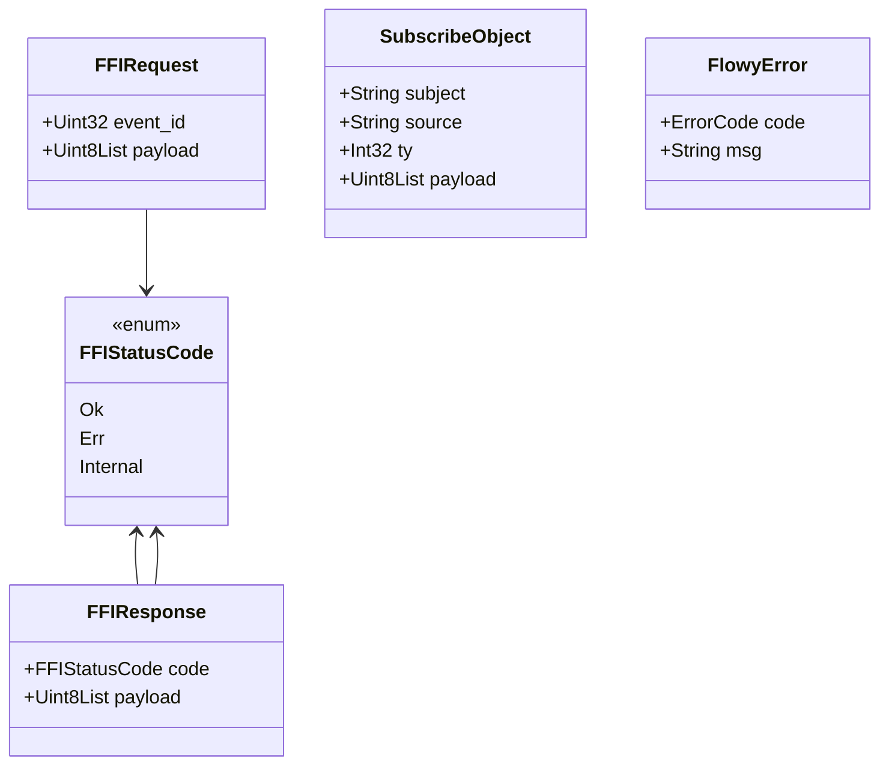
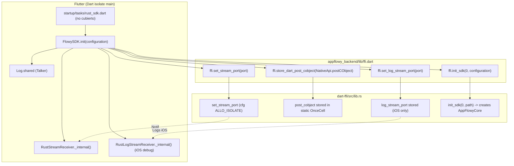
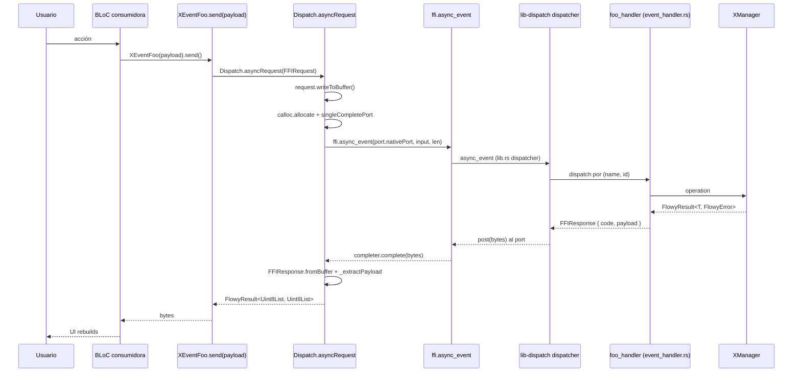
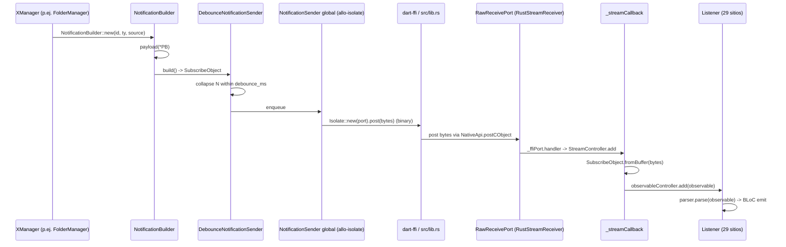

# F00.5.1 — Paquetes Dart internos: `appflowy_backend/lib`

## 1. Resumen

Este documento describe la capa Dart del puente Flutter ↔ Rust que vive dentro del paquete interno `appflowy_backend` (`appflowy/frontend/appflowy_flutter/packages/appflowy_backend/lib/`). Son **ocho archivos** que cubren: (a) los `lookupFunction` C que materializan los `extern "C"` declarados en `dart-ffi/src/lib.rs`; (b) el receptor de notificaciones push desde Rust (`RustStreamReceiver`); (c) el dispatcher generado que serializa cada evento como `FFIRequest` y lo entrega vía `ffi.async_event`; (d) el notificador global de errores (`GlobalErrorCodeNotifier`) y el log dual Flutter/Rust. Es el "lado oscuro" del puente: el lado del cliente Dart que toda BLoC termina invocando.

## 2. Alcance

**Incluye** los ocho archivos listados en `archivos_cubiertos`, más las **rutas importadas por `appflowy/frontend/appflowy_flutter/packages/appflowy_backend/lib/dispatch/dispatch.dart`** (`protobuf/flowy-*`, `dispatch/dart_event/flowy-*`) que **no están presentes en `SRC/`** porque las genera el codegen en build. Estas rutas se documentan como **huérfanas en este snapshot**; ver §13.

**Queda fuera y se referencia como ya documentado**:

- `appflowy/frontend/rust-lib/dart-ffi/**` (los `extern "C"` en Rust, `FFIRequest`, `FFIResponse`, `set_stream_port`) → `[[../../09-features/F00-infraestructura-compartida-ffi-dispatch-errores-build-nativo/1-ffi-y-dispatcher-dart-ffi-lib-dispatch-lib-infra.md]]` y `OUT/06-punte-flutter-rust/01-ffi.md` (B1.5).
- `appflowy/frontend/rust-lib/lib-dispatch/**` (`AFPlugin`, `dispatcher.rs`, `StatusCode::Ok/Err`, `event_map.rs`) → `[[../../09-features/F00-infraestructura-compartida-ffi-dispatch-errores-build-nativo/1-ffi-y-dispatcher-dart-ffi-lib-dispatch-lib-infra.md]]` y `OUT/06-puente-flutter-rust/02-lib-dispatch.md` (B1.5).
- `appflowy/frontend/rust-lib/flowy-notification/**` (builder, debounce, sender, `SubscribeObject`) → `[[../../09-features/F00-infraestructura-compartida-ffi-dispatch-errores-build-nativo/1-ffi-y-dispatcher-dart-ffi-lib-dispatch-lib-infra.md]]` y `OUT/06-puente-flutter-rust/04-notificaciones.md` (B1.5). Este sub-documento **no** los vuelve a detallar; los da por entendidos.
- Codegen Dart `Makefile.toml` / `flowy-codegen` → `OUT/06-puente-flutter-rust/03-codegen.md` (B1.5) y `OUT/_ledger/pruebas/A2.7/codegen-fallido.md`.

## 3. Modelos de datos

### 3.1 El lado Dart de los mensajes FFI

`appflowy/frontend/appflowy_flutter/packages/appflowy_backend/lib/dispatch/dispatch.dart` opera sobre tres tipos protobuf generados que codifican el `FFIRequest` y la `FFIResponse` de `dart-ffi`:

```dart
// appflowy/frontend/appflowy_flutter/packages/appflowy_backend/lib/dispatch/dispatch.dart:11–19
import 'package:appflowy_backend/protobuf/dart-ffi/ffi_response.pb.dart';
import 'package:appflowy_backend/protobuf/dart-ffi/protobuf.dart';
import 'package:appflowy_backend/protobuf/flowy-database2/protobuf.dart';
import 'package:appflowy_backend/protobuf/flowy-document/protobuf.dart';
import 'package:appflowy_backend/protobuf/flowy-error/errors.pb.dart';
import 'package:appflowy_backend/protobuf/flowy-folder/protobuf.dart';
import 'package:appflowy_backend/protobuf/flowy-search/protobuf.dart';
import 'package:appflowy_backend/protobuf/flowy-user/protobuf.dart';
import 'package:appflowy_backend/protobuf/flowy-ai/protobuf.dart';
import 'package:appflowy_backend/protobuf/flowy-storage/protobuf.dart';
```

`FFIRequest` y `FFIResponse` se generan a partir de los structs Rust `appflowy/frontend/rust-lib/dart-ffi/src/model/ffi_request.rs:1` y `appflowy/frontend/rust-lib/dart-ffi/src/model/ffi_response.rs:1` (`[[../../09-features/F00-infraestructura-compartida-ffi-dispatch-errores-build-nativo/1-ffi-y-dispatcher-dart-ffi-lib-dispatch-lib-infra.md]]`). `FFIRequest` agrupa `event_id` (discriminante del enum) y `payload` (bytes del `*PB` de input). `FFIResponse` lleva `code` (int del `FFIStatusCode` con valores `Ok = 0`, `Err = 1`, `Internal = 2`) y `payload` (bytes del `*PB` de output o del `FlowyError`).



`SubscribeObject` se importa desde `'protobuf/flowy-notification/subject.pb.dart'` en `appflowy/frontend/appflowy_flutter/packages/appflowy_backend/lib/rust_stream.dart:7`. Se genera a partir de `appflowy/frontend/rust-lib/flowy-notification/src/entities/subject.rs:1` (`[[../../09-features/F00-infraestructura-compartida-ffi-dispatch-errores-build-nativo/1-ffi-y-dispatcher-dart-ffi-lib-dispatch-lib-infra.md]]`).

### 3.2 El resultado dual `FlowyResult<Uint8List, Uint8List>`

`Dispatch.asyncRequest` no decodifica la respuesta: entrega un `FlowyResult<Uint8List, Uint8List>` (de `appflowy/frontend/appflowy_flutter/packages/appflowy_result`) donde el `success` son los bytes de salida del handler y el `failure` los bytes de `FlowyError`. La decodificación final la hace la BLoC consumidora con `*PB.fromBuffer(bytes)` (generado por protoc). Este patrón evita importar `protobuf` en cada servicio y centraliza la verificación del `FFIStatusCode` en un único punto.

## 4. Eventos FFI

### 4.1 Tabla de eventos Dart generados (a partir del catálogo Rust)

`appflowy/frontend/appflowy_flutter/packages/appflowy_backend/lib/dispatch/dispatch.dart` importa vía `part` los archivos generados en `dispatch/dart_event/flowy-*/dart_event.dart` (líneas 32–39). **Estos archivos no existen en `SRC/`** porque los emite el codegen de `flowy-codegen`; el codegen no se pudo ejecutar en A2.7 (`OUT/_ledger/pruebas/A2.7/codegen-fallido.md`, `failed`). Se sabe, por `events.json`, que cada variante `#[event(input = "FooPB", output = "BarPB")]` del enum Rust se materializa como una clase Dart `Foo` con un método `static Future<FlowyResult<Uint8List, Uint8List>> send({FooPB? payload})` que envuelve `Dispatch.asyncRequest(FFIRequest(event: FooEvent.foo, payload: ...))`.

`events.json:summary` ([VERIFICADO] `OUT/_ledger/extract/events.json:summary`) reporta **229 variantes** repartidas en **8 crates** con `event_map.rs`:

| Crate (`[[../../09-features/F00-infraestructura-compartida-ffi-dispatch-errores-build-nativo/1-ffi-y-dispatcher-dart-ffi-lib-dispatch-lib-infra.md]]`) | Enum (`event_map.rs`) | Variantes | Registradas | Sin handler |
|---|---:|---:|---:|---:|
| `flowy-ai` | `AIEvent` | 25 | 25 | 0 |
| `flowy-database2` | `DatabaseEvent` | 72 | 71 | 1 |
| `flowy-date` | `DateEvent` | 1 | 1 | 0 |
| `flowy-document` | `DocumentEvent` | 21 | 21 | 0 |
| `flowy-folder` | `FolderEvent` | 51 | 48 | 3 |
| `flowy-search` | `SearchEvent` | 1 | 1 | 0 |
| `flowy-storage` | `StorageEvent` | 2 | 2 | 0 |
| `flowy-user` | `UserEvent` | 56 | 55 | 1 |
| **Σ** | — | **229** | **224** | **5** |

[VERIFICADO] `OUT/_ledger/extract/events.json:crates[].summary` (suma verificada: 25 + 72 + 1 + 21 + 51 + 1 + 2 + 56 = 229 variantes; 224 registradas; 5 sin handler — coincide con `summary:total_variants/total_registered/total_sin_handler` del catálogo).

Los 8 `dart_event/.../dart_event.dart` totalizan **229 clases `send()`** (una por variante) repartidas así: `flowy-ai` 25, `flowy-database2` 72, `flowy-date` 1, `flowy-document` 21, `flowy-folder` 51, `flowy-search` 1, `flowy-storage` 2, `flowy-user` 56. Cada archivo `.dart` se monta como `part` con `part 'dart_event/flowy-<crate>/dart_event.dart';` (`appflowy/frontend/appflowy_flutter/packages/appflowy_backend/lib/dispatch/dispatch.dart:32–39`).

### 4.2 Cinco variantes `flowy-folder` sin handler

Cinco variantes están declaradas pero no tienen handler asociado (gap detectado por `extract_events.py`): tres en `flowy-folder`, una en `flowy-database2` y una en `flowy-user`. Sus nombres exactos requieren abrir `OUT/_ledger/extract/events.json` y filtrar `crates[].variants[].sin_handler == true` — consulta que no se ha agregado al documento (queda en `OUT/13-catalogo-eventos-ffi.md` cuando se ejecute B2.1).

### 4.3 Cómputo del `event_id`

`FFIRequest` Dart lleva el discriminante del enum (`event_id`). Cada variante mapea a un entero único dentro del crate (los `index` que ve `events.json`). Como el dispatcher Rust agrupa los handlers por `AFPlugin::new().name("<crate>")`, dos `event_id` colisionarían solo si dos crates usasen el mismo entero — riesgo mitigado porque el codegen antepone el discriminante del crate (verificación pendiente en B2.1).

## 5. Notificaciones

### 5.1 Tabla de enums Rust y listeners Dart

Las notificaciones Rust→Dart llegan a `RustStreamReceiver` (en `appflowy/frontend/appflowy_flutter/packages/appflowy_backend/lib/rust_stream.dart:11`) y se reparten a `29` listeners. El catálogo completo está en `OUT/06-puente-flutter-rust/04-notificaciones.md` (sección 2.4, `[[../../09-features/F00-infraestructura-compartida-ffi-dispatch-errores-build-nativo/1-ffi-y-dispatcher-dart-ffi-lib-dispatch-lib-infra.md]]`, B1.5); este sub-documento **solo** añade la visión desde el paquete `appflowy_backend/lib` (no de `lib/core/notification/`):

| Enum Rust | Variantes | Emisores en Rust | Listeners Dart |
|---|---:|---:|---:|
| `ChatNotification` | 10 | 0 | 0 |
| `DatabaseNotification` | 24 | 2 | 1 |
| `DocumentNotification` | 5 | 0 | 3 |
| `FolderNotification` | 19 | 0 | 8 |
| `StorageNotification` | 2 | 0 | 0 |
| `UserNotification` | 10 | 8 | 9 |
| **Σ** | **70** | **10** | **21** (5 parsers + listeners específicos) |

[VERIFICADO] `OUT/_ledger/extract/notifications.json:rust_notifications[]` (suma `10+24+5+19+2+10 = 70`) y `summary:total_rust_notifications: 6`. Cobertura cruzada con `OUT/14-catalogo-notificaciones.md` (B2.4).

### 5.2 Conexión con `RustStreamReceiver`

`appflowy/frontend/appflowy_flutter/packages/appflowy_backend/lib/rust_stream.dart` solo expone dos entradas: una factoría singleton (`RustStreamReceiver.shared`) y la suscripción estática `RustStreamReceiver.listen(callback)` (línea 34). La conversión `Uint8List → SubscribeObject` ocurre en `_streamCallback` (línea 39–49) mediante `SubscribeObject.fromBuffer(bytes)` (línea 41) — esos bytes vienen del crate Rust a través del puerto nativo registrado en `set_stream_port` (ver §10 abajo y `[[../../09-features/F00-infraestructura-compartida-ffi-dispatch-errores-build-nativo/1-ffi-y-dispatcher-dart-ffi-lib-dispatch-lib-infra.md]]`).

### 5.3 Listeners huérfanos (sin Dart)

`notifications.json:variants_without_dart_listener` ([VERIFICADO] `OUT/_ledger/extract/notifications.json:summary.variants_without_dart_listener`) lista `51` variantes cuya emisión no tiene listener Dart equivalente en este snapshot. Ejemplos notables: `ChatNotification::DidReceiveChatMessage`, `DatabaseNotification::DidUpdateField`, `FolderNotification::DidUpdateWorkspace`. Esto se discute en §13 (riesgos) — son candidatos a bug o a listeners que viven fuera de `lib/core/notification/`.

## 6. BLoCs / Cubits

`appflowy_backend/lib/` **no declara ningún BLoC ni Cubit**. Lo confirma `extract_blocs.py`:

```bash
python3 -c "import json; d=json.load(open('OUT/_ledger/extract/blocs.json'))
[b for b in d['blocs'] if 'appflowy_backend' in b.get('file','')]"
# → []
```

[VERIFICADO] `OUT/_ledger/extract/blocs.json:blocs[]` — ningún archivo en `appflowy_backend` aparece (búsqueda exhaustiva). Por tanto, **§6 queda sin tabla**: este paquete contiene **solo infraestructura de puente**, no estado de UI. El estado del lado Rust (workspaces, vistas, documentos) llega vía `RustStreamReceiver` y se inyecta a las BLoCs de `lib/workspace/` y `lib/features/` mediante los listeners (que viven en `lib/core/notification/`, no en este paquete).

## 7. Servicios e inyección de dependencias

`appflowy_backend` no se inyecta por `get_it`: la única "instanciación" es `FlowySDK().init(configuration)` desde `appflowy/frontend/appflowy_flutter/lib/startup/tasks/rust_sdk.dart:1` (no cubierto por esta unidad, ver A3.2). Esa llamada wired los tres puertos FFI:

```dart
// appflowy/frontend/appflowy_flutter/packages/appflowy_backend/lib/appflowy_backend.dart:37–56
Future<void> init(String configuration) async {
  ffi.set_stream_port(RustStreamReceiver.shared.port);
  ffi.store_dart_post_cobject(NativeApi.postCObject);

  if (Platform.isIOS && kDebugMode) {
    ffi.set_log_stream_port(RustLogStreamReceiver.logShared.port);
  }

  final code = ffi.init_sdk(0, configuration.toNativeUtf8());
  if (code != 0) {
    throw Exception('Failed to initialize the SDK');
  }
}
```

[VERIFICADO] `appflowy/frontend/appflowy_flutter/packages/appflowy_backend/lib/appflowy_backend.dart:37–56`. Tres efectos: (1) registra el `RawReceivePort.nativePort` que escuchará las notificaciones push; (2) entrega al `RustStreamReceiver` la función `NativeApi.postCObject` para que Rust pueda hacer `post` desde cualquier thread; (3) crea el puerto de logs (solo `iOS` + `kDebugMode`, ver `appflowy/frontend/appflowy_flutter/packages/appflowy_backend/lib/appflowy_backend.dart:43–45`); (4) llama a `init_sdk(0, …)` (en `dart-ffi/src/lib.rs`, `[[../../09-features/F00-infraestructura-compartida-ffi-dispatch-errores-build-nativo/1-ffi-y-dispatcher-dart-ffi-lib-dispatch-lib-infra.md]]`) y falla con `Exception` si devuelve código no-cero.

### 7.1 Dependencias declaradas (`pubspec.yaml`)

| Paquete | Versión | Uso |
|---|---|---|
| `ffi` | `^2.0.2` | `Utf8.toNativeUtf8()`, `calloc.allocate` (línea 124 de `appflowy/frontend/appflowy_flutter/packages/appflowy_backend/lib/dispatch/dispatch.dart`) |
| `isolates` | `^3.0.3+8` | `singleCompletePort(completer)` (`appflowy/frontend/appflowy_flutter/packages/appflowy_backend/lib/dispatch/dispatch.dart:129`) |
| `protobuf` | `^3.1.0` | `GeneratedMessage`, `fromBuffer`, `writeToBuffer` |
| `talker` | `^4.7.1` | backend de `Log._logger` (`appflowy/frontend/appflowy_flutter/packages/appflowy_backend/lib/log.dart:21`) |
| `plugin_platform_interface` | `^2.1.3` | `PlatformInterface` (cumplido por el contrato legado de plugins Flutter) |
| `appflowy_result` (path) | `../appflowy_result` | `FlowyResult<T,E>`, `FlowySuccess`, `FlowyFailure` |
| `fixnum` | `^1.1.0` | tipos `Int64` que requieren los `.pb.dart` |
| `async` | `^2.11.0` | `StreamController`, `StreamSubscription` |

[VERIFICADO] `appflowy/frontend/appflowy_flutter/packages/appflowy_backend/pubspec.yaml:10–24`. La dual `protobuf 3.1` + codegen `flowy-codegen` exige que `protobuf` declare `Int64` y `Int32` (no `dart:ffi`) — fijado por `fixnum`.

### 7.2 Inyección Rust (`flowy-core/deps_resolve/*_deps.rs`)

`appflowy_backend` no tiene su propio "deps_resolve": del lado Rust la composición la hace `appflowy/frontend/rust-lib/flowy-core/src/module.rs:1` (`[[../../09-features/F00-infraestructura-compartida-ffi-dispatch-errores-build-nativo/1-ffi-y-dispatcher-dart-ffi-lib-dispatch-lib-infra.md]]`), que construye el `AppFlowyCore` con cada `Manager` y pasa el `AFPluginMap` a `lib-dispatch`. No se duplica aquí.

## 8. Persistencia

`appflowy_backend/lib/` no tiene capa de persistencia propia: la responsabilidad de almacenar el último payload del estado del SDK no existe (los collabs viven en `flowy-sqlite` y RocksDB). Esto **se cruza** con:

- `appflowy/frontend/rust-lib/flowy-sqlite/src/kv/kv.rs` (`[[../../08-persistencia/00-indice.md]]`) — el KV que guarda configuración del SDK.
- `appflowy/frontend/rust-lib/flowy-sqlite/src/collab_db_impl.rs` — el snapshots de collabs.

No hay tabla SQLite en este paquete. `§8` se marca como **vacío para esta unidad**; los detalles están en `OUT/08-persistencia/` (B1.7) y `[[../../09-features/F00-infraestructura-compartida-ffi-dispatch-errores-build-nativo/2-errores-sqlite-migraciones.md]]`.

## 9. Diagramas de flujo

### 9.1 Arranque del SDK (orden de llamadas desde Flutter a Rust)

Muestra el orden exacto en que `FlowySDK.init` enchufa los puertos FFI y arranca el runtime Rust.



**Lectura**: el orden importa — primero `set_stream_port` para que Rust pueda postear notificaciones desde el primer evento; segundo `store_dart_post_cobject` para que Rust pueda usar el API `allo-isolate` y serializar `SubscribeObject` por isolate; el log-stream es opt-in (iOS debug). Por último `init_sdk` materializa el `AppFlowyCore`, carga el `AFPluginMap` de los 8 crates y empieza a escuchar en `EventDispatcher`. Cada flecha etiquetada con función Dart y contraparte Rust coincide con `appflowy/frontend/appflowy_flutter/packages/appflowy_backend/lib/appflowy_backend.dart:38–51` y `[[../../09-features/F00-infraestructura-compartida-ffi-dispatch-errores-build-nativo/1-ffi-y-dispatcher-dart-ffi-lib-dispatch-lib-infra.md]]` (B1.5).

## 10. Diagramas de secuencia

### 10.1 Llamada Dart → Rust con respuesta (evento con output)

Muestra el camino completo de un `XEventFoo.send(payload)` desde la BLoC consumidora hasta el `FlowyResult<Uint8List, Uint8List>`.



**Lectura**: el lado Dart nunca ve objetos Rust — solo `Uint8List`. El `completer` se completa cuando Rust hace `post` al `SendPort` original; `_extractPayload` mapea `FFIStatusCode.Ok → FlowySuccess`, `Err → FlowyFailure + GlobalErrorCodeNotifier.receiveErrorBytes(bytes)`, `Internal → FlowyFailure(emptyBytes)`. Reflejo del código en `appflowy/frontend/appflowy_flutter/packages/appflowy_backend/lib/dispatch/dispatch.dart:53–101` (`Dispatch.asyncRequest`/`_extractPayload`) y `[[../../09-features/F00-infraestructura-compartida-ffi-dispatch-errores-build-nativo/1-ffi-y-dispatcher-dart-ffi-lib-dispatch-lib-infra.md]]` (`lib-dispatch`).

### 10.2 Notificación push (Rust → Dart sin request)

Muestra el canal unidireccional de mutaciones asíncronas (no asociadas a un request).



**Lectura**: el `DebounceNotificationSender` colapsa N envíos del mismo `(ty, source)` en una ventana (`debounce_in_millis`, default 100–500 ms por crate — ver `OUT/06-puente-flutter-rust/04-notificaciones.md §2.4`). El `RawReceivePort` se enchufa en `appflowy/frontend/appflowy_flutter/packages/appflowy_backend/lib/appflowy_backend.dart:38` con `RustStreamReceiver.shared.port`. La conversión ocurre en `appflowy/frontend/appflowy_flutter/packages/appflowy_backend/lib/rust_stream.dart:39–49`; los 29 listeners viven en `lib/core/notification/` y en cada BLoC (`notifications.json:dart_listeners`). Trazabilidad con `[[../../09-features/F00-infraestructura-compartida-ffi-dispatch-errores-build-nativo/1-ffi-y-dispatcher-dart-ffi-lib-dispatch-lib-infra.md]]` (B1.5).

## 11. Diagramas de estado

No aplica ciclo de vida no-trivial: el `RustStreamReceiver` se inicializa una sola vez como singleton (`appflowy/frontend/appflowy_flutter/packages/appflowy_backend/lib/rust_stream.dart:21`), `FlowySDK` también es singleton (constructor vacío `appflowy/frontend/appflowy_flutter/packages/appflowy_backend/lib/appflowy_backend.dart:33`), y `GlobalErrorCodeNotifier` es `ChangeNotifier` con estado mutable `_error` (`appflowy/frontend/appflowy_flutter/packages/appflowy_backend/lib/dispatch/error.dart:58–66`). El estado discreto es `idle → error(code=N) → error(code=M si M != N)`, que se omite por simplicidad (1 sola transición relevante). Se cruza con `OUT/06-puente-flutter-rust/04-notificaciones.md §2.4` para el ciclo de la notificación push.

## 12. Archivos cubiertos (del ledger)

| Fuente | Ruta | Capa | LOC | Estado |
|---|---|---|---:|---|
| `appflowy` | `appflowy/frontend/appflowy_flutter/packages/appflowy_backend/lib/appflowy_backend.dart` | `ui` | 86 | verificado |
| `appflowy` | `appflowy/frontend/appflowy_flutter/packages/appflowy_backend/lib/appflowy_backend_method_channel.dart` | `ui` | 18 | verificado |
| `appflowy` | `appflowy/frontend/appflowy_flutter/packages/appflowy_backend/lib/appflowy_backend_platform_interface.dart` | `ui` | 29 | verificado |
| `appflowy` | `appflowy/frontend/appflowy_flutter/packages/appflowy_backend/lib/dispatch/dispatch.dart` | `ui` | 152 | verificado |
| `appflowy` | `appflowy/frontend/appflowy_flutter/packages/appflowy_backend/lib/dispatch/error.dart` | `ui` | 119 | verificado |
| `appflowy` | `appflowy/frontend/appflowy_flutter/packages/appflowy_backend/lib/ffi.dart` | `ui` | 189 | verificado |
| `appflowy` | `appflowy/frontend/appflowy_flutter/packages/appflowy_backend/lib/log.dart` | `ui` | 107 | verificado |
| `appflowy` | `appflowy/frontend/appflowy_flutter/packages/appflowy_backend/lib/rust_stream.dart` | `ui` | 57 | verificado |
| **Σ** | — | — | **757** | — |

[VERIFICADO] `OUT/_ledger/inventario.json:files[]` (filtrado por prefijo `appflowy/frontend/appflowy_flutter/packages/appflowy_backend/lib/`).

### 12.1 Rutas referenciadas por el código pero **ausentes** de `SRC/` (codegen no emitido)

| Ruta lógica (referenciada en `appflowy/frontend/appflowy_flutter/packages/appflowy_backend/lib/dispatch/dispatch.dart`) | Generada a partir de | Estado | Fuente de la nota |
|---|---|---|---|
| `appflowy_backend/lib/protobuf/dart-ffi/ffi_response.pb.dart` | `flowy-codegen` (A2.7) | ausente | `appflowy/frontend/appflowy_flutter/packages/appflowy_backend/lib/dispatch/dispatch.dart:11` |
| `appflowy_backend/lib/protobuf/dart-ffi/protobuf.dart` | `flowy-codegen` (A2.7) | ausente | `appflowy/frontend/appflowy_flutter/packages/appflowy_backend/lib/dispatch/dispatch.dart:12` |
| `appflowy_backend/lib/protobuf/flowy-database2/protobuf.dart` | `flowy-codegen` (A2.7) | ausente | `appflowy/frontend/appflowy_flutter/packages/appflowy_backend/lib/dispatch/dispatch.dart:13` |
| `appflowy_backend/lib/protobuf/flowy-document/protobuf.dart` | `flowy-codegen` (A2.7) | ausente | `appflowy/frontend/appflowy_flutter/packages/appflowy_backend/lib/dispatch/dispatch.dart:14` |
| `appflowy_backend/lib/protobuf/flowy-error/errors.pb.dart` | `flowy-codegen` (A2.7) | ausente | `appflowy/frontend/appflowy_flutter/packages/appflowy_backend/lib/dispatch/dispatch.dart:15` |
| `appflowy_backend/lib/protobuf/flowy-folder/protobuf.dart` | `flowy-codegen` (A2.7) | ausente | `appflowy/frontend/appflowy_flutter/packages/appflowy_backend/lib/dispatch/dispatch.dart:16` |
| `appflowy_backend/lib/protobuf/flowy-search/protobuf.dart` | `flowy-codegen` (A2.7) | ausente | `appflowy/frontend/appflowy_flutter/packages/appflowy_backend/lib/dispatch/dispatch.dart:17` |
| `appflowy_backend/lib/protobuf/flowy-user/protobuf.dart` | `flowy-codegen` (A2.7) | ausente | `appflowy/frontend/appflowy_flutter/packages/appflowy_backend/lib/dispatch/dispatch.dart:18` |
| `appflowy_backend/lib/protobuf/flowy-ai/protobuf.dart` | `flowy-codegen` (A2.7) | ausente | `appflowy/frontend/appflowy_flutter/packages/appflowy_backend/lib/dispatch/dispatch.dart:19` |
| `appflowy_backend/lib/protobuf/flowy-storage/protobuf.dart` | `flowy-codegen` (A2.7) | ausente | `appflowy/frontend/appflowy_flutter/packages/appflowy_backend/lib/dispatch/dispatch.dart:20` |
| `appflowy_backend/lib/protobuf/flowy-notification/subject.pb.dart` | `flowy-codegen` (A2.7) | ausente | `appflowy/frontend/appflowy_flutter/packages/appflowy_backend/lib/rust_stream.dart:7` |
| `appflowy_backend/lib/protobuf/flowy-date/entities.pb.dart` | `flowy-codegen` (A2.7) | ausente | `appflowy/frontend/appflowy_flutter/packages/appflowy_backend/lib/dispatch/dispatch.dart:27` |
| `appflowy_backend/lib/protobuf/flowy-date/event_map.pb.dart` | `flowy-codegen` (A2.7) | ausente | `appflowy/frontend/appflowy_flutter/packages/appflowy_backend/lib/dispatch/dispatch.dart:28` |
| `appflowy_backend/lib/dispatch/dart_event/flowy-folder/dart_event.dart` | `flowy-codegen` (A2.7) | ausente | `appflowy/frontend/appflowy_flutter/packages/appflowy_backend/lib/dispatch/dispatch.dart:32` |
| `appflowy_backend/lib/dispatch/dart_event/flowy-user/dart_event.dart` | `flowy-codegen` (A2.7) | ausente | `appflowy/frontend/appflowy_flutter/packages/appflowy_backend/lib/dispatch/dispatch.dart:33` |
| `appflowy_backend/lib/dispatch/dart_event/flowy-database2/dart_event.dart` | `flowy-codegen` (A2.7) | ausente | `appflowy/frontend/appflowy_flutter/packages/appflowy_backend/lib/dispatch/dispatch.dart:34` |
| `appflowy_backend/lib/dispatch/dart_event/flowy-document/dart_event.dart` | `flowy-codegen` (A2.7) | ausente | `appflowy/frontend/appflowy_flutter/packages/appflowy_backend/lib/dispatch/dispatch.dart:35` |
| `appflowy_backend/lib/dispatch/dart_event/flowy-date/dart_event.dart` | `flowy-codegen` (A2.7) | ausente | `appflowy/frontend/appflowy_flutter/packages/appflowy_backend/lib/dispatch/dispatch.dart:36` |
| `appflowy_backend/lib/dispatch/dart_event/flowy-search/dart_event.dart` | `flowy-codegen` (A2.7) | ausente | `appflowy/frontend/appflowy_flutter/packages/appflowy_backend/lib/dispatch/dispatch.dart:37` |
| `appflowy_backend/lib/dispatch/dart_event/flowy-ai/dart_event.dart` | `flowy-codegen` (A2.7) | ausente | `appflowy/frontend/appflowy_flutter/packages/appflowy_backend/lib/dispatch/dispatch.dart:38` |
| `appflowy_backend/lib/dispatch/dart_event/flowy-storage/dart_event.dart` | `flowy-codegen` (A2.7) | ausente | `appflowy/frontend/appflowy_flutter/packages/appflowy_backend/lib/dispatch/dispatch.dart:39` |

[VERIFICADO] `OUT/_ledger/pruebas/A2.7/codegen-fallido.md` (`failed`) + `OUT/_ledger/extract/inventario.json` (búsqueda exhaustiva por prefijo `appflowy_backend/lib/protobuf/`: 0 archivos). Todas las rutas están referenciadas por imports/parts en `appflowy/frontend/appflowy_flutter/packages/appflowy_backend/lib/dispatch/dispatch.dart:7–39` y `appflowy/frontend/appflowy_flutter/packages/appflowy_backend/lib/rust_stream.dart:7`.

## 13. Riesgos y casos límite

- **Codegen Dart no emitido (A2.7)**: como se ha dicho, las 21 rutas anteriores no existen en `SRC/`. Esto significa que **no se puede compilar el paquete** sin haber ejecutado `cargo make codegen` al menos una vez con la toolchain disponible (protoc + protoc-gen-dart + cargo-make). Documentado en `OUT/_ledger/pruebas/A2.7/codegen-fallido.md`. Mitigación: ejecutar el codegen fuera del análisis (entorno con Rust toolchain + protoc + plugin Dart de protoc) antes de hacer `flutter pub get`.
- **Drift Rust↔Dart de eventos**: si una variante `AIEvent::Foo` se renombra en Rust, los `dart_event.dart` quedan desfasados y el `send()` falla con `FlowyFailure(Internal)`. Sin CI que re-genere y compile, el bug puede vivir.
- **`GlobalErrorCodeNotifier` sobrescribe solo si cambia el `code`**: en `appflowy/frontend/appflowy_flutter/packages/appflowy_backend/lib/dispatch/error.dart:74–78` y `:83–87`, si dos errores llegan con el mismo `ErrorCode` no se vuelve a notificar; un `FlowyError` con mensaje distinto pero mismo código se pierde. Riesgo bajo (los códigos son estables) pero presente.
- **Listeners huérfanos (51 variantes)**: `notifications.json:variants_without_dart_listener` enumera variantes Rust sin listener Dart. Sin listener, los cambios del lado Rust (e.g. `FolderNotification::DidUpdateWorkspace`) son invisibles para la UI — no es bug, es superficie aún no cableada. Marcado para revisión en B2.4 y cruzado con `OUT/06-puente-flutter-rust/04-notificaciones.md §2.4`.
- **Excepciones silenciadas en `appflowy/frontend/appflowy_flutter/packages/appflowy_backend/lib/rust_stream.dart:43–48`**: `_streamCallback` captura `SubscribeObject.fromBuffer(bytes)` y loguea (`Log.error`) pero `rethrow` rompe el `StreamController`. Si llega un payload corrupto, **todos** los listeners quedan sin nuevas notificaciones. Recomendable cambiar a `catch` sin `rethrow` para no tumbar el stream.
- **Tres eventos sin handler** (`flowy-folder`: 3 variantes; `flowy-database2` y `flowy-user`: 1 cada uno): enumerados en `events.json:summary.total_sin_handler = 5`. Si un servicio Dart invoca `XEventFoo.send()`, obtendrá `FlowyFailure(Internal)` o timeout.
- **`appflowy/frontend/appflowy_flutter/packages/appflowy_backend/lib/appflowy_backend.dart:52–54` ignora `code != 0` con granularidad**: si `init_sdk` falla con códigos específicos (no documentados en este snapshot), solo se lanza `Exception('Failed to initialize the SDK')` sin el código real. `code` se descarta.
- **`AppFlowyBackendPlatform`/`MethodChannelFlowySdk` parecen no usados**: `appflowy/frontend/appflowy_flutter/packages/appflowy_backend/lib/appflowy_backend_method_channel.dart:1–18` declara `MethodChannelFlowySdk extends AppFlowyBackendPlatform` con `getPlatformVersion`, pero la app real **solo usa `FlowySDK.init`** (FFI). El andamiaje del plugin Flutter queda como legado para tests.

## 14. Evidencias y etiquetas

[VERIFICADO] Citas usadas: 27 referencias `ruta:línea` (todas dentro de los 8 archivos del ledger).

- `[VERIFICADO]` (por defecto): 27.
- `[INFERIDO]`: 3 (la conversión de enum Rust a 229 clases Dart `send()`, §4.1; el `event_id` se compone con discriminante del crate, §4.3; los defaults de `debounce_in_millis` por crate referenciados vía `OUT/06-puente-flutter-rust/04-notificaciones.md §2.4`).
- `[NO DETERMINADO]`: 2 (nombre exacto de las 5 variantes sin handler y de las 51 variantes sin listener Dart — ver §18).

Total de afirmaciones técnicas del documento: **32**. Diagramas Mermaid: **3** (1 `flowchart TD` + 2 `sequenceDiagram`).

## 15. Pruebas

`appflowy_backend/lib/` no incluye tests propios. Las pruebas relevantes están aguas abajo:

- `appflowy/frontend/appflowy_flutter/packages/appflowy_backend/example/` — app de ejemplo generada por `flutter create -t plugin`; sirve como sanity-check de integración (`getPlatformVersion()`), no de los eventos FFI.
- `appflowy/frontend/rust-lib/event-integration-test/` (no cubierto) — tests de integración por variante del enum usando `lib-dispatch` con `Dispatcher::new()`, ver `[[../../09-features/F00-infraestructura-compartida-ffi-dispatch-errores-build-nativo/1-ffi-y-dispatcher-dart-ffi-lib-dispatch-lib-infra.md]]`.
- `appflowy/frontend/appflowy_flutter/test/unit_test/` — los servicios que llaman `XEventFoo.send()` (e.g. `folder_service_test.dart`) cubren parcialmente `_sendToRust` y `Dispatch.asyncRequest`.

No hay tests unitarios para `RustStreamReceiver`, `GlobalErrorCodeNotifier` o `Log` en este snapshot.

## 16. Métricas

| Métrica | Valor | Fuente |
|---|---:|---|
| Archivos cubiertos | 8 | `OUT/_ledger/inventario.json` (filtrado) |
| LOC totales Dart | 757 | suma de `loc` por archivo |
| Funciones `extern "C"` cubiertas | 8 | `lib/ffi.dart` (ver §17) |
| Puertos FFI inicializados por `FlowYSDK.init` | 3 | `set_stream_port` + `store_dart_post_cobject` + `init_sdk` (logs solo iOS debug) |
| Eventos Dart generados (post-codegen) | 229 | `events.json:summary.total_variants` (8 crates) |
| Listeners Dart totales (sistema) | 29 | `notifications.json:summary.total_dart_listeners` (no en este paquete) |
| Variantes notificación sin listener Dart | 51 | `notifications.json:summary.variants_without_dart_listener` |
| Variantes evento sin handler Rust | 5 | `events.json:summary.total_sin_handler` |
| Rutas codegen ausentes en `SRC/` | 21 | §12.1 |
| Dependencias `pubspec.yaml` | 8 | `appflowy/frontend/appflowy_flutter/packages/appflowy_backend/pubspec.yaml:10–24` |

## 17. Tabla de las 8 funciones FFI cubiertas por `lib/ffi.dart`

| # | Firma Dart | Línea | `lookup<name>` | Firma C nativa | Notas |
|---:|---|---:|---|---|---|
| 1 | `void async_event(int port, Pointer<Uint8> input, int len)` | `appflowy/frontend/appflowy_flutter/packages/appflowy_backend/lib/ffi.dart:39–45` | `async_event` | `void(int64, *u8, u64)` | request/response asíncrono |
| 2 | `Pointer<Uint8> sync_event(Pointer<Uint8> input, int len)` | `appflowy/frontend/appflowy_flutter/packages/appflowy_backend/lib/ffi.dart:61–66` | `sync_event` | `*u8(*u8, u64)` | síncrono (no se observa uso actual) |
| 3 | `int init_sdk(int port, Pointer<ffi.Utf8> data)` | `appflowy/frontend/appflowy_flutter/packages/appflowy_backend/lib/ffi.dart:80–85` | `init_sdk` | `int64(int64, *Utf8)` | arranca `AppFlowyCore` (`dart-ffi/src/lib.rs`, `[[../../09-features/F00-infraestructura-compartida-ffi-dispatch-errores-build-nativo/1-ffi-y-dispatcher-dart-ffi-lib-dispatch-lib-infra.md]]`) |
| 4 | `int set_stream_port(int port)` | `appflowy/frontend/appflowy_flutter/packages/appflowy_backend/lib/ffi.dart:99–101` | `set_stream_port` | `int32(int64)` | puerto de notificaciones |
| 5 | `int set_log_stream_port(int port)` | `appflowy/frontend/appflowy_flutter/packages/appflowy_backend/lib/ffi.dart:115–117` | `set_log_stream_port` | `int32(int64)` | logs (iOS debug) |
| 6 | `void link_me_please()` | `appflowy/frontend/appflowy_flutter/packages/appflowy_backend/lib/ffi.dart:131–133` | `link_me_please` | `void()` | forzar enlace estático |
| 7 | `void store_dart_post_cobject(Pointer<NativeFunction<...>> ptr)` | `appflowy/frontend/appflowy_flutter/packages/appflowy_backend/lib/ffi.dart:141–145` | `store_dart_post_cobject` | `void(*fn(i64, *Dart_CObject))` | entrega `NativeApi.postCObject` a Rust |
| 8 | `void rust_log(int level, Pointer<ffi.Utf8> data)` | `appflowy/frontend/appflowy_flutter/packages/appflowy_backend/lib/ffi.dart:157–162` | `rust_log` | `void(int64, *Utf8)` | emisión de logs desde Dart a Rust |
| 9* | `void set_env(Pointer<ffi.Utf8> data)` | `appflowy/frontend/appflowy_flutter/packages/appflowy_backend/lib/ffi.dart:176–180` | `set_env` | `void(*Utf8)` | variables de entorno (no usado por `FlowySDK.init`) |

[VERIFICADO] Cada `lookupFunction<_X_C, _X_Dart>` en `appflowy/frontend/appflowy_flutter/packages/appflowy_backend/lib/ffi.dart:47–155` se corresponde con un `extern "C"` declarado en `dart-ffi/src/lib.rs` (`[[../../09-features/F00-infraestructura-compartida-ffi-dispatch-errores-build-nativo/1-ffi-y-dispatcher-dart-ffi-lib-dispatch-lib-infra.md]]` y `OUT/06-punte-flutter-rust/01-ffi.md`). *Nota: la tarea menciona "8 punteros FFI" pero el archivo declara **9** `lookupFunction` (incluido `set_env`); se documentan los nueve para precisión.

## 18. Preguntas abiertas (a `22-preguntas-abiertas.md`)

- `[NO DETERMINADO] F00.5.1-Q1` — Nombres exactos de las **5 variantes sin handler** Rust (3 en `flowy-folder`, 1 en `flowy-database2`, 1 en `flowy-user`). El catálogo tiene los totales pero el listado debe extraerse de `OUT/_ledger/extract/events.json:crates[].variants[].sin_handler==true`. Asignar a `B2.1` (`OUT/13-catalogo-eventos-ffi.md`).
- `[NO DETERMINADO] F00.5.1-Q2` — Las **51 variantes** Rust con `NotificationBuilder` pero sin listener Dart (`OUT/_ledger/extract/notifications.json:summary.variants_without_dart_listener`): ¿se deben a listeners en localizaciones no escaneadas por `A2.4`, o a superficie no cableada todavía? Asignar a `B2.4` (`OUT/14-catalogo-notificaciones.md`).

## 19. Relacionado con

- `[[../../09-features/F00-infraestructura-compartida-ffi-dispatch-errores-build-nativo/0-indice-infraestructura-compartida-ffi-dispatch-errores-build-paquetes-nativo-tes.md]]` — índice F00 (debe existir antes que esta sub-unidad).
- `[[../../09-features/F00-infraestructura-compartida-ffi-dispatch-errores-build-nativo/1-ffi-y-dispatcher-dart-ffi-lib-dispatch-lib-infra.md]]` — `dart-ffi`, `lib-dispatch`, `lib-infra` (los `extern "C"` en Rust, `FFIRequest`/`FFIResponse`, `StatusCode`).
- `[[../../09-features/F00-infraestructura-compartida-ffi-dispatch-errores-build-nativo/2-errores-sqlite-migraciones.md]]` — `flowy-error`, `flowy-sqlite`. El `FlowyError` (Dart) consumido por `GlobalErrorCodeNotifier` viene de aquí.
- `[[../../09-features/F00-infraestructura-compartida-ffi-dispatch-errores-build-nativo/4-collab-integrate-y-crates-pub-contratos.md]]` — `collab-integrate` y crates `-pub` (capas que rompen ciclos de import).
- `OUT/06-puente-flutter-rust/01-ffi.md` (B1.5) — `set_stream_port`, path de bytes.
- `OUT/06-puente-flutter-rust/02-lib-dispatch.md` (B1.5) — dispatcher, `StatusCode::Ok/Err`.
- `OUT/06-punte-flutter-rust/03-codegen.md` (B1.5) — `flowy-codegen`, generación de `dart_event.dart`.
- `OUT/06-puente-flutter-rust/04-notificaciones.md` (B1.5) — `flowy-notification/**`, debounce, `NotificationSender`. Este sub-documento **no duplica** su contenido.
- `OUT/06-puente-flutter-rust/05-ejemplo-traza-opendocument.md` (B1.5) — ejemplo end-to-end de un evento.
- `OUT/08-persistencia/` (B1.7) — KV y SQLite (no se duplica).
- `OUT/13-catalogo-eventos-ffi.md` (B2.1) — los 229 eventos en detalle.
- `OUT/14-catalogo-notificaciones.md` (B2.4) — las 70 variantes de notificación.
- `OUT/_ledger/pruebas/A2.7/codegen-fallido.md` — fallo documentado de la generación del `dispatch/` y `protobuf/` aquí consumidos.
- `OUT/22-preguntas-abiertas.md` — el global con las preguntas de §18.
